# 🎨 المخططات المعمارية — Cyber Diaries (arc42)

## 1. System Context Diagram (C4 Level 1)

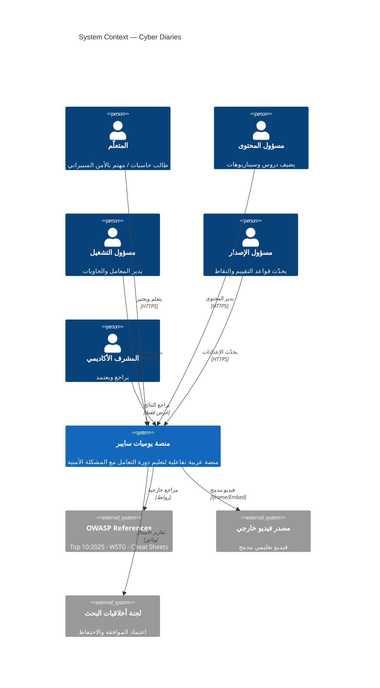

---

## 2. Container Diagram (C4 Level 2)

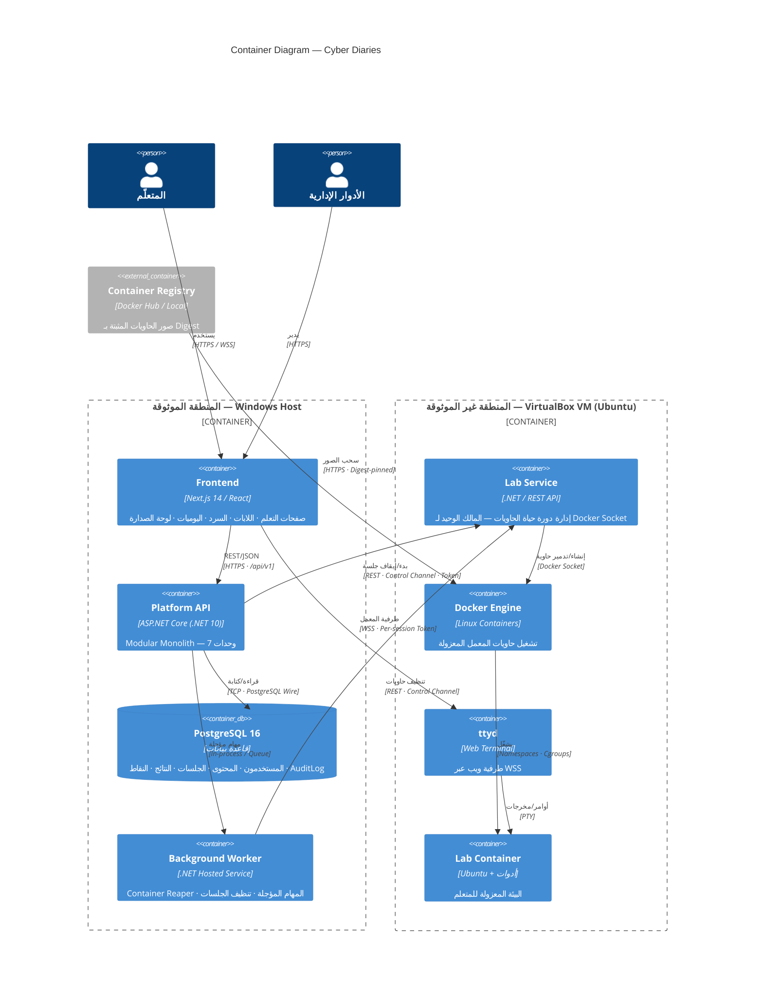

---

## 3. Component Diagram — الوحدات السبعة (C4 Level 3)

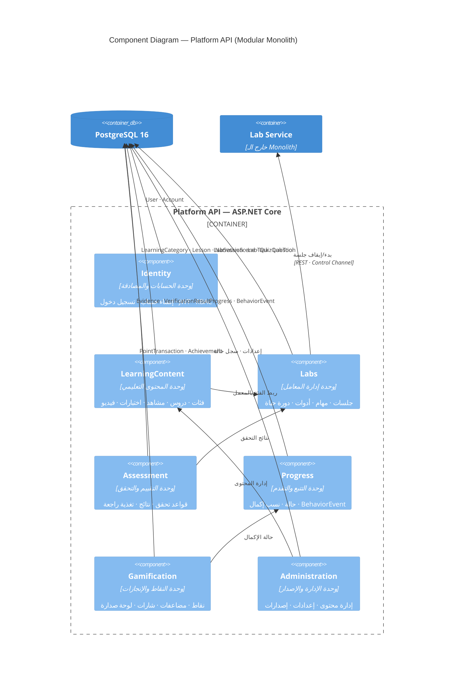

---

## 4. خريطة اعتماديات الوحدات

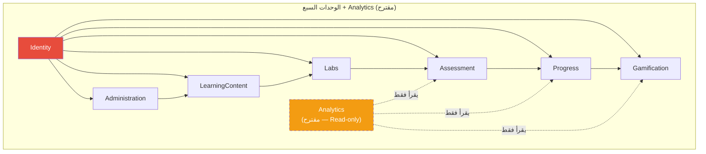

---

## 5. Deployment View — البنية الفيزيائية

```mermaid
flowchart TB
    subgraph laptop["💻 اللابتوب الوحيد — Ryzen 7 · 16GB RAM · Windows 11"]
        subgraph windows["Windows Host — المنطقة الموثوقة"]
            W_IDE["IDE + AI Agents<br/>~3-4 GB"]
            W_BROWSER["Browser<br/>~1-2 GB"]
            W_PLATFORM["Platform<br/>Next.js + ASP.NET Core + PostgreSQL<br/>~2-3 GB"]
            W_WORKER["Background Worker<br/>~0.5 GB"]
        end
        
        subgraph vm["VirtualBox VM (Ubuntu) — المنطقة غير الموثوقة ~4-5 GB"]
            VM_LAB["Lab Service<br/>.NET REST API"]
            VM_DOCKER["Docker Engine"]
            VM_TTYD["ttyd (WSS)"]
            
            subgraph containers["حاويات المعمل (1-2 متزامنة · 1.5GB لكل حاوية)"]
                C1["🔴 Red Workspace<br/>Terminal · curl · nmap"]
                C2["🎯 Target App<br/>.NET · PostgreSQL"]
                C3["🔵 Blue/Dev Workspace<br/>grep · tail · Monaco · Adminer"]
            end
            
            VM_NET["Private Docker Network<br/>--internal · No Egress"]
        end
        
        CTRL["Control Channel<br/>REST + Session Token"]
    end

    LEARNER["👤 المتعلّم<br/>(متصفح خارجي)"]

    LEARNER -->|"HTTPS"| W_PLATFORM
    LEARNER -->|"WSS (Proxy)"| VM_TTYD
    W_PLATFORM -->|"REST/JSON"| CTRL
    CTRL --> VM_LAB
    W_WORKER -->|"Cleanup"| CTRL
    VM_LAB --> VM_DOCKER
    VM_DOCKER --> containers
    VM_DOCKER --> VM_NET
    VM_TTYD --> C1
    VM_TTYD --> C3

    style vm fill:#1a1a2e,stroke:#e74c3c,stroke-width:2px
    style windows fill:#0d1b2a,stroke:#2ecc71,stroke-width:2px
    style containers fill:#2d2d44,stroke:#f39c12
```

---

## 6. Trust Boundaries & Security Zones

```mermaid
flowchart TB
    subgraph Z0["🌐 Zone 0 — External (Untrusted)"]
        BROWSER["متصفح المتعلّم"]
        REGISTRY["Container Registry"]
        VIDEO["مصدر فيديو خارجي"]
    end

    subgraph Z1["🟢 Zone 1 — Trusted (Windows Host)"]
        FRONTEND["Next.js Frontend"]
        API["Platform API<br/>(Modular Monolith)"]
        DB[("PostgreSQL<br/>+ AuditLog")]
        WORKER["Background Worker"]
    end

    subgraph Z2["🟡 Zone 2 — Semi-Trusted (Ubuntu VM)"]
        LAB_SVC["Lab Service"]
        DOCKER["Docker Engine"]
        TTYD["ttyd"]
    end

    subgraph Z3["🔴 Zone 3 — Untrusted (Lab Containers)"]
        CONTAINER["حاوية المعمل<br/>(كود المتعلّم · أدوات)"]
    end

    BROWSER -->|"TB-01: HTTPS + JWT"| FRONTEND
    BROWSER -->|"TB-01b: WSS + Session Token"| TTYD
    REGISTRY -->|"TB-07: Digest-pinned Images"| DOCKER
    VIDEO -->|"TB-08: Iframe Embed"| FRONTEND
    
    FRONTEND -->|"TB-02: REST/JSON + Auth"| API
    API -->|"TB-03: TCP + Least Privilege"| DB
    WORKER -->|"TB-03b: Internal"| DB
    
    API -->|"TB-04: Control Channel + Token"| LAB_SVC
    WORKER -->|"TB-04b: Cleanup Commands"| LAB_SVC
    
    LAB_SVC -->|"TB-05: Docker Socket (exclusive)"| DOCKER
    DOCKER -->|"TB-06: Namespaces + Cgroups"| CONTAINER
    TTYD -->|"TB-06b: PTY + Token"| CONTAINER

    style Z0 fill:#1a1a2e,stroke:#666
    style Z1 fill:#0d2818,stroke:#2ecc71,stroke-width:3px
    style Z2 fill:#2d2000,stroke:#f39c12,stroke-width:2px
    style Z3 fill:#2d0000,stroke:#e74c3c,stroke-width:2px
```

---

## 7. Runtime View — سيناريو بدء جلسة المعمل

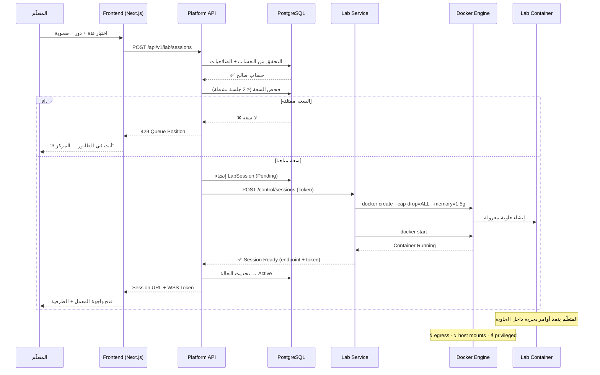

---

## 8. Runtime View — سيناريو التحقق الآلي واحتساب النقاط

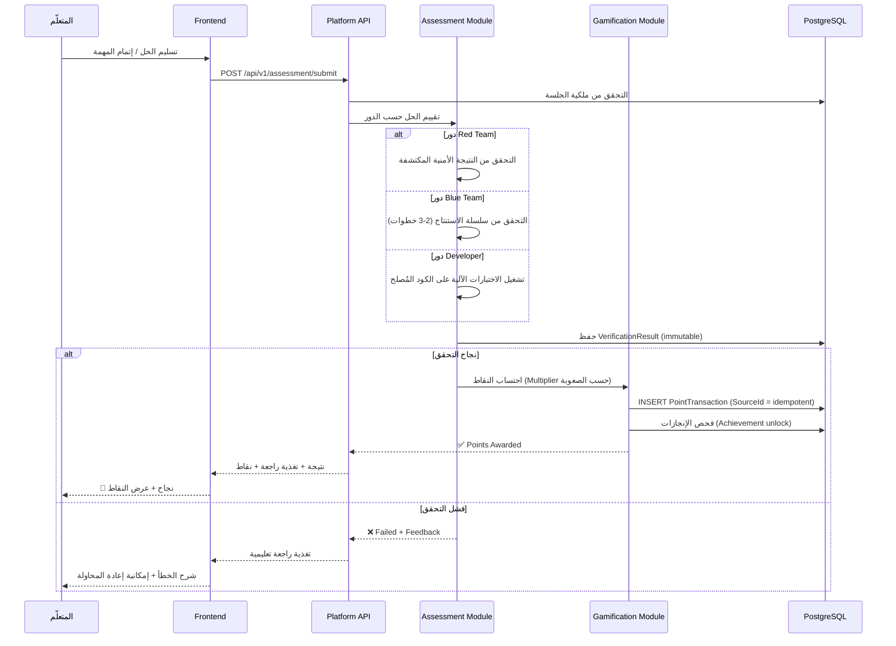

---

## 9. Runtime View — سيناريو انتهاء الجلسة والتدمير

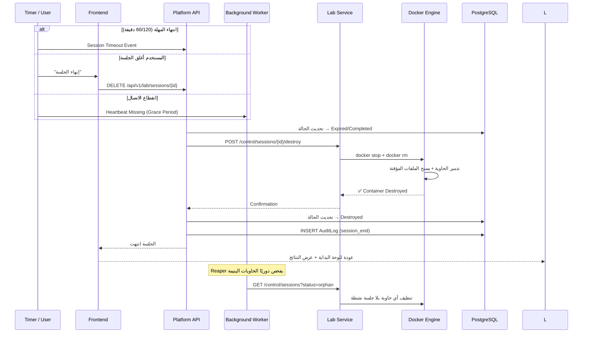

---

## 10. Data Model — ERD مبسط

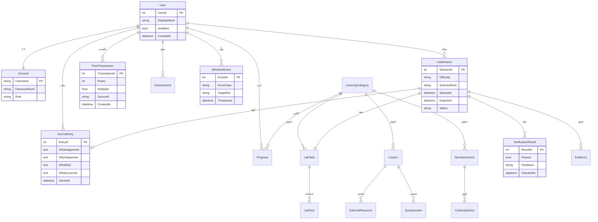

---

## 11. Lab Session State Machine

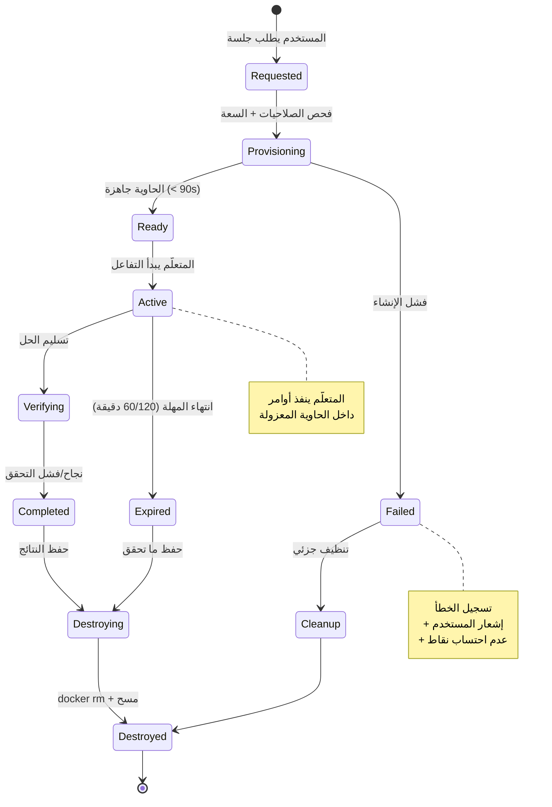

---

## 12. Security Controls per Trust Boundary

```mermaid
flowchart LR
    subgraph TB01["TB-01: Browser → Platform"]
        S1["HTTPS/TLS 1.3"]
        S2["JWT in HttpOnly Cookie"]
        S3["Rate Limiting (100 req/min)"]
        S4["CSRF Token"]
    end

    subgraph TB02["TB-02: Frontend → API"]
        S5["REST/JSON · /api/v1"]
        S6["Input Validation (FluentValidation)"]
        S7["ProblemDetails (RFC 7807)"]
    end

    subgraph TB03["TB-03: API → Database"]
        S8["Least Privilege DB Role"]
        S9["Parameterized Queries (EF Core)"]
        S10["Bound to localhost"]
        S11["Encryption at Rest"]
    end

    subgraph TB04["TB-04: API → Lab Service"]
        S12["Control Channel (REST)"]
        S13["Per-session Token"]
        S14["Operation Allowlist"]
        S15["Host-only Network"]
    end

    subgraph TB05["TB-05: Lab Service → Docker"]
        S16["Sole Socket Holder"]
        S17["--cap-drop=ALL"]
        S18["no-new-privileges"]
        S19["Read-only rootfs"]
        S20["Seccomp + AppArmor"]
    end

    subgraph TB06["TB-06: Container → Host"]
        S21["No shared folders"]
        S22["No clipboard"]
        S23["No drag-and-drop"]
        S24["NAT + Host-only"]
        S25["Snapshots before sessions"]
    end

    TB01 --> TB02 --> TB03
    TB02 --> TB04 --> TB05 --> TB06

    style TB01 fill:#0d2818,stroke:#2ecc71
    style TB02 fill:#0d2818,stroke:#2ecc71
    style TB03 fill:#0d2818,stroke:#2ecc71
    style TB04 fill:#2d2000,stroke:#f39c12
    style TB05 fill:#2d0000,stroke:#e74c3c
    style TB06 fill:#2d0000,stroke:#e74c3c
```

---

## 13. User Journey — المسارين

```mermaid
flowchart TD
    START(["🏠 الصفحة الرئيسية"])
    START --> AUTH{"تسجيل / دخول"}
    AUTH --> DASH["📋 لوحة البداية"]
    
    DASH --> PATH_CHOICE{"اختيار المسار"}
    
    PATH_CHOICE -->|"مسار التعلّم"| LEARN_PATH
    PATH_CHOICE -->|"مسار اللابات"| LAB_PATH

    subgraph LEARN_PATH["📚 مسار التعلّم"]
        L1["اختيار فئة (10 فئات)"]
        L2["🎬 مشهد قصصي (قبل التوظيف)"]
        L3["📖 شرح تقني مكتوب"]
        L4["🎥 فيديو خارجي مدمج"]
        L5["❓ اختبار قصير (3-5 أسئلة)"]
        L6["🔗 رابط إلى المعمل"]
        
        L1 --> L2
        L2 -->|"تخطي"| L2B["ملخص مكافئ"]
        L2 --> L3
        L2B --> L3
        L3 --> L4
        L4 --> L5
        L5 -->|"فحص ذاتي — ليس بوابة"| L6
    end

    subgraph LAB_PATH["🔬 مسار اللابات"]
        P1["اختيار فئة"]
        P2["🎬 افتتاحية اللاب (~1.5 د)"]
        P3["اختيار الصعوبة"]
        P4["اختيار الدور"]
        
        P1 --> P2
        P2 -->|"تخطي"| P2B["ملخص سياقي"]
        P2 --> P3
        P2B --> P3
        P3 --> P4
    end

    P4 --> ROLE_CHOICE{"الدور المختار"}
    
    ROLE_CHOICE -->|"Red Team"| RED["🔴 اكتشاف المشكلة"]
    ROLE_CHOICE -->|"Blue Team"| TRANS_B["🎬 مشهد انتقال"]
    ROLE_CHOICE -->|"Developer"| TRANS_D["🎬 مشهد انتقال"]
    
    TRANS_B --> BLUE["🔵 التحقيق والتحليل"]
    TRANS_D --> DEV["🟢 الإصلاح والتحقق"]

    RED --> VERIFY["⚙️ التحقق الآلي"]
    BLUE --> VERIFY
    DEV --> VERIFY

    VERIFY -->|"نجاح"| JOURNAL["📝 اليوميات (اختياري)"]
    VERIFY -->|"فشل"| FEEDBACK["💬 تغذية راجعة"]
    FEEDBACK -->|"إعادة محاولة"| P4

    JOURNAL --> PROGRESS["📊 التقدم + النقاط"]
    L6 --> LAB_PATH

    PROGRESS --> DASH

    style LEARN_PATH fill:#0a192f,stroke:#64ffda
    style LAB_PATH fill:#1a0a2e,stroke:#bb86fc
    style VERIFY fill:#2d1b00,stroke:#ff9800
```

---

## 14. Threat Model — STRIDE Matrix

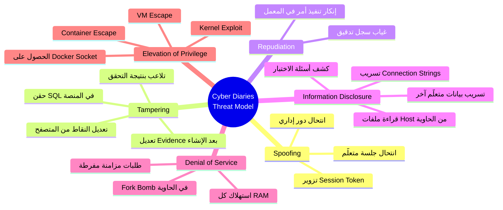

---

## 15. Quality Attribute Scenarios

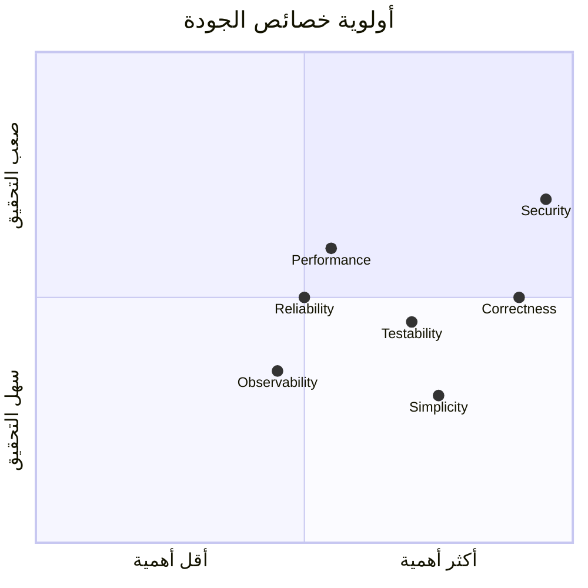

---

## 16. Release Roadmap

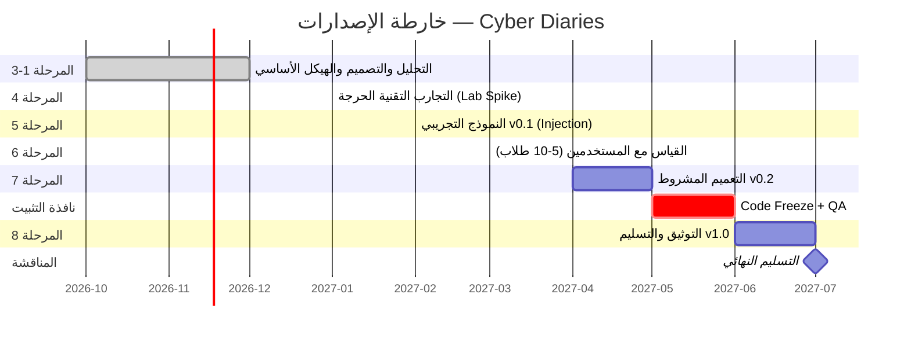

---

## 17. Container Hardening Checklist

```mermaid
flowchart TD
    subgraph hardening["🔒 تحصين الحاوية — كل جلسة"]
        H1["--cap-drop=ALL"]
        H2["--security-opt no-new-privileges"]
        H3["--read-only + tmpfs /tmp"]
        H4["--memory=1.5g --memory-swap=1.5g"]
        H5["--cpus=1 --pids-limit=256"]
        H6["--network=internal (no egress)"]
        H7["--user 1000:1000 (non-root)"]
        H8["seccomp=default"]
        H9["apparmor=docker-default"]
        H10["لا host mounts · لا /var/run/docker.sock"]
        H11["Image pinned by digest"]
        H12["Auto-destroy on session end"]
    end

    H1 --> RESULT["✅ حاوية معزولة آمنة"]
    H2 --> RESULT
    H3 --> RESULT
    H4 --> RESULT
    H5 --> RESULT
    H6 --> RESULT
    H7 --> RESULT
    H8 --> RESULT
    H9 --> RESULT
    H10 --> RESULT
    H11 --> RESULT
    H12 --> RESULT

    style RESULT fill:#0d2818,stroke:#2ecc71,stroke-width:3px
```

---

## 18. Assessment Flow per Role

```mermaid
flowchart LR
    subgraph red["🔴 Red Team"]
        R1["استكشاف التطبيق"] --> R2["تحديد نقطة الاشتباه"]
        R2 --> R3["إثبات الثغرة بأمان"]
        R3 --> R4["تقديم الدليل"]
    end

    subgraph blue["🔵 Blue Team"]
        B1["فحص السجلات"] --> B2["تحديد الطلب المشبوه"]
        B2 --> B3["ربط الأحداث زمنيًا"]
        B3 --> B4["استنتاج النشاط + المورد"]
    end

    subgraph dev["🟢 Developer"]
        D1["قراءة تقرير الحادث"] --> D2["تحديد السبب الجذري"]
        D2 --> D3["تعديل الكود"]
        D3 --> D4["تشغيل الاختبارات الآلية"]
    end

    R4 --> V["⚙️ التحقق الآلي (الخادم)"]
    B4 --> V
    D4 --> V

    V -->|"نجاح"| SUCCESS["✅ نقاط + تقدم + يومية"]
    V -->|"فشل"| RETRY["🔄 تغذية راجعة + إعادة محاولة"]

    style red fill:#2d0000,stroke:#e74c3c
    style blue fill:#001a33,stroke:#3498db
    style dev fill:#002200,stroke:#2ecc71
    style V fill:#2d2000,stroke:#f39c12
```

---

> 💡 **ملاحظة:** كل هذه المخططات بصيغة **Mermaid** ويمكن عرضها في أي أداة تدعمها (GitHub, VS Code + extension, Notion, Obsidian, أو [mermaid.live](https://mermaid.live)). هل تريد تصديرها كصور، أو تعديل أي مخطط، أو إضافة مخططات إضافية لأقسام معينة؟