# Architecture Documentation — Cyber Diaries

*arc42 template — version 9.1-EN (based upon AsciiDoc version), October 2026*

> **Status: populated — first complete pass.** This document fills the arc42 template with the
> architecture as it is currently specified in the project sources. It is written in English,
> matching the language of the other technical documents (`CDbHLT-TM-001` threat model,
> `CD-SAD-001` security architecture draft, `ADR-001`). The project decision that fixed the
> document language was recorded in `Untitled.md`, which is no longer on disk —
> `[GAP — source file no longer on disk]`. A one-page Arabic executive summary is delivered
> separately.
>
> Every statement carries its source locator. Facts that are not yet settled are marked as such
> rather than being smoothed over — an architecture document that hides open decisions is worse
> than one that shows them.

**Project** — Cyber Diaries (`يوميات سايبر`) · an interactive Arabic-language platform for
teaching web-application security through one connected story.
**Document** — arc42 architecture documentation, S1–S12.
**Owner** — HEADLESS Team (Architecture + Content + Backend + Frontend + Lab/DevOps).
**Approvers** — د/ أحمد زكريا سيد · د/ هشام عبدالنبي محمد (`Architecture/Data.md` S1).

## Source Documents

| Source | ID / version | Role in this document |
|---|---|---|
| `Requirements/Requirements Specification - MASTER.md` | `CDbHLT-REQ-SPEC-001` v0.1 (draft) | S1 goals, S2 constraints, S3 context, S10 quality, S12 glossary |
| `Architecture/Data.md` | decisions `Q-01…Q-63` | Owner answers that shaped the architecture |
| `Architecture/Threat Model/Threat Model.md` | `CDbHLT-TM-001` v0.1.2 (draft) | S8 security concept, S9 decisions, S11 risks |
| `WorkFlow/Workflow Docs.md` + `WorkFlow/Workflow Docs - mermaid Graph.md` | — | S5 building blocks, S6 runtime scenarios |
| `Architecture/docs/adr/ADR-001-isolation-substrate-and-platform-placement.md` | MADR 4.0 | S4 strategy, S7 deployment, S9 decisions |
| `Security_Architecture_Document_Cyber_Diaries_v0.1.md` (`CD-SAD-001` v0.1) | security architecture draft | S8 security design, data-flow and deployment view |
| `Requirements/Logs/Proposed Amendments - D3b, CN-001, CN-008, CN-022.md` | drafted, **unapplied** amendments | S2.1.1, S2.3, S5.2.8, S6.7 |
| `Requirements/Logs/Requirements Decisions - Consolidated.md` | `SRC-F`, the consolidated decision register | S9.3, S9.4, S11.4 |

> **`[GAP]` — `Untitled.md` is no longer on disk.** The owner's architecture-review answers
> (`A-03` platform placement, the `D3b` capacity figures, the `CN-001`/`CN-008`/`CN-022`
> amendments, the `ADR-002`/SysBox proposal, the document-language decision) were cited from
> `Untitled.md`. That file is absent from the workspace as of this revision, and it was already
> absent when the repair baseline was captured — this document did not remove it. Every citation
> that depended on it has been re-pointed to a source that exists: `ADR-001` S2, the amendments
> file, the threat model, and `Architecture/Data.md`. The two items with no live substitute — the
> document-language decision and the `ADR-002`-as-SysBox proposal — are marked as gaps.
| `Description/Project Description.md` / `… EN.md` | — | S1.1 requirements overview, product vision |
| `Requirements/Logs/*` | decision logs, amendments, tool licences | S9 decisions, open issues |
| `Plan/`, `Roadmap&Timeline/` | — | S7 deployment, release plan |

### How to read the status markers

| Marker | Meaning |
|---|---|
| *(no marker)* | Confirmed in a cited source |
| `[PROPOSED]` | Decided in a source, but the source itself flags it as needing review |
| `[TBD]` | The source explicitly leaves the value undecided |
| `[CONFLICT]` | Two sources disagree; both readings are given, with the resolution rule |
| `[GAP]` | The architecture needs something the sources do not cover yet |
| `[PLANNED — NOT WRITTEN]` | A decision exists as a proposal only; the ADR file does not exist |

## Table of Contents

- [Source Documents](#source-documents)
   - [How to read the status markers](#how-to-read-the-status-markers)
- [About arc42](#about-arc42)
- [1. Introduction and Goals](#1-introduction-and-goals)
   - [1.1. Requirements Overview](#11-requirements-overview)
   - [1.2. Quality Goals](#12-quality-goals)
   - [1.3. Stakeholders](#13-stakeholders)
- [2. Architecture Constraints](#2-architecture-constraints)
   - [2.1 Technical and solution constraints (S3.1)](#21-technical-and-solution-constraints-31)
   - [2.1.1. Pending Constraint Amendments](#211-pending-constraint-amendments)
   - [2.2 Enterprise and process constraints (S3.8)](#22-enterprise-and-process-constraints-38)
   - [2.3 Constraints proposed but not yet part of the specification](#23-constraints-proposed-but-not-yet-part-of-the-specification)
   - [2.4 Decisions that behave as constraints](#24-decisions-that-behave-as-constraints)
- [3. Context and Scope](#3-context-and-scope)
   - [3.1. Business Context](#31-business-context)
   - [3.2. Technical Context](#32-technical-context)
- [4. Solution Strategy](#4-solution-strategy)
   - [4.1 Top-level decomposition](#41-top-level-decomposition)
   - [4.2 Technology stack](#42-technology-stack)
   - [4.3 The two-boundary isolation strategy](#43-the-two-boundary-isolation-strategy)
   - [4.4 Decisions that are still open](#44-decisions-that-are-still-open)
- [5. Building Block View](#5-building-block-view)
   - [5.1. Whitebox Overall System](#51-whitebox-overall-system)
      - [5.1.1. Frontend — Next.js 14](#511-frontend--nextjs-14)
      - [5.1.2. Platform API — ASP.NET Core Modular Monolith](#512-platform-api--aspnet-core-modular-monolith)
      - [5.1.3. Lab Service — Ubuntu guest VM](#513-lab-service--ubuntu-guest-vm)
      - [5.1.4. Lab container — ephemeral, unprivileged](#514-lab-container--ephemeral-unprivileged)
      - [5.1.5. PostgreSQL 16 + AuditLog](#515-postgresql-16--auditlog)
      - [5.1.6. Background Worker](#516-background-worker)
   - [5.2. Level 2](#52-level-2)
      - [5.2.1. Identity](#521-identity)
      - [5.2.2. LearningContent](#522-learningcontent)
      - [5.2.3. Labs](#523-labs)
      - [5.2.4. Assessment](#524-assessment)
      - [5.2.5. Progress](#525-progress)
      - [5.2.6. Gamification](#526-gamification)
      - [5.2.7. Administration](#527-administration)
      - [5.2.8. Analytics \[PROPOSED\] — not a module of the current baseline](#528-analytics-proposed--not-a-module-of-the-current-baseline)
   - [5.3. Level 3](#53-level-3)
      - [5.3.1. White Box — Labs module](#531-white-box--labs-module)
      - [5.3.2. White Box — Assessment module](#532-white-box--assessment-module)
- [6. Runtime View](#6-runtime-view)
   - [6.1. Register and Login](#61-register-and-login)
   - [6.2. Start Lab Session](#62-start-lab-session)
   - [6.3. Execute Command in the Lab](#63-execute-command-in-the-lab)
   - [6.4. Submit Solution](#64-submit-solution)
   - [6.5. Verify Result](#65-verify-result)
   - [6.6. Write Journal](#66-write-journal)
   - [6.7. Lab Session Lifecycle (state machine)](#67-lab-session-lifecycle-state-machine)
   - [6.8. Lab Failure](#68-lab-failure)
   - [6.9. Admin Content Publish](#69-admin-content-publish)
   - [6.10. Failed Authentication](#610-failed-authentication)
   - [6.11. Security Scenario — Manually Killing the Container](#611-security-scenario--manually-killing-the-container)
   - [6.12. Security Scenario — Reaching Another Learner's Session](#612-security-scenario--reaching-another-learners-session)
- [7. Deployment View](#7-deployment-view)
   - [7.1. Infrastructure Level 1](#71-infrastructure-level-1)
   - [7.2. Infrastructure Level 2](#72-infrastructure-level-2)
      - [7.2.1. Windows host — trusted zone](#721-windows-host--trusted-zone)
      - [7.2.2. VirtualBox Ubuntu guest — semi-trusted zone](#722-virtualbox-ubuntu-guest--semi-trusted-zone)
      - [7.2.3. Docker Engine — inside the guest](#723-docker-engine--inside-the-guest)
- [8. Cross-cutting Concepts](#8-cross-cutting-concepts)
   - [8.1. Security Concept](#81-security-concept)
   - [8.2. Authentication and Session Lifecycle](#82-authentication-and-session-lifecycle)
   - [8.3. Authorization and Access Control](#83-authorization-and-access-control)
   - [8.4. Lab Isolation and Untrusted Execution](#84-lab-isolation-and-untrusted-execution)
   - [8.5. Input Validation and Web Defenses](#85-input-validation-and-web-defenses)
   - [8.6. Audit, Logging and Observability](#86-audit-logging-and-observability)
   - [8.7. Data Protection: Classification, Encryption and Secrets](#87-data-protection-classification-encryption-and-secrets)
   - [8.8. Privacy, Consent and Research Data](#88-privacy-consent-and-research-data)
   - [8.9. Assessment Integrity and Server-Side Scoring](#89-assessment-integrity-and-server-side-scoring)
   - [8.10. Modular Boundaries and Domain Events](#810-modular-boundaries-and-domain-events)
   - [8.11. Persistence, Migrations and Caching](#811-persistence-migrations-and-caching)
   - [8.12. API Style, Versioning and Error Handling](#812-api-style-versioning-and-error-handling)
   - [8.13. Frontend Rendering and Internationalization](#813-frontend-rendering-and-internationalization)
   - [8.14. Supply Chain Security](#814-supply-chain-security)
   - [8.15. Testing and Verification Strategy](#815-testing-and-verification-strategy)
   - [8.16. Content Management, Narrative Consistency and the Difficulty Model](#816-content-management-narrative-consistency-and-the-difficulty-model)
   - [8.17. Incident Response, Backup and Continuity](#817-incident-response-backup-and-continuity)
- [9. Architecture Decisions](#9-architecture-decisions)
   - [9.1. Architecture Decision Records](#91-architecture-decision-records)
   - [9.2. ADR-001 — in detail](#92-adr-001--in-detail)
   - [9.3. Requirements decision register (D1…D17)](#93-requirements-decision-register-d1d17)
   - [9.4. Audit decisions (D-01…D-06) and the missing decision sheet](#94-audit-decisions-d-01d-06-and-the-missing-decision-sheet)
- [10. Quality Requirements](#10-quality-requirements)
   - [10.1. Quality Requirements Overview](#101-quality-requirements-overview)
   - [10.2. Quality Scenarios](#102-quality-scenarios)
- [11. Risks and Technical Debts](#11-risks-and-technical-debts)
   - [11.1. Requirements risks (RK-001…RK-011)](#111-requirements-risks-rk-001rk-011)
   - [المخاطرة الكبرى (The Showstopper)](#المخاطرة-الكبرى-the-showstopper)
   - [11.1b. Proposed additional risks (owner input — awaiting sign-off)](#111b-proposed-additional-risks-owner-input--awaiting-sign-off)
   - [11.2. Accepted residual risks (RR-01…RR-05)](#112-accepted-residual-risks-rr-01rr-05)
   - [11.3. Open issues (technical debt in the threat model)](#113-open-issues-technical-debt-in-the-threat-model)
   - [11.4. Technical and documentation debt found by this audit](#114-technical-and-documentation-debt-found-by-this-audit)
   - [11.5. Risk-handling rules for this project](#115-risk-handling-rules-for-this-project)
- [12. Glossary](#12-glossary)
   - [12.1. Product and domain terms](#121-product-and-domain-terms)
   - [12.2. OWASP Top 10:2025 — the official names as adopted](#122-owasp-top-102025--the-official-names-as-adopted)
   - [12.3. Architecture and security terms](#123-architecture-and-security-terms)
   - [12.4. Terms added by owner input (Q-62, Q-63)](#124-terms-added-by-owner-input-q-62-q-63)
   - [12.5. Units of measure used in the specification](#125-units-of-measure-used-in-the-specification)
## About arc42

arc42, the template for documentation of software and system architecture.
Template Version 9.1-EN (based upon AsciiDoc version), October 2026.
Created, maintained and © by Dr. Peter Hruschka, Dr. Gernot Starke and contributors. See
<https://arc42.org>.

<!--
This document reproduces the structure and the section titles of the arc42 template.
The template itself was created, is maintained and is © by Dr. Peter Hruschka,
Dr. Gernot Starke and contributors; it is not the original work of this project.

The supplied arc42 PDFs (plain and withhelp) state the above attribution but contain no
explicit license statement. The authoritative license terms are published at https://arc42.org .
-->
<!--
How to read this document:
- Each statement carries a source locator such as
  `[Source: Requirements Specification - MASTER.md — S3.1, CN-001]`.
- The status markers listed above distinguish settled facts from open decisions.
- Diagrams are Mermaid blocks; each one is a structural placeholder whose edges are either
  taken from a source or explicitly marked as not defined by any source — see S11.4
  naming the diagram it expects.
-->

---

## 1. Introduction and Goals

Cyber Diaries is an interactive Arabic-language platform that teaches web-application security
through **one connected story** rather than through disconnected exercises. A single protagonist
encounters incidents at a fictional company, and each OWASP category becomes one episode of a
loop: incident → discovery → interpretation → remediation → documentation.
`[Source: Requirements Specification - MASTER.md — S4.1, glossary: "The Episode (Loop)"]`

The platform has two paths that share the same story world: a **learning path** (the protagonist
before employment learns the category) and a **labs path** (an incident after the protagonist
joins the company, practised in an isolated lab from one of three roles — Red Team, Blue
Team/SOC, Developer). The three roles are *usage patterns*, not separate audiences, and every
security category is built as **one** scenario shared by all three so that the knowledge stays
connected. `[Source: MASTER.md — S2.4, S2.5, CN-011]`

### 1.1. Requirements Overview

The authoritative requirements baseline is a single document — `CDbHLT-REQ-SPEC-001`, version 0.1,
released 2026-10-26 — which the requirements specification itself designates as the *only*
authoritative source ("نموذج أولي — المصدر المعتمد الوحيد"). It is still a draft: it carries an
audit banner dated 2026-11-05 and its control table (v0.1), body text (batch v0.8) and the
section-split extracts (v0.5-draft) state three different versions.
`[Source: MASTER.md — document header, lines 1–23; S14, S18.1]`

| Aspect | Value | Source |
|---|---|---|
| Document | `CDbHLT-REQ-SPEC-001` v0.1 — *Template / Requirements Specification* | MASTER.md header |
| Structure | S1 Purpose · S2 Stakeholders · S3 Constraints · S4 Terminology · S5 Facts & Assumptions · S6 Scope of work · S7 Data model · S8 Product scope · S9 Functional requirements · S10 Look & feel · S11 Usability · S12 Performance · S13 Operational & environmental · S14 Maintainability & support · S15 Security · S16 Cultural · S17 Legal · S18 Open issues · S19 Off-the-shelf solutions · S20 New problems · S21 Tasks · S22 Migration · S23 Risks · S24 Costs · S25 Documentation & training · S26 Waiting room · S27 Ideas | MASTER.md TOC |
| Appendices | أ User needs · ب Interview template & consent · ج Legislation & standards register · د Master requirements register | MASTER.md appendices |
| Requirement count | **114** requirements in the master register | MASTER.md Sد.4 item 8 |
| Verification status | **0 / 114** — nothing is built, so no verification or acceptance test has been executed | MASTER.md Sد.4 item 8 |
| Decision overlay | `Architecture/Data.md` records 63 owner answers (`Q-01…Q-63`) that refine the specification | `Architecture/Data.md` |
| Architecture overlay | `CDbHLT-TM-001` v0.1.2 (threat model), `WorkFlow/Workflow Docs.md`, `ADR-001` | those documents |

**Product use cases — `S8.2` of the specification.** The table below reproduces the source's
`PUC No.`, `اسم PUC` and `الأولوية` columns. The **Arabic name and the priority cell are copied
verbatim**; in the source the `PUC No.` column holds bare zero-padded numbers (`001`…`022`), and
the `PUC-0NN` form used here is the one the source uses in S8.3 and in Appendix د.3.

| PUC       | اسم PUC — Name (verbatim SRC-A S8.2)                          | English gloss                                                             | الأولوية — Priority (verbatim)                                                                               |
| --------- | ------------------------------------------------------------- | ------------------------------------------------------------------------- | ------------------------------------------------------------------------------------------------------------ |
| `PUC-001` | الصفحة الرئيسية والتسجيل والدخول                              | Home page, registration and login                                         | **Must**                                                                                                     |
| `PUC-002` | لوحة البداية واختيار المسار                                   | Start dashboard and path selection                                        | **Must**                                                                                                     |
| `PUC-003` | عرض الفئات واختيار فئة في مسار التعلّم                        | Display the categories and pick one on the learning path                  | **Must**                                                                                                     |
| `PUC-004` | المشهد القصصي التعليمي (أو ملخصه المكافئ)                     | The educational story scene (or its equivalent summary)                   | **Must**                                                                                                     |
| `PUC-005` | الشرح التقني والفيديو التعليمي والاختبار القصير               | Technical explanation, educational video and the short quiz               | **Must**                                                                                                     |
| `PUC-006` | الانتقال من صفحة الفئة إلى معملها                             | Moving from the category page to its lab                                  | **Must**                                                                                                     |
| `PUC-007` | بدء جلسة اللاب: الصعوبة والدور والافتتاحية                    | Starting a lab session: difficulty, role and opening                      | **Must**                                                                                                     |
| `PUC-008` | تنفيذ مهمة Red Team                                           | Executing the Red Team task                                               | **Must**                                                                                                     |
| `PUC-009` | تنفيذ مهمة Blue Team                                          | Executing the Blue Team task                                              | **Must**                                                                                                     |
| `PUC-010` | تنفيذ مهمة Developer                                          | Executing the Developer task                                              | **Must**                                                                                                     |
| `PUC-011` | التحقق الآلي من النتيجة والتغذية الراجعة                      | Automated verification of the result and the feedback                     | **Must**                                                                                                     |
| `PUC-012` | خوض الحلقة الكاملة (اكتشاف ← تحقيق ← معالجة ← ملخص)           | Playing the full loop (discovery ← investigation ← remediation ← summary) | **Should** — خيار إضافي لا يُفرض                                                                             |
| `PUC-013` | كتابة اليوميات وحفظها                                         | Writing the journal and saving it                                         | **Must**                                                                                                     |
| `PUC-014` | متابعة التقدم ونسب الإكمال                                    | Following progress and completion rates                                   | **Should**                                                                                                   |
| `PUC-015` | لوحة الصدارة الاختيارية                                       | The optional leaderboard                                                  | **Should** — **مغلقة افتراضيًا (Opt-in)** (`Data/data.md` 3)                                                 |
| `PUC-016` | إدارة المحتوى (فئة · درس · مشهد · سيناريو)                    | Content management (category · lesson · scene · scenario)                 | **Should** — شرط التعميم                                                                                     |
| `PUC-017` | تشغيل المعمل وتنظيفه                                          | Operating the lab and cleaning it up                                      | **Must** (أمان المعمل)                                                                                       |
| `PUC-018` | الإصدار والإعدادات (معايير التقييم · اقتصاد النقاط · الصعوبة) | Release and settings (evaluation criteria · points economy · difficulty)  | **Should**                                                                                                   |
| `PUC-019` | *لعب جماعي*                                                   | *Multiplayer*                                                             | **Won't** — بند خارج النطاق صراحةً (16)                                                                      |
| `PUC-020` | *تطبيق هاتف*                                                  | *Mobile application*                                                      | **Won't** — بند خارج النطاق صراحةً (16)                                                                      |
| `PUC-021` | *تقييم حر للنصوص*                                             | *Free-text evaluation*                                                    | **Won't** — مؤجّل صراحةً (6.7، 16)                                                                           |
| `PUC-022` | *محاكاة SIEM تجاري*                                           | *Commercial SIEM simulation*                                              | **Won't** — بند خارج النطاق صراحةً؛ تحليل السجلات يتم بأدوات المعمل (grep/tail) لا بمنتج SIEM (16، تنبيه C2) |

`[Source: Requirements Specification - MASTER.md — S8.2]`

> **Note on the "Won't" rows.** The source states: «البنود 019–022 **ليست حالات استخدام قائمة**،
> بل **حدود نطاق موثّقة** في هذا الجدول لتفادي تسرّبها إلى التنفيذ. تُوثَّق نسختها المستهدفة في
> القسم 26.1.» — items 019–022 are not real use cases but documented scope boundaries, recorded
> here so they cannot leak into implementation.
> `[Source: Requirements Specification - MASTER.md — S8.2, note below the table]`

> **Path note.** The `PUC-015` priority cell above is reproduced verbatim from the source, which
> cites `Data/data.md` item 3. That citation points to **`Requirements/Data/data.md`** — a
> *different* file from **`Architecture/Data.md`** (this document's `SRC-C`). Both exist and
> their SHA-256 hashes differ; see S11.4.

**Requirement-ID families used by the specification.** These prefixes are the vocabulary of the
architecture document and are cited throughout S8, S9 and S10.

| Prefix | Meaning | Prefix | Meaning |
|---|---|---|---|
| `FR` | Functional requirement (atomic) | `AC` | Access-control requirement |
| `CN` | Mandated constraint (see S2) | `AU` | Audit requirement |
| `UN` / `RU` | User need / requirement for use | `PV` | Privacy requirement |
| `PUC` / `BUC` | Product use case / business use case | `CMP` | Compliance requirement |
| `IN` | Integrity requirement | `SD` | Referenced standard |
| `CU` | Cultural requirement | `IF` | Interface requirement |
| `IM` | Implementation requirement | `PE` / `PR` | Physical-environment / productization requirement |
| `SP` `SC` `PA` `RA` `RB` `CP` `SE` `LG` | Speed · safety-critical · precision · reliability · robustness · capacity · scalability · longevity (see S10) | `MT` `AD` `SPP` | Maintainability · adaptability · support |
| `BR` | Business rule | `NP` | New problem |
| `OI` | Open issue | `RK` | Risk (see S11) |

**Functional scope accepted for v1.0:** one complete Injection episode (the pilot category) plus
the core learner journey, cost measurement, an evaluative study, the documentation set and a
research paper; final delivery and discussion in **7-2027**.
`[Source: MASTER.md — S2.1, S2.2]`

**Deliberately out of scope for v0.1:** multi-node / cloud / Kubernetes deployment; a
learner-facing full operating-system desktop; security tools built from scratch; commercial SIEM
simulation; multiple system templates; multiplayer; a mobile application; certified credentials;
paid enterprise paths; free-text evaluation of answers.
`[Source: MASTER.md — S26, S8.2 Won't PUC-019…022; Threat Model.md — S4.2]`

### 1.2. Quality Goals

The owner ranked **seven** quality goals; Observability and Reliability were explicitly added as
secondary goals. `[Source: Architecture/Data.md — Q-01, Q-03]`

| # | Quality goal | Priority | Concrete scenario | Acceptance criterion | Source |
|---|---|---|---|---|---|
| 1 | **Security** | Highest | A learner executes arbitrary commands inside the lab; the platform, database and learner data must stay outside the lab boundary | No learner command executes in the API process; the lab is network-isolated and destroyed after the session | CN-002, CN-003, CN-004, IM-001, IM-005 |
| 2 | **Correctness** | Highest | The server awards points for a solved task | Points, achievements and results are computed **only** server-side, idempotently by source id, with no browser-side counting and no double counting | CN-005, IN-001…IN-007, `CTRL-SCORE-01/02` |
| 3 | **Simplicity** | High | A new contributor must find where a feature belongs | One runnable Modular Monolith with clear internal module boundaries; no microservices | CN-001, MT-002 |
| 4 | **Testability** | High | The team must prove a control works | Verification rules live server-side and versioned; automated verification returns a result in **&lt; 3 s** | SC-004, SP-004, `CTRL-ASSESS-01` |
| 5 | **Performance** | Medium | A learner opens a lesson page | Simple API response **&lt; 500 ms**; composite request **&lt; 2 s**; container ready **&lt; 90 s** | SP-001, SP-002, SP-003 |
| 6 | **Reliability** | Medium | A session starts while two learners are already active | Session start succeeds within the declared capacity; queue with visible position for the next request | RA-002, CP-001, D3b |
| 7 | **Observability** | Medium | An administrator investigates a disputed result | Every sensitive operation is recorded with actor, action, time and outcome; logs carry no personal data | AU-001…AU-004, CN-014 |

The owner's acceptance-criteria summary for these goals is: **500 ms · 2 s · 90 s · 3 s · n ≥ 10**
(where `n ≥ 10` is the minimum study sample). `[Source: Architecture/Data.md — Q-02]`

**Three project-level goals (PAM) sit above the quality goals** and are measured, not merely
targeted: (1) enable an Arabic learner to master the full cycle — find → interpret → fix →
document — measured by pre/post and deferred test plus in-platform behavioural data, with the
success threshold expressed qualitatively as improvement of the post-test mean over the pre-test
mean; (2) turn generalization from an estimate into a measurement, by measuring the first
episode's real cost in work hours; (3) enable one template to generalize to other categories,
measured by running a second category with no architectural change and shadowing cost across two
episodes. `[Source: MASTER.md — S1.2]`

> **Note on status.** Every number above is a **requirement**, not a measurement. The
> requirements specification records verification as `0 / 114`; the threat model records all 42
> threats as `Planned` with **0** verified. Availability (`RA-001`) remains `[TBD]` because it
> depends on the deployment provider that decision D2 has not yet chosen.
> `[Source: MASTER.md — S12.4, Sد.4 item 8; Threat Model.md — S10.1, S1.3]`

### 1.3. Stakeholders

The stakeholders are specified in `MASTER.md` S2.1–S2.8. Participation and impact degrees in the
S2.3 table are explicitly the team's own estimates, not source-derived.
`[Source: MASTER.md — S2.3 note]`

**Client / sponsor** — the two academic supervisors of the IT Department, Assiut International
Technological University (EGC TECH AITU): Prof. Ahmed Zakaria Sayed (owner of decision D6) and
Prof. Hisham Abdelnabi Mohamed. They hold final acceptance, and they own the decisions that
set the pilot category, the target deployment environment (D2), scope and episode count (D3, D4),
lab values and numeric performance targets, the legal basis and consent model (D5), role
assignment (D6), and the content/scenario freeze dates.
`[Source: MASTER.md — S2.1; Architecture/Data.md — Q-01 approvers]`

**Delivery team — HEADLESS, 12 members** — 3 cyber-security · 2 back-end · 3 front-end ·
2 content · 2 UI/UX. Architecture and content leads hold a declared final say, not merely a
coordinating role (CN-017). `[Source: MASTER.md — S2.1, CN-017]`

| Role / Name | Contact | Expectation from this architecture document | Source |
|---|---|---|---|
| Architecture lead | HEADLESS team | Recorded architecture decisions, lab-service boundary, lab values and session durations, task assignment | S2.3, S2.8 |
| Content lead (2 members) | HEADLESS team | Lessons, scenarios, hints, questions, diaries, references, reusable templates for ten categories | S2.3 |
| Integration & releases owner | Backend / Lab | Track done/blocked, shared test environment, per-batch status log | S2.3, CN-018 |
| World Bible owner | HEADLESS team | One file documenting phase order, timeline, hero/character evolution, per-episode events | S2.3 |
| Assessment & points owner | Backend / Content | Auto-verification rules per role, points economy, documented completion rate | S2.3 |
| Ethics & compliance owner | HEADLESS team | Legal basis for data collection, consent form, retention policy, licence review | S2.3 |
| Lab / DevOps engineer (2, from the security group) | HEADLESS team | VirtualBox + Docker, test applications, security isolation, deployment and monitoring, container lifecycle and auto-cleanup | S2.8 |
| Operations administrator | HEADLESS team | Lab lifecycle, limits, monitoring | S3.3, S15.1, AC-005 |
| Content administrator | HEADLESS team | Content CRUD — without touching lab operating settings | S3.3, S15.1, AC-006 |
| Release officer | HEADLESS team | Assessment rules, points economy, difficulty levels, releases | S3.3, S15.1, AC-007 |
| Supervisor / examiner | Academic staff | Demo, review of documentation; **no admin account in v0.1** | S3.3, S7.1 |
| Pilot participants (5–10) and study sample `n ≥ 10` | Invited learners | Story, transition and tool clarity; completion time; repeated errors; hint use vs. completion | S2.2, S2.3, D16 |
| Research consumer | Study team | Anonymized exports only | S3.3, PV-002, PV-006 |
| Defence committee / academic reviewers | University | Match delivery against the announced scope; accept the platform, docs, study and paper | S2.3 |

**Users.** The primary audience is CS students and beginner web developers (**70 %**); the
secondary audience is security enthusiasts without a programming background (**30 %**), served by
a simplified independent path (D8). Two personas are in use — *Ahmed*, a 21-year-old Cairo CS
student, and *Sara*, a 24-year-old non-programmer from Alexandria; a third persona is explicitly
not used. `[Source: MASTER.md — S2.4, S2.5, S2.6]`

## 2. Architecture Constraints

Cyber Diaries is constrained far more tightly than a typical product. The specification calls
these *mandated constraints* (`قيد مفروض`) and splits them in two: **14 solution constraints**
(`CN-001`…`CN-014`) in S3.1 and **5 enterprise constraints** (`CN-015`…`CN-019`) in S3.8 —
**19 in total**. The numbering is continuous across the two sections; the source states that
`3.8` numbering continues from `3.1`. Every row carries the type "mandated constraint"; the
source's own non-negotiable flag is reproduced in the tables below.
`[Source: Requirements Specification - MASTER.md — S3.1, S3.8, Appendix د.1; S24.1 count row]`

### 2.1 Technical and solution constraints (`S3.1`)

| ID | Constraint | غير قابل للتفاوض؟ — Non-negotiable? | Stated rationale | Source |
|---|---|---|---|---|
| `CN-001` | All seven modules — Identity · LearningContent · Labs · Assessment · Progress · Gamification · Administration — live in **one runnable Modular Monolith**, not microservices | **لا** — No; breakable by client permission against documenting the impact on integration and testing | "Modular Monolith, not Microservices: development and integration speed suited to a graduation team, with clearly bounded, testable modules" | S3.1 |
| `CN-002` | The lab service must be **separate from the API process**; no user command executes inside the API process | **نعم** — Yes; a security constraint that is not breakable by client permission | "Running untrusted code is a security problem categorically different from managing users and content" | S3.1 |
| `CN-003` | Each lab environment runs in a **temporary, network-isolated container** with limited permissions, auto-destroyed when the session ends | **نعم** — Yes | "Temporary isolated containers … destroyed after the session"; the lab is never used to target a real system | S3.1 |
| `CN-004` | Embedded tools must not escape the lab scope | **نعم** — Yes | "It is guaranteed that running them cannot leave the lab scope" | S3.1 |
| `CN-005` | All points and achievements are counted **server-side** through automated verification; nothing is counted from browser data; no double counting | **نعم** — Yes; security and integrity | "All points and achievements are computed on the server through automated verification; nothing is counted from browser data, with duplicate counting prevented" | S3.1 |
| `CN-006` | APIs are **REST-first**; GraphQL only if its value is proven | **لا** — No; breakable by client permission against documenting the proven need | "An explicit architectural decision" | S3.1 |
| `CN-007` | All embedded tools are **real, off-the-shelf** tools; no security tool is built from scratch unless no ready alternative exists | **لا** — No; conditional on the exception rule and a documented decision | "All tools are real, ready-made and integrated; none is built from scratch" | S3.1 |
| `CN-008` | يجب أن يكون **سطح المكتب في المعمل واجهة تفاعلية فقط** — لا نظام تشغيل ولا آلة افتراضية — *The lab desktop must be an interactive interface only — not an operating system and not a virtual machine* | **نعم** — Yes | «سطح المكتب واجهة فقط — كصورة تفاعلية للوصول إلى الأدوات»؛ وهو بند خارج النطاق صراحةً — "the desktop is an interface only — an interactive view for reaching the tools"; and it is explicitly out of scope | S3.1 |
| `CN-009` | The content administration panel adds categories, lessons and scenarios **without a code change**; text content is strictly separated from lab operating settings | **لا** — No; changeable by a documented decision | "An explicit architectural decision, and the precondition for generalizing the template to additional categories" | S3.1 |
| `CN-010` | Story scenes belong to the learning path before employment; lab events come after the hero joins "Nour Tek"; timeline order is preserved | **نعم** — Yes | — | S3.1 |
| `CN-011` | Each security category uses **one** security scenario shared by all three roles — same incident, same root cause | **لا** — No; reviewable by an architecture/content decision | "This avoids building three separate experiences per category, and preserves the knowledge link between discovery, investigation and remediation" | S3.1 |
| `CN-012` | Exploit content is framed **defensively** — not a copy-paste-ready attack guide; no ready-made solution steps | **نعم** — Yes | "Content is written in a defensive educational frame, at a level that does not amount to an attack operating manual" | S3.1 |
| `CN-013` | Names and characters are entirely fictional; no real entities | **نعم** — Yes | — | S3.1 |
| `CN-014` | Educational logs contain no personal information and no secrets | **نعم** — Yes | — | S3.1 |

The constraint text above is an English rendering of the Arabic description in `SRC-A` S3.1; the
`CN-008` row additionally carries the **original Arabic verbatim**, because it carries a pending
amendment (see S2.1.1). Nine of the fourteen are non-negotiable (`نعم`): `CN-002`, `CN-003`,
`CN-004`, `CN-005`, `CN-008`, `CN-010`, `CN-012`, `CN-013`, `CN-014`; the remaining five are
conditional and each names its break condition.
`[Source: MASTER.md — S3.1, CDbHLT-CN-001…CN-014]`

### 2.1.1. Pending Constraint Amendments

Two constraint texts exist only as **proposals**. Neither is in force; the specification still
carries the original wording.

**`CN-008` — separating the desktop from the runtime environment**

| Field | Content |
|---|---|
| **Original text (in force)** | يجب أن يكون **سطح المكتب في المعمل واجهة تفاعلية فقط** — لا نظام تشغيل ولا آلة افتراضية |
| **Original rationale (in force)** | «سطح المكتب واجهة فقط — كصورة تفاعلية للوصول إلى الأدوات»؛ وهو بند خارج النطاق صراحةً |
| **Proposed reword** | `CN-008 (معدّل):` سطح المكتب المعروض للمتعلم داخل المعمل هو واجهة تفاعلية للوصول إلى الأدوات، وليس نظام تشغيل كاملًا يحاكي تجربة سطح مكتب حقيقية. لا يستطيع المتعلم تثبيت برامج، ولا تعديل نظام الملفات، ولا الوصول إلى موارد خارج نطاق الأدوات المسموح بها. ملاحظة توضيحية (ليست استثناءً): هذا القيد يخص "واجهة سطح المكتب" المعروضة للمتعلم فقط، ولا يتعارض مع استخدام آلة افتراضية كحد عزل بيئي غير مرئي للمتعلم على مستوى البنية التحتية (انظر CN-022). |
| **Problem the amendment solves** | «`CN-008` الحالي يقول: «سطح المكتب في المعمل واجهة تفاعلية فقط — **لا نظام تشغيل ولا آلة افتراضية**». وقراءة حرفية له تمنع الـVM التي أصبحت حد العزل المعتمد — تناقض سيُقرأ في المناقشة كخطأ معماري.» — a literal reading of the current text forbids the VM that has become the adopted isolation boundary, a contradiction that would be read in review as an architectural error |
| **Status** | `[PROPOSED — pending approval]` |
| **Source** | `Requirements/Logs/Proposed Amendments - D3b, CN-001, CN-008, CN-022.md` S3 · `Architecture/Data.md` Q-04 (whose answer is «إعادة الصياغة المقترحة سابقًا / الاعتماد على ملف المتطلبات» — the rewording itself is held in the requirements file, not in `Data.md`) |
| **Approval log** | `[GAP — no approval recorded]` |
| **Approval procedure** | The amendments file states: «**مقترح — لم يُطبَّق بعد** (بانتظار اعتماد الفريق ثم المشرف)», owned by the Architecture Lead, target date **2026-11-12**; «لا يُنسخ أي نص إلى `MASTER.md` قبل اعتماد الفريق» — no text is copied into `MASTER.md` before the team approves |
| **Impact if approved** | `Requirements/Logs/Proposed Amendments …` S5: S3.1 constraints (CN-001 amended · CN-008 amended · CN-022 new) · Appendix د re-generated for those rows |

**`CN-022` — the VM isolation boundary (new constraint)**

The full proposed text, acceptance criteria and the numbering rationale (`CN-020` was allocated
by `Q-05` to the Kubernetes prohibition and `CN-021` by `Q-06` to the single-device rule, so
`CN-022` is used to avoid re-using an identifier) are reproduced in S2.3.
`[Source: Requirements/Logs/Proposed Amendments - D3b, CN-001, CN-008, CN-022.md S4]`

### 2.2 Enterprise and process constraints (`S3.8`)

| ID | Constraint | Source |
|---|---|---|
| `CN-015` | The number of generalized episodes is announced early with the supervisor, not at project end | S3.8 |
| `CN-016` | Freeze dates for the content template and the scenario template are treated as official deliverables | S3.8 |
| `CN-017` | The architecture lead and the content lead have a declared final say, not merely a coordinating role | S3.8 |
| `CN-018` | API contracts are agreed before implementation is distributed; periodic small-batch merges with a shared test environment | S3.8 |
| `CN-019` | No final schedule is promised before the first episode has been measured | S3.8 |

The enterprise-acceptance status of all five is `[TBD]` in the source.
`[Source: MASTER.md — S3.8]`

### 2.3 Constraints proposed but not yet part of the specification

Three constraint IDs exist only as proposals. They are **not** in `CDbHLT-REQ-SPEC-001`, so no
requirement may cite them as binding.

| Proposed ID | Proposed text | Status | Source |
|---|---|---|---|
| `CN-020` | "Kubernetes is prohibited in the first version" | Reserved by `Data.md` Q-05 as a technical rationale; **not present in MASTER.md**. The threat model's Appendix C records it as "already allocated by Q-05" | `Data.md` Q-05; Threat Model.md Appendix C |
| `CN-021` | "The lab is not permitted to run on more than one device" | Reserved by `Data.md` Q-06 as a physical constraint; **not present in MASTER.md** | `Data.md` Q-06 |
| `CN-022` | The **VM isolation boundary** — the lab service and its containers run only inside a VirtualBox VM on the host; no untrusted code executes outside it, with a single narrow authenticated control channel as the exception | **Drafted, not applied** to `CDbHLT-REQ-SPEC-001`; assigned to `CN-022` specifically because `CN-020` was already allocated | Threat Model.md Appendix C; `Requirements/Logs/Proposed Amendments - D3b, CN-001, CN-008, CN-022.md` |

Until `CN-022` is applied, traceability gap **G-01** remains open: `T-26`, `T-27` and `T-28`
(the VM-escape family) have no requirement ID. `[Source: Threat Model.md — S13.2 G-01]`

> **`[CONFLICT]` — `CN-008` versus the VM substrate.** `CN-008` states the lab desktop is "no
> operating system and no virtual machine", while the isolation design places the lab inside a
> VirtualBox VM. The amendment draft resolves the wording: the constraint applies to the
> **learner-facing desktop**, not to the invisible infrastructure boundary.
> `[Source: MASTER.md — S3.1 note (`[PROPOSED — Requires Review — D-03/D-04]`); Threat Model.md — OI-TM-05; Requirements/Logs/Proposed Amendments - D3b, CN-001, CN-008, CN-022.md S3]`

> **`[CONFLICT]` — the ID of the VM-boundary constraint.** The amendments file S4 and `ADR-001`
> S6 both name the new VM-boundary constraint `CN-020`; the threat model's Appendix C and the
> amendments file's own numbering note use `CN-022`, because `CN-020` was already allocated to
> the Kubernetes prohibition by `Data.md` Q-05. **Resolution rule: `CN-022` is correct.**
> `ADR-001`'s link to `Proposed Amendments - D3b, CN-001, CN-008, CN-020.md` is a **broken
> link** — the file on disk ends in `CN-022.md`.
> `[Source: Threat Model.md — Appendix C; Requirements/Logs/Proposed Amendments - D3b, CN-001, CN-008, CN-022.md S4; ADR-001 — S6 and its Related-document link]`

### 2.4 Decisions that behave as constraints

These are not requirement IDs but they bind the architecture exactly as a constraint would.

| Decision | Binding statement | Source |
|---|---|---|
| `D3` / `D3b` | Lab session: 60 min default, 120 min maximum. **Two** concurrent sessions; the third request queues. Container memory 1.5 GB | `Data.md` Q-20; `Requirements/Logs/Proposed Amendments - D3b, CN-001, CN-008, CN-022.md` S1; Threat Model.md S5 |
| `A-03` | The platform (Next.js + API + PostgreSQL) runs on the **Windows host** in the trusted zone; the VirtualBox Ubuntu VM hosts only the lab stack in the untrusted zone | ADR-001 S2; Threat Model.md S2.6 A-03 |
| `Q-10` | Isolation substrate for v0.1: **VirtualBox + Docker**; Docker on Linux for production | `Data.md` Q-10 |
| `Q-12` | Inter-module data flow is **in-process + domain events**; no message bus | `Data.md` Q-12 |
| `Q-16` | Each module exposes exactly one public interface, `I{Module}Service` | `Data.md` Q-16 |
| `Q-19` / `Q-20` | Environments are **Development**, **Demo**, **Production**; the first two run on the team's own laptop | `Data.md` Q-19, Q-20 |
| `S3.7` | There is **no cash budget** — every technical choice must be free or open source | MASTER.md S3.7 |
| `D14` | An incompatible licence is a **release blocker** | MASTER.md S19.1 |
| `D15` | The OWASP Top 10 **2025** category names are adopted as official | MASTER.md S4.1, S17.1 |
| `D17` | The stack is fixed to Next.js 14 · ASP.NET Core on .NET 10 · PostgreSQL 16 | MASTER.md S3.4 |

## 3. Context and Scope

The system scope is the **Cyber Diaries platform plus the isolated lab stack**. Everything the
learner sees and everything that records their progress is in scope; the learner's own machine is
out of scope, and so is the hosting of any real system the learner might try to reach.

### 3.1. Business Context

| # | Communication partner | Type | What it provides to the platform | Why it matters | Source |
|---|---|---|---|---|---|
| S1 | The **learner** (both audiences) | Actor | Learning and lab sessions, requests | Who learns, what they choose, when they stop | MASTER.md S6.2, S2.4 |
| S2 | **Content administration panel** (project team) | Content source | Content and scenarios | Where content is entered; how a category is added without touching code (CN-009) | MASTER.md S6.2 |
| S3 | **Educational video source** and external OWASP references | External source | Embedded video, references | What is displayed from outside the platform, and the behaviour when loading fails (BR-19) | MASTER.md S6.2, S3.3 |
| S4 | **Platform service — Modular Monolith** | Internal service | Points, evaluation rules | How points are computed and how evaluation rules are executed (CN-005) | MASTER.md S6.2 |
| S5 | **Lab service — VirtualBox + Docker** | Internal service | Logs and evidence, lab sessions | Where activities execute, and when the environment is destroyed (CN-003, CN-004) | MASTER.md S6.2 |
| S6 | **PostgreSQL database** | Data store | Results, points, journals | Where the state that the reports are built on is stored (S7) | MASTER.md S6.2 |

**Partner and collaborative applications** (`S3.3`):

| # | Partner application | Owner | Nature of collaboration | Effective interfaces |
|---|---|---|---|---|
| 1 | External educational video source | `[TBD — Requires Decision: the team picks material from a "trusted source"; no site is named]` | Content collaboration | Embedded video player plus a direct fallback link |
| 2 | OWASP documentation — Top 10:2025 · WSTG · Cheat Sheet Series | OWASP | External references — three links per category | Sources section on the category page |
| 3 | Lab trial applications (`ttyd` · `Monaco Editor` · `Adminer`) | Project team (Lab/DevOps) | **Not** a partner application — project-owned and assumed | Lab interface |

The specification states plainly that there are no institutional partner applications.
`[Source: MASTER.md — S3.3]`

**Adjacent actors at the system boundary** (from the threat model's component inventory):
Visitor (public home page only), Learner (authenticated, executes arbitrary commands **inside the
lab container only**), Content Administrator, Operations Administrator, Release Officer,
Supervisor/examiner (trusted observer, no admin account in v0.1) and Research consumer
(anonymized exports only). `[Source: Threat Model.md — S3.3]`

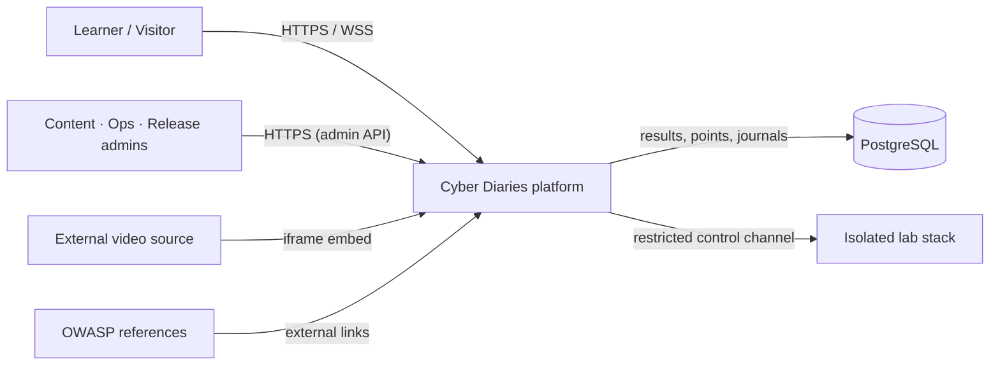

**Explicitly out of scope** (v0.1) — carried from `S26` and the Won't list:

| # | Item | Type | Reason |
|---|---|---|---|
| 1 | A full operating-system desktop | Technical / functional | Contradicts `CN-008` — the lab desktop is an interface only |
| 2 | Security tools built from scratch | Functional | Excluded by the `CN-007` rule |
| 3 | Long or high-cost animation per category and role | Content | Deferred as high-cost |
| 4 | Commercial SIEM simulation | Technical | Log analysis uses the lab tools `grep` / `tail` (PUC-022) |
| 5 | Multiple system templates | Architectural | Contradicts `CN-001` — one Modular Monolith |
| 6 | Multiplayer | Functional | PUC-019 |
| 7 | Mobile application | Functional | PUC-020 — phone support deferred (D12) |
| 8 | Certified credentials | Operational | — |
| 9 | Paid enterprise paths | Operational / commercial | Contradicts the no-cash-budget rule (S3.7) |
| 10 | Free-text evaluation of answers | Functional | Explicitly deferred (PUC-021, BR-16) |
| 11 | *Candidate* password change and account recovery | Functional | **Not a declared exclusion** — open question `OI-010` |

`[Source: MASTER.md — S26, S8.2, S18.1]`

### 3.2. Technical Context

| # | Adjacent system | Data content | Transport | Initiator | Protocol | Priority |
|---|---|---|---|---|---|---|
| 1 | Learner's browser (user client) | Browser requests, authentication, lab solutions | Internet / LAN | User via the browser | HTTPS / WSS | Must |
| 2 | Admin CMS interface | Lesson data, scene text, evaluation criteria, question banks | Protected network connection with administrator rights | Content / Release administrator | HTTPS (REST API) | Must |
| 3 | External video platforms | Streams of the embedded technical teaching videos | External internet | Learner's browser | HTTPS (iframe embedding) | Must |
| 4 | Isolated Docker service | Container lifecycle commands (start, stop, destroy) | Isolated internal network between services | On lab-session start or end | Docker Engine API / socket | Must |
| 5 | Web terminal (`ttyd`) | Shell commands and terminal input/output | Persistent bidirectional channel | Learner and lab container | WebSockets (WSS) | Must |
| 6 | In-browser code editor (Monaco) | Remediation source code and patch files | Client–server interface | Learner in the Developer role | HTTPS (JSON API) | Must |
| 7 | Primary database (PostgreSQL) | Accounts, records, journals, point movements | Local or encrypted network | Backend API services | TCP / PostgreSQL wire protocol | Must |

`[Source: MASTER.md — S13.2]`

**Atomic interface requirements:** `IF-001` unified REST/JSON free of GraphQL · `IF-002`
encrypted WebSockets (WSS) for the terminal · `IF-003` an isolated control interface for the
container service. `[Source: MASTER.md — S13.2]`

**Physical environment and productization:** `PE-001` the UI works in supported browsers with no
extra installation · `PE-002` device and screen-resolution compatibility `[TBD — D12 · OI-002]` ·
`PE-003` deployment bundles and backend are compatible with the cloud or university servers (D2) ·
`PR-001` packaging and automated deployment through Docker Compose / container manifests ·
`PR-002` configuration and connection strings kept out of the code via environment variables.
`[Source: MASTER.md — S13.1, S13.3]`

> **`[CONFLICT]` — the control channel between platform and lab.** `IF-003` and `S13.2` specify
> the **Docker Engine API / socket** as the transport for container-lifecycle commands, while
> threat model `TB-04` and `OI-TM-13` leave open whether the channel is an **SSH tunnel** or
> the **Docker API over an isolated network**. `Data.md` Q-11 answers a different question —
> platform-to-lab is "REST/JSON internally plus the Docker API (because we are on the same
> machine), and externally gRPC" — which does not match either reading and is itself logged as
> `OI-TM-04`. **Resolution rule: the channel is not yet decided.** It is the subject of the
> control-plane decision `ADR-002` (see S9) and remains open with a due date of 2026-11-08.
> `[Source: MASTER.md — S13.2, IF-003; Threat Model.md — TB-04, OI-TM-13, OI-TM-04;
> Architecture/Data.md — Q-11]`

> **`[CONFLICT]` — where the platform runs.** `MASTER.md` S3.2 (decision D2) names the
> deployment target as free cloud hosting (Oracle Cloud Free or Render) or the university
> server, while `Data.md` Q-19 and `ADR-001` put Development and Demo on the team's own laptop
> and reserve the server for Production after v1.0. **Resolution rule: both are true at
> different times** — the laptop carries Development and Demo in v0.1, the cloud/server carries
> Production post-v1.0 — but the *provider* itself is still undecided (`OI-007`), so `RA-001`
> (availability SLA) cannot be set. `[Source: MASTER.md — S3.2, D2, S12.4, S18.1;
> Architecture/Data.md — Q-19; ADR-001 — S2; Threat Model.md — S3.5]`

## 4. Solution Strategy

Cyber Diaries is a **modular monolith with a separated, isolated lab process**. The platform is
one deployable application with seven internal modules; the lab is a second, deliberately
separate process that owns the only Docker socket in the system and runs inside a virtual
machine. The split is not stylistic — it is the boundary that keeps untrusted learner code away
from learner data.

### 4.1 Top-level decomposition

| Decision | Choice | Rejected alternative | Why | Source |
|---|---|---|---|---|
| Architectural style | **Modular Monolith** — one runnable unit with clear internal module boundaries | Microservices | "Development and integration speed suited to a graduation team, with clearly bounded, testable modules" — a 12-member team with no independent deployment pipeline cannot operate services | CN-001, S4.1 |
| Domain modelling | **DDD bounded contexts, one per module** — the seven modules of `CN-001` | Shared entity model | `Data.md` Q-15 answers "نعم، 8 Bounded Contexts (تطابق الوحدات)" — an **owner input** stating eight bounded contexts that match the modules; it is a domain-model statement, not a module-decomposition decision, and it is not reconciled with `CN-001` | `Data.md` Q-15; S7.1, S7.2 |
| Layering | Layered style inside each module | Flat module | `Data.md` preamble: "modular monolithic architecture with layered style and event style" | `Architecture/Data.md` preamble |
| Process separation | The **lab service is a separate process** from the API, and the API never executes commands | In-process lab | "Running untrusted code is a security problem categorically different from managing users and content" | CN-002, S3.1 |
| Inter-module communication | **In-process calls + domain events**, no message bus | Message broker | `Data.md` Q-12 — a broker adds operational weight the single-node deployment cannot carry | `Data.md` Q-12; MASTER.md S13.2, S27.1 |
| Module public interface | Exactly one public interface per module, `I{Module}Service` | Exposing repositories / entities | `Data.md` Q-16 | `Data.md` Q-16 |
| API style | **REST/JSON**, GraphQL only with proven value | GraphQL | `CN-006`; `IF-001` requires a unified REST/JSON interface free of GraphQL | CN-006, IF-001 |
| Isolation | **VirtualBox VM → Docker → ephemeral container**, two boundaries | Container-only isolation | A container escape reaches only the guest; a second escape is needed to reach the host | `Data.md` Q-10; ADR-001; Threat Model.md S3.2, S5 |
| Verification | **Server-side automated verification**, never browser-side | Client-side self-check | "Self-test is not automated verification" — points and achievements are computed on the server, idempotently | CN-005, IN-001…IN-007 |
| State handling | `Evidence`, `PointTransaction`, `Achievement`, `VerificationResult`, `BehaviorEvent` are **append-only or immutable** | Mutable aggregates | The audit trail cannot be rewritten by the learner; S7.1 CRUD rules and S15.2 IN-005…IN-007 | MASTER.md S7.1, S15.2 |
| Content management | A **content panel** adds categories, lessons and scenarios without a code change | Code-driven content | `CN-009` — this is the precondition for generalizing the template to further categories | CN-009, MT-001 |
| Packaging | Docker Compose / container manifests, configuration via environment variables | Manual deployment | PR-001, PR-002 | MASTER.md S13.3 |

**Proposed 8th module (Analytics):** `SRC-C` Q-13 asks «**هل نضيف وحدة `Analytics` ثامنة**؟» and
answers «نعم (D-11)» — an **owner input**, not a signed-off requirement. Q-15 lists 8 Bounded
Contexts; Q-16 provides the public-interface rule `I{Module}Service` for every module.
**Until `CN-001` is formally amended, this document treats 7 as the current requirements
baseline and Analytics as `[PROPOSED]`.** The proposed `CN-001` text and the alternative
(a read-model inside `Progress`) are reproduced in S2.3; the decision is scheduled for
**2026-11-12**.
`[Source: Architecture/Data.md — Q-13, Q-15, Q-16; Requirements/Logs/Proposed Amendments - D3b, CN-001, CN-008, CN-022.md S2]`

### 4.2 Technology stack

The stack is fixed by decision D17 and by the no-cash-budget rule (S3.7); an incompatible
licence is a release blocker (D14).

| Layer | Technology | Version | Source |
|---|---|---|---|
| Frontend framework | React | fixed after build completion (D17) | S3.4, S19.2 |
| Frontend application | Next.js | **14** | S3.4, S19.2, D17 |
| Backend / API | ASP.NET Core | **.NET 10** | S3.4, S19.2, D17 |
| Database | PostgreSQL | **16** | S3.4, S19.2, D17 |
| Lab substrate | VirtualBox + Docker | fixed after build completion (D17) | S3.4, S19.2 |
| Lab tools | `ttyd` · `Monaco Editor` · `Adminer` · `curl` · `nmap` · `GPG` · `grep`/`tail` · browser developer tools | — | S3.4, S19.1 |
| Packaging | Docker Compose / container manifests + environment variables | — | PR-001, PR-002 |
| API documentation | Swagger / OpenAPI | — | MT-004, CN-018 |
| Browser client | Chrome and Edge, last two versions | — | S3.2, `Requirements/Data/data.md` S2 |

`[Source: Requirements Specification - MASTER.md — S3.4, S13.3, S19.1, S19.2]`

### 4.3 The two-boundary isolation strategy

This is the single most consequential strategy in the system and is the reason the architecture
exists in its current shape.

1. **Boundary 1 — container inside the guest.** The learner's commands run inside an ephemeral,
   network-isolated, unprivileged container with `--cap-drop=ALL`, `no-new-privileges`, a
   read-only root filesystem, seccomp/AppArmor and no host mounts. It is destroyed when the
   session ends or times out. `[Source: Threat Model.md — CTRL-LAB-03, CTRL-LAB-04, CTRL-LAB-05]`
2. **Boundary 2 — the VirtualBox guest inside the Windows host.** The lab service, Docker, `ttyd`
   and the containers live in an Ubuntu guest VM. No shared folders, no clipboard, no
   drag-and-drop; NAT plus a host-only network; snapshots before sessions.
   `[Source: Threat Model.md — CTRL-VM-01, CTRL-VM-02]`
3. **The platform stays outside.** Next.js, the API and PostgreSQL stay on the Windows host in
   the trusted zone, so a container escape — or even a full VM escape — still meets a second
   boundary before it can reach learner data. `[Source: ADR-001 S2; Threat
   Model.md S2.6 A-03]`

The alternative — putting the platform inside the VM — was rejected because a single VM escape
would then expose platform and lab together, defeating defence in depth. The memory budget
drives the same answer: the VM needs only ≈3.5–4 GB when it hosts the lab alone, against
≈5.5–6.5 GB if it also hosts the platform, on a 16 GB laptop.
`[Source: ADR-001 — S2, decision-options table: "✅ VM ≈ 4 GB" for option B against "❌ VM ≈ 5.5–6.5 GB" for option A]`

### 4.4 Decisions that are still open

The architecture is not finished, and this document does not pretend otherwise. The following
choices are explicitly unresolved in the sources and constrain what S5–S7 can claim.

| Open item | Why it matters | Owner / due | Source |
|---|---|---|---|
| **Module count: 7 or 8** | `CN-001` lists seven modules; `Data.md` Q-13/Q-15 and the threat model assume eight including Analytics as a read-only read-model. `MT-002` lists only six, omitting Administration. The building-block view in S5 is affected directly | Architecture Lead — 2026-11-12 (`OI-TM-02`, `OI-012`) | MASTER.md S3.1, S14.1, S6.2, S18.1; Threat Model.md OI-TM-02 |
| **Platform↔lab control channel** | SSH tunnel or Docker API over an isolated network? Determines `TB-04` implementation and the `T-11`/`T-22` controls | Architecture + DevOps — 2026-11-08 (`OI-TM-13`) | Threat Model.md OI-TM-13; ADR-001 |
| **API style at the external edge** | `Data.md` Q-11 says "gRPC externally" while `CN-006` mandates REST-first | Architecture Lead — 2026-11-12 (`OI-TM-04`) | Threat Model.md OI-TM-04; `Data.md` Q-11 |
| **Concurrency: 10 or 2** | `CP-001`/`RA-002`/`AC-004` still say 10; the capacity analysis says 2. Until this is amended the requirement is untestable | Owner + Supervisor — 2026-11-12 (`OI-TM-06`, `D3b`) | Threat Model.md OI-TM-06; MASTER.md S12.4, S12.6 |
| **Deployment provider** | Oracle Cloud Free, Render, or the university server. `RA-001` availability cannot be stated until the provider is chosen | `OI-007` | MASTER.md S3.2, S12.4, S18.1 |
| **Legal basis, consent text, retention** | Three separate `[TBD — D5]` items; no participant data may be collected before the model is approved | Ethics & compliance owner | MASTER.md S15.3, S15.4, S17, Appendix C.2; Threat Model.md OI-TM-10 |
| **Password hashing algorithm, password change, account recovery** | `AC-009` leaves the algorithm to a design decision inside S15.1; `FR-007` is suspended on `OI-010`; `OI-011` leaves username format and minimum password length open | Architecture + Backend | MASTER.md S7.2, S15.1, S18.1, S26 |
| **Isolation technology spike** | `ADR-001` is provisionally accepted and becomes final only after the isolation spike passes its gate (`IM-006`) | Lab/DevOps | ADR-001 S8; Threat Model.md S16 item 9 |
| **Per-role verification engines vs. one shared scenario** | `CTRL-ASSESS-02` specifies per-role verification engines while `CN-011` mandates one shared scenario per category | Architecture + Content | Threat Model.md CTRL-ASSESS-02; MASTER.md CN-011 |

## 5. Building Block View

Level 1 is the platform and its lab stack. Level 2 is the module decomposition of the Modular
Monolith. Level 3 opens the two modules whose internals genuinely constrain the architecture:
`Labs` and `Assessment`.

### 5.1. Whitebox Overall System

**Overview Diagram**

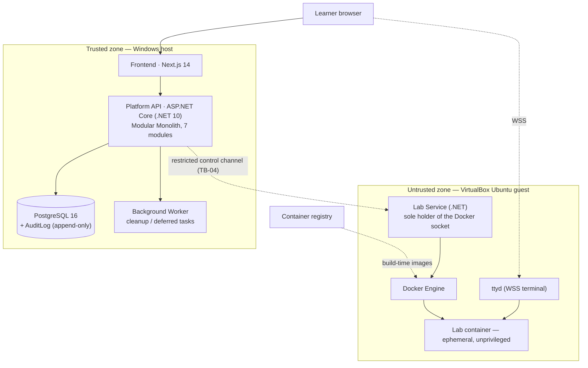

**Motivation**

The decomposition follows the two hard boundaries the project has: **trusted vs. untrusted
code**, and **one deployable vs. many modules**. The platform is one process because `CN-001`
forbids microservices and the team is twelve people; the lab is a second process because
`CN-002` requires it and because it is the only component allowed to touch the Docker socket.
Inside the platform, the modules exist so that DDD bounded contexts stay testable in isolation
(`MT-002`) while remaining one deployment unit.
`[Source: MASTER.md — CN-001, CN-002, MT-002; Threat Model.md — S3.2, S9.1; ADR-001 S2]`

**Contained Building Blocks**

| # | Building block | Kind | Runs on | Responsibility | Source |
|---|---|---|---|---|---|
| 1 | **Frontend** — Next.js 14 / React | Application | Windows host | Home, registration, login, dashboard, learning path, narrative rendering engine, lab UI, three role workspaces, journals, leaderboard, virtual desktop shell, external video player | MASTER.md S3.2, S3.4, Project Description EN S14 |
| 2 | **Platform API** — ASP.NET Core (.NET 10), Modular Monolith | Application service | Windows host | The seven modules below; every platform capability | MASTER.md S3.2, CN-001 |
| 3 | **Lab Service** — .NET service | Application service | Ubuntu guest VM | Lab session lifecycle; the **only** component that talks to the Docker socket | MASTER.md S3.2; Threat Model.md S3.2, CTRL-LAB-01 |
| 4 | **Docker Engine** | Infrastructure | Ubuntu guest VM | Container creation, isolation enforcement, resource limits | Threat Model.md S3.2 |
| 5 | **ttyd** | Infrastructure | Ubuntu guest VM | Browser terminal bridge (WSS) into the learner's container | Threat Model.md S3.2, CTRL-LAB-08 |
| 6 | **Lab container** — ephemeral, unprivileged | Runtime environment | Inside Docker | The fictional vulnerable target application plus the learner tools | Threat Model.md S3.2, CTRL-LAB-03 |
| 7 | **PostgreSQL 16** + `AuditLog` | Data store | Windows host | Accounts, content, sessions, results, points, journals, telemetry; append-only audit table | MASTER.md S3.2, S7.1; Threat Model.md S3.2 |
| 8 | **Background Worker** | Process | Windows host | Container cleanup and reaper, deferred tasks | MASTER.md S3.2, S20.1 NP-001, S27.1 ID-005 |
| 9 | **Container registry** | External | Docker Hub / local build cache | Supplies pre-built lab and service images | Threat Model.md S3.2, CTRL-LAB-09 |

**Important Interfaces** *(optional)*

| Interface | Direction | Transport | Content | Requirement |
|---|---|---|---|---|
| Browser → Frontend | Inbound | HTTPS / WSS | Page requests, credentials, lab solutions | S13.2 (1) |
| Frontend → API | Internal | HTTPS, REST/JSON | Commands and queries | IF-001, TB-02 |
| API → Lab Service | Cross-zone | **Undecided** — SSH tunnel or Docker API over an isolated network | Session start / stop / destroy commands | IF-003, TB-04 · `[CONFLICT]` — see S3.2 |
| Browser → ttyd | Cross-zone | WSS | Terminal input and output | IF-002, TB-01 → TB-04 → TB-06 |
| API → PostgreSQL | Internal | TCP / PostgreSQL wire protocol | SQL, results, audit writes | TB-03 |
| Lab Service → Docker Engine | Inside VM | Docker Engine API / socket | Container create / exec / destroy | TB-05 |

#### 5.1.1. Frontend — Next.js 14

**Purpose / Responsibility** — renders every learner-facing and administrator-facing surface:
public home, registration, login, the landing dashboard, category pages, the learning path, the
narrative rendering engine (both timelines), the story-scene / lab-introduction / transition
players, the embedded external video player, the virtual desktop interface, the three role
workspaces, the journal editor and the optional leaderboard. It also proxies the terminal
channel. `[Source: MASTER.md S3.2; Project Description EN S14]`

**Interface(s)** — HTTPS/WSS to the browser; REST/JSON to the API; proxies the terminal channel
rather than exposing `ttyd` directly (`CTRL-LAB-08`). `[Source: MASTER.md S13.2; Threat Model.md
CTRL-LAB-08]`

**(Optional) Quality/Performance Characteristics** — no extra installation on the learner
device (`PE-001`); Chrome and Edge, last two versions.
`[Source: MASTER.md S13.1, S3.2]`

**(Optional) Fulfilled Requirements** — `PE-001`; parts of `FR-024` (the simplified path, D8);
the experience rules (skippable scenes require an equivalent summary; scenes must not reveal
assessment answers). `[Source: MASTER.md S13.1, S8.1; Project Description EN S4.5]`

**(Optional) Open Issues/Problems/Risks** — the browser-support decision `D12` is still open,
so `PE-002` (device and screen-resolution compatibility) cannot be specified.
`[Source: MASTER.md S12.4, S18.1; Requirements/Data/data.md S6]`

#### 5.1.2. Platform API — ASP.NET Core Modular Monolith

**Purpose / Responsibility** — the single deployed application service carrying all seven
modules; it owns identity, content, lab orchestration, assessment, progress, gamification and
administration. It **never** executes a learner command.
`[Source: MASTER.md S3.1 CN-001, S3.2; Threat Model.md CTRL-LAB-01]`

**Interface(s)** — REST/JSON on `/api/v1` with Swagger/OpenAPI documentation (`IF-001`,
`MT-004`); access to PostgreSQL; the cross-zone control channel to the Lab Service.
`[Source: MASTER.md S13.2, MT-004; Threat Model.md S12]`

**(Optional) Quality/Performance Characteristics** — simple API response &lt; 500 ms, composite
request &lt; 2 s (`SP-001`, `SP-002`); one deployed service on the target environment, except the
lab service required by `CN-002`. `[Source: MASTER.md S12.1, S3.2]`

**(Optional) Directory/File Location** — not stated in the sources.
`[Source: MASTER.md S3.2 — no module directory layout is specified]`

**(Optional) Fulfilled Requirements** — `CN-001`, `CN-002`, `CN-005`, `CN-006`, `CN-009`,
`MT-002`, `MT-004`, `AC-001`…`AC-009`, `AU-001`…`AU-004`, `PV-001`…`PV-007`.

**(Optional) Open Issues/Problems/Risks** — the module count is disputed (7 vs 8) and the
control channel is undecided; see S4.4.

#### 5.1.3. Lab Service — Ubuntu guest VM

**Purpose / Responsibility** — owns the lab session lifecycle: create, monitor, destroy the
container; enforce the resource limits; collect the session log. It is the **sole holder of the
Docker socket**; the API never executes commands. `[Source: Threat Model.md S3.2, CTRL-LAB-01,
CTRL-LAB-05, CTRL-LAB-07]`

**Interface(s)** — inbound only from the platform over the restricted control channel, with a
per-session token bound to learner + session (`CTRL-LAB-02`); outbound to the Docker Engine
socket only. `[Source: Threat Model.md TB-04, CTRL-LAB-02]`

**(Optional) Quality/Performance Characteristics** — container ready in **&lt; 90 s** with
pre-pulled images (`SP-003`, `CTRL-LAB-09`); 1.5 GB RAM, 1 vCPU, 256 PIDs, 60/120-minute
timeout (`CTRL-LAB-07`). `[Source: Threat Model.md S5, S12]`

**(Optional) Fulfilled Requirements** — `CN-002`, `CN-003`, `CN-004`, `IM-001`, `IM-003`,
`IM-005`, `SC-001`, `SC-004`.

**(Optional) Open Issues/Problems/Risks** — `OI-TM-13` (channel choice), `OI-TM-14` (the WSS
proxy path from the browser to `ttyd` must be specified), `OI-TM-09` (a legacy "command in the
API process" threat had no exact counterpart). `[Source: Threat Model.md S17.1]`

#### 5.1.4. Lab container — ephemeral, unprivileged

**Purpose / Responsibility** — hosts the fictional vulnerable target application and the
learner's tools; it is the only place learner commands execute.
`[Source: Threat Model.md S3.2; MASTER.md CN-003]`

**Interface(s)** — terminal over `ttyd`/WSS with a per-session path and token; the in-browser
editor talks to the API, not to the container directly. `[Source: MASTER.md S13.2 (5), (6);
Threat Model.md CTRL-LAB-08]`

**(Optional) Quality/Performance Characteristics** — non-root, `--cap-drop=ALL`,
`no-new-privileges`, read-only root filesystem, seccomp/AppArmor, no host mounts, `--internal`
Docker network with no default route and no DNS, no university or internet egress.
`[Source: Threat Model.md CTRL-LAB-03, CTRL-LAB-04]`

**(Optional) Open Issues/Problems/Risks** — `T-30` (learner uses `nmap`/`curl` to attack the
university network or the internet) is rated **Critical** if egress is not truly denied; egress
denial is therefore the single most important property of this block. The container
technology itself is still unselected — `SysBox` is named in the workflow documentation but
`ADR-002` is still to decide it after the isolation spike.
`[Source: Threat Model.md S10 (T-30), S17.3; Workflow Docs.md S7, S13]`

#### 5.1.5. PostgreSQL 16 + `AuditLog`

**Purpose / Responsibility** — stores accounts, content, sessions, results, points, journals
and telemetry; the `AuditLog` table is an append-only store for sensitive operations and the
lab lifecycle. `[Source: MASTER.md S3.2, S7.1; Threat Model.md S3.2]`

**Interface(s)** — TCP / PostgreSQL wire protocol; least-privilege database role; the database
user has **no UPDATE/DELETE** on `AuditLog`. `[Source: MASTER.md S13.2; Threat Model.md
CTRL-DATA-01, CTRL-LOG-02]`

**(Optional) Quality/Performance Characteristics** — encryption at rest for the platform
database and backups (`CTRL-DATA-02`); nightly `pg_dump` with a restore test before the pilot
(`CTRL-DATA-04`).

**(Optional) Open Issues/Problems/Risks** — `G-04`: there is **no backup/restore requirement**
in the specification, only risk `T-40`; and `OI-TM-10`: audit retention is set to 7 years
(`Q-40`) while the `D5` retention policy is still unapproved.
`[Source: Threat Model.md S13.2, S17.1]`

#### 5.1.6. Background Worker

**Purpose / Responsibility** — cleanup and deferred tasks: reaping orphaned containers,
expiring sessions. `[Source: MASTER.md S3.2, S20.1 NP-001, S27.1 ID-005]`

**Interface(s)** — reads and writes PostgreSQL; calls the Lab Service through the same
control channel. `[Source: MASTER.md S13.2]`

**(Optional) Quality/Performance Characteristics** — the reaper is the corrective half of
`CTRL-LAB-05` (ephemeral lifecycle) and `CTRL-LAB-06` (admission control).
`[Source: Threat Model.md CTRL-LAB-05, CTRL-LAB-06]`

### 5.2. Level 2

The seven modules of the Modular Monolith, with the data each one owns. The dependency map is
`Identity → all`, `LearningContent → Labs → Assessment → Progress → Gamification`,
`Administration → LearningContent`, `Analytics → all`.
`[Source: Architecture/Data.md — Q-14, Q-15, Q-16; MASTER.md S3.2, S7.2]`

| Module | Responsibility | Owned entities | Depends on | Source |
|---|---|---|---|---|
| `Identity` | The learner and the login account — credentials and administrative role | `User`, `Account` | — | S3.2, S7.2 |
| `LearningContent` | Category, lesson, scene, content and external resources | `LearningCategory`, `Lesson`, `ExternalResource` | `Identity` | S3.2, S7.2 |
| `Labs` | `LabSession`, `LabTask`, the lab environment and the container lifecycle | `LabSession`, `LabTask`, `LabTool` | `Identity`, `LearningContent` | S3.2, S7.2 |
| `Assessment` | `QuizQuestion`, `Evidence`, `VerificationResult`, automated verification | `QuizQuestion`, `Evidence`, `VerificationResult` | `Labs` | S3.2, S7.2 |
| `Progress` | `Progress` — a learner's state within a category | `Progress` | `Assessment` | S3.2, S7.2 |
| `Gamification` | `PointTransaction`, `Achievement` | `PointTransaction`, `Achievement` | `Progress` | S3.2, S7.2 |
| `Administration` | Content, releases and settings management | — | `LearningContent` | S3.2 |
| `Analytics` *(proposed)* | Read-model for the study's quantitative and qualitative data | — | reads `BehaviorEvent` and `Progress`, writes to neither | `Data.md` Q-13; amendments file S2 |

Each module exposes exactly one public interface, `I{Module}Service`.
`[Source: Architecture/Data.md — Q-16]`

> **`[CONFLICT]` — three different module counts.** `CN-001` and the workflow documentation
> say **7**; `Architecture/Data.md` Q-13/Q-15, the threat model S3.2 and the DFD say **8**
> (adding `Analytics`); `MT-002` lists only **6**, omitting `Administration`. S5.2 above shows
> the seven-module reading, which is the one written into `CN-001` today, and adds `Analytics`
> as a clearly-marked proposal. The decision is due 2026-11-12 (`OI-TM-02` / `OI-012`).
> `[Source: MASTER.md S3.1, S14.1; Data.md Q-13, Q-15; Threat Model.md S3.2, OI-TM-02]`

> **`[GAP]` — entities with no owning module.** `JournalEntry` (BR-01), `BehaviorEvent`
> (F-01), `ContinuityEntry` (BR-12) and `LabTool` (CN-007) are in the data dictionary but no
> module is named as their owner. `NarrativeScene` is owned by the *narrative rendering
> engine*, which is a component of the frontend rather than one of the seven modules. The
> building-block view therefore does not yet close over the data model.
> `[Source: MASTER.md S7.1, S7.2]`

#### 5.2.1. Identity

**Purpose / Responsibility** — account creation, authentication, the learner's profile and the
administrative role held on `Account.Role`. `[Source: MASTER.md S3.2, S7.2]`

**Interface(s)** — `IIdentityService`; consumed by every other module for identity and role
checks. `[Source: Data.md Q-14, Q-16]`

**Internal structure** — `User` 1—1 `Account`; `User` 1—* to `LabSession`, `JournalEntry`,
`Progress`, `PointTransaction`, `Achievement` and `BehaviorEvent`. The account role decides
every administrative capability, and the role is verified on the server for every
administrative request (`AC-002`). `[Source: MASTER.md S7.1, S15.1]`

**(Optional) Open Issues/Problems/Risks** — the password-hash algorithm is left to a design
decision inside S15.1 (`AC-009`); `FR-007` (password change and recovery) is suspended on
`OI-010`; username format and minimum password length are open on `OI-011`.
`[Source: MASTER.md S7.2, S15.1, S18.1, S26]`

#### 5.2.2. LearningContent

**Purpose / Responsibility** — the OWASP categories, lessons, narrative scenes and external
resources that form the learning path. `[Source: MASTER.md S3.2, S7.2]`

**Interface(s)** — `ILearningContentService`; consumed by `Labs` and by `Administration`.

**Internal structure** — `LearningCategory` 1—* `Lesson` / `NarrativeScene` / `LabTask` /
`Progress`; `Lesson` 1—* `ExternalResource` / `QuizQuestion`. A category is a **risk area**, not
a single vulnerability, and carries one representative educational case; each category holds
three external references and one embedded video. `[Source: MASTER.md S7.1, S3.3, S4.1]`

**Internal structure (narrative)** — `NarrativeScene` carries `Kind`, `TimelinePhase`,
`DurationSeconds` and `SummaryText`; the `ContinuityEntry` table (owner unassigned) keeps the
chronological order so the protagonist is never shown working at NoorTech before joining.
`[Source: MASTER.md S7.1, S7.2; Project Description EN S4.4, S8.1]`

#### 5.2.3. Labs

**Purpose / Responsibility** — `LabSession`, `LabTask`, the lab environment and the container
lifecycle; it is the module that talks to the Lab Service. `[Source: MASTER.md S3.2, S7.2]`

**Interface(s)** — `ILabsService`; outbound to the Lab Service over the control channel.
`[Source: Data.md Q-14, Q-16; Threat Model.md TB-04]`

**Internal structure** — `LabSession` 1—1 `LabTask`, 1—* `VerificationResult`, 1—* `Evidence`,
1—0..1 `JournalEntry`; `LabTask` 1—* `LabTool`. A session records `Difficulty`, `Role`,
`StartedAt`, `ExpiresAt` and `Status`.
`[Source: MASTER.md S7.1, S7.2]`

**Internal structure (lifecycle)** — a session is created `Pending`, becomes `Provisioning`
while the container is created, `Active` once the environment is ready, and ends as `Expired`
or `Destroyed`; the session log records start, end and destruction with actor, container id
and image digest (`CTRL-LOG-04`). `[Source: Workflow Docs.md S7; Threat Model.md S11, CTRL-LOG-04]`

#### 5.2.4. Assessment

**Purpose / Responsibility** — the question bank, the evidence collected from the lab, and the
automated verification that decides whether a task is solved. `[Source: MASTER.md S3.2, S7.2]`

**Interface(s)** — `IAssessmentService`; produces the `VerificationResult` that `Progress` and
`Gamification` consume.

**Internal structure** — verification rules, answer banks and expected results are stored
**server-side, versioned, and never exposed to the client**; results are immutable and bound to
the session (`CTRL-ASSESS-01`). Three verification engines are **specified**, one per role: the security
outcome for Red Team, the inference-chain rubric for Blue Team, and the automated test suite
for Developer (`CTRL-ASSESS-02`).
`[Source: Threat Model.md CTRL-ASSESS-01, CTRL-ASSESS-02]`

**(Optional) Open Issues/Problems/Risks** — `G-02`: there is no requirement beyond `PA-002`
covering verification integrity, so `T-31` is traced to a gap. `[Source: Threat Model.md S13.2]`

#### 5.2.5. Progress

**Purpose / Responsibility** — a learner's progress state within a category; the completion
percentage is computed from the actually stored records, never estimated (`PA-003`).
`[Source: MASTER.md S3.2, S7.1, S12.3]`

**Interface(s)** — `IProgressService`; consumed by `Gamification` and by the dashboard.

#### 5.2.6. Gamification

**Purpose / Responsibility** — `PointTransaction` and `Achievement`. Points are computed on the
server, idempotently by `SourceId`, with the difficulty multiplier fixed at the moment of
success (`CTRL-SCORE-01`); `PointTransaction` is append-only and `Achievement` is not updated
after it is unlocked (`CTRL-SCORE-02`). `[Source: Threat Model.md CTRL-SCORE-01, CTRL-SCORE-02;
MASTER.md S7.1, S15.2]`

**Interface(s)** — `IGamificationService`; consumes `Progress` and the `VerificationResult`.

**Internal structure** — the difficulty multiplier is Easy 1.0 · Medium 1.5 · Hard 2.0, and the
arithmetic must be exact to 100 % with no rounding (`PA-001`). The leaderboard is closed by
default (opt-in, D13), shows display names only, and can be hidden completely (`PV-007`,
`BR-06`). `[Source: MASTER.md S12.3, S15.1; Workflow Docs.md S8]`

#### 5.2.7. Administration

**Purpose / Responsibility** — content and release management: categories, lessons, scenes and
quizzes are added without touching code, while lab operating settings stay strictly separated
from text content (`CN-009`, `MT-001`). `[Source: MASTER.md S3.1 CN-009, S14.1 MT-001]`

**Interface(s)** — `IAdministrationService`; consumed by `LearningContent`; the three
administrative roles map to it as content management (`AC-006`), lab lifecycle and limits
(`AC-005`), and assessment/points/difficulty/releases (`AC-007`).
`[Source: MASTER.md S15.1; Workflow Docs.md S13]`

**(Optional) Open Issues/Problems/Risks** — `S15.1` carries an explicit unresolved conflict:
the "view learning page" row forbids the content administrator from reading, while `AC-006`
and the "manage content" row grant that role the addition and editing of lessons and scenes.
The specification states: **do not change the matrix before the supervisor decides.**
`[Source: MASTER.md S15.1 note]`

#### 5.2.8. Analytics `[PROPOSED]` — not a module of the current baseline

| Field | Content | Source |
|---|---|---|
| **Status** | `[PROPOSED]` — an owner input, **not** part of the `CN-001` baseline and not signed off | `Architecture/Data.md` Q-13 |
| **Purpose / Responsibility** | `Q-13` asks «**هل نضيف وحدة `Analytics` ثامنة**؟» and answers «نعم (D-11)». The proposed amendment describes the module as a **read-only read-model**: it consumes `BehaviorEvent` and `Progress`, writes to neither, and owns no data of its own; any future analytical write would require an ADR amending the constraint, precisely to avoid a circular dependency `Progress ← Analytics ← Progress` | `Data.md` Q-13; `Requirements/Logs/Proposed Amendments - D3b, CN-001, CN-008, CN-022.md` S2 |
| **Interface** | `IAnalyticsService` — the instantiated form of the pattern `I{Module}Service` that Q-16 mandates for every module. **Note:** Q-16 states the pattern, not this literal string | `Data.md` Q-16 |
| **Entities** | `[GAP — not defined in Requirements S7.1]` — no `Analytics` entity appears in the data dictionary | `Requirements Specification - MASTER.md` S7.1 |
| **Bounded contexts** | Q-15 answers «نعم، 8 Bounded Contexts (تطابق الوحدات)». This is a **domain-model statement**, not a module-decomposition decision, and it does not by itself mean eight approved or implemented modules | `Data.md` Q-15 |
| **Alternative if not adopted** | Keep `CN-001` at **seven** modules and implement the analytics as a read-model **inside** `Progress`, without a separate module | `Proposed Amendments …` S2 |

The decision is scheduled for **2026-11-12** (team meeting), when the amendments file states it
will either settle the eighth module or keep `CN-001` at seven. Until then, `CN-001` governs and
this section describes a proposal.
`[Source: Architecture/Data.md — Q-13, Q-15, Q-16; Requirements/Logs/Proposed Amendments - D3b, CN-001, CN-008, CN-022.md S2]`

### 5.3. Level 3

Only two level-2 blocks are opened further, because only these two carry decisions that are not
yet fixed.

#### 5.3.1. White Box — Labs module

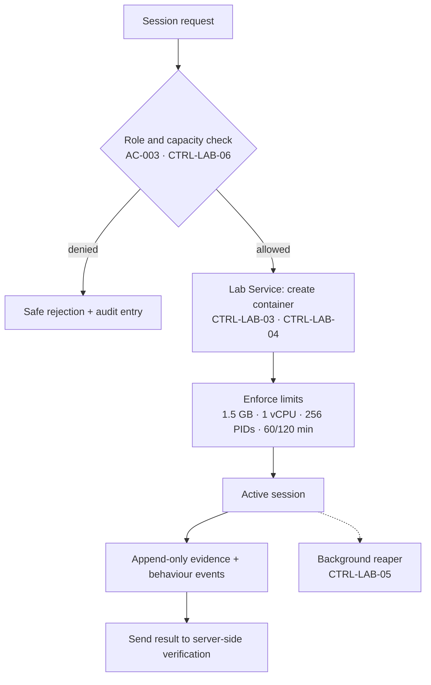

The session request is authorized against the learner's own role and the declared capacity
before anything is provisioned; the denial path is safe and audited. Provisioning applies the
container hardening and the egress denial before the environment is declared ready. The reaper
is the corrective path for a session that ends without a clean teardown.
`[Source: Workflow Docs.md S7; Threat Model.md CTRL-LAB-02…CTRL-LAB-06]`

#### 5.3.2. White Box — Assessment module

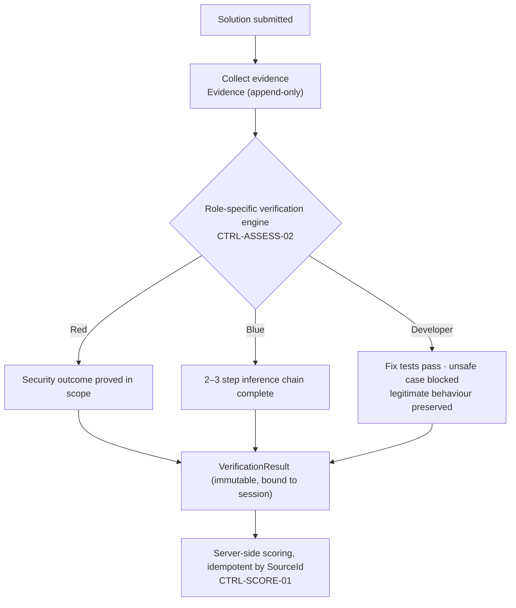

Failure or insufficient evidence produces a specific educational feedback message and an
optional retry **within the same session**; giving up ends the task without points — no
counting happens on failure. `[Source: Workflow Docs.md — mermaid graph; MASTER.md CN-005,
IN-001…IN-007]`

## 6. Runtime View

Twelve scenarios are documented: the ten the owner selected, plus the two security scenarios
that the owner explicitly asked to be documented as runtime scenarios.
`[Source: Architecture/Data.md — Q-17, Q-18]`

### 6.1. Register and Login

| Field | Value |
|---|---|
| **Context/Background** | A visitor reaches the public home page of Cyber Diaries. The home page introduces the platform, states that the current release is one complete Injection episode, and offers *Get Started* and *Login* |
| **Source/Stimulus** | The visitor submits the registration form with a username, a password and an optional display name |
| **Metric/Acceptance Criteria** | A valid, non-duplicate registration creates an `Account` with an active `User` and an authentication session, and lands on the dashboard. An invalid registration re-raises the error on the offending field only. No authentication error message reveals whether an account exists (`FR-004`) |

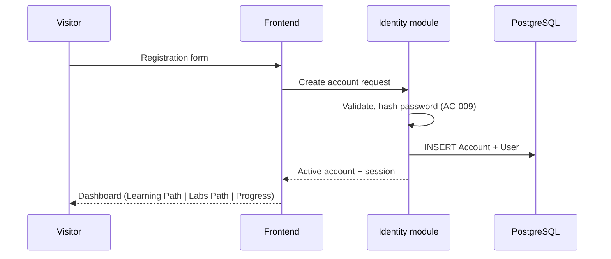

**Notable interactions** — the password is never stored in clear text; the role is written on
`Account` at creation; every later administrative request re-verifies that role on the server
(`AC-002`). `[Source: MASTER.md S7.2, S15.1, Workflow Docs.md S1]`

### 6.2. Start Lab Session

| Field | Value |
|---|---|
| **Context/Background** | An authenticated learner on the dashboard chooses the category and requests a lab session |
| **Source/Stimulus** | The learner submits a session request; the server authenticates the account and checks whether a session may start |
| **Metric/Acceptance Criteria** | If authorized, the Lab Service creates an ephemeral, network-isolated container and reports it ready **within 90 s** (`SP-003`) with limits applied (1.5 GB RAM, 1 vCPU, 256 PIDs, 60 min default / 120 max). If not authorized, the request is rejected safely and the attempt is audited. A third concurrent request **queues** (`D3b`, `CTRL-LAB-06`) |

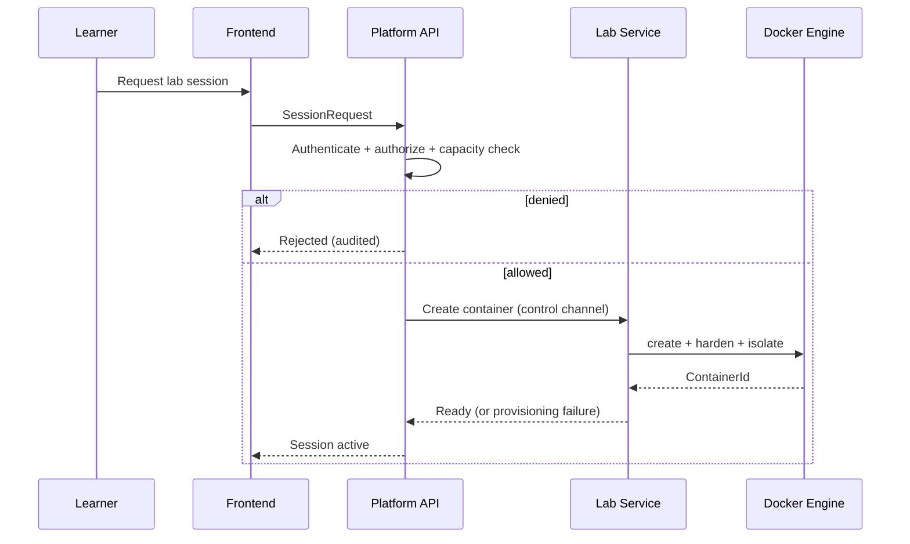

**Notable interactions** — the API never touches the Docker socket; the Lab Service is its sole
holder (`CTRL-LAB-01`). Egress denial is applied before the environment is declared ready
(`CTRL-LAB-04`). Provisioning failure is recorded and any partial environment is cleaned up.
`[Source: Workflow Docs.md — mermaid graph; Threat Model.md CTRL-LAB-01, CTRL-LAB-03, CTRL-LAB-04]`

### 6.3. Execute Command in the Lab

| Field | Value |
|---|---|
| **Context/Background** | The learner is in a role workspace: Red Team (browser + developer tools + `ttyd` + `curl`/`nmap`), Blue Team/SOC (logs + `grep`/`tail` + `Adminer` + `ttyd`), or Developer (`Monaco Editor` + linter + automated tests) |
| **Source/Stimulus** | The learner types a command into the terminal, or edits a file in the in-browser editor |
| **Metric/Acceptance Criteria** | The command executes **only inside the lab container**, never in the API process and never on the host (`CN-002`, `CN-004`). The terminal is reachable only through the authenticated reverse proxy over WSS with a per-session path and token (`CTRL-LAB-08`) |

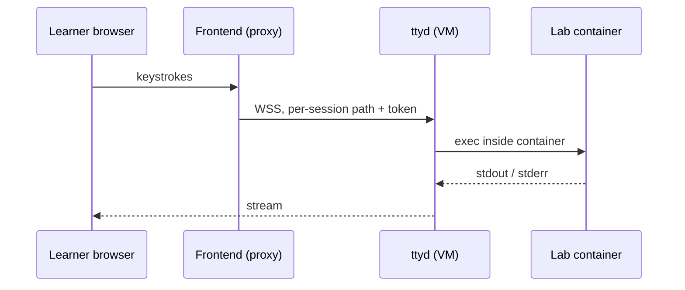

**Notable interactions** — `ttyd` is never exposed directly; it sits behind the authenticated
proxy and speaks WSS only. The learner's identity inside the sandbox is not attributable — the
session binding happens at the platform layer (`CTRL-LAB-02`, Threat Model S7.1).
`[Source: Threat Model.md CTRL-LAB-02, CTRL-LAB-08, S7.1]`

### 6.4. Submit Solution

| Field | Value |
|---|---|
| **Context/Background** | The learner believes the task is solved and submits the result to the server |
| **Source/Stimulus** | The learner submits from the role workspace; the solution travels from the frontend to the API, and evidence travels from the container |
| **Metric/Acceptance Criteria** | Evidence and behaviour events are recorded **append-only** — no learner mutation path exists (`CTRL-SCORE-02`). A `SourceId` makes the submission idempotent, so a resubmission cannot award points twice (`CTRL-SCORE-01`) |

**Notable interactions** — evidence is captured by path, kind and creation time; the session
log binds the container id and the image digest so the evidence can be tied to an exact
environment. `[Source: MASTER.md S7.1, S15.2 IN-005…IN-007; Threat Model.md CTRL-SCORE-01,
CTRL-SCORE-02, CTRL-LOG-04]`

### 6.5. Verify Result

| Field | Value |
|---|---|
| **Context/Background** | A solution has been submitted and the server decides whether it is correct |
| **Source/Stimulus** | The Assessment module runs the role-specific verification engine |
| **Metric/Acceptance Criteria** | The verification result and its feedback are returned **within 3 s** (`SP-004`). The result is immutable and bound to the session. Verification rules and expected results are stored server-side and versioned, and are **never exposed to the client** (`CTRL-ASSESS-01`) |

| Role | Pass condition | Source |
|---|---|---|
| Red Team | The security outcome is proved inside the lab scope | CTRL-ASSESS-02 |
| Blue Team / SOC | A two- to three-step inference chain is completed | CTRL-ASSESS-02 |
| Developer | The fix's tests pass, the unsafe case is blocked, and legitimate functionality is preserved | CTRL-ASSESS-02 |

**Notable interactions** — a failure or missing evidence yields a specific educational
feedback message and an optional retry inside the same session; giving up ends the task
without points. `[Source: Workflow Docs.md — mermaid graph; MASTER.md S12.1, CN-005]`

### 6.6. Write Journal

| Field | Value |
|---|---|
| **Context/Background** | After a successful verification, the learner may keep a diary entry |
| **Source/Stimulus** | The learner answers four questions: *What happened? Why did it happen? What did I do? What did I learn?* |
| **Metric/Acceptance Criteria** | The journal is **optional**: skipping it neither blocks progress nor deducts points. Saving it may earn optional extra points. The entry is stored and is not directly editable by the user |

**Notable interactions** — the journal is both a learning artefact and the study's qualitative
measurement instrument (`JournalEntry` records `WhatHappened`, `WhyHappened`, `WhatIDid`,
`WhatILearned`, `SavedAt`); it is the only learner-authored content that carries personal
meaning, so it is excluded from educational logs and research exports (`CN-014`, `PV-006`).
`[Source: MASTER.md S7.2, S15.3 PV-002/PV-006, CN-014; Project Description EN S7; Workflow
Docs.md S7]`

### 6.7. Lab Session Lifecycle (state machine)

The authoritative lab lifecycle is `Workflow Docs.md` S13 (`# 13) Workflow تشغيل المعمل تقنيًا`,
sub-heading `##生命周期 الجلسة`). The state diagram below is reproduced from that source
verbatim; the trigger column is taken from the S13 fourteen-step table and the S7 / S22
flowcharts, because the S13 diagram itself labels no edge.

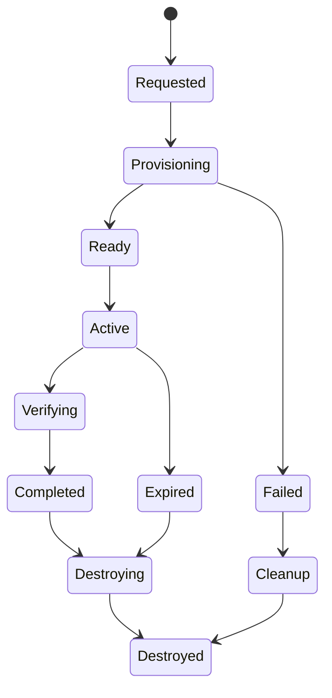

| From | To | Trigger in the source |
|---|---|---|
| `[*]` | `Requested` | step 1 — المستخدم يطلب بدء جلسة · Frontend → API · `SessionRequest` |
| `Requested` | `Provisioning` | step 3 — API يرسل طلب تشغيل معمل · Labs Service · `ContainerJob` |
| `Provisioning` | `Ready` | step 5 — تُحمَّل الأدوات والتطبيق التجريبي · Container · Ready environment |
| `Ready` | `Active` | step 6 — تُربط واجهة المستخدم بـ ttyd/Monaco/Adminer · Frontend/Labs · Active session |
| `Active` | `Verifying` | step 9 — المستخدم يرسل نتيجة · API · `VerificationRequest` |
| `Verifying` | `Completed` | step 10 — Assessment يتحقق · Backend · `VerificationResult`; step 11 — تُحفظ النقاط والتقدم · Gamification/Progress · DB records |
| `Completed` | `Destroying` | step 13 — تُدمَّر الحاوية · Docker + SysBox/Labs · Cleanup |
| `Destroying` | `Destroyed` | step 14 — يُسجَّل تنظيف الموارد · AuditLog · Completed |
| `Active` | `Expired` | step 12 — تنتهي الجلسة أو ينتهي الوقت · Background Worker · Expiry |
| `Expired` | `Destroying` | step 13 — تُدمَّر الحاوية · Docker + SysBox/Labs · Cleanup |
| `Provisioning` | `Failed` | `Workflow Docs.md` S22ب — `C -- لا --> E[Failed]` (container creation failed) |
| `Failed` | `Cleanup` | `Workflow Docs.md` S22ب — `E --> F[Cleanup]` |
| `Cleanup` | `Destroyed` | `Workflow Docs.md` S22ب — `F --> G[رسالة للمستخدم: تعذر بدء المعمل]` |

**Terminal state.** `Destroyed` is the only lab-session state with **no outgoing transition**
in S13. `Requested`, `Provisioning`, `Ready`, `Active`, `Verifying`, `Completed`, `Destroying`,
`Expired`, `Failed` and `Cleanup` all have at least one outgoing edge.
`[Source: Workflow Docs.md — S13, S22ب]`

**Timeout behaviour** — the S13 operational-limits table states `مدة الجلسة الافتراضية | 60 دقيقة`
and `الحد الأقصى | 120 دقيقة`; the expiry is performed by the `Background Worker` (step 12).
`[Source: Workflow Docs.md — S13, "قيود تشغيلية محسومة"]`

**Cleanup behaviour** — step 13 destroys the container (`Docker + SysBox/Labs`) and step 14
records the resource cleanup in the `AuditLog`. The S13 critical-security rules add that the
container is destroyed automatically after the session and that a `Background Worker / Container
Reaper` cleans up orphan containers. `[Source: Workflow Docs.md — S13, steps 13–14 and
"قواعد أمنية حرجة"]`

> **`[CONFLICT]` — two state machines in the same source.** `Workflow Docs.md` S20 ب) repeats the
> S13 diagram but adds two edges that S13 does not contain: `Active --> Paused` and
> `Paused --> Active`, backed by the S22ج disconnect flow (`Active session → انقطاع اتصال؟ →
> Paused/Grace period → عاد خلال المهلة؟ → Resume`). The source states which of the two
> supersedes the other nowhere. **Resolution rule: S13 is authoritative**, because S13 alone
> carries the timeout, cleanup and security rules; the `Paused` branch is recorded here as a
> documented divergence rather than merged into the diagram.
> `[Source: Workflow Docs.md — S13 vs S20 ب), S22ج]`

> **`[GAP]` — no transition for a container that dies mid-session.** The source defines a
> provisioning-failure branch (`Provisioning --> Failed`) and a user-disconnect branch, but
> **no** transition leaves `Active` for `Failed` when the container dies, the Docker daemon
> stops, or the host runs out of memory. The absence is consistent with owner input
> `Q-58`/`Q-59`/`Q-60`/`Q-61`, which ask for exactly those risks to be added
> (`RK-013`, `RK-014`, `RK-015`, `RK-016`) — see S11.1b.
> `[Source: Workflow Docs.md — S13, S20 ب), S22; Architecture/Data.md — Q-58…Q-61]`

> **`[CONFLICT]` — the operational-limits table still carries the pre-audit capacity.**
> S13's own table states `التزامن المستهدف | 10 متعلمين` and `ذاكرة الحاوية | 2GB RAM`, which
> the capacity analysis rejects (10 × 2 GB = 20 GB on a 16 GB host). The working values remain
> 2 sessions and 1.5 GB — see S7.1 and the proposed `D3b`.
> `[Source: Workflow Docs.md — S13, "قيود تشغيلية محسومة"]`

### 6.8. Lab Failure

| Field | Value |
|---|---|
| **Context/Background** | Container provisioning fails, or the container dies during the session |
| **Source/Stimulus** | The Lab Service cannot bring the environment ready, or the engine reports the container as gone |
| **Metric/Acceptance Criteria** | The provisioning failure is recorded, any partial environment is cleaned up, and the learner receives a clear error rather than a hang. A dead container is detected and destroyed by the reaper |

**Notable interactions** — the failure path is the same path the threat model calls the
corrective half of the ephemeral lifecycle. `T-17` (a lab process exhausting CPU, memory or
PIDs and interrupting other sessions) is contained by the per-container limits, not by the
failure path. `[Source: Workflow Docs.md — mermaid graph; Threat Model.md S10 T-17,
CTRL-LAB-05, CTRL-LAB-07]`

### 6.9. Admin Content Publish

| Field | Value |
|---|---|
| **Context/Background** | The content administrator adds or edits a category, lesson, scene or quiz in the admin panel |
| **Source/Stimulus** | The administrator submits the content; the release officer governs the evaluation rules, the points economy and the difficulty levels |
| **Metric/Acceptance Criteria** | Content is added or changed **without a code change** (`CN-009`, `MT-001`). Publishing is restricted by the announced scope (`CN-015`). The content administrator may **not** touch lab operating settings (`AC-006`), and the release officer may **not** operate the lab (`AC-005`, `AC-007`). Every administrative change is audited with actor, action, time and outcome (`AU-001`) |

**Notable interactions** — the role separation is enforced on the server, not in the UI; the
"forbidden" cell of the matrix is enforced server-side by `AC-002`. The audit log is
**specified** to be append-only, and the database role is **specified** to have no UPDATE or
DELETE on it (`CTRL-LOG-02`).
`[Source: MASTER.md S15.1, S15.4; Threat Model.md CTRL-AUTHZ-03, CTRL-LOG-01, CTRL-LOG-02]`

### 6.10. Failed Authentication

| Field | Value |
|---|---|
| **Context/Background** | A user submits wrong credentials, or an attacker tries to brute-force an account |
| **Source/Stimulus** | The login form is submitted repeatedly from one IP or one account |
| **Metric/Acceptance Criteria** | The failure message is **identical** whether or not the account exists (anti-enumeration, `FR-004`). The attempt is recorded in the audit log. Rate limiting applies: 10 requests/min/IP on the auth endpoints and 100 requests/min/user overall (`CTRL-AUTH-03`) |

**Notable interactions** — `T-37` (brute force, credential stuffing, account enumeration) is
rated **Medium** with no MFA in v0.1; it is the reason the rate limits exist. This is the one
security scenario that is entirely inside the trusted zone.
`[Source: Threat Model.md CTRL-AUTH-03, S10 T-37, S4.2]`

### 6.11. Security Scenario — Manually Killing the Container

| Field | Value |
|---|---|
| **Context/Background** | A learner inside the lab tries to kill the container process to break out of the exercise |
| **Source/Stimulus** | The learner issues a kill command from the terminal |
| **Metric/Acceptance Criteria** | The attempt fails or is contained inside the lab container. The platform and the database are unaffected — they are on the other side of the VM boundary (`TB-06`). The attempt is visible in the session log and in the audit trail |

**Notable interactions** — the answer to "can a learner break out?" is the two-boundary design:
even a full container-to-guest escape lands inside the VM, and a second escape is required to
reach the host (`T-16`, `T-26`, `T-29`). A misuse test proving that host access is impossible
is an acceptance criterion of the proposed `CN-022` and a release gate (`IM-006`).
`[Source: Architecture/Data.md — Q-18; Threat Model.md S10, S16 item 9; amendments file S4]`

### 6.12. Security Scenario — Reaching Another Learner's Session

| Field | Value |
|---|---|
| **Context/Background** | A learner tries to reach a session, container or evidence set belonging to another learner |
| **Source/Stimulus** | The learner guesses or obtains another session identifier and requests it |
| **Metric/Acceptance Criteria** | The request is denied. A session is bound to exactly one authenticated account, and a start is refused before the difficulty and role are even chosen (`AC-003`). Object-level ownership checks apply to sessions, evidence, journals and progress (`AC-004`, `CTRL-AUTHZ-02`) |

**Notable interactions** — the per-session token is bound to learner + session and validated by
both `ttyd` and the Lab Service (`CTRL-LAB-02`); the terminal path is per-session and
token-protected (`CTRL-LAB-08`). This scenario exercises `T-14` and `T-36`.
`[Source: Architecture/Data.md — Q-18; MASTER.md S15.1 AC-003/AC-004; Threat Model.md CTRL-LAB-02,
CTRL-AUTHZ-02]`

## 7. Deployment View

### 7.1. Infrastructure Level 1

**Overview Diagram**

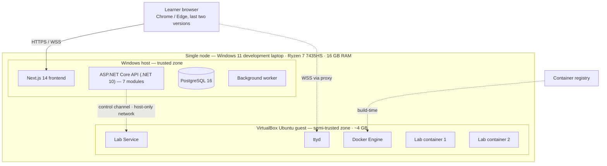

**Motivation**

The deployment shape is a direct consequence of two constraints: **no cash budget** (S3.7) and
**one physical machine** (assumption A-01). The threat model explicitly scores the **Demo**
topology; the development topology is identical apart from the IDE and AI agents on the host.
`[Source: Threat Model.md — S2.6 A-01/A-04, S3.5; MASTER.md S3.7]`

The separation of platform and lab is not a deployment convenience — it is the second isolation
boundary. Putting the platform inside the VM would mean a single escape exposes both, and it
would cost ≈5.5–6.5 GB of the 16 GB for the VM instead of ≈3.5–4 GB.
`[Source: ADR-001 S2]`

**Environments**

| Environment | Infrastructure | Users | Backup | Source |
|---|---|---|---|---|
| **Development** | Windows host (platform) + VirtualBox Ubuntu VM (lab only) | Developers | **None** (`Q-22`) | Threat Model.md S3.5 |
| **Demo** | The same laptop: platform on Windows, lab in the VM; localhost / LAN only | Whole team and supervisors | Daily content backup | Threat Model.md S3.5 |
| **Production** (post-v1.0) | Linux server: platform and lab **separated** | Whole team | Every 6 h + PITR | Threat Model.md S3.5 |

The specification names only "the deployment environment" and "a shared test environment"
(`CN-018`); the three names above come from `Architecture/Data.md` Q-19 and the threat model.
There is no separate staging environment, and `CN-021` (the lab may not run on more than one
device) keeps the lab pinned to a single machine. `[Source: MASTER.md S3.2, CN-018;
Architecture/Data.md Q-06, Q-19]`

**Quality and/or Performance Characteristics of the infrastructure**

| Limit | v0.1 value | Source |
|---|---|---|
| Concurrent lab sessions | **2 maximum**, the third request queues | `Q-20` + capacity analysis · `CTRL-LAB-06` |
| RAM per lab container | **1.5 GB** | Capacity analysis · `CTRL-LAB-07` |
| CPU per lab container | **1 vCPU** (`--cpus`) | Proposed · `CTRL-LAB-07` |
| PIDs per container | **256** (fork-bomb containment) | Proposed · `CTRL-LAB-07` |
| VM memory budget | **≈ 4 GB** (guest OS + Lab Service + Docker + 2 × 1.5 GB containers) | Capacity analysis |
| Host RAM | **16 GB** | Hardware · `A-01` |
| Session duration | **60 min default / 120 min max** | `D3` · `SC-001` |
| Container preparation | **&lt; 90 s** with pre-pulled images | `D4` · `SP-003` · `CTRL-LAB-09` |
| Automated validation | **&lt; 3 s** | `D4` · `SP-004` |
| Simple / composite API response | **&lt; 500 ms / &lt; 2 s** | `D4` · `SP-001`/`SP-002` |
| Production concurrency target (post-v1.0) | 10 sessions on a Linux server | `D3` — not modelled or tested for v0.1 |
| Platform availability | `[TBD]` — depends on the provider SLA | `RA-001`, `D2` |

`[Source: Threat Model.md — S5; MASTER.md — S12.1, S12.4, S12.6]`

> **`[CONFLICT]` — three different capacity numbers.** `CP-001`/`RA-002`/`AC-004` and the
> workflow documentation still say **10 concurrent / 2 GB**, while the capacity analysis and
> the threat model say **2 concurrent / 1.5 GB**. The reasoning is arithmetic: 10 × 2 GB = 20 GB
> on a 16 GB laptop, which the audit recorded as "a mathematical impossibility". **Resolution
> rule: 2 sessions and 1.5 GB are the working values**, carried by `D3b`, which is *proposed
> but not yet applied*; `OI-TM-06` tracks the requirement side. The workflow documentation
> still names the old figures and needs updating.
> `[Source: MASTER.md S12.4, S12.6; Threat Model.md S5, OI-TM-06; Workflow Docs.md S13;
> amendments file S1]`

**Mapping of Building Blocks to Infrastructure**

| Building block | Development | Demo | Production (post-v1.0) | Notes |
|---|---|---|---|---|
| Frontend (Next.js 14) | Windows host, `npm run dev` | Windows host | Linux server | Proxied terminal channel |
| Platform API (7 modules) | Windows host, `dotnet run` | Windows host | Linux server | One deployed service (`CN-001`) |
| PostgreSQL 16 | Windows host, localhost | Windows host, localhost | Linux server | Least-privilege role; bound to the host only |
| `AuditLog` table | Inside PostgreSQL | Inside PostgreSQL | Inside PostgreSQL | Append-only |
| Background Worker | Windows host | Windows host | Linux server | Reaper + deferred tasks |
| Lab Service | Ubuntu guest VM | Ubuntu guest VM | Linux server (lab separated) | Sole Docker-socket holder |
| Docker Engine + containers | Ubuntu guest VM | Ubuntu guest VM | Linux server | Pre-pulled, digest-pinned images |
| ttyd | Ubuntu guest VM | Ubuntu guest VM | Linux server | Behind the authenticated proxy, WSS only |
| Container registry | Docker Hub / local cache | Docker Hub / local cache | Docker Hub / private cache | Supply-chain scanned (`Q-44`) |
| Backup store | **None** | Host filesystem + external copy | Server + PITR | `pg_dump` per `Q-22` |

`[Source: Threat Model.md — S3.5, S3.2; MASTER.md — S13.2, S13.3]`

**Release plan and infrastructure gates**

| Release | Scope | Target date | What must not break | Gate |
|---|---|---|---|---|
| `v0.1` — first pilot | One complete `A05:2025 Injection` episode end to end | end of Phase 5 — February 2027 | Lab isolation · server-side points · journal integrity | Misuse test `IM-006` passed; hosting resolved (`OI-007`) |
| `v0.2` — scale | Measure the episode's cost; generalize the template to further categories | after Phase 7 — May 2027 | Stability of the Injection episode | Scope announced conditionally with the supervisors (`CN-015`) |
| `v1.0` — final | Integrated platform, points system, optional leaderboard, evaluation study `n ≥ 10`, four documentation deliverables, research paper | **July 2027** | Operational stability through the defence (`LG-001`) | Templates frozen two weeks before delivery (`CN-016`) |

`[Source: Roadmap&Timeline.md — S4, S6; MASTER.md — S13.4]`

### 7.2. Infrastructure Level 2

#### 7.2.1. Windows host — trusted zone

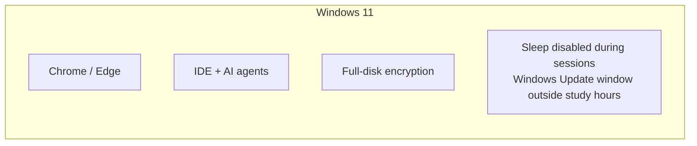

The host carries the platform, the database, the IDE and the browser. Host hygiene is a named
control: full-disk encryption, sleep disabled during the pilot, an update window outside study
hours, and no learner data on the host. `[Source: Threat Model.md — CTRL-VM-03, S3.2]`

> `[GAP — source does not define relationships]` The diagram lists the host elements the sources
> name; no source states how these elements relate to one another, so no edges are drawn.

#### 7.2.2. VirtualBox Ubuntu guest — semi-trusted zone

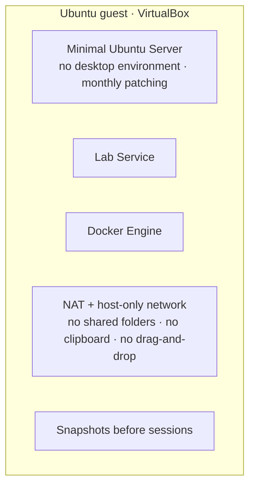

The guest runs **only** the lab stack — never the platform. It is minimal Ubuntu Server with no
desktop environment, patched monthly with unattended security upgrades, and it is snapshotted
before each session so a corrupted environment can be rolled back. The VirtualBox
configuration is hardened: NAT plus a host-only network, no shared folders, no clipboard, no
drag-and-drop. `[Source: Threat Model.md — CTRL-VM-01, CTRL-VM-02; ADR-001 S4]`

> `[GAP — source does not define relationships]` The diagram lists the guest elements the sources
> name; no source states how these elements relate to one another, so no edges are drawn.

#### 7.2.3. Docker Engine — inside the guest

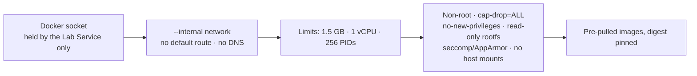

The Docker socket is held by one process only. The network is created `--internal`, so there is
no default route and no DNS resolution; the container therefore cannot reach the university
network or the internet — the property that keeps `T-30` out of the Critical band. Images are
pre-pulled into the guest and pinned by digest, because a cold pull cannot meet the 90-second
preparation target on this hardware.
`[Source: Threat Model.md — CTRL-LAB-01, CTRL-LAB-04, CTRL-LAB-07, CTRL-LAB-09; S10 T-30]`

> `[GAP — source does not define relationships]` The five elements are five **independent
> controls** in the source's register (`CTRL-LAB-01`, `CTRL-LAB-04`, `CTRL-LAB-07`, `CTRL-LAB-03`,
> `CTRL-LAB-09`). No source states that they form an ordered chain; the left-to-right sequence is
> a reading aid only.

> **`[CONFLICT]` — the container technology is not decided.** The workflow documentation and the
> project description both name **SysBox** as if it were selected, and the technical spike is
> scheduled to decide "SysBox or an alternative". **SysBox selection is not yet an ADR; it
> remains a `[PROPOSED]` post-spike candidate** and has no ADR number allocated. The container
> technology does not change the Docker-socket isolation or the VM boundary.
> `[Source: Workflow Docs.md S7, S13; Project Description EN S14, S1; Threat Model.md S17.3 ADR-002]`

## 8. Cross-cutting Concepts

The concepts below are the ones the sources actually specify. Where a source still leaves a
value open, the concept states the gap rather than inventing a value.

### 8.1. Security Concept

Cyber Diaries runs untrusted learner code inside an isolated lab, while the trusted platform
(Next.js, ASP.NET Core API, PostgreSQL) stays on the Windows host.

> **Scope of this section.** The complete threat register is
> `Architecture/Threat Model/Threat Model.md` — **42 threats** with STRIDE classification,
> trust boundaries, and controls. This section summarizes only the Critical threats.
> `[Source: Architecture/Threat Model/Threat Model.md — S10, S12]`

The register's own summary (`S10.1`) states the distribution below verbatim. It also records
that **0** threats are `Verified` and **42** are `Planned` — control designed, not built —
because nothing is implemented yet.

| Metric (S10.1) | Count |
|---|---|
| Total threats | **42** |
| 🔴 Critical | **6** — T-11, T-13, T-16, T-22, T-26, T-27 |
| 🟠 High | **28** |
| 🟡 Medium | **8** — T-02, T-10, T-19, T-34, T-35, T-38, T-40, T-41 |
| 🟢 Low | **0** |
| Open (no control designed) | 0 |
| Planned (control designed, not built) | **42** |
| Verified | **0** |

`[Source: Threat Model.md — S10.1]`

**Security zones** (threat model S3.4, from `Q-42`):

| Zone | Trust | Contents |
|---|---|---|
| Trusted | High | Windows host: Next.js, Platform API, PostgreSQL, `AuditLog`, backups |
| Semi-trusted | Medium | Ubuntu VM kernel, Lab Service, ttyd, Docker daemon |
| Untrusted | Low | Lab containers, learner input, terminal streams |
| External | None | Browser, container registry, external backup copy |

**Trust boundaries** (threat model S6): TB-01 Public→App · TB-02 FE→API · TB-03 API→DB ·
TB-04 Platform→Lab — the only crossing between trusted and untrusted zones · TB-05 Container→VM ·
TB-06 VM→Windows host · TB-07 Container↔Container (must be denied) · TB-08 Admin→App.

**The six Critical threats that shape the architecture** (`S10.1`, `S10.2`):

| Threat | Scenario | Primary control | ADR (S17.3) |
|---|---|---|---|
| T-16 | Container escape / isolation failure into the guest VM | container hardening + VM boundary | ADR-001 |
| T-26 | VM escape from the Ubuntu guest into the Windows host | no shared folders/clipboard, snapshots, hypervisor config | ADR-001 |
| T-11 | Unauthorized lab session management | Lab Service is the sole Docker-socket holder; session tokens | ADR-002 |
| T-13 | Docker daemon / guest VM compromise | socket isolation + least privilege | *not listed against any ADR in S17.3* |
| T-22 | Docker API command tampering | authenticated channel + operation allow-list | ADR-002 |
| T-27 | VirtualBox hypervisor exploit | patch cadence + supply-chain checks | ADR-001 |

`[Source: Threat Model.md — S10.1, S10.2, S17.3]`

**Two Information-disclosure threats that shape the data design** (`S10` rows T-20 and T-39,
reproduced verbatim):

| Field | T-20 | T-39 |
|---|---|---|
| Title (Appendix A) | Unauthorized Database Communication | Secrets / connection-string leakage |
| STRIDE category | `I` | `I` |
| Target / trust boundary | DB channel (TB-03) | API/DB (TB-02/03) |
| Scenario and impact | Query results exposed to unauthorized components | **Secrets leakage**: connection strings, JWT signing key, Docker credentials in repo, env, logs or images |
| L / I / Score | 3 / 5 / 15 | 3 / 5 / 15 |
| Severity | 🟠 High | 🟠 High |
| Status / Owner / Release | Planned · Backend · v0.1 | Planned · Sec & DevOps · v0.1 |
| Residual | Low | Medium |
| Control | `CTRL-DATA-01` — least-privilege DB roles; PostgreSQL bound to localhost / the Windows host only; TLS where applicable | `CTRL-DATA-02` — encryption at rest (TDE or provider-managed); `CTRL-DATA-03` — secrets in environment variables (dev) / Docker secrets (prod); no secrets in repo, images or logs; `.env` git-ignored |
| Misuse case / trace | — | `AB-12` — Any user reads secrets from repo, env or logs · `Q-36` → `AC-009` → secret scan → `CTRL-DATA-03` |

Neither T-20 nor T-39 is classified as *residual* or as *integrity* by the source; both carry
only the ordinary register column `Residual`. The threat the source labels *Verification
integrity* is **T-31** (learner tampers with validation rules, results or evidence to fake
success), not T-20 or T-39.
`[Source: Threat Model.md — S10, S12, S13.1, S18]`

**Non-negotiable rules:** the platform never executes learner commands (`CN-002`); every lab
session is bound to one learner and destroyed on end or timeout (`CN-003`, `IM-002`); containers
have no egress (`CN-004`); all points are calculated server-side (`CN-005`); the learner-facing
desktop is UI-only (`CN-008`, amended).

**Open dependency:** the VM boundary needs the proposed `CN-022` amendment (threat model
Appendix C) before it has a requirement ID. `ADR-001` is provisionally accepted and becomes
final only after the isolation spike passes its gate.

**How the threat model was built.** Methodology is STRIDE applied **per element and per data
flow**, scored Likelihood × Impact on a 5×5 matrix, with a DFD v2 of 18 elements. The register
holds **42 threats** — 6 Critical, 28 High, 8 Medium, 0 Low — of which **38 controls** cover
every one. All 42 are currently `Planned` and **0** are `Verified`, because nothing is built
yet. `[Source: Threat Model.md — S2.1, S2.3, S10.1, S12]`

> **`[CONFLICT]` — the threat count in `Data.md`.** `Data.md` Q-41 records "15 numbered threats
> (T-01…T-15)" and `SG-01` proposes rebuilding the model as STRIDE × 6 trust boundaries = **36
> cells**. The threat model that was actually written supersedes both: it has **42** threats and
> **8** boundaries, and its STRIDE matrix is element × STRIDE (17 elements), not boundary ×
> STRIDE. The legacy `T-01…T-15` survive as aliases with an explicit mapping in Appendix A.
> **Resolution rule: use the threat model's numbering.** `[Source: Architecture/Data.md Q-41,
> SG-01, SG-02; Threat Model.md S10.1, S6, S7, Appendix A]`

### 8.2. Authentication and Session Lifecycle

| Aspect | Decision | Source |
|---|---|---|
| Token form | **JWT in an `HttpOnly` cookie** plus a refresh token | `Data.md` Q-24; `CTRL-AUTH-02` |
| Access token lifetime | **60 minutes** | `Data.md` Q-25; `CTRL-AUTH-02` |
| Refresh token lifetime | **3 days** | `Data.md` Q-25; `CTRL-AUTH-02` |
| Rotation | On every use | `Data.md` Q-25; `CTRL-AUTH-02` |
| Revocation | Immediate | `Data.md` Q-25; `CTRL-AUTH-02` |
| Password hashing | **Argon2id**, memory 64 MB, 3 iterations | `Data.md` Q-26; `CTRL-AUTH-01` |
| Cookie flags | `HttpOnly` + `Secure` + `SameSite` | `CTRL-AUTH-02` |
| Anti-enumeration | Identical error message whether or not the account exists | `Data.md` Q-34 / `FR-004`; `CTRL-AUTH-03` |
| Rate limiting | 10 req/min/IP on auth; 100 req/min/user overall | `Data.md` Q-34; `CTRL-AUTH-03` |
| Session binding | A lab session is bound to one authenticated account; a start is refused before difficulty and role are chosen | `AC-003`; `CTRL-LAB-02` |

`[Source: Architecture/Data.md — Q-24…Q-26, Q-34; Threat Model.md — CTRL-AUTH-01…03,
CTRL-LAB-02; MASTER.md S15.1]`

> **`[CONFLICT]` — refresh-token lifetime.** `SG-06` proposes a 7-day refresh token because the
> specification "does not mention JWT/rotation/revocation"; `Q-25` answers the same question
> with **3 days**, and the threat model's control register implements 3 days. **Resolution
> rule: 3 days** — `SG-06` is a gap-filling proposal that predates the answer.
> `[Source: Architecture/Data.md Q-25 vs SG-06; Threat Model.md CTRL-AUTH-02]`

> **`[CONFLICT]` — the specification never names a token protocol.** `MASTER.md` S7.2 and S15.1
> say only "an account with a valid authentication session"; the words *JWT*, *OAuth*, *OIDC*,
> *cookie* and *session token* do not occur in the specification at all. The concrete mechanism
> exists only in `Architecture/Data.md` and the threat model. **Resolution rule: treat the
> `Data.md` answers as the architecture decision, and add them to the specification.** This is
> part of the traceability gap list in S11. `[Source: MASTER.md S7.2, S15.1; Data.md Q-24…Q-26]`

### 8.3. Authorization and Access Control

Authorization uses the **ASP.NET Core attribute + policy** idiom. Every administrative request
re-verifies the role on the server, object-level ownership is checked for sessions, evidence,
journals and progress, and the three administrator roles are separated — there is no shared
administrator account. `[Source: Data.md Q-27; CTRL-AUTHZ-01, CTRL-AUTHZ-02, CTRL-AUTHZ-03]`

| Role | Learning page | Login / account | Manage content | Operate lab | Releases & settings | Leaderboard | Own data | Delete account |
|---|---|---|---|---|---|---|---|---|
| Learner | read | own | forbidden | own session only | forbidden | read | own | request |
| Content administrator | **forbidden*** | own | edit | forbidden | forbidden | forbidden | forbidden | forbidden |
| Operations administrator | forbidden | own | forbidden | edit (full) | forbidden | forbidden | forbidden | forbidden |
| Release officer | forbidden | own | forbidden | forbidden | edit | forbidden | forbidden | forbidden |
| Supervisor / examiner | — | — | — | — | — | — | — | — |

`*` **Unresolved conflict in the source**: the "view learning page" row forbids the content
administrator, while `AC-006` and the "manage content" row grant that role the addition and
editing of lessons and scenes. The specification states: **do not change the matrix before the
supervisor decides.** `[Source: MASTER.md S15.1]`

Every "forbidden" cell is enforced on the server, not in the interface (`AC-002`). Reading the
audit and session logs is not a learner capability — it is restricted to authorized
administrative roles (`AU-004`). `[Source: MASTER.md S15.1 note]`

### 8.4. Lab Isolation and Untrusted Execution

This is the concept the whole system is built around. It has three parts: **the boundary
chain**, **the container hardening**, and the **security / resources / cleanup policies**. The
lab-session **state machine** is not repeated here — see S6.7.

**Boundary chain** — learner command → ephemeral container → Docker Engine → Ubuntu guest →
VirtualBox → Windows host. Every arrow is a place where a control exists; the platform never
appears on the learner's side of the chain. `[Source: Threat Model.md S6, S9.1]`

| Control | What it does | Threats |
|---|---|---|
| `CTRL-LAB-01` | The Lab Service is the **sole** holder of the Docker socket; the API never executes commands | T-11, T-13, T-22 |
| `CTRL-LAB-02` | A per-session token is bound to learner + session and validated by both ttyd and the Lab Service | T-14, T-23 |
| `CTRL-LAB-03` | Container hardening: non-root, `--cap-drop=ALL`, `no-new-privileges`, read-only rootfs, seccomp/AppArmor, no host mounts | T-16, T-29, T-28 |
| `CTRL-LAB-04` | Egress denial: `--internal` network, no default route, no DNS, no university or internet egress | T-30, T-32 |
| `CTRL-LAB-05` | Ephemeral lifecycle: destroy on end or timeout; a reaper collects orphans | T-12, T-17 |
| `CTRL-LAB-06` | Admission control: 2 concurrent sessions maximum, queue for the third, explicit rejection beyond | T-12, T-17, T-41 |
| `CTRL-LAB-07` | Resource limits: 1.5 GB RAM, 1 vCPU, 256 PIDs, 60/120-minute timeout | T-17, T-12 |
| `CTRL-LAB-08` | ttyd is never exposed directly — behind the authenticated reverse proxy, WSS only, per-session path and token | T-14, T-15, T-23, T-24, T-25 |
| `CTRL-LAB-09` | Lab images are pre-pulled and cached in the VM; image digests are pinned | T-38, T-12 |
| `CTRL-VM-01` | VirtualBox VM as the primary boundary: no shared folders, no clipboard, no drag-and-drop, NAT + host-only network, snapshots before sessions | T-26, T-27, T-29, T-41 |
| `CTRL-VM-02` | Guest OS hardened and patched monthly; minimal Ubuntu Server; no desktop environment; unattended security upgrades | T-27, T-28 |
| `CTRL-VM-03` | Host hygiene: full-disk encryption, sleep disabled during the pilot, Windows Update window outside study hours, no learner data on the host | T-41, T-26 |

`[Source: Threat Model.md S12]`

**Egress denial is the single most important property.** `T-30` — a learner using `nmap`/`curl`
to attack the university network or the internet — is rated *Low only if egress is truly
denied; otherwise **Critical***. It is a legal and reputational risk, not only a technical one.
`[Source: Threat Model.md S10, T-30]`

**Security policies** (the S13 critical-security rules, verbatim from `Workflow Docs.md` S13):

- خدمة المعمل منفصلة تمامًا عن خدمة API. — the lab service is completely separate from the API
  service.
- الحاوية لا تصل إلى الشبكة الداخلية. — the container does not reach the internal network.
- الحاوية لا تصل إلى Host. — the container does not reach the host.
- الأدوات لا تخرج عن نطاق المعمل. — the tools do not leave the lab scope.
- لا تُثبَّت أدوات على جهاز المتعلم. — no tools are installed on the learner's device.
- سطح المكتب في المعمل واجهة تفاعلية فقط. — the lab desktop is an interactive interface only.
- الحاوية تُدمر تلقائيًا بعد الجلسة. — the container is destroyed automatically after the session.
- يوجد Background Worker / Container Reaper لتنظيف الحاويات اليتيمة. — a Background Worker /
  Container Reaper cleans up orphan containers.
- السجلات التعليمية لا تحتوي معلومات شخصية حقيقية أو أسرارًا. — educational logs contain no real
  personal information or secrets.

`[Source: Workflow Docs.md — S13, "قواعد أمنية حرجة"]`

**Resource policies** (the S13 operational-limits table, verbatim):

| البند — Item | القيمة — Value |
|---|---|
| مدة الجلسة الافتراضية | 60 دقيقة |
| الحد الأقصى | 120 دقيقة |
| التزامن المستهدف | 10 متعلمين |
| ذاكرة الحاوية | 2GB RAM |
| بناء الحاوية | أقل من 90 ثانية |
| تحقق آلي | أقل من 3 ثوانٍ |
| API بسيط | أقل من 500ms |
| API مركب | أقل من 2s |

`[Source: Workflow Docs.md — S13, "قيود تشغيلية محسومة"]`
`[CONFLICT]` — the concurrency and memory rows still carry the pre-audit values (10 learners,
2 GB); the working values are 2 sessions and 1.5 GB. See S6.7 and S7.1.

**Cleanup policies** — the container is destroyed when the session ends or times out; the
`Background Worker` performs the expiry and a `Background Worker / Container Reaper` collects
orphan containers; the `AuditLog` records the resource cleanup. **State machine: see S6.7.**
`[Source: Workflow Docs.md — S13 steps 12–14; CTRL-LAB-05]`

### 8.5. Input Validation and Web Defenses

| Defense | Decision | Source |
|---|---|---|
| CSRF | Anti-forgery token + `SameSite=Strict` | `Data.md` Q-31; `CTRL-INPUT-04` |
| XSS | CSP header + output encoding (React does this by default) + DOMPurify for dynamic content | `Data.md` Q-32; `CTRL-INPUT-03` |
| SQL injection | Parameterized queries through EF Core; **no raw SQL** except in Analytics (Dapper, parameterized) | `Data.md` Q-33; `CTRL-INPUT-02` |
| Input validation | **FluentValidation with allow-lists** — never block-lists | `Data.md` Q-35; `CTRL-INPUT-01` |
| SSRF | URL allow-list for any server-side fetch; no user-supplied URL is fetched from the VM | `CTRL-INPUT-05` |

`[Source: Architecture/Data.md — Q-31…Q-35; Threat Model.md S12]`

> **`[GAP]` — none of these defenses has a requirement ID.** The threat model's coverage-gap
> list records `G-03`: "no requirements for CSRF / XSS / SQLi / SSRF / brute-force controls",
> leaving `T-32`, `T-33`, `T-34`, `T-35` and `T-37` traced to gaps rather than to
> requirements. The decisions above exist; the requirements that would bind them do not.
> `[Source: Threat Model.md S13.2 G-03]`

### 8.6. Audit, Logging and Observability

| Aspect | Decision | Source |
|---|---|---|
| Logging library | **Serilog**, structured | `Data.md` Q-29; `CTRL-LOG-01` |
| Sinks | JSON files **plus** a PostgreSQL `AuditLog` table | `Data.md` Q-29; `CTRL-LOG-01` |
| Audited events | **12 event types**, each with actor id, action, time and outcome (accept/reject) | `Data.md` Q-40; `AU-001`; `CTRL-LOG-01` |
| Lab session log | Start, end, destruction — with actor, container id and image digest | `AU-002`; `CTRL-LOG-04` |
| Immutability | The audit table is **append-only**; the DB user has no UPDATE/DELETE on it | `AU-003`; `CTRL-LOG-02` |
| Access | Reading audit and session logs is restricted to authorized administrative roles | `AU-004`; `CTRL-LOG-02` |
| Redaction | No PII, credentials or secrets in educational or terminal logs; sampled review each release | `CN-014`; `CTRL-LOG-03` |
| Retention | **7 years**, pending `D5` | `Data.md` Q-40; `OI-TM-10` |

`[Source: Architecture/Data.md Q-29, Q-40; MASTER.md S15.4; Threat Model.md CTRL-LOG-01…04]`

Detection is manual: there is no SIEM on a single node, so detection relies on weekly manual
review of the append-only log. This is accepted as `RR-04`.
`[Source: Threat Model.md S15 RR-04, S17.1 OI-TM-12]`

### 8.7. Data Protection: Classification, Encryption and Secrets

| Aspect | Decision | Source |
|---|---|---|
| Data classification | **4 levels** — Public / Internal / Confidential / Restricted | `Data.md` Q-39 |
| Encryption in transit | **TLS 1.3** for HTTPS; TLS 1.2 minimum internally | `Data.md` Q-38; `CTRL-NET-01` |
| Encryption at rest | PostgreSQL TDE (or provider-managed); **no file-level encryption in v0.1** | `Data.md` Q-37; `CTRL-DATA-02` |
| Secrets in development | Environment variables | `Data.md` Q-36; `PR-002` |
| Secrets in production | Docker secrets | `Data.md` Q-36; `CTRL-DATA-03` |
| Secret hygiene | No secrets in the repository, in images or in logs; `.env` is git-ignored | `CTRL-DATA-03` |
| Backup protection | Nightly `pg_dump` to the host plus an external copy for Demo; a restore test before the pilot | `CTRL-DATA-04` |
| Vault | **Not in v0.1** | `Data.md` Q-36 |

`[Source: Architecture/Data.md Q-36…Q-39; Threat Model.md CTRL-DATA-01…04, CTRL-NET-01]`

> **Note.** `SG-04` and `SG-05` proposed a formal classification scheme and a cryptography
> standard because neither existed in the specification. `Q-39` and the `CTRL-*` controls now
> supply both. AES-256-GCM was proposed in `SG-05` for sensitive storage but is **not** among
> the decided values — encryption at rest is delegated to the database or the hosting
> provider. `[Source: Architecture/Data.md SG-04, SG-05, Q-37]`

### 8.8. Privacy, Consent and Research Data

This is the concept with the hardest external dependency: **no participant data may be
collected before the ethics model is approved.** `[Source: MASTER.md S15.3 PV-001; Threat Model.md S1.2]`

| ID | Requirement | Legal basis | Source |
|---|---|---|---|
| `PV-001` | Documented prior consent from every participant under the approved informed-consent form, before any data collection. Literal text `[TBD — D5]`; committee approval date `[TBD — D5]` | PDPL · Declaration of Helsinki · committee approval | MASTER.md S15.3 |
| `PV-002` | Collect anonymized data and only what is necessary (username, hashed password, optional display name) | PDPL | MASTER.md S15.3 |
| `PV-003` | The learner can see the data held on their account | PDPL | MASTER.md S15.3 |
| `PV-004` | Account deletion on request, with research records anonymized | PDPL · D11 | MASTER.md S15.3 |
| `PV-005` | A committee-approved retention policy per data type | PDPL | MASTER.md S15.3 |
| `PV-006` | Educational records carry no personal information or secrets | `CN-014` · PDPL | MASTER.md S15.3 |
| `PV-007` | Leaderboard is opt-in, with full hiding available | BR-06 · D13 · PDPL | MASTER.md S15.3 |

**Governing instruments:** PDPL — Egyptian Personal Data Protection Law **151/2020**
(`CMP-001`), the Declaration of Helsinki (`SD-004`), and an approved informed-consent model
(`CMP-002`, `CP-002`). Retention and deletion procedures must conform to PDPL and D11
(`CMP-003`). `[Source: MASTER.md S17.1, S17.2, Appendix C.1, C.2]`

**Behaviour events are permanent** — `BehaviorEvent` is append-only with **no deletion** and
permanent retention, because the deferred study test depends on them. Account deletion removes
`Account`, `JournalEntry`, `Progress`, `PointTransaction` and `Achievement`, and replaces the
user reference in research records with an anonymous identifier.
`[Source: MASTER.md S7.1 note (ب), S15.3]`

> **`[CONFLICT]` — legal conflict.** `OI-TM-10` records that audit retention is fixed at 7
> years (`Q-40`) while the `D5` retention policy is still unapproved — a direct legal conflict
> that must be settled before the pilot. `[Source: Threat Model.md S17.1 OI-TM-10]`

### 8.9. Assessment Integrity and Server-Side Scoring

| Rule | Detail | Source |
|---|---|---|
| Where points are computed | **Server-side only**, through automated verification; nothing is counted from browser data | `CN-005`; `CTRL-SCORE-01` |
| Idempotency | Scoring is idempotent by `SourceId`; the multiplier is fixed at the moment of success | `CTRL-SCORE-01` |
| No learner mutation path | `Evidence`, `PointTransaction`, `Achievement` and `VerificationResult` are append-only or immutable | `CTRL-SCORE-02`; IN-005…IN-007 |
| Verification rules | Stored server-side, versioned, and **never exposed to the client**; results immutable and bound to the session | `CTRL-ASSESS-01` |
| Per-role engines | Security outcome (Red) · inference-chain rubric (Blue) · automated test suite (Developer) | `CTRL-ASSESS-02` |
| Accuracy | Points and difficulty multipliers must be exact to 100 %, with no rounding; verification pass/fail accuracy 100 % | `PA-001`, `PA-002` |
| Difficulty multipliers | Easy 1.0 · Medium 1.5 · Hard 2.0 | MASTER.md S12.3; Workflow Docs.md S8 |
| What difficulty changes | **Only** the amount of help — not the flaw and not the solution | Workflow Docs.md S8 |
| Failure behaviour | Failure ends the task without points; **no counting on failure** | Workflow Docs.md — mermaid graph |

`[Source: MASTER.md S12.3, S15.2; Architecture/Data.md Q-02; Threat Model.md CTRL-SCORE-01/02,
CTRL-ASSESS-01/02]`

### 8.10. Modular Boundaries and Domain Events

The Modular Monolith is organised as DDD bounded contexts — one per module — with in-process
calls plus domain events, no message bus. Each module exposes exactly one public interface,
`I{Module}Service`, so that dependencies are explicit and cycles are impossible.
`[Source: CN-001; Architecture/Data.md Q-12, Q-15, Q-16; MASTER.md S14.1 MT-002]`

The dependency map is `Identity → all`, `LearningContent → Labs → Assessment → Progress →
Gamification`, `Administration → LearningContent`, `Analytics → all`. The map is acyclic by
construction, which is also why `Analytics`, if adopted, must be a read-only model.
`[Source: Architecture/Data.md Q-14; amendments file S2]`

`MT-002` additionally requires the module independence to hold **without circular
dependencies**, and `MT-004` requires every endpoint to be documented with Swagger/OpenAPI so
the contracts stay reviewable before implementation is distributed (`CN-018`).
`[Source: MASTER.md S14.1]`

### 8.11. Persistence, Migrations and Caching

| Aspect | Decision | Source |
|---|---|---|
| Domain data access | **EF Core** | `Data.md` Q-28; `ADR-007` |
| Analytics data access | **Dapper**, parameterized — the only place raw SQL is allowed | `Data.md` Q-33; `CTRL-INPUT-02` |
| Schema changes | **EF Core Migrations**, applied manually with `dotnet ef database update` in v0.1 | `Data.md` Q-50; `ADR-007` |
| Caching | **In-memory (`IMemoryCache`)** in v0.1; **no Redis**, with an expectation of relying on Redis later | `Data.md` Q-49 |
| Database | PostgreSQL 16, least-privilege role, bound to localhost or the Windows host only | `CTRL-DATA-01` |

`[Source: Architecture/Data.md Q-28, Q-49, Q-50; Threat Model.md CTRL-DATA-01, CTRL-INPUT-02]`

> **Note.** Redis is **not** a decision in v0.1 — `Q-49` defers it explicitly. Any document
> that names Redis as the caching technology for this release is wrong.
> `[Source: Architecture/Data.md Q-49]`

### 8.12. API Style, Versioning and Error Handling

| Aspect | Decision | Source |
|---|---|---|
| Style | REST first; GraphQL only with proven value | `CN-006`; `IF-001`; `ADR-012` |
| Versioning | **URL path** — `/api/v1/...` | `Data.md` Q-48; `ADR-012` |
| Error format | **ProblemDetails (RFC 7807)**; no stack traces to clients | `Data.md` Q-30; `ADR-010` |
| Documentation | Swagger/OpenAPI for every endpoint | `MT-004`; `CN-018` |
| Validation | FluentValidation allow-lists on every input | `Data.md` Q-35; `CTRL-INPUT-01` |

`[Source: Architecture/Data.md Q-30, Q-35, Q-48; MASTER.md S13.2, S14.1; Threat Model.md
CTRL-INPUT-01, ADR-010/012]`

### 8.13. Frontend Rendering and Internationalization

Server-side rendering is used for content, while the lab uses client components, because the
terminal stream must stay interactive (`ADR-011`). The platform's language is **Arabic RTL by
default**, with English LTR used for technical terms only — the terms are kept in English
because that is what the technical references use.
`[Source: ADR-011; Architecture/Data.md Q-47]`

The frontend also carries the experience rules that keep the narrative honest: the quiz is a
self-assessment and **not** a progression gate; a skippable scene must have an equivalent
summary that preserves stage, character and task without revealing the answer; and either path
may be entered directly. `[Source: Project Description EN S4.5; Workflow Docs.md — execution
rules]`

### 8.14. Supply Chain Security

| Aspect | Decision | Source |
|---|---|---|
| Dependency scanning (SCA) | `dotnet list package --vulnerable` weekly **and** `npm audit` weekly | `Data.md` Q-43; `ADR-015` |
| Image scanning | **Trivy before every deployment** — no image ships without a scan | `Data.md` Q-44; `CTRL-SUP-01/02` |
| Image provenance | Images are built by the team from a trusted base and scanned before use; digests are pinned | `A-06`; `CTRL-LAB-09` |
| Tool licences | 13 tools are registered; **only 1 is verified** (the browser developer tools, bundled with the browser); **12 are pending**. An incompatible licence is a **release blocker** | `Requirements/Logs/Tool Licenses Register.md`; D14 |

`[Source: Architecture/Data.md Q-43, Q-44; Threat Model.md S2.6 A-06, CTRL-LAB-09,
CTRL-SUP-01/02]`

The threat model names `T-38` (a tampered or vulnerable base image) as a **Medium** residual
risk "scan only" — the mitigation is scanning, and the residual risk of a compromised image is
accepted with that limitation. `[Source: Threat Model.md S10 T-38]`

> **`[GAP]` — 12 of 13 tool licences are unverified.** The register states plainly that the
> empty columns must be filled before the first deployment, and that a tool whose licence does
> not permit educational use must be replaced. `[Source: Requirements/Logs/Tool Licenses
> Register.md, S2]`

### 8.15. Testing and Verification Strategy

The specification defines a verification set `V-01…V-40` and maps threats to requirement and
test (`Threat Model.md S13.1`). The strategy has three layers:

1. **Automated verification of learner solutions** — the role-specific engines of `CTRL-ASSESS-02`,
   returning a result within 3 s (`SP-004`).
2. **Security control tests** — a named test per control family: `V-29`, `V-38` for the lab
   control plane; `V-33` plus a capacity test for admission control; `V-36` plus misuse tests
   for container hardening; `V-31`, `V-37` for egress denial; `V-25`…`V-28` for logging;
   `V-39` for image caching. `[Source: Threat Model.md S12, S13.1]`
3. **Misuse and gate tests** — a misuse test proving the container cannot reach the Windows
   host, and the `IM-006` release gate that must pass before any release that touches
   isolation. `[Source: Threat Model.md S16 item 9; ADR-001 S8]`

**Tests that do not exist yet** and are marked as new in the traceability matrix: auth
throttle, SQLi, XSS, CSRF, SSRF, verification-integrity, and ttyd/WSS tests.
`[Source: Threat Model.md S13.1]`

> **`[GAP]` — nothing has been tested.** Verification and validation status is `0 / 114`, all 42
> threats are `Planned` with **0** `Verified`, and the threat model explicitly states it
> "cannot support any claim that a control is implemented or tested". `[Source: MASTER.md
> Sد.4 item 8; Threat Model.md S1.2, S1.3, S10.1]`

### 8.16. Content Management, Narrative Consistency and the Difficulty Model

The content panel lets administrators add categories, lessons, scenes and tests **without a
code change**, and keeps text content strictly separated from lab operating settings. This is
the precondition for generalizing the template to further categories — the generalization goal
of the project. `[Source: CN-009; MASTER.md S14.1 MT-001]`

Narrative consistency is a single-owner problem: the **World Bible** is one file documenting
stage order, timeline, character development, relationships, per-episode events and teams, with
one owner and announced freeze dates (`CN-016`). The rule that the protagonist is never shown
working at NoorTech before joining is a content constraint, not a UI rule (`CN-010`).
`[Source: MASTER.md S2.3, S3.1 CN-010/CN-016; Project Description EN S8.1]`

The **difficulty model** changes only the amount of help — Easy (1.0) gives expanded hints with
a similar example that never reaches the solution, Medium (1.5) gives directional pointers
(where to look, which clue, which tool), Hard (2.0) gives none. The underlying flaw and the
solution are identical across levels. `[Source: Workflow Docs.md S8; MASTER.md S12.3]`

The **simplified path** (D8) serves the 30 % audience without a programming background as an
independent route, so it is not a degraded mode of the main path.
`[Source: Architecture/Data.md — MASTER.md S2.6; EDIT_LOG v0.4]`

### 8.17. Incident Response, Backup and Continuity

| Aspect | Status | Source |
|---|---|---|
| Incident response playbook | To be written in **v0.2**, after v0.1 | `Data.md` Q-45; `SG-09` |
| Penetration testing plan | Before **v1.0** only | `Data.md` Q-46 |
| Backup | Nightly `pg_dump` to the host plus an external copy for Demo; backups triggered manually each study day; restore test before the pilot | `CTRL-DATA-04`; `RR-03` |
| Development environment backup | **None** — the loss of the development environment is accepted | `Q-22`; Threat Model.md S3.5 |
| Continuity | Single node: sleep disabled during sessions; Windows Update window outside study hours; the VM is destroyed after the study window | `CTRL-VM-03`; `RR-02` |

`[Source: Architecture/Data.md Q-22, Q-45, Q-46; Threat Model.md S3.5, S15, CTRL-DATA-04,
CTRL-VM-03]`

> **`[GAP]` — there is no backup or restore requirement.** `G-04` in the threat model's
> coverage gaps records that `T-40` has no requirement anchor, only a risk. The same gap
> applies to the incident-response playbook, which does not exist before v0.2.
> `[Source: Threat Model.md S13.2 G-04; Architecture/Data.md Q-45]`

## 9. Architecture Decisions

Architecture decisions are recorded in **MADR 4.0** format — `Context · Decision ·
Consequences · Alternatives` — and stored in a **separate `docs/adr/` folder with a table in
S9**.

**17 ADRs are planned** (`ADR-000`…`ADR-016`). The plan comes from owner input `Q-51`
("**17 ADR** (ADR-000 إلى ADR-016)"), the format from `Q-52`, and the storage location from
`Q-53` ("**مجلد `docs/adr/` منفصل + جدول في S9**"). The threat model's S17.3 reproduces the
same 17 rows as a proposal to be reconciled with this section.

**Actual files present in `Architecture/docs/adr/`:** `ADR-001-isolation-substrate-and-platform-placement.md` — **one file**.
**16 of the 17 are `[PLANNED — NOT WRITTEN]`.**

The index below reproduces the S17.3 table. Per the source: «ADR numbers here are a proposal.
If the ADR files are written with different numbering, the `ADR` column in S12 must be updated —
the mapping is kept in this single table to make that a one-line change.»
`[Source: Architecture/Data.md — Q-51, Q-52, Q-53; Threat Model.md — S17.3]`

### 9.1. Architecture Decision Records

| ADR | Decision | Status | Consequences / notes |
|---|---|---|---|
| **ADR-000** | Architecture style: Modular Monolith with 8 modules | `[PLANNED — NOT WRITTEN]` | Anchors `T-03`, `T-06`. Module count is itself disputed (7 vs 8) — see S4.4 |
| **ADR-001** | Lab isolation: VirtualBox VM + Docker inside it (v0.1); Linux + Docker for production | **Accepted by Team — Pending Supervisor Acknowledgment** — file written: `docs/adr/ADR-001-isolation-substrate-and-platform-placement.md` | Anchors `T-16`, `T-26`, `T-27`, `T-29`, `T-30`. The Windows host becomes security-critical; a restricted cross-zone channel must be built. Becomes final only after the isolation spike passes its gate (`IM-006`) |
| **ADR-002** | Lab control plane: internal REST + Docker API; the Lab Service is the sole socket holder | `[PLANNED — NOT WRITTEN]` | Anchors `T-11`, `T-14`, `T-21`, `T-22`. **Subject disputed** — see the note below |
| **ADR-003** | Single-node deployment on the laptop; Development and Demo environments; no cloud in v0.1 | `[PLANNED — NOT WRITTEN]` | Anchors `T-26`, `T-40`, `T-41` |
| **ADR-004** | Capacity and resources: 2 sessions, 1.5 GB, queue, pre-pulled images | `[PLANNED — NOT WRITTEN]` | Anchors `T-12`, `T-17`. Carries the `D3b` values |
| **ADR-005** | Authentication: JWT in an `HttpOnly` cookie plus refresh rotation; CSRF defence | `[PLANNED — NOT WRITTEN]` | Anchors `T-01`, `T-05`, `T-18`, `T-34` |
| **ADR-006** | Authorization: attribute + policy + object-level checks | `[PLANNED — NOT WRITTEN]` | Anchors `T-03`, `T-06`, `T-14`, `T-36` |
| **ADR-007** | Data access and persistence: EF Core, Dapper for Analytics, migrations | `[PLANNED — NOT WRITTEN]` | Anchors `T-07`, `T-08`, `T-33` |
| **ADR-008** | Password hashing: Argon2id | `[PLANNED — NOT WRITTEN]` | Anchors `T-05`, `T-37` |
| **ADR-009** | Logging and audit: Serilog + append-only `AuditLog` | `[PLANNED — NOT WRITTEN]` | Anchors `T-09`, `T-10`, `T-42` |
| **ADR-010** | Error handling: ProblemDetails, no stack traces to clients | `[PLANNED — NOT WRITTEN]` | Anchors `T-19` |
| **ADR-011** | Frontend rendering: RSC for content, client components for the lab | `[PLANNED — NOT WRITTEN]` | Anchors `T-02`, `T-35` |
| **ADR-012** | API style, versioning and input validation: REST/JSON, `/api/v1`, FluentValidation allow-lists | `[PLANNED — NOT WRITTEN]` | Anchors `T-19`, `T-32`, `T-33` |
| **ADR-013** | Threat-modeling and risk method: STRIDE + L×I | `[PLANNED — NOT WRITTEN]` | Applies to all threats |
| **ADR-014** | Assessment and scoring model: server-side, idempotent, immutable | `[PLANNED — NOT WRITTEN]` | Anchors `T-04`, `T-31` |
| **ADR-015** | Supply chain: Trivy, SCA, image pinning | `[PLANNED — NOT WRITTEN]` | Anchors `T-38` |
| **ADR-016** | ADR format and storage (MADR 4.0 in `docs/adr/`) | `[PLANNED — NOT WRITTEN]` | Process decision |

`[Source: Threat Model.md — S17.3; Architecture/Data.md — Q-51…Q-53]`

> **Only `ADR-001` exists as a file.** The other sixteen are a proposal, not a record: the
> threat model states plainly that "ADR numbers here are a proposal. If the ADR files are
> written with different numbering, the `ADR` column in S12 must be updated — the mapping is
> kept in this single table to make that a one-line change." Each `[PLANNED — NOT WRITTEN]`
> row above therefore names a decision that has been *made in prose* but not yet *recorded as an
> ADR*.
> `[Source: Threat Model.md — S17.3 note]`

> **`[CONFLICT]` — what `ADR-002` is about.** The threat model's index gives `ADR-002` the
> subject *lab control plane — internal REST + Docker API, the Lab Service as sole socket
> holder*. **SysBox selection is not yet an ADR** — it remains a `[PROPOSED]` post-spike
> candidate with no ADR number allocated, and no other source assigns it one. The control-plane
> decision and the container-technology decision are therefore two separate open items.
> `[Source: Threat Model.md S17.3]`

### 9.2. ADR-001 — in detail

| Field | Value |
|---|---|
| Title | Lab isolation substrate and platform placement |
| Format | MADR 4.0 |
| Status | **Accepted by Team — Pending Supervisor Acknowledgment** |
| Date | 2026-11-05 |
| Deciders | HEADLESS Team — Architecture Lead + Lab/DevOps Lead |
| Files | `Architecture/docs/adr/ADR-001-isolation-substrate-and-platform-placement.md` |
| Finality | Provisionally accepted; becomes final only after the isolation spike passes its gate (`IM-006`) |

**Decision.** The VirtualBox Ubuntu VM is the isolation boundary. The platform — Next.js,
ASP.NET Core API and PostgreSQL — stays on the Windows host in the trusted zone. Docker runs
inside the VM. The lab service and its containers are the only untrusted code on the host.

**Drivers.** D-01 blast radius · D-02 memory budget on a 16 GB machine · D-03 development loop
(hot reload for a two-person backend team) · D-04 requirement conformance (`CN-002`, `CN-003`,
`CN-008`) · D-05 operational simplicity · D-06 defence in depth.

**Consequences.** The Windows host becomes security-critical, and a restricted cross-zone channel
must be built and authenticated. A container escape reaches only the guest; reaching the host
requires a second escape across `TB-06`. The VM budget is ≈3.5–4 GB, leaving ≥ 10 GB for
Windows, the platform, the IDE and the browser.

**Open items inside the ADR.** It links to
`Requirements/Logs/Proposed Amendments - D3b, CN-001, CN-008, CN-020.md` — a **broken link**,
because the file on disk ends in `CN-022.md` (see S2.3). It also lists `CN-020` as the VM
boundary constraint, whereas the correct ID is `CN-022`.

`[Source: ADR-001 — SS1–8]`

### 9.3. Requirements decision register (D1…D17)

These are the project's own decisions, taken by the owner and the supervisors. They are
governance decisions rather than architecture decisions, but they bind the architecture, so
they are listed here for traceability. The authoritative register is
`Requirements/Data/data.md` S6 ("القرارات المغلقة"), which states: *this section is the
official reference for the decisions closed after the Consolidated list was extracted; any
file that contradicts it is corrected in favour of this section.*
`[Source: Requirements/Data/data.md S6]`

| ID | Decision | Status | Date | Value / note |
|---|---|---|---|---|
| `D1` | Pilot category | **Decided** | 26-10-2026 | Injection (`A05:2025`) |
| `D2` | Target deployment environment | Owner answer applied; **`[PROPOSED — reopening by D-01]`** | 26-10-2026 | Oracle Cloud Free · Render · university server. Reopening reason: the "single machine = 16 GB laptop" situation is nowhere documented. Provider still undecided (`OI-007`) |
| `D3` | Lab values | **Closed** 27-10-2026, then **`[PROPOSED — reopening by D-02]`** | 27-10-2026 | 60 min default / 120 max · 10 concurrent · 2 GB. Reopening reason: 10 × 2 GB = 20 GB exceeds the team's 16 GB — "a mathematical impossibility" |
| `D3b` | Realistic capacity | **Proposed — not yet applied** | 2026-11-05 | 2 concurrent sessions, the third queues; production target 10 on a dedicated server; 1.5 GB per container |
| `D4` | Performance targets | **Closed** | 27-10-2026 | &lt; 500 ms · &lt; 2 s · &lt; 90 s · &lt; 3 s |
| `D5` | Legal basis and ethical approval | **Closed strategically** | 27-10-2026 | PDPL 151/2020 · university ethics committee · Declaration of Helsinki. Three sub-items remain `[TBD — D5]`: committee approval date, exact retention duration, literal consent text |
| `D6` | Role assignment by name | Owner answer applied | 26-10-2026 | All internal roles → **HEADLESS Team** (12 positions) |
| `D7` | Identifier prefix | **Closed** | 27-10-2026 | `CDbHLT-` in every identifier, in every file; `[PREFIX]` and `CD-` are retired |
| `D8` | Simplified path for the non-technical audience | Owner answer applied | 26-10-2026 | An **independent simplified path**, not a degraded mode |
| `D9` | Availability scope | **Open** | — | `[TBD — D9]` |
| `D10` | Support window and channel during the pilot | **No status recorded** | — | Mentioned only in the mapping file's non-blocking list; absent from the closed register and from the specification's decision key |
| `D11` | Data retention window and account deletion | Owner answer applied | 26-10-2026 | Learner account deletion is **allowed**; research records are anonymized |
| `D12` | Supported OS, screen resolution, phone support | **Open** | 26-10-2026 | Deferred "after build completion" |
| `D13` | Leaderboard default and points economy | **Decided** | 26-10-2026 | Leaderboard closed by default (opt-in). Body text still carries a `[PROPOSED]` tag on the same point |
| `D14` | Tool licences — who verifies | Owner answer applied; register still open | 26-10-2026 | HEADLESS Team verifies; the Tool Licenses Register was created. 12 of 13 tools are still pending |
| `D15` | Official OWASP Top 10:2025 names and order | Owner answer applied | 26-10-2026 | The official A01–A10 names |
| `D16` | Sample size and statistical threshold | Owner answer applied | 26-10-2026 | **n ≥ 10** |
| `D17` | Remaining tool versions and the technology stack | Owner answer applied, versions deferred | 26-10-2026 | Stack fixed: Next.js 14 · .NET 10 · PostgreSQL 16; other versions pinned after build completion |

`[Source: Requirements/Data/data.md S6; Requirements/Logs/Requirements Decisions - Consolidated.md; Requirements/Logs/EDIT_LOG v0.3, v0.4, v0.5, v0.8; MASTER.md S18.1, decision key]`

### 9.4. Audit decisions (D-01…D-06) and the missing decision sheet

A **second, hyphenated** decision family (`D-01`…`D-06`) belongs to an audit decision sheet,
`Pre-arc42-Audit-and-Decision-Sheet.md`. That file is referenced by the requirements
specification (Arabic and English editions) and by the project description — but **not** by the
threat model, whose own search for "Pre-arc42", "Decision Sheet", "ورقة قرارات" and "ما قبل
arc42" returns nothing. The file **does not exist in the workspace**: a recursive search for any
filename containing "Pre-arc42" or "Decision Sheet" returns nothing. `SRC-F`
(`Requirements/Logs/Requirements Decisions - Consolidated.md`) is used as the substitute source
for decision history. The visible members of the family are:

| ID | Subject | Visible in |
|---|---|---|
| `D-01` | Re-decide the isolation model and the deployment environment; reopens `D2` | Project Description line 48; MASTER.md decision key |
| `D-02` | Reopens `D3` on capacity | MASTER.md decision key |
| `D-03` | The isolation model — VirtualBox + Docker | Project Description line 377; MASTER.md S3.1 note |
| `D-03`/`D-04` | Collision with `CN-008` | MASTER.md S3.1 note |
| `D-01`…`D-06` | ADR-001's decision drivers: blast radius, memory budget, development loop, requirement conformance, operational simplicity, defence in depth | ADR-001 S2 |

> **`[GAP]` — `D-07` cannot be confirmed to exist.** There is **no `D-07`** anywhere in the
> workspace. The closest real record is `D7` (the identifier prefix), written **without a
> hyphen**, closed on 2026-10-27. Because the audit decision sheet that would carry the
> hyphenated family is absent, the hyphenated series can only be reconstructed to `D-06`.
> `[Source: workspace-wide search; Requirements/Data/data.md S6; ADR-001 S2]`

## 10. Quality Requirements

### 10.1. Quality Requirements Overview

The performance requirements of the specification are organised in eight categories (S12.1–S12.8).
Every numeric value below is a **requirement with an acceptance criterion**, not a measurement —
verification status is `0 / 114`.
`[Source: MASTER.md S12.1–S12.8, Sد.4 item 8]`

| Category | ID | Requirement / target | Value | Status |
|---|---|---|---|---|
| **Speed** (12a) | `SP-001` | Simple API response | **&lt; 500 ms** | Settled (D4) |
| | `SP-002` | Composite requests — session start/reserve, dual auth | **&lt; 2 s** | Settled (D4) |
| | `SP-003` | Isolated container built and ready for learner interaction | **&lt; 90 s** | Settled (D4) — requires pre-pulled images |
| | `SP-004` | Automated verification result and feedback returned | **&lt; 3 s** | Settled (D4) |
| **Safety-critical** (12b) | `SC-001` | Lab session duration, default / maximum | **60 min / 120 min** | Settled (D3) |
| **Precision** (12c) | `PA-001` | Points and difficulty multipliers (Easy 1.0 / Medium 1.5 / Hard 2.0) exact | **100 %**, no rounding | Requirement |
| | `PA-002` | Auto-verification of Developer solutions detects the flaw and confirms the patch | **100 %** pass/fail accuracy | Requirement |
| | `PA-003` | Progress and completion percentage computed from actually stored records | Absolute, no estimation | Requirement |
| **Reliability** (12d) | `RA-001` | Platform availability during the trial and evaluation | **`[TBD]`** — depends on the provider SLA chosen under D2 | **Open** |
| | `RA-002` | Lab session reservation/start success within maximum concurrency | **95 %** `[PROPOSED]` — concurrency value still says 10 | **Proposed / conflicting** |
| **Robustness** (12e) | `RB-*` | Three qualitative requirements — fault tolerance, no state loss on failure, graceful degradation | no numeric target | Requirement |
| **Capacity** (12f) | `CP-001` | Concurrent learners supported in the lab environment | **10** — **conflicts with the working value of 2** | **Conflicting** |
| | `CP-002` | Maximum RAM per lab container | **2 GB** — **conflicts with the working value of 1.5 GB** | **Conflicting** |
| | `CP-003` | Database capacity for the study sample and a wider audience | **n ≥ 10** plus wider-audience records; no absolute number | Requirement |
| **Scalability** (12g) | `SE-*` | Two qualitative requirements — template reuse for new OWASP categories; the lab service can move to a separate host | no numeric target | Requirement |
| **Longevity** (12h) | `LG-001` | Stable structure until final delivery and defence | until **7-2027** | Requirement |

**Usability thresholds** — five metrics (dashboard load time, category-page completion time,
quiz error rate, hint usage, story clarity) are named but their thresholds are all `[TBD]`.
`[Source: MASTER.md S11.1]`

**Numeric targets stated outside S12** (same nature — all requirements):

| Value | Meaning | Source |
|---|---|---|
| `n ≥ 10` | Study sample size (D16); the pilot itself runs with 5–10 students | S1.2, S2.2, S12.6 |
| 70 % / 30 % | Audience split, primary / secondary | S2.6 |
| 60 / 120 min | Lab session duration (D3) | S12.2, S15.5 `IM-005` |
| 3 external sources per category | OWASP links plus the embedded video | S3.3 |
| 2 weeks | Template freeze lead time before delivery | S2.1, CN-016 |
| ~1.5 min | Lab-opener duration | S4.1 units-of-measure table |
| 3–5 | Questions per short quiz | S4.1, S11 |

`[Source: MASTER.md S1.2, S2.1, S2.2, S2.6, S3.3, S4.1, S11.1, S12.2, S12.6]`

> **`[CONFLICT]` — the capacity family is stale.** `RA-002`, `CP-001` and `CP-002` carry the
> pre-audit values (10 concurrent, 2 GB). The capacity analysis and the threat model carry
> 2 concurrent and 1.5 GB, and `D3b` proposes to write the new values into the specification.
> Until `D3b` is applied, three requirement IDs assert a capacity the hardware cannot deliver.
> `[Source: MASTER.md S12.4, S12.6; Threat Model.md S5, OI-TM-06; amendments file S1]`

### 10.2. Quality Scenarios

Eight scenarios make the quality goals concrete and testable. The first six are usage
scenarios in the short (Q42) form; the last two are change scenarios in the long (SEI) form.

**QS-1 — Simple API response**

| Field | Value |
|---|---|
| Context/Background | An authenticated learner opens a lesson page; the frontend calls the API for content and progress |
| Source/Stimulus | The Next.js frontend issues a simple REST/JSON request |
| Metric/Acceptance Criteria | The API responds in **&lt; 500 ms** (`SP-001`), measured server-side over the study window |

**QS-2 — Composite request**

| Field | Value |
|---|---|
| Context/Background | The learner requests a lab session, which requires an authorization check and a session reservation |
| Source/Stimulus | The frontend issues a composite request |
| Metric/Acceptance Criteria | The API responds in **&lt; 2 s** (`SP-002`), including the authorization and reservation work |

**QS-3 — Container provisioning**

| Field | Value |
|---|---|
| Context/Background | The learner requests a lab session; the Lab Service creates the container |
| Source/Stimulus | The platform sends a start command over the control channel |
| Metric/Acceptance Criteria | The environment is ready for learner interaction in **&lt; 90 s** (`SP-003`), with images pre-pulled and digests pinned |

**QS-4 — Automated verification**

| Field | Value |
|---|---|
| Context/Background | The learner submits a solution from the role workspace |
| Source/Stimulus | The frontend posts the result to the API |
| Metric/Acceptance Criteria | The verification result and its feedback are returned in **&lt; 3 s** (`SP-004`); the rules stay server-side and the result is immutable |

**QS-5 — Session expiry**

| Field | Value |
|---|---|
| Context/Background | A lab session has run for 60 minutes (default) or reached the 120-minute maximum |
| Source/Stimulus | The session timer fires |
| Metric/Acceptance Criteria | The session ends, intermediate results are saved safely, the container is destroyed, the cleanup is audited, and **no points are awarded without documented verification** |

**QS-6 — Concurrent admission**

| Field | Value |
|---|---|
| Context/Background | Two learners already hold lab sessions and a third learner requests one |
| Source/Stimulus | The third request arrives |
| Metric/Acceptance Criteria | The request **queues** with a visible position; beyond the declared capacity the request is explicitly rejected. The 2-session cap protects integrity; availability degrades, which is accepted as `RR-05` |

**QS-7 — Change scenario: add a second OWASP category**

| Field | Value |
|---|---|
| Scenario ID | QS-7 |
| Scenario Name | Generalize the template to a second security category without an architectural change |
| Source | Product owner and supervisor |
| Stimulus | After the first episode is measured, the team announces the next category |
| Environment | Production-like deployment of the frozen template |
| Artifact | The platform, the content panel, the lab images, the verification engines |
| Response | The new category is created through the content panel without a code change; only new lab images and verification rules are built |
| Response Measure | The architecture is unchanged; the measured work hours for the second episode are recorded and compared with the first, as the generalization goal requires (`S1.2` goal 3) |

**QS-8 — Change scenario: move the platform to a server**

| Field | Value |
|---|---|
| Scenario ID | QS-8 |
| Scenario Name | Move from the laptop deployment to the Production server (post-v1.0) |
| Source | Operations administrator |
| Stimulus | The deployment provider is finally chosen (`D2`, `OI-007`) and the pilot ends |
| Environment | Linux server, platform and lab separated, backups every 6 h with PITR |
| Artifact | The platform container bundle, the lab images, the environment configuration |
| Response | The platform is deployed through Docker Compose with configuration in environment variables (`PR-001`, `PR-002`); the lab moves to the separated server; `RA-001` becomes a stated SLA |
| Response Measure | The platform is portable without code change (`AD-001`); the availability target replaces `[TBD]`; the concurrency target returns to 10 — the value `D3b` defers rather than discards |

`[Source: MASTER.md S12.1–S12.8, S1.2, S13.3; Architecture/Data.md — Q-19 (environment names: Development on the laptop · Demo on the laptop · Production after v1.0) and Q-20 (the lab environment); Threat Model.md S3.5, S5; Roadmap&Timeline.md S4; ADR-001 S2]`

## 11. Risks and Technical Debts

The project carries **three distinct risk registers**, and they must not be merged: the
requirements-level risks `RK-001…RK-011` (S23.1), the security residual risks `RR-01…RR-05`
(threat model S15), and the open issues `OI-TM-01…OI-TM-14`. The technical-debt list at the end
is derived from the inconsistencies this audit found between the sources.

### 11.1. Requirements risks (`RK-001`…`RK-011`)

The table below is reproduced from `CDbHLT-REQ-SPEC-001` S23.1. The **Arabic description,
likelihood, impact, mitigation, affected requirements, owner and status cells are copied
verbatim from the source**; the *English gloss* column is a literal rendering added for readers
of this English document and carries no authority of its own.

Only `RK-001` carries a source-stated rating. Every other row's likelihood and impact cell in
the source is tagged `[PROPOSED — Requires Review: …]`, which the source itself states is
required so that no plan is built on an unapproved classification.

| ID | وصف المخاطرة — Description (verbatim SRC-A S23.1) | English gloss | الاحتمال — Likelihood | الأثر — Impact | خطة الطوارئ والتخفيف — Mitigation (verbatim) | المالك — Owner | الحالة — Status |
|---|---|---|---|---|---|---|---|
| `CDbHLT-RK-001` | تضخم النطاق (Scope Creep) نتيجة تشعب المسارين والأدوار والفئات | Scope creep caused by the branching of the two paths, the three roles and the categories | عالٍ (High) | عالٍ (High) | بناء حلقة واحدة متكاملة أولاً (فئة Injection)، وقياس التكلفة الفعلية بساعات العمل قبل التوسع، وإعلان النطاق الواقعي مبكرًا للمشرف — build one complete loop first (the Injection category), measure the real cost in work hours before expanding, and announce the realistic scope to the supervisor early | HEADLESS Team | مفتوح (open) |
| `CDbHLT-RK-002` | انزلاق مرحلة التفسير والتحقيق (Blue Team) إلى امتحان قراءة سطحي | The Blue Team interpretation/investigation stage slipping into a superficial reading test | `[PROPOSED — Requires Review: متوسط]` | `[PROPOSED — Requires Review: عالٍ]` | تصميم سلسلة استنتاج حقيقية في كل مهمة، وتطبيق اختبار جودة مع طالب لم يرَ السيناريو قبل اعتماده، والاعتماد على أسئلة مرتبطة بأدلة محددة — design a genuine inference chain in every task, apply a quality test with a student who has not seen the scenario before approving it, and rely on questions tied to specific evidence | قائد المحتوى (Content Lead) | مفتوح (open) |
| `CDbHLT-RK-003` | ارتفاع كلفة إنتاج المحتوى المرئي وتعدد الخطوط الزمنية | Rising cost of visual content production and multiple timelines | `[PROPOSED — Requires Review: عالٍ]` | `[PROPOSED — Requires Review: متوسط]` | الفصل الواضح بين المشاهد السردية والفيديوهات التقنية وافتتاحيات اللابات، وتوحيد القوالب البصرية، والبدء بـ Injection لقياس الكلفة، وتأجيل الأنيميشن الطويل والمكلف — clearly separate narrative scenes from technical videos and lab openings, unify the visual templates, start with Injection to measure the cost, and defer long and costly animation | فريق المحتوى و UI/UX | مفتوح (open) |
| `CDbHLT-RK-004` | صعوبة التقييم الموضوعي والآلي لجودة التحليل والتفسير | Difficulty of subjective and automatic assessment of analysis and interpretation quality | `[PROPOSED — Requires Review: متوسط]` | `[PROPOSED — Requires Review: عالٍ]` | ربط الأسئلة بأدلة محددة وقبول استنتاجات صحيحة معتمدة مسبقًا، وعرض التغذية الراجعة بعد الاختيار، وتأجيل تقييم النصوص الحرة إلى مراحل مستقبلية — tie questions to specific evidence and accept pre-approved correct inferences, show feedback after the choice, and defer free-text evaluation to future stages | فريق Backend والمحتوى | مفتوح (open) |
| `CDbHLT-RK-005` | فقدان السياق السردي عند اختيار المتعلم الدخول المباشر لدور معملي | Loss of narrative context when the learner chooses direct entry to a practical role | `[PROPOSED — Requires Review: متوسط]` | `[PROPOSED — Requires Review: متوسط]` | إعداد ملخص سياقي نصي مكافئ ومختصر، وتجهيز أدلة متسقة، وتوضيح أهداف المهمة دون كشف الإجابات أو خطوات الحل — prepare an equivalent, concise textual context summary, prepare consistent evidence, and clarify the task objectives without revealing answers or solution steps | فريق التصميم والمحتوى | مفتوح (open) |
| `CDbHLT-RK-006` | تشتت المتعلم بين متطلبات ووظائف الأدوار المعملية الثلاثة | Learner confusion between the requirements and functions of the three practical roles | `[PROPOSED — Requires Review: متوسط]` | `[PROPOSED — Requires Review: متوسط]` | تقديم بطاقة تعريفية موجزة قبل بدء المهمة، وتمييز واجهات الأدوار بصريًا بصورة واضحة، وإبراز ترابط الأدوار في السيناريو الكامل — present a brief identification card before the task starts, distinguish the role interfaces visually, and highlight the roles' interconnection in the full scenario | فريق Frontend | مفتوح (open) |
| `CDbHLT-RK-007` | اختراق أو عزل غير محكم للمعامل وسوء إعداد بيئة التشغيل | Lab breakout or insufficiently tight isolation, and a misconfigured runtime environment | `[PROPOSED — Requires Review: عالٍ]` | `[PROPOSED — Requires Review: حرج]` | تطبيق صلاحيات محدودة للمستخدم داخل الحاوية، وحظر الوصول إلى الشبكات الخارجية، وتحديد سقف الموارد (2GB) والزمن (60 دقيقة)، والتنظيف الآلي واختبار إساءة الاستخدام قبل النشر — apply restricted user privileges inside the container, block access to external networks, cap resources (2GB) and time (60 minutes), and perform automatic cleanup plus a misuse test before deployment | فريق Lab & DevOps | مفتوح (open) |
| `CDbHLT-RK-008` | تلاعب المتعلمين باحتساب النقاط والأوسمة من طرف العميل (Client-side Manipulation) | Learners manipulating point and badge accounting from the client side | `[PROPOSED — Requires Review: متوسط]` | `[PROPOSED — Requires Review: عالٍ]` | حصر احتساب وتحقق كافة النقاط والنتائج والإنجازات داخل الخادم (Backend) آليًا، ومنع التكرار، وتسجيل الأحداث الحساسة في السجلات — confine the automatic accounting and verification of all points, results and achievements to the backend, prevent duplication, and log sensitive events | فريق Backend | مفتوح (open) |
| `CDbHLT-RK-009` | تدني جودة الصياغة العربية واضطراب المصطلحات التقنية | Decline in Arabic writing quality and inconsistency of technical terminology | `[PROPOSED — Requires Review: متوسط]` | `[PROPOSED — Requires Review: متوسط]` | إخضاع كل محتوى لمراجعة تقنية ولغوية، واعتماد الفصحى للشروحات والعامية المصرية الطبيعية للحوارات، وتوحيد المصطلحات عبر مسرد رسمي موحد — subject all content to technical and linguistic review, use Modern Standard Arabic for explanations and natural Egyptian colloquial for dialogue, and unify terminology through one official glossary | فريق المحتوى | مفتوح (open) |
| `CDbHLT-RK-010` | حدوث تناقضات سردية أو اختلاط مرحلة التعلّم بمرحلة العمل | Narrative contradictions, or mixing of the learning stage with the working stage | `[PROPOSED — Requires Review: متوسط]` | `[PROPOSED — Requires Review: عالٍ]` | ضبط الخط الزمني عبر «مرجع العالم» (World Bible) بإشراف مالك واحد للملف، وتثبيت مواعيد تجميد معلنة للسيناريو قبل الإنتاج — control the timeline through the World Bible under one owner of the file, and fix announced freeze dates for the scenario before production | مالك مرجع العالم (HEADLESS Team) | مفتوح (open) |
| `CDbHLT-RK-011` | تعطل أو تأخر التكامل البرمجي بين الفرق التخصصية الداخلية | Breakdown or delay of programming integration between the internal specialist teams | `[PROPOSED — Requires Review: عالٍ]` | `[PROPOSED — Requires Review: عالٍ]` | إقرار وتوثيق عقود واجهات البرمجة (API Contracts) مبكرًا، وتطبيق الدمج المستمر الدوري بحزم صغيرة، وتجهيز بيئة اختبار مشتركة بإشراف مسؤول تكامل معلن — approve and document API contracts early, apply periodic continuous integration in small batches, and provide a shared test environment under an announced integration owner | قائد المعمارية ومسؤول التكامل | مفتوح (open) |

**Affected requirements** (verbatim SRC-A S23.1, one column per risk): `RK-001` → `CN-015`,
`FR-012`, `FR-013` · `RK-002` → `BR-015`, `FR-020`, `IN-006` · `RK-003` → `FR-015`, `FR-016`,
`FR-019`, `CN-016` · `RK-004` → `IN-006`, `FR-020`, `BR-015` · `RK-005` → `FR-009`, `FR-016`,
`BR-011` · `RK-006` → `FR-008`, `FR-023`, `CU-001` · `RK-007` → `CN-002`, `CN-003`, `CN-004`,
`AC-004`, `IM-001`, `IM-005` · `RK-008` → `CN-005`, `IN-001`, `IN-002`, `AU-001` · `RK-009` →
`FR-017`, `FR-022`, `CU-001`, `CU-003` · `RK-010` → `CN-010`, `CN-016`, `FR-015`, `BR-013` ·
`RK-011` → `CN-001`, `CN-018`, `AC-002`, `AU-004`.
`[Source: Requirements Specification - MASTER.md — S23.1]`

### المخاطرة الكبرى (The Showstopper)

> **المخاطرة الكبرى (The Showstopper):** انهيار عزل المعمل المعمارية أو سوء إعداد الحاويات بما يسمح بهروب الأوامر الضارة خارج نطاق المعمل، مما يهدد أمان خادم الاستضافة أو يعرض شبكة الجامعة لمخاطر أمنية وقانونية توقف المشروع بالكامل (`CDbHLT-CN-002` · `CDbHLT-CN-003` · `CDbHLT-CN-004` · `CDbHLT-IM-001` · `CDbHLT-IM-005`).

*English rendering:* collapse of the architectural isolation of the lab, or misconfiguration of
the containers that allows malicious commands to escape the lab scope — threatening the
security of the hosting server or exposing the university network to security and legal risks
that would stop the project entirely (`CN-002`, `CN-003`, `CN-004`, `IM-001`, `IM-005`).
`[Source: Requirements Specification - MASTER.md — S23.1, "المخاطرة الكبرى (The Showstopper)"]`

### 11.1b. Proposed additional risks (owner input — awaiting sign-off)

`Architecture/Data.md` Q-57…Q-61 ask whether five further risks should be added to the
register. Each question names a risk identifier; **no likelihood, impact or mitigation is
stated for any of them**, and the answer cell gives only a short affirmation. The rows below
therefore reproduce exactly what the source contains and mark every absent field.

**This repair is documentation correction, not a new risk assessment.** No mitigation has
been proposed here.

| ID | Name (from SRC-C question column) | Likelihood | Impact | Mitigation | Owner answer (verbatim) | Status |
|---|---|---|---|---|---|---|
| `RK-012` | جهاز شخصي — personal device | `[TBD — not stated in source]` | `[TBD — not stated in source]` | `[TBD — not stated in source]` | نعم (D-05) | `[OWNER-INPUT]` |
| `RK-013` | Kernel Exploit | `[TBD — not stated in source]` | `[TBD — not stated in source]` | `[TBD — not stated in source]` | نعم — لأننا نستخدم Docker | `[OWNER-INPUT]` |
| `RK-014` | فشل VirtualBox — VirtualBox failure | `[TBD — not stated in source]` | `[TBD — not stated in source]` | `[TBD — not stated in source]` | نعم — لأن VirtualBox قد ينهار | `[OWNER-INPUT]` |
| `RK-015` | نفاد ذاكرة الـHost — host memory exhaustion | `[TBD — not stated in source]` | `[TBD — not stated in source]` | `[TBD — not stated in source]` | نعم — 16GB فقط | `[OWNER-INPUT]` |
| `RK-016` | توقف Docker daemon — Docker daemon stop | `[TBD — not stated in source]` | `[TBD — not stated in source]` | `[TBD — not stated in source]` | نعم | `[OWNER-INPUT]` |

`[Source: Architecture/Data.md — Q-57, Q-58, Q-59, Q-60, Q-61]`

None of these five appears in `CDbHLT-REQ-SPEC-001` S23.1, which holds exactly eleven risks
(`RK-001`…`RK-011`). `RK-013`, `RK-014`, `RK-015` and `RK-016` correspond to the failure modes
the lab lifecycle does **not** model — see the `[GAP]` note in S6.7.
`[Source: Requirements Specification - MASTER.md — S23.1; Workflow Docs.md — S13, S20 ب)]`

### 11.2. Accepted residual risks (`RR-01`…`RR-05`)

The table below is reproduced from `CDbHLT-TM-001` S15. The threat each residual risk refers
to is copied verbatim from the source — note that each row names **exactly one** threat.

The source's own status strings are preserved: the document status line reads
`| Status | **Draft — Pending Review** |`, and every row carries the status
**Accepted by Team — Pending Supervisor Acknowledgment**. S15 contains no section-level
"pending supervisor sign-off" string of its own; the acceptance is recorded per row.

| ID | Threat | Residual level | Justification (verbatim SRC-B S15) | Mitigation in place (planned) | Re-evaluation trigger | Accepted by | Status |
|---|---|---|---|---|---|---|---|
| `RR-01` | T-28 Guest kernel exploit | **Medium** | Root inside the guest stays inside the VM. The platform, DB and learner data are on Windows, so reaching them requires a **second** escape across TB-06 | Guest patched monthly; no shared folders; snapshot rollback; ephemeral sessions; guest runs only the lab stack | Any guest-kernel CVE ≥ High, or an anomalous privilege-escalation event in the session log | HEADLESS Team (Architecture + Lab/DevOps leads) | **Accepted by Team — Pending Supervisor Acknowledgment** |
| `RR-02` | T-27 Hypervisor 0-day | **Medium** | VirtualBox escape is high-severity but low-frequency; single-tenant laptop, no public access, invited participants only | Patch cadence before each study day; no shared folders/clipboard/drag-drop; VM destroyed after the study window | VirtualBox security advisory/CVE, OS upgrade, or any host-integrity anomaly | HEADLESS Team (Architecture + Lab/DevOps leads) | **Accepted by Team — Pending Supervisor Acknowledgment** |
| `RR-03` | T-41 Host failure | **Medium** | Single-node constraint is accepted by design; data loss is bounded by nightly backups for Demo | Backups triggered manually each study day; `pg_dump` verified; sleep disabled during sessions; update window outside study hours | Any data-loss/near miss during a study day, or migration of the pilot to a server | HEADLESS Team (Architecture + Lab/DevOps leads) | **Accepted by Team — Pending Supervisor Acknowledgment** |
| `RR-04` | T-10 No SOC/detection | **Low–Medium** | No SIEM by scope; detection is manual log review | Append-only `AuditLog`; 12 audited event types; weekly manual review during the pilot | An incident the audit log cannot reconstruct | HEADLESS Team (Architecture + Lab/DevOps leads) | **Accepted by Team — Pending Supervisor Acknowledgment** |
| `RR-05` | T-12 Concurrency cap | **Low** | The 2-session cap with a queue degrades availability but protects integrity | Queue with visible position; explicit rejection at request 3; resource limits per container | A 3rd concurrent request during the pilot, or queue wait > 5 minutes | HEADLESS Team (Architecture + Lab/DevOps leads) | **Accepted by Team — Pending Supervisor Acknowledgment** |

`[Source: Architecture/Threat Model/Threat Model.md — S15]`

> **`[CONFLICT]` — a count mismatch inside the threat model itself.** S10.1 states
> `Residual risk proposed for acceptance | **2** — T-28, T-41 (S15)`, while S15 contains
> **five** rows naming T-28, T-27, T-41, T-10 and T-12. The S0 change log (row C-13) counts
> the items as "5 items marked `Draft`". The register itself is the authoritative list; the
> S10.1 figure is a stale summary. This is a defect **in the source**, not in this document,
> and it is reported rather than silently reconciled.
> `[Source: Threat Model.md — S10.1, S15, S0 change log C-13]`

### 11.3. Open issues (technical debt in the threat model)

Fourteen issues are listed in `CDbHLT-TM-001` S17.1: **9 Open** and **5 Closed**. Each is an
architectural unknown that the building-block view and the runtime view above had to work
around.

| ID | Open issue | Status | Due / owner | Affects |
|---|---|---|---|---|
| `OI-TM-01` | The trust-boundary numbering in `Data.md` Q-07 (6 boundaries, `TB-01…TB-06`) differs from the threat model's 8 | **Closed** 2026-11-05 — the 8-boundary scheme is authoritative; `Q-07` must be aligned | Architecture Lead | S3.2, S8.1 |
| `OI-TM-02` | Module count 8 (`CN-001` says 7) | **Open** | 2026-11-12 · Architecture Lead | S5.2 |
| `OI-TM-03` | The platform-versus-lab isolation substrate | **Closed** by A-03 | — | S4.3, S7.1 |
| `OI-TM-04` | The external API style: `Data.md` Q-11 says "gRPC externally" while `CN-006` mandates REST-first | **Open** | 2026-11-12 · Architecture Lead | S3.2, S8.12 |
| `OI-TM-05` | `CN-008` — the learner desktop is UI-only; the VM substrate is allowed | **Open** | Architecture + Supervisor | S2.3 |
| `OI-TM-06` | The concurrency conflict: `D3` says 10, the capacity analysis says 2 | **Open** | 2026-11-12 · Owner + Supervisor | S7.1, S10.1 |
| `OI-TM-07` | The evidence retention period | **Closed** | — | S8.8 |
| `OI-TM-08` | The `Account.Role` check on every administrative request | **Closed** | — | S8.3 |
| `OI-TM-09` | A legacy threat "command execution in the API process" had no exact counterpart in the new register | **Open** | Architecture Lead | S8.4 |
| `OI-TM-10` | Audit retention is set at 7 years (`Q-40`) while the `D5` retention policy is unapproved — a legal conflict | **Open** | Ethics owner | S8.6, S8.8 |
| `OI-TM-11` | `data.md` S2 states 30–120 minutes while `D3` states 60/120 | **Open** | Architecture Lead | S7.1 |
| `OI-TM-12` | The absence of a SIEM | **Closed** → `RR-04` | — | S8.6 |
| `OI-TM-13` | The control channel — SSH versus the Docker API over an isolated network | **Open** | 2026-11-08 · Architecture + DevOps | S3.2, S5.1.3 |
| `OI-TM-14` | The `ttyd` WSS proxy path from the browser to the guest | **Open** | Architecture Lead | S5.1.3 |

`[Source: Threat Model.md — S17.1]`

### 11.4. Technical and documentation debt found by this audit

These are the inconsistencies between the sources themselves. They are listed here because an
architecture document that silently harmonizes its sources hides exactly the information a
reviewer needs.

| # | Debt | Where | Recommended action |
|---|---|---|---|
| 1 | **Three different module counts** — 7 (`CN-001`, workflow docs), 8 (`Data.md` Q-13/Q-15, threat model), 6 (`MT-002`, which omits Administration) | MASTER.md S3.1, S14.1; Workflow Docs.md S13; Threat Model.md S3.2 | Close `OI-TM-02` and make one number binding in `CN-001` |
| 2 | **Three different capacity numbers** — 10 / 2 GB in the requirements, 2 / 1.5 GB in the threat model and the workflow docs' own table | MASTER.md S12.4, S12.6; Workflow Docs.md S13; Threat Model.md S5 | Apply `D3b` to the specification and update the workflow document |
| 3 | **SysBox selection is not yet an ADR; it remains a `[PROPOSED]` post-spike candidate.** The workflow docs and the project description name SysBox as if selected; the spike has not decided it and no ADR number is allocated to it | Workflow Docs.md S7, S13; Project Description EN S14; Threat Model.md S17.3 | Write the container-technology ADR after the spike and fix the documents that pre-empt it |
| 4 | **A broken link in `ADR-001`** — it points to `Proposed Amendments - D3b, CN-001, CN-008, CN-020.md`; the file is `…CN-022.md` | `Architecture/docs/adr/ADR-001-…md` | Fix the link and the `CN-020` reference inside the ADR |
| 5 | **The `CN-020` / `CN-022` numbering split** — the amendments file and `ADR-001` use `CN-020` for the VM boundary; the threat model reserves `CN-020` for the Kubernetes prohibition (`Q-05`) | `Requirements/Logs/Proposed Amendments …` S4; ADR-001 S6; Threat Model.md Appendix C | Apply the `CN-022` naming everywhere |
| 6 | **The threat count in `Data.md` is stale** — Q-41 says 15 threats, SG-01 proposes 36 STRIDE cells; the threat model has 42 threats and 8 boundaries | Data.md Q-41, SG-01, SG-02 | Update `Data.md` to point at `CDbHLT-TM-001` |
| 7 | **The specification never names a token protocol** — JWT, OAuth, cookies and sessions appear only in `Data.md` and the threat model | MASTER.md S7.2, S15.1 | Add the mechanism to the specification so S8.2 is traceable |
| 8 | **The specification has no requirement for CSRF, XSS, SQLi, SSRF or brute-force controls** — `G-03` | Threat Model.md S13.2 | Add requirement IDs for the `CTRL-INPUT-*` family |
| 9 | **The specification has no backup or restore requirement** — `G-04` | Threat Model.md S13.2 | Add a requirement for `CTRL-DATA-04` |
| 10 | **The audit decision sheet is missing** — `Pre-arc42-Audit-and-Decision-Sheet.md` is referenced by the requirements specification (Arabic and EN) and the project description, but not by the threat model, and the file does not exist on disk; `SRC-F` is used as the substitute, so the `D-01…D-06` family is only partially reconstructable | MASTER.md (AR + EN); Project Description.md; `Requirements/Logs/Requirements Decisions - Consolidated.md` | Restore or supersede the file |
| 11 | **The version control table of the specification is inconsistent** — the control table says v0.1, the body says batch v0.8, the by-sections extracts say v0.5-draft | MASTER.md S14, S18.1 | Fix the control table |
| 12 | **12 of 13 tool licences are unverified**, and an incompatible licence is a release blocker | `Requirements/Logs/Tool Licenses Register.md` | Close the register before the first deployment |
| 13 | **The `S15.1` authorization matrix contradicts itself** on the content administrator's reading permission, and the specification forbids changing it before the supervisor decides | MASTER.md S15.1 | Escalate to the supervisor; do not silently pick a side |
| 14 | **The team size is recorded as 12 and 13** — `MASTER.md` S2.1 states **12** members (3 cyber · 2 back-end · 3 front-end · 2 content · 2 UI/UX = 12); `Roadmap&Timeline.md` states **13** in four places, including «13 عضوًا موزعين على أربع مجموعات تخصصية» (13 members across **four** specialist groups, against the specification's five groups). The 13 is **not** 12 + 1 supervisor — it is the same team counted with a different group split. The amendments file lists the correction explicitly: `Roadmap&Timeline` → «'13 عضوًا' → 12 (تصحيح مستقل)». **Resolution rule: 12**, the requirements baseline; the Roadmap figure is a typo to correct | MASTER.md S2.1; Roadmap&Timeline.md S2, S4, S8, S10; `Requirements/Logs/Proposed Amendments …` S5 impact map | Correct the Roadmap to 12 and re-derive the group breakdown from S2.1 |
| 15 | **`D10` has no status** — it appears only in the mapping file's non-blocking list, and never in the closed-decision register | Requirements/Data/data.md S6 | Record the decision or mark it withdrawn |
| 16 | **`D13` carries a `[PROPOSED]` tag in the body** although the register records it as closed | MASTER.md S2.6; Requirements/Data/data.md S6 | Remove the stale tag |
| 17 | **CI/CD pipeline deferral** — v0.1 deploys with **manual Docker Compose**; **GitHub Actions** arrives in v0.2 | `Architecture/Data.md` — Q-23 | Build the pipeline in v0.2; do not assume CI in v0.1 |
| 18 | **E2E test deferral** — `[GAP — source not located]`. Neither `MASTER.md` nor `Architecture/Data.md` records a deferral of end-to-end testing. The closest statement is `PA-001`'s «مجموعة اختبار شاملة (يُحدَّد عددها في مرحلة الاختبار)» — a comprehensive test suite whose **count** is deferred to the testing phase, which is not the same thing as deferring E2E tests. No mitigation is proposed here | `Requirements Specification - MASTER.md` S12.3 `PA-001`; `Architecture/Data.md` (no matching answer) | Locate or record the decision; do not assume E2E coverage exists or is deferred |
| 19 | **`Architecture/Data.md` and `Requirements/Data/data.md` are different files** — 34,842 bytes (SHA-256 `6c057111…`) versus 7,724 bytes (SHA-256 `d04f1e5c…`). Citations that used the bare name `Data/data.md` were ambiguous; the source's own `PUC-015` priority cell cites `Data/data.md` item 3, which resolves to `Requirements/Data/data.md` | `Architecture/Data.md`; `Requirements/Data/data.md` | Use the full relative path in every citation |
| 20 | **`Untitled.md` is no longer on disk** — the owner's architecture-review answers were cited from it. Every citation has been re-pointed to a live source; the document-language decision and the `ADR-002`-as-SysBox proposal have no live substitute and are marked `[GAP]` | workspace-wide search; `ADR-001` S2; `Requirements/Logs/Proposed Amendments …` | Restore the file or ratify its content into a tracked document |
| 21 | **The threat model contradicts itself on residual risk** — S10.1 says `Residual risk proposed for acceptance \| 2 — T-28, T-41 (S15)`, while S15 contains five rows (T-28, T-27, T-41, T-10, T-12) and the S0 change log counts them as "5 items marked `Draft`" | Threat Model.md S10.1, S15, S0 change log C-13 | Correct S10.1 to 5, or narrow S15 to two rows |

`[Source: the sources named in each row]`

### 11.5. Risk-handling rules for this project

1. **Isolation integrity outranks availability.** When capacity conflicts with isolation, the
   capacity is reduced — `RR-05`.
2. **Nothing ships without the control's test.** A control without a named test is not
   implemented; **38 controls are specified** and each has a test ID.
3. **An incompatible licence blocks the release** (D14).
4. **The pilot is the measurement instrument.** The first episode is measured before the
   schedule is promised (`CN-019`).
5. **The security review gate precedes any release that touches isolation** (`IM-006`,
   `ADR-001` S8).
6. **Legal approval precedes data collection** — no participant data before the ethics model is
   approved (`PV-001`).

`[Source: Threat Model.md S16; MASTER.md S3.1 CN-019, S19.1 D14; ADR-001 S8]`

## 12. Glossary

The first table is the project's own glossary from the requirements specification, including the
synonym each term must **not** be confused with — the specification is explicit that synonyms
and homonyms cost hours and cause errors.
`[Source: Requirements Specification - MASTER.md — S4.1]`

### 12.1. Product and domain terms

| Term | Definition | Do not confuse with | Source |
|---|---|---|---|
| **Cyber Diaries / يوميات سايبر** | The project: an Arabic interactive platform for teaching web-application security, built on one connected story with a single protagonist | "the platform" alone (too general) | S1 · S2 · S6 · S8 |
| **OWASP Top 10:2025** | The reference framework from which the ten categories underpinning the content are derived | "Top 10" without the year | S1 · S4 · S6 · S8 · S9 · S17 |
| **Security category** | A risk area, **not** a single vulnerability; one representative educational case is chosen per category | **Do not use "vulnerability" as a synonym for a category** | S4 · S5 · S6 · S8 · S9 |
| **The loop / episode** | The complete unit: incident → discovery → interpretation → remediation → documentation | "Lesson" (a smaller unit) · "Task" (a unit inside a role) | S1 · S2 · S6 · S8 · S9 |
| **Learning path** | The path that presents the category as teaching material: the pre-employment scene, the explanation, the external video and the short quiz | "the first path" without a name. **It does not open the lab and passing it is not required** | S1 · S4 · S6 · S8 |
| **Labs path** | The path that presents an incident inside "NoorTech", then a task in one of the three roles inside the lab | "the second path" · "the practical mode" | S1 · S4 · S6 · S8 |
| **Red Team** | The role of finding the problem and proving it exists **within the lab scope** | "the attacker" · "the hacker" — measured by the security outcome discovered, not by a hidden text | S2 · S5 · S6 · S8 · S9 |
| **Blue Team / SOC** | The role of examining evidence and logs, correlating events and identifying the activity and the affected asset | "defence" · "monitoring" | S2 · S5 · S6 · S8 · S9 |
| **Developer** | The role of identifying the root cause, fixing it and verifying the fix is safe | "the programmer" — that is a narrative epithet for the protagonist's colleague | S2 · S5 · S6 · S8 · S9 |
| **BUC — Business Use Case** | The response to a business event in the real world | "use case" without a prefix | S6 · S8 · د |
| **PUC — Product Use Case** | What the product offers within its own boundaries | "screen" · "page" | S8 · د |
| **UN — User Need** | A user need phrased as *situation + purpose* | "a wish" | Appendix أ |
| **RU — Requirement for Use** | A use requirement derived from a UN | "a story" | Appendix أ |
| **FR** | An atomic functional requirement | "a task" | S9 |
| **NFR** | A non-functional requirement | "a constraint" | S10–S17 |
| **CR** | A mandated constraint | "a business rule" | S3 |
| **PAM** | Purpose – Advantage – Measurement | "the goal" alone | S1.2 |
| **MoSCoW** | Must · Should · Could · Won't | "a numeric priority" · "a satisfaction percentage" — **no numeric satisfaction percentage is used** | S8.2 · S9 · د |
| **SUC** | System use case | — | Reserved; unused in the first release |
| **SQL Injection** | Injecting untrusted input into a query so that its logic changes | "database injection" (broader) | S4 · S6 · S8 · S9 |
| **The educational story scene** | A scene on the learning path in which the protagonist appears **before employment**, learning the category | "the video" (two different things) | S5 · S6 · S8 · S10 |
| **The lab opening** | A short narrative opening (~1.5 min) presenting an incident that happened at "NoorTech" **after the protagonist joined** | "the story scene" (the closest) | S5 · S6 · S8 · S10 |
| **The transition scene** | A short scene showing the protagonist asking a Blue Team/SOC or Developer colleague for help | "the opening" | S6 · S8 |
| **The equivalent contextual summary** | The text shown when a scene is skipped, preserving the stage, character and task context | "the summary" (too brief) | S5 · S6 · S8 · S11 |
| **The protagonist** | One character linking both paths and all episodes; the working name is "Saber" and it may change | "the player" · "the user" | S4 · S8 |
| **"NoorTech"** | A wholly fictional Egyptian e-payment services company that grows across the episodes | "the company" (unnamed) — **entirely fictional; it refers to no real entity** | S4 · S6 · S8 |
| **World Bible** | One file documenting the order of the two stages, the timeline, the protagonist's development, the characters and each episode's events | "the backstory" | S5 · S6 · S8 · S21 |
| **The journal (اليوميات)** | A post-episode writing mechanism answering four questions: what happened · why it happened · what I did · what I learned | "the notes" · "the report" | S1 · S6 · S7 · S9 |
| **Automated verification** | An automated server-side check of a task's completion condition, instead of searching for a hidden text | "the quiz" — the self-check on the learning path | S5 · S6 · S8 · S9 |
| **Free-text evaluation** | Open-ended evaluation of written answers | "evaluation" (generic) — **explicitly deferred** out of the first release | S5 · S6 |
| **Difficulty level** | Easy · Medium · Hard — determines the **amount of hinting**, not the kind of flaw | "the learner's level" | S4 · S5 · S8 · S11 |
| **Hints** | Graduated assistance: expanded (with a similar example) → directional pointers → nothing | "the answers" — **no level ever shows the ready solution** | S4 · S5 · S8 · S11 |
| **The desktop** | The interactive interface inside the lab (taskbar, shortcuts, files, tabbed windows) | "the operating system" · "the virtual machine" — **interface only** (`CN-008`) | S4 · S8 · S13 |
| **The lab / lab environment** | The isolated container in which activities execute, destroyed after the session | "the machine" · "the VM" — never used to target a real system | S3 · S6 · S8 · S13 |
| **Lab service** | The service, separate from the API process, that manages the container lifecycle | "the API" — **its separation is mandatory** (`CN-002`) | S3 · S8 · S13 · S15 |
| **Modular Monolith** | One unit with clear internal boundaries between the modules | "Microservices" | S3 · S4 · S8 · S13 |
| **Completion rate** | The ratio of those who started to those who finished, computed from real data with a documented completion definition | "success rate" — always shown together with the participant count, and **never hidden when n ≥ 10** (D16) | S4 · S5 · S8 · S12 |
| **Leaderboard** | An optional ranking over three periods (weekly · monthly · overall) with optional display names | "the ranking" — it can be hidden completely | S4 · S5 · S8 · S12 |
| **Full scenario** | An optional option that chains the three roles in sequence, then a summary tying cause to impact, evidence and fix | "the full mode" — **not imposed** on someone who wants a single role | S4 · S6 · S8 |

### 12.2. OWASP Top 10:2025 — the official names as adopted

Used verbatim in S6.2, S8.2, S9 and S24. `[Source: MASTER.md S4.1, D15]`

| Code | Official name |
|---|---|
| A01:2025 | Broken Access Control |
| A02:2025 | Security Misconfiguration |
| A03:2025 | Software Supply Chain Failures |
| A04:2025 | Cryptographic Failures |
| **A05:2025** | **Injection** — the pilot category (D1) |
| A06:2025 | Insecure Design |
| A07:2025 | Authentication Failures |
| A08:2025 | Software or Data Integrity Failures |
| A09:2025 | Security Logging and Alerting Failures |
| A10:2025 | Mishandling of Exceptional Conditions |

### 12.3. Architecture and security terms

| Term | Definition | Source |
|---|---|---|
| **ADR** | Architecture Decision Record, in MADR 4.0 format, stored under `Architecture/docs/adr/` | S9; `Data.md` Q-51…Q-53 |
| **STRIDE** | The threat-modelling method applied per element and per data flow in `CDbHLT-TM-001`. *Definition (REF-2):* "STRIDE is an acronym that stands for Spoofing, Tampering, Repudiation, Information Disclosure, Denial of Service, and Elevation of Privilege. The STRIDE approach to threat modeling was invented by Loren Kohnfelder and Praerit Garg (Kohnfelder, 1999)." | Threat Model.md S2.1 · `[Definition source: Threat Modeling (Shostack) — Ch. 3, book p. 61]` |
| **DFD** | Data Flow Diagram — the threat model ships DFD v2 with 18 elements | Threat Model.md S2.1 |
| **Trust boundary** | A line where data crosses between trust zones; TB-01 … TB-08. *Definition (REF-2):* "a trust boundary is anyplace where various principals come together—that is, where entities with different privileges interact" | Threat Model.md S6 · `[Definition source: Threat Modeling (Shostack) — Ch. 2, book p. 50]` |
| **Threat model** | The register of threats, their STRIDE classification, their trust boundaries and their controls. *Definition (REF-2):* the four-step framework — Model System → Find Threats → Address Threats → Validate | Threat Model.md S2.1 · `[Definition source: Threat Modeling (Shostack) — Introduction, Fig. I-1]` |
| **Security zone** | A region with one trust level: Trusted · Semi-trusted · Untrusted · External | Threat Model.md S3.4 |
| **CTRL-nnn** | A security control in the threat model's register of 38 controls | Threat Model.md S12 |
| **T-nn** | A threat in the register of 42 threats | Threat Model.md S10 |
| **RR-nn** | A residual risk accepted after the controls are applied | Threat Model.md S15 |
| **OI-TM-nn** | An open issue in the threat model | Threat Model.md S17.1 |
| **G-nn** | A coverage gap — a threat with no requirement anchor | Threat Model.md S13.2 |
| **Q-nn** | An owner answer in `Architecture/Data.md` | `Architecture/Data.md` |
| **D-n / Dnn** | A requirements decision (D1…D17); the hyphenated family D-01…D-06 belongs to the missing audit decision sheet | S9.3, S9.4 |
| **CN-nnn** | A mandated constraint (CN-001…CN-019 in the specification; CN-020/021 reserved; CN-022 proposed) | S2 |
| **RK-nnn** | A requirements-level risk (RK-001…RK-011) | S11.1 |
| **Untrusted code** | Code executed on behalf of a learner, confined by the container and the VM boundary | S8.4 |
| **Egress denial** | The property that a lab container has no route to the internet, the university network or the host | S8.4 |
| **Single node** | The development and demo deployment in which the platform and the lab share one physical machine (assumption A-01) | S7.1 |
| **World Bible owner** | The single accountable owner of narrative consistency, with announced freeze dates (`CN-016`) | S8.16 |

### 12.4. Terms added by owner input (`Q-62`, `Q-63`)

`Architecture/Data.md` Q-62 asks «**هل نضيف مصطلحات أمنية جديدة** (Threat Model · Trust Boundary · STRIDE · MITM)؟» and answers «نعم». Q-63 asks «**هل نضيف مصطلحات معمارية جديدة** (Building Block · Runtime Scenario · Quality Scenario · ADR)؟» and also answers «نعم». The four rows below are the terms those two answers introduce; the **definition column is taken from the reference works, not from the project**, so that a term carries the same meaning for every reader.

| Term | Definition (from REF) | Term source | Definition source (REF) |
|---|---|---|---|
| **MITM** (man-in-the-middle) | "someone who wants to tamper can simply pretend to be the other end, using what's called a **man-in-the-middle attack**" | `Architecture/Data.md` Q-62 | `[Definition source: Threat Modeling (Shostack) — Ch. 1 "Dive in and Threat Model!", book p. 15]` · also `[Definition source: arc42-template-EN-withhelp.pdf — S12]` for the glossary entry |
| **Building Block** | "The **building block view** is a hierarchical collection of black boxes and white boxes and their descriptions." The building block view shows the static decomposition of the system into building blocks (modules, components, subsystems, classes, interfaces, packages, libraries, frameworks, layers, partitions, tiers, functions, macros, operations, data structures, …) as well as their dependencies (relationships, associations, …) | `Architecture/Data.md` Q-63 | `[Definition source: arc42-template-EN-withhelp.pdf — S12]` — the definition text is carried in the building-block chapter, arc42 S5 |
| **Runtime Scenario** | "the **runtime view** describes concrete behavior and interactions of the system's building blocks in form of scenarios from the following areas: important use cases or features; interactions at critical external interfaces; operation and administration; and error and exception scenarios" | `Architecture/Data.md` Q-63 | `[Definition source: arc42-template-EN-withhelp.pdf — S12]` — the definition text is carried in the runtime-view chapter, arc42 S6 |
| **Quality Scenario** | "**Quality scenarios** make quality requirements concrete and allow you to decide whether they are fulfilled (in the sense of acceptance criteria). Ensure that your scenarios are specific and measurable." | `Architecture/Data.md` Q-63 | `[Definition source: arc42-template-EN-withhelp.pdf — S12]` — the definition text is carried in the quality-requirements chapter, arc42 S10.2 |

**A note on the arc42 S12 citation.** Chapter 12 of the arc42 template is its **Glossary**
chapter, and it specifies the *form* a glossary must take — "A table with columns `<Term>` and
`<Definition>`" — rather than defining the four terms above. The definition **text** for
Building Block, Runtime Scenario and Quality Scenario is carried in arc42 SS5, 6 and 10.2
respectively, and MITM is not an arc42 term at all: it is defined by REF-2. Each row therefore
names both the prescribed S12 pointer and the section that actually carries the wording.
`[Source: arc42-template-EN-withhelp.pdf — Chapter 12, Glossary]`

`ADR` is the fourth term of Q-63. It already appears in S12.3 and is defined by arc42 S9:
"With 'decisions' we mean selecting one alternative based on given criteria"; the storage
format and location are the project's own (`Data.md` Q-52, Q-53). Its term source is
`Architecture/Data.md` Q-63 and its definition source is
`[Definition source: arc42-template-EN-withhelp.pdf — S12]` with the wording carried in arc42 S9.

### 12.5. Units of measure used in the specification

| Unit | Meaning | Where |
|---|---|---|
| ms | Milliseconds — API response and verification latency | S12.1 |
| s | Seconds — container preparation | S12.1 |
| min | Minutes — session duration (60 / 120) | S12.2 |
| GB | Gigabytes — container memory limit and host RAM | S12.6 |
| % | Percentage — verification accuracy, completion rate | S12.3, S12.8 |
| n | Sample size — the study sample, `n ≥ 10` | S1.2, S2.2 |

`[Source: MASTER.md S4.1 units-of-measure table]`

---

*arc42, the template for documentation of software and system architecture. Template Version
9.1-EN (based upon AsciiDoc version), October 2026. Created, maintained and © by Dr. Peter
Hruschka, Dr. Gernot Starke and contributors. See <https://arc42.org>.*

*This document is Cyber Diaries' own architecture documentation. It follows the arc42 template
structure; the template itself is not the original work of this project. The supplied arc42 PDFs
state the attribution above but contain no explicit license statement — the authoritative terms
are published at <https://arc42.org>.*
