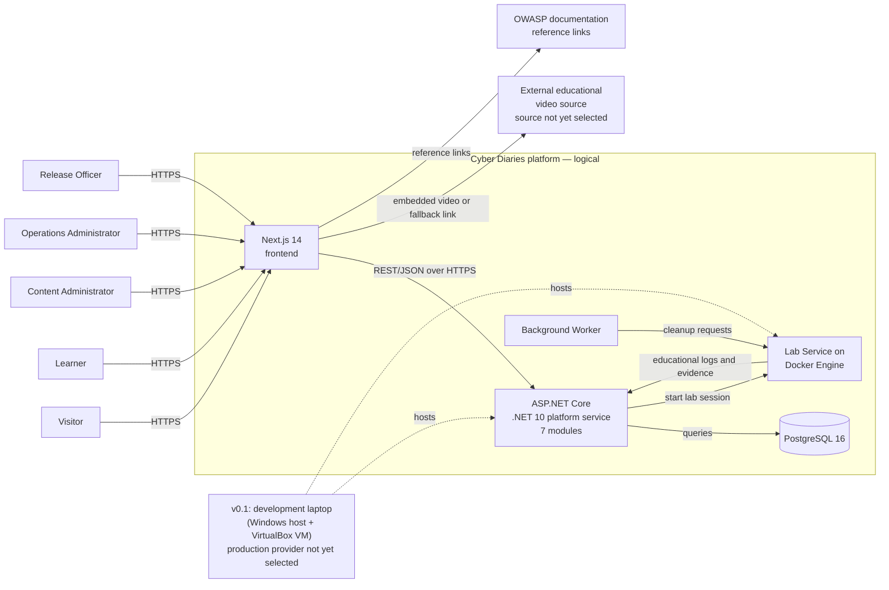
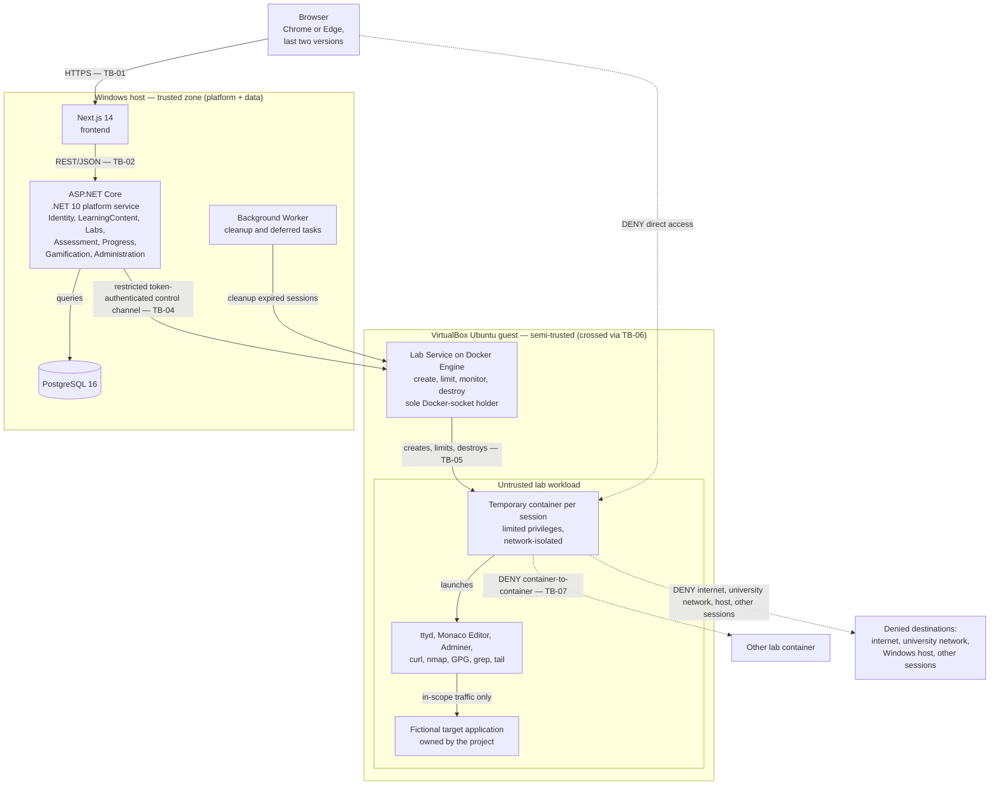
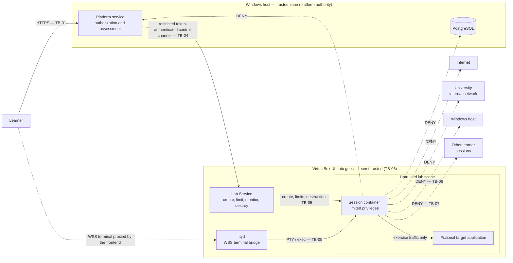
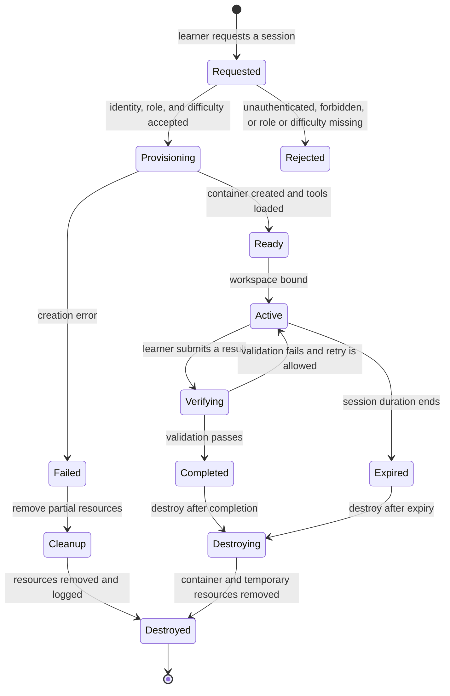

# Security Architecture Document — Cyber Diaries

**Requirements-derived draft**

| Field | Value |
|---|---|
| Document title | Security Architecture Document — Cyber Diaries |
| Document ID | CD-SAD-001 |
| Version | 0.2 |
| Status | Draft v0.2 — updated to current baselines; not yet reviewed |
| Classification | Internal |
| Date | 2026-11-05 |
| Owners | Ali Ahmad Abdulmunim · Mohamed Osama Ibrahim |
| Authors | Ali Ahmad Abdulmunim · Mohamed Osama Ibrahim |
| System | Cyber Diaries — interactive Arabic web application security learning platform |
| Source baseline | `Requirements/Requirements Specification - MASTER.md` · `Architecture/Threat Model/Threat Model.md` · `Architecture/Data.md` · `Architecture/Architecture - ADR.md` · `Description/Project Description.md` · `WorkFlow/Workflow Docs.md` |
| Repository path | `Security_Architecture_Document_Cyber_Diaries_v0.2.md` |
| Review cycle | Proposed: every release that touches identity, lab isolation, assessment integrity, or personal data; and annually |

**What this document is.** A security architecture description built only from facts that already exist in the project documentation. It records the stated system, the stated security constraints and requirements, the logical trust boundaries those requirements imply, and the verification that is planned but not yet performed.

**What this document is not.** It is not an as-built architecture, not an implementation record, not a test report, and not an approved risk acceptance. It contains no as-built configuration and no measured results. Design-level deployment and security decisions now exist in dedicated sources (ADR-001; `Architecture/Data.md` owner input) and are recorded here with their sources; implementation configuration, test evidence, and signatures still do not exist in the source baseline.

---

## Basis and evidence rule

Every statement in this document carries one of four statuses:

| Status | Meaning | Treatment in this document |
|---|---|---|
| Mandated | A non-negotiable constraint from the requirements baseline | Stated as an architectural obligation |
| Specified | An atomic, testable requirement with an observable fit criterion | Stated with its requirement identifier |
| Proposed | A design position introduced by this draft to organize the architecture | Explicitly labeled as proposed; requires owner approval |
| Open | A decision the source baseline records as unresolved | Named as open; never filled with an invented value |

Every verification row in this document is **Planned**. No test has been executed, no evidence artifact exists, and no control is claimed to be implemented or effective.

### Requirement prefixes used

| Prefix | Domain | Source section |
|---|---|---|
| `CDbHLT-CN-*` | Non-negotiable and declared constraints | S3.1 |
| `CDbHLT-AC-*` | Access control | S15.1 |
| `CDbHLT-IN-*` | Data integrity | S15.2 |
| `CDbHLT-PV-*` | Privacy | S15.3 |
| `CDbHLT-AU-*` | Audit | S15.4 |
| `CDbHLT-IM-*` | Immunity of the platform from lab activity | S15.5 |
| `CDbHLT-SC-*` | Safety-critical requirements | S12.2 |
| `CDbHLT-SP-*` | Performance and speed | S12.1 |
| `CDbHLT-FR-*` | Functional requirements | Sections 9–11 |

### Revision history

| Version | Date | Author | Change summary | Review status |
|---|---|---|---|---|
| 0.1 | 2026-11-04 | Ali Ahmad Abdulmunim · Mohamed Osama Ibrahim | Initial requirements-derived draft. Contains only sections supportable from the existing baseline. | Not reviewed |
| 0.2 | 2026-11-05 | Ali Ahmad Abdulmunim · Mohamed Osama Ibrahim | Updated to current baselines: Threat Model S10 (42 threats), TB-01…TB-08, D3b capacity, ADR-001 substrate, Data.md Q-24…Q-50, RK-012…016, corrected Appendix A paths. | Not reviewed |

### Approval status

This document has not been reviewed, approved, or signed. The named owners are the document owners, not approvers of a completed security architecture. Approval requires the missing artifacts listed in [S14](#14-coverage-limitations).

---

## Contents

1. [Purpose, scope and status](#1-purpose-scope-and-status)
2. [System context](#2-system-context)
3. [Logical architecture](#3-logical-architecture)
4. [Security objectives and principles](#4-security-objectives-and-principles)
5. [Assets, data and classification](#5-assets-data-and-classification)
6. [Identity, authentication and authorization](#6-identity-authentication-and-authorization)
7. [Application and API security](#7-application-and-api-security)
8. [Isolated lab security](#8-isolated-lab-security)
9. [Audit, logging and privacy](#9-audit-logging-and-privacy)
10. [Initial threat register](#10-initial-threat-register)
11. [Requirements traceability](#11-requirements-traceability)
12. [Assurance plan](#12-assurance-plan)
13. [Known risks and open decisions](#13-known-risks-and-open-decisions)
14. [Coverage limitations](#14-coverage-limitations)
- [Appendix A — Source register](#appendix-a--source-register)
- [Appendix B — Glossary](#appendix-b--glossary)
- [Appendix C — Maintenance triggers](#appendix-c--maintenance-triggers)

---

## 1. Purpose, scope and status

### 1.1 Purpose

This document describes the security architecture that the Cyber Diaries requirements imply, at the level of detail the requirements support. It is intended to:

- give the two document owners a single reference for the security obligations already accepted in the requirements;
- make the trust boundaries and the isolation model explicit before implementation;
- connect each security obligation to the requirement that states it and the test that will later prove it;
- record honestly where the baseline stops and what must be produced to complete the architecture.

### 1.2 What this document can and cannot support

| Can support | Cannot support |
|---|---|
| Explaining the stated system and its roles | Describing the deployed system |
| Listing the mandated security constraints | Asserting that any control is implemented |
| Deriving logical trust boundaries and data flows | Presenting an as-built network or cloud topology |
| Mapping requirements to security obligations | Claiming a requirement is verified |
| Planning verification and release gates | Reporting test results or residual risk acceptance |
| Recording known open decisions | Resolving legal, privacy, or product decisions |

### 1.3 Scope

| Element | In scope | Basis |
|---|---|---|
| Cyber Diaries web platform | Yes | Project Description EN.md S0–S2 |
| Next.js 14 frontend | Yes | Requirements S3.4 |
| ASP.NET Core .NET 10 platform service, seven modules | Yes | Requirements S3.1 `CDbHLT-CN-001`, S3.2 |
| PostgreSQL 16 database | Yes | Requirements S3.2, S3.4 |
| Separate Lab Service on Docker Engine | Yes | Requirements S3.1 `CDbHLT-CN-002`, S3.2 |
| Background Worker for cleanup and deferred tasks | Yes | Requirements S3.2 |
| Lab tools and fictional target applications | Yes | Requirements S3.3, S3.4 |
| Roles: Visitor, Learner, Content Administrator, Operations Administrator, Release Officer | Yes | Requirements S15.1 |
| v0.1 substrate (laptop, VirtualBox VM, platform placement) | Yes | ADR-001 (Accepted by Team — Pending Supervisor); Threat Model S3 |
| Hosting provider and production topology | No | Provider not selected (D2, OI-007) |
| University network and learner device | No | Outside the system boundary; treated as external |
| Source code repository and CI/CD pipeline | Partially (design intent only) | Docker Compose manual in v0.1, GitHub Actions planned v0.2 (Q-23); weekly SCA and Trivy scanning (Q-43, Q-44); no pipeline exists yet |
| Evaluation study operations | No | Study protocol and consent form not approved (D5) |

### 1.4 Source baseline

| Source | Actual path | What it contributes |
|---|---|---|
| Requirements Specification | `Requirements/Requirements Specification - MASTER.md` | Constraints, roles, permissions, data dictionary, security requirements, safety-critical requirements, performance targets, privacy and legal basis |
| Threat Model (formal register) | `Architecture/Threat Model/Threat Model.md` | 42 threats (STRIDE, L×I scoring), 38 controls, 8 trust boundaries, 5 residual risks, misuse cases |
| Owner decisions | `Architecture/Data.md` | 63 owner answers Q-01…Q-63 (isolation, capacity, auth, logging, environments) |
| Architecture & ADRs | `Architecture/Architecture - ADR.md` | Full arc42 documentation with current decisions and ADR index |
| ADR-001 | `Architecture/docs/adr/ADR-001-isolation-substrate-and-platform-placement.md` | Isolation substrate and platform placement (Accepted by Team — Pending Supervisor) |
| Requirements decisions | `Requirements/Logs/Requirements Decisions - Consolidated.md` | D1–D17 decision history |
| Proposed amendments | `Requirements/Logs/Proposed Amendments - D3b, CN-001, CN-008, CN-022.md` | Drafted amendments; not yet applied to the requirements baseline |
| Closed decisions | `Requirements/Data/data.md` | Official closed decisions (D3, D4, D5, D7) |
| Project description | `Description/Project Description.md` | Product context, architecture intent, risks, ethical and legal commitments |
| Workflow | `WorkFlow/Workflow Docs.md` | Lab session lifecycle, operational limits, critical security rules, failure behavior |

> The v0.1 draft referenced a former repository layout (`Pre Documentations/...`) that no longer exists; those paths were corrected in this revision.

### 1.5 Status of this document

| Dimension | State |
|---|---|
| Requirements coverage | Partial: security requirements in S15 and safety-critical requirements in S12 are covered; operational, resilience, and supply-chain areas are not |
| Architectural detail | Logical plus the decided v0.1 substrate (ADR-001: platform on the Windows host, lab stack in a VirtualBox VM); no as-built configuration |
| Evidence | None; every test is planned |
| Approval | None; draft only |
| Owner acceptance | Document ownership assigned; residual risk not accepted |

---

## 2. System context

### 2.1 Product context

Cyber Diaries is an interactive Arabic learning platform that teaches web application security through a continuous narrative and a practical lab path. The Learning Path presents educational categories derived from the OWASP Top 10:2025. The Labs Path places the learner inside a fictional company and asks them to perform Red Team, Blue Team, or Developer tasks in an isolated environment. The platform records progress, points, achievements, journals, and behavior events for learning and for the evaluation study.

The security-relevant consequence is that the platform does two different things at once:

1. It manages accounts, content, assessment, and personal data — a conventional web application security problem.
2. It executes untrusted learner commands — a safety-critical isolation problem.

The requirements treat the second as a separate service boundary (`CDbHLT-CN-002`) and as a release-blocking safety property (`CDbHLT-IM-006`).

### 2.2 Roles

| Role | Description | Security significance | Source |
|---|---|---|---|
| Visitor | Unauthenticated user | May see only the public introductory homepage | `CDbHLT-AC-001` |
| Learner | Registered user | Owns one account, own lab sessions, own journals, own progress; cannot reach another learner's data | `CDbHLT-AC-003`, `CDbHLT-AC-004`, `CDbHLT-AC-008` |
| Content Administrator | Manages categories, lessons, scenes, quizzes, and textual scenarios | Must not be able to change lab operation settings | `CDbHLT-AC-006`, `CDbHLT-CN-009` |
| Operations Administrator | Manages lab lifecycle, isolation, resource and duration limits, monitoring, and destruction | Holds the most safety-critical operational authority | `CDbHLT-AC-005` |
| Release Officer | Manages assessment criteria, points economy, difficulty levels, and releases | Controls the rules that anchor assessment integrity | `CDbHLT-AC-007` |
| Supervisor / examiner | Trusted observer — no administrative account in v0.1 | May see demos and review documentation; cannot operate the system | Threat Model S3.3 |
| Research consumer | Trusted — study team only | Receives only anonymized exports; no access to identifiable data (`CDbHLT-PV-002`, `CDbHLT-PV-006`) | Threat Model S3.3 |

### 2.3 Logical context diagram (D-01)

**Status:** Proposed logical view derived from the stated architecture. Not an as-built diagram.

### 2.4 External dependencies

| Dependency | Direction | Data or function exchanged | Authentication or protection stated | Failure behavior stated | Source |
|---|---|---|---|---|---|
| Learner or administrator browser | Inbound | User requests, credentials, session, lab interaction | HTTPS | Not specified | Requirements S3.2 |
| Hosting provider | Infrastructure | Hosts the platform and lab services | Provider not selected | Not specified | Requirements S3.2 (D2) |
| External educational video source | Outbound embed or link | Video content and a fallback link | Not specified | Fallback link displayed when embedding fails | Requirements S3.3; Project Description S5.7 |
| OWASP documentation | Outbound links | Reference links only | Not applicable | Not specified | Requirements S3.3 |
| Docker Engine | Internal dependency | Container creation and destruction for labs | Isolation requirements `CDbHLT-CN-003`, `CDbHLT-CN-004` | Failed provisioning leads to cleanup and an error message | Requirements S3.2; Workflow S13 |
| VirtualBox hypervisor | Infrastructure | Hosts the Ubuntu guest running Lab Service, Docker, ttyd, and the lab containers | Restricted token-authenticated control channel only; no shared folders, no clipboard, no drag-and-drop | Patch cadence and snapshot rollback planned (CTRL-VM-01, CTRL-VM-02); WSL2 fallback if the spike fails | ADR-001 S2; Threat Model S3.2 |

> **Boundary note.** The browser is not managed by the project and is treated as untrusted. The university network is outside the boundary and is explicitly named as a network the lab must not reach (`CDbHLT-SC-003`).

### 2.5 Mandatory constraints that shape this architecture

| ID | Constraint | Architectural consequence | Non-negotiable | Source |
|---|---|---|---|---|
| `CDbHLT-CN-001` | Seven modules in a single runnable Modular Monolith, not independent services | One backend deployment unit, with module boundaries inside it; the Lab Service is the sole mandated exception | Declared constraint; breakable only with client permission | Requirements S3.1 |
| `CDbHLT-CN-002` | Lab service separate from the API process; no user command executed inside the API process | A hard process boundary between platform logic and untrusted execution | Yes | Requirements S3.1 |
| `CDbHLT-CN-003` | Temporary, network-isolated container with limited privileges, destroyed after session end | Lab compute is ephemeral and constrained by design | Yes | Requirements S3.1 |
| `CDbHLT-CN-004` | Embedded tools prevented from exiting the lab scope | Default-denied network and execution scope for lab tools | Yes | Requirements S3.1 |
| `CDbHLT-CN-005` | All points and achievements calculated on the server; no client-side calculation; no duplicate awards | Server-side assessment authority and idempotent award logic | Yes | Requirements S3.1 |
| `CDbHLT-CN-006` | REST-first interfaces; no GraphQL unless proven necessary | A single API style to secure and test | Declared constraint; breakable with client permission | Requirements S3.1 |
| `CDbHLT-CN-008` | The lab desktop presented to the learner is an interactive interface for reaching tools — not a full operating system. Proposed reword: applies to the learner-facing desktop only and does **not** prohibit the infrastructure VM of `CDbHLT-CN-022`, which is invisible to the learner | Learner-facing UI is not an OS; the substrate VM is invisible to the learner | Yes | Requirements S3.1; reword per Data.md Q-04, Amendments S3 `[PROPOSED — reword pending]` (OI-TM-05) |
| `CDbHLT-CN-009` | Content administration separated from lab operation settings | Role separation enforced in the administration surface | Declared constraint; modifiable by documented decision | Requirements S3.1 |
| `CDbHLT-CN-014` | Educational logs contain no personal information or secrets | Log content is a privacy and safety requirement, not only a hygiene preference | Yes | Requirements S3.1 |
| `CDbHLT-CN-020` (proposed) | Kubernetes is prohibited in the first version | Deployment substrate must be Docker Compose on a single node | Yes | Data.md Q-05 `[PROPOSED — not yet in MASTER.md]` |
| `CDbHLT-CN-021` (proposed) | The lab is not permitted to run on more than one device | Single-node constraint reinforces the VM boundary and the capacity model of S8.5 | Yes | Data.md Q-06 `[PROPOSED — not yet in MASTER.md]` |
| `CDbHLT-CN-022` (proposed) | The lab service and its containers run only inside a VirtualBox VM; no untrusted code executes outside it | The VM is the isolation boundary; a single restricted, token-authenticated control channel is the only cross-zone flow | Yes | Amendments S4 `[PROPOSED — drafted, not yet applied]`; closes traceability gap G-01 for T-26/T-27/T-28 |

---

## 3. Logical architecture

### 3.1 Stated components

| Component | Stated technology | Responsibility | Security relevance | Source |
|---|---|---|---|---|
| Frontend | Next.js 14, React | Narrative, learning pages, lab workspace, journals, administration views | Renders untrusted user input; must not be trusted to enforce authorization | Requirements S3.4 |
| Platform service | ASP.NET Core .NET 10, Modular Monolith | Identity, LearningContent, Labs, Assessment, Progress, Gamification, Administration | Holds authentication, authorization, assessment, and audit authority | Requirements S3.1, S3.2 |
| Database | PostgreSQL 16 | Users, content, sessions, results, points, progress, journals, behavior events | Primary confidentiality and integrity asset | Requirements S3.2, S3.4 |
| Lab Service | Docker Engine | Builds and runs isolated containers, target applications, and tools | Creates and destroys untrusted compute | Requirements S3.2 |
| Lab substrate VM | Ubuntu guest inside VirtualBox | Hosts Lab Service + Docker + ttyd; isolates untrusted containers from Windows | **Primary isolation boundary (TB-06)**. Container escape reaches only the guest; a second escape is required to reach Windows. The Lab Service is the sole holder of the Docker socket | ADR-001 S2; Threat Model S2.6 A-03, S5 |
| Background Worker | Stated in the architecture tree | Cleanup and deferred tasks, including expired sessions | Enforces automatic destruction independently of the request path | Requirements S3.2; Workflow S13 |
| Lab tools | `ttyd`, Monaco Editor, Adminer, `curl`, `nmap`, GPG, `grep`, `tail` | Terminal, editor, database browser, and command-line practice | Untrusted execution within a constrained container | Requirements S3.4 |
| Fictional target applications | Owned by the project | Training targets for the exercises | Must never be real external systems | `CDbHLT-IM-004`; Project Description S22 |

### 3.2 Logical container diagram (D-02)

**Status:** Proposed logical view derived from the stated architecture. It shows intended boundaries, not deployed network zones.

**Placement note (ADR-001, Accepted by Team — Pending Supervisor Acknowledgment).** The trusted zone — Next.js, the platform service, PostgreSQL, the `AuditLog` store, and backups — runs on the Windows host. The semi-trusted Ubuntu guest VM hosts only the lab stack (Lab Service, Docker Engine, ttyd, lab containers). The learner-facing desktop remains UI-only; the VM substrate is invisible to the learner (amended CN-008, proposed). [Source: ADR-001 S2; Threat Model S3.2, S3.4]

### 3.3 Module responsibilities and security relevance

| Module | Responsibility | Security-relevant authority | Source |
|---|---|---|---|
| Identity | Accounts, credentials, roles, sessions | Authenticates users and supplies the role used by every authorization decision | Requirements S3.1, S7.2 |
| LearningContent | Categories, lessons, scenes, quizzes, resources | Publishes content; must not expose unpublished or out-of-scope content | `CDbHLT-AC-006`, `CDbHLT-CN-015` |
| Labs | Lab tasks, sessions, lifecycle requests | Requests lab actions from the Lab Service; must never execute user commands itself | `CDbHLT-CN-002`, `CDbHLT-IM-001` |
| Assessment | Automated validation and results | Produces the immutable validation result and feedback | `CDbHLT-IN-006` |
| Progress | Learner completion state | Records completion; must not record completion on failure or interruption | `CDbHLT-IN-008` |
| Gamification | Points and achievements | Computes points and awards server-side and prevents duplicates | `CDbHLT-CN-005`, `CDbHLT-IN-001`, `CDbHLT-IN-002` |
| Administration | Content, lab operations, release settings | Separates three administrative authorities | `CDbHLT-AC-005`, `CDbHLT-AC-006`, `CDbHLT-AC-007` |

### 3.4 Logical trust boundaries

| ID | Boundary | What separates | Flows across it | Required control | Source |
|---|---|---|---|---|---|
| TB-01 | Public → App | Browser from the application entry point (Next.js over HTTPS/WSS) | Credentials, session token, terminal stream, admin requests | TLS 1.3, cookie flags, CSP, rate limiting; authentication required for all internal pages (`CDbHLT-AC-001`) | Threat Model S6 |
| TB-02 | Frontend → API | Next.js from the ASP.NET Core platform service (REST/JSON) | Commands and queries | JWT validation, authorization policy, input validation; server-side role verification (`CDbHLT-AC-002`) | Threat Model S6 |
| TB-03 | API → Database | Application logic from persisted data (PostgreSQL) | SQL, results, audit writes | Least-privilege DB user, parameterized queries, TLS | Threat Model S6 |
| TB-04 | Platform → Lab | Windows host (API) from the Ubuntu VM (Lab Service) | Session commands (start/stop/destroy) over a **restricted, token-authenticated control channel** (SSH or Docker API — finalized in OI-TM-13) | Service authentication, session tokens, operation allow-list; the only crossing between trusted and untrusted zones; process separation (`CDbHLT-CN-002`, `CDbHLT-IM-001`, `CDbHLT-SC-004`) | Threat Model S6 |
| TB-05 | Lab → VM | Container workload from the Docker daemon and the Ubuntu guest | syscalls, Docker API, cgroup limits | Container hardening, non-root, cap-drop, seccomp, resource limits, no egress, ephemeral (`CDbHLT-CN-003`, `CDbHLT-SC-002`, `CDbHLT-CN-004`, `CDbHLT-SC-003`) | Threat Model S6 |
| TB-06 | VM → Windows host | Ubuntu guest from Windows 11 | Hypervisor calls only (**TB-04 traverses it**) | VirtualBox isolation, no shared folders/clipboard/drag-and-drop, NAT + host-only network, snapshot rollback | Threat Model S6 |
| TB-07 | Lab → Lab | Container A from Container B | (must be none) | Per-session internal Docker network; no shared volumes; cross-session access prohibition (`CDbHLT-AC-004`) | Threat Model S6 |
| TB-08 | Admin → App | Administrative identity from administrative functions | Content, lab, and release operations | RBAC + policy, audit, separation of the three admin roles; server-side role verification on every administrative request (`CDbHLT-AC-002`, `CDbHLT-AC-005`–`AC-007`) | Threat Model S6 |

> **Collision resolved (OI-TM-01 closed).** An earlier version of this document used TB-06 for "Administrator → administrative functions" and a nonexistent TB-07 for "Isolated lab scope" in S8.2. The formal register in `CDbHLT-TM-001` renumbers: **TB-06 = VM → Windows host, TB-07 = Container → Container, TB-08 = Administrator → App**. The 8-boundary scheme is authoritative. [Source: Threat Model.md — S6, S17.1 OI-TM-01]

### 3.5 Deployment status

The v0.1 development and demonstration topology is decided (ADR-001, Accepted by Team — Pending Supervisor Acknowledgment): a single development laptop — the platform (Next.js, API, PostgreSQL, `AuditLog`, backups) on the Windows host, the lab stack (Lab Service, Docker, ttyd, containers) inside a VirtualBox Ubuntu guest; no cloud provider and no public URL in v0.1. Deployment is manual Docker Compose in v0.1; GitHub Actions is planned for v0.2 (Q-23). For production (post-v1.0) the hosting provider is still not selected: the baseline records three candidate options — Oracle Cloud Free, Render, or the university server (D2, OI-007). The only stated mandatory conditions on any provider are container support, HTTPS, and 2 GB RAM per container (the v0.1 working value is 1.5 GB — see S8.5).

This document therefore does not describe regions, subnets, firewall rules, or load balancers for any deployed environment. Those are listed in [S14](#14-coverage-limitations); the security-zone model that replaces them at design level is in S3.6.

### 3.6 Security zones (per CDbHLT-TM-001 S3.4)

| Zone | Trust level | Contents |
|---|---|---|
| **Trusted** | High | Windows host: Next.js, Platform API, PostgreSQL, `AuditLog`, backups |
| **Semi-trusted** | Medium | Ubuntu VM kernel, Lab Service, ttyd, Docker daemon |
| **Untrusted** | Low | Lab containers, learner input, terminal streams |
| **External** | None | Browser, container registry, external backup copy |

The zone model is the basis for every trust-boundary decision in S3.4 and every lab control in S8. [Source: Architecture/Threat Model/Threat Model.md — S3.4]

---

## 4. Security objectives and principles

### 4.1 Security objectives

These objectives are derived from the mandated constraints and the security requirements. They are not new product requirements.

| ID | Objective | Why it exists | Definition of satisfied | Source |
|---|---|---|---|---|
| SO-01 | Contain untrusted lab execution | Learner commands are untrusted by definition | No lab command runs in the API process; no lab traffic exits its scope | `CDbHLT-CN-002`, `CDbHLT-CN-004`, `CDbHLT-IM-001`, `CDbHLT-IM-003` |
| SO-02 | Preserve assessment integrity | Points and results must reflect real work | All scoring is server-side; duplicate awards are impossible; results and evidence are immutable to learners | `CDbHLT-CN-005`, `CDbHLT-IN-001` – `IN-008` |
| SO-03 | Enforce least authority by role | Administrative authority is split across three roles | Every administrative request is role-checked on the server, including direct API calls | `CDbHLT-AC-002`, `CDbHLT-AC-005` – `AC-008` |
| SO-04 | Protect learner and research data | Personal data and journals are processed under PDPL and ethics review | Data is minimal, owner-only where required, and deleted or anonymized on request | `CDbHLT-PV-001` – `PV-007` |
| SO-05 | Make sensitive actions attributable | Integrity and privacy claims need evidence | Sensitive operations and lab lifecycles are recorded in append-only logs | `CDbHLT-AU-001` – `AU-004` |
| SO-06 | Keep lab artifacts free of personal data and secrets | Educational logs are shared as study material | Sampled logs contain no personal information or secrets | `CDbHLT-CN-014`, `CDbHLT-PV-006` |
| SO-07 | Destroy lab compute reliably | Ephemeral isolation depends on destruction | Container and temporary resources are removed at session end or timeout and the removal is logged | `CDbHLT-CN-003`, `CDbHLT-SC-001`, `CDbHLT-AU-002` |

### 4.2 Architecture principles

These principles are proposed as design constraints derived from the requirements. Each one changes a concrete decision in this document.

| ID | Principle | Derivation | What it requires here |
|---|---|---|---|
| P-01 | Execution is separated from management | `CDbHLT-CN-002` | The platform service requests lab actions; the Lab Service performs them; no user command enters the API process |
| P-02 | Deny by default | `CDbHLT-CN-004`, `CDbHLT-SC-003` | Lab tools have no route to the internet, the university network, the host, the platform, the database, or another session |
| P-03 | Least privilege | `CDbHLT-CN-003`, `CDbHLT-SC-002`, `CDbHLT-AC-005` | Containers run with restricted privileges; administrative authority is split by role |
| P-04 | The server is the authority | `CDbHLT-CN-005`, `CDbHLT-AC-002` | Authorization, validation, scoring, and result creation happen server-side; the interface is never the enforcement point |
| P-05 | Records are append-only | `CDbHLT-IN-005` – `IN-007`, `CDbHLT-AU-003` | Evidence, points, achievements, behavior events, and audit entries accept additions, not learner edits or deletions |
| P-06 | Ephemeral by design | `CDbHLT-CN-003`, `CDbHLT-SC-001` | Lab compute and temporary resources are created for one session and destroyed at the end |
| P-07 | Data minimization | `CDbHLT-PV-002`, `CDbHLT-CN-014` | Only the fields needed for operation and the approved study are collected; logs exclude personal data and secrets |
| P-08 | Accountability by design | `CDbHLT-AU-001` – `AU-004` | Sensitive operations and session lifecycles are recorded with actor, operation, time, and result |
| P-09 | Safety outranks schedule | Project Description S16, S19; `CDbHLT-IM-006` | A failed isolation test stops a release rather than being documented as debt |

---

## 5. Assets, data and classification

### 5.1 Asset inventory

Classifications follow the four-level scheme adopted by owner decision `Q-39` in `Architecture/Data.md` (previously marked "proposed" in v0.1).

| ID | Asset | Type | Where it lives (stated) | Classification (Q-39) | Why it matters | Source |
|---|---|---|---|---|---|---|
| A-01 | Account credentials (`Username`, `PasswordHash`) | Data | Account in PostgreSQL | Restricted | Compromise enables account takeover | Requirements S7.2; `CDbHLT-AC-009` |
| A-02 | Account metadata (`DisplayName`, `IsHidden`, `CreatedAt`) | Data | Account and User | Confidential | Identity exposure and leaderboard visibility | Requirements S7.2; `CDbHLT-PV-007` |
| A-03 | Learning content (categories, lessons, scenes, quizzes, resources) | Data | LearningContent module | Internal | Unpublished content and scope control | `CDbHLT-AC-006`, `CDbHLT-CN-015` |
| A-04 | Lab session records (`SessionId`, `Difficulty`, `Role`, `StartedAt`, `ExpiresAt`, `Status`) | Data | PostgreSQL and session log | Confidential | Attribution, isolation verification, destruction proof | Requirements S7.2; `CDbHLT-AU-002` |
| A-05 | Evidence and validation results | Data | Lab environment and Assessment module | Confidential | Integrity of assessment and learner work | `CDbHLT-IN-005`, `CDbHLT-IN-006` |
| A-06 | Journals (`WhatHappened`, `WhyHappened`, `WhatIDid`, `WhatILearned`) | Data | JournalEntry | Confidential | Personal reflection and research data | Requirements S7.2; `CDbHLT-PV-003` |
| A-07 | Progress, points, and achievements | Data | Progress and Gamification modules | Confidential | Integrity of the learning record | `CDbHLT-CN-005`, `CDbHLT-IN-001` – `IN-005` |
| A-08 | Behavior events (`EventType`, `TargetRef`, `Timestamp`) | Data | BehaviorEvent | Confidential | Research measurement; re-identification risk | `CDbHLT-IN-007`; Project Description S20.3 |
| A-09 | Audit log and lab session log | Data | Audit mechanism; storage design not specified | Restricted | Accountability and incident evidence | `CDbHLT-AU-001` – `AU-004` |
| A-10 | Lab container and its temporary filesystem | Infrastructure | Docker host | Confidential | Holds in-progress learner work and evidence | `CDbHLT-CN-003` |
| A-11 | Lab tools and fictional target applications | Component | Lab images and containers | Internal | Integrity of the training environment | `CDbHLT-IM-004` |
| A-12 | Point calculation inputs and rules (`Multiplier`, `SourceId`, success criteria) | Data and logic | Assessment and Gamification modules | Restricted | Directly determines assessment integrity | `CDbHLT-CN-005`, `CDbHLT-IN-002`, `CDbHLT-IN-004` |

### 5.2 Classification scheme (per Data.md Q-39)

Classifications are per `Architecture/Data.md` Q-39 — four levels: **Public / Internal / Confidential / Restricted**. [Source: Data.md — Q-39]

| Class | Definition | Handling in this document |
|---|---|---|
| Public | Intended for unauthenticated visitors | Homepage and public introductory content only |
| Internal | Not for public release, low harm if disclosed | Learning content, lab inventory, tool documentation |
| Confidential | Harm to a learner or to assessment integrity if disclosed | Account metadata, journals, progress, points, evidence, behavior events, lab session detail |
| Restricted | Legal, safety, or integrity impact if disclosed | Credentials, point rules, audit logs, lab control capability |

### 5.3 Data entities and sensitivity

| Entity | Key fields | Sensitivity | Security obligation | Source |
|---|---|---|---|---|
| Account | `Username`, `PasswordHash`, `Role` | High | Irreversible password hash; role is the basis of authorization | `CDbHLT-AC-009`; Requirements S7.2 |
| User | `UserId`, `DisplayName`, `IsHidden`, `CreatedAt` | Medium | Owner-controlled visibility; no automatic deletion, deletion at request | Requirements S7.1, S7.2; D11 |
| LabSession | `SessionId`, `Difficulty`, `Role`, `StartedAt`, `ExpiresAt`, `Status` | High | Bound to one learner; status proves destruction | `CDbHLT-AC-003`, `CDbHLT-AU-002` |
| Evidence | `EvidenceId`, `Path`, `Kind`, `CreatedAt` | High | Append-only for learners | `CDbHLT-IN-005` |
| VerificationResult | `ResultId`, `Passed`, `Feedback`, `CheckedAt` | High | Created automatically; immutable after creation | `CDbHLT-IN-006` |
| JournalEntry | `EntryId`, four reflection fields, `SavedAt` | High | Visible to owner; deleted with account | `CDbHLT-PV-003`, `CDbHLT-PV-004` |
| Progress | `ProgressId`, `State`, `CompletedAt` | Medium | Completion only on genuine success | `CDbHLT-IN-008` |
| PointTransaction | `TransactionId`, `Points`, `Multiplier`, `SourceId`, `CreatedAt` | High | Server-calculated; duplicate prevention; append-only | `CDbHLT-IN-001`, `CDbHLT-IN-002`, `CDbHLT-IN-005` |
| Achievement | `AchievementId`, `Code`, `UnlockedAt` | Medium | Not updated after unlocking; deleted with account | Requirements S7.1; `CDbHLT-IN-002` |
| BehaviorEvent | `EventId`, `EventType`, `TargetRef`, `Timestamp` | High | Append-only; used for research measurement | `CDbHLT-IN-007` |

### 5.4 Logical data flows

Protocols are stated only where the baseline states them. "Not specified" means the baseline does not define the mechanism.

| ID | From | To | Data | Protocol | Boundary | Required protection | Source |
|---|---|---|---|---|---|---|---|
| DF-01 | Browser | Next.js frontend | Credentials, session, requests, lab interaction | HTTPS | TB-01 | TLS; authentication for internal pages | Requirements S3.2; `CDbHLT-AC-001` |
| DF-02 | Frontend | Platform service | REST/JSON requests | HTTPS; REST/JSON | TB-02 | Server-side authentication and authorization | `CDbHLT-CN-006`, `CDbHLT-AC-002` |
| DF-03 | Platform service | PostgreSQL | Queries and results | Not specified | TB-03 | Server-side data access only | Requirements S3.2 |
| DF-04 | Platform service | Lab Service | Session start request | Restricted token-authenticated control channel (SSH or Docker API — pending OI-TM-13) | TB-04 | Only the Lab Service executes lab actions | `CDbHLT-CN-002`, `CDbHLT-IM-001` |
| DF-05 | Background Worker | Lab Service | Cleanup of expired sessions | Not specified | TB-04 | Automatic destruction independent of the user request | Requirements S3.2; `CDbHLT-SC-001` |
| DF-06 | Lab Service | Lab container and tools | Workspace binding, terminal, editor, database interface | Not specified | TB-05 | Session-bound access; no cross-session access | `CDbHLT-AC-004`; Workflow S13 |
| DF-07 | Lab tools | Fictional target application | Exercise traffic | Not specified | TB-05 | In-scope traffic only | `CDbHLT-CN-004`, `CDbHLT-SC-003` |
| DF-08 | Lab container | Any external network, host, platform, database, or other session | Attempted traffic | Any | TB-05 | Denied and, where logging exists, recorded | `CDbHLT-CN-004`, `CDbHLT-SC-003` |

### 5.5 Personal data and retention status

| Data element | Purpose | Exposure | Retention status | Source |
|---|---|---|---|---|
| `Username` | Account login | Platform operators with database access | Deleted with account at learner request | Requirements S7.2; D11 |
| `PasswordHash` | Login verification | Should never be readable by any role | Deleted with account at learner request | `CDbHLT-AC-009`; D11 |
| `DisplayName` | Optional leaderboard display | Visible only if the learner opts in | Deleted with account; hiding is immediate | `CDbHLT-PV-007`; BR-06 |
| `IsHidden` | Leaderboard hiding preference | Learner and enforcement logic | Deleted with account | `CDbHLT-PV-007` |
| `JournalEntry` fields | Learning reflection and qualitative study data | Owner only | Deleted with account | `CDbHLT-PV-003`, `CDbHLT-PV-004` |
| `BehaviorEvent` fields | Study measurement | Research use, pseudonymous intent | Anonymized when the account is deleted | `CDbHLT-IN-007`, `CDbHLT-PV-004` |
| `LabSession` metadata | Operations, attribution, destruction proof | Authorized administrative roles | Not resolved in the baseline | `CDbHLT-AU-002`, `CDbHLT-AU-004` |
| Audit actor identifier | Accountability for sensitive operations | Authorized administrative roles | Not resolved in the baseline | `CDbHLT-AU-001`, `CDbHLT-AU-004` |

Retention position recorded in the baseline: there is no automatic deletion; account deletion occurs at the learner's request and removes the account and linked journals, progress, points, and achievements, while research records are reduced to an anonymous identifier so anonymized results remain for deferred study (D11). The exact retention duration for each data type remains unresolved under D5. This document does not invent durations, and no retention period is asserted as approved.

---

## 6. Identity, authentication and authorization

### 6.1 Identity types

| Identity type | Examples | Provisioning stated | Credential stated | Used by | Source |
|---|---|---|---|---|---|
| Human — learner | Registered learner | Self-registration | Username and password | Web application | `CDbHLT-AC-001`, `CDbHLT-AC-009` |
| Human — administrator | Content, Operations, Release | Administrative account with a role in `Account.Role` | Username and password | Administration views | `CDbHLT-AC-002`; Requirements S7.2 |
| Visitor | No account | None | None | Public homepage only | `CDbHLT-AC-001` |

No service identity, machine identity, break-glass identity, federation, or multi-factor mechanism is defined in the baseline. Those are listed in [S14](#14-coverage-limitations).

### 6.2 Authentication requirements specified

| Requirement | Statement | Status | Source |
|---|---|---|---|
| Session prerequisite | Every internal page requires a valid authenticated session; only the public introductory homepage is available to a visitor | Specified | `CDbHLT-AC-001` |
| Password storage | Passwords are stored only as irreversible hashes in `PasswordHash`; no plaintext in any storage location | Specified | `CDbHLT-AC-009` |
| Login error behavior | Registration and login errors must not reveal whether an account exists; the message is identical in both cases | Specified | `CDbHLT-FR-004` |
| Token mechanism | JWT stored in an HttpOnly + Secure + SameSite cookie plus a refresh token. Access 60 minutes; refresh 3 days; rotation on every use; immediate revocation | `[OWNER-INPUT]` | Data.md Q-24, Q-25; CTRL-AUTH-02 |
| Password hashing algorithm | **Argon2id**, memory 64 MB, iterations 3 | `[OWNER-INPUT]` | Data.md Q-26; CTRL-AUTH-01 |
| Rate limiting (auth) | 10 req/min per IP on auth endpoints; 100 req/min per user overall | `[OWNER-INPUT]` | Data.md Q-34; CTRL-AUTH-03 |
| Role source | Authorization uses the role recorded in `Account.Role` after authentication | Specified | Requirements S15.1 permissions matrix |

> The refresh-token lifetime is recorded as **3 days** (Data.md Q-25). An earlier proposal (`SG-06`) suggested 7 days; the conflict was resolved in favour of Q-25 and is documented in `Architecture/Architecture - ADR.md`.

The baseline still does not specify password length or composition, lockout thresholds, account recovery, or MFA — those remain unspecified and appear in [S14](#14-coverage-limitations). Hashing parameters, token format, session lifetime, cookie attributes, rotation, and revocation are now specified as owner input (Q-24–Q-26, Q-34; CTRL-AUTH-01…03) and await formal adoption into the requirements baseline.

### 6.3 Authorization model

The model is role-based at the administrative level, with object ownership for learner data. The matrix below is reproduced from the requirements baseline.

| Function or data | Learner | Content Administrator | Operations Administrator | Release Officer | Condition | Source |
|---|---|---|---|---|---|---|
| View learning pages and scenes | Read | Read for preview and review | Forbidden | Forbidden | Content preview is proposed in the source matrix and awaits supervisor confirmation of the apparent conflict | Requirements S15.1 |
| Log in and create an account | Execute for own account | Execute for administrative account | Execute for administrative account | Execute for administrative account | Role is taken from `Account.Role` after authentication | Requirements S15.1 |
| Content administration | Forbidden | Edit | Forbidden | Forbidden | Must not touch lab operation settings | `CDbHLT-AC-006`, `CDbHLT-CN-009` |
| Lab operation and lifecycle | Execute for own session only | Forbidden | Edit in full | Forbidden | Learner execution stays inside the isolated scope | `CDbHLT-AC-005` |
| Release and settings management | Forbidden | Forbidden | Forbidden | Edit | Assessment criteria, points economy, difficulty levels | `CDbHLT-AC-007` |
| View leaderboard | Read | Forbidden | Forbidden | Forbidden | Closed by default; opt-in only; optional display names | `CDbHLT-PV-007`, BR-06 |
| Edit personal data | Edit own account only | Forbidden | Forbidden | Forbidden | Display name and hiding status only | `CDbHLT-AC-008` |
| Delete account | Execute own request only | Forbidden | Forbidden | Forbidden | Deletes account and linked records; anonymizes research records | `CDbHLT-PV-004`, D11 |

### 6.4 Enforcement rules

| Rule | Requirement | Status |
|---|---|---|
| The server verifies the role on every administrative request; interface hiding is not a control | `CDbHLT-AC-002` | Specified |
| Every rejected administrative attempt is recorded in the audit log | `CDbHLT-AC-002`, `CDbHLT-AU-001` | Specified |
| A lab session is created for exactly one authenticated learner and only after difficulty and role are chosen | `CDbHLT-AC-003` | Specified |
| No learner can open another learner's session, container, or evidence | `CDbHLT-AC-004` | Specified |
| Lab lifecycle authority belongs only to the Operations Administrator | `CDbHLT-AC-005` | Specified |
| Content administration cannot change lab operation settings | `CDbHLT-AC-006`, `CDbHLT-CN-009` | Specified |
| Release settings belong only to the Release Officer | `CDbHLT-AC-007` | Specified |
| Learners can edit only their own `DisplayName` and `IsHidden`; administrators cannot edit those fields | `CDbHLT-AC-008` | Specified |
| Audit and session logs are not readable by learners | `CDbHLT-AU-004` | Specified |

---

## 7. Application and API security

### 7.1 Interface style

The first release is REST/JSON. GraphQL is excluded unless a documented need proves its value (`CDbHLT-CN-006`). The frontend is Next.js 14 and the platform service is ASP.NET Core .NET 10. All user-facing access is stated as HTTPS.

### 7.2 Specified application and API controls

| Control area | Specified behavior | Requirement | Status |
|---|---|---|---|
| Authentication gate | Internal pages are unavailable without a valid session | `CDbHLT-AC-001` | Specified |
| Server-side authorization | Role verification on every administrative request | `CDbHLT-AC-002` | Specified |
| Object ownership | Lab sessions are single-learner and not reachable by another learner | `CDbHLT-AC-003`, `CDbHLT-AC-004` | Specified |
| Account enumeration | Identical error message whether the username exists or the password is wrong | `CDbHLT-FR-004` | Specified |
| Session attribution | Every lab session is linked to one account identifier in the session log | `CDbHLT-AC-003`, `CDbHLT-AU-002` | Specified |

### 7.3 Assessment integrity controls

| Control | Specified behavior | Requirement | Status |
|---|---|---|---|
| Server-side scoring | All points and achievements are calculated by the server through automated validation | `CDbHLT-CN-005`, `CDbHLT-IN-001` | Specified |
| Duplicate prevention | The same achievement cannot be awarded twice; the award is distinguished by `SourceId` | `CDbHLT-IN-002` | Specified |
| Immutable evidence | Learners cannot modify or delete evidence, points transactions, or achievements after creation | `CDbHLT-IN-005` | Specified |
| Immutable result | The validation result and feedback are created automatically and cannot be modified by any path | `CDbHLT-IN-006` | Specified |
| Append-only behavior data | Behavior events cannot be modified or deleted by the learner and carry type, target, and time | `CDbHLT-IN-007` | Specified |
| Failure semantics | No points or achievements are recorded on validation failure or connection interruption | `CDbHLT-IN-008` | Specified |
| Level fairness | The multiplier is the one for the level at which success was achieved; no retroactive upgrade | `CDbHLT-IN-004` | Specified |
| No points gating | Content is not opened or blocked by a points balance | `CDbHLT-IN-003` | Specified |

### 7.4 Application and API controls specified in Data.md (owner-input)

The v0.1 draft recorded these areas as unspecified. They are now specified at decision level by the owner answers in `Architecture/Data.md` and the controls register of `CDbHLT-TM-001`. Every decision below carries status `[OWNER-INPUT]` — owner-provided working direction, awaiting formal adoption into the requirements baseline.

| Control area | Decision | Requirement / source |
|---|---|---|
| Input validation | FluentValidation with allow-lists on every input | Q-35; CTRL-INPUT-01 |
| Output encoding | React default encoding + DOMPurify for dynamic content | Q-32; CTRL-INPUT-03 |
| CSP header | Yes | Q-32; CTRL-INPUT-03 |
| CSRF defense | Anti-forgery token + SameSite=Strict | Q-31; CTRL-INPUT-04 |
| SQL injection defense | EF Core parameterized queries; no raw SQL except Analytics (Dapper, parameterized) | Q-33; CTRL-INPUT-02 |
| Rate limiting | 100 req/min per user; 10 req/min per IP on auth endpoints | Q-34; CTRL-AUTH-03 |
| Cookie attributes | HttpOnly + Secure + SameSite (JWT cookie) | Q-24; CTRL-AUTH-02 |
| Error shape | ProblemDetails (RFC 7807) | Q-30; ADR-010 |
| Logging | Serilog structured JSON + `AuditLog` table (12 event types) | Q-29, Q-40; CTRL-LOG-01 |
| Authorization | ASP.NET Core Attribute + Policy (middleware where needed) | Q-27; CTRL-AUTHZ-01 |
| Data access | EF Core for the domain + Dapper for Analytics | Q-28; ADR-007 |
| Caching | IMemoryCache in v0.1; no Redis | Q-49 |
| API versioning | URL path `/api/v1/...` | Q-48; ADR-012 |
| Secrets management | Environment variables (dev) + Docker secrets (prod); no Vault in v0.1 | Q-36; CTRL-DATA-03 |
| Encryption at rest | PostgreSQL TDE (or provider-managed) | Q-37; CTRL-DATA-02 |
| Encryption in transit | TLS 1.3 external / TLS 1.2 minimum internal | Q-38; CTRL-NET-01 |
| Dependency scanning | Weekly `dotnet list package --vulnerable` + `npm audit` | Q-43; CTRL-SUP-02 |
| Container image scanning | Trivy before every deployment; fail on Critical/High | Q-44; CTRL-SUP-01 |
| Database migrations | EF Core Migrations + manual `dotnet ef database update` (v0.1) | Q-50 |

**Still truly unspecified** — recorded as `[GAP]` and tracked in [S14](#14-coverage-limitations):
- File upload handling (no upload mechanism in v0.1)
- SBOM generation and artifact signing
- Full security-headers policy list (only CSP is specified)
- Incident response playbook (deferred to v0.2 by decision, Q-45)

REST/JSON remains the mandated interface style (`CDbHLT-CN-006`); the Q-11 note on GraphQL/gRPC is tracked as an open conflict in OI-TM-04 (ADR-013 pending) and introduces no exception here.

---

## 8. Isolated lab security

### 8.1 Isolation model

The lab is the safety-critical part of the architecture. The model stated in the baseline has five properties:

1a. **Process separation.** The platform service never executes a learner command. The Lab Service performs lab actions and is the sole holder of the Docker socket (`CDbHLT-CN-002`, `CDbHLT-IM-001`, `CDbHLT-SC-004`; CTRL-LAB-01).
1b. **VM substrate.** The Lab Service and its containers run inside an Ubuntu guest in VirtualBox; the platform stays on the Windows host in the trusted zone. A container escape reaches only the guest (TB-05); reaching the platform requires a second escape across TB-06 (VM → Windows). [Source: ADR-001 S2; Threat Model S2.6 A-03]
2. **Temporary compute.** Each session runs in a container created for that session and destroyed at the end or at timeout (`CDbHLT-CN-003`, `CDbHLT-IM-002`, `CDbHLT-SC-001`).
3. **Limited privilege.** The learner cannot obtain privileges that bypass isolation or install packages outside the lab scope (`CDbHLT-SC-002`).
4. **Network containment.** Lab tools cannot reach the internet, the university network, the host, the platform, the database, or another session (`CDbHLT-CN-004`, `CDbHLT-IM-003`, `CDbHLT-SC-003`).
5. **Proven destruction.** The container and its temporary resources are removed and the removal is recorded in the session log (`CDbHLT-SC-001`, `CDbHLT-AU-002`).

### 8.2 Lab isolation diagram (D-03)

**Status:** Proposed logical view derived from the mandated constraints. It shows intended allowed and denied paths, not deployed network rules.

### 8.3 Session lifecycle (D-04)

**Status:** Proposed state view derived from `Workflow Docs.md` S13. State names follow the workflow document.

### 8.4 Lifecycle states and security events

| State | Trigger | Security-relevant event | Evidence expected | Source |
|---|---|---|---|---|
| Requested | Learner starts a session | Authorization, role, and difficulty are checked before creation | Decision record | `CDbHLT-AC-003`, `CDbHLT-AC-005` |
| Provisioning | Lab Service accepts the request | Container is created with the approved limits | Provisioning log | Workflow S13 |
| Ready | Container and tools are loaded | Workspace is bound to the session | Container identifier | Workflow S13 |
| Active | Learner works | Commands run inside the container only; out-of-scope attempts are blocked | Evidence and actions | `CDbHLT-IM-001`, `CDbHLT-IM-003` |
| Verifying | Learner submits | Automated validation runs server-side | Validation request and result | `CDbHLT-IN-006` |
| Completed | Validation passes | Result is recorded immutably | `VerificationResult` | `CDbHLT-IN-006` |
| Expired | Duration ends | Session is terminated regardless of activity | Session status | `CDbHLT-IM-005`, `CDbHLT-SC-001` |
| Failed | Provisioning error | Partial resources are cleaned up; no points are recorded | Error record | Workflow S13; `CDbHLT-IN-008` |
| Cleanup and Destroyed | Cleanup completes | Container and temporary resources are removed | Destruction log and inventory check | `CDbHLT-AU-002`, `CDbHLT-SC-001` |

### 8.5 Operating limits

| Limit | Working v0.1 value | Status | Source |
|---|---|---|---|
| Default session duration | 60 minutes | Settled decision D3 | `CDbHLT-IM-005`, `CDbHLT-SC-001` |
| Maximum session duration | 120 minutes | Settled decision D3 | `CDbHLT-IM-005`, `CDbHLT-SC-001` |
| Documented adjustable range | 30 to 120 minutes | Recorded in the data dictionary | Requirements S7.2; `CDbHLT-IM-005` |
| Memory per container | **1.5 GB** (was 2 GB) | `[CONFLICT]` D3 vs D3b | Threat Model S5; D3b amendments S1 |
| Concurrent learners | **2 maximum, 3rd request queues** (was 10) | `[CONFLICT]` D3 vs D3b | Threat Model S5; D3b amendments S1 |
| CPU per container | **1 vCPU** | Proposed control | Threat Model S5; CTRL-LAB-07 |
| PIDs per container | **256** | Proposed control | Threat Model S5; CTRL-LAB-07 |
| VM memory budget | **~4 GB** (guest OS + Lab Service + Docker + 2 × 1.5 GB containers) | Capacity analysis | Threat Model S5; ADR-001 |
| Container preparation | Less than 90 seconds **with pre-pulled images** | D4 + CTRL-LAB-09 | `CDbHLT-SP-003` |
| Automated validation | Less than 3 seconds | Settled decision D4 | `CDbHLT-SP-004` |
| Simple API response | Less than 500 ms | Settled decision D4 | `CDbHLT-SP-001` |
| Compound API response | Less than 2 seconds | Settled decision D4 | `CDbHLT-SP-002` |

> **Status of working values.** The 2-session / 1.5-GB figures are working values from the capacity analysis in Threat Model S5. They are formalised as proposed amendment **D3b** in `Requirements/Logs/Proposed Amendments - D3b, CN-001, CN-008, CN-022.md` S1 and are **not yet applied to the requirements baseline**. Requirements `CDbHLT-CP-001`, `CDbHLT-RA-002`, and `CDbHLT-AC-004` still carry the pre-audit values (10 concurrent, 2 GB). OI-TM-06 tracks the amendment, due 2026-11-12. The production target of 10 concurrent learners on a dedicated server remains a post-v1.0 goal (D3, future) and is not used as a v0.1 test criterion.

### 8.6 Denied paths

| Denied path | What it prevents | Requirement | Verification status |
|---|---|---|---|
| Lab command executed inside the API process | Platform compromise through untrusted code | `CDbHLT-CN-002`, `CDbHLT-IM-001`, `CDbHLT-SC-004` | Planned |
| Container to internet | Real-world targeting and data exfiltration | `CDbHLT-CN-004`, `CDbHLT-IM-003`, `CDbHLT-SC-003` | Planned |
| Container to university internal network | Lateral movement into institutional systems | `CDbHLT-SC-003` | Planned |
| Container to Docker host | Container escape and host compromise | `CDbHLT-CN-003`, `CDbHLT-SC-002` | Planned |
| Container to platform service or database | Access to learner data and platform authority | `CDbHLT-CN-004`, `CDbHLT-IM-003` | Planned |
| One session to another session | Cross-learner access | `CDbHLT-AC-004` | Planned |
| Installing tools or packages outside the lab scope | Bypass of the constrained environment | `CDbHLT-SC-002`, `CDbHLT-CN-008` | Planned |
| Using the lab desktop as an operating system or virtual machine | Scope expansion and host access | `CDbHLT-CN-008` | Planned |
| Direct access to the container from the browser outside the platform interface | Bypass of session binding and authorization | `CDbHLT-AC-004` | Proposed control; mechanism not specified |

### 8.7 Destruction and cleanup

| Requirement | Statement | Status | Source |
|---|---|---|---|
| Automatic destruction | Container and temporary resources are destroyed immediately at session end or timeout | Specified | `CDbHLT-SC-001`, `CDbHLT-IM-002` |
| Timeout enforcement | Session ends at the maximum timeout even if the learner is still active | Specified | `CDbHLT-IM-005` |
| Cleanup of failures | Failed provisioning is followed by cleanup of partial resources | Specified in the workflow | Workflow S13 |
| Orphan cleanup | A Background Worker or container reaper cleans orphaned containers | Stated in the workflow | Workflow S13 |
| Destruction proof | The lab session log records start, end, and destruction with status | Specified | `CDbHLT-AU-002` |
| No learner trace | No trace of the learner remains in the lab environment after destruction | Specified | `CDbHLT-IM-002` |

### 8.8 Misuse test plan required before release

`CDbHLT-IM-006` requires a documented misuse test before every release that touches lab isolation, and a negative result stops the release. The test cases below are derived from the fit criteria of the safety-critical requirements. None has been executed.

| Test | Method derived from the requirement | Pass criterion | Requirement | Status |
|---|---|---|---|---|
| **Egress denial — CRITICAL** | From inside the container: DNS, ICMP, TCP to 8.8.8.8, HTTP, UDP, IPv6, raw socket | All fail; no packet leaves | `CDbHLT-IM-003`, `CDbHLT-SC-003` | Planned |
| **University network isolation — CRITICAL** | Attempt 192.168.x.x, 10.x.x.x, university domains | All unreachable | `CDbHLT-SC-003` | Planned |
| **Direct execution rejected — CRITICAL** | Call the API path with a user command and inspect where it executes | The command is routed to the Lab Service and is not executed in the API process | `CDbHLT-IM-001`, `CDbHLT-SC-004` | Planned |
| Cross-session access rejected | Attempt to open another learner's session identifier | Access is rejected and no connection to the other container is established | `CDbHLT-AC-004` | Planned |
| Privilege escalation rejected | Attempt privilege escalation and writes to protected system paths inside the container | Attempts are rejected and no elevated privilege is obtained | `CDbHLT-SC-002` | Planned |
| Out-of-scope installation rejected | Attempt to install a tool or package outside the approved lab scope | The learner cannot install outside the container scope | `CDbHLT-SC-002`, `CDbHLT-CN-008` | Planned |
| Host access blocked | Attempt to reach the guest VM filesystem and, across TB-06, the Windows host (shared folders, clipboard, drag-and-drop) | No guest-VM or Windows-host access is obtained | `CDbHLT-CN-003`, `CDbHLT-CN-022` (proposed) | Planned |
| Destruction verified | End a session and let another expire; inspect the session log and container inventory | Container and temporary resources are gone and the removal is logged | `CDbHLT-SC-001`, `CDbHLT-AU-002` | Planned |
| Timeout verified | Keep a session active past the maximum duration | Session ends at 120 minutes and is destroyed | `CDbHLT-IM-005` | Planned |
| Resource limit verified | Exhaust memory or CPU inside the container | The container stays within its 1.5 GB / 1 vCPU / 256-PID limits and the impact is limited to the session | `CDbHLT-IM-005` (D3b) | Planned |
| Log content clean | Sample educational logs produced in the lab | No personal information and no secrets are present | `CDbHLT-CN-014`, `CDbHLT-PV-006` | Planned |
| Fictional target inventory | Review the lab catalog | Every target is fictional and owned by the project | `CDbHLT-IM-004` | Planned |

> **Why egress denial is the top test.** A learner using `nmap` or `curl` to attack the university network or the internet (`CDbHLT-T-30` in the formal register) is rated Low only if egress is truly denied; otherwise it is **Critical**. It is a legal and reputational risk, not only a technical one. Any release that touches isolation must re-run this test (`CDbHLT-IM-006` gate). [Source: Threat Model.md — S10 T-30, CTRL-LAB-04]

---

## 9. Audit, logging and privacy

### 9.1 Audit requirements specified

| Requirement | Statement | Status | Source |
|---|---|---|---|
| Sensitive operation logging | Record administrative operations on content, settings, and releases; rejected access, calculation, or modification attempts; and account deletion requests | Specified | `CDbHLT-AU-001` |
| Audit entry fields | Actor technical identifier, operation, time, and result | Specified | `CDbHLT-AU-001` |
| Lab session log | Record start, end, and destruction for each session, with status `active`, `expired`, or `destroyed` | Specified | `CDbHLT-AU-002` |
| Append-only audit | No interface or endpoint can modify or delete an audit entry | Specified | `CDbHLT-AU-003` |
| Restricted log access | Learners cannot read audit or session logs; authorized administrative roles can | Specified | `CDbHLT-AU-004` |

### 9.2 Log content rule

Educational logs produced in the lab must contain no personal information and no secrets (`CDbHLT-CN-014`, `CDbHLT-PV-006`). The audit actor is recorded by technical identifier without additional personal data (`CDbHLT-AU-001`).

### 9.3 Privacy basis

| Item | Position recorded in the baseline | Source |
|---|---|---|
| Legal basis | Egyptian Personal Data Protection Law No. 151 of 2020 (PDPL) | Requirements S15.3, S17; D5 |
| Approving body | University Research Ethics Committee | Requirements S15.3, S17; D5 |
| Complementary standard | Declaration of Helsinki | Requirements S17.2; D5 |
| Consent | Documented prior consent from every participant before any data collection | `CDbHLT-PV-001` |
| Data minimization | Anonymous and only what operation and the documented study require | `CDbHLT-PV-002` |
| Deletion | At the learner's request; linked records deleted; research records reduced to an anonymous identifier | `CDbHLT-PV-004`, D11 |
| Retention | No automatic deletion; exact durations unresolved | `CDbHLT-PV-005`, D5 |

### 9.4 Privacy controls specified

| Control | Specified behavior | Requirement | Status |
|---|---|---|---|
| Consent before collection | No participant data is collected before consent is recorded per the approved form | `CDbHLT-PV-001` | Specified |
| Minimal fields | Each collected field has a documented purpose; no identity fields beyond username, hashed password, and optional display name | `CDbHLT-PV-002` | Specified |
| Owner visibility | Learners can view their own progress, journals, points, achievements, and hiding status | `CDbHLT-PV-003` | Specified |
| Account deletion | Owner-initiated deletion removes the account and linked records and anonymizes research records | `CDbHLT-PV-004` | Specified |
| Retention policy | An approved policy must exist for each data type | `CDbHLT-PV-005` | Specified; approval outstanding |
| Clean logs | Lab logs are free of personal data and secrets | `CDbHLT-PV-006` | Specified |
| Leaderboard privacy | Closed by default; opt-in; optional display names; immediate full hiding | `CDbHLT-PV-007` | Specified |

> **Collection gate.** The baseline states that participant data collection is prohibited before the consent form is approved. Consent form text and approval date are not available in the repository. Therefore this document does not authorize collection, and the absence is recorded in [S13](#13-known-risks-and-open-decisions) and [S14](#14-coverage-limitations).

---

## 10. Initial threat register

### 10.1 Method and status

> **Scope of this section.** The complete threat register is `CDbHLT-TM-001` v0.1.2 — **42 threats** with STRIDE × element classification, L×I scoring (1–5 each, score 1–25), **38 controls**, and **8 trust boundaries** (see S3.4). This section provides a requirements-derived summary of 15 threats that map directly to the mandated constraints. The remaining **27 threats** in the formal register cover authentication, session, secrets, supply-chain, verification-integrity, and SSRF/XSS/CSRF classes. [Source: Architecture/Threat Model/Threat Model.md — S10, S12]

This register is derived from the mandated constraints and the security requirements. It is a requirements-derived summary of 15 threats that map directly to the mandated constraints. The formal scored register is `CDbHLT-TM-001` (see the scope note above); likelihood/impact scores are recorded there, not duplicated here. Every treatment is a specified requirement; every verification is planned.

### 10.2 Threats

| ID | TM ID (per CDbHLT-TM-001 Appendix A) | Boundary | STRIDE | Scenario | Treatment specified in the baseline | Status |
|---|---|---|---|---|---|---|
| T-01 | `CDbHLT-T-37` (+T-05) | TB-01 | Spoofing | An attacker guesses credentials or enumerates accounts through login responses | Identical error messages (`CDbHLT-FR-004`); password hashing (`CDbHLT-AC-009`); rate limiting now specified as owner input (Q-34) | Partially specified |
| T-02 | `CDbHLT-T-01` (+T-05) | TB-01 | Spoofing | A stolen session is replayed to reach internal pages | Authentication required for every internal page (`CDbHLT-AC-001`); session lifetime and rotation now specified as owner input (Q-24, Q-25) | Partially specified |
| T-03 | `CDbHLT-T-03` | TB-08 | Elevation of privilege | A learner calls an administrative endpoint directly, bypassing the interface | Server-side role verification on every administrative request (`CDbHLT-AC-002`); explicit separation of the three administrative roles (`CDbHLT-AC-005` – `AC-007`) | Specified |
| T-04 | `CDbHLT-T-36` (+T-14) | TB-05 | Elevation of privilege | A learner opens another learner's session or evidence | Single-learner session binding (`CDbHLT-AC-003`); cross-session access prohibition (`CDbHLT-AC-004`) | Specified |
| T-05 | `CDbHLT-T-04` | TB-03 | Tampering | A learner submits a client-side score or achievement claim | Server-side calculation only (`CDbHLT-CN-005`, `CDbHLT-IN-001`); duplicate prevention (`CDbHLT-IN-002`); level multiplier fixed at success time (`CDbHLT-IN-004`) | Specified |
| T-06 | `CDbHLT-T-08` (+T-31) | TB-03 | Tampering | A learner modifies or deletes evidence, a validation result, or a behavior event | Append-only evidence, points, and achievements (`CDbHLT-IN-005`); immutable result (`CDbHLT-IN-006`); append-only behavior events (`CDbHLT-IN-007`) | Specified |
| T-07 | `CDbHLT-T-10` | TB-08 | Repudiation | An administrative action has no attributable record | Sensitive operation audit with actor, operation, time, and result (`CDbHLT-AU-001`); append-only audit (`CDbHLT-AU-003`) | Specified |
| T-08 | `CDbHLT-T-30` | TB-05 | Information disclosure | A lab tool reaches the internet or the university network | No exit from lab scope (`CDbHLT-CN-004`, `CDbHLT-IM-003`); strict network isolation (`CDbHLT-SC-003`); egress denial control CTRL-LAB-04 | Specified |
| T-09 | `CDbHLT-T-29` (+T-13, T-16) | TB-05 | Elevation of privilege | A learner escalates privileges or escapes the container to the host | Limited privileges (`CDbHLT-CN-003`, `CDbHLT-SC-002`); ephemeral destruction (`CDbHLT-SC-001`); the host of the containers is now the guest VM (TB-06 is the primary boundary) | Specified |
| T-10 | `CDbHLT-T-12` (+T-17) | TB-05 | Denial of service | A learner exhausts memory or runs an unbounded process | 1.5 GB per container, 1 vCPU, 256 PIDs, and 120-minute maximum (`CDbHLT-IM-005`, D3/D3b); admission control of 2 concurrent sessions with a queue | Specified |
| T-11 | `CDbHLT-T-42` | TB-03 | Information disclosure | Personal data or secrets appear in educational logs | Log content prohibition (`CDbHLT-CN-014`, `CDbHLT-PV-006`); log redaction control CTRL-LOG-03 | Specified |
| T-12 | `CDbHLT-T-16` (per OI-TM-09) | TB-04 | Tampering | A user command is executed inside the API process | Process separation (`CDbHLT-CN-002`, `CDbHLT-IM-001`, `CDbHLT-SC-004`); Lab Service is the sole Docker-socket holder (CTRL-LAB-01) | Specified |
| T-13 | `CDbHLT-T-36` (+T-07) | TB-02 | Information disclosure | A learner reads another learner's journals or progress | Internal access requires authentication (`CDbHLT-AC-001`); no path displays private learner data to another user (`CDbHLT-PV-003`) | Specified |
| T-14 | `CDbHLT-T-04` | TB-03 | Tampering | The same achievement is awarded repeatedly | Duplicate prevention keyed by `SourceId` (`CDbHLT-IN-002`) | Specified |
| T-15 | `CDbHLT-T-03` | TB-08 | Elevation of privilege | A Content Administrator changes lab operation settings | Strict separation of content and lab settings (`CDbHLT-AC-006`, `CDbHLT-CN-009`) | Specified |

> The legacy `T-01…T-15` numbering in this section is retained for internal cross-references only; every row now carries its mapping to the formal register as verified against `CDbHLT-TM-001` Appendix A ("Legacy Security Architecture threats"). The boundary column reflects the renumbered scheme of S3.4.

### 10.3 Abuse cases

| ID | Actor | Abuse case | Requirement that addresses it | Detection specified |
|---|---|---|---|---|
| AB-01 | Learner | Access another learner's session by identifier | `CDbHLT-AC-004` | Rejected request recorded per `CDbHLT-AU-001` |
| AB-02 | Learner | Scan or connect to the internet from the lab | `CDbHLT-IM-003`, `CDbHLT-SC-003` | Denied traffic; logging detail not specified |
| AB-03 | Learner | Change points in the browser or replay an award request | `CDbHLT-IN-001`, `CDbHLT-IN-002` | Rejected operation recorded per `CDbHLT-AU-001` |
| AB-04 | Learner | Edit or delete evidence or a validation result | `CDbHLT-IN-005`, `CDbHLT-IN-006` | Rejected operation recorded per `CDbHLT-AU-001` |
| AB-05 | Learner | Install tools or modify the lab system | `CDbHLT-SC-002`, `CDbHLT-CN-008` | Attempt rejected inside the container; logging detail not specified |
| AB-06 | Learner | Read audit or session logs | `CDbHLT-AU-004` | Rejected request recorded per `CDbHLT-AU-001` |
| AB-07 | Content Administrator | Change lab limits or lifecycle settings | `CDbHLT-AC-006`, `CDbHLT-CN-009` | Rejected request recorded per `CDbHLT-AU-001` |
| AB-08 | Any user | Retrieve another learner's journal or progress | `CDbHLT-PV-003` | Not specified |

> These abuse cases are merged as misuse cases in `CDbHLT-TM-001` S14, which extends them with AB-09…AB-12 (verification-integrity tampering, guest-kernel exploit, shared-folder/clipboard abuse, secrets reading) and attaches controls to each. The formal register's misuse-case table supersedes this one on the next revision.

---

## 11. Requirements traceability

### 11.1 How to read this matrix

Each row links a requirement from the baseline to the architectural obligation it creates and the verification that will later be performed. Every requirement in this table is specified. Every verification is planned. No row is verified. The absence of a row does not mean the requirement is unimportant; it means the requirement is outside the scope of this draft.

### 11.2 Access control

| Requirement | Obligation | Architectural element | Verification planned | Status |
|---|---|---|---|---|
| `CDbHLT-AC-001` | Internal pages require a valid authenticated session; only the public homepage is open | Frontend and platform service | Unauthenticated request to every internal page | Specified |
| `CDbHLT-AC-002` | Server verifies role on every administrative request | Platform service authorization | Direct API call from an unauthorized account | Specified |
| `CDbHLT-AC-003` | One authenticated learner per lab session; role and difficulty chosen first | Labs module and Lab Service | Session request without role or difficulty | Specified |
| `CDbHLT-AC-004` | No access to another learner's session, container, or evidence | Session binding and lab network isolation | Concurrent cross-session access attempt | Specified |
| `CDbHLT-AC-005` | Lab lifecycle restricted to Operations Administrator | Administration module and Lab Service | Role negative test for learner, content, and release roles | Specified |
| `CDbHLT-AC-006` | Content administration limited to content; no lab operation settings | Administration module | Attempt to change lab settings from the content role | Specified |
| `CDbHLT-AC-007` | Assessment criteria, points economy, difficulty, and releases restricted to Release Officer | Administration module | Attempt from every other role | Specified |
| `CDbHLT-AC-008` | Learners edit only their own `DisplayName` and `IsHidden` | Identity module | Cross-account edit attempt | Specified |
| `CDbHLT-AC-009` | Passwords stored only as irreversible hashes; no plaintext | Identity module and database | Storage inspection and hash comparison | Specified; algorithm fixed as owner input (Argon2id 64 MB / 3 iterations, Q-26) |

### 11.3 Data integrity

| Requirement | Obligation | Architectural element | Verification planned | Status |
|---|---|---|---|---|
| `CDbHLT-IN-001` | Points and achievements calculated server-side, never from browser data | Assessment and Gamification | Tamper the client response and compare awards | Specified |
| `CDbHLT-IN-002` | No duplicate calculation of the same achievement | Gamification, keyed by `SourceId` | Replay the same award request | Specified |
| `CDbHLT-IN-003` | No content is gated by points | Content and progress | Inspect every content access path for a points condition | Specified |
| `CDbHLT-IN-004` | Multiplier fixed at the level where success was achieved | Gamification | Change difficulty after completion and compare points | Specified |
| `CDbHLT-IN-005` | Learners cannot modify or delete evidence, points, or achievements | Data access rules | Mutation and deletion attempts | Specified |
| `CDbHLT-IN-006` | Validation result and feedback created automatically and immutable | Assessment | Attempt to modify or delete a result | Specified |
| `CDbHLT-IN-007` | Behavior events are append-only and carry type, target, and time | Progress and research data | Mutation and deletion attempts | Specified |
| `CDbHLT-IN-008` | No points or achievements on failure or connection interruption | Assessment and Gamification | Failure and interruption simulation | Specified |

### 11.4 Privacy

| Requirement | Obligation | Architectural element | Verification planned | Status |
|---|---|---|---|---|
| `CDbHLT-PV-001` | Documented prior consent before any data collection | Identity and study process | Attempt to collect before consent is recorded | Specified; form and approval date open |
| `CDbHLT-PV-002` | Anonymous, minimal participant data | Data model | Field-by-field purpose review | Specified |
| `CDbHLT-PV-003` | Learner can view own progress, journals, points, achievements, and hiding status | Learner account views | Owner view and cross-account denial | Specified |
| `CDbHLT-PV-004` | Account deletion removes linked records and anonymizes research records | Identity and data layer | Deletion request and follow-up inspection | Specified; retention duration open |
| `CDbHLT-PV-005` | Approved retention policy for each data type | Governance | Verify the approved policy exists | Specified; approval outstanding |
| `CDbHLT-PV-006` | Lab logs free of personal data and secrets | Lab Service logging | Sample produced logs | Specified |
| `CDbHLT-PV-007` | Leaderboard opt-in, optional names, immediate full hiding | Identity and leaderboard | Default, opt-in, and hiding tests | Specified |

### 11.5 Audit

| Requirement | Obligation | Architectural element | Verification planned | Status |
|---|---|---|---|---|
| `CDbHLT-AU-001` | Sensitive operations logged with actor, operation, time, and result | Platform service audit | Trigger each operation class and inspect entries | Specified |
| `CDbHLT-AU-002` | Lab session log records start, end, and destruction with status | Lab Service and session log | Lifecycle query after completion and expiry | Specified |
| `CDbHLT-AU-003` | Audit log is append-only | Audit storage | Modify and delete attempts | Specified |
| `CDbHLT-AU-004` | Log reading restricted to authorized administrative roles | Administration and audit access | Learner read attempt | Specified |

### 11.6 Lab immunity and safety-critical behavior

| Requirement | Obligation | Architectural element | Verification planned | Status |
|---|---|---|---|---|
| `CDbHLT-IM-001` | User commands execute only in the separate Lab service | Platform service and Lab Service | Call the API path and inspect the execution location | Specified |
| `CDbHLT-IM-002` | Temporary isolated container destroyed after the session | Lab Service and Background Worker | Observe destruction and inspect the environment | Specified |
| `CDbHLT-IM-003` | Lab tools cannot reach outside the lab scope | Lab network isolation | Egress and scan attempts from inside | Specified |
| `CDbHLT-IM-004` | All targets are fictional and project-owned | Lab catalog | Inventory review | Specified |
| `CDbHLT-IM-005` | Resource and duration limits, including 120-minute maximum | Lab Service | Stress and timeout tests | Specified |
| `CDbHLT-IM-006` | Documented misuse test before any isolation-related release; failure stops release | Release process | Inspect the release gate and the signed test record | Specified |
| `CDbHLT-SC-001` | Container and temporary resources destroyed at end or timeout | Lab Service and Background Worker | Container inventory and session log | Specified |
| `CDbHLT-SC-002` | Rigid privilege restriction; no bypass and no out-of-scope installation | Container runtime | Privilege escalation and installation tests | Specified |
| `CDbHLT-SC-003` | Strict network isolation from the internet and university network | Lab network | Scan and connection attempts | Specified |
| `CDbHLT-SC-004` | Lab execution path separated from the API process | Platform service and Lab Service | Architecture inspection and direct-execution test | Specified |

### 11.7 Performance requirements with security relevance

| Requirement | Obligation | Architectural element | Verification planned | Status |
|---|---|---|---|---|
| `CDbHLT-SP-003` | Lab environment ready in under 90 seconds | Lab Service | Provisioning timing | Specified |
| `CDbHLT-SP-004` | Automated validation result in under 3 seconds | Assessment | Submission-to-feedback timing | Specified |

### 11.8 Constraint coverage

| Constraint | Where addressed in this document | Coverage |
|---|---|---|
| `CDbHLT-CN-001` | S3.1, S3.2 | Stated |
| `CDbHLT-CN-002` | S3.4, S8.1, S8.6 | Stated |
| `CDbHLT-CN-003` | S8.1, S8.6, S8.7 | Stated |
| `CDbHLT-CN-004` | S8.1, S8.6 | Stated |
| `CDbHLT-CN-005` | S7.3, S11.3 | Stated |
| `CDbHLT-CN-006` | S7.1 | Stated |
| `CDbHLT-CN-008` | S8.6, S8.8 | Stated |
| `CDbHLT-CN-009` | S6.3, S6.4 | Stated |
| `CDbHLT-CN-014` | S9.2, S9.4, S8.8 | Stated |
| `CDbHLT-CN-020` (proposed) | S2.5, S3.5 | Proposed (Data.md Q-05) |
| `CDbHLT-CN-021` (proposed) | S2.5, S8.5 | Proposed (Data.md Q-06) |
| `CDbHLT-CN-022` (proposed) | S2.5, S3.1, S3.2, S8.1 | Proposed (Amendments S4) |

---

## 12. Assurance plan

### 12.1 Planned verification derived from fit criteria

Every entry is planned. No test has been run and no evidence exists.

| ID | Verification | Method derived from the requirement | Evidence expected | Requirement | Status |
|---|---|---|---|---|---|
| V-01 | Unauthenticated access denied | Request each internal page without a session | Test report | `CDbHLT-AC-001` | Planned |
| V-02 | Direct administrative call denied | Call administrative endpoints from an unauthorized account | Test report and audit entries | `CDbHLT-AC-002` | Planned |
| V-03 | Session requires role and difficulty | Request a session without either selection | Test report | `CDbHLT-AC-003` | Planned |
| V-04 | Cross-session access denied | Attempt another learner's session identifier at approved capacity | Test report | `CDbHLT-AC-004` | Planned |
| V-05 | Lab lifecycle role enforcement | Attempt lifecycle actions from each non-operations role | Test report and audit entries | `CDbHLT-AC-005` | Planned |
| V-06 | Content and lab settings separated | Attempt a lab setting change from the content role | Test report | `CDbHLT-AC-006` | Planned |
| V-07 | Release settings protected | Attempt a settings change from each other role | Test report and batch status register | `CDbHLT-AC-007` | Planned |
| V-08 | Personal fields owner-only | Attempt to edit another account's display name or hiding status | Test report | `CDbHLT-AC-008` | Planned |
| V-09 | No plaintext password | Inspect storage and login verification; verify Argon2id (64 MB, 3 iterations) | Inspection report | `CDbHLT-AC-009` | Planned; algorithm Argon2id (Q-26) |
| V-10 | Client tampering has no effect | Modify the client response and compare points and achievements | Test report | `CDbHLT-IN-001` | Planned |
| V-11 | Duplicate award prevented | Replay an award request | Test report | `CDbHLT-IN-002` | Planned |
| V-12 | No points gating | Review every content access path | Review report | `CDbHLT-IN-003` | Planned |
| V-13 | Multiplier fixed at success | Change difficulty after success and compare | Test report | `CDbHLT-IN-004` | Planned |
| V-14 | Evidence, points, achievements immutable | Attempt modification and deletion from the learner interface | Test report | `CDbHLT-IN-005` | Planned |
| V-15 | Result immutable | Attempt every modification path on a validation result | Test report and audit entries | `CDbHLT-IN-006` | Planned |
| V-16 | Behavior events append-only | Attempt modification and deletion | Test report | `CDbHLT-IN-007` | Planned |
| V-17 | No award on failure or interruption | Simulate failure and connection loss | Test report | `CDbHLT-IN-008` | Planned |
| V-18 | Consent precedes collection | Attempt collection before consent is recorded | Test report | `CDbHLT-PV-001` | Planned |
| V-19 | Every field has a purpose | Field-by-field review against operation and study | Review report | `CDbHLT-PV-002` | Planned |
| V-20 | Owner can see own data | Open the account data views; attempt cross-account access | Test report | `CDbHLT-PV-003` | Planned |
| V-21 | Deletion and anonymization | Delete an account and inspect linked records and research references | Test report | `CDbHLT-PV-004` | Planned |
| V-22 | Retention policy exists | Verify the approved policy and its approval record | Policy document | `CDbHLT-PV-005` | Planned |
| V-23 | Lab logs clean | Sample logs produced in the lab | Sampling report | `CDbHLT-PV-006` | Planned |
| V-24 | Leaderboard privacy | Verify default, opt-in, and immediate hiding | Test report | `CDbHLT-PV-007` | Planned |
| V-25 | Sensitive operations logged | Trigger each operation class and inspect entries | Coverage report and samples | `CDbHLT-AU-001` | Planned |
| V-26 | Session lifecycle logged | Complete and expire sessions; query the log | Lifecycle report | `CDbHLT-AU-002` | Planned |
| V-27 | Audit append-only | Attempt modification and deletion | Test report | `CDbHLT-AU-003` | Planned |
| V-28 | Log reading restricted | Attempt a learner read of audit and session logs | Test report | `CDbHLT-AU-004` | Planned |
| V-29 | Direct execution rejected | Call the API path with a user command | Test report | `CDbHLT-IM-001` | Planned |
| V-30 | Container destroyed | End and expire sessions; inspect inventory and log | Destruction report | `CDbHLT-IM-002` | Planned |
| V-31 | No exit from lab scope | Egress and scan attempts from inside | Test report | `CDbHLT-IM-003` | Planned |
| V-32 | Fictional targets only | Review the lab catalog | Inventory report | `CDbHLT-IM-004` | Planned |
| V-33 | Limits and timeout | Stress and timeout tests | Test report | `CDbHLT-IM-005` | Planned |
| V-34 | Misuse gate exists | Inspect the release process and its records | Gate record | `CDbHLT-IM-006` | Planned |
| V-35 | Resource destruction at end or timeout | Inspect container inventory and session log | Test report | `CDbHLT-SC-001` | Planned |
| V-36 | Privilege restriction | Escalation and installation attempts | Test report | `CDbHLT-SC-002` | Planned |
| V-37 | Network isolation | Scan and connection attempts to the internet and university network | Test report | `CDbHLT-SC-003` | Planned |
| V-38 | API and lab separated | Architecture inspection and execution-location test | Review and test report | `CDbHLT-SC-004` | Planned |
| V-39 | Lab readiness time | Measure request-to-workspace time | Timing report | `CDbHLT-SP-003` | Planned |
| V-40 | Validation time | Measure submission-to-feedback time | Timing report | `CDbHLT-SP-004` | Planned |

### 12.2 Isolation release gate

Proposed gate derived from `CDbHLT-IM-006`:

| Gate condition | Evidence required | Blocking |
|---|---|---|
| All misuse tests in [S8.8](#88-misuse-test-plan-required-before-release) pass | Documented test record | Yes |
| Any failed isolation test is treated as a release blocker | Defect record and retest | Yes |
| Session destruction is proven for both completion and timeout | Session log and inventory check | Yes |
| No personal data or secrets in sampled lab logs | Sampling report | Yes |
| Release decision recorded | Gate record | Yes |

### 12.3 Evidence status

| Evidence category | State |
|---|---|
| Requirement specification | ✅ Available — `Requirements/Requirements Specification - MASTER.md` |
| Threat model | ✅ **Available** — `CDbHLT-TM-001` v0.1.2 (42 threats, 38 controls, 8 TBs, 5 RRs) |
| Owner decisions | ✅ **Available** — `Architecture/Data.md` Q-01…Q-63 |
| ADR-001 | ✅ **Available** — Accepted by Team, Pending Supervisor (`Architecture/docs/adr/`) |
| Architecture & ADRs | ✅ **Available** — `Architecture/Architecture - ADR.md` (arc42) |
| Architecture diagrams | ✅ Logical drafts in this document + `Architecture - ADR.md` |
| Implementation configuration | ❌ Not available |
| Test plans | ✅ Derived in this document |
| Test results | ❌ None executed |
| Audit samples | ❌ None |
| Retention policy | ❌ Not approved (D5) |
| Consent form | ❌ Not available (D5) |
| Risk acceptance | ❌ Not signed (RR-01…RR-05 pending supervisor acknowledgment) |

---

## 13. Known risks and open decisions

### 13.1 Risks recorded in the source baseline

These risks are recorded in the project description or implied directly by the constraints. They are reproduced here with the security treatment that the requirements specify. No score is assigned, because no deployed system exists to calibrate likelihood or impact.

| ID | Risk | Recorded mitigation | Security requirements that carry the mitigation | Treatment status |
|---|---|---|---|---|
| R-01 | Lab isolation failure or unsafe configuration | Restricted permissions, blocked unnecessary network access, resource and time limits, automatic cleanup, and misuse testing before deployment | `CDbHLT-CN-002` – `CN-004`, `CDbHLT-IM-001` – `IM-006`, `CDbHLT-SC-001` – `SC-004` | Specified; not implemented or tested |
| R-02 | Points manipulation | Server-side calculation, duplicate-award prevention, logging of sensitive operations | `CDbHLT-CN-005`, `CDbHLT-IN-001`, `CDbHLT-IN-002`, `CDbHLT-AU-001` | Specified; not implemented or tested |
| R-03 | Unauthorized administrative action | Role separation and server-side enforcement | `CDbHLT-AC-002`, `CDbHLT-AC-005` – `AC-007`, `CDbHLT-AU-001` | Specified; not implemented or tested |
| R-04 | Personal data or secrets in educational logs | Log content prohibition and privacy requirement | `CDbHLT-CN-014`, `CDbHLT-PV-006` | Specified; not implemented or tested |
| R-05 | Cross-learner data exposure | Single-learner session binding and owner-only data views | `CDbHLT-AC-004`, `CDbHLT-PV-003` | Specified; not implemented or tested |
| R-06 | Assessment result alteration | Immutable results, append-only evidence, audit trail | `CDbHLT-IN-005`, `CDbHLT-IN-006`, `CDbHLT-AU-003` | Specified; not implemented or tested |
| R-07 | Personal device as the execution host | Not stated in the source | — (risk `RK-012` to be added to the requirements risk register) | Recorded; mitigation not stated (`[OWNER-INPUT]`, Q-57) |
| R-08 | Kernel exploit via Docker | Not stated in the source | — (risk `RK-013`) | Recorded; mitigation not stated (`[OWNER-INPUT]`, Q-58) |
| R-09 | VirtualBox failure | Not stated in the source | — (risk `RK-014`) | Recorded; mitigation not stated (`[OWNER-INPUT]`, Q-59) |
| R-10 | Host memory exhaustion (16 GB) | Not stated in the source | — (risk `RK-015`) | Recorded; mitigation not stated (`[OWNER-INPUT]`, Q-60) |
| R-11 | Docker daemon stop | Not stated in the source | — (risk `RK-016`) | Recorded; mitigation not stated (`[OWNER-INPUT]`, Q-61) |

> **Supersession note.** The formal threat register at `Architecture/Threat Model/Threat Model.md` (`CDbHLT-TM-001`) supersedes this requirements-derived risk list. Specifically, the Showstopper (lab isolation breach) is scored there as `CDbHLT-T-16` / `T-26` / `T-29` (score 25/25/16) with residual-acceptance decisions in its S15 (RR-01…RR-05, "Accepted by Team — Pending Supervisor Acknowledgment"). A change to that register supersedes S13.1 without a separate change to this document. [Source: Threat Model.md — S10, S15, Appendix A]

### 13.2 Open decisions affecting security

These decisions were recorded as unresolved in the requirements baseline. Rows marked **RESOLVED** or **PARTIALLY RESOLVED** were closed by owner decisions dated 2026-11-05 and await formal adoption into the requirements baseline; the remaining rows are not filled here.

| ID | Decision | Status | Recorded in |
|---|---|---|---|
| OD-01 | Password hashing algorithm and parameters | **RESOLVED 2026-11-05** — Argon2id (64 MB, 3 iterations) per Data.md Q-26. Awaiting formal adoption into the requirements baseline. | Data.md Q-26; CTRL-AUTH-01 |
| OD-02 | Retention duration for each data type, including anonymized research records | The retention policy cannot be approved and the deletion claim cannot be completed. The 7-year audit-retention figure (Q-40) also remains gated on D5 (OI-TM-10) | `CDbHLT-PV-005`, `CDbHLT-AU-001` – `AU-004`, D5 |
| OD-03 | Literal consent form text and ethics committee approval date | Participant data collection is prohibited before approval; consent cannot be verified | `CDbHLT-PV-001`, `CDbHLT-CMP-002`, D5 |
| OD-04 | Hosting provider | **PARTIALLY RESOLVED** — Dev/Demo on the development laptop (ADR-001, Q-19); production on a Linux server post-v1.0; the provider itself is still open (OI-007). Backup: Demo daily content / Prod every 6 h + PITR (Q-22). Deployment: manual Docker Compose v0.1; GitHub Actions v0.2 (Q-23) | D2, OI-007, Q-19…Q-23 |
| OD-05 | External educational video source | External content dependency and fallback behavior cannot be assessed | Requirements S3.3 |
| OD-06 | Versions of components other than Next.js 14, .NET 10, and PostgreSQL 16 | **PARTIALLY RESOLVED** — VirtualBox + Docker fixed for v0.1 (Q-10); remaining tool versions pinned after build completion (D17, OI-008) | Q-10, D17 |
| OD-07 | Scope of password change in the first release | **TRACKED** — OI-010 in Requirements S18.1. Not resolved. | Requirements S18.1, S26 |
| OD-08 | Resolution of the content-preview conflict in the permissions matrix | The matrix is not to be changed before supervisor decision | Requirements S15.1 |

### 13.3 Dependency map

| Decision | Blocks | Effect on this document |
|---|---|---|
| OD-01 | Password control assessment | Resolved as owner input (Argon2id, Q-26); `CDbHLT-AC-009` becomes fully assessable on formal adoption |
| OD-02 | Retention and deletion verification | `CDbHLT-PV-005` and `CDbHLT-AU-001` – `AU-004` cannot be closed |
| OD-03 | Any participant data collection | `CDbHLT-PV-001` cannot be satisfied |
| OD-04 | Deployment, network, and host sections | v0.1 substrate decided (ADR-001, S3.6 zones); production provider still gates as-built network and hosting sections |
| OD-05 | External dependency review | The video embed remains an unassessed integration |
| OD-06 | Vulnerability and patch baseline | VirtualBox + Docker fixed (Q-10); remaining tool versions still gate the component vulnerability claim |
| OD-07 | Account lifecycle completeness | Identity section remains partial |
| OD-08 | Administrative matrix stability | The content-preview row remains provisional |

---

## 14. Coverage limitations

The following areas are omitted because the repository does not contain the facts needed to fill them. Each row names what is missing. No empty section has been created for them in this document.

| Omitted area | Why it cannot be filled now | What is needed |
|---|---|---|
| As-built system architecture | The system is not built; the baseline describes intent, not deployment | Implemented component inventory, ports, protocols, and deployment manifests |
| Deployment and hosting topology (production) | v0.1 substrate decided (ADR-001); the production provider is not selected (D2, OI-007) | Provider selection, region, network layout, ingress, TLS termination, and host inventory |
| Identity provider, MFA, and federation | Not mentioned in the baseline; none in v0.1 by assumption A-08 | Identity design decision and configuration |
| Session and token mechanics (implementation) | Owner input recorded (Q-24/Q-25: JWT HttpOnly cookie, 60-min access, 3-day refresh, rotation, immediate revocation) | Implementation configuration and formal adoption into the requirements baseline |
| Password policy, recovery, and lockout | Length/composition, recovery, and lockout remain unspecified; the hashing algorithm is fixed as owner input (Argon2id, Q-26) | Approved policy and configuration |
| Cryptographic design and key management | Algorithms fixed as owner input (Q-37 TDE at rest, Q-38 TLS 1.3/1.2) | Key custody, rotation, and encryption-at-rest implementation detail |
| Secrets management | Owner input recorded (Q-36: env vars dev / Docker secrets prod; no Vault in v0.1) | Implementation configuration, injection method, and rotation policy |
| Backup, restore, RTO, and RPO | Backup policy defined per environment (Q-22: Demo daily content; Prod 6 h + PITR); restore drill planned (CTRL-DATA-04) | RTO/RPO values and restore test results |
| Resilience and disaster recovery | Not specified | SLOs, failure modes, degradation rules, and DR exercise |
| Logging pipeline, retention, and alerting | Owner input recorded (Q-29 Serilog JSON + `AuditLog` table; Q-40 12 event types) | Sink implementation, alert routing, retention schedule (gated on D5, OI-TM-10) |
| Incident response and on-call | Deferred to v0.2 by decision (Q-45) | Roles, contacts, playbooks, severity model, and exercise records |
| Container runtime and image pipeline | Owner input recorded (Q-44 Trivy before deployment; pre-pulled pinned images, CTRL-LAB-09) | Base-image policy, signing, and admission control |
| Lab orchestration implementation | Decided at design level (Lab Service is the sole Docker-socket holder; control channel pending OI-TM-13) | Control-channel implementation, API contract, quota enforcement, and cleanup implementation |
| Host hardening and patching | Planned controls exist (CTRL-VM-02 guest patching; CTRL-VM-03 host hygiene) | Executed hardening baseline and patch records |
| CI/CD and supply chain | Owner input recorded (Q-43 weekly SCA; Q-23 Docker Compose v0.1 → GitHub Actions v0.2) | Pipeline implementation, repository protections, SBOM, and signing |
| Security testing results | No tests have been executed | Test reports for every row in [S12](#12-assurance-plan) |
| Penetration test | Deferred by decision to pre-v1.0 (Q-46) | Scope, rules of engagement, report, and retest |
| Operational governance | No named operational roles, approvers, or review cadence | RACI, access reviews, change management, and security metrics |
| Data protection impact assessment | Not available | DPIA and ethics committee decision |
| Retention schedule | Durations unresolved (D5) | Approved schedule per data type |
| Consent form and approval | Text and date unavailable (D5) | Approved form and committee letter |
| Content administration conflict | The matrix contains an unresolved conflict | Supervisor decision on content preview |
| Accessibility and localisation security impact | Outside the security baseline | Separate accessibility review |

---

## Appendix A — Source register

| Source | Sections used | Use in this document |
|---|---|---|
| `Requirements/Requirements Specification - MASTER.md` | S3.1, S3.2, S3.3, S3.4, S7.1, S7.2, S12.1, S12.2, S15.1–S15.5, S17 | Constraints, components, data entities, roles, permissions, security requirements, performance targets, privacy and legal basis |
| `Architecture/Threat Model/Threat Model.md` (`CDbHLT-TM-001` v0.1.2) | S3, S5, S6, S10, S12, S14, S15, S17.1, Appendix A | 8 trust boundaries, security zones, roles, D3b working values, formal threat register and TM-ID mapping, controls, misuse cases, residual risks, open issues |
| `Architecture/Data.md` | Q-01…Q-63, SG-01…SG-09 | Owner decisions on isolation, capacity, authentication, logging, environments, and controls |
| `Architecture/Architecture - ADR.md` | arc42 sections, ADR index | Architecture documentation and the 17-ADR index (MADR 4.0) |
| `Architecture/docs/adr/ADR-001-isolation-substrate-and-platform-placement.md` | All | Isolation substrate (VirtualBox VM), platform placement on the Windows host, validation spike gate |
| `Requirements/Logs/Proposed Amendments - D3b, CN-001, CN-008, CN-022.md` | S1, S3, S4 | D3b capacity values, CN-008 reword, CN-022 VM-boundary text (all proposed, not yet applied) |
| `Requirements/Data/data.md` | S6 | Official closed decisions (D3, D4, D5, D7) |
| `Description/Project Description.md` | S0–S2, S5, S12–S14, S16, S19, S21, S22 | Product context, architecture intent, risks, ethical commitments |
| `WorkFlow/Workflow Docs.md` | S13 | Lab lifecycle, operating limits, critical security rules, failure behavior |
| `Security Architecture Template.md` / `Security Architecture Diagram Pack.md` | — | `[GAP — source not located in the current repository layout]` (cited by v0.1 under a former path) |

---

## Appendix B — Glossary

| Term | Meaning in this document |
|---|---|
| Append-only | A record store that accepts additions but not modification or deletion by the learner |
| Container | The temporary Docker environment in which a learner's lab session runs |
| Evidence | A log, request, or response produced inside the lab and used for assessment |
| Isolation scope | The session container and its fictional target application; nothing outside this scope is reachable |
| Lab Service | The separate service that creates, limits, monitors, and destroys lab containers |
| Mandated | Required by a non-negotiable constraint |
| Open | A decision recorded as unresolved in the baseline |
| Planned | A verification that has not been executed |
| Platform service | The ASP.NET Core modular monolith containing **seven modules** (Identity, LearningContent, Labs, Assessment, Progress, Gamification, Administration), with `Analytics` **proposed** as an 8th read-only read-model module per Data.md Q-13 and OI-TM-02 (team decision due 2026-11-12) |
| Proposed | A design position introduced by this draft for approval |
| Specified | Required by an atomic, testable requirement |
| Trust boundary | A line where authority or trust changes and where controls must be enforced |

---

## Appendix C — Maintenance triggers

This section is proposed. The document should be revised when any of the following occurs:

| Trigger | Sections affected |
|---|---|
| Deployment provider selected | S2.4, S3.5, S14 |
| Lab orchestration and runtime design completed | S3.2, S8, S14 |
| Identity and session design completed | S6, S14 |
| Retention policy approved | S5.5, S9.4, S13.2 |
| Consent form approved | S9.3, S9.4, S13.2 |
| Password hashing algorithm selected | S6.2, S11.2, S13.2 |
| First isolation test executed | S8.8, S12 |
| First release candidate built | S12, S14 |
| Security incident | S10, S12, S13 |
| New external interface or data class | S2.4, S3.4, S5 |
| Control channel finalized (SSH vs Docker API — OI-TM-13) | S3.4, S5.4, S8.1 |
| D3b capacity amendment applied to the requirements baseline (OI-TM-06) | S8.5 |
| Formal threat register re-scored (`CDbHLT-TM-001`) | S10, S13.1 |

---

*End of requirements-derived security architecture v0.2. This document contains no as-built claims, no test results, and no approved risk acceptance. Change log: v0.2 (2026-11-05) — Threat Model alignment, TB-01…TB-08, D3b capacity, ADR-001 substrate, Data.md Q-24…Q-50, RK-012…016, Appendix A paths corrected. It should be extended only when the missing artifacts in [S14](#14-coverage-limitations) exist.*
