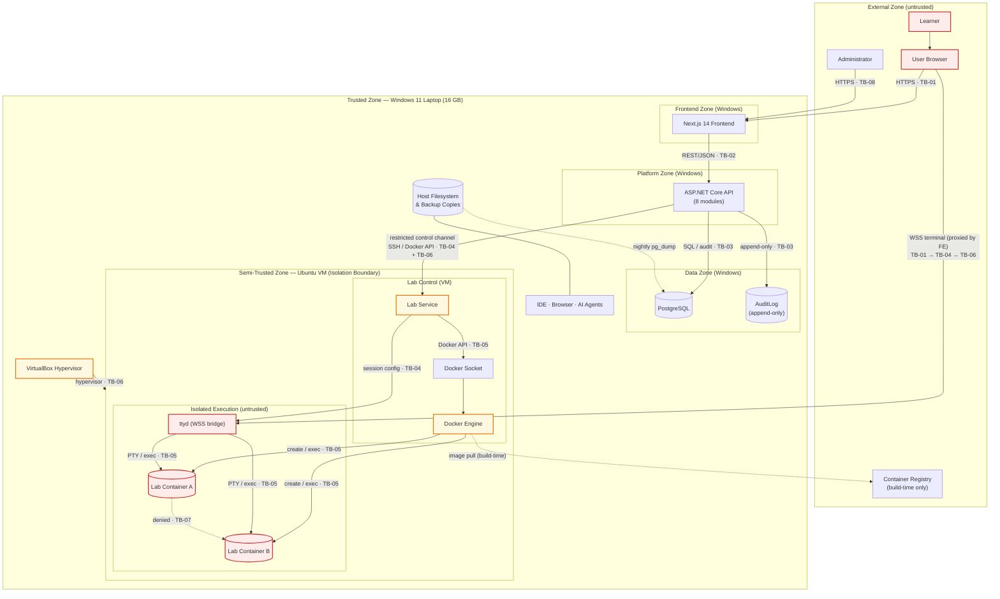

# Cyber Diaries — Threat Model

**Single source of truth for the project's threat model.** This document replaces the raw tool export (preserved at `C:\Users\Electronica Care\Downloads\Cyber_Diaries_Threat_Model.md`) and supersedes the threat registers in `Security_Architecture_Document_Cyber_Diaries_v0.1.md` (S10) — which are now **legacy aliases** mapped in Appendix A.

---

## 0. Document control

| Item | Value |
|---|---|
| Document ID | `CDbHLT-TM-001` |
| Title | Cyber Diaries — Threat Model |
| Version | 0.1.2 |
| Status | **Draft — Pending Review** |
| Date | 2026-11-05 |
| Prepared by | HEADLESS Team (collective ownership — `D6`) |
| Technical reviewer | Architecture Lead (within the team — `CN-017`) |
| Approver | د/ أحمد زكريا سيد · د/ هشام عبدالنبي محمد (`Data.md` S1) |
| Methodology | STRIDE per element and per data flow; Likelihood × Impact (5×5) |
| DFD version | **v2** (this document, S9) |
| Related documents | `CDbHLT-REQ-SPEC-001` (Requirements) · `CD-SAD-001` v0.1 (Security Architecture draft) · `Architecture/Data.md` (decisions Q-01…Q-63) · `architecture.md` (arc42 S8/S9/S11) · `WorkFlow/Workflow Docs.md` S13 · `docs/adr/ADR-001` · `Requirements/Logs/Proposed Amendments - D3b, CN-001, CN-008, CN-022.md` |
| Tool of origin | Threat-modeling export (26 slots, #3 missing) — see Appendix A |
| Language | English (manuscript language of *this* document; Arabic summary available on request) |

### Revision history

| Version | Date | Author | Change |
|---|---|---|---|
| 0.1.0 | 2026-11-05 | HEADLESS Team | Raw tool export: 25 threats, 14 elements, 25 data flows, no scoring |
| 0.1.1 | 2026-11-05 | HEADLESS Team | Structural completion: document control, methodology, quantitative scoring, corrected scope, DFD v2, trust-boundary register, merged legacy registers, 17 new threats, controls register, traceability, residual-risk register, maintenance triggers, glossary |
| 0.1.2 | 2026-11-05 | HEADLESS Team | Applied the decision answers: platform placed on the Windows host (VM = lab only), TB-04/05/06 redefined, threat targets updated, residual risks accepted by the team, open-issue register closed/dated |

### Change log — what this revision corrected in the export

| # | Correction | Before (export) | After (this document) |
|---|---|---|---|
| C-1 | Isolation substrate | "Docker containers" only; "Full operating system virtualization" listed as **out of scope** | **VirtualBox VM (Ubuntu) is the isolation boundary; Docker inside it for service organization** (`Data.md` Q-10/Q-20) |
| C-2 | Concurrency | "10 concurrent learners" implied | **2 concurrent sessions max on the dev/demo laptop, 3rd request queued** (`Q-20`; `Untitled.md` Sالقرار 2) |
| C-3 | Memory per container | 2 GB | **1.5 GB** + 1 vCPU, with a total host budget (S5) |
| C-4 | Trust boundaries | 6 unnamed zones, no IDs | **8 identified boundaries TB-01…TB-08** (`Untitled.md` Sالبند 4), legacy IDs mapped |
| C-5 | Deployed topology | None | **Windows 11 host → VirtualBox → Ubuntu guest VM → Docker → containers**; platform stack inside the VM |
| C-6 | Threat numbering | 1…26 with #3 missing; 25 rows | **`CDbHLT-T-01…T-42`** (25 preserved + 17 new), tool numbers kept as `Tool #` |
| C-7 | Scoring | Severity only; `Score` column empty | **L × I (5×5) = 1–25**, with explicit thresholds |
| C-8 | Status | All "Open" while mitigation text was populated | 5-state model (`Open/Planned/Implemented/Verified/Accepted`) + owner + release + residual |
| C-9 | Traceability | Zero requirement IDs | Requirement + Control + Test + ADR columns |
| C-10 | Modules | 8 ad-hoc names contradicting `CN-001` | **Canonical 8 modules** (`Data.md` Q-13/Q-15) + amendment note (OI-TM-02) |
| C-11 | Legacy registers | Two disjoint registers (SAD `T-01…T-15`; tool 25) | **One register**; legacy IDs mapped in Appendix A; `AB-01…AB-08` merged as misuse cases (S14) |
| C-12 | Platform placement | Platform assumed to run inside the VM | **Platform on the Windows host (trusted zone); the VM hosts the lab only** — `Untitled.md` S2 / `ADR-001`; S3, S5, S6, S8, S9 and affected threat rows updated |
| C-13 | Residual risk | 5 items marked `Draft`, blocked on supervisor signature | **Accepted by Team — Pending Supervisor Acknowledgment**, each with mitigation + re-evaluation trigger (S15) |
| C-14 | Open issues | 12 issues, no deadlines, 3 implicitly resolved | 14 registered; **5 closed**, 9 open with dated owners (S17.1) |

---

## 1. Purpose, scope and status of this document

### 1.1 Purpose

This document:

- identifies the threats against Cyber Diaries as specified in `CDbHLT-REQ-SPEC-001` and the v0.1 decisions;
- records the trust boundaries of the **actual v0.1 topology** (single laptop, VM-based isolation) instead of a hypothetical cloud deployment;
- attaches each threat to an owner, a control, a requirement, a planned verification and a release;
- makes residual risk explicit and approvable;
- declares what is **not** covered so that no reader mistakes silence for coverage.

### 1.2 What this document can and cannot support

| Can support | Cannot support |
|---|---|
| Explaining the threat landscape of the specified system | Claiming any control is implemented or tested |
| Justifying trust boundaries and isolation decisions | Presenting an as-built network topology |
| Prioritizing what must be built before the pilot | Reporting test results or signed risk acceptance |
| Showing requirement → control → test traceability | Replacing a penetration test |
| Recording accepted residual risk | Legal/privacy compliance sign-off (separate: `PV-*`, `CMP-*`) |

### 1.3 Document status

| Dimension | State |
|---|---|
| Architecture baseline used | Requirements v0.1 + decisions `Q-01…Q-63` + `Untitled.md` answers |
| Implementation evidence | **None** — no code, no deployment, no test run |
| Threat coverage | Structural coverage complete for the specified v0.1; dynamic validation not performed |
| Approval | Not reviewed, not approved |

---

## 2. Methodology

### 2.1 Framework

| Element | Choice | Reference |
|---|---|---|
| Threat enumeration | **STRIDE**, applied **per element** and **per data flow** | `Q-41` |
| Diagram | Data-flow diagram v2 with 7 trust zones and 8 trust boundaries | S8–S9 |
| Scoring | **Likelihood (1–5) × Impact (1–5) = Score (1–25)** | `Untitled.md` Sالقرار 3 |
| Severity thresholds | **Critical ≥ 20 · High 12–19 · Medium 6–11 · Low 1–5** | S2.3 |
| Session metadata | Participant roles, DFD version, date | S2.5 |

**Why not DREAD:** DREAD requires separate Reproducibility, Exploitability and Affected-Users estimates that need field data unavailable for a graduation project. L×I is defensible in front of the supervisor and reproducible by re-scoring.

### 2.2 Likelihood and impact definitions

**Likelihood (L)** — probability that the threat is realized against the v0.1 system within the pilot window:

| L | Label | Meaning |
|---|---|---|
| 5 | Almost certain | No control exists or the control is trivially bypassed; a motivated learner hits it by accident |
| 4 | Likely | Control exists only on paper; realistic attempt would succeed |
| 3 | Possible | Control specified but not yet implemented or not verified |
| 2 | Unlikely | Control specified and structurally enforced by the chosen substrate |
| 1 | Rare | Requires host-level or physical compromise outside the threat actor's reach |

**Impact (I)** — worst credible consequence for the project (not only for the learner):

| I | Label | Meaning |
|---|---|---|
| 5 | Critical | Host compromise, real-world network attack, project shutdown, personal-data breach |
| 4 | High | Cross-learner data exposure, assessment-integrity loss, persistent compromise of a service |
| 3 | Medium | Single-session integrity loss, degraded availability, inaccurate records |
| 2 | Low | Reputation/clarity issue, recoverable misconfiguration |
| 1 | Negligible | Cosmetic or fully recoverable within a session |

### 2.3 Severity bands and risk matrix

| Score | Severity        | Action required                                                                            |
| ----- | --------------- | ------------------------------------------------------------------------------------------ |
| 20–25 | 🔴 **Critical** | Blocks the pilot; must be mitigated or explicitly accepted by the supervisor before `v0.1` |
| 12–19 | 🟠 **High**     | Must have a planned control with a named owner and a planned test before `v0.1`            |
| 6–11  | 🟡 **Medium**   | Control planned; may ship with documented residual risk                                    |
| 1–5   | 🟢 **Low**      | Monitor; no dedicated control required at `v0.1`                                           |

| | I=1 | I=2 | I=3 | I=4 | I=5 |
|---|---|---|---|---|---|
| **L=5** | 5 | 10 | 15 | **20** | **25** |
| **L=4** | 4 | 8 | 12 | **16** | **20** |
| **L=3** | 3 | 6 | 9 | **12** | 15 |
| **L=2** | 2 | 4 | 6 | 8 | 10 |
| **L=1** | 1 | 2 | 3 | 4 | 5 |

### 2.4 Scoring discipline

- Scores are **expert judgment**, not measured incident data. They are dated and must be re-scored after the lab spike and after the pilot.
- A threat scored Critical **cannot be silently downgraded**; any change of a Critical score requires a change-log entry and the reviewer's initials.
- Severity is derived from the score, never assigned independently.

### 2.5 Session metadata

| Item | Value |
|---|---|
| Threat-modeling session | Not yet held with supervisors; this revision is desk analysis |
| Participants | HEADLESS Team (Architecture + Security + Backend) — collective per `D6` |
| DFD version scored | v2 (S9) |
| Next review | After the lab isolation spike; before `v0.1 Pilot` |

### 2.6 Assumptions (A)

| ID | Assumption | Consequence if false |
|---|---|---|
| A-01 | One physical machine: the development laptop (Windows 11, Ryzen 7 7435HS, 16 GB RAM) | Whole deployment view changes; `Q-19/Q-20` |
| A-02 | Maximum 2 concurrent lab sessions; 3rd request queued | `T-12/T-17` likelihood rises; `CP-001` (10) untestable |
| A-03 | **Platform (Next.js + API + PostgreSQL) runs on the Windows host (trusted zone); the VirtualBox Ubuntu VM hosts only the Lab Service, Docker, ttyd and the lab containers (untrusted zone).** The only channel between the zones is a restricted, token-authenticated control channel | Decided in `Untitled.md` S2 and recorded in `ADR-001`. If the platform were placed inside the VM, a container escape would reach learner data directly and the VM boundary would protect nothing |
| A-04 | No cloud provider, no public URL in v0.1; access over localhost/LAN | `RA-001` (availability) and `T-30` change if exposed publicly |
| A-05 | Browsers: Chrome / Edge, last two versions (`Data.md` S2) | New browser attack surface |
| A-06 | Lab images are built by the team from a trusted base and scanned before use (`Q-44`) | Supply-chain risk `T-38` rises to High |
| A-07 | Lab containers have **no** egress at all (no internet, no university network) | `T-30` becomes the project's top risk |
| A-08 | Accounts are local to the platform (no SSO, no social login) | New identity-provider threats |
| A-09 | Administrators are team members; learners are invited pilot participants | Insider-threat scope limited |
| A-10 | Physical security of the laptop is out of scope except disk encryption and loss policy | `T-41` residual accepted |

### 2.7 Limitations

1. No dynamic testing, no deployment, no logs exist; every status is `Planned`.
2. Likelihood/impact scores are not calibrated against field data.
3. The model covers the **web platform + lab substrate**; it does not cover: legal compliance (`CMP-*`), the research protocol (`OI-012`), institutional network operations, or cloud production (`v1.0`).
4. Physical/datacenter threats, insider DBAs and nation-state actors are out of scope.
5. This is not a penetration test.

---

## 3. System description (v2)

### 3.1 Product

Cyber Diaries is an Arabic, story-driven learning platform for web-application security (OWASP Top 10:2025). The first release delivers **one complete episode — A05:2025 Injection** — across a learning track and a lab track with three roles (Red Team, Blue Team/SOC, Developer) sharing one incident, server-side automatic verification, an optional journal, and research telemetry.

### 3.2 Components in scope

| # | Component | Technology | Runs on | Responsibility |
|---|---|---|---|---|
| 1 | Browser client | Chrome/Edge | Learner device | Rendering, story playback, lab desktop shell, terminal view |
| 2 | Frontend | Next.js 14 (React) | **Windows host** | Public pages, dashboard, learning pages, lab UI, journal; proxies the terminal channel |
| 3 | Platform API | ASP.NET Core / .NET 10, **Modular Monolith, 8 modules** | **Windows host** | Identity, LearningContent, Labs, Assessment, Progress, Gamification, Administration, Analytics |
| 4 | Database | PostgreSQL 16 | **Windows host** | Accounts, content, sessions, results, points, journal, telemetry |
| 5 | Audit log store | PostgreSQL `AuditLog` table (append-only) | **Windows host** | Sensitive operations, lab lifecycle |
| 6 | Lab Service | .NET service | **Inside the Ubuntu VM** | Lab session lifecycle; the **only** component that talks to the Docker socket |
| 7 | Docker Engine | Docker Engine | **Inside the Ubuntu VM** | Container creation, isolation enforcement, limits |
| 8 | ttyd | Browser terminal bridge (WSS) | **Inside the Ubuntu VM** | Interactive terminal into the learner's container |
| 9 | Lab container | Ephemeral Docker container, unprivileged | **Inside the Ubuntu VM** | The fictional target application + learner tools |
| 10 | Ubuntu guest VM | VirtualBox guest | Under VirtualBox | Hosts components 6–9 and the lab stack; **primary isolation boundary** |
| 11 | VirtualBox hypervisor | On Windows 11 | Windows host | Hardware-level boundary between the VM and Windows |
| 12 | Windows host | Development laptop | — | Trusted zone: platform, DB, IDE, browser; must never execute learner code |
| 13 | Container image registry | Docker Hub / local build cache | External / build-time | Supplies pre-built lab and service images |
| 14 | Backup store | Host filesystem + external copy | Windows host | `pg_dump` artefacts per `Q-22` |

### 3.3 Roles

| Role | Trust level | Notes |
|---|---|---|
| Visitor | Untrusted | Public homepage only (`AC-001`) |
| Learner | Untrusted (authenticated) | Executes arbitrary commands **inside** the lab container only |
| Content Administrator | Semi-trusted | Content CRUD; **no** lab operation settings (`AC-006`) |
| Operations Administrator | Semi-trusted | Lab lifecycle, limits, monitoring (`AC-005`) |
| Release Officer | Semi-trusted | Assessment rules, points economy, difficulty, releases (`AC-007`) |
| Supervisor / examiner | Trusted observer | Demo, review of documentation; no admin account in v0.1 |
| Research consumer | Trusted | Anonymized exports only (`PV-002`, `PV-006`) |

### 3.4 Security zones (`Q-42`, extended)

| Zone | Trust | Contents |
|---|---|---|
| Trusted | High | Windows host: Next.js, Platform API, PostgreSQL, AuditLog, backups |
| Semi-trusted | Medium | Ubuntu VM kernel, Lab Service, ttyd, Docker daemon |
| Untrusted | Low | Lab containers, learner input, terminal streams |
| External | None | Browser, container registry, external backup copy |

### 3.5 Environments (`Q-19`, `Q-20`, `Q-22`)

| Environment | Infrastructure | Users | Backup |
|---|---|---|---|
| **Development** | **Windows host** (platform) + **VirtualBox Ubuntu VM** (lab only) | Developers | None (`Q-22`) |
| **Demo** | Same laptop: platform on Windows, lab in the VM; localhost/LAN only | Whole team + supervisors | Daily content backup |
| **Production** (post-v1.0) | Linux server: platform and lab separated | Whole team | Every 6 h + PITR |

The threat model scores the **Demo** topology. The development topology is identical except for the IDE/AI agents running on the Windows host.

---

## 4. Scope

### 4.1 In scope

- Authentication, authorization, session management of the platform.
- Learning content and progress; journals; leaderboard privacy.
- Scoring, achievements and **assessment/verification integrity**.
- Lab session creation, execution, monitoring, destruction, and cleanup.
- **VM-based isolation** (VirtualBox → Ubuntu guest → Docker → containers) and its escape vectors.
- Browser terminal (ttyd over WSS) and all terminal data flows.
- Database, audit log and backup stores.
- Container image supply chain and dependency scanning.
- The laptop as the single infrastructure node (failure modes and physical-loss policy).
- Research telemetry and its PII constraints.
- Abuse/misuse cases by learners and administrators.

### 4.2 Out of scope (v0.1)

| Out of scope | Reason |
|---|---|
| Multi-node / cloud / Kubernetes deployment | Explicitly excluded in v0.1 (`Q-05`: Kubernetes prohibited; `Q-19`: laptop only) |
| A learner-facing full operating-system desktop | `CN-008`: the lab desktop is an interface, not an OS (**note:** this does *not* forbid the VM substrate, which is invisible to the learner — see OI-TM-05) |
| Production hardening, HA, DR drills | Post-v1.0 (`Q-19`) |
| Social login / SSO / federation | No identity provider in v0.1 |
| Mobile application, multiplayer, commercial SIEM | In the Won't list (`Requirements S26`) |
| Legal-basis and consent adequacy | Owned by `CMP-*` / `PV-*` / `D5`, not by this model |
| Datacenter, physical intrusions, insider DBA | Outside the system boundary |
| Penetration testing of third-party tools (VirtualBox, Docker, ttyd, PostgreSQL) | Their CVEs are monitored via SCA (Q-43) — see T-27/T-38 |

---

## 5. Operating limits (corrected)

| Limit | v0.1 value | Source | Note |
|---|---|---|---|
| Concurrent lab sessions | **2 maximum**, 3rd queued | `Q-20` + capacity analysis | Replaces "10" from `D3`; `CP-001`, `RA-002`, `AC-004` still say 10 → OI-TM-06 |
| RAM per lab container | **1.5 GB** | Capacity analysis | Was 2 GB in `D3` |
| CPU per lab container | **1 vCPU** | Proposed | Enforced with `--cpus` |
| PIDs per container | **256** | Proposed | Fork-bomb containment |
| Platform placement | **Windows host** (trusted zone): Next.js, API, PostgreSQL | ADR-001 / `Untitled.md` S2 | The VM hosts only the lab stack |
| VM memory budget | **~4 GB** (guest OS + Lab Service + Docker + 2 × 1.5 GB containers) | Capacity analysis | Leaves ≥ 10 GB for Windows + platform + IDE + browser |
| Host RAM | 16 GB | Hardware | `A-01` |
| Session duration | **60 min default / 120 min max** | `D3` | Adjustable range documented as 30–120 (`data.md` S2) |
| Container preparation | **< 90 s** with **pre-pulled images** | `D4` / `SP-003` | Cold-pull cannot meet 90 s on this laptop → images pre-pulled (CTRL-LAB-09) |
| Automated validation | **< 3 s** | `D4` / `SP-004` | |
| Simple / compound API response | **< 500 ms / < 2 s** | `D4` / `SP-001/002` | |
| Production concurrency target (post-v1.0) | 10 sessions on a Linux server | `D3` (future) | Not modelled/tested for v0.1 |

---

## 6. Trust boundaries

| TB | Name | From → To | What crosses | Primary controls |
|---|---|---|---|---|
| **TB-01** | Public → App | Browser → Next.js (HTTPS/WSS) | Credentials, session token, terminal stream, admin requests | TLS 1.3, cookie flags, CSP, WAF-less rate limiting |
| **TB-02** | Frontend → API | Next.js → ASP.NET Core (REST/JSON) | Commands and queries | JWT validation, authorization policy, input validation |
| **TB-03** | API → Database | API → PostgreSQL | SQL, results, audit writes | Least-privilege DB user, parameterized queries, TLS |
| **TB-04** | Platform → Lab | Windows host (API) → Ubuntu VM (Lab Service) | Session commands (start/stop/destroy) over a **restricted, token-authenticated control channel** (SSH or Docker API) | Service authentication, session tokens, operation allow-list; the only crossing between trusted and untrusted zones |
| **TB-05** | Lab → VM | Container → Docker daemon → Ubuntu guest | syscalls, docker API, cgroup limits | Container hardening, non-root, cap-drop, seccomp, resource limits, no egress, ephemeral |
| **TB-06** | VM → Windows host | Ubuntu guest → Windows 11 | Hypervisor calls only (**TB-04 traverses it**) | VirtualBox isolation, no shared folders/clipboard/drag-drop, NAT/host-only network, snapshot rollback |
| **TB-07** | Lab → Lab | Container A ↔ Container B | (must be none) | Per-session internal Docker network; no shared volumes |
| **TB-08** | Admin → App | Administrator → API (admin functions) | Content and settings changes | RBAC + policy, audit, separation of the three admin roles |

### 6.1 Legacy boundary mapping

| Legacy (export / SAD v0.1) | This document | Note |
|---|---|---|
| TB-01 Public→App | TB-01 | unchanged |
| TB-02 FE→API | TB-02 | unchanged |
| TB-03 API→DB | TB-03 | unchanged |
| TB-04 API→Lab | TB-04 | unchanged |
| TB-05 Lab→Host | TB-05 | the "host" of the containers is now the **guest VM**, not a cloud host |
| TB-06 (Admin→App in `Q-07`) | **TB-08** | renumbered |
| TB-06 (VM→Windows in `Untitled.md`) | TB-06 | new, primary boundary |
| TB-07 (Container→Container) | TB-07 | new |
| TB-06 "Platform authority" / TB-07 "Isolated lab scope" in SAD S8.2 | — | **collision resolved**: one ID, one meaning (see OI-TM-01) |

---

## 7. STRIDE coverage matrix

Every element that crosses a boundary must have at least one threat per applicable STRIDE letter. Cells contain `CDbHLT-T-xx` references; `—` means "considered and no credible threat at v0.1" (justified in S7.1).

| Element | S | T | R | I | D | E |
|---|---|---|---|---|---|---|
| Browser / learner input | T-01, T-05 | T-02, T-34 | — | T-18 | — | — |
| Next.js frontend | T-05 | T-02, T-35 | — | T-18, T-23 | — | — |
| Platform API | T-01 | T-19, T-32, T-33 | T-10 | T-36 | T-12 | T-03, T-06 |
| Identity & Authorization | T-05, T-37 | T-06 | T-10 | T-18 | T-37 | T-03 |
| Assessment / verification | — | T-04, T-31 | T-10 | T-07 | — | T-03 |
| Lab Service | T-11 | T-21, T-22 | T-10 | T-07 | T-12 | T-11, T-13 |
| Docker daemon / socket | T-11 | T-22 | — | — | T-17 | T-13, T-29 |
| ttyd | T-14 | T-24, T-25 | — | T-15, T-23 | T-12 | — |
| Lab container | — | T-30 | — | T-42 | T-17 | T-16, T-28, T-29 |
| PostgreSQL | — | T-08 | T-10 | T-07, T-20 | T-40 | — |
| AuditLog | — | T-09 | T-10 | T-42 | T-40 | — |
| Backup store | — | T-40 | — | T-40 | T-40 | — |
| Ubuntu guest kernel | — | — | — | — | T-41 | T-28 |
| VirtualBox hypervisor | — | — | — | — | T-41 | T-26, T-27 |
| Windows host | — | — | — | T-26 | T-41 | T-26 |
| Container registry | — | T-38 | — | T-38 | — | — |
| Administrators (actors) | T-01, T-05 | T-19 | T-09 | T-07 | — | T-03, T-06 |

### 7.1 Justified "no threat" cells

- **Repudiation on containers** — learners have no attributable identity inside the sandbox; the session log is bound at the platform layer (T-10).
- **Spoofing of lab containers** — containers are not addressable entities; cross-container traffic is denied by TB-07.
- **Denial of service on the audit store** — append-only writes are small and rate-limited by the API; capacity is not a credible vector on a single node.
- **Actors (supervisor/examiner)** — no account exists in v0.1; observation is out-of-band.

---

## 8. Data-flow diagram (v2)

**Legend:** solid arrows cross a trust boundary; dotted arrows are denied paths or out-of-band flows. Containers never reach the internet, the university network, the platform API, PostgreSQL, or each other.

---

## 9. Element and data-flow inventory

### 9.1 Elements

| ID | Element | Type | Zone | Threats |
|---|---|---|---|---|
| E-01 | Learner | Actor | External | — |
| E-02 | Administrator | Actor | External | T-01, T-03, T-05, T-06 |
| E-03 | User Browser | Actor | External | T-01, T-02, T-05, T-18, T-34 |
| E-04 | Next.js Frontend | Process | Frontend (Windows) | T-02, T-05, T-18, T-23, T-35 |
| E-05 | Platform API | Process | Platform (Windows) | T-01, T-03, T-06, T-10, T-12, T-19, T-32, T-33, T-36 |
| E-06 | Identity & Authorization | Process | Platform (Windows) | T-03, T-05, T-06, T-10, T-18, T-37 |
| E-07 | Assessment / Verification | Process | Platform (Windows) | T-04, T-07, T-31 |
| E-08 | Lab Service | Process | Lab Control (VM) | T-07, T-10, T-11, T-12, T-13, T-21, T-22 |
| E-09 | Docker Engine / Socket | Process | Lab Control (VM) | T-11, T-13, T-17, T-22, T-29 |
| E-10 | ttyd Terminal | Process | Isolated Execution (VM) | T-12, T-14, T-15, T-23, T-24, T-25 |
| E-11 | Lab Container | Process | Isolated Execution (VM) | T-16, T-17, T-28, T-29, T-30, T-42 |
| E-12 | PostgreSQL | Store | Data (Windows) | T-07, T-08, T-10, T-20, T-40 |
| E-13 | AuditLog | Store | Data (Windows) | T-09, T-10, T-40, T-42 |
| E-14 | Backup Store | Store | Data (Windows) | T-40 |
| E-15 | Ubuntu VM (kernel) | Infrastructure | Semi-trusted (VM) | T-28, T-41 |
| E-16 | VirtualBox Hypervisor | Infrastructure | Trusted (Windows) | T-26, T-27, T-41 |
| E-17 | Windows Host | Infrastructure | Trusted (Windows) | T-26, T-27, T-41 |
| E-18 | Container Registry | External | External | T-38 |

### 9.2 Data flows

| ID | Flow | From → To | Boundary | Threats |
|---|---|---|---|---|
| DF-01 | HTTPS pages / API / admin | Browser → Next.js | TB-01 | T-01, T-05, T-18, T-34 |
| DF-02 | REST/JSON requests and responses | Next.js → API | TB-02 | T-02, T-19, T-32, T-33 |
| DF-03 | SQL queries and results | API → PostgreSQL | TB-03 | T-07, T-08, T-20, T-33 |
| DF-04 | Audit events (append) | API → AuditLog | TB-03 | T-09, T-10 |
| DF-05 | Lab commands (start/stop/destroy) | Windows API → VM Lab Service | **TB-04 + TB-06** | T-11, T-21 |
| DF-06 | Docker API calls | Lab Service → Docker socket | TB-05 | T-13, T-22, T-29 |
| DF-07 | Container creation / execution | Docker → Container | TB-05 | T-16, T-17, T-29 |
| DF-08 | Container stdout/stderr/logs | Container → Docker → Lab Service | TB-05 | T-42 |
| DF-09 | Session configuration | Lab Service → ttyd (inside the VM) | internal (VM) | T-14, T-21 |
| DF-10 | WSS terminal input (proxied by FE) | Browser → Next.js → ttyd | **TB-01 → TB-04 → TB-06** | T-14, T-23, T-25 |
| DF-11 | WSS terminal output (proxied by FE) | ttyd → Next.js → Browser | **TB-01 → TB-04 → TB-06** | T-15, T-23, T-24 |
| DF-12 | PTY / exec channel | ttyd → Container | TB-05 | T-25, T-24 |
| DF-13 | Container ↔ container | Container A → Container B | TB-07 | **denied** (no flow allowed) |
| DF-14 | Image pull (build-time) | Registry → Docker | — (build host) | T-38 |
| DF-15 | Backup dump | PostgreSQL → Windows filesystem | — (same host) | T-40, T-41 |
| DF-16 | Restore (rare) | Windows filesystem → PostgreSQL | — (same host) | T-40 |
| DF-17 | Host↔guest hypervisor calls | Ubuntu VM ↔ VirtualBox | TB-06 | T-26, T-27 |
| DF-18 | Research telemetry export | API → Analytics export | TB-03 | T-42 |

---

## 10. Threat register

**Columns:** `Ref` = tool number (export) · SAD legacy ID · misuse case. `TB` = boundary crossed. `Status` per S11. Scores are L×I per S2.

| ID | Ref | STRIDE | Target (TB) | Scenario and impact | L | I | Score | Sev | Status | Owner | Release | Residual |
|---|---|---|---|---|---|---|---|---|---|---|---|---|
| **T-01** | #1 · SAD T-02 | S | Platform API (TB-02) | Stolen/invalid/under-validated credentials are used to reach protected endpoints → unauthorized learner/admin resources | 4 | 4 | 16 | 🟠 High | Planned | Backend | v0.1 | Low after token validation + rotation |
| **T-02** | #2 | T | Frontend/API (TB-02) | Learner modifies client state or request bodies → manipulated values accepted | 3 | 3 | 9 | 🟡 Medium | Planned | Frontend | v0.1 | Low (server validation) |
| **T-03** | #4 · SAD T-03 | E | Platform API (TB-08) | Learner reaches admin-only functionality through missing/incorrect authorization checks | 3 | 4 | 12 | 🟠 High | Planned | Backend | v0.1 | Low (policy + audit) |
| **T-04** | #5 · SAD T-05/T-14 | T | Assessment (TB-02) | Learner forges or replays a score/achievement claim → corrupted progress and research data | 3 | 4 | 12 | 🟠 High | Planned | Backend | v0.1 | Low (server-side + idempotency) |
| **T-05** | #6 | S | Identity (TB-01) | Attacker impersonates learner/admin via weak authentication or a compromised session | 4 | 4 | 16 | 🟠 High | Planned | Backend | v0.1 | Medium (single-factor) |
| **T-06** | #7 · SAD T-15 | E | Identity/Authz (TB-02) | An authenticated user performs operations outside their role | 3 | 4 | 12 | 🟠 High | Planned | Backend | v0.1 | Low |
| **T-07** | #8 | I | PostgreSQL (TB-03) | Unauthorized user/component reads learner or research data | 3 | 4 | 12 | 🟠 High | Planned | Backend | v0.1 | Low |
| **T-08** | #9 · SAD T-06 | T | PostgreSQL (TB-03) | Unauthorized modification of progress, scores, achievements, accounts | 3 | 4 | 12 | 🟠 High | Planned | Backend | v0.1 | Low (append-only) |
| **T-09** | #10 | T | AuditLog (TB-03) | Attacker modifies or deletes audit records → loss of accountability | 3 | 4 | 12 | 🟠 High | Planned | Backend | v0.1 | Low |
| **T-10** | #11 · SAD T-07 | R | AuditLog (TB-03) | Important security actions are not recorded → incidents unattributable | 3 | 3 | 9 | 🟡 Medium | Planned | Backend | v0.1 | Medium (no SOC) |
| **T-11** | #12 | E | Lab Service (TB-04+TB-06) | Unauthorized requests create/manage/terminate lab sessions | 4 | 5 | 20 | 🔴 Critical | Planned | Lab & DevOps | v0.1 | Medium (single Lab Service) |
| **T-12** | #13 · SAD T-10 | D | Lab Service (TB-04/05) | Excessive session creation/resource consumption exhausts the single node | 4 | 3 | 12 | 🟠 High | Planned | Lab & DevOps | v0.1 | High (2-session cap, queue) |
| **T-13** | #14 | E | Docker/VM (TB-05) | Container isolation failure lets lab code affect the Docker daemon or the guest VM | 4 | 5 | 20 | 🔴 Critical | Planned | Lab & DevOps | v0.1 | Medium (VM boundary) |
| **T-14** | #15 · AB-01 | S | ttyd (TB-01→TB-04→TB-06) | Unauthorized user reaches another learner's terminal session | 3 | 4 | 12 | 🟠 High | Planned | Backend | v0.1 | Low (session binding) |
| **T-15** | #16 | I | ttyd (TB-01→TB-04→TB-06) | Terminal session data exposed in transit | 3 | 4 | 12 | 🟠 High | Planned | Backend | v0.1 | Low (WSS) |
| **T-16** | #17 · SAD T-12 | E | Container→VM (TB-05) | Lab activity affects the guest VM, other sessions, or — through a second escape — the Windows host | 5 | 5 | 25 | 🔴 Critical | Planned | Lab & DevOps | v0.1 | Medium (defense in depth) |
| **T-17** | #18 | D | Container (TB-05) | Lab process exhausts CPU/memory/PIDs → other sessions interrupted | 4 | 3 | 12 | 🟠 High | Planned | Lab & DevOps | v0.1 | Medium (limits) |
| **T-18** | #19 | I | Auth channel (TB-01) | Credentials or tokens exposed in transit, URLs or logs | 3 | 4 | 12 | 🟠 High | Planned | Backend | v0.1 | Low |
| **T-19** | #20 | T | API (TB-02) | Request parameters/data modified before reaching the backend | 3 | 3 | 9 | 🟡 Medium | Planned | Backend | v0.1 | Low |
| **T-20** | #21 | I | DB channel (TB-03) | Query results exposed to unauthorized components | 3 | 5 | 15 | 🟠 High | Planned | Backend | v0.1 | Low |
| **T-21** | #22 · AB-07 | T | Platform→Lab (TB-04+TB-06) | Lab management requests tampered in flight | 3 | 4 | 12 | 🟠 High | Planned | Backend | v0.1 | Low |
| **T-22** | #23 | T | Docker socket (TB-04/05) | Manipulated Docker API calls create/modify/terminate unintended containers | 5 | 4 | 20 | 🔴 Critical | Planned | Lab & DevOps | v0.1 | Medium (socket isolation) |
| **T-23** | #24 | I | Terminal channel (TB-01) | Terminal data exposed between browser and ttyd | 3 | 4 | 12 | 🟠 High | Planned | Backend | v0.1 | Low (WSS + binding) |
| **T-24** | #25 | T | Terminal output (TB-05) | Output altered → learner receives misleading results | 3 | 4 | 12 | 🟠 High | Planned | Backend | v0.1 | Low |
| **T-25** | #26 | T | Terminal input (TB-05) | Commands altered before reaching the container | 3 | 4 | 12 | 🟠 High | Planned | Backend | v0.1 | Low |
| **T-26** | new | E | VM→Windows (TB-06) | **VM escape** via VirtualBox bug, shared folder, clipboard or drag-and-drop → code reaches the Windows host, which now hosts the **platform, PostgreSQL and learner data** | 5 | 5 | 25 | 🔴 Critical | Planned | Sec & DevOps | v0.1 | Medium (hardened hypervisor config) |
| **T-27** | new | E | Hypervisor (TB-06) | **Hypervisor exploit** (unpatched VirtualBox CVE) → Windows host compromise, exposing the platform and the database | 4 | 5 | 20 | 🔴 Critical | Planned | Sec & DevOps | v0.1 | Medium (patch cadence) |
| **T-28** | new | E | Guest kernel (TB-05) | **Kernel exploit inside the guest** (privilege escalation to root in Ubuntu) → all sessions in the VM compromised | 4 | 4 | 16 | 🟠 High | Planned | Sec & DevOps | v0.1 | Accepted (proposed, RR-01) |
| **T-29** | new · SAD T-09 | E | Container→VM (TB-05) | **Container escape** to the guest VM via kernel/runtime vulnerability | 4 | 4 | 16 | 🟠 High | Planned | Lab & DevOps | v0.1 | Medium (non-root, seccomp, cap-drop) |
| **T-30** | new · SAD T-08 · AB-02 | T | Lab→Internet/University (TB-05) | Learner uses `nmap`/`curl` inside the lab to attack the university network or the internet → legal/reputational incident and project shutdown | 3 | 5 | 15 | 🟠 High | Planned | Lab & DevOps | v0.1 | Low only if egress is truly denied; otherwise **Critical** |
| **T-31** | new | T | Assessment (TB-02/04) | **Verification integrity**: learner tampers with validation rules/results/evidence to fake success | 3 | 5 | 15 | 🟠 High | Planned | Backend | v0.1 | Medium |
| **T-32** | new | T | API (TB-02) | **SSRF** — server-side fetch of an internal resource (video metadata, content import, URL fields) | 3 | 4 | 12 | 🟠 High | Planned | Backend | v0.1 | Low |
| **T-33** | new | T | API→DB (TB-03) | **SQL injection** in the platform's own API (ironic but mandatory) | 3 | 4 | 12 | 🟠 High | Planned | Backend | v0.1 | Low (EF Core parameterization) |
| **T-34** | new | T | Browser session (TB-01) | **CSRF** — forged state-changing request from another site | 3 | 3 | 9 | 🟡 Medium | Planned | Backend | v0.1 | Low |
| **T-35** | new | T | Frontend (TB-01) | **XSS** — stored/reflected script in content, journal or terminal output | 3 | 3 | 9 | 🟡 Medium | Planned | Frontend | v0.1 | Low (CSP + encoding) |
| **T-36** | new · SAD T-04/T-13 · AB-01/AB-08 | I | API (TB-02) | **IDOR** — access another learner's journals, progress or session by identifier | 3 | 4 | 12 | 🟠 High | Planned | Backend | v0.1 | Low |
| **T-37** | new · SAD T-01 | S | Auth (TB-01) | **Brute force / credential stuffing / account enumeration** | 4 | 3 | 12 | 🟠 High | Planned | Backend | v0.1 | Medium (no MFA) |
| **T-38** | new | T | Registry→Docker (build) | **Supply-chain**: tampered or vulnerable base image / dependency enters the lab | 2 | 5 | 10 | 🟡 Medium | Planned | Sec & DevOps | v0.1 | Medium (scan only) |
| **T-39** | new | I | API/DB (TB-02/03) | **Secrets leakage**: connection strings, JWT signing key, Docker credentials in repo, env, logs or images | 3 | 5 | 15 | 🟠 High | Planned | Sec & DevOps | v0.1 | Medium |
| **T-40** | new | D | Backup (TB-06) | **Backup tampering/loss** — corrupt or missing `pg_dump`, failed restore, no off-device copy | 2 | 4 | 8 | 🟡 Medium | Planned | Backend | v0.1 | High (dev has no backup) |
| **T-41** | new | D | Laptop (TB-06) | **Host failure modes** — sleep during a session, disk full, Windows Update reboot, theft, single point of failure → platform + lab outage and possible study-day loss | 3 | 3 | 9 | 🟡 Medium | Planned | Sec & DevOps | v0.1 | Accepted (proposed, RR-03) |
| **T-42** | new · SAD T-11 | I | Lab logs/telemetry (TB-05) | **PII in logs** — learner names, credentials or secrets in terminal logs, exports or research telemetry | 3 | 4 | 12 | 🟠 High | Planned | Backend | v0.1 | Medium |

### 10.1 Summary

| Metric | Count |
|---|---|
| Total threats | **42** |
| 🔴 Critical | **6** — T-11, T-13, T-16, T-22, T-26, T-27 |
| 🟠 High | **28** |
| 🟡 Medium | **8** — T-02, T-10, T-19, T-34, T-35, T-38, T-40, T-41 |
| 🟢 Low | **0** |
| Open (no control designed) | 0 |
| Planned (control designed, not built) | **42** |
| Residual risk proposed for acceptance | **2** — T-28, T-41 (S15) |
| Verified | **0** |

### 10.2 Top 10 risks by score

| Rank | ID | Score | One-line |
|---|---|---|---|
| 1 | T-16 | 25 | Container escape / isolation failure into the guest VM |
| 1 | T-26 | 25 | VM escape from the Ubuntu guest into the Windows host |
| 3 | T-11 | 20 | Unauthorized lab session management |
| 3 | T-13 | 20 | Docker daemon / guest VM compromise |
| 3 | T-22 | 20 | Docker API command tampering |
| 3 | T-27 | 20 | VirtualBox hypervisor exploit |
| 7 | T-01 | 16 | Unauthorized API access |
| 7 | T-05 | 16 | Authentication spoofing |
| 7 | T-28 | 16 | Guest kernel privilege escalation |
| 7 | T-29 | 16 | Container escape to the VM |

> **Reading the list:** five of the top six are isolation threats. That is the project's real risk profile — not score tampering, and not content quality.

---

## 11. Status model

| Status | Meaning | Allowed when |
|---|---|---|
| `Open` | Identified, no control designed | Discovery phase |
| `Planned` | Control specified (requirement/ADR), not implemented | Requirements/architecture phase — **current state of 40 threats** |
| `Implemented` | Control coded, not tested | Build phase |
| `Verified` | Control tested, evidence linked | After a passing test record exists |
| `Accepted` | Residual risk explicitly accepted with justification and approver | Only with supervisor/owner sign-off |

No threat may move to `Implemented`/`Verified` before the corresponding test is executed. No threat may move to `Accepted` without an entry in S15.

---

## 12. Controls register

Each control lists the threats it treats, the requirement that mandates it, the planned test and the architectural decision that records it. ADR numbers follow the proposed index in S17.3 (to be reconciled when the ADR files are written).

| Control ID | Control | Type | Threats | Requirement | Test | ADR |
|---|---|---|---|---|---|---|
| **CTRL-AUTH-01** | Argon2id password hashing (64 MB, 3 iterations) | Preventive | T-05, T-37 | `AC-009` | V-09 | ADR-008 |
| **CTRL-AUTH-02** | JWT stored in `HttpOnly` + `Secure` + `SameSite` cookie; 60-min access, 3-day refresh, rotation on use, immediate revocation | Preventive | T-01, T-05, T-18, T-23 | `AC-001` | V-01 | ADR-005 |
| **CTRL-AUTH-03** | Identical auth error messages; rate limit 10 req/min/IP on auth, 100 req/min/user overall | Preventive / Detective | T-01, T-05, T-37 | `FR-004`, `Q-34` | V-01 + new auth-throttle test | ADR-005 |
| **CTRL-AUTHZ-01** | Server-side role verification on every administrative request (attribute + policy) | Preventive | T-03, T-06, T-11 | `AC-002`, `AC-005`…`AC-007` | V-02, V-05 | ADR-006 |
| **CTRL-AUTHZ-02** | Object-level ownership checks for sessions, evidence, journals, progress | Preventive | T-14, T-36 | `AC-003`, `AC-004` | V-04 | ADR-006 |
| **CTRL-AUTHZ-03** | Separation of the three administrator roles; no shared admin account | Preventive | T-06, T-31 | `AC-006`, `AC-007` | V-06, V-07 | ADR-006 |
| **CTRL-INPUT-01** | FluentValidation with allow-lists on every input | Preventive | T-02, T-19, T-33 | `FR-006`, `Q-35` | V-10 | ADR-012 |
| **CTRL-INPUT-02** | Parameterized queries via EF Core; no raw SQL except Analytics (Dapper, parameterized) | Preventive | T-33 | `Q-33` | New SQLi test | ADR-007 |
| **CTRL-INPUT-03** | CSP header, output encoding, DOMPurify for dynamic content | Preventive | T-35 | `Q-32` | New XSS test | ADR-012 |
| **CTRL-INPUT-04** | Anti-forgery token + `SameSite=Strict` | Preventive | T-34 | `Q-31` | New CSRF test | ADR-005 |
| **CTRL-INPUT-05** | URL allow-list for any server-side fetch; no user-supplied URL fetched from the VM | Preventive | T-32 | `Q-35` | New SSRF test | ADR-012 |
| **CTRL-SCORE-01** | Server-side scoring only, idempotent by `SourceId`, multiplier fixed at success time | Preventive | T-04 | `IN-001`, `IN-002`, `IN-004` | V-10, V-11, V-13 | ADR-014 |
| **CTRL-SCORE-02** | Append-only evidence, points, achievements and results; no learner mutation path | Preventive | T-04, T-08 | `IN-005`, `IN-006` | V-14, V-15 | ADR-014 |
| **CTRL-ASSESS-01** | Verification rules, answer banks and expected results stored server-side, versioned and never exposed to the client; results immutable and bound to session | Preventive / Detective | T-31 | `PA-002`, `IN-006` | V-15 + new verification-integrity test | ADR-014 |
| **CTRL-ASSESS-02** | Per-role verification engines: security outcome (Red), inference chain rubric (Blue), automated test suite (Developer) | Preventive | T-31 | `BR-17`, `PA-002` | V-40 | ADR-014 |
| **CTRL-LAB-01** | Lab Service is the sole holder of the Docker socket; the API never executes commands | Preventive | T-11, T-13, T-22 | `CN-002`, `IM-001`, `SC-004` | V-29, V-38 | ADR-002 |
| **CTRL-LAB-02** | Per-session token bound to learner + session; token validated by ttyd and Lab Service | Preventive | T-14, T-23 | `AC-003`, `AC-004` | V-04 | ADR-002 |
| **CTRL-LAB-03** | Container hardening: non-root, `--cap-drop=ALL`, `no-new-privileges`, read-only rootfs, seccomp/AppArmor, no host mounts | Preventive | T-16, T-29, T-28 | `CN-003`, `SC-002` | V-36, misuse tests | ADR-001 |
| **CTRL-LAB-04** | Egress denial: `--internal` Docker network, no default route, no DNS, no university/internet egress | Preventive | T-30, T-32 | `CN-004`, `IM-003`, `SC-003` | V-31, V-37 | ADR-001 |
| **CTRL-LAB-05** | Ephemeral lifecycle: destroy on end or timeout; reaper for orphans | Preventive / Corrective | T-12, T-17 | `SC-001`, `IM-002` | V-30, V-35 | ADR-002 |
| **CTRL-LAB-06** | Admission control: max 2 concurrent sessions, queue for the 3rd, explicit rejection beyond | Preventive | T-12, T-17, T-41 | `IM-005`, `NP-010` | V-33 + capacity test | ADR-004 |
| **CTRL-LAB-07** | Resource limits: 1.5 GB RAM, 1 vCPU, 256 PIDs, 60/120-min timeout | Preventive | T-17, T-12 | `IM-005`, `D3` | V-33 | ADR-004 |
| **CTRL-LAB-08** | ttyd never exposed directly: behind the authenticated reverse proxy, WSS only, per-session path and token | Preventive | T-14, T-15, T-23, T-24, T-25 | `IF-002` | New ttyd/WSS tests | ADR-002 |
| **CTRL-LAB-09** | Lab images pre-pulled and cached in the VM; image digests pinned | Preventive | T-38, T-12 | `SP-003`, `Q-44` | V-39 | ADR-004 |
| **CTRL-VM-01** | VirtualBox VM as the primary boundary; **no shared folders, no clipboard, no drag-and-drop**, NAT + host-only network, snapshots before sessions | Preventive | T-26, T-27, T-29, T-41 | `CN-003`, `Q-10` | Misuse: host-reach test | ADR-001 |
| **CTRL-VM-02** | Guest OS hardened and patched monthly; minimal Ubuntu Server; no desktop environment; unattended security upgrades | Preventive | T-27, T-28 | `Q-10` | Patch audit | ADR-001 |
| **CTRL-VM-03** | Host hygiene: full-disk encryption, sleep disabled during pilot, Windows Update window outside study hours, no learner data on host | Preventive | T-41, T-26 | `Q-10`, `Q-22` | Checklist | ADR-003 |
| **CTRL-DATA-01** | Least-privilege DB roles; PostgreSQL bound to localhost / the Windows host only; TLS for connections where applicable | Preventive | T-07, T-08, T-20 | `AC-002`, `Q-38` | V-02 | ADR-007 |
| **CTRL-DATA-02** | Encryption at rest (TDE or provider-managed) for the platform DB and backups | Preventive | T-07, T-39, T-40 | `Q-37` | Config audit | ADR-007 |
| **CTRL-DATA-03** | Secrets in environment variables (dev) / Docker secrets (prod); no secrets in repo, images or logs; `.env` git-ignored | Preventive | T-39 | `Q-36` | Secret scan | ADR-003 |
| **CTRL-DATA-04** | Nightly `pg_dump` to host + external copy for Demo; restore test before the pilot | Corrective | T-40 | `Q-22` | Restore drill | ADR-003 |
| **CTRL-LOG-01** | Serilog structured JSON + `AuditLog` table; 12 event types recorded with actor, action, time, result | Detective | T-10 | `AU-001`, `Q-29`, `Q-40` | V-25 | ADR-009 |
| **CTRL-LOG-02** | Append-only audit table; DB user has no UPDATE/DELETE on it; access restricted to admin roles | Preventive / Detective | T-09 | `AU-003`, `AU-004` | V-27, V-28 | ADR-009 |
| **CTRL-LOG-03** | Log redaction: no PII, credentials or secrets in educational/terminal logs; sampled review each release | Preventive | T-42 | `CN-014`, `PV-006` | V-23 | ADR-009 |
| **CTRL-LOG-04** | Lab session log: start, end, destroy, actor, container id, image digest | Detective | T-10, T-16 | `AU-002` | V-26 | ADR-009 |
| **CTRL-SUP-01** | Trivy image scan before every build; fail on Critical/High | Preventive | T-38 | `Q-44` | Scan report | ADR-015 |
| **CTRL-SUP-02** | Weekly SCA: `dotnet list package --vulnerable`, `npm audit`; tracked in the risk register | Preventive | T-38, T-27 | `Q-43` | Weekly report | ADR-015 |
| **CTRL-NET-01** | TLS 1.3 at the reverse proxy; no direct container port exposure; ttyd through the same proxy | Preventive | T-15, T-18, T-23 | `Q-38` | Config audit | ADR-003 |

**Control coverage:** 38 controls cover all 42 threats; none is uncovered. The heaviest are CTRL-VM-01 (4 threats: T-26, T-27, T-29, T-41) and CTRL-LAB-01, CTRL-LAB-03, CTRL-AUTHZ-01 and CTRL-AUTH-02 (3 threats each).

---

## 13. Traceability

### 13.1 Threat → requirement → test

| Threat | Primary requirement | Secondary | Planned test | Control |
|---|---|---|---|---|
| T-01 | `AC-001` | `FR-004` | V-01 | CTRL-AUTH-02/03 |
| T-02 | `IN-001` | `FR-006` | V-10 | CTRL-INPUT-01 |
| T-03 | `AC-002` | `AC-005…007` | V-02, V-05 | CTRL-AUTHZ-01 |
| T-04 | `IN-001/002/004` | `CN-005` | V-10, V-11, V-13 | CTRL-SCORE-01 |
| T-05 | `AC-009` | `FR-002`, `Q-24` | V-09, V-01 | CTRL-AUTH-01/02 |
| T-06 | `AC-002` | `AC-006/007` | V-06, V-07 | CTRL-AUTHZ-01/03 |
| T-07 | `PV-002` | `AC-001` | V-19 | CTRL-DATA-01/02 |
| T-08 | `IN-005` | `AU-001` | V-14 | CTRL-SCORE-02, CTRL-DATA-01 |
| T-09 | `AU-003` | `CN-005` | V-27 | CTRL-LOG-02 |
| T-10 | `AU-001` | `AU-002` | V-25 | CTRL-LOG-01 |
| T-11 | `AC-003` | `IM-001` | V-03, V-29 | CTRL-LAB-01 |
| T-12 | `IM-005` | `NP-010` | V-33 | CTRL-LAB-05/06/07 |
| T-13 | `CN-002` | `SC-004` | V-38 | CTRL-LAB-01/03 |
| T-14 | `AC-004` | `AC-003` | V-04 | CTRL-LAB-02/08 |
| T-15 | `IF-002` | `Q-38` | New WSS test | CTRL-LAB-08, CTRL-NET-01 |
| T-16 | `SC-002` | `CN-003`, `IM-002` | V-36, misuse suite | CTRL-LAB-03, CTRL-VM-01 |
| T-17 | `IM-005` | `D3` | V-33 | CTRL-LAB-07 |
| T-18 | `AC-009` | `Q-38` | V-09 | CTRL-AUTH-02, CTRL-NET-01 |
| T-19 | `FR-006` | `Q-35` | V-10 | CTRL-INPUT-01 |
| T-20 | `PV-002` | `Q-38` | V-19 | CTRL-DATA-01 |
| T-21 | `CN-002` | `AC-003` | V-29 | CTRL-LAB-01 |
| T-22 | `AC-005` | `IM-001` | V-05, V-29 | CTRL-LAB-01 |
| T-23 | `IF-002` | `AC-004` | New WSS test | CTRL-LAB-08 |
| T-24 | `IF-002` | — | New WSS test | CTRL-LAB-08 |
| T-25 | `IF-002` | — | New WSS test | CTRL-LAB-08 |
| T-26 | **Gap** — no requirement ID (see CN-022, Appendix C) | `CN-003` amended | Misuse: host-reach test | CTRL-VM-01 |
| T-27 | **Gap** (same) | `Q-43`, `Q-44` | Patch audit | CTRL-VM-02, CTRL-SUP-02 |
| T-28 | **Gap** (same) | `SC-002` | V-36 | CTRL-VM-02, CTRL-LAB-03 |
| T-29 | `SC-002` | `CN-003` | V-36 | CTRL-LAB-03 |
| T-30 | `CN-004` | `IM-003`, `SC-003` | V-31, V-37 | CTRL-LAB-04 |
| T-31 | `PA-002` | `IN-006` | V-15 + new test | CTRL-ASSESS-01/02 |
| T-32 | **Gap** — `FR-006` partially | `Q-35` | New SSRF test | CTRL-INPUT-05 |
| T-33 | **Gap** — no explicit requirement | `Q-33` | New SQLi test | CTRL-INPUT-02 |
| T-34 | **Gap** — no explicit requirement | `Q-31` | New CSRF test | CTRL-INPUT-04 |
| T-35 | **Gap** — `QR-32` decision only | `Q-32` | New XSS test | CTRL-INPUT-03 |
| T-36 | `PV-003` | `AC-004` | V-20, V-04 | CTRL-AUTHZ-02 |
| T-37 | **Gap** — no explicit requirement | `Q-34` | New throttle test | CTRL-AUTH-03 |
| T-38 | `Q-44` | `CN-007` | Scan report | CTRL-SUP-01 |
| T-39 | `Q-36` | `AC-009` | Secret scan | CTRL-DATA-03 |
| T-40 | `Q-22` | `RA-001` | Restore drill | CTRL-DATA-04 |
| T-41 | **Gap** — `RK-012…RK-016` are risks, not requirements | `Q-57…Q-61` | Checklist | CTRL-VM-03 |
| T-42 | `CN-014` | `PV-006` | V-23 | CTRL-LOG-03 |

### 13.2 Coverage gaps (requirements side)

| Gap | Consequence | Recommendation |
|---|---|---|
| G-01: **No requirement defines the VM boundary** | T-26/T-27/T-28 have no `CDbHLT-*` requirement | Amend `CN-003` to "container **inside an isolated VM**", or add `CN-022` (proposed) |
| G-02: no requirement for **verification integrity** beyond `PA-002` | T-31 | Add an `IN-*` or `PA-*` requirement: "verification rules are server-side, versioned, and not derivable from the client" |
| G-03: no requirements for CSRF/XSS/SQLi/SSRF/brute-force controls | T-32…T-35, T-37 | Add a new security sub-section (15.6) or enrich `AC-*`/`IN-*` |
| G-04: no backup/restore requirement | T-40 | Add an `RA-*`/`MT-*` requirement with RTO/RPO |
| G-05: laptop failure modes exist only as risks (`RK-012…RK-016`) | T-41 | Keep as risks, but link them from this register |
| G-06: concurrency requirement still says 10 | T-12, T-17 untestable | Update `CP-001/RA-002/AC-004` to "declared capacity (2)" or add `D3b` |

---

## 14. Abuse and misuse cases (merged from SAD S10.3)

| ID | Actor | Misuse case | Threats | Control | Detection |
|---|---|---|---|---|---|
| AB-01 | Learner | Open another learner's session by identifier | T-14, T-36 | CTRL-AUTHZ-02, CTRL-LAB-02 | Rejected request in audit log (`AU-001`) |
| AB-02 | Learner | Scan or connect from inside the lab | T-30 | CTRL-LAB-04 | Denied traffic; egress-drop counter |
| AB-03 | Learner | Edit points in the browser or replay an award | T-04 | CTRL-SCORE-01 | Rejected operation in audit log |
| AB-04 | Learner | Edit/delete evidence or a validation result | T-08, T-31 | CTRL-SCORE-02, CTRL-ASSESS-01 | Rejected operation in audit log |
| AB-05 | Learner | Install tools / modify the lab system | T-16, T-29 | CTRL-LAB-03 | Container-level denial; session log |
| AB-06 | Learner | Read audit or session logs | T-09, T-10 | CTRL-LOG-02 | Rejected request in audit log |
| AB-07 | Content Administrator | Change lab limits or lifecycle settings | T-03, T-21 | CTRL-AUTHZ-03 | Rejected request in audit log |
| AB-08 | Any user | Retrieve another learner's journal or progress | T-07, T-36 | CTRL-AUTHZ-02 | **Not specified** → add detection |

**New misuse cases derived from this revision**

| ID | Actor | Misuse case | Threats | Control |
|---|---|---|---|---|
| AB-09 | Learner | Tamper with validation rules/results to fake success | T-31 | CTRL-ASSESS-01 |
| AB-10 | Learner | Exploit a guest-kernel bug to reach other sessions | T-28 | CTRL-VM-02, CTRL-LAB-03 |
| AB-11 | Learner | Use shared folders/clipboard to reach the Windows host | T-26 | CTRL-VM-01 |
| AB-12 | Any user | Read secrets from repo, env or logs | T-39 | CTRL-DATA-03 |

---

## 15. Residual risk register

| ID | Threat | Residual level | Justification | Mitigation in place (planned) | Re-evaluation trigger | Accepted by | Status |
|---|---|---|---|---|---|---|---|
| RR-01 | T-28 Guest kernel exploit | **Medium** | Root inside the guest stays inside the VM. The platform, DB and learner data are on Windows, so reaching them requires a **second** escape across TB-06 | Guest patched monthly; no shared folders; snapshot rollback; ephemeral sessions; guest runs only the lab stack | Any guest-kernel CVE ≥ High, or an anomalous privilege-escalation event in the session log | HEADLESS Team (Architecture + Lab/DevOps leads) | **Accepted by Team — Pending Supervisor Acknowledgment** |
| RR-02 | T-27 Hypervisor 0-day | **Medium** | VirtualBox escape is high-severity but low-frequency; single-tenant laptop, no public access, invited participants only | Patch cadence before each study day; no shared folders/clipboard/drag-drop; VM destroyed after the study window | VirtualBox security advisory/CVE, OS upgrade, or any host-integrity anomaly | HEADLESS Team (Architecture + Lab/DevOps leads) | **Accepted by Team — Pending Supervisor Acknowledgment** |
| RR-03 | T-41 Host failure | **Medium** | Single-node constraint is accepted by design; data loss is bounded by nightly backups for Demo | Backups triggered manually each study day; `pg_dump` verified; sleep disabled during sessions; update window outside study hours | Any data-loss/near miss during a study day, or migration of the pilot to a server | HEADLESS Team (Architecture + Lab/DevOps leads) | **Accepted by Team — Pending Supervisor Acknowledgment** |
| RR-04 | T-10 No SOC/detection | **Low–Medium** | No SIEM by scope; detection is manual log review | Append-only `AuditLog`; 12 audited event types; weekly manual review during the pilot | An incident the audit log cannot reconstruct | HEADLESS Team (Architecture + Lab/DevOps leads) | **Accepted by Team — Pending Supervisor Acknowledgment** |
| RR-05 | T-12 Concurrency cap | **Low** | The 2-session cap with a queue degrades availability but protects integrity | Queue with visible position; explicit rejection at request 3; resource limits per container | A 3rd concurrent request during the pilot, or queue wait > 5 minutes | HEADLESS Team (Architecture + Lab/DevOps leads) | **Accepted by Team — Pending Supervisor Acknowledgment** |

**Acceptance rule (per `Untitled.md` S1):** the team accepts these residual risks now and records them; the supervisor receives a five-line summary as **notification, not a blocking signature**. If no objection is raised within one week of sending, the item counts as acknowledged. Every `RR-` must keep both a mitigation and a re-evaluation trigger — an `RR-` that loses either reverts to `Open`. Any trigger firing reopens the item and forces a re-score.

---

## 16. Maintenance triggers

Re-run and re-score this threat model when **any** of the following occurs:

1. **Architecture change** — new module, new boundary, moving Lab Service out of the VM, changing the reverse proxy.
2. **Substrate change** — WSL2 instead of VirtualBox, Docker Desktop, new guest OS, Kubernetes.
3. **Lab image or tool change** — new base image, new tool (curl/nmap/GPG/Adminer/Monaco/ttyd versions).
4. **New OWASP category** — before the second episode is built.
5. **Auth change** — MFA, SSO, token lifetime, cookie policy.
6. **Exposure change** — publishing the platform publicly, adding a domain/TLS certificate.
7. **Incident or near miss** — any denial, escape attempt, or data exposure.
8. **Dependency CVE** — Critical/High CVE in VirtualBox, Docker, ttyd, PostgreSQL, Next.js, ASP.NET.
9. **Before every release** that touches isolation (`IM-006` gate).
10. **After the pilot** — re-score with real usage data.

---

## 17. Open issues and conflicts

### 17.1 Open issues register

| ID | Issue | Impact | Owner | Due | Status |
|---|---|---|---|---|---|
| OI-TM-01 | Trust-boundary scheme: `Data.md` Q-07 lists **6** TBs (TB-06 = Admin→App); this document uses **8** (TB-06 = VM→Host, TB-07 = Lab→Lab, TB-08 = Admin→App) | Cross-document inconsistency | Architecture Lead | — | **Closed 2026-11-05** — 8-TB scheme documented in S6; `Q-07` to be aligned at the next data cleanup |
| OI-TM-02 | Module count: `Data.md` Q-13/Q-15 = **8 modules** (incl. Analytics); `CN-001` still lists **7** | Building-block view and this DFD disagree with the requirement | Architecture Lead | **2026-11-12** | **Open — deadline set** (team meeting; amendment drafted in the amendments file) |
| OI-TM-03 | Topology assumption A-03 | Determines TB-04/TB-05/TB-06 and T-26/T-27 impact | Architecture Lead | — | **Closed 2026-11-05 by A-03** — platform on Windows, VM = lab only (`ADR-001`) |
| OI-TM-04 | `Q-11` mentions **gRPC externally**; `CN-006` mandates REST first and forbids GraphQL without justification | API-style conflict | Architecture Lead | 2026-11-12 | Open (ADR-013) |
| OI-TM-05 | `CN-008` says the lab desktop is "not an OS and not a VM" — ambiguous against the VM substrate | Could be read as a contradiction in the defense | Architecture + Content | 2026-11-12 | Open — amendment text drafted |
| OI-TM-06 | Concurrency: `D3` still says **10**; `CP-001`/`RA-002`/`AC-004` inherit it; reality is 2 | Requirements untestable | Owner + Supervisor | 2026-11-12 | Open — `D3b` text drafted |
| OI-TM-07 | Scoring arithmetic in the source decision note: 17 new threats listed but "14" and a total of 39 were stated | Documentation only | Architecture Lead | — | **Closed** — 42 threats in S10.1 |
| OI-TM-08 | Tool export had threat **#3 missing** (IDs 1–26 → 25 rows) | Mapping ambiguity | Architecture Lead | — | **Closed** — Appendix A |
| OI-TM-09 | SAD `T-12` ("user command executed inside the API process") has no exact counterpart; mapped to T-16 | Possible underpricing of a process-isolation failure | Architecture Lead | Next re-score | Open |
| OI-TM-10 | Audit retention is set to **7 years** (`Q-40`) while `D5` retention policy is still unapproved | Legal conflict | Compliance | Before the pilot | Open |
| OI-TM-11 | `data.md` S2 still says session range **30–120**, while `D3` closes 60/120 | Minor inconsistency | Owner | Next data cleanup | Open |
| OI-TM-12 | No SOC/IDS on a single laptop → detection is manual | Residual risk | DevOps | — | **Closed** — accepted as RR-04 |
| OI-TM-13 | Control channel between platform (Windows) and Lab Service (VM): **SSH tunnel** or **Docker API over an isolated network**? | Determines TB-04 implementation and T-11/T-22 controls | Architecture + DevOps | 2026-11-08 | Open (with ADR-001) |
| OI-TM-14 | ttyd runs inside the VM while the browser talks to Next.js on Windows — the WSS proxy path must be specified | Determines T-14/T-15/T-23 controls | Backend + DevOps | Lab spike | Open |

### 17.2 Corrections applied to the export (summary)

See S0 change log (C-1…C-14).

### 17.3 Proposed ADR index (to be reconciled with `Architecture/architecture.md` S9)

Data.md `Q-51` fixes **17 ADRs** in MADR 4.0 format (`Q-52`) stored under `docs/adr/` (`Q-53`). The threat model needs these to anchor controls:

| ADR | Decision | Used by |
|---|---|---|
| ADR-000 | Architecture style: Modular Monolith with 8 modules | T-03, T-06 |
| ADR-001 | Lab isolation: VirtualBox VM + Docker inside (v0.1); Linux + Docker for production | T-16, T-26, T-27, T-29, T-30 |
| ADR-002 | Lab control plane: internal REST + Docker API; Lab Service is the sole socket holder | T-11, T-14, T-21, T-22 |
| ADR-003 | Single-node deployment on the laptop; Dev/Demo environments; no cloud in v0.1 | T-26, T-40, T-41 |
| ADR-004 | Capacity and resources: 2 sessions, 1.5 GB, queue, pre-pulled images | T-12, T-17 |
| ADR-005 | Authentication: JWT in HttpOnly cookie + refresh rotation; CSRF defense | T-01, T-05, T-18, T-34 |
| ADR-006 | Authorization: attribute + policy + object-level checks | T-03, T-06, T-14, T-36 |
| ADR-007 | Data access and persistence: EF Core, Dapper for Analytics, migrations | T-07, T-08, T-33 |
| ADR-008 | Password hashing: Argon2id | T-05, T-37 |
| ADR-009 | Logging and audit: Serilog + append-only AuditLog | T-09, T-10, T-42 |
| ADR-010 | Error handling: ProblemDetails (no stack traces to clients) | T-19 |
| ADR-011 | Frontend rendering: RSC for content, client components for the lab | T-02, T-35 |
| ADR-012 | API style, versioning and input validation: REST/JSON, `/api/v1`, FluentValidation allow-lists | T-19, T-32, T-33 |
| ADR-013 | Threat-modeling and risk method: STRIDE + L×I | all |
| ADR-014 | Assessment and scoring model: server-side, idempotent, immutable | T-04, T-31 |
| ADR-015 | Supply chain: Trivy, SCA, image pinning | T-38 |
| ADR-016 | ADR format and storage (MADR 4.0 in `docs/adr/`) | process |

> **Note:** ADR numbers here are a proposal. If the ADR files are written with different numbering, the `ADR` column in S12 must be updated — the mapping is kept in this single table to make that a one-line change.

---

## 18. Glossary

| Term | Definition |
|---|---|
| **Threat model** | Structured analysis of what can go wrong, who can cause it, and how it is mitigated |
| **STRIDE** | Spoofing, Tampering, Repudiation, Information disclosure, Denial of service, Elevation of privilege |
| **Trust boundary (TB)** | A line where data or control crosses between different trust levels |
| **Threat** | A potential adverse event (in this document: `CDbHLT-T-nn`) |
| **Control** | A preventive, detective or corrective measure (`CTRL-*`) |
| **Residual risk** | The risk that remains after controls are applied |
| **Misuse / abuse case** | A concrete attacker scenario (`AB-nn`) |
| **Likelihood / Impact** | Probability of realization / severity of consequence (1–5 each) |
| **Score** | L × I, 1–25 |
| **VM** | Virtual machine; here: Ubuntu guest inside VirtualBox |
| **Hypervisor** | VirtualBox layer between the guest VM and the Windows host |
| **Isolation boundary** | The boundary that must hold if untrusted learner code escapes: here, the VirtualBox VM (TB-06) |
| **Container** | Docker process-isolation unit inside the VM; not a security boundary by itself |
| **Docker socket** | `/var/run/docker.sock`, the control channel to the Docker daemon; held only by the Lab Service |
| **ttyd** | Web terminal bridge that exposes a PTY to the browser over WSS |
| **WSS** | WebSocket over TLS |
| **cgroup** | Linux control group enforcing CPU/RAM/PID limits |
| **seccomp / AppArmor** | Linux syscall filtering / mandatory access control used to harden containers |
| **Air-gapped lab** | Lab container with no egress to the internet or the university network |
| **Idempotency** | Preventing duplicate effects of a repeated request (here, scoring) |
| **Bounded context** | DDD module boundary with its own model; the eight modules of this system |
| **ADR** | Architecture Decision Record |
| **NFR** | Non-functional requirement |
| **Pilot** | Exploratory study with 5–10 participants before any generalization |

---

## 19. References

| Ref | Document |
|---|---|
| `CDbHLT-REQ-SPEC-001` | Requirements Specification — MASTER (v0.1) |
| `CD-SAD-001` | Security Architecture Document v0.1 (legacy threat register S10, abuse cases S10.3) |
| `Architecture/Data.md` | Decisions Q-01…Q-63 (isolation, capacity, auth, logging, environments) |
| `Untitled.md` | Decision answers: substrate, capacity, scoring, numbering, merge |
| `WorkFlow/Workflow Docs.md` S13 | Lab session lifecycle, operating limits, failure flows |
| `Description/Project Description.md` | Product description, scope, roles, ethics |
| OWASP Top 10:2025 | Reference framework for the educational content |
| OWASP WSTG / Cheat Sheets | Verification and prevention guidance (`SD-002`, `SD-003`) |
| NIST SP 800-115 | Technical security testing guidance (reference only) |
| arc42 S8/S9/S11 | Where this model is referenced |

---

## Appendix A — Tool export mapping

The export carried 26 slots with **#3 missing** (25 rows). Mapping to the stable IDs used here:

> **Mapping rule:** tool rows are ordered by tool number (with #3 absent) and assigned `T-01…T-25` sequentially; the 17 new threats take `T-26…T-42`. The source decision note proposed mapping the 25 tool rows into `T-16…T-25` — arithmetically impossible (25 rows cannot fit 10 IDs) — and proposed 14 new IDs for 17 listed items. This resolved numbering is the one used in every table above (recorded as OI-TM-07).

| Tool # | `CDbHLT-T-` | Title |
|---|---|---|
| 1 | T-01 | Unauthorized API Access |
| 2 | T-02 | Client-Side Data Manipulation |
| 3 | — | **missing in the export** (never defined) |
| 4 | T-03 | Privilege Escalation |
| 5 | T-04 | Score Manipulation |
| 6 | T-05 | Authentication Spoofing |
| 7 | T-06 | Authorization Bypass |
| 8 | T-07 | Sensitive Data Disclosure |
| 9 | T-08 | Database Data Tampering |
| 10 | T-09 | Audit Log Tampering |
| 11 | T-10 | Insufficient Security Logging |
| 12 | T-11 | Unauthorized Lab Management |
| 13 | T-12 | Lab Resource Exhaustion |
| 14 | T-13 | Docker Host Compromise (now: Docker/VM compromise) |
| 15 | T-14 | Unauthorized Terminal Session Access |
| 16 | T-15 | Terminal Communication Disclosure |
| 17 | T-16 | Lab Container Isolation Failure |
| 18 | T-17 | Container Resource Exhaustion |
| 19 | T-18 | Authentication Data Exposure |
| 20 | T-19 | Request Tampering |
| 21 | T-20 | Unauthorized Database Communication |
| 22 | T-21 | Lab Request Tampering |
| 23 | T-22 | Unauthorized Command Tampering |
| 24 | T-23 | Terminal Data Exposure |
| 25 | T-24 | Terminal Output Tampering |
| 26 | T-25 | Terminal Input Tampering |
| new | T-26 | VM Escape |
| new | T-27 | Hypervisor Exploit |
| new | T-28 | Guest Kernel Exploit |
| new | T-29 | Container Escape → VM |
| new | T-30 | Outbound attack from the lab |
| new | T-31 | Verification integrity compromise |
| new | T-32 | SSRF |
| new | T-33 | SQL injection in the platform |
| new | T-34 | CSRF |
| new | T-35 | XSS |
| new | T-36 | IDOR |
| new | T-37 | Brute force / rate abuse |
| new | T-38 | Container image supply chain |
| new | T-39 | Secrets / connection-string leakage |
| new | T-40 | Backup tampering or loss |
| new | T-41 | Laptop failure modes |
| new | T-42 | PII in lab/research logs |

### Legacy Security Architecture threats (`SAD T-01…T-15`)

| SAD | Content (short) | Mapped to |
|---|---|---|
| T-01 | Credential guessing / enumeration | T-37 (+T-05) |
| T-02 | Stolen session replay | T-01 (+T-05) |
| T-03 | Direct administrative endpoint call | T-03 |
| T-04 | Another learner's session/evidence | T-36 (+T-14) |
| T-05 | Client-side score claim | T-04 |
| T-06 | Modify evidence / validation result / behavior event | T-08 (+T-31) |
| T-07 | Administrative action without attribution | T-10 |
| T-08 | Lab tool reaches internet/university network | T-30 |
| T-09 | Privilege escalation / container escape to host | T-29 (+T-13, T-16) |
| T-10 | Memory/process exhaustion | T-12 (+T-17) |
| T-11 | PII or secrets in educational logs | T-42 |
| T-12 | User command executed inside the API process | T-16 (see OI-TM-09) |
| T-13 | Another learner's journal/progress | T-36 (+T-07) |
| T-14 | Duplicate achievement award | T-04 |
| T-15 | Content admin changes lab settings | T-03 |

---

## Appendix B — Original export summary (preserved for audit)

| Metric | Value |
|---|---|
| Rows exported | 25 |
| Severity as exported | 4 Critical · 18 High · 3 Medium |
| Elements | 14 |
| Data flows | 25 |
| Scoring | Severity only, `Score` column empty |
| Status of all rows | "Open", while mitigation text was populated (contradiction resolved by S11/S12) |
| Raw file | `C:\Users\Electronica Care\Downloads\Cyber_Diaries_Threat_Model.md` |

---

## Appendix C — Related amendment proposals

The threat model assumes four requirement changes that are drafted but **not yet applied** to `CDbHLT-REQ-SPEC-001`. Full texts:

`Requirements/Logs/Proposed Amendments - D3b, CN-001, CN-008, CN-022.md`

| Amendment | Effect on this threat model |
|---|---|
| `D3b` — capacity: 2 sessions · 1.5 GB · queue | Re-scores T-12 and T-17; makes `CP-001`/`RA-002`/`AC-004` testable |
| `CN-001` — 8 modules, Analytics as read-only read-model | Building blocks in S3.2/S9.1; ownership of T-06/T-31 |
| `CN-008` — learner desktop is UI-only; VM substrate allowed | Removes the apparent contradiction with TB-06 |
| `CN-022` — VM boundary (replaces the proposed `CN-020`, which is already allocated by Q-05) | Gives T-26/T-27/T-28 a requirement ID and closes traceability gap G-01 |

After the amendments are applied to the MASTER, the S13.1 rows marked **Gap** must be updated to the new IDs.

---

*End of document — `CDbHLT-TM-001` v0.1.2.*
