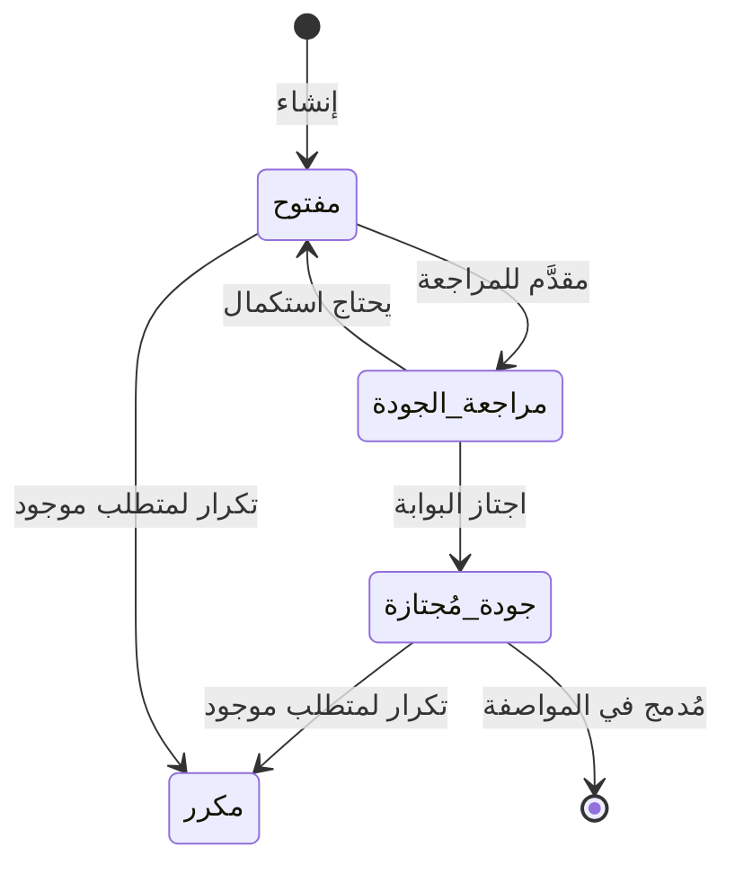

## قالب وثيقة المتطلبات — مشروع يوميات سايبر — Cyber Diaries
---
### بيانات الوثيقة (Document Control)

| البند                                | القيمة                       |
| ------------------------------------ | ---------------------------- |
| اسم المشروع (Project Name)           | يوميات سايبر — Cyber Diaries |
| الرمز المختصر للمشروع (Project Code) | CDbHLT                       |
| رقم الوثيقة (Document ID)            | CDbHLT-REQ-SPEC-001          |
| الإصدار (Version)                    | 0.1                          |
| الحالة (Status)                      | نموذج اولي                   |
| تاريخ الإصدار (Release Date)         | 26-10-2026                   |
| المالك/المسؤول (Owner)               | HEADLESS Team                |
| فريق المراجعة (Reviewers)            | PH: Ahmed Zakaria Hemaid     |

### سجل المراجعات (Revision History)

| الإصدار | التاريخ    | المؤلف             | التغييرات | الحالة     |
| ------- | ---------- | ------------------ | --------- | ---------- |
| 0.0     | 20-10-2026 | محمد ياسر حسن جمعة | [لا شئ    | نموذج اولي |
|         |            |                    |           |            |

### قائمة المصطلحات والاختصارات (Abbreviations) — راجع القسم 4.1

| الاختصار | المعنى                                                      |
| -------- | ----------------------------------------------------------- |
| PUC      | حالة استخدام المنتج (Product Use Case)                      |
| BUC      | حالة استخدام العمل (Business Use Case)                      |
| SUC      | حالة استخدام النظام (System Use Case)                       |
| FR       | متطلب وظيفي (Functional Requirement)                        |
| NFR      | متطلب غير وظيفي (Non-Functional Requirement)                |
| CR       | قيد (Constraint Requirement)                                |
| PAM      | الغرض – الميزة – القياس (Purpose – Advantage – Measurement) |
| MoSCoW   | نظام ترميز الأولويات (Must / Should / Could / Won't)        |

---

## دليل استخدام هذا القالب (How to Use This Template)

### 1. المبادئ الحاكمة (Volere Principles)

| المبدأ                           | التطبيق العملي في هذا القالب                                                                 |
| -------------------------------- | -------------------------------------------------------------------------------------------- |
| **الوصف (Description)**          | يُقصر على ذِكر الحقيقة بإيجاز — ماذا يجب أن يفعل المنتج.                                     |
| **المبرر (Rationale)**           | حجة قابلة للجدال تُبرر وجود المتطلب — تُ.Tested في كل مراجعة.                                |
| **معيار القبول (Fit Criterion)** | **إلزامي**: اختبار قابل للتنفيذ يُحدّد هل يحقّق التصميم المتطلب. لا معيار قبول = متطلب غامض. |
| **الفصل بين المشكلة والحل**      | في الأقسام 1–8 نصف المشكلة وسياقها فقط. الحل يُعزل في القسم 27 (أفكار للحلول).               |
| **عدم الخلط بين المتطلب والحل**  | في القسم 9 (المتطلبات الوظيفية) اكتب «يجب أن يتيح» لا «يجب أن يستخدم».                       |
|                                  |                                                                                              |

### 2. نظام ترقيم المتطلبات (Requirement Numbering)

| البادئة        | المعنى                                                    | المدى    |
| -------------- | --------------------------------------------------------- | -------- |
| `[XX]-FR-###`  | متطلب وظيفي (Functional Requirement)                      | القسم 9  |
| `[XX]-AP-###`  | متطلب مظهر (Appearance)                                   | 10.1     |
| `[XX]-ST-###`  | متطلب أسلوب (Style)                                       | 10.2     |
| `[XX]-EU-###`  | سهولة الاستخدام (Ease of Use)                             | 11.1     |
| `[XX]-PI-###`  | التخصيص والتدويل (Personalization & Internationalization) | 11.2     |
| `[XX]-LN-###`  | التعلّم (Learning)                                        | 11.3     |
| `[XX]-UP-###`  | الفهم واللباقة (Understandability & Politeness)           | 11.4     |
| `[XX]-AC-###`  | إتاحة الوصول (Accessibility)                              | 11.5     |
| `[XX]-SP-###`  | السرعة والاستجابة (Speed & Latency)                       | 12.1     |
| `[XX]-SC-###`  | السلامة (Safety-Critical)                                 | 12.2     |
| `[XX]-PA-###`  | الدقة (Precision & Accuracy)                              | 12.3     |
| `[XX]-RA-###`  | الموثوقية والتوافر (Reliability & Availability)           | 12.4     |
| `[XX]-RB-###`  | المتانة وتحمل الأعطال (Robustness & Fault-Tolerance)      | 12.5     |
| `[XX]-CP-###`  | السعة (Capacity)                                          | 12.6     |
| `[XX]-SE-###`  | القابلية للتوسع (Scalability & Extensibility)             | 12.7     |
| `[XX]-LG-###`  | العمر التشغيلي (Longevity)                                | 12.8     |
| `[XX]-PE-###`  | البيئة المادية (Physical Environment)                     | 13.1     |
| `[XX]-IF-###`  | الواجهات مع الأنظمة المجاورة (Interfacing)                | 13.2     |
| `[XX]-PR-###`  | المنتجية/التوزيع (Productization)                         | 13.3     |
| `[XX]-RL-###`  | الإصدارات (Release)                                       | 13.4     |
| `[XX]-MT-###`  | الصيانة (Maintenance)                                     | 14.1     |
| `[XX]-SPP-###` | إمكانية الدعم (Supportability)                            | 14.2     |
| `[XX]-AD-###`  | القابلية للتكيّف (Adaptability)                           | 14.3     |
| `[XX]-AX-###`  | التحكم في الوصول (Access)                                 | 15.1     |
| `[XX]-IN-###`  | السلامة integrity (Integrity)                             | 15.2     |
| `[XX]-PV-###`  | الخصوصية (Privacy)                                        | 15.3     |
| `[XX]-AU-###`  | التدقيق (Audit)                                           | 15.4     |
| `[XX]-IM-###`  | المناعة (Immunity)                                        | 15.5     |
| `[XX]-CU-###`  | ثقافي (Cultural)                                          | 16.1     |
| `[XX]-CP-###`  | امتثال قانوني (Compliance)                                | 17.1     |
| `[XX]-SD-###`  | معايير (Standards)                                        | 17.2     |
| `[XX]-CN-###`  | قيد حل (Solution Constraint)                              | 3.1      |
| `[XX]-BUC-###` | حالة استخدام عمل                                          | 6.4      |
| `[XX]-PUC-###` | حالة استخدام منتج                                         | 8.3      |
| `[XX]-UN-###`  | حاجة مستخدم (User Need)                                   | الملحق أ |
| `[XX]-RU-###`  | متطلب استخدام (Requirement for Use)                       | الملحق أ |

> **قاعدة:** الرقم لا يُعاد استخدامه أبدًا. المتطلبات الملغاة تُوسم `ملغى` وتبقى في السجل للاحتفاظ بسلسلة التتبّع.

### 3. ترميز الأولويات (MoSCoW)

| الرمز      | المعنى          | التعريف                                                                                   |
| ---------- | --------------- | ----------------------------------------------------------------------------------------- |
| **Must**   | لازم            | لا يُصدر الإصدار إلا إذا تحقّقت. غيابها يُفشل الإصدار.                                    |
| **Should** | مستحسن          | مهم جوهريًا لكنه قابل للتأجيل إلى إصدار لاحق دون إفشال الإصدار.                           |
| **Could**  | إضافي           | يُنفَّذ إن توفّر الوقت أو المساحة. أولوية الترقية إليه أقل من Must/Should.                |
| **Won't**  | خارج النطاق     | صريح لن يُنفَّذ في هذا الإصدار — يُوثَّق في القسم 26 (غرفة الانتظار) مع النسخة المستهدفة. |
| Kill       | قتل صاحب الفكرة | ضربه بالنار                                                                               |

> **ملاحظة منهجية:** استُبدل زوجُ «درجة رضا العميل / درجة عدم الرضا» في القالب الأصلي بنظام MoSCoW، لأن التقدير الرقمي لدرجة الرضا يسبّب ارتباكًا ويصعب تبريره في المراجعة. تبقى الأولوية **قرارًا موثّقًا قابلًا للجدال** لا انطباعًا.

### 4. دورة حياة المتطلب وبوابة الجودة (Requirement Lifecycle & Quality Gateway)

كل متطلب ذرّي يمر بالحالات التالية. **لا يُعتمد المتطلب في المواصفة إلا بعد اجتياز بوابة الجودة.**



**بوابة الجودة (Quality Gateway) — شروط العبور الإلزامية:**

| # | الشرط | تم ✓ |
|---|---|---|
| 1 | المتطلب **ذرّي** (atomic) — يصف شيئًا واحدًا فقط | ☐ |
| 2 | حقل **الوصف** مكتمل ومباشر | ☐ |
| 3 | حقل **المبرر** موجود ويجيب عن «لماذا؟» | ☐ |
| 4 | حقل **معيار القبول** موجود **وقابل للتنفيذ وقياسه** | ☐ |
| 5 | **المصدر** محدّد (من أين أتت الحاجة) | ☐ |
| 6 | **الاعتماديات والتعارضات** مفحوصة | ☐ |
| 7 | **الأولوية (MoSCoW)** مقرّرة | ☐ |
| 8 | قابل للتتبّع إلى **حاجة مستخدم / حالة استخدام** | ☐ |
| 9 | **متوافق مع القيود** في القسم 3 | ☐ |
| 10 | **لا يفرض حلًا تقنيًا** | ☐ |

### 5. سلسلة التتبّع (Traceability Chain)

يجب أن يكون لكل متطلب ذرّي مسار كامل من البيت إلى الاختبار:

```text
حاجة المستخدم (User Need)          [XX-UN-###]   ← الملحق أ
        ↓
متطلب الاستخدام (Requirement for Use) [XX-RU-###] ← الملحق أ
        ↓
حالة استخدام المنتج (PUC)           [XX-PUC-###]  ← القسم 8
        ↓
المتطلب الذرّي (Atomic Requirement) [XX-XXX-###]  ← الأقسام 9–17
        ↓
معيار القبول (Fit Criterion)                  ← الاختبار
        ↓
النتيجة / حالة التحقق                        ← سجل الاختبارات
```

| حالة الاستخدام (PUC) | المتطلبات الذرّية المرتبطة | حالة التحقق |
|---|---|---|
| [XX-PUC-000] | [XX-FR-000, ...] | [مغطى / جزئي / غير مغطى] |
| [XX-PUC-000] | [XX-FR-000, ...] | [مغطى / جزئي / غير مغطى] |
| [XX-PUC-000] | [XX-FR-000, ...] | [مغطى / جزئي / غير مغطى] |

### 6. اصطلاحات الكتابة (Writing Conventions)

- ابدأ الوصف بفعل إلزامي: «يجب أن»، «يُتاح»، «تُحتسب».
- تجنّب: «يكون»، «يُفضّل» (تعبير تفضيل لا يمكن اختبارها).
- تجنّب ذكر أسماء تقنيات أو أدوات أو لغات في القسم 9 — ضعها في القسم 3.1 أو 27.
- كل رقم في القوس `([])` يشير إلى متطلب أو PUC مرتبط.
- اكتب معيار القبول بحيث يُجيب عن سؤال: **«ماذا أفعل لأثبت أن هذا تحقّق؟»**
- السطر الأول في كل جدول: سطر الترويسة، والثاني: سطر الفاصل `|---|---|`، ثم صف واحد فارغ لكل صف.

---
---
# 📋 نموذج بطاقة المتطلب (Requirements Shell / Snow Card)

> **طريقة الاستخدام:** انسخ الكتلة التالية لكل متطلب ذرّي وضعها في القسم المناسب، أو املأ الجدول المجمّع في القسم 9.1 والملحق د.
> النموذج مبني على قالب Volere المُعدَّل (المتطلبات المُستخدمة في الأدوات الآلية) مع استبدال تقديرَي الرضا بنظام MoSCoW.

### بطاقة متطلب ذرّي — blank

| الحقل                                     | القيمة                                                               |
| ----------------------------------------- | -------------------------------------------------------------------- |
| **رقم المتطلب (Requirement No.)**         | `[XX-XXX-000]`                                                       |
| **نوع المتطلب (Requirement Type)**        | `[وظيفي / غير وظيفي / قيد]`                                          |
| **الأولوية (Priority – MoSCoW)**          | `[Must / Should / Could / Won't]`                                    |
| **حالات الاستخدام المرتبطة (Use Cases)**  | `[XX-PUC-000, XX-BUC-000]`                                           |
| **الوصف (Description)**                   | [اكتب المتطلب كحقيقة مختصرة ومحددة — ماذا يجب أن يفعل المنتج]        |
| **المبرر (Rationale)**                    | [اكتب الحجة التي تبرّر وجود المتطلب، وتكون قابلة للجدال في المراجعة] |
| **المصدر (Source)**                       | [من أين أتت الحاجة: مقابلة / تحليل سياق / قرار فريق / معيار خارجي]   |
| **معيار القبول (Fit Criterion)**          | [اكتب اختبارًا قابلًا للتنفيذ والقياس يُثبت تحقّق المتطلب]           |
| **الاعتماديات (Dependencies)**            | [XX-XXX-000, ...]                                                    |
| **التعارضات (Conflicts)**                 | [XX-XXX-000, ...]                                                    |
| **المواد الداعمة (Supporting Materials)** | [رابط / مرجع / ملحق / صورة]                                          |
| **السجل (History)**                       | [أنشئ في: YYYY-MM-DD] · [آخر تعديل: YYYY-MM-DD بواسطة: ...]          |

### بطاقة متطلب ذرّي — blank (نسخة ثانية للنسخ واللصق)

| الحقل | القيمة |
|---|---|
| **رقم المتطلب (Requirement No.)** | `[XX-XXX-000]` |
| **نوع المتطلب (Requirement Type)** | `[وظيفي / غير وظيفي / قيد]` |
| **الأولوية (Priority – MoSCoW)** | `[Must / Should / Could / Won't]` |
| **حالات الاستخدام المرتبطة (Use Cases)** | `[XX-PUC-000]` |
| **الوصف (Description)** | [ ] |
| **المبرر (Rationale)** | [ ] |
| **المصدر (Source)** | [ ] |
| **معيار القبول (Fit Criterion)** | [ ] |
| **الاعتماديات (Dependencies)** | [ ] |
| **التعارضات (Conflicts)** | [ ] |
| **المواد الداعمة (Supporting Materials)** | [ ] |
| **السجل (History)** | [ ] |

---
---

# 📑 الفهرس (Table of Contents)

| # | القسم | الأقسام الفرعية |
|---|---|---|
| **1** | غرض المشروع (The Purpose of the Project) | 1.1 · 1.2 |
| **2** | أصحاب المصلحة (The Stakeholders) | 2.1 · 2.2 · 2.3 · 2.4 · 2.5 · 2.6 · 2.7 · 2.8 |
| **3** | القيود المفروضة (Mandated Constraints) | 3.1 · 3.2 · 3.3 · 3.4 · 3.5 · 3.6 · 3.7 · 3.8 |
| **4** | اصطلاحات التسمية والمصطلحات (Naming Conventions and Terminology) | 4.1 |
| **5** | الحقائق والافتراضات (Relevant Facts and Assumptions) | 5.1 · 5.2 · 5.3 |
| **6** | نطاق العمل (The Scope of the Work) | 6.1 · 6.2 · 6.3 · 6.4 |
| **7** | نموذج بيانات العمل وقاموس البيانات (Business Data Model and Data Dictionary) | 7.1 · 7.2 |
| **8** | نطاق المنتج (The Scope of the Product) | 8.1 · 8.2 · 8.3 |
| **9** | المتطلبات الوظيفية (Functional Requirements) | 9.1 |
| **10** | المظهر والإحساس (Look and Feel Requirements) | 10.1 · 10.2 |
| **11** | سهولة الاستخدام والإنسانية (Usability and Humanity Requirements) | 11.1 · 11.2 · 11.3 · 11.4 · 11.5 |
| **12** | الأداء (Performance Requirements) | 12.1 · 12.2 · 12.3 · 12.4 · 12.5 · 12.6 · 12.7 · 12.8 |
| **13** | التشغيل والبيئة (Operational and Environmental Requirements) | 13.1 · 13.2 · 13.3 · 13.4 |
| **14** | القابلية للصيانة والدعم (Maintainability and Support Requirements) | 14.1 · 14.2 · 14.3 |
| **15** | متطلبات الأمان (Security Requirements) | 15.1 · 15.2 · 15.3 · 15.4 · 15.5 |
| **16** | المتطلبات الثقافية (Cultural Requirements) | 16.1 |
| **17** | المتطلبات القانونية (Legal Requirements) | 17.1 · 17.2 |
| **18** | المسائل المفتوحة (Open Issues) | 18.1 |
| **19** | الحلول الجاهزة (Off-the-Shelf Solutions) | 19.1 · 19.2 · 19.3 |
| **20** | المشكلات الجديدة (New Problems) | 20.1 · 20.2 · 20.3 · 20.4 · 20.5 |
| **21** | المهام (Tasks) | 21.1 · 21.2 |
| **22** | الترحيل إلى المنتج الجديد (Migration to the New Product) | 22.1 · 22.2 |
| **23** | المخاطر (Risks) | 23.1 |
| **24** | التكاليف (Costs) | 24.1 |
| **25** | توثيق المستخدم والتدريب (User Documentation and Training) | 25.1 · 25.2 |
| **26** | غرفة الانتظار (Waiting Room) | 26.1 |
| **27** | أفكار للحلول (Ideas for Solutions) | 27.1 |
| **أ** | ملحق أ: حاجات المستخدم ومتطلبات الاستخدام | أ.1 · أ.2 |
| **ب** | ملحق ب: نموذج المقابلة والموافقة المستنيرة | ب.1 · ب.2 |
| **ج** | ملحق ج: سجل التشريعات والمعايير | ج.1 |
| **د** | ملحق د: السجل الرئيسي للمتطلبات | د.1 · د.2 · د.3 |

---
---
