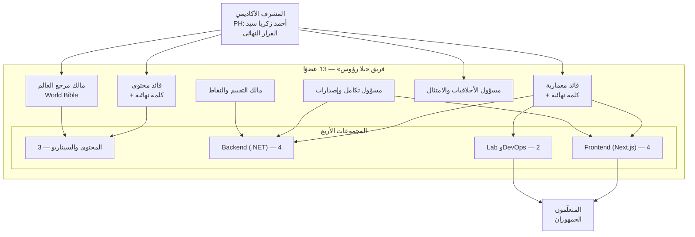
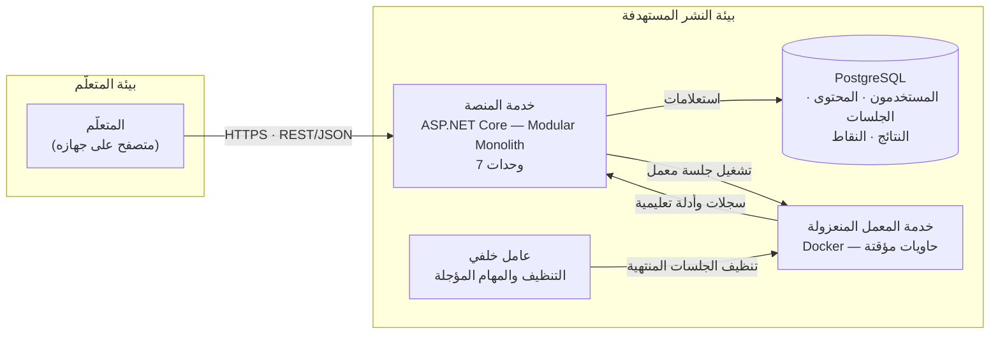
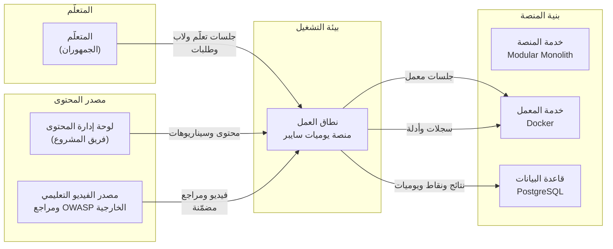
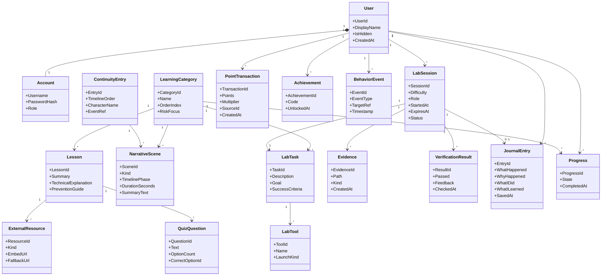
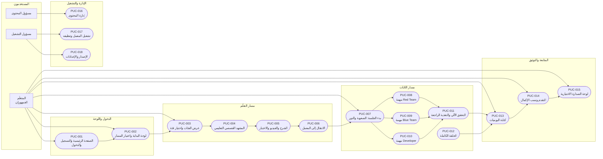

# مسودة وثيقة المتطلبات — يوميات سايبر (Cyber Diaries)

> **حالة الوثيقة:** **مسودة عمل — مقتصرة على الأقسام 1–8** (كما اتُّفق). الأقسام **9–27** والملاحق تُكتب في ملف/دفعة تالية. **0.3:** دُمجت إجابات `data.md`. **0.4 (26-10-2026):** دُمجت إجابات المالك عن تسعة قرارات (D2 · D6 · D8 · D11 · D12 · D14 · D15 · D16 · D17). **0.5:** أُغلقت ثلاثة عشر مسألة كانت بوسم «مقترح — يحتاج مراجعة»؛ لم يبقَ سوى **D7**.

| البند                                | القيمة                                                                              |     |
| ------------------------------------ | ----------------------------------------------------------------------------------- | --- |
| اسم المشروع (Project Name)           | يوميات سايبر — Cyber Diaries                                                        |     |
| الرمز المختصر للمشروع (Project Code) | `CDbHLT`                                                                            |     |
| رقم الوثيقة (Document ID)            | `CDbHLT-REQ-SPEC-001`                                                               |     |
| الإصدار (Version)                    | `0.5-draft`                                                                         |     |
| الحالة (Status)                      | مسودة — الأقسام 1–8 فقط (0.4: إجابات المالك عن 9 قرارات · 0.5: إغلاق 13 بند مراجعة) |     |
| تاريخ المسودة (Release Date)         | 26-10-2026                                                                          |     |
| المالك/المسؤول (Owner)               | فريق «بلا رؤوس» (HEADLESS Team)                                                     |     |
| فريق المراجعة (Reviewers)            | PH: أحمد زكريا سيد                                                                  |     |

**مصادر التعبئة:**

| المصدر                                                  | الدور في هذه المسودة                                                                                                                                                                                                                                                                 |
| ------------------------------------------------------- | ------------------------------------------------------------------------------------------------------------------------------------------------------------------------------------------------------------------------------------------------------------------------------------ |
| `Description/Project Description.md`                    | **المرجع الوحيد** لأي معلومة واقعية. كل اقتباس يرد أسفله بصيغة «وصف المشروع N».                                                                                                                                                                                                      |
| `Requirements/00_Requirements_Mapping.md`               | دليل المعلومات المعروفة والناقصة، وخريطة قرارات D1–D15 (يُضاف إليها D16 وD17 المقترحتان أدناه).                                                                                                                                                                                      |
| `Requirements/Requirements Specification.md`            | القالب — **لم يُعدَّل**؛ نُسخ بنيته كاملة إلى هذه المسودة.                                                                                                                                                                                                                           |
| `Requirements/Requirements Specification References.md` | بيانات الوثيقة ونظام الترقيم ودليل الاستخدام.                                                                                                                                                                                                                                        |
| `data.md`                                               | **مصدر المعطيات المؤسسية والقرارات** (أحدث مصدر: 26-10-2026 23:01): الجامعة والكلية والقسم · المشرفان · فريق المشروع (12 عضوًا) · المواعيد · الميزانية · نسب الجمهور · الشخصيات · إعدادات النشر · سياسة الاحتفاظ. **دُمجت إجاباته في الإصدار 0.3**، وما لم يجبه يبقى معلَّمًا بوسمه. |

**مفتاح الوسوم المستخدم في هذه المسودة:**

| الوسم                            | المعنى                                                       | الإجراء المطلوب                                                         |
| -------------------------------- | ------------------------------------------------------------ | ----------------------------------------------------------------------- |
| `[TBD — Requires Decision: ...]` | معلومة **غير متاحة** في مصدر المشروع، ولا يجوز اختراعها.     | يحتاج قرارًا بشريًا. النص بعد النقطتين يحدّد **القرار المطلوب بالضبط**. |
| `[PROPOSED — Requires Review]`   | قيمة أو قاعدة أو متطلب **اقترحه الفريق** ولم يُعتمد بعد.     | يحتاج مراجعة واعتمادًا.                                                 |
| `وصف المشروع N`                  | المصدر: القسم رقم N في `Description/Project Description.md`. | —                                                                       |

> **بادئة ترقيم المتطلبات:** استُعملت في هذه المسودة بادئة `CDbHLT-` (الرمز المختصر للمشروع في بيانات الوثيقة) بدل `[XX]` الواردة في القالب.
> ال**[PROPOSED — Requires Review] — القرار D7 (البند المعلّق الوحيد بعد 0.5):** البادئة المستعملة فعليًا في الوثيقة كلها هي `CDbHLT-`؛ المطلوب **كلمة إقرار واحدة** (أو التحويل إلى `CD-`) ثم يُستبدل `[XX]` في القالب وملف دليل الاستخدام.
>
> **قرارات إضافية خارج D1–D15 (نشأت أثناء تعبئة 1–8):** **D16** (حجم العينة) و**D17** (تثبيت الإصدارات) — **كلتاهما مُجابة في كتلة قرارات المالك أدناه**، ولم تعودا مفتوحتين.
> **D1 وD13 — محسومان وليسا قرارين مفتوحين:** D1 (الفئة التجريبية) محسوم بنطاق النسخة = **Injection**؛ وD13 (لوحة الصدارة) محسومة بـ`data.md` 3 = **مغلقة افتراضيًا (Opt-in)**.

> **قرارات المالك — 26-10-2026 (الدفعة 0.4):**
> **D6** الأدوار الداخلية → **فريق HEADLESS Team** (مسؤولية جماعية، بلا تسمية فرد).
> **D14** مراجعة تراخيص الأدوات → **فريق HEADLESS Team**، والسجل في `Requirements/Tool Licenses Register.md`.
> **D17** إصدارات بقية الأدوات → **تُحدَّد بعد اكتمال البناء** (تأجيل مقصود).
> **D11** حذف حساب المتعلّم → **مسموح بطلب المتعلّم**.
> **D12** نظام التشغيل ودقة الشاشة → **تُحدَّد بعد اكتمال البناء**؛ المتصفحات مثبّتة: Chrome وEdge (آخر إصدارين).
> **D8** الجمهور غير التقني → **مسار مبسّط مستقل**.
> **D16** حجم العينة → **10 مشاركين على الأقل**.
> **D2** بيئة النشر → **استضافة مجانية (Oracle أو Render) أو سيرفر الجامعة**؛ المزوّد يُختار عند النشر.
> **D15** أسماء OWASP → **القائمة الرسمية Top 10:2025**، مثبّتة في 4.1.
> **لم يُجب:** D7 (بادئة الترقيم) — ما زال مقترحًا.

---

---

# القسم الأول: غرض المشروع (The Purpose of the Project)

> **الهدف من القسم:** تعرّف الدافع وراء المشروع — لماذا أُنشئ، وما الذي سيتغيّر. هذا القسم يبرّر وجود كل ما بعده، ولهذا يُراجَع في كل اجتماع مراجعة.

## 1.1 خلفية المشروع (1a — The User Business or Background of the Project Effort)

**ما الذي ستكتبه هنا:** وصف مختصر للعمل القائم وسياقه، والمشكلة التي دفعت إلى إطلاق هذا المشروع، والعمل الذي ينوي إنجازه المستخدم النهائي بالمنتج المُسلَّم. يمكن الاستعانة بنماذج العمليات الحالية أو العينات من الوثائق القائمة.

| البند                                         | المحتوى                                                                                                                                                                                                                                                                                                                                                                                                                                                                                                                                                                                                                                                                                                                                                                                                                                         |
| --------------------------------------------- | ----------------------------------------------------------------------------------------------------------------------------------------------------------------------------------------------------------------------------------------------------------------------------------------------------------------------------------------------------------------------------------------------------------------------------------------------------------------------------------------------------------------------------------------------------------------------------------------------------------------------------------------------------------------------------------------------------------------------------------------------------------------------------------------------------------------------------------------------- |
| العمل القائم اليوم (Current Work)             | التعلّم الذاتي لأمن تطبيقات الويب يقوم اليوم على أربعة أنماط متفرّقة: **(أ)** قراءة توثيق ومراجع تقنية موزّعة على مواقع ولغات مختلفة؛ **(ب)** مشاهدة فيديوهات ومقالات تعليمية متفرّقة؛ **(ج)** خوض تدريبات عملية في محاكيات جاهزة أو في بيئات شخصية غير معزولة؛ **(د)** تدوين ما تعلّمه في ملاحظات شخصية. **المنفّذ في كل الحالات هو المتعلّم بنفسه** — لا توجد جهة مؤسسية توفّر مسارًا متكاملًا، ولا بيئة تدريب معزولة مخصّصة، ولا أداة تربط التعلّم بالسياق المهني. النتيجة ست مشكلات مُرصودة: الفجوة بين النظرية والتطبيق · تشتّت المحتوى · حاجز اللغة · الانفصال عن سياق العمل · غياب المنظور المتكامل · صعوبة قياس التقدم الحقيقي. (وصف المشروع 3، 4)                                                                                                                                                                                      |
| المشكلة أو الفرصة (The Problem / Opportunity) | المشكلة ليست نقص ثغرات، بل **غياب دورة متكاملة بأدوات حقيقية وبسياق عمل**. تفصيلها: **(1)** قد يعرف المتعلم تعريف SQL Injection دون أن يعرف كيف يكتشفها أو يفسر أثرها أو يصلحها. **(2)** تشتّت المحتوى بين مصادر متعددة بلغات ومستويات صعوبة مختلفة. **(3)** حاجز اللغة: معظم الموارد المتقدمة بالإنجليزية. **(4)** الانفصال عن سياق العمل: التدريبات المعزولة لا تعرض العلاقة بين الخطأ البرمجي والحادث الأمني وأثره. **(5)** غياب المنظور المتكامل: اكتشاف الثغرة لا يضمن القدرة على تحليل آثارها في السجلات أو إصلاح سببها. **(6)** صعوبة قياس التقدم الحقيقي: إكمال درس أو مشاهدة فيديو لا يعني اكتساب مهارة عملية. (وصف المشروع 3)                                                                                                                                                                                                         |
| ما الذي يُنتظر من المنتج (Intended Use)       | المخرج الملتزم به، معلن سلفًا (وصف المشروع 16): **(1)** حلقة واحدة متكاملة بإتقان — فئة Injection بسيناريو SQL Injection محدود: مشهد قصصي في مسار التعلّم يظهر فيه البطل قبل التوظيف، ثم الشرح والفيديو التعليمي الخارجي المدمج والاختبار القصير، ثم انتقال القصة زمنيًا إلى مرحلة عمل البطل في «نور تك»، وافتتاحية اللاب ومشاهد الانتقال حسب الدور، والوظائف الثلاث، واليوميات، والتقييم الآلي. **(2)** رحلة المستخدم الأساسية: الصفحة الرئيسية، التسجيل/الدخول، لوحة البداية، والاختيار بين المسارين. **(3)** قياس التكلفة الفعلية للحلقة بساعات العمل لكل مكوّن. **(4)** تعميم القالب على فئات إضافية بحسب الوقت المتبقي بعد القياس. **(5)** دراسة تقييمية على النموذج. **(6)** التوثيق التقني والعلمي وورقة بحثية. ومخرجات المنصة: منصة عاملة، محتوى تعليمي عربي، معمل عملية، توثيق تقني وعلمي، دراسة تقييمية، وورقة بحثية (وصف المشروع 1). |
| الدافع المؤسسي (Business Trigger)             | **متطلب تخرج (Graduation Requirement):** توفير **بيئة أمنية عربية معزولة** للتعلّم والتقييم داخل المسار الأكاديمي، بدل الاعتماد على محاكيات أجنبية أو بيئات شخصية غير معزولة (`data.md` 5). **الأثر:** الدافع أكاديمي لا سوقي — فلا إيراد ولا مؤشر نجاح تجاري، والجدول مربوط بالتسليم النهائي (3.6) والميزانية صفرية نقديًا (3.7).                                                                                                                                                                                                                                                                                                                                                                                                                                                                                                              |

**النطاق المستثنى من الخلفية (Out of Scope of This Section):**

| مستثنى | السبب |
|---|---|
| المنتج المتخيَّل (عشر فئات كاملة) | وصف المشروع 16 يعلن أن **الملتزم به في المناقشة هو حلقة واحدة**؛ فالخلفية تصف سياق المشروع كما هو ملتزم به، لا المنتج الكامل المتخيَّل. |
| التفاصيل التقنية (اختيار التقنيات والإصدارات) | مبدأ فصل المشكلة عن الحل: التقنيات والأدوات تُوثَّق في 3.1 و3.4 و27.1، ولا تُعدّ جزءًا من «الخلفية». |

## 1.2 أهداف المشروع (1b — Goals of the Project)

> **ما الذي ستكتبه هنا:** أهداف المشروع بصيغة **PAM** — الغرض (Purpose)، الميزة (Advantage)، القياس (Measurement). كل هدف **يجب** أن يكون قابلًا للقياس؛ الهدف غير القابل للقياس يُرفض.

**جدول PAM:**

| # | الغرض (Purpose) | الميزة (Advantage) | القياس (Measurement) | نوع الهدف |
|---|---|---|---|---|
| 1 | تمكين المتعلّم العربي من إتقان **دورة** التعامل مع مشكلة أمنية في تطبيقات الويب — اكتشاف، تفسير، معالجة، توثيق — لا حفظ اسم ثغرة | ربط السرد والمعمل والأدوات الحقيقية في تجربة واحدة، بدل التنقّل بين مصادر متفرّقة وبلغات متفرّقة؛ (القيمة التي تتحقق عند النجاح: متعلّم يشرح المشكلة ويثبتها ويحلل أدلتها ويصلح سببها ويوثّقها — وصف المشروع 2) | أدوات القياس المعلنة: **اختبار قبلي وبعدي ومؤجل عند الإمكان**، و**بيانات سلوكية من داخل المنصة**، و**اختبار سهولة الاستخدام**، و**تحليل يوميات المتعلمين** (وصف المشروع 0، 20.2). **حجم العينة: 10 مشاركين على الأقل (D16 — قرار المالك).** و**عتبة النجاح (مُعتمد في 0.5 — ينتظر توقيع المشرف في 3.8):** تحسّن متوسط الدرجة في الاختبار البعدي مقابل القبلي، ويُقاس **وصفيًا** (متوسط التغيّر · حجم الأثر · اتجاه النتائج) لا باختبار دلالة إحصائية عند هذا الحجم. | هدف تعلّم |
| 2 | تحويل قرار التعميم من تقدير إلى قياس: قياس الكلفة الفعلية للحلقة الأولى قبل إعلان عدد الحلقات | انتقال من «كم نحتاج؟» إلى رقم ساعات لكل مكوّن (محتوى · مشاهد · تجهيز معمل · اختبارات آلية)، فيصبح إعلان النطاق قرارًا مسؤولًا لا مخاطرة | **ساعات العمل الفعلية لكل مكوّن** (وصف المشروع 16.3، 19). لا يُوعد بجدول نهائي قبل اكتمال هذا القياس | **هدف قياس / حوكمة (Measurement & Governance Goal)** — نوع خامس أُضيف في 0.5 لأن الخيارات الأربعة في القالب (خدمة · إيراد · قانوني · تعلّم) لا تشمل قياس الكلفة داخليًا |
| 3 | تمكين تعميم قالب واحد على فئات أخرى دون بناء نظام جديد لكل فئة | إعادة استثمار القوالب (السرد · سطح المكتب · أدوات المعمل · التقييم) بدل تكرار العمل يدويًا لكل حلقة | **جاهزية القالب للتكرار:** تشغيل حلقة على فئة ثانية دون تعديل معماري، مع تظلّل كلفة كل مكوّن بين دورتين (وصف المشروع 5، 16.4). عدد الفئات المغطّاة **يُعلن مبكرًا مع المشرف** لا في نهاية المشروع | **هدف خدمة** — القيمة تظهر عند إعادة استثمار القالب لفئة ثانية |

**تعريف أنواع الأهداف:**

| النوع | التعريف |
|---|---|
| هدف خدمة (Service Goal) | يُقاس أثره على المستخدم: ما الذي يشتريه من الخدمة؟ |
| هدف إيراد (Revenue Goal) | يُقاس بالمال أو الحصة السوقية على مدى زمني محدّد. |
| هدف قانوني (Legal Goal) | إثبات مطابقة المنتج لشريعة أو معيار — لا يقاس برقم. |
| هدف تعلّم (Learning Goal) | إثبات اكتساب مستخدمٍ لِمهارة أو فهم معيّن — يقاس باختبار قبلي/بعدي. |
| **هدف قياس / حوكمة (Measurement & Governance Goal)** | **نوع خامس أُضيف في 0.5 (ليس في القالب):** يُقاس برقم داخلي للفريق نفسه — ساعات عمل · كلفة مكوّن · جودة — لا بأثر على مستخدم أو سوق. |

**مراجعة إجمالية للأهداف (تُقرأ في كل اجتماع مراجعة):**
- [ ] تمّت مراجعة جميع الأهداف مع أصحاب المصلحة — ⏳ **معلّق:** الاعتماد بعد جلسة المراجعة الأولى مع المشرف (يعتمد على D5 وD6).
- [ ] كل هدف له قياس مرتبط — كل صف في جدول PAM أعلاه يقابله قياس محدّد قابل للتنفيذ (أدوات القياس المعلنة · ساعات العمل · جاهزية القالب).
- [ ] القياسات قابلة للتنفيذ ضمن موارد المشروع — ⏳ **معلّق جزئيًا:** حجم العينة حُسم (n ≥ 10 — D16)؛ يبقى قياس الحلقة الأولى.

---

---

# القسم الثاني: أصحاب المصلحة (The Stakeholders)

> **الهدف من القسم:** حصر كل من له مصلحة في المنتج. تجاهل صاحب مصلحة يعني ضياع متطلبات.

## 2.1 العميل / الراعي (2a — The Client)

| البند                                  | المحتوى                                                                                                                                                                                                                                                                                                                                                                                                                                                                                                                                                                                                                                                                                                                                                                          |
| -------------------------------------- | -------------------------------------------------------------------------------------------------------------------------------------------------------------------------------------------------------------------------------------------------------------------------------------------------------------------------------------------------------------------------------------------------------------------------------------------------------------------------------------------------------------------------------------------------------------------------------------------------------------------------------------------------------------------------------------------------------------------------------------------------------------------------------- |
| **الاسم / الدور (Name/Role)**          | **المشرفان الأكاديميان:** **د/ أحمد زكريا سيد** و**د/ هشام عبدالنبي محمد** (`data.md` 1)، ولهما القرار النهائي في اعتماد النطاق ومواعيد التجميد. **أسماء الفريق الاثني عشر وتخصّصاتهم موثّقة** (`data.md` 1: 3 أمن سيبراني · 2 Back-End · 3 Front-End · 2 محتوى · 2 UI/UX = **12**). **تنبيه عددي:** وصف المشروع 18 و2.2 يذكران **13 عضوًا** في أربع مجموعات (3+4+4+2)؛ `data.md` يسمّي **12** — الفرق عضو واحد غير مسمّى — يُستكمل في كشف الفريق (ليس قرارًا مفتوحًا). **الاسم الرسمي المعتمد (قرار المالك):** «د/ أحمد زكريا سيد» — وُحِّد في بيانات الوثيقة وفي `References.md`، فلا تعارض بعد اليوم. و**ملكية الأدوار الداخلية** (قائد معمارية · قائد محتوى · مسؤول تكامل · مالك مرجع العالم · مالك سجل المخاطر): **فريق HEADLESS Team** كمسؤولية جماعية (D6 — قرار المالك). |
| **المؤسسة**                            | **ASSIUT INTERNATIONAL TECHNOLOGICAL UNIVERSITY** (جامعة أسيوط التكنولوجية الدولية) — **الكلية التكنولوجية المصرية الألمانية بأسيوط (EGC TECH AITU)** — **قسم تكنولوجيا المعلومات** (`data.md` 1).                                                                                                                                                                                                                                                                                                                                                                                                                                                                                                                                                                               |
| **القرارات التي يتخذها**               | **(1)** الفئة التجريبية **محسومة بنطاق النسخة: Injection** — لا تحتاج قرارًا. **(2)** اعتماد بيئة النشر المستهدفة (D2). **(3)** اعتماد نطاق التعميم وعدد الحلقات — «العدد يُعلن مبكرًا مع المشرف لا في النهاية» (وصف المشروع 16.4). **(4)** اعتماد قيم المعمل وأهداف الأداء الرقمية (D3 · D4). **(5)** اعتماد الأساس القانوني ونموذج الموافقة قبل جمع بيانات المشاركين (D5). **(6)** إسناد الأدوار بالأسماء داخل الفريق (D6). **(7)** اعتماد مواعيد تجميد قوالب المحتوى والسيناريو، لأنها تُعامَل كمخرجات رسمية (وصف المشروع 18).                                                                                                                                                                                                                                                |
| **مسؤول عن القبول النهائي**            | **نعم — مُعتمد في 0.5.** القبول النهائي للنطاق **المعلن**: الحلقة الواحدة (Injection) كاملة + رحلة المستخدم الأساسية + قياس التكلفة + الدراسة التقييمية + التوثيق والورقة البحثية. **المبرر:** يعرض عليه «القرار الأهم في هذا التوصيف» (وصف المشروع 16) ويُعلن نطاق التعميم معه (16.4). **لم يسمّه المصدر حرفيًا «المقبول النهائي»** — يُثبَّت بتوقيع المشرف في 3.8.                                                                                                                                                                                                                                                                                                                                                                                                             |
| **نقاط المراجعة (Review Checkpoints)** | **(1)** بعد إقرار نطاق النسخة (الفئة التجريبية **Injection** محسومة سلفًا) وقبل كتابة المحتوى — بداية المرحلة 2 من خطة العمل (وصف المشروع 19). **(2)** عند **مواعيد التجميد** المعلنة لقالب المحتوى وقالب السيناريو — تُعامَل كمخرجات رسمية (وصف المشروع 18). **(3)** بعد **قياس تكلفة الحلقة الأولى**: إعلان عدد الحلقات المعمَّمة (وصف المشروع 16.4، 19). **(4)** قبل تشغيل جمع بيانات المشاركين: اعتماد نموذج الموافقة والأساس القانوني (D5). **التواريخ المثبَّتة:** التسليم/المناقشة النهائية **7-2027**، وتجميد قوالب المحتوى والسيناريو **قبل التسليم بأسبوعين** (`data.md` 1). **توزيع نقاط المراجعة الأربع على تقويم شهري: [TBD — Requires Decision: تقويم مراجعات تفصيلي داخل نافذة 2027].**                                                                           |
| **مخطط تنظيمي مُوضَّح**                | الهيكل مُعبَّأ **بالأدوار** أدناه، والأسماء متاحة (12 عضوًا — `data.md` 1). **القرار (D6):** لا تسمية فرد لكل دور — الأدوار تُدار كـ**مسؤولية جماعية لفريق HEADLESS Team**، فالمخطط يوضّح الهيكل لا مالكيه.                                                                                                                                                                                                                                                                                                                                                                                                                                                                                                                                                                      |

**مخطط تنظيمي بالأدوار (بدون أسماء — بانتظار D6):**

> **ملاحظة:** المصدر يذكر «مسؤول تكامل وإصدارات» و«قائد معمارية» و«قائد محتوى» **بلا أسماء** (وصف المشروع 18، وسجل التنبيه C12 في خريطة المتطلبات). **مالك سجل المخاطر ومالك وحدة Gamification ومسؤول الأخلاقيات أدوار مُشتقّة** لا يسمّيها المصدر — وقد **أُسندت كلها إلى فريق HEADLESS Team** (قرار المالك — D6)، فلم تعد معلّقة على تسمية أفراد.

## 2.2 العميل النهائي / المشتري (2b — The Customer)

| البند                         | المحتوى                                                                                                                                                                                                                                                                                                                                                                                           |
| ----------------------------- | ------------------------------------------------------------------------------------------------------------------------------------------------------------------------------------------------------------------------------------------------------------------------------------------------------------------------------------------------------------------------------------------------- |
| **من يشتري أو يتبنّى المنتج** | **لا يوجد مشترٍ تجاري في هذا المشروع.** ثلاثة أطراف يجب التفريق بينها: **(أ) المستفيد من الاستخدام** = المتعلّم — طلاب الحاسبات ومطورو الويب المبتدئون، والمهتمون بالأمن السيبراني بلا خلفية برمجية (وصف المشروع 1). **(ب) الجهة المستلِمة للمخرجات** = الجهة الأكاديمية التي تُسلَّم لها المنصة والتوثيق والدراسة التقييمية والورقة البحثية. **(ج) مستخدمو التشغيل** = فريق المشروع (13 عضوًا). |
| **القرارات التي يتخذها**      | المتعلّم: اختيار المسار (تعلّم / لابات) · اختيار الفئة · اختيار مستوى الصعوبة · اختيار الدور · تخطي المشاهد · كتابة اليوميات. **لا تُفتح ولا تُحجب أي محتوى بالنقاط** (وصف المشروع 12).                                                                                                                                                                                                          |
| **نقاط المراجعة**             | **تجربة استطلاعية مع 5–10 طلاب**: رصد المشكلات التعليمية والتقنية، **قياس زمن الإتمام**، تقييم **وضوح القصة والانتقالات والأدوات**، وتحديد ما يُبسَّط قبل التعميم (وصف المشروع 19، المرحلة 6). **التوقيت:** بعد اكتمال الحلقة الأولى (المرحلة 6) وداخل نافذة ما قبل التسليم النهائي **7-2027**؛ **اليوم المحدّد [TBD — Requires Decision: تقويم المرحلة 6].** **فرقٌ مقصود:** التجربة الاستطلاعية = **5–10 طلاب** (وصف المشروع 19)، أما **عينة الدراسة = ‏n ≥ 10** (D16 — قرار المالك)؛ فالدراسة قد تشمل المشاركين أنفسهم أو تُضاف إليهم جلسات، وهذا لا يُغيّر وصف التجربة الاستطلاعية.                                                                                                                                  |
| **ملاحظة**                    | في التطوير الداخلي قد يكون العميل (2.1) هو المشتري (2.2) — وضّح ذلك. **التوضيح:** هذا مشروع تخرج بلا علاقة تعاقدية، وطبيعة العلاقة **علاقة خطة عمل أكاديمية** لا صفقة. لذلك: **العميل (2.1) = المشرف الأكاديمي**، و**المشتري (2.2) = الجهة الأكاديمية المستلِمة للمخرجات**، و**المستخدم النهائي (2.4) = المتعلّم**. لا تعارض بين 2.1 و2.2 لأنهما لا يشتريان خدمة بل يشرفان على إنجاز مخرجات.      |

## 2.3 بقية أصحاب المصلحة (2c — Other Stakeholders)

| # | الدور / الوصف | ما الذي يحتاجه المشروع منه | درجة المشاركة | درجة التأثير | كيف تُدار التعارضات |
|---|---|---|---|---|---|
| 1 | **قائد معمارية** | قرارات معمارية مسجّلة · حدود ومسؤوليات خدمة المعمل · قيم المعمل ومدد الجلسات · إسناد مهام Backend وFrontend وLab | عالٍ | عالٍ | «قائد معمارية وقائد محتوى لهما **كلمة نهائية معلنة**، لا مجرد تنسيق» (وصف المشروع 18) · عقود API تُتفق عليها قبل توزيع التنفيذ (18) |
| 2 | **قائد محتوى** (المحتوى والسيناريو — 3 أعضاء) | الدروس · السيناريو · التلميحات · الأسئلة · اليوميات · المراجع · قوالب قابلة للتكرار على الفئات العشر | عالٍ | عالٍ | كلمة نهائية معلنة (18) · مواعيد تجميد معلنة لقالب المحتوى وقالب السيناريو تُعامَل كمخرجات رسمية (18) |
| 3 | **مسؤول تكامل وإصدارات** | متابعة ما اكتمل وما ينتظر وما يتعطل · بيئة اختبار مشتركة · سجل حالة لكل دفعة | متوسطة | عالٍ | «دمج دوري لأجزاء صغيرة وبيئة اختبار مشتركة» (18) · عقود API مبكرة (21) |
| 4 | **مالك مرجع العالم (World Bible)** | ملف واحد يوثّق ترتيب المرحلتين، والخط الزمني (تعلّم ← توظيف ← نمو الشركة)، وتطور البطل والشخصيات، وأحداث كل حلقة | متوسطة | عالٍ | «ملف واحد ... **له مالك واحد** ومواعيد تجميد معلنة، حتى لا تنتج عن كتابة السيناريوهات بأيدٍ متعددة تناقضات» (8.1) |
| 5 | **مالك التقييم والنقاط** (Assessment + Gamification) | قواعد التحقق الآلي لكل دور · اقتصاد النقاط · تعريف «نسبة الإكمال» الموثّق | متوسطة | متوسطة | **فريق HEADLESS Team** (مسؤولية جماعية — D6) الفصل بينهما: التقييم يصحّح، والنقاط تشجيع (12) |
| 6 | **مسؤول الأخلاقيات والامتثال** | الأساس القانوني لجمع البيانات · نموذج الموافقة · سياسة الاحتفاظ بالبيانات · مراجعة التراخيص | منخفضة | عالٍ | **[TBD — Requires Decision — D5: الأساس القانوني واعتماد الجامعة]** — **شكل الموافقة متاح**: «إقرار شفهي/ورقي من الطلاب المشاركين» (`data.md` 5)، أمّا **الأساس القانوني والاعتماد المؤسسي** فلم يُوثَّقا. يُمنع تشغيل جمع البيانات على المشاركين قبل اعتماد النموذج (22) |
| 7 | **المشاركون في التجربة الاستطلاعية (5–10 طلاب) — وعينة الدراسة n ≥ 10 (D16)** | وضوح القصة والانتقالات والأدوات · زمن الإتمام · الأخطاء المتكرّرة · ربط استخدام التلميحات بمعدل الإكمال | متوسطة | عالٍ | ملاحظاتهم قد تطلب تغييرًا بعد تاريخ التجميد — المبدأ الحاكم: «ما يُضحَّى عند ضيق الوقت هو عدد الحلقات المعلن سلفًا، **لا أمان المعمل ولا جودة التقييم**» (16) |
| 8 | **لجنة المناقشة/المقيّمون الأكاديميون** | مطابقة ما أُنجز بما أُعلن · قبول المنصة والتوثيق والدراسة والورقة البحثية | منخفضة | عالٍ | **[TBD — Requires Decision: أسماء لجنة المناقشة تُعلَن من الجامعة قبل المناقشة]** تُدار بوضوح نطاق المخرج المعلن سلفًا (16) |

> **ملاحظة على درجة المشاركة ودرجة التأثير:** القيم أعلاه **تقدير فريق** (لا ينقلها المصدر) — لأن المصدر يصف الأدوار ومسؤولياتها لكنه **لا يقدّر درجة مشاركة ولا درجة تأثير** لأي منها. تُعتمد في أول اجتماع مراجعة لأصحاب المصلحة.

**قائمة فحص سريع لأصحاب المصلحة (استخدمها كقائمة تحقّق):**
`العميل/الراعي` (راجع 2.1) · `المشتري` (راجع 2.2) · `خبراء المادة` · `عامة الجمهور` · `مستخدمو النظام القائم` · `خبراء التسويق` · `الخبراء القانونيون` · `خبراء المجال` · `خبراء الاستخدامية` · `ممثلو الجمعيات الخارجية` · `محللو الأعمال` · `المصممون والمطوّرون` · `المختبِرون` · `مهندسو الأنظمة` · `مهندسو البرمجيات` · `خبراء التقنية` · `مصممو الأنظمة`

**تطبيق القائمة على هذا المشروع:**

| بند القائمة | ينطبق؟ | على من |
|---|---|---|
| `العميل/الراعي` | نعم | المشرف الأكاديمي (2.1) |
| `المشتري` | نعم (بصيغة الجهة الأكاديمية المستلِمة) | 2.2 |
| `خبراء المادة` | نعم | قائد المحتوى ومجموعته (3 أعضاء) |
| `عامة الجمهور` | نعم | الجمهور الإضافي — المهتمون بلا خلفية برمجية |
| `مستخدمو النظام القائم` | **لا ينطبق** | لا يوجد نظام قائم — المشروع جديد بالكامل |
| `خبراء التسويق` | **لا ينطبق** | لا وجود لمنتج تجاري ولا سوق في التوصيف |
| `الخبراء القانونيون` | **لا ينطبق** | لا يذكر المصدر استشارة قانونية؛ الأخلاقيات يغطيها «مسؤول الأخلاقيات» (D5) |
| `خبراء المجال` | نعم | قائد المعمارية ومهندسو الأنظمة والبرمجيات |
| `خبراء الاستخدامية` | **جزئي** | تجربة استطلاعية مع 5–10 طلاب (المرحلة 6) |
| `ممثلو الجمعيات الخارجية` | **لا ينطبق** | لا يذكر المصدر جمعيات أو أطرافًا ممثِّلة |
| `محللو الأعمال` | **لا ينطبق** | لا وجود لتحليل أعمال أو متطلبات سوقية في التوصيف |
| `المصممون والمطوّرون` | نعم | مجموعات Frontend (4) وBackend (4) وLab/DevOps (2) |
| `المختبِرون` | نعم | المشاركون في التجربة الاستطلاعية |
| `مهندسو الأنظمة` · `مهندسو البرمجيات` · `خبراء التقنية` · `مصممو الأنظمة` | نعم | قائد المعمارية ومجموعة Lab/DevOps |

## 2.4 المستخدمون الفعليون (2d — The Hands-On Users of the Product)

> **ما الذي ستكتبه هنا:** فئات المستخدمين المستهدفة. لكل فئة: الدور والمسؤوليات، الخبرة في المادة (مبتدئ / متمرّس / خبير)، الخبرة التقنية (مبتدئ / متمرّس / خبير)، وخصائص أخرى تؤثر على المتطلبات (الإمكانات البدنية والعقلية، الاتجاه نحو المهنة، الاتجاه نحو التقنية، الموقع الجغرافي، التعليم، المهارات اللغوية، الفئة العمرية، الجنس، الدافع).

| # | فئة المستخدم | الدور والمسؤوليات | خبرة المادة | الخبرة التقنية | خصائص أخرى تؤثر على المتطلبات | ممثل |
|---|---|---|---|---|---|---|
| 1 | **الجمهور الأساسي** — طلاب الحاسبات ومطورو الويب المبتدئون | يتعلّم مفهوم الفئة في مسار التعلّم ثم يختبره عمليًا في مسار اللابات | أمن تطبيقات الويب: **مبتدئ** (يعرف تعريف الثغرة دون أن يعرف كيف يكتشفها أو يفسر أثرها أو يصلحها — 3) | البرمجة والويب: **مبتدئ إلى متمرّس** — «لديهم أساسيات البرمجة والويب» (1) **(تقدير فريق مستنتج من المصدر — يُراجع مع المشرف)** | يدخل عبر المحتوى التمهيدي · عربية الفهم مع مصطلح إنجليزي عند الحاجة · متعلّم ذاتي بلا ضغط مؤسسي أو جدول إجباري | **مشاركون فعليون من الفئة نفسها** — التجربة الاستطلاعية 5–10، وعينة الدراسة **n ≥ 10** (D16)؛ آلية الدعوة والاختيار تُوثَّق في خطة الدراسة (20) |
| 2 | **الجمهور الإضافي** — المهتمون بالأمن السيبراني بلا خلفية برمجية | يدخلون عبر المحتوى التمهيدي في مسار التعلّم؛ ويختلفون عن الأساسي في حاجتهم إلى تفسير المصطلح وكود المثال | أمن تطبيقات الويب: **مبتدئ** | **مبتدئ — بلا خلفية برمجية** | دخول عبر المحتوى التمهيدي (1) · لا يستطيع تعديل الكود · **حُسم (D8): يحصل على مسار مبسّط مستقل** | **الشخصية المرجعية ٢ — سارة** (2.5): تمثّل هذه الشريحة تمثيلًا وصفيًا لا اسميًا |
| 3 | **متعلّم في المعمل بدور Red Team** | يبحث عن المشكلة ويجيب بأمان داخل نطاق المعمل؛ ويُقاس بالنتيجة الأمنية المكتشفة لا بمجرد العثور على نص مخفي (6.1) | في الفئة قيد التدريب: **مبتدئ إلى متمرّس** | **متمرّس** — يستخدم أدوات الاكتشاف وإرسال الطلبات: `curl`، أدوات مطور المتصفح، `nmap` عند الحاجة (13) | أدوات قليلة ومحددة فقط بحسب الدور (13) · مستوى الصعوبة يحدّد مقدار التلميحات لا نوع الثغرة (11) · لا تظهر أدوات الدورين الآخرين | **لا فئة منفصلة** — الدور **نمط استخدام** داخل المعمل، يمثّله نفس المشاركين في الفئة الأساسية (الشخصية ١) |
| 4 | **متعلّم في المعمل بدور Blue Team / SOC** | يفحص الأدلة والسجلات، ويربط الأحداث، ويحدد النشاط والمورد المتأثر؛ ويُقاس بسلسلة استنتاج من خطوتين إلى ثلاث (6.1) | في الفئة قيد التدريب: **مبتدئ إلى متمرّس** | **متمرّس** — `grep` و`tail` لتحليل السجلات، `Adminer` لاستعراض قاعدة البيانات التجريبية (13) | خطر تصميمي معلَن: الانزلاق إلى «امتحان قراءة» — يُمنع ذلك بسلسلة استنتاج حقيقية (6.7) | **لا فئة منفصلة** — الدور **نمط استخدام** داخل المعمل، يمثّله نفس المشاركين في الفئة الأساسية (الشخصية ١) |
| 5 | **متعلّم في المعمل بدور Developer** | يحدد السبب الجذري ويصلحه ويتحقق من سلامة الإصلاح؛ ويُقاس باختبارات آلية تثبت المشكلة وتمنع الحالة غير الآمنة وتُبقي الوظائف المشروعة (6.1) | في الفئة قيد التدريب: **مبتدئ إلى متمرّس** | **متمرّس** — `Monaco Editor` لتحرير الكود في مرحلة المعالجة (13) | لماذا ثلاثة أدوار مختلفة في معمل واحد؟ لأن الأدوار تُقاس بمعايير مختلفة — انظر BR-17 | **لا فئة منفصلة** — الدور **نمط استخدام** داخل المعمل، يمثّله نفس المشاركين في الفئة الأساسية (الشخصية ١) |

> **ملاحظة تفسيرية:** الصفوف **3 و4 و5 ليست فئات مستخدمين منفصلة** بل **أنماط استخدام داخل المعمل** يتفرّع عنها القسم 2.4 اعتمادًا على الدور المختار (6.1)، لأن الدور يغيّر الأدوات المتاحة ونوع المهمة ومعيار التقييم. أما الصفوف **1 و2** فهما الجمهوران الفعليان المعرّفان في وصف المشروع 1.

**أسئلة تحقّق لإجابة «نعم»:**
- [x] هل المستخدم الأساسي مجرّد (occasional) أم دائم الاستخدام؟ → **مجرد**: الاستخدام متقطّع في جلسات تعلّم ولبات منفصلة؛ لا تُفرض جلسة يومية، ودورة العمل ذاتية بلا جدول مؤسسي.
- [ ] هل سيستخدم المنتج مستخدمون من خارج المؤسسة؟ → **يُتوقع نعم** (الجمهور الإضافي وأي متعلّم عربي) — **[TBD — Requires Decision: النشر مفتوح للعامة أم مقيّد بالدفعة التجريبية؟]**
- [x] هل يُستخدم عبر الهاتف أو الاتصال البعيد أو الاتصال الشبكي؟ → **عبر الاتصال الشبكي، وقد يكون عن بُعد**: المعمل يعمل في حاويات على خادم ويصل إليه المتعلّم عبر المتصفح. **دعم الهاتف: مؤجَّل** — يُحدَّد مع مواصفات المتصفح بعد اكتمال البناء (D12).
- [ ] هل سيستخدمه أطفال أو كبار أو أشخاص بلغة أخرى؟ → **[TBD — Requires Decision: لا يذكر المصدر جمهورًا سنيًّا أو لغات أخرى، والنطاق الأول عربي. القرار: تأكيد الجمهور المستهدف عمريًا، وهل تُدعم لغة ثانية لاحقًا.]**
- [ ] هل ستُقيَّد بعض المهام بسبب القدرة البدنية أو السعرات أو الوصول؟ → **[TBD — Requires Decision: نطاق إتاحة الوصول في النسخة الأولى غير محدّد في المصدر (انظر D9 والقسم 11.5).]**

## 2.5 الشخصيات المرجعية (2e — Personas)

> **ما الذي ستكتبه هنا:** **حتى ثلاث شخصيات كحد أقصى.** شخصية متخيّلة تحكي قصة حياة كاملها: الاسم، العمر، الوظيفة، الأسرة، الهوايات، مكان السكن، الطعام والموسيقى المفضّلان، ما يحبّه وما يكرهه، وجهات العطلات، الاتجاه نحو التقنية، الاتجاه نحو المال — وأي خاصية أخرى تؤثر في طريقة تفكير الشخص في المنتج. أرفق صورة أو رسمًا للشخصية.

> **تنبيه منهجي (ضروري قبل التعبئة):** الشخصيات السردية في وصف المشروع — البطل «صابر»، المدير، الزميل المطور، زميل Blue Team/SOC، زميل Developer، موظف الدعم، العملاء، الخصم (8.2) — هي **شخصيات عالم سردي** تُصمَّم لخدمة القصة، وليست Personas. الـPersona هنا أداة تصميمية لفهم **المتعلّم المستهدف** (2.4) وتستمد من **الجمهورين** لا من خيط السرد. الخلط بين المستويين يفسد تتبّع المتطلبات. ويترتب على ذلك أن **عدد الشخصيات = 2** (جمهوران)، لا 9.

#### الشخصية ١ — أحمد، المتعلّم التقني (الجمهور الأساسي)

| البند | المحتوى |
|---|---|
| **الاسم** | **أحمد** (`data.md` 4 — الشخصية 1) |
| **العمر** | **21 سنة** (`data.md` 4) |
| **الوظيفة / الدور** | طالب حاسبات أو مطوّر ويب في بداياته المهنية؛ يقضي وقته بين المحاضرات والمشاريع الجانبية |
| **مكان السكن** | **القاهرة** (`data.md` 4) |
| **الخلفية والتعليم** | أساسيات البرمجة والويب؛ يدرس أمن تطبيقات الويب ضمن مقرراته أو تلقائيًا (وصف المشروع 1) |
| **الخبرة في المجال** | **مبتدئ** في أمن تطبيقات الويب: يعرف تعريف SQL Injection ولا يعرف كيف يكتشفها أو يفسر أثرها أو يصلحها (وصف المشروع 3) |
| **الخبرة التقنية** | **مبتدئ إلى متمرّس** في البرمجة والويب **(تقدير فريق مستنتج من «أساسيات البرمجة والويب» — يُراجع مع المشرف)** |
| **المهارات اللغوية** | عربية ممتازة؛ يقرأ الشرح بالفصحى أسرع من الإنجليزي، ويحتاج المصطلح الإنجليزي مشروحًا عند أول ورود (1) |
| **العائلة** | **[TBD — Requires Decision: لم تُذكر في `data.md` 4؛ تُكتب في جلسة التصميم]** |
| **الهوايات والاهتمامات** | **الألعاب والهاكاثونات** (`data.md` 4) — أي أنه يصل إلى التقنية عبر التجربة الجماعية والمنافسة لا عبر القراءة وحدها |
| **الطريقة التي ينظر بها إلى التقنية** | **يرى الأمن غامضًا ويحتاج تبسيطًا** (`data.md` 4): باب لا يعرف من أين يبدأ، لا أداة تُستخدم لاختراق |
| **ما يزعجه في المنتج المقترح** | التنقّل بين مصادر متعددة وبلغات متعددة · أن يُطلب منه اسم ثغرة بدل أن يفهمها · أي واجهة تُغرقه بأدوات لا يحتاجها في مهمته (4.3.7، 13) |
| **الصورة** | **[TBD — Requires Decision: تُنتَج في جلسة التصميم]** |
| **السلوكيات التي يفترضها هذا التصميم** | يفتح المنصة على جلسات متقطّعة لا يومية · يقرأ الشرح قبل المشاهد · يستخدم التلميحات الموسّعة ثم يخفضها تدريجيًا · يكتب اليوميات بعد كل حلقة لأن اليوميات جزء من الحلقة لا إضافة · يختار **دورًا واحدًا** في الغالب لا الحلقة الكاملة · يبحث عن «الخطوة التالية» بوضوح |

#### الشخصية ٢ — سارة، المهتمة بلا خلفية برمجية (الجمهور الإضافي)

| البند | المحتوى |
|---|---|
| **الاسم** | **سارة** (`data.md` 4 — الشخصية 2) |
| **العمر** | **24 سنة** (`data.md` 4) |
| **الوظيفة / الدور** | **[TBD — Requires Decision: لم تُذكر في `data.md`]** — يدخل عبر المحتوى التمهيدي في مسار التعلّم (وصف المشروع 1) |
| **مكان السكن** | **الإسكندرية** (`data.md` 4) |
| **الخلفية والتعليم** | **[TBD — Requires Decision: لم تُذكر في `data.md`]** — مؤكد فقط أنها **بلا خلفية برمجية** (وصف المشروع 1) |
| **الخبرة في المجال** | **مبتدئ** — الدافع فكري (أمن المعلومات) لا مهني |
| **الخبرة التقنية** | **مبتدئ — بلا خلفية برمجية** (وصف المشروع 1) |
| **المهارات اللغوية** | عربية؛ يقرأ الشرح المبسّط دون كود، ويعتمد على الشرح النصي والفيديو بدل التطبيق (3) |
| **العائلة** | **[TBD — Requires Decision: لم تُذكر في `data.md` 4]** |
| **الهوايات والاهتمامات** | **القراءة** (`data.md` 4) — تفضيل للمحتوى المكتوب يبرّر الشرح النصي والملخصات |
| **الطريقة التي ينظر بها إلى التقنية** | **تخاف من التفاصيل التقنية وتحتاج شرحًا مبسّطًا** (`data.md` 4) |
| **ما يزعجه في المنتج المقترح** | الكود بلا شرح · مصطلح بلا مثال · مسار يفرض عليه ما لا يفهمه · اختبارات تُحبطه دون تلميح |
| **الصورة** | **[TBD — Requires Decision: تُنتَج في جلسة التصميم]** |
| **السلوكيات التي يفترضها هذا التصميم** | يقرأ الصفحة التعليمية كاملة قبل أي تفاعل · يعتمد على المحتوى التمهيدي والمصطلح المفسّر · **لا يدخل مسار اللابات إلا إذا رأى مسارًا مبسّطًا** — وهذا بالضبط سبب فتح القرار D8 · يحتاج تعريفًا مختصرًا قبل كل وظيفة (تخفيف تشتّت المتعلم) |

#### الشخصية ٣ — غير مستخدمة (قرار مثبَّت: شخصيتان فقط)

| البند | المحتوى |
|---|---|
| **الحالة** | **لا شخصية ثالثة — محسوم** (`data.md` 4 يعرّف شخصيتين اثنتين، ومصدر المشروع يحدّد جمهورين اثنين). الصف الثالث في القالب يبقى محجوزًا لأي شريحة ثالثة **إن أُعلنت لاحقًا**، وإضافتها تتطلب أولًا تعريف الجمهور الثالث أو الشريحة داخل الجمهور الإضافي. |

> **طريقة عرض الشخصية في الاجتماعات:** اطبع هذه الشخصية بحجم A3 واعرضها في كل اجتماع مراجعة لتذكير الحاضرين بأننا نكتشف متطلبات **هؤلاء** الناس بعينهم.

## 2.6 أولويات المستخدمين (2f — Priorities Assigned to Users)

> **ما الذي ستكتبه هنا:** إسناد أولوية لكل فئة مستخدم. الفئات غير المهمة تشمل المستخدمين النادرين وغير المصرّح لهم وغير المتمرّسين ومن يسيء استخدام المنتج.

| # | فئة المستخدم | التصنيف | النسبة المئوية | عدد المتطلبات المرتبطة | ملاحظات |
|---|---|---|---|---|---|
| 1 | الجمهور الأساسي — طلاب حاسبات ومطورو ويب مبتدئون | **رئيسي (Key)** — التصنيف مطابق لمسمّى `data.md` 5 | **70%** (توزيع معلن — `data.md` 5) | **[TBD — Requires Decision — تُستكمل في القسم 9]** | التوزيع المعلن: **70%** (`data.md` 5) — مبني على أن الجمهورين يدخلان من البوابة نفسها بينما الجمهور الإضافي يدخل عبر المحتوى التمهيدي فقط (1) |
| 2 | الجمهور الإضافي — مهتمون بلا خلفية برمجية | **ثانوي (Secondary)** — التصنيف مطابق لمسمّى `data.md` 5 | **30%** (توزيع معلن — `data.md` 5) | **[TBD — Requires Decision — تُستكمل في القسم 9]** | التوزيع المعلن: **30%** (`data.md` 5) — **تحذير:** شريحة راكدة محتملة (فجوة C5)؛ أولويتها تُراجع عند حسم D8 (مسار مبسّط أم تكييف داخل الصفحة) |
| 3 | — | غير مهم (Unimportant) | **لا ينطبق — لا توجد هذه الفئة** | 0 | لا يوجّه المصدر إلى أي فئة غير مهمة؛ كل الفئات المستهدفة داخل النطاق. **قاعدة حل التعارض المطبَّقة:** عند تعارض بين متطلب مستخدم ثانوي ومتطلب مستخدم رئيسي — **يعود الطلب لمتطلب المستخدم الرئيسي** |
| 4 | — | — | — | — | **لا ينطبق** — لا توجد فئات مستخدمين أخرى مستهدفة في النسخة الأولى. يُعاد تقييم الصف عند تعميم الفئات (القسم 26) |

## 2.7 مشاركة المستخدمين (2g — User Participation)

> **ما الذي ستكتبه هنا:** نوع المشاركة المنتظرة من كل فئة، والوقت التقديري الذي سيستغرقونه. كثير من المشاريع تفشل بسبب عدم مشاركة المستخدمين — صرّح بذلك من البداية.

| # | فئة المستخدم | نوع المشاركة المنتظرة | المعرفة المنتظرة منهم | الوقت التقديري | عدد الجلسات |
|---|---|---|---|---|---|
| 1 | الجمهور الأساسي (طلاب حاسبات ومطورو مبتدئون) | **اختبار** + **متطلبات استخدام** — اختبار الواجهة والسرد مع مجموعة صغيرة وتوثيق الملاحظات (معيار القبول رقم 19)، مع استبيان انخراط وسهولة استخدام (20.2) | وضوح القصة والانتقالات والأدوات · زمن الإتمام · الأخطاء المتكرّرة · أي مهمة تُربكهم | **[TBD — Requires Decision: لا يوفّر المصدر أي تقدير زمني]** | **[TBD — Requires Decision: عدد الجلسات ومدة كل جلسة يحدَّدان في تصميم الدراسة الاستطلاعية]** |
| 2 | الجمهور الإضافي (بلا خلفية برمجية) | **اختبار** + **متطلبات استخدام** — تُدرَج في التجربة الاستطلاعية وفي الدراسة (n ≥ 10)، بعد حسم D8 بمسار مبسّط مستقل | وضوح المسار المبسّط · إكمال الدرس بلا مساعدة · فهم المصطلح بلا كود | **[TBD — Requires Decision: مدة جلسة هذه الشريحة]** | جلسة واحدة على الأقل |
| 3 | المشرف الأكاديمي | **معرفة مجال / متطلبات استخدام** — مراجعة النطاق المعلن، ومحتوى المسار التعلّم، وقوالب المحتوى والسيناريو قبل مواعيد التجميد | ملاءمة المخرجات للنطاق المعلن · وضوح العيب والمعيار · جاهزية المحتوى للمراجعة | **[TBD — Requires Decision: الوقت التقديري لمراجعات المشرف غير مذكور في المصدر — يُقدَّر مع لجنة الإشراف]** | **[TBD — Requires Decision: عدد المراجعات يربط بمواعيد التجميد المعلنة (CN-016)]** |

## 2.8 مستخدمو الصيانة وفنيّو الخدمة (2h — Maintenance Users and Service Technicians)

| # | الدور | المسؤوليات | الخصائص المؤثرة | المتطلبات المتوقعة |
|---|---|---|---|---|
| 1 | **مهندس Lab / DevOps** (2 من الفريق) | Docker · التطبيقات التجريبية · العزل الأمني · النشر والمراقبة · دورة حياة الحاويات وتنظيفها التلقائي (وصف المشروع 18، 14) | يعمل على بنية معزولة؛ الطلبات تأتي من المنصة لا من المستخدمين؛ أي خطأ هنا يمسّ أمان المعمل مباشرة | **محال إلى 14.1 و15.1:** إدارة دورة حياة الحاوية · إعدادات العزل وحدود الموارد والمدة · التنظيف التلقائي · المراقبة · إعادة التهيئة · سجل الجلسات |
| 2 | **مسؤول التكامل والإصدارات** (من Backend / Lab) | متابعة ما اكتمل وما ينتظر وما يتعطل · إدارة الإصدارات · عقود الـAPI · إعدادات لوحة المحتوى (معايير التقييم، اقتصاد النقاط، مستويات الصعوبة) (وصف المشروع 18) | يحتاج مخرجات كل دفعة موثّقة وبيئة اختبار مشتركة؛ تحديث الإعدادات يجب ألّا يمسّ الكود (CN-009) | **محال إلى 13.4 و14.1:** سجل حالة لكل دفعة · بيئة اختبار مشتركة · إعدادات قابلة للتحديث دون لمس الكود · توثيق متطلبات الـAPI |

> **المالك (D6):** الدوران مُسندان إلى **فريق HEADLESS Team** كمسؤولية جماعية — لا تسمية فردية.

---

---

# القسم الثالث: القيود المفروضة (Mandated Constraints)

> **الهدف من القسم:** القيود عامة — عوامل تنطبق على المنتج كله. القيود تُكتب **بنفس قالب المتطلب الذرّي** (وصف + مبرر + معيار قبول)، لأن كتابتها كقواعد عامة يخفي القيود الزائفة (حل تقني متخفيّ في ثوب قيد).

## 3.1 قيود الحل (3a — Solution Constraints)

> **ما الذي ستكتبه هنا:** التقنية أو الحل المفروض، مع رقم الإصدار إن وُجد، وسبب فرضه. **تنبيه:** أي تقنية تفرضها هنا يجب أن يكون غير قابل للتفاوض — وإلا فهو **ليس قيدًا** بل اسم حل. القيود التي يمكن كسرها بإذن العميل تُوثَّق هنا مع ذكر الشرط.

| رقم المتطلب     | الوصف (Description)                                                                                                                                                                                                | المبرر (Rationale)                                                                                                                 | معيار القبول (Fit Criterion)                                                                                                                | غير قابل للتفاوض؟                                                       | المصدر                   |
| --------------- | ------------------------------------------------------------------------------------------------------------------------------------------------------------------------------------------------------------------ | ---------------------------------------------------------------------------------------------------------------------------------- | ------------------------------------------------------------------------------------------------------------------------------------------- | ----------------------------------------------------------------------- | ------------------------ |
| `CDbHLT-CN-001` | يجب أن تُبنى وحدات المنصة (Identity · LearningContent · Labs · Assessment · Progress · Gamification · Administration) في بنية **Modular Monolith** واحدة قابلة للتشغيل، لا خدمات مستقلة                            | «Modular Monolith لا Microservices: سرعة تطوير وتكامل تناسب فريق تخرج، مع وحدات واضحة الحدود قابلة للاختبار»                       | ينجح البناء والاختبار كوحدة واحدة، ويبقى عدد الخدمات المنشورة على بيئة النشر = 1، باستثناء خدمة المعمل بمقتضى CN-002                        | **لا** — قابل للكسر بإذن العميل مقابل توثيق الأثر على التكامل والاختبار | وصف المشروع 14           |
| `CDbHLT-CN-002` | يجب أن تكون **خدمة المعمل منفصلة عن عملية الـAPI**، ولا يُنفَّذ أي أمر من أوامر المستخدم داخل عملية الـAPI                                                                                                         | «تشغيل كود غير موثوق مسألة أمنية مختلفة عن إدارة المستخدمين والمحتوى»                                                              | محاولة تنفيذ أمر مستخدم عبر مسار الـAPI لا تُنفَّذ داخل العملية بل تُوجَّه إلى خدمة المعمل المعزولة؛ اختبار المعمل يثبت رفض التنفيذ المباشر | **نعم** — قيد أمني لا يُكسر بإذن العميل                                 | وصف المشروع 14، 21       |
| `CDbHLT-CN-003` | يجب أن تعمل كل بيئة معمل داخل **حاوية مؤقتة معزولة** شبكيًا بصلاحيات محدودة، وتُدمَّر تلقائيًا بعد انتهاء الجلسة                                                                                                   | «حاويات مؤقتة معزولة ... تُدمَّر بعد الجلسة»، و«لا تُستخدم المعامل لاستهداف أي نظام حقيقي»                                         | بعد انتهاء الجلسة أو انقضاء مهلة الجلسة تُدمَّر الحاوية ولا يبقى أثر للمتعلّم في بيئة المعمل؛ تتحقق الإزالة بسجل الحاويات                   | **نعم**                                                                 | وصف المشروع 14، 22       |
| `CDbHLT-CN-004` | يجب أن يُمنع تشغيل الأدوات المدمجة من **الخروج عن نطاق المعمل**                                                                                                                                                    | «ويُضمن ألا يسمح تشغيلها بالخروج عن نطاق المعمل»                                                                                   | اختبار إساءة استخدام يثبت أن أي مسار صادر من الأدوات لا يصل إلى شبكة خارجية ولا إلى خارج نطاق المعمل                                        | **نعم**                                                                 | وصف المشروع 13، 21       |
| `CDbHLT-CN-005` | يجب أن تُحتسب **كل النقاط والإنجازات في الخادم** عبر التحقق الآلي، ولا يُعتمد أي احتساب من بيانات المتصفح، مع منع الاحتساب المكرر للإنجاز نفسه                                                                     | «قاعدة أساسية: كل احتساب النقاط والإنجازات في الخادم عبر التحقق الآلي، لا شيء يُحتسب من بيانات المتصفح، مع منع الاحتساب المكرر»    | (أ) تعديل استجابة الخادم داخل المتصفح لا يغيّر نقطة ولا إنجازًا؛ (ب) إرسال طلب تكرار لنفس الإنجاز لا يضاعفه؛ (ج) اختبار آلي يثبت القاعدتين  | **نعم** — أمان ونزاهة                                                   | وصف المشروع 12، 21       |
| `CDbHLT-CN-006` | يجب أن تُبنى الواجهات على **REST أولًا**، ولا يُضاف GraphQL إلا إذا أثبتت الحاجة قيمته                                                                                                                             | قرار معماري محسوم صرّح به                                                                                                          | كل نقاط النهاية المتاحة في النسخة الأولى REST/JSON، ولا وجود لواجهة GraphQL؛ وأي إضافة مستقبلية تكون مغلقة خلف قرار موثّق                   | **لا** — قابل للكسر بإذن العميل مقابل توثيق الحاجة التي أثبتتها         | وصف المشروع 14           |
| `CDbHLT-CN-007` | يجب أن تكون كل الأدوات المدمجة **أدوات جاهزة حقيقية**، ولا يُطوَّر داخل المشروع أداة أمنية من الصفر إلا إذا لم يوجد بديل جاهز يفي بالغرض                                                                           | «الأدوات كلها حقيقية وجاهزة تُدمج ولا تُبنى من الصفر»؛ وقاعدة الاستثناء مشروطة بغياب البديل الجاهز                                 | جرد الأدوات المدمجة في كل معمل يبيّن أن كل أداة جاهزة مثبّتة ومراجع ترخيصها، ولا تحتوي المعامل على أداة مطوّرة داخليًا                      | **لا** — مشروط بقاعدة الاستثناء وبقرار موثّق                            | وصف المشروع 13، 16       |
| `CDbHLT-CN-008` | يجب أن يكون **سطح المكتب في المعمل واجهة تفاعلية فقط** — لا نظام تشغيل ولا آلة افتراضية                                                                                                                            | «سطح المكتب واجهة فقط — كصورة تفاعلية للوصول إلى الأدوات»؛ وهو بند خارج النطاق صراحةً                                              | لا يستطيع المتعلّم تثبيت برامج ولا تعديل النظام؛ وكل الأدوات تُفتح عبر واجهة الصفحة المخصّصة                                                | **نعم**                                                                 | وصف المشروع 13، 16       |
| `CDbHLT-CN-009` | يجب أن يُتيح **لوحة إدارة المحتوى** إضافة فئات ودروس وسيناريوهات دون تعديل الكود، مع فصل صارم بين المحتوى النصي وإعدادات تشغيل المعمل                                                                              | قرار معماري محسوم، وهو شرط تعميم القالب على فئات إضافية                                                                            | إضافة فئة ودروس وسيناريو من لوحة الإدارة تظهر في المسارين دون أي نشر برمجي؛ وإعدادات تشغيل المعمل غير قابلة للتعديل من اللوحة نفسها         | **لا** — قابل للتعديل بقرار موثّق                                       | وصف المشروع 14، 16       |
| `CDbHLT-CN-010` | يجب أن يقع **المشهد القصصي في مسار التعلّم في مرحلة ما قبل التوظيف**، وأن تقع أحداث اللابات **بعد انضمام البطل إلى «نور تك»**، مع حفظ هذا التسلسل الزمني                                                           | «يجب أن يحافظ ترتيب المشاهد على هذا التسلسل الزمني حتى لا يبدو أن البطل يعمل في «نور تك» قبل انضمامه إليها»                        | مراجعة سردية لكل مشهد في المسارين تُثبت عدم وجود مشهد يضع البطل داخل الشركة بصفته موظفًا قبل انضمامه؛ وتُوثَّق النتيجة في مرجع العالم       | **نعم**                                                                 | وصف المشروع 4.4، 8.1، 21 |
| `CDbHLT-CN-011` | يجب أن تعتمد كل فئة أمنية **سيناريوًا أمنيًا واحدًا** تشارك فيه الأدوار الثلاثة: المشكلة التي يكتشفها Red Team هي نفسها التي تظهر آثارها في أدلة Blue Team، والسبب الجذري الذي يعالجه Developer مرتبط بالحادث نفسه | «بهذا نتجنب بناء ثلاث تجارب منفصلة لكل فئة، ونحافظ على ترابط المعرفة بين الاكتشاف والتحقيق والمعالجة»                              | لكل فئة معمَّنة ملف يربط حادثًا واحدًا بأدلة الأدوار الثلاثة؛ وتوصيف كل دور يشير إلى الحادثة ذاتها                                          | **لا** — قابل للمراجعة بقرار معماري/محتوى                               | وصف المشروع 6.4، 6.6     |
| `CDbHLT-CN-012` | يجب أن يُصاغ محتوى الاستغلال في **إطار تعليمي دفاعي**، لا يرقى إلى دليل تشغيل هجومي جاهز للنسخ                                                                                                                     | «المحتوى يُصاغ في إطار تعليمي دفاعي بمستوى لا يرقى لدليل تشغيل هجومي»؛ وقاعدة «لا يكشف الملخص إجابات التقييم أو خطوات الحل الجاهز» | مراجعة محتوى كل فئة تستند إلى قاعدة «لا خطوات حل جاهزة»؛ ويُتحقق أن التطبيق المتاح داخل المعمل لا ينتج خطوات قابلة للنسخ خارج المعمل        | **نعم**                                                                 | وصف المشروع 4.5، 22      |
| `CDbHLT-CN-013` | يجب أن تكون **الأسماء والشخصيات** داخل المنصة والسرد افتراضية بالكامل، ولا تشير إلى كيانات قائمة                                                                                                                   | «أسماء وشخصيات افتراضية بالكامل لا تشير لكيانات قائمة»                                                                             | مراجعة كيانات السرد والمواد قبل النشر تُثبت خلوّها من أسماء حقيقية                                                                          | **نعم**                                                                 | وصف المشروع 22           |
| `CDbHLT-CN-014` | يجب ألا تحتوي **السجلات التعليمية** على معلومات شخصية أو أسرار                                                                                                                                                     | «لا معلومات شخصية أو أسرار داخل السجلات التعليمية»                                                                                 | مراجعة عيّنة من السجلات المُنتَجة فعليًا في المعمل تنفي وجود بيانات شخصية أو أسرار                                                          | **نعم**                                                                 | وصف المشروع 22           |

**أسئلة تحقّق قبل اعتماد القيد:**
- [x] هل يمكن تصوّر حلول أخرى متوافقة مع القيد؟ إن نعم → ليس قيدًا، أعد تصنيفه. → **CN-002 · CN-003 · CN-004 · CN-005 · CN-008 · CN-010 · CN-012 · CN-013 · CN-014: لا** (قيود أمني أو أخلاقي أو سردي غير قابلة للتفاوض). **CN-001 · CN-006 · CN-007 · CN-009 · CN-011: نعم**، لكن بقيود معمارية أو اختصار محتوى معلن — لذلك تبقى **قيودًا موثّقة** لا أسماء حلول، ولها شروط كسر صريحة في عمود «غير قابل للتفاوض؟».
- [x] هل القيد يؤثر على المنتج كله أم على حالات استخدام بعينها؟ → **كل القيود تنطبق على المنتج كله** (معمارية/أخلاقية)، باستثناء **CN-007 وCN-011** اللذين يقيّدان المحتوى لا المنصة.
- [x] هل هناك رافعة (Leverage) للحل موجودة في القسم 27؟ → **لا** — لم تُنقل أي حل إلى 27.1 في هذه المسودة؛ ما ورد أعلاه قيود فحسب، لا خيارات تصميم.

## 3.2 بيئة التنفيذ الحالية (3b — Implementation Environment of the Current System)

> **ما الذي ستكتبه هنا:** البيئة التقنية والمادية التي سيُثبَّت فيها المنتج: الأجهزة، الأنظمة، العمليات، الأدوار، والأنظمة غير البشرية المجاورة.

| # | المكوّن | النوع | الوصف | متاح؟ | ملاحظات |
|---|---|---|---|---|---|
| 1 | متصفّح المتعلّم وجهازه | برمجي / مادي | وصول عبر HTTPS إلى بيئة النشر؛ لا يُثبَّت على جهاز المتعلّم سوى المتصفح | نعم (المتصفح متاح) | **Chrome وEdge — آخر إصدارين منهما** (`data.md` 2). **نظام التشغيل وأدنى دقة شاشة وسلوك RTL: تُحدَّد بعد اكتمال البناء (D12)** |
| 2 | بيئة النشر (الخادم/الاستضافة) | برمجي | الخادم الذي تُشغَّل عليه خدمة المنصة وخدمة المعمل | **استضافة سحابية مجانية (Oracle Cloud Free أو Render) أو سيرفر الجامعة** (D2 — قرار المالك)؛ **المزوّد النهائي يُختار عند النشر** | شرط ملزم على أي مزوّد: دعم Docker/حاويات + HTTPS + 2GB RAM للحاوية؛ ويحدد 13.3 و14.2 و22.1 |
| 3 | خدمة المنصة — ASP.NET Core | برمجي | Modular Monolith بوحدات: Identity · LearningContent · Labs · Assessment · Progress · Gamification · Administration | نعم (قرار معماري محسوم) | الإصدار **.NET 10** (`data.md` 2) — يُثبَّت عند بدء التنفيذ (D17) |
| 4 | قاعدة بيانات PostgreSQL | برمجي | المستخدمون · المحتوى · الجلسات · النتائج · النقاط | نعم (قرار محسوم) | الإصدار **16** (`data.md` 2) · المخطط التفصيلي في القسم 7 |
| 5 | مُشغّل Docker + خدمة المعمل | برمجي | بناء وتشغيل الحاويات المعزولة وتطبيقاتها التجريبية وأدواتها | نعم (قرار محسوم) | يلتزم بـ CN-003 وCN-004 |
| 6 | عامل خلفي (Background Worker) | برمجي | التنظيف والمهام المؤجلة | نعم (مذكور في شجرة المعمارية) | يلتزم بـ CN-003 (التنظيف التلقائي) |
| 7 | نظام قائم يُرحَّل إليه | — | **لا يوجد** — المشروع جديد بلا نظام قائم | لا | هذا هو سبب اعتبار 22.1 (الترحيل) غير منطبق |

> **ملاحظة تفسيرية على هذا القسم:** لا يوجد في هذا المشروع «نظام قائم» تُحلَّل بيئته؛ لذلك فإن **الوضع القائم المرصود هو وضع المتعلّم الحالي** (المشكلات الست في 3 من وصف المشروع، والمُوثَّق في 6.1)، والجدول أعلاه يصف **البيئة التي ستُثبَّت فيها المنصة** كما حُدِّدت في 14. وهذا هو السبب المباشر في اعتبار القسم 22 (الترحيل) غير منطبق على المشروع.

## 3.3 التطبيقات الشريكة أو التعاونية (3c — Partner or Collaborative Applications)

> **ما الذي ستكتبه هنا:** تطبيقات ليست جزءًا من المنتج لكن يتعاون معها. اذكر مواصفات كل واجهة تؤثر في المنتج.

| # | التطبيق الشريك | مالكه | طبيعة التعاونية | الواجهات المؤثرة | المتطلبات المولّدة |
|---|---|---|---|---|---|
| 1 | **مصدر الفيديو التعليمي الخارجي** | **[TBD — Requires Decision: يختار الفريق مادة من «مصدر موثوق»، والمصدر يحدد النوع ولا يسمّي موقعًا بعينه. القرار: اختيار المصدر والمادة لكل فئة]** | تعاونية محتوى: الفريق يختار المادة ويعيد نشرها مضمّنة داخل صفحة الفئة | مشغّل الفيديو المدمج + **رابط بديل مباشر** يُعرض عند تعذّر التضمين (وصف المشروع 5.7، 8.3) | **[مؤجَّل — تُملأ عند القسم 9 و11]** |
| 2 | **توثيق OWASP** (Top 10:2025 · WSTG · Cheat Sheet Series) | OWASP | مراجع خارجية: **ثلاثة روابط لكل فئة** تُعرض كمصادر موثوقة (وصف المشروع 5.9) | قسم المصادر في صفحة الفئة | **[مؤجَّل — تُملأ عند القسم 9]** |
| 3 | **تطبيقات المعمل التجريبية** | فريق المشروع (Lab/DevOps) | **ليست تطبيقًا شريكًا** — مملوكة للمشروع وافتراضية بالكامل («كل التطبيقات المستهدفة للتدريب افتراضية ومملوكة للمشروع»)، تُدرَج هنا لإظهار حدودها | واجهة المعمل: `ttyd` · `Monaco Editor` · `Adminer` | `CDbHLT-CN-001` … `CDbHLT-CN-014` |

> **لا توجد تطبيقات مؤسسية شريكة** — لا نظام إدارة تعلّم، ولا بوابة تسجيل جامعية، ولا نظام تذاكر دعم. لذلك «الأطبيق الشريك» في هذا المشروع محصور في **مصدر محتوى خارجي** و**تطبيقات تجريبية داخلية مملوكة للمشروع**.

## 3.4 البرمجيات الجاهزة (3d — Off-the-Shelf Software)

> **ما الذي ستكتبه هنا:** مكونات أو أنظمة جاهزة (تجارية أو مفتوحة المصدر) ستُستخدم لتنفيذ بعض المتطلبات. خصائصها وواجهاتها **قيود تصميم**.

| # | المكوّن الجاهز | النوع/المصدر | النسخة | الترخيص | الاستخدام المقصود | الواجهات المؤثرة | ملاحظات |
|---|---|---|---|---|---|---|---|
| 1 | `ttyd` | أداة مفتوحة المصدر | **يُثبَّت بعد اكتمال البناء** (تأجيل مقصود — D17) | **فريق HEADLESS Team** — يُوثَّق في سجل التراخيص | طرفية ويب موصولة بحاوية المعمل | واجهة الطرفية داخل مساحة العمل | لا بديل جاهز بنفس الغرض ⇒ مشمول بـ CN-007 |
| 2 | `Monaco Editor` | مكتبة مفتوحة المصدر | **يُثبَّت بعد اكتمال البناء** (تأجيل مقصود — D17) | **فريق HEADLESS Team** — يُوثَّق في سجل التراخيص | تحرير الكود في مرحلة المعالجة (Developer) | محرر الكود داخل مساحة العمل | يُدمج في الواجهة الأمامية (React/Next.js) |
| 3 | `Adminer` | أداة مفتوحة المصدر | **يُثبَّت بعد اكتمال البناء** (تأجيل مقصود — D17) | **فريق HEADLESS Team** — يُوثَّق في سجل التراخيص | استعراض قاعدة البيانات التجريبية (Blue / Developer) | واجهة قاعدة البيانات | على قاعدة بيانات المعمل التجريبية فقط |
| 4 | `curl` | أداة سطر أوامر جاهزة | **يُثبَّت بعد اكتمال البناء** (تأجيل مقصود — D17) | **فريق HEADLESS Team** — يُوثَّق في سجل التراخيص | إرسال الطلبات وفحص الاستجابات (Red Team) | الطرفية | مقيّدة بنطاق المعمل (CN-004) |
| 5 | `nmap` | أداة جاهزة | **يُثبَّت بعد اكتمال البناء** (تأجيل مقصود — D17) | **فريق HEADLESS Team** — يُوثَّق في سجل التراخيص | فحص محدود داخل نطاق المعمل عند الحاجة | الطرفية | **مقيّد بنطاق المعمل صراحةً** (CN-004) |
| 6 | `GPG` | أداة جاهزة | **يُثبَّت بعد اكتمال البناء** (تأجيل مقصود — D17) | **فريق HEADLESS Team** — يُوثَّق في سجل التراخيص | عمليات التوقيع والتحقق في سيناريوهاتها | الطرفية | تُستخدم في فئات التوقيع/السلامة فقط |
| 7 | `grep` و`tail` | أدوات جاهزة | **يُثبَّت بعد اكتمال البناء** (تأجيل مقصود — D17) | **فريق HEADLESS Team** — يُوثَّق في سجل التراخيص | معالجة السجلات النصية (Blue Team) | الطرفية | تحلّل سجلات المعمل التعليمية |
| 8 | أدوات مطور المتصفح | مدمجة في المتصفح | مرتبط بإصدار المتصفح | **مدمجة — Chrome/Edge آخر إصدارين** (`data.md` 2) | فحص الطلبات والاستجابات أثناء التدريب | أدوات المطور في المتصفح | يوفّرها المتصفح لا النظام |
| 9 | `React` | إطار عمل مفتوح المصدر | **يُثبَّت بعد اكتمال البناء** (تأجيل مقصود — D17) | **فريق HEADLESS Team** — يُوثَّق في سجل التراخيص | بناء الواجهة | طبقة الواجهة الأمامية | مدعوم في 14 |
| 10 | `Next.js` | إطار عمل مفتوح المصدر | **14** (`data.md` 2) | **فريق HEADLESS Team** — يُوثَّق في سجل التراخيص | تطبيق الواجهة الأمامية (صفحات المسارين، السرد، سطح المكتب، اليوميات) | تطبيق الواجهة | مدعوم في 14 |
| 11 | `ASP.NET Core` | إطار عمل مفتوح المصدر | **.NET 10** (`data.md` 2) | **فريق HEADLESS Team** — يُوثَّق في سجل التراخيص | خدمة الـAPI بمعمارية Modular Monolith | واجهة REST | مدعوم في 14، CN-001، CN-006 |
| 12 | `PostgreSQL` | قاعدة بيانات مفتوحة المصدر | **16** (`data.md` 2) | **فريق HEADLESS Team** — يُوثَّق في سجل التراخيص | تخزين المستخدمين والمحتوى والجلسات والنتائج والنقاط | طبقة البيانات | مدعوم في 14 |
| 13 | `Docker` | منصة حاويات مفتوحة المصدر | **يُثبَّت بعد اكتمال البناء** (تأجيل مقصود — D17) | **فريق HEADLESS Team** — يُوثَّق في سجل التراخيص | بناء وتشغيل المعمل المعزول | خدمة المعمل | مدعوم في 14، CN-003 |

> **قاعدة التراخيص (CN-007 + وصف المشروع 22):** «تُراجع تراخيص كل البرمجيات والمكونات المدمجة مفتوحة المصدر». لذلك: **الترخيص لكل صف: يُراجعه ويتحقق منه فريق HEADLESS Team ويُوثَّق في `Requirements/Tool Licenses Register.md` (D14 — قرار المالك)**؛ ويبقى **نوع الترخيص نفسه غير مسجّل بعد** (العمود ينتظر التعبئة من السجل). و**الإصدار لكل صف: مثبّت لثلاثة مكوّنات فقط (Next.js 14 · .NET 10 · PostgreSQL 16)، والباقي يُثبَّت بعد اكتمال البناء (D17)**. وتُمنع الأدوات ذات التراخيص غير المتوافقة قبل الإنتاج.

> **تنبيه مخاطر:** عند اكتشاف متطلب يتعارض مع سلوك المكوّن الجاهز — إمّا المكوّن غير قابل للتسوية (تُحذف المتطلبات المتعارضة) أو تُعدَّل المتطلبات. سجّل القرار في القسم 18.

## 3.5 بيئة العمل المتوقعة (3e — Anticipated Workplace Environment)

> **ما الذي ستكتبه هنا:** المكان الذي سيعمل فيه المستخدم: الإضاءة، الضجيج، الحرارة، المساحة، هل العمل Standing أم جالسًا، اتصاله بالشبكة، الأجهزة المتاحة، الضغط الزمني. هذه العوامل تُشتقّ منها متطلبات التشغيل (القسم 13) ومتطلبات سهولة الاستخدام (القسم 11).

| العامل | الوصف | التأثير المتوقع على التصميم |
|---|---|---|
| الإضاءة والضوء الطبيعي | بيئة تعلّم ذاتية غير مضبوطة؛ قد يكون المتعلّم في غرفة بإضاءة خافتة أو ساطعة | لا يُصمَّم على افتراض إضاءة محددة؛ ويُتجنَّب الاعتماد على ألوان ذات دلالة حصرية وحدها، وتُعتمد رموز ونصوص مصاحبة |
| الضجيج والمحيط الصوتي | غير مضبوط — تعلّم ذاتي غالبًا في بيت أو في قاعة مشتركة | الجلسات قصيرة ومتصادمة؛ وتُقدَّم المعلومات المهمة في نصّ لا صوت فقط |
| الحرارة والرطوبة | لا أثر على المتطلبات الرقمية | لا ينطبق |
| المساحة ومكان الجلوس/الوقوف | العمل جالس على جهاز شخصي بمساحة شاشة غير مضبوطة؛ بلا افتراض جهاز واحد فقط | تخطيط متجاوب، ودعم RTL، وعدم افتراض دقة شاشة بعينها → **الدقة المستهدفة تُحدَّد بعد اكتمال البناء (D12)** |
| جودة الاتصال بالشبكة | **حسّاسة:** الاتصال بالمعمل مستمر (طرفية عبر الويب)، ويظهر أيضًا اعتماد على شبكة خارجية للفيديو التعليمي المدمج | مؤشرات حالة الاتصال والتعامل مع انقطاعه أثناء الجلسة؛ واحتفاظ ببديل نصّي/رابط بديل عند تعذّر تحميل الفيديو (5.7) |
| الأجهزة المتاحة لدى المستخدم | متصفح على جهاز المتعلّم + اتصال بالإنترنت؛ **لا تُثبَّت أدوات على جهازه** (CN-008) | كل الأدوات تعمل داخل الحاوية وتُعرض عبر الواجهة؛ لا متطلبات تثبيت على جهاز المستخدم |
| الضغط الزمني ووتيرة العمل | متعلّم ذاتي بلا ضغط مؤسسي أو مواعيد إجبارية؛ الإيقاع متقطّع | لا تُفرض مدة إجبارية، ولا تُقيَّد الجلسات بمهلة قصيرة تُحسّ كضغط؛ ومهلة الجلسة في المعمل مرتبطة بحدود الموارد (D3) لا بالإلحاح التعليمي |

## 3.6 قيود الجدول الزمني (3f — Schedule Constraints)

| البند | المحتوى |
|---|---|
| **الموعد النهائي (Deadline)** | **7-2027** — تاريخ المناقشة/التسليم النهائي (`data.md` 1). **اليوم المحدّد داخل الشهر: [TBD — Requires Decision: موعد المناقشة اليومي]** لأن `data.md` يذكر الشهر فقط، وهو مدخل مباشر للقسم 21.2. |
| **سبب تحديده** | **الجدول مشتق من القياس لا من تاريخ**: «يُقاس تكلفة الحلقة الأولى فعليًا ... ثم يُقدَّر الباقي بناءً عليها. لا يُوعد بجدول نهائي قبل هذا القياس» (وصف المشروع 19). المقياس الحالي للتقدير هو **بوابات المراحل** لا التواريخ: مرحلة 1 التحليل والتصميم ← مرحلة 2 المحتوى والقصة ← مرحلة 3 الهيكل الأساسي ← مرحلة 4 التجارب الحرجة ← مرحلة 5 النموذج التجريبي (حلقة Injection) ← مرحلة 6 القياس مع المستخدمين ← مرحلة 7 التعميم ← مرحلة 8 التحليلات والتوثيق (19) |
| **أثر عدم الالتزام به** | «إذا لم يسمح الوقت تُقلَّص عدد الفئات أو مستوى إنتاج الفيديو، **لا جودة التقييم ولا أمان المعمل**» (19). والمبدأ المعلن: «ما يُضحَّى عند ضيق الوقت هو عدد الحلقات المعلن سلفًا» (16) |
| **أجزاء المنتج الأكثر أهمية لهذا الموعد** | بالترتيب المعلن في 16: **(1)** الحلقة الواحدة (Injection) كاملة — مشهد التعلّم + الشرح + الفيديو + الاختبار + افتتاحية اللاب + الوظائف الثلاث + اليوميات + التقييم الآلي. **(2)** رحلة المستخدم الأساسية (الصفحة الرئيسية، التسجيل/الدخول، لوحة البداية، الاختيار بين المسارين). **(3)** التقييم الآلي ونظام النقاط الموثوق. **(4)** قياس التكلفة الفعلية. **(5)** الدراسة التقييمية. **(6)** التوثيق التقني والعلمي والورقة البحثية |
| **تواريخ سابقة يلزم فيها توفّر أجزاء للاختبار** | **مواعيد تجميد معلنة** لقالب المحتوى وقالب السيناريو، تُعامَل كمخرجات رسمية (18)؛ و**عقود API تُتفق عليها قبل توزيع التنفيذ** (18). **مواعيد التجميد: قبل التسليم/المناقشة بأسبوعين** (`data.md` 1)، أي داخل النافذة التي تسبق 2027-07 مباشرة. **التاريخ اليومي الدقيق: [TBD — Requires Decision — CN-016: اعتماد المشرف للتقويم].** |

## 3.7 قيود الميزانية (3g — Budget Constraints)

| البند | المحتوى |
|---|---|
| **المبلغ المتاح (نقدًا أو موارد)** | **لا ميزانية نقدية** — المشروع يعتمد على **موارد الفريق** (`data.md` 5). ما يترتب على ذلك: لا استضافة مدفوعة ولا تراخيص مدفوعة ولا خدمات خارجية مدفوعة، وأي اختيار تقني يجب أن يكون مجانيًا/مفتوح المصدر (وهو ما يقيّد D2). **الموارد العينية (سيرفر الجامعة · وقت الفريق) غير مقدَّرة رقميًا [TBD — Requires Decision: تقدير الموارد العينية]**. ملاحظة منهجية: **التكلفة تُقاس بساعات العمل الفعلية لا بالمال** (وصف المشروع 16.3، 24) |
| **مصدر التمويل** | **لا تمويل خارجي** — التمويل = **جهد فريق المشروع** (12 اسمًا مسمّى في `data.md` 1؛ والوصف يذكر 13 عضوًا — الفرق معلَّق في D6) + موارد مؤسسية غير محدّدة. لا يُنسب تمويل خارجي (منحة/رعاية) قبل توثيقه. |
| **كيف يقيّد هذا المتطلبات** | القيود الفعّالة في هذا المشروع **غير نقدية**: **(أ)** الوقت المتاح للمشروع — وهو القيد الأكبر، ويظهر أثره في 3.6. **(ب)** كلفة إنتاج المحتوى المرئي — قُدِّرت بـ«تأجيل الفيديوهات السينمائية أو الأنيميشن المعقدة مرتفعة التكلفة» واعتماد مشاهد قصيرة قابلة لإعادة الاستخدام (5، 16، 21). **(ج)** كلفة التوسّع — عدد الحلقات يُعلن بعد القياس لا قبله (16.4). **(د)** كلفة تراخيص الأدوات — تُراجع قبل الإنتاج (CN-007، 22). |

## 3.8 قيود المؤسسة (3h — Enterprise Constraints)

> **ما الذي ستكتبه هنا:** متطلبات خاصة بالمؤسسة المستثمِرة — قيود إدارية أو تنظيمية قد تبدو غير منطقية بمفردها لكنها مُلزمة. **لا تُناقَش هذه القيود في هذا القسم** — سجّلها هنا كما هي، وناقشها في القسم 18 إن كانت موضع نزاع.

| رقم المتطلب | نص القيد | السبب | معيار القبول | حالة القبول من المؤسسة |
|---|---|---|---|---|
| `CDbHLT-CN-015` | يُعلن **عدد الحلقات المعمَّمة مبكرًا مع المشرف**، لا في نهاية المشروع | «تضخم النطاق (مساران × وظائف × فئات)» — لا يمكن إعلان نطاق يتجاوز قدرة الفريق (وصف المشروع 21، 16.4) | يوجد إعلان مكتوب ومرخَّخ بعد قياس الحلقة يحدد عدد الحلقات المعمَّمة؛ ولم يُنتَج محتوى خارج العدد المعلن دون تحديث الإعلان | **[TBD — Requires Decision: توقيع المشرف الأكاديمي — د/ أحمد زكريا سيد · د/ هشام عبدالنبي محمد]** |
| `CDbHLT-CN-016` | **مواعيد التجميد** لقالب المحتوى وقالب السيناريو تُعامَل كمخرجات رسمية | «مع فريق من هذا الحجم، المخاطرة الحقيقية هي سرعة القرار» (وصف المشروع 18) | يوجد جدول تجميد معلن؛ وأي تعديل بعد التجميد يمر عبر قائد المحتوى ويُسجَّل كاستثناء موثّق | **[TBD — Requires Decision: توقيع المشرف + التقويم اليومي]** |
| `CDbHLT-CN-017` | **قائد معمارية وقائد محتوى لهما كلمة نهائية معلنة**، لا مجرد تنسيق | «مع فريق من هذا الحجم، المخاطرة الحقيقية هي سرعة القرار» (وصف المشروع 18) | لكل خلاف بين الفرق يوجد قرار نهائي مسجّل باسم أحد القائدين في سجل القرارات | **[TBD — Requires Decision: توقيع المشرف + D6]** |
| `CDbHLT-CN-018` | **عقود API تُتفق عليها قبل توزيع التنفيذ**، مع دمج دوري لأجزاء صغيرة وبيئة اختبار مشتركة | «خطر تعطل التكامل بين الفرق» (وصف المشروع 21، 18) | لكل وحدة جديدة واجهة API مكتوبة متفق عليها قبل بدء تنفيذها؛ ولكل دفعة دمج دوري في بيئة الاختبار المشتركة | **[TBD — Requires Decision: توقيع المشرف الأكاديمي — د/ أحمد زكريا سيد · د/ هشام عبدالنبي محمد]** |
| `CDbHLT-CN-019` | **لا يُوعد بجدول نهائي قبل قياس الحلقة الأولى** | «لا يُوعد بجدول نهائي قبل هذا القياس» (وصف المشروع 19) | لا يوجد في وثائق المشروع تاريخ نهائي متعهد به قبل اكتمال قياس الحلقة الأولى | **[TBD — Requires Decision: توقيع المشرف الأكاديمي — د/ أحمد زكريا سيد · د/ هشام عبدالنبي محمد]** |

> **ملاحظة على الترقيم:** ترقيم القيود في 3.8 **مستمر** من 3.1 (`CDbHLT-CN-001` … `CDbHLT-CN-014` في 3.1). عمود «حالة القبول من المؤسسة» يحتاج توقيع المشرف في كل صف — **[TBD — Requires Decision: توقيع المشرف الأكاديمي على الصفوف الخمسة]**.

---

---

# القسم الرابع: اصطلاحات التسمية والمصطلحات (Naming Conventions and Terminology)

## 4.1 تعريفات كل المصطلحات والاختصارات (4a)

> **ما الذي ستكتبه هنا:** معجم المعاني لكل اسم واختصار يستخدمه أصحاب المصلحة. **ابدأ** من أي معجم قائم في المؤسسة أو المجال، ثم وسّعه. اجعل الأطراف المتفق عليها توافق على التعريف كتابةً.
> **قاعدة:** تجنّب وجود مرادفات (نفس المعنى لكلمتين) أو متشابهات لفظية (كلمتان مختلفتان بنفس الاسم) — كلاهما يسبّب ساعات ضائعة وأخطاء.

| المصطلح / الاختصار | التعريف | مرادف/متشابه يجب تجنّبه | تظهر في أي قسم | ملاحظات |
|---|---|---|---|---|
| **يوميات سايبر / Cyber Diaries** | اسم المشروع: منصة عربية تفاعلية لتعليم أمن تطبيقات الويب قوامها قصة متصلة ببطل رئيسي واحد | «المنصة» وحدها (تعميم) | 1 · 2 · 6 · 8 | «سايبر» من الفعل سَبَرَ: من يختبر الأمور بعمق |
| **OWASP Top 10:2025** | الإطار المرجعي الذي تُشتق منه الفئات العشر التي يقوم عليها المحتوى | «Top 10» بلا سنة | 1 · 4 · 6 · 8 · 9 · 17 | **الأسماء الرسمية مثبّتة أدناه (قرار المالك — D15)** |
| **الفئة الأمنية (Security Category)** | مجال مخاطر أمني لا ثغرة منفردة؛ «تُختار حالة تعليمية ممثلة لكل فئة» | **لا تُستخدم «ثغرة» كمرادف للفئة** | 4 · 5 · 6 · 8 · 9 | وصف المشروع 9 |
| **الحلقة (Loop / Episode)** | الوحدة الكاملة: حادث ← اكتشاف ← تفسير ← معالجة ← توثيق | «الدرس» (وحدة أصغر) · «المهمة» (وحدة داخل الدور) | 1 · 2 · 6 · 8 · 9 | «مسلسل من عشر حلقات» (8.1) |
| **مسار التعلّم (Learning Path)** | المسار الذي يعرض الفئة كمادة تعليمية: مشهد البطل قبل التوظيف + شرح + فيديو خارجي + اختبار قصير | «المسار الأول» بلا تسمية | 1 · 4 · 6 · 8 | **لا يفتح المعمل ولا يُشترط اجتيازه** |
| **مسار اللابات (Labs Path)** | المسار الذي يعرض حادثًا داخل «نور تك» ثم مهمة بأحد الأدوار الثلاثة داخل المعمل | «المسار الثاني» · «الوضع العملي» | 1 · 4 · 6 · 8 | هو مسار اللاب |
| **Red Team** | دور اكتشاف المشكلة وإثبات وجودها داخل نطاق المعمل | **«المهاجم» · «الهاكر»** | 2 · 5 · 6 · 8 · 9 | يُقاس بالنتيجة الأمنية المكتشفة لا بنص مخفي |
| **Blue Team / SOC** | دور فحص الأدلة والسجلات وربط الأحداث وتحديد النشاط والمورد المتأثر | «الدفاع» · «المراقبة» | 2 · 5 · 6 · 8 · 9 | خطر «امتحان قراءة» (6.7) |
| **Developer** | دور تحديد السبب الجذري وإصلاحه والتحقق من سلامة الإصلاح | «المبرمج» (وهي صفة سردية لزميل البطل) | 2 · 5 · 6 · 8 · 9 | يُقاس باختبارات آلية |
| **BUC — Business Use Case** | حالة استخدام عمل: الاستجابة لحدث عمل في العالم الحقيقي | «حالة استخدام» بلا بادئة | 6 · 8 · د | الترقيم: `CDbHLT-BUC-###` |
| **PUC — Product Use Case** | حالة استخدام منتج: ما يقدّمه المنتج داخل حدوده | «شاشة» · «صفحة» | 8 · د | كل PUC يجب أن يتتبّع إلى BUC (8.1) |
| **UN — User Need** | حاجة مستخدم مُصاغة بصيغة «حالة + غرض» | «رغبة» | الملحق أ | `CDbHLT-UN-###` |
| **RU — Requirement for Use** | متطلب استخدام مشتق من UN | «قصة» | الملحق أ | `CDbHLT-RU-###` |
| **FR** | متطلب وظيفي ذرّي | «مهمة» | 9 | `CDbHLT-FR-###` |
| **NFR** | متطلب غير وظيفي | «قيد» | 10–17 | — |
| **CR** | قيد مفروض | «قاعدة عمل» | 3 | القيد في 3.1 · القاعدة في 5.2 |
| **PAM** | الغرض – الميزة – القياس | «الهدف» وحده | 1.2 | — |
| **MoSCoW** | Must · Should · Could · Won't | «الأولوية الرقمية» · «نسبة الرضا» | 8.2 · 9 · د | **لا تُستخدم نسبة رضا رقمية** |
| **SUC** | حالة استخدام النظام | — | — | محجوزة؛ لم تُستخدم في النسخة الأولى |
| **SQL Injection** | حقن مدخلات غير موثوقة في استعلام، فيُغيّر منطقه | «حقن قاعدة البيانات» (الأعم) | 4 · 6 · 8 · 9 | الفئة التجريبية — سيناريو محدود (10) |
| **المشهد القصصي التعليمي** | مشهد في مسار التعلّم يظهر فيه البطل **قبل التوظيف** وهو يتعلم الفئة | «الفيديو» (يوجد نوعان مختلفان) | 5 · 6 · 8 · 10 | **ليس** افتتاحية اللاب ولا مشهد الانتقال |
| **افتتاحية اللاب** | مقدمة سردية قصيرة (~1.5 دقيقة) تعرض حادثًا وقع في «نور تك» **بعد انضمام البطل** | «المشهد القصصي» (الأقرب) | 5 · 6 · 8 · 10 | تُعرض قبل مهمة الدور |
| **مشهد الانتقال** | مشهد قصير يوضح استعانة البطل بزميل Blue Team/SOC أو Developer | «الافتتاحية» | 6 · 8 | لا يظهر عند اختيار Red Team |
| **الملخص السياقي المكافئ** | ملخص نصي يُعرض عند تخطي المشهد ويحفظ سياق المرحلة والشخصية والمهمة | «الملخص» (مختصر) | 5 · 6 · 8 · 11 | **لا يكشف الحل** |
| **البطل الرئيسي** | شخصية واحدة تربط المسارين والحلقات؛ اسمه المبدئي «صابر» وقابل للتغيير | «اللاعب» · «المستخدم» | 4 · 8 | له مرحلتان زمنيتان: تعلّم قبل التوظيف ثم عمل داخل «نور تك» |
| **«نور تك»** | شركة مصرية افتراضية لخدمات الدفع الإلكتروني تنمو عبر الحلقات | «الشركة» (بلا تسمية) | 4 · 6 · 8 | **افتراضية بالكامل** — لا تشير إلى كيان قائم |
| **مرجع العالم (World Bible)** | ملف واحد يوثّق ترتيب المرحلتين والخط الزمني وتطور البطل والشخصيات وأحداث كل حلقة | «قصة الخلفية» | 5 · 6 · 8 · 21 | **نقطة تواصل واحدة** لكل مرجع (المسؤولية جماعية — D6) ومواعيد تجميد (8.1) |
| **اليوميات** | آلية كتابة بعد كل حلقة تجيب عن أربعة أسئلة: ماذا حدث · لماذا حدث · ماذا فعلت · ماذا تعلمت | «الملاحظات» · «التقرير» | 1 · 6 · 7 · 9 | أداة تعلّم وتأملي ومصدر بيانات نوعية |
| **التحقق الآلي** | فحص آلي من الخادم لشرط إنجاز المهمة، بدل البحث عن نص مخفي | «الاختبار» (الفحص الذاتي في مسار التعلّم) | 5 · 6 · 8 · 9 | **الاختبار الذاتي ≠ التحقق الآلي** |
| **التقييم الحر للنصوص** | تقييم مفتوح للنصوص الإجابات | «تقييم» (عام) | 5 · 6 | **مؤجَّل صراحةً** خارج نطاق النسخة الأولى |
| **مستوى الصعوبة** | Easy · Medium · Hard — يحدّد **مقدار التلميحات** لا نوع الثغرة | «مستوى المتعلّم» | 4 · 5 · 8 · 11 | Easy افتراضي |
| **التلميحات** | مساعدة متدرجة: موسّعة (بمثال مشابه) ← إشارات اتجاهية ← لا شيء | «الإجابات» | 4 · 5 · 8 · 11 | **لا يعرض أي مستوى الحل الجاهز** |
| **السطح المكتب** | واجهة تفاعلية داخل المعمل (شريط مهام، اختصارات، ملفات، نوافذ بتبويبات) | «نظام التشغيل» · «الجهاز الافتراضي» | 4 · 8 · 13 | **واجهة فقط** (CN-008) |
| **المعمل / بيئة المعمل** | الحاوية المعزولة التي تُنفَّذ فيها الأنشطة وتُدمَّر بعد الجلسة | «الجهاز» · «الـVM» | 3 · 6 · 8 · 13 | لا تُستخدم لاستهداف أي نظام حقيقي |
| **خدمة المعمل** | الخدمة المنفصلة عن عملية الـAPI التي تدير دورة حياة الحاويات | «الـAPI» | 3 · 8 · 13 · 15 | **فصلها إلزامي** (CN-002) |
| **Modular Monolith** | بنية وحدة واحدة بحدود داخلية واضحة بين الوحدات | «الـMicroservices» | 3 · 4 · 8 · 13 | CN-001 |
| **نسبة الإكمال** | نسبة من بدأ إلى من أكمل، محسوبة من بيانات فعلية بتعريف إكمال موثّق | «نسبة النجاح» | 4 · 5 · 8 · 12 | تُعرض دائمًا مقترنة بعدد المشاركين؛ ولا تُخفى عند **n ≥ 10** (D16) |
| **لوحة الصدارة** | ترتيب اختياري بثلاث فترات (أسبوعي · شهري · إجمالي) بأسماء عرض اختيارية | «الترتيب» | 4 · 5 · 8 · 12 | قابلة للإخفاء الكامل |
| **الحلقة الكاملة (Full Scenario)** | خيار إضافي يجمع الأدوار الثلاثة بالتتابع ثم ملخصًا يربط السبب بالأثر والدليل والإصلاح | «الوضع الكامل» | 4 · 6 · 8 | **غير مفروض** على من يريد دورًا واحدًا |

**قائمة فئات OWASP Top 10:2025 المعتمدة (تُستخدم حرفيًا في 6.2 · 8.2 · 9 · 24):**

| الرمز | الاسم الرسمي |
|---|---|
| A01:2025 | Broken Access Control |
| A02:2025 | Security Misconfiguration |
| A03:2025 | Software Supply Chain Failures |
| A04:2025 | Cryptographic Failures |
| A05:2025 | Injection |
| A06:2025 | Insecure Design |
| A07:2025 | Authentication Failures |
| A08:2025 | Software or Data Integrity Failures |
| A09:2025 | Security Logging and Alerting Failures |
| A10:2025 | Mishandling of Exceptional Conditions |

> **ملاحظة:** الفئة التجريبية في النسخة الأولى هي **A05:2025 — Injection** (محسومة بنطاق النسخة). والترتيب أعلاه هو المعتمد في هذه الوثيقة؛ أي مطابقة نهائية مع الإصدار الرسمي المنشور تُنفَّذ في القسم 24 (مراجعة المصادر) لا هنا.

**وحدات القياس المتفق عليها:**

| المفهوم | الوحدة المعتمدة | الصيغة | ملاحظات |
|---|---|---|---|
| كلفة الحلقة الواحدة | **ساعة عمل فعلية** | مجموع ساعات كل مكوّن: كتابة المحتوى · إنتاج المشاهد · تجهيز المعمل · الاختبارات الآلية | القياس أساس قرار التعميم (16.3، 19) |
| مدة الافتتاحية والسيناريو | **دقيقة** | زمن التشغيل المستهدف ≈ 1.5 دقيقة | قيمة مستهدفة من المصدر؛ تُقاس في المرحلة 6 |
| عدد أسئلة الاختبار القصير | **سؤال** | من 3 إلى 5 | حدّ أدنى وحدّ أقصى (5.9) |
| مضاعف النقاط بحسب الصعوبة | **معامل بلا وحدة** | Easy 1.0 · Medium 1.5 · Hard 2.0 | يُحتسب المستوى الذي تحققت عنده شروط النجاح، ولا يُمنح لمجرد الاختيار (11) |
| نسب الإكمال | **نسبة مئوية (%)** | عدد من أكمل ÷ عدد من بدأ، بتعريف إكمال موثّق | لا تُخفى النسب حين يكون حجم العينة **n ≥ 10**؛ وتُعرض دائمًا مقترنة بعدد المشاركين (D16) |
| زمن الإتمام | **دقيقة** | من بدء المهمة حتى ظهور نتيجة التحقق الآلي | يُقاس في التجربة الاستطلاعية (المرحلة 6) |
| حجم العينة في الدراسة | **فرد** | عدد المشاركين الفعليين | **10 مشاركين على الأقل** (D16 — قرار المالك) |

---

# القسم الخامس: الحقائق والافتراضات (Relevant Facts and Assumptions)

## 5.1 الحقائق ذات الصلة (5a — Relevant Facts)

> **ما الذي ستكتبه هنا:** عوامل تؤثر في المنتج ولا تُمثَّل كمتطلبات أو قيود — خلفية للمشكلة. بعضها سيتحوّل لاحقًا إلى متطلبات.

| # | الحقيقة | المصدر | النوع / النطاق | متطلبات محتملة تُنتجها |
|---|---|---|---|---|
| F-01 | المشروع منصة عربية تفاعلية لتعليم أمن تطبيقات الويب قوامها قصة متصلة ببطل رئيسي واحد وتمر بمرحلتين زمنيتين مترابطتين | وصف المشروع 0 | نطاق المشروع | متطلبات مسار التعلّم · متطلبات مسار اللابات · CN-010 |
| F-02 | الإطار المرجعي هو OWASP Top 10:2025 بعشر فئات، وكل فئة **مجال مخاطر لا ثغرة منفردة**، فتُختار لها حالة تعليمية ممثلة | وصف المشروع 1، 9 | محتوى | متطلبات عرض الفئات · BR-14 · CN-011 |
| F-03 | الجمهوران: الأساسي طلاب الحاسبات ومطورو الويب المبتدئون، والإضافي المهتمون بالأمن بلا خلفية برمجية | وصف المشروع 1 | مستخدمون | 2.4 · 2.6 · متطلبات تكييف المحتوى التمهيدي (D8) |
| F-04 | اللغة: الحوارات بالعامية المصرية الطبيعية، والشروح بالفصحى الواضحة مع المصطلح الإنجليزي عند الحاجة | وصف المشروع 1، 8.3 | ثقافي | BR-18 · متطلبات التدويل (11.2) |
| F-05 | البنية: مسار تعلّم + مسار لابات، وبطل واحد له مرحلة قبل التوظيف ومرحلة بعد انضمامه إلى «نور تك»، وثلاثة أدوار عملية | وصف المشروع 1، 4.4، 6.1 | نطاق | CN-010 · BR-13 · متطلبات الأدوار |
| F-06 | قرارات معمارية محسومة: Modular Monolith · فصل خدمة المعمل إلزامي · REST أولًا · حاويات معزولة تُدمَّر بعد الجلسة · لوحة محتوى بلا لمس الكود | وصف المشروع 14 | معماري | CN-001 … CN-009 |
| F-07 | كل النقاط والإنجازات تُحتسب في الخادم، ولا يُعتمد أي احتساب من بيانات المتصفح، مع منع الاحتساب المكرر | وصف المشروع 12 | أمني | CN-005 · BR-03 · BR-05 |
| F-08 | الفصل بين التعلّم والعمل ملزم: مشاهد التعلّم قبل التوظيف، وأحداث اللابات بعد انضمام البطل | وصف المشروع 4.4، 6.3، 8.1 | سردي | CN-010 · BR-13 |
| F-09 | الاختبار القصير **فحص ذاتي للتعلم وليس بوابة** يمنع التقدم | وصف المشروع 4.2، 5 | سلوكي | BR-01 · PUC-006 |
| F-10 | مستوى الصعوبة يحدّد **مقدار التلميحات** لا نوع الثغرة ولا حقيقة الحل | وصف المشروع 11 | سلوكي | BR-02 · BR-04 |
| F-11 | كل فئة تعتمد **حادثًا أمنيًا واحدًا** تعبّره الأدوار الثلاثة، ويُجهَّز للدخول المباشر لأي دور | وصف المشروع 6.4 | معماري | CN-011 · BR-14 |
| F-12 | القرار المعلن: **حلقة واحدة متكاملة بإتقان (فئة Injection)** أولاً، مع **10 بنود خارج النطاق صراحةً** | وصف المشروع 16 | نطاق | 26.1 · BR-15 |
| F-13 | الأدوات كلها حقيقية وجاهزة لا تُبنى من الصفر، وتُراجع تراخيصها، ولا يُسمح لها بالخروج عن نطاق المعمل | وصف المشروع 13، 22 | معماري وأخلاقي | CN-004 · CN-007 · 3.4 |
| F-14 | كل التطبيقات المستهدفة للتدريب افتراضية ومملوكة للمشروع، ولا تُستخدم المعامل لاستهداف نظام حقيقي؛ وبيانات المشاركين مجهولة الهوية وبالقدر الضروري فقط | وصف المشروع 22 | أخلاقي | CN-012 · CN-013 · CN-014 · 15.3 |
| F-15 | الفريق 13 عضوًا في أربع مجموعات (محتوى 3 · Backend 4 · Frontend 4 · Lab/DevOps 2)، مع آليات قرار معلنة | وصف المشروع 18 | تنظيمي | 2.3 · CN-016 … CN-018 |
| F-16 | هناك **19 معيار قبول** معلنة للنسخة الأولى | وصف المشروع 17 | نطاق | 9.1 (مخرج الدفعة التالية) |
| F-17 | هناك 11 خطرًا مع تخفيف محدّد لكل منها | وصف المشروع 21 | تنظيمي | 23.1 |
| F-18 | لا يُوعد بجدول نهائي قبل قياس الحلقة، ولا تُحدَّد قيمة نجاح إحصائية دون حساب حجم العينة | وصف المشروع 19، 20.3 | منهجي | 1.2 · 3.6 · 24.1 |
| F-19 | المخرجات المعلنة: منصة عاملة · محتوى تعليمي عربي · معمل عملية · توثيق تقني وعلمي · دراسة تقييمية · ورقة بحثية | وصف المشروع 1 | نطاق | 1.1 · 25.1 |

## 5.2 قواعد العمل (5b — Business Rules)

> **ما الذي ستكتبه هنا:** قواعد تحكم العمل وقد تكون مصدرًا متكررًا للمتطلبات. لكل قاعدة: نصها، سببها، **الجهة التي تملكها** (مصدر سلطتها).

| # | نص القاعدة | سبب القاعدة | الجهة المالكة | المتطلبات المتأثرة |
|---|---|---|---|---|
| BR-01 | الاختبار القصير فحص ذاتي للتعلّم لا بوابة؛ **لا يُشترط اجتيازه لفتح المعمل** | منع احتكاك غير تعليمي مع التعلّم | قائد محتوى | `CDbHLT-FR` (فتح المعمل) · PUC-006 |
| BR-02 | مستوى الصعوبة يحدّد **مقدار التلميحات** فقط، ولا يغيّر نوع الثغرة ولا حقيقة الحل | توحيد القياس بين المستويات وعدم تحريف التعلّم | قائد محتوى | BR-04 · PUC-007 |
| BR-03 | لا يُمنح مضاعف مستوى أعلى لمجرد اختياره؛ يُحتسب المستوى الذي تحققت عنده شروط النجاح، ولا يُسمح بتغييره بعد الإنجاز | منع تحصيل نقاط غير مستحقة | **فريق HEADLESS Team** (مسؤولية جماعية — D6) | CN-005 · BR-05 |
| BR-04 | التلميحات **مساعدة لا عقاب**، وتُسجَّل مرات استخدامها لأغراض التحليل التعليمي | فلسفة السقالات التعليمية والتعلّم من العواقب | قائد محتوى | 11.3 · 12.x (تتبّع الاستخدام) |
| BR-05 | النقاط **تشجيع لطيف**: لا تفتح محتوى ولا تحجبه، ولا مقياس قيمة للمتعلّم، ولا ضغط تنافسيًا على المبتدئ | حماية الدافعية وعدم تحويل التعلّم إلى سباق | **فريق HEADLESS Team** (مسؤولية جماعية — D6) | CN-005 · 15.1 |
| BR-06 | لوحة الصدارة اختيارية بثلاث فترات (أسبوعي · شهري · إجمالي)، بأسماء عرض اختيارية وإمكانية **إخفاء الحساب كليًا** | احترام خصوصية المتعلّم وقرار عدم الضغط | **فريق HEADLESS Team** (مسؤولية جماعية — D6) | 15.1 · 15.3 |
| BR-07 | نسب الإكمال تُحسب من **بيانات فعلية** بتعريف إكمال موثّق (من بدأ · من أكمل وظيفة · من أكمل الحلقة)، وتُخفى النسب المبنية على عينات صغيرة | صدق القياس وحماية خصوصية المشاركين | **فريق HEADLESS Team** (مسؤولية جماعية — D6) | 12.x · 15.3 |
| BR-08 | تُعرض الأدوات بحسب الدور المختار وطبيعة الفئة فقط، **بلا إغراق للواجهة** | تركيز الانتباه على مهمة واحدة | **فريق HEADLESS Team** (مسؤولية جماعية — D6) | 11.1 · PUC-008 … PUC-010 |
| BR-09 | يستطيع المستخدم الدخول إلى أي مسار مباشرة، ولا يُشترط إنهاء أحدهما قبل الآخر | احترام مسارات التعلّم المختلفة | **فريق HEADLESS Team** (مسؤولية جماعية — D6) | PUC-002 · PUC-003 · PUC-007 |
| BR-10 | المشاهد والملخصات **لا تكشف** إجابات التقييم ولا خطوات الحل الجاهز | حماية قيمة التعلّم من التسريب | قائد محتوى | CN-012 · 11.4 |
| BR-11 | تخطي المشهد يستلزم **ملخصًا نصيًا مكافئًا** يحفظ سياق المرحلة والشخصية والمهمة | احترام حق التخطي دون فقدان السياق | قائد محتوى | PUC-004 · PUC-007 · 11.4 |
| BR-12 | العالم السردي يُدار بـ**مرجع عالم واحد** له **مالك واحد** ومواعيد تجميد معلنة | منع تناقضات السرد من تعدد الأقلام | **فريق HEADLESS Team** كمسؤولية جماعية (D6)، مع **نقطة تواصل واحدة** لكل مرجع تُحدَّد عند التنفيذ ولا تُسمّى في الوثيقة | CN-010 · BR-13 · 8.1 |
| BR-13 | **التسلسل الزمني ملزم**: مشاهد التعلّم قبل التوظيف، وأحداث اللابات بعد انضمام البطل إلى «نور تك» | منع ظهور البطل موظفًا قبل انضمامه | **فريق HEADLESS Team** (مسؤولية جماعية — D6) | CN-010 · PUC-004 · PUC-007 |
| BR-14 | كل فئة تعتمد حادثًا أمنيًا واحدًا تعبّره الأدوار الثلاثة، **مع إمكانية الدخول لأي دور** دون تنفيذ الأدوار السابقة | تفادي ثلاث تجارب منفصلة لكل فئة + مرونة التدريب | قائد محتوى + مالك مرجع العالم | CN-011 · PUC-008 … PUC-010 |
| BR-15 | مهمة التفسير تتطلب **سلسلة استنتاج حقيقية** (ملاحظة شاذة ← ربط بحدث آخر ← استنتاج النشاط والمورد المتأثر)، لا بحثًا عن سطر؛ ويُختبر ذلك على طالب لم يرَ السيناريو | منع انزلاق مرحلة التفسير إلى امتحان قراءة | قائد محتوى | BR-16 · PUC-009 |
| BR-16 | صيغ الأسئلة المعتمدة: اختيار من متعدد · اختيار الأدلة الصحيحة · ترتيب الأحداث زمنيًا؛ و**التقييم الحر للنصوص مؤجل** | ضبط معايير القياس وتجنّب صعوبة التقييم الآلي للنصوص | قائد محتوى | 9.1 · 26.1 |
| BR-17 | معايير التقييم تختلف بحسب الدور: Red Team يُقاس بالنتيجة الأمنية المكتشفة · Blue Team بسلسلة استنتاج من خطوتين إلى ثلاث · Developer باختبارات آلية تثبت المشكلة وتمنع الحالة غير الآمنة وتُبقي الوظائف المشروعة | قياس الوظيفة التي يُدرَّب عليها فعلًا | **فريق HEADLESS Team** (مسؤولية جماعية — D6) | PUC-008 … PUC-011 |
| BR-18 | المحتوى بالعربية: الحوارات بالعامية المصرية، والشروح بالفصحى مع المصطلح الإنجليزي عند الحاجة؛ **مراجعة تقنية لكل درس ومراجعة لغوية للحوار**، مع توحيد ترجمة المصطلحات | جودة اللغة والمصطلحات | قائد محتوى | 16.1 · 11.2 |
| BR-19 | **المحتوى المكتوب يظل المرجع الأساسي** الذي يضمن اكتمال الشرح ودقته واستمراره حتى عند تعذّر عرض أي فيديو، ويُحتفظ برابط بديل موثوق | ضمان الاكتمال استقلالًا عن الوسائط الخارجية | قائد محتوى | 5.7 · PUC-005 |

> **ملاحظة:** كل قاعدة عمل جديدة أو متغيّرة تُضاف إلى *كتاب قواعد العمل* للمؤسسة، ليصبح مُدخلًا لكل مشروع لاحق.
>
> **ملاحظة على «الجهة المالكة»:** يسمّي المصدر **قائد المحتوى** (المحتوى والسيناريو) و**مالك مرجع العالم** صراحةً. بقية الجهات المالكة **فريق HEADLESS Team** (مسؤولية جماعية — D6)، ولم يُسمّها المصدر.

## 5.3 الافتراضات (5c — Assumptions)

> **ما الذي ستكتبه هنا:** ما يفترضه فريق التطوير. **يجب أن يحتوي كل افتراض على أثره إذا كان خاطئًا** — وإلا فهو اعتقاد لا افتراض.
> **قاعدة:** الافتراضات مؤقتة. عند إصدار المواصفة يجب أن يكون كل افتراض قد تحوّل إلى متطلب أو قيد. الافتراض المتبقي يعني أن المتطلب لم يُكتشف بعد.

| # | نص الافتراض | الاحتمال (%) | الأثر إن كان خاطئًا | البدائل المحتملة | الحالة |
|---|---|---|---|---|---|
| A-01 | **الربط بين الاكتشاف والتفسير والمعالجة** (المنظور الثلاثي) يبني فهمًا أعمق مما تبنيه التدريبات المنفردة — «ويُختبر هذا الافتراض في الدراسة لا يُفترض» | **[TBD — Requires Decision: المصدر لا يعطي احتمالًا؛ يُقدَّر مع المشرف أو في تصميم الدراسة]** | إن لم يتحقّق، يسقط مبرر المشروع الأثقل (دورة كاملة لا استغلال منفرد) وتصبح القيمة في التعلّم بالممارسة وحدها | تصيير المنصة كمختبر تعلّم بالممارسة + بيئة آمنة بلا ادعاء أوجه التعلّم | مفتوح |
| A-02 | كل فئة، كونها **مجال مخاطر لا ثغرة منفردة**، يمكن تمثيلها بحالة تعليمية واحدة تصلح للأدوار الثلاثة | **[TBD — Requires Decision: المصدر لا يعطي احتمالًا؛ يُقدَّر مع المشرف أو في تصميم الدراسة]** | بعض الفئات قد تحتاج أكثر من حالة، فيتضاعف محتوى كل فئة ويصبح التعميم مستحيلًا في الوقت المتاح | تقسيم الفئة إلى «فئة · حالة» عند الحاجة، مع إعلان ذلك في مرجع العالم | مفتوح |
| A-03 | **تثبيت الأدوار الثلاثة** على مستوى التصميم قابل للتكرار على الفئات العشر مع تغيّر التفاصيل فقط | **[TBD — Requires Decision: المصدر لا يعطي احتمالًا؛ يُقدَّر مع المشرف أو في تصميم الدراسة]** | إن احتاجت فئة دورًا رابعًا أو تغيّرت معايير التقييم جوهريًا، يلغى سريان قالب التقييم ويصبح التعميم إعادة بناء | تخفيض عدد الفئات المعلنة مسبقًا (CN-015) | مفتوح |
| A-04 | **القالب الموحَّد قابل للتعميم** على فئات إضافية بالزمن المتبقي بعد قياس الحلقة الأولى | **[TBD — Requires Decision: المصدر لا يعطي احتمالًا؛ يُقدَّر مع المشرف أو في تصميم الدراسة]** | يبقى المخرج حلقة واحدة فقط، وتضيق المساهمة العلمية — وهو مقبول ضمن «حلقة واحدة متقنة أقوى علميًا وأمانًا» (16) | إعلان عدد الحلقات مبكرًا (CN-015) | مفتوح |
| A-05 | بيئة معمل **افتراضية ومعزولة** كافية لتعليم التطبيق دون مخاطرة قانونية أو أخلاقية | **[TBD — Requires Decision: المصدر لا يعطي احتمالًا؛ يُقدَّر مع المشرف أو في تصميم الدراسة]** | تظهر مخاطرة قانونية أو أخلاقية على المحتوى أو بيئة التشغيل | الإغلاق التام للشبكة الخارجية في المعمل (CN-003 · CN-004) | مفتوح |
| A-06 | الجمهور الإضافي «بلا خلفية برمجية» يمكنه الاستفادة من **المحتوى التمهيدي داخل مسار التعلّم** كما هو دون مسار مبسّط مستقل | **مُبطَل — لا ينطبق** | شريحة راكدة لا تصل إلى المحتوى؛ ويصبح المسار المبسّط شرطًا للإصدار لا خيارًا | **حُسم D8: مسار مبسّط مستقل** | **مُبطَل بقرار المالك (D8)** — تحوّل من افتراض إلى متطلب في 2.4 |
| A-07 | بنية Modular Monolith ونمط التقييم الموحَّد يكفيان لحجم مشروع تخرج، ولا تتطلب إضافة فئات إعادة كتابة جوهرية | **[TBD — Requires Decision: المصدر لا يعطي احتمالًا؛ يُقدَّر مع المشرف أو في تصميم الدراسة]** | إعادة معمارية مكلفة في آخر المشروع | الإبقاء على CN-001 وتوسيع الوحدات لا الخدمات | مفتوح |

> **ملاحظة على عمود «الاحتمال (%)»:** لا يقدّر مصدر المشروع احتمالًا رقميًا لأي افتراض. العمود يُملأ عند اعتماد الدراسة (القرار D5 للجانب الأخلاقي) وتقدير المشرفين — لا قبله. و**A-06 خارج هذا العمود** لأنه أُبطل بقرار D8.

**افتراضات ضمن «ما لن يفعله المنتج» (Explicit Non-Goals):**
- [x] **عشرة بنود خارج نطاق النسخة الأولى صراحةً** (وصف المشروع 16): نظام تشغيل افتراضي كامل · أدوات أمنية تُبنى من الصفر · فيديوهات أنيميشن طويلة أو عالية التكلفة لكل فئة وكل دور · محاكاة SIEM تجاري · قوالب أنظمة متعددة · لعب جماعي · تطبيق هاتف · شهادات معتمدة · مسارات مؤسسية مدفوعة · التقييم الحر للنصوص.
- [x] **التزام معلن إضافي:** ما يُضحَّى به عند ضيق الوقت هو **عدد الحلقات المعلن سلفًا** — لا أمان المعمل ولا جودة التقييم (16).

---

---

# القسم السادس: نطاق العمل (The Scope of the Work)

> **الهدف من القسم:** تحديد حدود العمل الذي ستُدرسه — وهو **أوسع** من المنتج. لا بد من فهم العمل الذي سيخدمه المنتج ليبني منتجًا ينسجم مع محيطه.

## 6.1 الوضع القائم (6a — The Current Situation)

> **ما الذي ستكتبه هنا:** تحليل العمليات القائمة اليدوية والآلية التي سيُغيّرها المنتج أو يحلّ محلّها. في نموذج Volere Brown Cow يُسمّى هذا **منظر «كيف الآن؟» (How Now)**.

**نماذج العمليات القائمة (Business Process Models):**

| # | العملية | مالكها | الخطوات | الأدوات المستخدمة | المشكلات المرصودة | مُرفق |
|---|---|---|---|---|---|---|
| 1 | **تعلّم مفهوم أمني من مصادر خارجية** | المتعلّم بنفسه | البحث عن مرجع ← قراءة/مشاهدة ← تدوين ملاحظة | مستندات ومقالات وفيديوهات متفرّقة بالإنجليزية غالبًا | تشتّت المحتوى · حاجز اللغة · الفجوة بين النظرية والتطبيق (وصف المشروع 3.1، 3.2، 3.3) | لا |
| 2 | **التدريب العملي على ثغرة** | المتعلّم بنفسه | اختيار تمرين ← تنزيل/تشغيل بيئة ← تنفيذ حمولة الطلب ← ملاحظة النتيجة | محاكيات جاهزة أو بيئة شخصية غير معزولة | الانفصال عن سياق العمل · غياب المنظور المتكامل (اكتشاف بلا تحليل ولا إصلاح) (3.4، 3.5) | لا |
| 3 | **التحقق من الأثر على السجلات** | المتعلّم بنفسه | قراءة السجلات ← البحث عن سطر مطابق | `grep` على سجلات محلية إن توفّرت | **غلبة التفسير على «البحث عن سطر»** · لا تُقاس جودة الاستنتاج (6.7) | لا |
| 4 | **توثيق ما تعلّمه** | المتعلّم بنفسه | كتابة ملاحظات شخصية | ملاحظات/مستند شخصي | **لا أداة قياس نوعي** · صعوبة قياس التقدم الحقيقي (3.6، 7) | لا |

> **ملاحظة:** لا توجد «عملية قائمة» مؤسسية ولا نظام قائم يُستبدل — العمليات الأربع أعلاه **ذاتية** يطبّقها المتعلّم وحده. ولهذا السبب لا يوجد في هذا المشروع ترحيل بيانات ولا تشغيل متوازٍ (انظر 22.1).

## 6.2 سياق العمل (6b — The Context of the Work)

> **ما الذي ستكتبه هنا:** تحديد حدود العمل قيد الدراسة. **يشمل هذا القسم كل متصل بالنطاق — بما في ذلك ما هو خارج المنتج** — مع توضيح سبب اهتمامنا بكل نظام مجاور.

**جدول المدخلات والمخرجات:**

| النوع | الاسم | النظام المجاور | الوصف | مرجع قاموس البيانات (7.2) |
|---|---|---|---|---|
| إدخال | بيانات حساب المستخدم | المتعلّم (S1) | اسم مستخدم وكلمة مرور عند التسجيل، وبيانات الدخول عند العودة | `Account` · `User` |
| إدخال | مشهد مصوَّر أو نصي للمشهد | مصدر الفيديو التعليمي ومراجع OWASP (S3) | مادة تعليمية خارجية مضمّنة + رابط بديل | `ExternalResource` |
| إدخال | محتوى وسيناريو فئة | لوحة إدارة المحتوى (S2) | دروس ومشاهد واختبارات وسيناريوهات يضيفها فريق المشروع | `Lesson` · `NarrativeScene` · `QuizQuestion` · `LabTask` |
| إدخال | طلبات وأوامر داخل المعمل | المتعلّم عبر واجهة المعمل (S1) | أوامر وأدوات تنفيذ داخل الحاوية المعزولة | `LabSession` · `LabTask` |
| إدخال | أحداث سلوك المستخدم | المنصة نفسها | فتح دليل، ترتيب التصفح، تلميح مستخدم، الزمن المستغرق | `BehaviorEvent` |
| إخراج | نتيجة تحقق آلي وتغذية راجعة | خدمة المنصة (S4) | نجاح/فحص المهمة ونوع الملاحظة | `VerificationResult` |
| إخراج | نقاط وإنجازات | وحدة Gamification (S4) | نقاط بــمضاعف المستوى وإنجازات وشارات | `PointTransaction` · `Achievement` |
| إخراج | يومية المتعلّم | المتعلّم (S1) | أربعة إجابات نصية تُحفظ | `JournalEntry` |
| إخراج | بيانات دراسة نوعية وكمية | **[TBD — Requires Decision: «وحدة التحليلات» ليست في الوحدات السبع المعلنة (CN-001) ولا في مخطط 6.2 — تُضاف وحدة ثامنة، أم تُشتق من Progress + BehaviorEvent؟]** | بيانات سلوكية + يوميات + **نتائج اختبار قبلي/بعدي [TBD — Requires Decision: الاختبار القبلي/البعدي يُدار داخل المنصة (يحتاج PUC وكيان بيانات) أم أداة بحث خارجية؟ لا حالة استخدام ولا كيان بيانات له حاليًا]** | `BehaviorEvent` · `JournalEntry` |
| إخراج | سجلات وأدلة تعليمية | خدمة المعمل (S5) | سجلات التطبيق التجريبي وطلبات المتعلّم | `Evidence` |

**لماذا نهتم بكل نظام مجاور؟** (اذكر ما الذي نحتاج معرفته: متى، كيف، أين، من، ماذا، ولماذا)

| النظام المجاور | سبب الاهتمام |
|---|---|
| المتعلّم (S1) | **من** يتعلّم، و**ماذا** يختار في كل خطوة، و**متى** يتوقف: منها تُشتق حالات الاستخدام ومتطلبات التصفية والإتاحة |
| لوحة إدارة المحتوى (S2) | **أين** يُدخل المحتوى، و**كيف** يُضاف صنف جديد دون لمس الكود (CN-009) — وهو شرط التعميم |
| مصدر الفيديو التعليمي ومراجع OWASP (S3) | **ماذا** يُعرض على المتعلّم من خارج المنصة، و**ماذا** يحدث عند تعذّر التحميل — القاعدة: المحتوى المكتوب يبقى المرجع (BR-19) |
| خدمة المنصة (S4) | **كيف** تُحتسب النقاط وتُنفَّذ قواعد التقييم —و**ماذا** يُسجَّل (CN-005) |
| خدمة المعمل (S5) | **أين** تُنفَّذ الأنشطة، و**متى** تُدمَّر البيئة، و**كيف** تُمنع الأدوات من الخروج عن النطاق (CN-003، CN-004) |
| قاعدة البيانات (S6) | **أين** تُحفظ الحالة التي تُبنى عليها التقارير وقياس التكلفة (القسم 7) |

## 6.3 تقسيم العمل (6c — Work Partitioning)

> **ما الذي ستكتبه هنا:** قائمة **أحداث العمل (Business Events)** — وقائع في العالم الحقيقي تؤثر في العمل. الاستجابة لكل حدث تسمّى **حالة استخدام عمل (BUC)**. أسماء المدخلات والمخرجات هنا **يجب أن تطابق** ما هو مكتوب في 6.2.

| # | اسم الحدث | المدخل (In) | المخرج (Out) | ملخص الاستجابة (BUC) | فئات بيانات العمل المرتبطة |
|---|---|---|---|---|---|
| E-01 | **زيارة المنصة** (زائر غير مسجَّل) | صفحة رئيسية | خيارا Get Started و Login | يُعرَّف الزائر بفكرة التجربة ويُحال إلى التسجيل أو الدخول | `ExternalResource` (تعريف) |
| E-02 | **إنشاء حساب أو تسجيل الدخول** | بيانات حساب | حساب نشط + جلسة مصادقة | يُنشأ الحساب أو يُتحقق منه ويُنقل المستخدم إلى لوحة البداية | `Account` · `User` |
| E-03 | **الوصول إلى لوحة البداية واختيار المسار** | حساب نشط | مسار مختار (تعلّم / لابات) + عرض التقدم السابق | تعرض اللوحة المسارين مع التقدم وآخر نشاط، ويُسجَّل المسار المختار | `User` · `Progress` · `BehaviorEvent` |
| E-04 | **اختيار فئة في مسار التعلّم** | مسار تعلّم + قائمة الفئات العشر | صفحة فئة تعليمية | تُفتح صفحة الفئة المختارة مع مشهدها القصصي | `LearningCategory` · `Lesson` |
| E-05 | **عرض المشهد القصصي التعليمي أو تخطيه** | صفحة الفئة | مشهد معروض أو ملخص نصي مكافئ | يُعرض المشهد قبل التوظيف؛ وعند التخطي يظهر ملخص يحفظ السياق ولا يكشف الحل | `NarrativeScene` · `BehaviorEvent` |
| E-06 | **استعراض الشرح والفيديو والاختبار** | صفحة الفئة | شرح تقني + فيديو مضمّن أو رابط بديل + اختبار قصير | تُعرض مكونات الصفحة التعليمية العشرة بالترتيب، ويبقى الاختبار فحصًا ذاتيًا لا بوابة | `Lesson` · `ExternalResource` · `QuizQuestion` |
| E-07 | **الانتقال إلى معمل الفئة** | صفحة الفئة | جلسة معمل قابلة للبدء | يُفتح معمل الفئة نفسها دون اشتراط اجتياز الاختبار | `LabSession` · `LabTask` |
| E-08 | **بدء جلسة لاب واختيار الصعوبة والدور** | جلسة معمل | مستوى صعوبة + دور + افتتاحية (أو ملخص مكافئ) | تُعرض الافتتاحية الزمنية بعد انضمام البطل، ثم تُؤخذ الصعوبة والدور ويُعرض مشهد الانتقال عند Blue/Developer | `LabSession` · `NarrativeScene` |
| E-09 | **تنفيذ مهمة الدور داخل المعمل** | مهمة + أدوات الدور | حالة إنجاز المهمة | تُتاح أدوات الدور فقط، ويُنفِّذ المتعلّم النشاط داخل الحاوية المعزولة | `LabTask` · `LabTool` · `Evidence` |
| E-10 | **التحقق الآلي من النتيجة** | حالة الإنجاز | نتيجة تحقق + تغذية راجعة | يتحقق الخادم آليًا وفق معايير الدور (نتيجة أمنية · سلسلة استنتاج · اختبارات آلية) | `VerificationResult` · `Evidence` |
| E-11 | **كتابة اليوميات وحفظها** | نتيجة المهمة | يومية محفوظة بأربعة إجابات | يكتب المتعلّم ماذا حدث · لماذا حدث · ماذا فعلت · ماذا تعلمت، وتُحفظ مرتبطة بالجلسة | `JournalEntry` |
| E-12 | **متابعة التقدم ولوحة الصدارة** | حساب نشط | نسب إكمال + ترتيب اختياري | تُعرض نسب الإكمال من بيانات فعلية، ولوحة الصدارة اختيارية بأسماء عرض اختيارية | `Progress` · `PointTransaction` · `BehaviorEvent` |
| E-13 | **إدارة المحتوى** | مسؤول المحتوى | فئة/درس/مشهد/سيناريو جديد منشور | تُضاف المحتوى من لوحة الإدارة دون لمس الكود، مع فصل إعدادات المعمل | `Lesson` · `NarrativeScene` · `LabTask` |
| E-14 | **تشغيل المعمل وصيانته** | مسؤول التشغيل | حاوية نظيفة + سجل جلسات | تُدار دورة حياة الحاوية وتُدمَّر تلقائيًا وتُراقَب الأدوات | `LabSession` · `LabTool` · `Evidence` |
| E-15 | **إصدار نسخة ومتابعة حالة العمل** | مسؤول الإصدار | نسخة منشورة + سجل حالة | يُصدر محتوى أو قواعد تقييم أو إعدادات عبر لوحة الإدارة، وتُتابَع حالة كل دفعة | `BehaviorEvent` (سجل) |

## 6.4 تحديد حالة استخدام العمل (6d — Specifying a Business Use Case / BUC)

> **قاعدة صارمة:** كل ما تكتبه داخل BUC يجب أن يبقى **داخل حدود** المدخلات والمخرجات المحددة للحدث في 6.3. إن اكتشفت حاجة لمدخل أو مخرج جديد → عدّل جدول الأحداث ومخطط السياق.

#### BUC [CDbHLT-BUC-001] — الدخول إلى المنصة والوصول إلى لوحة البداية

| البند | المحتوى |
|---|---|
| **رقم الحدث المرتبط** | E-01 · E-02 · E-03 |
| **المدخلات** | `صفحة رئيسية` · `بيانات حساب المستخدم` · `مسار مختار (تعلّم / لابات)` — كما هي مسمّاة في 6.2 و6.3 |
| **المخرجات** | `حساب نشط + جلسة مصادقة` · `خيارا Get Started و Login` · `مسار مختار (تعلّم / لابات) + عرض التقدم السابق` |
| **الوصف التفصيلي (سيناريو)** | 1) يزور الزائر المنصة فتُعرَض تعريف مختصر لفكرة «يوميات سايبر» وطبيعة التجربة مع خيارين واضحين: Get Started/Login (E-01). 2) ينشئ حسابًا أو يسجّل الدخول (E-02). 3) يصل إلى لوحة البداية التي تعرض المسارين بوضوح، مع إظهار تقدمه السابق وآخر نشاط عند توفّر بيانات سابقة (E-03). 4) يختار أحد المسارين، فيبدأ مساره دون أن يُشترط إنهاء المسار الآخر (BR-09). |
| **الاستثناءات والاستبدالات** | فشل التسجيل أو الدخول: رسالة خطأ واضحة دون كشف أي معلومة عن وجود الحساب. حساب موجود ببيانات خاطئة: إعادة محاولة دون تكرار النماذج. لا بيانات سابقة: تُعرض اللوحة دون مؤشرات تقدم ولا لوحة صدارة. |
| **قواعد العمل المطبَّقة** | BR-09 · BR-06 · BR-07 |
| **نماذج مصاحبة (مخطط نشاط / تدفق بيانات / مخطط تسلسل)** | **[مؤجَّل — تُنتَج في مرحلة التصميم]** |

#### BUC [CDbHLT-BUC-002] — استعراض محتوى مسار التعلّم والانتقال إلى معمل الفئة

| البند | المحتوى |
|---|---|
| **رقم الحدث المرتبط** | E-04 · E-05 · E-06 · E-07 |
| **المدخلات** | `محتوى وسيناريو فئة` · `صفحة فئة تعليمية` |
| **المخرجات** | `شرح تقني + فيديو مضمّن أو رابط بديل + اختبار قصير` · `مشهد معروض أو ملخص نصي مكافئ` · `جلسة معمل قابلة للبدء` |
| **الوصف التفصيلي (سيناريو)** | 1) تظهر الفئات العشر في مسار التعلّم فيختار المستخدم فئة (E-04). 2) يبدأ المشهد القصصي الذي يظهر فيه البطل **قبل التوظيف** وهو يتعلّم الفئة؛ ويمكن تخطيه فيظهر عندها ملخص مكافئ (E-05). 3) تُعرض مكونات الصفحة التعليمية: مقدمة مبسطة · شرح تقني · مثال · الأسباب الجذرية · أساليب الوقاية والإصلاح · فيديو تعليمي خارجي مضمّن أو رابط بديل · اختبار من 3–5 أسئلة · ثلاثة مصادر خارجية · رابط إلى المعمل (E-06). 4) ينتقل المستخدم مباشرة إلى معمل الفئة نفسها **دون اشتراط اجتياز الاختبار** (E-07). |
| **الاستثناءات والاستبدالات** | تعذّر تحميل الفيديو الخارجي: يظهر الرابط البديل الموثّق، ولا يتعطّل الشرح (BR-19). تعذّر تشغيل المشهد: يظهر الملخص المكافئ. |
| **قواعد العمل المطبَّقة** | BR-01 · BR-10 · BR-11 · BR-19 · BR-18 |
| **نماذج مصاحبة** | **[مؤجَّل — تُنتَج في مرحلة التصميم]** |

#### BUC [CDbHLT-BUC-003] — بدء جلسة لاب واختيار الصعوبة والدور

| البند | المحتوى |
|---|---|
| **رقم الحدث المرتبط** | E-08 |
| **المدخلات** | `جلسة معمل قابلة للبدء` |
| **المخرجات** | `مستوى صعوبة + دور + افتتاحية (أو ملخص مكافئ)` |
| **الوصف التفصيلي (سيناريو)** | 1) تُعرض الافتتاحية السردية (~1.5 دقيقة) التي تعرض حادثًا وقع في «نور تك» **بعد انضمام البطل**؛ ويمكن تخطيها فيظهر ملخص سياقي مكافئ (BR-11). 2) يختار المستخدم مستوى الصعوبة (Easy افتراضي · Medium · Hard) وهو الذي يحدّد **مقدار التلميحات** لا نوع الثغرة (BR-02). 3) يختار الدور: Red Team أو Blue Team أو Developer. 4) عند Red Team: انتقال مباشر إلى مهمة الاكتشاف. وعند Blue Team أو Developer: مشهد انتقال قصير يوضح استعانة البطل بزميل من الفريق المعني، ثم ينتقل إلى مساحة عمل الدور (BR-14 · BR-13). |
| **الاستثناءات والاستبدالات** | تخطي الافتتاحية: ملخص مكافئ. عدم الاختيار: لا تبدأ الجلسة قبل تحديد الدور والمستوى. |
| **قواعد العمل المطبَّقة** | BR-02 · BR-11 · BR-13 · BR-14 |
| **نماذج مصاحبة** | **[مؤجَّل]** |

#### BUC [CDbHLT-BUC-004] — تنفيذ مهمة الدور والتحقق الآلي من النتيجة

| البند | المحتوى |
|---|---|
| **رقم الحدث المرتبط** | E-09 · E-10 |
| **المدخلات** | `مهمة + أدوات الدور` · `طلبات وأوامر داخل المعمل` |
| **المخرجات** | `حالة إنجاز المهمة` · `نتيجة تحقق + تغذية راجعة` · `سجلات وأدلة تعليمية` |
| **الوصف التفصيلي (سيناريو)** | 1) تُعرض مساحة العمل بحدود الدور المختار فقط: وصف المشكلة والهدف والأدلة المتاحة والأدوات اللازمة، **دون إغراق الواجهة** بأدوات لا يحتاجها (BR-08). 2) ينفّذ المتعلّم النشاط داخل البيئة المعزولة (CN-003). 3) تتحقق المنصة آليًا من النتيجة **وفق معايير الدور** (BR-17): Red Team — نتيجة أمنية مكتشفة لا نص مخفي؛ Blue Team — سلسلة استنتاج من خطوتين إلى ثلاث؛ Developer — اختبارات آلية تثبت المشكلة وتمنع الحالة غير الآمنة وتُبقي الوظائف المشروعة. 4) تظهر النتيجة والتغذية الراجعة (شرح الخطأ وإتاحة التصحيح، لا رسائل فشل جافة). 5) يُسجَّل سلوك المتعلّم (فتح دليل، ترتيب التصفح، تلميح، زمن) كبيانات دراسة. |
| **الاستثناءات والاستبدالات** | فشل المهمة: تُعرض تغذية راجعة تشرح الخطأ وتتيح التصحيح، ولا يُسجَّل إنجاز. انقطاع الاتصال: تُعرض حالة انقطاع صريحة ولا تُحتسب نقاط. انتهاء مهلة الجلسة: تُدمَّر البيئة تلقائيًا ويُحفظ ما تحقق. |
| **قواعد العمل المطبَّقة** | BR-04 · BR-08 · BR-10 · BR-17 · CN-002 · CN-003 · CN-004 · CN-005 |
| **نماذج مصاحبة** | **[مؤجَّل]** |

#### BUC [CDbHLT-BUC-005] — توثيق التعلّم في اليوميات

| البند | المحتوى |
|---|---|
| **رقم الحدث المرتبط** | E-11 |
| **المدخلات** | `نتيجة المهمة` |
| **المخرجات** | `يومية محفوظة بأربعة إجابات` · `بيانات دراسة نوعية` |
| **الوصف التفصيلي (سيناريو)** | بعد كل حلقة يكتب المتعلّم في يومياته إجابات أربعة: **ماذا حدث؟ لماذا حدث؟ ماذا فعلت؟ ماذا تعلمت؟** وتُحفظ اليومية مرتبطة بالجلسة (BR-01 · BR-13). |
| **الاستثناءات والاستبدالات** | **اليومية اختيارية وتُمنح عليها نقاط إضافية** (`data.md` 3: «اختيارية ولكن تمنح نقاط إضافية»). **سلوك المنصة عند التخطي (مُعتمد في 0.5):** لا يُحجب التقدّم ولا تُخصم نقاط، وتُسجَّل الحلقة مكتملة مع وسم «بلا يومية»، ويُظهر تقرير المتعلّم الفرق بين الحالتين. |
| **قواعد العمل المطبَّقة** | BR-01 · BR-13 |
| **نماذج مصاحبة** | **[مؤجَّل]** |

#### BUC [CDbHLT-BUC-006] — متابعة التقدم وعرض لوحة الصدارة

| البند | المحتوى |
|---|---|
| **رقم الحدث المرتبط** | E-12 |
| **المدخلات** | `حساب نشط` |
| **المخرجات** | `نسب إكمال + ترتيب اختياري` |
| **الوصف التفصيلي (سيناريو)** | تُحسب نسب الإكمال من بيانات فعلية بتعريف إكمال موثّق (من بدأ · من أكمل وظيفة · من أكمل الحلقة)، وتُخفى النسب المبنية على عينات صغيرة؛ وتُعرض لوحة الصدارة الاختيارية بثلاث فترات وبأسماء عرض اختيارية مع إمكانية إخفاء الحساب كليًا. |
| **الاستثناءات والاستبدالات** | **لوحة الصدارة مغلقة افتراضيًا — قرار مثبَّت** (`data.md` 3: «مغلقة افتراضيًا (Opt-in)»)، اتساقًا مع فلسفة «تشجيع لطيف لا ضغط تنافسي» (BR-05). **D13 محسومة وليست قرارًا مفتوحًا.** |
| **قواعد العمل المطبَّقة** | BR-05 · BR-06 · BR-07 |
| **نماذج مصاحبة** | **[مؤجَّل]** |

#### BUC [CDbHLT-BUC-007] — إدارة المحتوى وتشغيل المعمل والإصدار

| البند | المحتوى |
|---|---|
| **رقم الحدث المرتبط** | E-13 · E-14 · E-15 |
| **المدخلات** | `محتوى وسيناريو فئة` |
| **المخرجات** | `فئة/درس/مشهد/سيناريو جديد منشور` · `حاوية نظيفة + سجل جلسات` · `نسخة منشورة + سجل حالة` |
| **الوصف التفصيلي (سيناريو)** | 1) يضيف مسؤول المحتوى فئة أو درسًا أو مشهدًا أو سيناريو من لوحة الإدارة دون لمس الكود، مع فصل صارم بين المحتوى النصي وإعدادات تشغيل المعمل (CN-009). 2) يدير مسؤول التشغيل دورة حياة الحاوية: تشغيلها، ضبط حدود العزل والموارد والمدة، ومراقبتها، وتدميرها تلقائيًا بعد الجلسة (CN-003). 3) يُصدر مسؤول الإصدار قواعد التقييم أو اقتصاد النقاط أو مستويات الصعوبة من اللوحة نفسها، وتُتابَع حالة كل دفعة (BR-07). |
| **الاستثناءات والاستبدالات** | **مزامنة التوسعة (مُعتمد في 0.5):** إضافة فئة في لوحة الإدارة لا تعني اعتمادها في المسارين قبل اعتماد المشرف لعدد الحلقات (CN-015). |
| **قواعد العمل المطبَّقة** | CN-003 · CN-009 · CN-015 · BR-07 |
| **نماذج مصاحبة** | **[مؤجَّل]** |

**ملخص حالات استخدام العمل (BUC):**

| BUC | الاسم | الأحداث المرتبطة | الـPUC المولّدة (8.2) |
|---|---|---|---|
| `CDbHLT-BUC-001` | الدخول إلى المنصة والوصول إلى لوحة البداية | E-01 · E-02 · E-03 | PUC-001 · PUC-002 |
| `CDbHLT-BUC-002` | استعراض محتوى مسار التعلّم والانتقال إلى المعمل | E-04 · E-05 · E-06 · E-07 | PUC-003 … PUC-006 |
| `CDbHLT-BUC-003` | بدء جلسة لاب واختيار الصعوبة والدور | E-08 | PUC-007 |
| `CDbHLT-BUC-004` | تنفيذ مهمة الدور والتحقق الآلي من النتيجة | E-09 · E-10 | PUC-008 … PUC-011 |
| `CDbHLT-BUC-005` | توثيق التعلّم في اليوميات | E-11 | PUC-013 |
| `CDbHLT-BUC-006` | متابعة التقدم وعرض لوحة الصدارة | E-12 | PUC-014 · PUC-015 |
| `CDbHLT-BUC-007` | إدارة المحتوى وتشغيل المعمل والإصدار | E-13 · E-14 · E-15 | PUC-016 … PUC-018 |

---

---

# القسم السابع: نموذج بيانات العمل وقاموس البيانات (Business Data Model and Data Dictionary)

## 7.1 نموذج بيانات العمل (7a — Business Data Model)

> **ما الذي ستكتبه هنا:** نموذج الموضوعات الجوهرية والكيانات والعلاقات. **انتبه:** هذا **نموذج بيانات عمل** وليس تصميم قاعدة بيانات — منطق تقسيم البيانات ضمن نطاق العمل، وليس مخططًا تنفيذيًا. الغرض الأساسي: **إثارة متطلبات لم تنتبه لها** — استعمل جدول CRUD (إنشاء/قراءة/تحديث/حذف) لمقارنة النموذج بالأحداث.

| الصنف | العلاقات | السمات | يُنشأ في (C) | يُقرأ في (R) | يُحدَّث في (U) | يُحذف في (D) |
|---|---|---|---|---|---|---|
| `User` | Account · LabSession · JournalEntry · Progress · PointTransaction · Achievement · BehaviorEvent | UserId · DisplayName · IsHidden · CreatedAt | BUC-001 | BUC-001 · BUC-006 | BUC-006 (إخفاء الاسم) | **لا حذف تلقائي — احتفاظ كامل؛ وحذف الحساب مسموح بطلب المتعلّم (D11 — قرار المالك)** |
| `Account` | User (1:1) | Username · PasswordHash · Role | BUC-001 | BUC-001 | **[TBD — Requires Decision: هل تغيير كلمة المرور داخل نطاق النسخة؟]** | **يُحذف مع حذف الحساب (D11)** |
| `LearningCategory` | Lesson · NarrativeScene · LabTask · Progress | CategoryId · Name · OrderIndex · RiskFocus | BUC-007 | BUC-002 · BUC-003 | BUC-007 | BUC-007 (قبل النشر) |
| `Lesson` | LearningCategory · ExternalResource · QuizQuestion | LessonId · Summary · TechnicalExplanation · PreventionGuide | BUC-007 | BUC-002 | BUC-007 | BUC-007 |
| `ExternalResource` | Lesson | ResourceId · Kind · EmbedUrl · FallbackUrl | BUC-007 | BUC-002 | BUC-007 | BUC-007 |
| `NarrativeScene` | LearningCategory · ContinuityEntry | SceneId · Kind · TimelinePhase · DurationSeconds · SummaryText | BUC-007 | BUC-002 · BUC-003 | BUC-007 | BUC-007 |
| `QuizQuestion` | Lesson | QuestionId · Text · OptionCount · CorrectOptionId | BUC-007 | BUC-002 | BUC-007 | BUC-007 |
| `LabSession` | User · LabTask · VerificationResult · Evidence · JournalEntry | SessionId · Difficulty · Role · StartedAt · ExpiresAt · Status | BUC-003 | BUC-003 · BUC-004 · BUC-005 | BUC-004 · BUC-005 · BUC-007 (تنظيف) | BUC-007 (تدمير تلقائي بعد الجلسة) |
| `LabTask` | LearningCategory · LabSession · LabTool | TaskId · Description · Goal · SuccessCriteria | BUC-007 | BUC-003 · BUC-004 | BUC-007 | BUC-007 |
| `LabTool` | LabTask | ToolId · Name · LaunchKind | BUC-007 | BUC-004 | BUC-007 | BUC-007 |
| `Evidence` | LabSession | EvidenceId · Path · Kind · CreatedAt | BUC-004 | BUC-004 | **لا تُعدَّل بعد الإنشاء — إضافة فقط** (`data.md` 3) | BUC-007 (مع الحاوية) |
| `VerificationResult` | LabSession | ResultId · Passed · Feedback · CheckedAt | BUC-004 | BUC-004 · BUC-005 | **تُنشأ آليًا ولا تُعدَّل بعد الإنشاء** (CN-005) | BUC-007 |
| `JournalEntry` | User · LabSession | EntryId · WhatHappened · WhyHappened · WhatIDid · WhatILearned · SavedAt | BUC-005 | BUC-005 · BUC-006 | BUC-005 | **يُحذف مع حذف الحساب (D11)** |
| `Progress` | User · LearningCategory | ProgressId · State · CompletedAt | BUC-004 · BUC-006 | BUC-001 · BUC-006 | BUC-004 | **يُحذف مع حذف الحساب (D11)** |
| `PointTransaction` | User | TransactionId · Points · Multiplier · SourceId · CreatedAt | BUC-004 · BUC-006 | BUC-006 | **تُضاف فقط ولا تُعدَّل من المستخدم** (`data.md` 3) | **يُحذف مع حذف الحساب (D11)** |
| `Achievement` | User | AchievementId · Code · UnlockedAt | BUC-004 | BUC-006 | **لا يُحدَّث بعد الفتح — يبقى مفتوحًا** (CN-005) | **يُحذف مع حذف الحساب (D11)** |
| `BehaviorEvent` | User | EventId · EventType · TargetRef · Timestamp | BUC-002 … BUC-006 | BUC-006 (وتحليل الدراسة) | **تُضاف فقط بلا تعديل** (`data.md` 3) | **لا حذف — احتفاظ دائم (`data.md` 2)** |
| `ContinuityEntry` | NarrativeScene | EntryId · TimelineOrder · CharacterName · EventRef | BUC-007 | BUC-002 · BUC-003 | BUC-007 | BUC-007 |

> **فحص CRUD — الفجوات المرصودة:**
> **(أ)** كل صنف له عملية إنشاء (C) واحدة على الأقل عدا `Achievement` و`PointTransaction` و`VerificationResult` و`BehaviorEvent` التي **تُنشأ آليًا** بالنظام لا يدويًا — وهذا مقصود (CN-005 · BR-07).
> **(ب)** خانات الحذف (D): **حُسمت (D11 — قرار المالك):** حذف الحساب **مسموح بطلب المتعلّم**، ويُحذف معه ما يرتبط به من سجلات (اليوميات · التقدّم · النقاط · الإنجازات). **وعند الحذف (مُعتمد في 0.5) يُستبدل** مرجع المستخدم في سجلات البحث بمُعرِّف مجهول، فتبقى **النتائج المجهولة** للدراسة المؤجلة. **مخاطرة قائمة:** لا أساس قانوني معتمد بعد (D5) — يجب تثبيته قبل جمع أي بيانات (انظر 15.3).
> **(ج)** `Account` لا يُقرأ إلا في BUC-001، فلا يُشتقّ منه متطلب غير وظيفي مباشر — يُضاف لاحقًا في 15.1.

## 7.2 قاموس البيانات (7b — Data Dictionary)

> **ما الذي ستكتبه هنا:** محتوى كل صنف وسمة وعلاقة ومدخل ومخرج — حتى المستوى الأوّلي. هذا القاموس هو **المرجع الوحيد** لأسماء الحقول، ويُستخدم بنفس التسميات في المتطلبات وفي وثائق المستخدم.

| الاسم | المحتوى | النوع | المصدر / ملاحظات |
|---|---|---|---|
| `User` | المستخدم المسجَّل في المنصة | صنف (Class) | وحدة Identity (14) |
| `Account` | حساب الدخول: بيانات الاعتماد والدور الإداري | صنف (Class) | وحدة Identity (14) |
| `UserId` | معرّف المستخدم الفريد | سمة/عنصر (Attribute/Element) | مفتاح أساسي |
| `Username` | اسم الدخول | سمة/عنصر | فريد |
| `PasswordHash` | تجزئة كلمة المرور (لا تُخزَّن كلمة المرور نصًّا) | سمة/عنصر | **[TBD — Requires Decision — D12/15.1: خوارزمية التجزئة تُحسم في 15.1]** |
| `Role` | دور المستخدم الإداري (مشرف محتوى · مشرف تشغيل · مسؤول إصدار) | سمة/عنصر | **[TBD — Requires Decision — تُستكمل مصفوفة الصلاحيات في 15.1]** |
| `DisplayName` | اسم العرض في لوحة الصدارة (اختياري) | سمة/عنصر | BR-06 |
| `IsHidden` | هل أخفى المستخدم حسابه من لوحة الصدارة | سمة/عنصر | BR-06 · 15.3 |
| `CreatedAt` | تاريخ الإنشاء | سمة/عنصر | |
| `LearningCategory` | فئة أمنية من فئات OWASP Top 10:2025 | صنف (Class) | وحدة LearningContent (14) |
| `CategoryId` | معرّف الفئة | سمة/عنصر | مفتاح أساسي |
| `Name` | اسم الفئة (عربي + إنجليزي) | سمة/عنصر | **مطابق للاسم الرسمي في جدول 4.1 (A01:2025 … A10:2025)** |
| `OrderIndex` | ترتيب العرض داخل المسارين | سمة/عنصر | BR-13 |
| `RiskFocus` | مجال المخاطر الذي تمثله الفئة | سمة/عنصر | F-02 |
| `Lesson` | الصفحة التعليمية لفئة واحدة | صنف (Class) | وحدة LearningContent |
| `LessonId` | معرّف الدرس | سمة/عنصر | |
| `Summary` | مقدمة مبسطة: ما المشكلة وأثرها | سمة/عنصر | 5.2 |
| `TechnicalExplanation` | الشرح التقني: كيف تحدث والظروف التي تسمح بها | سمة/عنصر | 5.3 |
| `PreventionGuide` | الأسباب الجذرية وأساليب الوقاية والإصلاح | سمة/عنصر | 5.5 · 5.6 |
| `ExternalResource` | مورد خارجي مضمَّن (فيديو تعليمي) أو مرجع (رابط) | صنف (Class) | BR-19 |
| `ResourceId` | معرّف المورد | سمة/عنصر | |
| `Kind` | نوع المورد: فيديو تعليمي · مرجع خارجي | سمة/عنصر | |
| `EmbedUrl` | رابط التضمين المباشر | سمة/عنصر | **[TBD — Requires Decision: اختيار مصدر الفيديو التعليمي]** |
| `FallbackUrl` | رابط بديل يُعرض عند تعذّر التضمين | سمة/عنصر | BR-19 · 5.7 |
| `NarrativeScene` | مشهد سردي: تعليمي أو افتتاحية لاب أو انتقال | صنف (Class) | محرك عرض السرد (14) |
| `SceneId` | معرّف المشهد | سمة/عنصر | |
| `Kind` | نوع المشهد: تعليمي · افتتاحية لاب · انتقال | سمة/عنصر | BR-10 · BR-11 |
| `TimelinePhase` | المرحلة الزمنية: **تعلّم قبل التوظيف** أو **عمل داخل نور تك** | سمة/عنصر | CN-010 · BR-13 |
| `DurationSeconds` | المدة المستهدفة للمشهد | سمة/عنصر | ≈ 1.5 دقيقة للافتتاحية (8.3) |
| `SummaryText` | الملخص السياقي المكافئ عند التخطي | سمة/عنصر | BR-11 |
| `QuizQuestion` | سؤال اختيار من متعدد في الاختبار القصير | صنف (Class) | وحدة Assessment |
| `QuestionId` | معرّف السؤال | سمة/عنصر | |
| `Text` | نص السؤال | سمة/عنصر | BR-16 |
| `OptionCount` | عدد الخيارات (3–5 أسئلة في الاختبار) | سمة/عنصر | 5.9 |
| `CorrectOptionId` | الخيار الصحيح (لمعايير التحقق الآلي) | سمة/عنصر | BR-17 |
| `LabSession` | جلسة معمل لمستخدم واحد | صنف (Class) | وحدة Labs |
| `SessionId` | معرّف الجلسة | سمة/عنصر | مفتاح أساسي |
| `Difficulty` | مستوى الصعوبة: Easy · Medium · Hard | سمة/عنصر | BR-02 |
| `Role` | الدور المختار: Red Team · Blue Team · Developer | سمة/عنصر | BR-14 · BR-17 |
| `StartedAt` | وقت بدء الجلسة | سمة/عنصر | |
| `ExpiresAt` | وقت انتهاء الجلسة (المهلة) | سمة/عنصر | **قابلة للضبط بين 30 و120 دقيقة لكل جلسة** (`data.md` 2)؛ **القيمة الافتراضية [TBD — Requires Decision — D3]** |
| `Status` | حالة الجلسة: نشطة · منتهية · مدمَّرة | سمة/عنصر | CN-003 |
| `LabTask` | مهمة قابلة للتنفيذ لدور معيّن في فئة | صنف (Class) | وحدة Labs · BR-14 |
| `TaskId` | معرّف المهمة | سمة/عنصر | |
| `Description` | وصف المهمة في حدود الدور المختار | سمة/عنصر | 4.3.7 |
| `Goal` | الهدف المطلوب | سمة/عنصر | |
| `SuccessCriteria` | معايير التحقق الآلي الخاصة بالدور | سمة/عنصر | BR-17 |
| `LabTool` | أداة جاهزة مدمجة في المعمل | صنف (Class) | CN-007 |
| `ToolId` | معرّف الأداة | سمة/عنصر | |
| `Name` | اسم الأداة | سمة/عنصر | 13 |
| `LaunchKind` | طريقة التشغيل: طرفية · محرر · قاعدة بيانات · أداة المتصفح | سمة/عنصر | BR-08 |
| `Evidence` | دليل أو سجل تعليمي داخل المعمل | صنف (Class) | وحدة Assessment |
| `EvidenceId` | معرّف الدليل | سمة/عنصر | |
| `Path` | مسار الدليل داخل المعمل | سمة/عنصر | |
| `Kind` | نوع الدليل: سجل · طلب · استجابة | سمة/عنصر | BR-15 |
| `CreatedAt` | وقت إنشاء الدليل | سمة/عنصر | |
| `VerificationResult` | نتيجة التحقق الآلي من مهمة | صنف (Class) | وحدة Assessment · CN-005 |
| `ResultId` | معرّف النتيجة | سمة/عنصر | |
| `Passed` | هل تحققت شروط النجاح | سمة/عنصر | BR-17 |
| `Feedback` | التغذية الراجعة (شرح الخطأ وإتاحة التصحيح) | سمة/عنصر | 15 |
| `CheckedAt` | وقت الفحص | سمة/عنصر | |
| `JournalEntry` | يومية المتعلّم بعد الحلقة | صنف (Class) | BR-01 |
| `EntryId` | معرّف اليومية | سمة/عنصر | |
| `WhatHappened` | ماذا حدث؟ | سمة/عنصر | 7 |
| `WhyHappened` | لماذا حدث؟ | سمة/عنصر | 7 |
| `WhatIDid` | ماذا فعلت؟ | سمة/عنصر | 7 |
| `WhatILearned` | ماذا تعلمت؟ | سمة/عنصر | 7 |
| `SavedAt` | وقت الحفظ | سمة/عنصر | |
| `Progress` | حالة تقدّم مستخدم في فئة | صنف (Class) | وحدة Progress |
| `ProgressId` | معرّف التقدّم | سمة/عنصر | |
| `State` | التعريف الموثّق للإكمال: بدأ · أكمل وظيفة · أكمل الحلقة | سمة/عنصر | BR-07 |
| `CompletedAt` | وقت إتمام المرحلة | سمة/عنصر | |
| `PointTransaction` | حركة نقاط | صنف (Class) | وحدة Gamification |
| `TransactionId` | معرّف الحركة | سمة/عنصر | |
| `Points` | عدد النقاط | سمة/عنصر | BR-05 |
| `Multiplier` | مضاعف المستوى عند التحقق (1.0 · 1.5 · 2.0) | سمة/عنصر | BR-03 |
| `SourceId` | معرّف المصدر الذي أنشأ الحركة | سمة/عنصر | CN-005 (منع التكرار) |
| `CreatedAt` | وقت إنشاء الحركة | سمة/عنصر | |
| `Achievement` | إنجاز أو شارة | صنف (Class) | وحدة Gamification |
| `AchievementId` | معرّف الإنجاز | سمة/عنصر | |
| `Code` | رمز الإنجاز (مرتبط بالفئة أو الوظيفة) | سمة/عنصر | 12 |
| `UnlockedAt` | وقت فتح الإنجاز | سمة/عنصر | |
| `BehaviorEvent` | حدث سلوكي يُستخدم في القياس والبحث | صنف (Class) | F-01 · 20.3.1 |
| `EventId` | معرّف الحدث | سمة/عنصر | |
| `EventType` | نوع الحدث: فتح دليل · تلميح · اختيار دور · بدء مهمة | سمة/عنصر | BR-04 |
| `TargetRef` | مرجع العنصر المستهدف | سمة/عنصر | |
| `Timestamp` | زمن الحدث | سمة/عنصر | |
| `ContinuityEntry` | مُدخَل في مرجع العالم يضمن اتساق السرد | صنف (Class) | BR-12 |
| `EntryId` | معرّف المُدخَل | سمة/عنصر | |
| `TimelineOrder` | الترتيب الزمني للمشهد | سمة/عنصر | CN-010 |
| `CharacterName` | الشخصية المرتبطة بالمُدخَل | سمة/عنصر | BR-13 |
| `EventRef` | مرجع الحدث/الحلقة | سمة/عنصر | |
| `الصفحة الرئيسية → لوحة البداية` | تدفّق بيانات: من الزائر إلى لوحة البداية | تدفق بيانات (Dataflow) | BUC-001 |
| `اختيار المسار → صفحة الفئة` | تدفّق بيانات: اختيار المسار ونوع الفئة | تدفق بيانات | BUC-002 |
| `المشهد/الملخص → مساحة عمل الدور` | تدفّق بيانات: سياق المرحلة والشخصية والمهمة | تدفق بيانات | BUC-003 |
| `المهمة → التحقق الآلي → النتيجة` | تدفّق بيانات: حالة الإنجاز | تدفق بيانات | BUC-004 |
| `النتيجة → اليومية → التحليل النوعي` | تدفّق بيانات: إجابات اليومية | تدفق بيانات | BUC-005 |
| `User — Account` | علاقة: حساب واحد لكل مستخدم | علاقة (Relationship) | 7.1 |
| `LearningCategory — Lesson — LabTask` | علاقة: لكل فئة درس تعليمي ومهمة معمل | علاقة (Relationship) | 7.1 |
| `LabSession — LabTask — VerificationResult` | علاقة: الجلسة تُنفّذ مهمة وتُنتج نتيجة | علاقة (Relationship) | 7.1 |
| `LabSession — JournalEntry` | علاقة: يومية لكل جلسة (0..1) | علاقة (Relationship) | 7.1 |
| `NarrativeScene — ContinuityEntry` | علاقة: كل مشهد مرتبط بمُدخَل في مرجع العالم | علاقة (Relationship) | 7.1 |

**حقول تُضاف لاحقًا من قبل المنفّذين (تُستكمل في مرحلة التصميم):**
- [ ] الصيغة التقنية لكل حقل (نوع البيانات، الطول، القيم المسموحة)
- [ ] آلية التخزين
- [ ] قواعد الترحيل من النظام القائم (راجع 22.2) — **لا ينطبق: لا يوجد نظام قائم في هذا المشروع، ولا ترحيل بيانات (انظر 22.1).**

---

---

# القسم الثامن: نطاق المنتج (The Scope of the Product)

## 8.1 حدود المنتج (8a — Product Boundary)

> **ما الذي ستكتبه هنا:** مخطط حالات الاستخدام الذي يحدد **الحدود بين المستخدمين والمنتج**. تُشتقّ الـPUC من فحص كل BUC وتحديد ما الذي يقدّمه المنتج وما الذي يبقى للمستخدم. **كل PUC يجب أن يكون قابلاً للتتبّع إلى BUC.**

> **ملاحظة:** مخطط PUC مناسب لعدد صغير (حتى ~20 PUC). إن تجاوز العدد، استخدم **مخطط نطاق المنتج + جدول PUC** (8.2).
> **تطبيق هذه الملاحظة:** عدد الـPUC المنفَّذة في النسخة الأولى **18** — ضمن الحدود، فالمخطط أعلاه كافٍ. أمّا البنود الأربعة المسجّلة بـ«Won't» في جدول 8.2 فهي **حدود نطاق موثّقة لا حالات استخدام منفَّذة**، ولذلك لم تُرسم في المخطط.

## 8.2 جدول حالات استخدام المنتج (8b — Product Use Case Table)

> **ما الذي ستكتبه هنا:** ملخّص الواجهات بين المنتج والأنظمة الآلية والمؤسسات والمستخدمين، مع تحديد دقيق لمدخلات ومخرجات كل PUC.

| PUC No. | اسم PUC | المستخدم/الفاعل | المدخلات | المخرجات | BUC المصدر | الأولوية |
|---|---|---|---|---|---|---|
| 001 | الصفحة الرئيسية والتسجيل والدخول | زائر / متعلّم مسجَّل | بيانات حساب · بيانات دخول | خيارا Get Started و Login · حساب نشط · جلسة مصادقة | `CDbHLT-BUC-001` | **Must** |
| 002 | لوحة البداية واختيار المسار | متعلّم | حالة الحساب | مسار مختار (تعلّم / لابات) · عرض التقدم السابق | `CDbHLT-BUC-001` | **Must** |
| 003 | عرض الفئات واختيار فئة في مسار التعلّم | متعلّم | مسار التعلّم | صفحة فئة تعليمية | `CDbHLT-BUC-002` | **Must** |
| 004 | المشهد القصصي التعليمي (أو ملخصه المكافئ) | متعلّم | صفحة الفئة | مشهد معروض · ملخص نصي مكافئ | `CDbHLT-BUC-002` | **Must** |
| 005 | الشرح التقني والفيديو التعليمي والاختبار القصير | متعلّم | صفحة الفئة | شرح · فيديو مضمّن أو رابط بديل · اختبار 3–5 أسئلة | `CDbHLT-BUC-002` | **Must** |
| 006 | الانتقال من صفحة الفئة إلى معملها | متعلّم | صفحة الفئة · نتيجة الاختبار (اختيارية) | جلسة معمل قابلة للبدء | `CDbHLT-BUC-002` | **Must** |
| 007 | بدء جلسة اللاب: الصعوبة والدور والافتتاحية | متعلّم | جلسة معمل | مستوى صعوبة · دور · افتتاحية أو ملخص · مشهد انتقال عند Blue/Developer | `CDbHLT-BUC-003` | **Must** |
| 008 | تنفيذ مهمة Red Team | متعلّم (Red Team) | أدوات الاكتشاف · طلبات | حالة إنجاز المهمة · سجلات وأدلة | `CDbHLT-BUC-004` | **Must** |
| 009 | تنفيذ مهمة Blue Team | متعلّم (Blue Team) | السجلات والأدلة · أدوات تحليلها | حالة إنجاز المهمة · سلسلة استنتاج | `CDbHLT-BUC-004` | **Must** |
| 010 | تنفيذ مهمة Developer | متعلّم (Developer) | محرر الكود · الاختبارات · الموارد | حالة إنجاز المهمة · إصلاح مُتحقَّق منه آليًا | `CDbHLT-BUC-004` | **Must** |
| 011 | التحقق الآلي من النتيجة والتغذية الراجعة | المنصة | حالة الإنجاز | نتيجة تحقق · تغذية راجعة | `CDbHLT-BUC-004` | **Must** |
| 012 | خوض الحلقة الكاملة (اكتشاف ← تحقيق ← معالجة ← ملخص) | متعلّم | مسار اللابات | سلسلة نتائج · ملخص يربط السبب بالأثر والدليل والإصلاح | `CDbHLT-BUC-004` | **Should** — خيار إضافي لا يُفرض |
| 013 | كتابة اليوميات وحفظها | متعلّم | نتيجة المهمة | يومية محفوظة بأربعة إجابات | `CDbHLT-BUC-005` | **Must** |
| 014 | متابعة التقدم ونسب الإكمال | متعلّم | حساب نشط · بيانات فعلية | نسب إكمال · حالة لكل فئة | `CDbHLT-BUC-006` | **Should** |
| 015 | لوحة الصدارة الاختيارية | متعلّم | حساب نشط · نقاط | ترتيب اختياري · إخفاء الحساب كليًا | `CDbHLT-BUC-006` | **Should** — **مغلقة افتراضيًا (Opt-in)** (`data.md` 3) |
| 016 | إدارة المحتوى (فئة · درس · مشهد · سيناريو) | مسؤول المحتوى | محتوى وسيناريو فئة | محتوى منشور يظهر في المسارين | `CDbHLT-BUC-007` | **Should** — شرط التعميم |
| 017 | تشغيل المعمل وتنظيفه | مسؤول التشغيل | حالة الجلسات | حاوية نظيفة · سجل جلسات | `CDbHLT-BUC-007` | **Must** (أمان المعمل) |
| 018 | الإصدار والإعدادات (معايير التقييم · اقتصاد النقاط · الصعوبة) | مسؤول الإصدار | قواعد وإعدادات | نسخة منشورة · سجل حالة | `CDbHLT-BUC-007` | **Should** |
| 019 | *لعب جماعي* | — | — | — | — | **Won't** — بند خارج النطاق صراحةً (16) |
| 020 | *تطبيق هاتف* | — | — | — | — | **Won't** — بند خارج النطاق صراحةً (16) |
| 021 | *تقييم حر للنصوص* | — | — | — | — | **Won't** — مؤجّل صراحةً (6.7، 16) |
| 022 | *محاكاة SIEM تجاري* | — | — | — | — | **Won't** — بند خارج النطاق صراحةً؛ تحليل السجلات يتم بأدوات المعمل (grep/tail) لا بمنتج SIEM (16، تنبيه C2) |

> **ملاحظة على بنود «Won't»:** البنود 019–022 **ليست حالات استخدام قائمة**، بل **حدود نطاق موثّقة** في هذا الجدول لتفادي تسرّبها إلى التنفيذ. تُوثَّق نسختها المستهدفة في القسم 26.1.

## 8.3 حالات استخدام المنتج الفردية (8c — Individual Product Use Cases)

> **ما الذي ستكتبه هنا:** تفاصيل كل PUC — سيناريو أو نموذج، أو مواصفة حالات استخدام رسمية تتضمن الاستثناءات والبدائل.

#### PUC [CDbHLT-PUC-001] — الصفحة الرئيسية والتسجيل والدخول

| البند | المحتوى |
|---|---|
| **الوصف** | نقطة دخول المستخدم إلى المنصة: صفحة عامة تعريفية + إنشاء حساب + تسجيل الدخول، ينتهي للمستخدم إلى لوحة البداية |
| **الفاعلون** | زائر (لا حساب) · متعلّم مسجَّل (حساب جديد) · متعلّم مسجَّل (حساب قائم) |
| **المُطلق (Trigger)** | زيارة المنصة · أو فتح رابط تسجيل الدخول |
| **المدخلات** | بيانات حساب المستخدم (اسم مستخدم وكلمة مرور) · بيانات الدخول لحساب قائم |
| **المخرجات** | خيارا Get Started و Login · حساب نشط · جلسة مصادقة · الانتقال إلى لوحة البداية |
| **السيناريو الرئيسي (Main Success Scenario)** | 1) تُعرَض الصفحة الرئيسية بتعريف مختصر لفكرة «يوميات سايبر» وطبيعة التجربة مع خيارين واضحين. 2) يختار الزائر Get Started فينشئ حسابًا، أو Login فيدخل بحساب قائم. 3) عند نجاح التسجيل أو الدخول ينتقل المستخدم إلى الصفحة الرئيسية الداخلية (لوحة البداية). |
| **السيناريوهات البديلة** | حساب قائم يدخل مباشرة. مستخدم يعود فيُعرض عليه تقدمه السابق وآخر نشاط عند توفّر بيانات. |
| **الاستثناءات** | بيانات ناقصة أو غير صالحة: رسالة خطأ واضحة عند الحقل المحدد دون كشف وجود الحساب. تعذّر الاتصال بالخدمة: رسالة خطأ مع إعادة المحاولة. |
| **الشروط المسبقة** | لا شيء للمستخدم الزائر. وجود جدول حسابات المستخدمين للوصول عبر الدور الإداري (مقبول عند BUC-007). |
| **ما بعد النجاح** | المستخدم في لوحة البداية وجاهز لاختيار المسار (PUC-002). |
| **النماذج المصاحبة** | **[مؤجَّل — تُنتَج في مرحلة التصميم]** |
| **المتطلبات الذرّية المولّدة** | **[مؤجَّل — تُملأ عند إتمام القسم 9]** |

#### PUC [CDbHLT-PUC-002] — لوحة البداية واختيار المسار

| البند | المحتوى |
|---|---|
| **الوصف** | نقطة الانتقال بين الدخول والتعلّم: لوحة تعرض المسارين بوضوح مع تقدّم المتعلّم، ويختار منها مساره |
| **الفاعلون** | متعلّم مسجَّل |
| **المُطلق (Trigger)** | نجاح التسجيل أو الدخول (PUC-001) |
| **المدخلات** | حالة الحساب · بيانات التقدّم المحفوظة |
| **المخرجات** | مسار مختار (تعلّم / لابات) · عرض التقدّم السابق وآخر نشاط |
| **السيناريو الرئيسي (Main Success Scenario)** | 1) يصل المستخدم إلى لوحة البداية بعد نجاح الدخول. 2) تعرض اللوحة مسارين رئيسيين واضحين: **مسار التعلّم** و**مسار اللابات**. 3) تُظهر اللوحة تقدّمه السابق وآخر نشاط عند توفّر بيانات سابقة. 4) يختار أحد المسارين فيبدأ رحلته من قائمة الفئات العشر. |
| **السيناريوهات البديلة** | مستخدم جديد بلا بيانات سابقة: تُعرض اللوحة بلا مؤشرات تقدّم. مستخدم يعود بعد إكمال حلقة: تظهر حالته وأحدث نشاط. |
| **الاستثناءات** | تعذّر تحميل بيانات التقدّم: تُعرض اللوحة كاملة دون مؤشرات، ولا يتعطّل اختيار المسار. |
| **الشروط المسبقة** | حساب نشط وجلسة مصادقة (PUC-001). |
| **ما بعد النجاح** | بدء مسار التعلّم (PUC-003) أو مسار اللابات (PUC-007). |
| **النماذج المصاحبة** | **[مؤجَّل — تُنتَج في مرحلة التصميم]** |
| **المتطلبات الذرّية المولّدة** | **[مؤجَّل — تُملأ عند إتمام القسم 9]** |
#### PUC [CDbHLT-PUC-007] — بدء جلسة اللاب: الصعوبة والدور والافتتاحية

| البند | المحتوى |
|---|---|
| **الوصف** | لحظة دخول المستخدم إلى لاب الفئة: عرض الافتتاحية السردية ثم اختيار الصعوبة والدور ثم الانتقال إلى مساحة عمل الدور |
| **الفاعلون** | متعلّم مسجَّل · المنصة (عرض الافتتاحية وتلخيص التخطي) |
| **المُطلق (Trigger)** | طلب المستخدم الانتقال من صفحة التعلّم إلى المعمل (PUC-006) أو اختيار فئة مباشرة من مسار اللابات |
| **المدخلات** | جلسة معمل قابلة للبدء · اختيار مستوى الصعوبة · اختيار الدور |
| **المخرجات** | افتتاحية معروضة أو ملخص سياقي مكافئ · مستوى صعوبة · دور مختار · مشهد انتقال (عند Blue/Developer) · مساحة عمل الدور |
| **السيناريو الرئيسي (Main Success Scenario)** | 1) تُعرض الافتتاحية (~1.5 دقيقة) التي تعرض حادثًا وقع في «نور تك» **بعد انضمام البطل**. 2) إن تخطّاها المستخدم، يظهر ملخص سياقي مكافئ يحمل سياق الحادث والهدف والمعلومات الضرورية دون كشف الحل. 3) يختار مستوى الصعوبة: Easy (افتراضي) · Medium · Hard — ويحدد المستوى **مقدار التلميحات** فقط. 4) يختار الدور: Red Team أو Blue Team أو Developer. 5) عند Red Team ينتقل مباشرة إلى مهمة الاكتشاف؛ وعند Blue Team يظهر مشهد انتقال يوضح استعانة البطل بزميل من فريق Blue Team/SOC، وعند Developer مشهد مماثل يوضح استعانة البطل بزميل من فريق التطوير. 6) ينتقل المستخدم إلى مساحة عمل الدور المختار. |
| **السيناريوهات البديلة** | اختيار دور واحد فقط (المسار المعتاد). اكتمال الأدوار الثلاثة بالتتابع (PUC-012) — خيار إضافي غير مفروض. |
| **الاستثناءات** | لم يُحدَّد الصعوبة أو الدور: لا تبدأ الجلسة. تعذّر تشغيل الافتتاحية: يظهر الملخص المكافئ. |
| **الشروط المسبقة** | جلسة معمل مبدوءة (PUC-006) · حساب نشط. |
| **ما بعد النجاح** | مساحة عمل الدور مع أدوات الدور فقط (PUC-008 · PUC-009 · PUC-010). |
| **النماذج المصاحبة** | **[مؤجَّل]** |
| **المتطلبات الذرّية المولّدة** | **[مؤجَّل — تُملأ عند إتمام القسم 9]** |

#### PUC [CDbHLT-PUC-008] — تنفيذ مهمة Red Team

| البند | المحتوى |
|---|---|
| **الوصف** | اكتشاف المشكلة وإثبات وجودها بأمان داخل نطاق المعمل، ضمن مساحة عمل تعرض أدوات الاكتشاف فقط |
| **الفاعلون** | متعلّم بدور Red Team · المعمل المعزول · وحدة Assessment |
| **المُطلق (Trigger)** | دخول المستخدم إلى مساحة عمل Red Team بعد اختيار الدور (PUC-007) |
| **المدخلات** | أدوات الاكتشاف وإرسال الطلبات (`curl`، أدوات مطور المتصفح، `nmap` عند الحاجة) · طلبات على التطبيق التجريبي |
| **المخرجات** | حالة إنجاز المهمة · سجلات وأدلة · نتيجة تحقق آلي (النتيجة الأمنية المكتشفة) |
| **السيناريو الرئيسي (Main Success Scenario)** | 1) تُعرض مساحة العمل بحدود الدور: وصف المشكلة والهدف والأدلة المتاحة والأدوات اللازمة **فقط**. 2) يستكشف المتعلّم التطبيق داخل الحاوية المعزولة ويُثبت المشكلة في سياق محدود. 3) تتحقق المنصة آليًا من **النتيجة الأمنية** — لا مجرد العثور على نص مخفي. 4) تظهر النتيجة والتغذية الراجعة. |
| **السيناريوهات البديلة** | الوصول المباشر إلى هذه المهمة دون تنفيذ الأدوار السابقة — مُتاح بنص «تُجهَّز الأدلة والبيئة بما يسمح بالدخول المباشر إلى أي دور». |
| **الاستثناءات** | محاولة خارج نطاق المعمل: تُمنع (CN-004). فشل التحقق: تغذية راجعة تشرح الخطأ وتتيح التصحيح. انتهاء مهلة الجلسة: تُدمَّر البيئة تلقائيًا. |
| **الشروط المسبقة** | PUC-007 مكتملة · بيئة معزولة تعمل · مستوى الصعوبة محدَّد. |
| **ما بعد النجاح** | PUC-011 (التحقق والتغذية الراجعة) ثم PUC-013 (اليومية). |
| **النماذج المصاحبة** | **[مؤجَّل]** |
| **المتطلبات الذرّية المولّدة** | **[مؤجَّل — تُملأ عند إتمام القسم 9]** |

#### PUC [CDbHLT-PUC-013] — كتابة اليوميات وحفظها

| البند | المحتوى |
|---|---|
| **الوصف** | توثيق تعلّم المتعلّم بعد الحلقة بأربعة أسئلة، وحفظه كبيانات نوعية تُحلَّل في الدراسة |
| **الفاعلون** | متعلّم · المنصة |
| **المُطلق (Trigger)** | ظهور نتيجة التحقق الآلي والتغذية الراجعة بعد إتمام المهمة (PUC-011) |
| **المدخلات** | نتيجة المهمة · أربعة إجابات نصية |
| **المخرجات** | يومية محفوظة مرتبطة بالجلسة · بيانات دراسة نوعية |
| **السيناريو الرئيسي (Main Success Scenario)** | 1) تُعرض لوحة اليوميات بأربعة أسئلة: **ماذا حدث؟ لماذا حدث؟ ماذا فعلت؟ ماذا تعلمت؟** 2) يكتب المتعلّم إجاباته. 3) تُحفظ اليومية مرتبطة بجلسة المعمل وتظهر ضمن بياناته. 4) يستطيع المتعلّم العودة إلى لوحة الفئات أو متابعة التجربة الكاملة. |
| **السيناريوهات البديلة** | المتعلّم الذي يفضّل الدور الواحد يتابع من لوحة الفئات. |
| **الاستثناءات** | **اليومية اختيارية وتُمنح عليها نقاط إضافية** (`data.md` 3)؛ وعند تخطيها لا يُحجب التقدّم ولا تُخصم نقاط، وتُسجَّل الحلقة مكتملة مع وسم «بلا يومية» (مُعتمد في 0.5). |
| **الشروط المسبقة** | PUC-011 مكتملة. |
| **ما بعد النجاح** | تحديث التقدّم ونسب الإكمال (PUC-014). |
| **النماذج المصاحبة** | **[مؤجَّل]** |
| **المتطلبات الذرّية المولّدة** | **[مؤجَّل — تُملأ عند إتمام القسم 9]** |

#### ملخص بقية حالات استخدام المنتج (PUC 003–006 · 009–012 · 014–018)

> **ملاحظة:** التفاصيل الكاملة لهذا الـPUC تُكتب في الشكل نفسه عند إتمام القسم 9؛ وجدول الملخص أدناه يحفظ الحد الأدنى المطلوب (الفاعل · المُطلق · المدخلات · المخرجات · السيناريو · الاستثناء) دون تكرار القوالب الفارغة.

| PUC | الاسم | الفاعل | المُطلق | المدخلات | المخرجات | السيناريو الرئيسي (مختصر) | الاستثناءات |
|---|---|---|---|---|---|---|---|
| 003 | عرض الفئات واختيار فئة | متعلّم | اختيار مسار التعلّم | مسار التعلّم | صفحة فئة | تظهر الفئات العشر ويختار المستخدم فئة | — |
| 004 | المشهد القصصي التعليمي | متعلّم | فتح صفحة فئة | صفحة الفئة | مشهد أو ملخص مكافئ | يُعرض مشهد البطل **قبل التوظيف** وهو يتعلم الفئة؛ وعند التخطي ملخص يحفظ سياق الشخصية واللحظة | تعذّر التشغيل: يظهر الملخص |
| 005 | الشرح والفيديو والاختبار | متعلّم | بعد المشهد | صفحة الفئة | شرح · فيديو أو رابط بديل · اختبار 3–5 | تُعرض مكونات الصفحة التعليمية العشرة بالترتيب؛ الاختبار فحص ذاتي لا بوابة | تعذّر الفيديو: رابط بديل ولا يتعطّل الشرح |
| 006 | الانتقال إلى المعمل | متعلّم | بعد الاطلاع على المحتوى | صفحة الفئة · نتيجة الاختبار (اختيارية) | جلسة معمل قابلة للبدء | ينتقل المستخدم إلى معمل الفئة نفسها **دون اشتراط اجتياز الاختبار** | — |
| 009 | مهمة Blue Team | متعلّم (Blue Team) | PUC-007 | السجلات والأدلة · أدوات تحليلها | حالة إنجاز · سلسلة استنتاج | يفحص الأدلة وربط الأحداث ويحدد النشاط والمورد المتأثر؛ ويُقاس بسلسلة استنتاج لا ببحث عن سطر | سؤال «قراءة» لا يقبل إجابة منطقية: يُراجع المحتوى |
| 010 | مهمة Developer | متعلّم (Developer) | PUC-007 | محرر الكود · الاختبارات · الموارد | حالة إنجاز · إصلاح مُتحقَّق منه آليًا | يحدد السبب الجذري ويصلحه؛ ويُقاس باختبارات آلية تثبت المشكلة وتمنع الحالة غير الآمنة وتُبقي الوظائف المشروعة | — |
| 011 | التحقق الآلي والتغذية الراجعة | المنصة | انتهاء النشاط | حالة الإنجاز | نتيجة · تغذية راجعة | يتحقق الخادم آليًا وفق معايير الدور، ويعرض النتيجة مع شرح الخطأ وإتاحة التصحيح | انقطاع الاتصال: لا تُحتسب نقاط |
| 012 | الحلقة الكاملة | متعلّم | PUC-007 | الأدوار الثلاثة بالتتابع | سلسلة نتائج · ملخص رابط | اكتشاف ← تحقيق ← معالجة ← ملخص يربط السبب بالأثر والدليل والإصلاح؛ خيار إضافي لا يُفرض | تخطي دور: متاح دون إلزام، ويُحفظ سياق الحلقة |
| 014 | التقدم ونسب الإكمال | متعلّم | فتح اللوحة | حساب نشط · بيانات فعلية | نسب إكمال · حالة لكل فئة | تُحسب النسب من بيانات فعلية بتعريف إكمال موثّق، وتُعرض دائمًا مقترنة بعدد المشاركين (لا تُخفى عند n ≥ 10 — D16) | عيّنة أصغر من 10: تُعرض ومعها تنبيه صريح بحجمها |
| 015 | لوحة الصدارة | متعلّم | فتح اللوحة | حساب نشط · نقاط | ترتيب اختياري | لوحة اختيارية بثلاث فترات وأسماء عرض اختيارية وإمكانية إخفاء الحساب كليًا | لا استثناءات — الحساب قابل للإخفاء كليًا، واللوحة مغلقة افتراضيًا (Opt-in — `data.md` 3) |
| 016 | إدارة المحتوى | مسؤول المحتوى | فتح اللوحة | محتوى وسيناريو فئة | محتوى منشور | تُضاف فئة أو درس أو مشهد أو سيناريو دون لمس الكود، مع فصل إعدادات المعمل | محتوى خارج العدد المعلن: يُراجع (CN-015) |
| 017 | تشغيل المعمل وتنظيفه | مسؤول تشغيل | بدء الجلسة / دوريًا | حالة الجلسات | حاوية نظيفة · سجل جلسات | تُدار دورة حياة الحاوية وتُدمَّر تلقائيًا بعد الجلسة وتُراقَب حدود العزل والموارد والمدة | عزل خاطئ: يُوقف الإصدار (CN-003) |
| 018 | الإصدار والإعدادات | مسؤول إصدار | قرار إصدار | قواعد وإعدادات | نسخة منشورة · سجل حالة | تُحدَّث معايير التقييم واقتصاد النقاط ومستويات الصعوبة من اللوحة دون لمس الكود | — |

---

