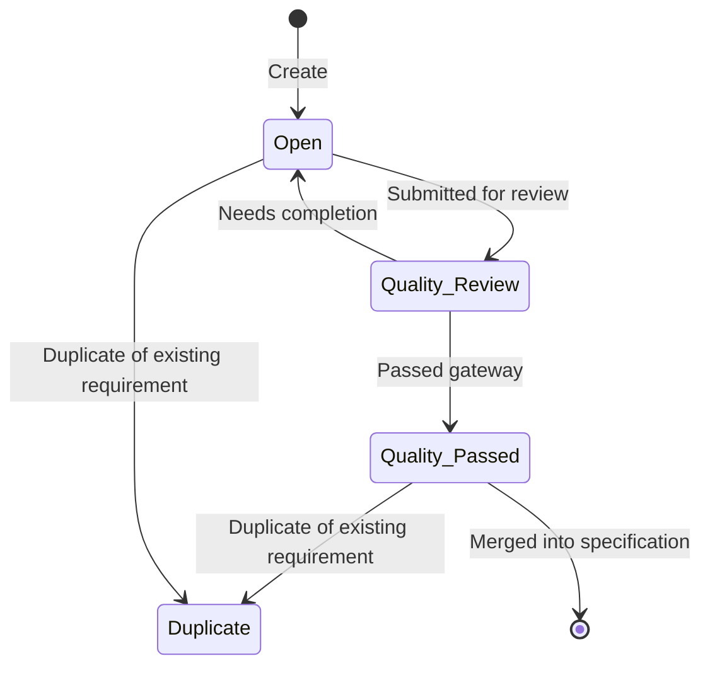
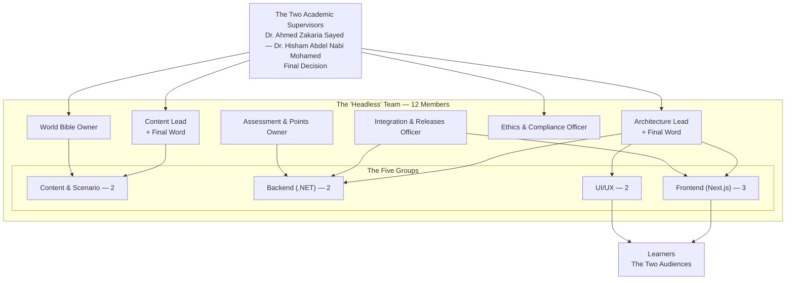
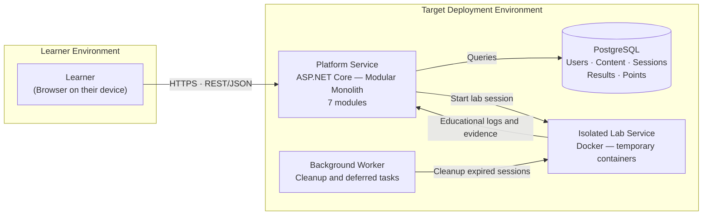
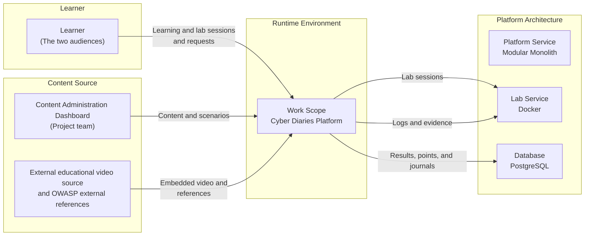
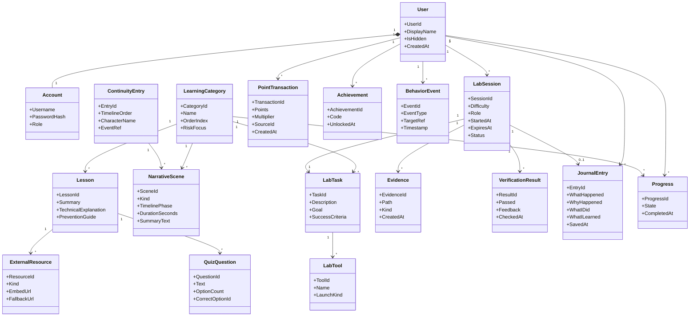
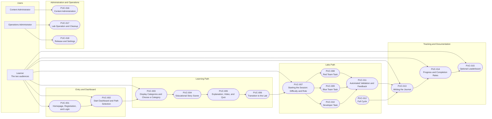

# Requirements Specification — MASTER

---
### Document Control

| Item | Value |
| --- | --- |
| Project Name | Cyber Diaries (يوميات سايبر) |
| Project Code | CDbHLT |
| Document ID | CDbHLT-REQ-SPEC-001 |
| Version | 0.1 |
| Status | Prototype — Single Source of Truth (SSoT) |
| Release Date | 26-10-2026 |
| Owner | HEADLESS Team |
| Reviewers | Dr. Ahmed Zakaria Sayed — Dr. Hisham Abdel Nabi Mohamed |

### Revision History

| Version | Date | Author | Changes | Status |
| --- | --- | --- | --- | --- |
| 0.0 | 26-10-2026 | Mohamed Ahmed Sayed Mohamed | Created | Prototype |
| 0.1 | | Mohamed Yasser | | |

### Abbreviations — see Section 4.1

| Abbreviation | Meaning |
| --- | --- |
| PUC | Product Use Case |
| BUC | Business Use Case |
| SUC | System Use Case |
| FR | Functional Requirement |
| NFR | Non-Functional Requirement |
| CR | Constraint Requirement |
| PAM | Purpose – Advantage – Measurement |
| MoSCoW | Must / Should / Could / Won't |

---

## How to Use This Template

### 1. Governing Principles (Volere Principles)

| Principle | Practical Application in This Template |
|---|---|
| **Description** | Restricted to stating the fact concisely — what the product must do. |
| **Rationale** | A debatable argument justifying the requirement's existence — tested in every review. |
| **Fit Criterion** | **Mandatory**: an executable test that determines whether the design fulfils the requirement. No fit criterion = vague requirement. |
| **Separation of problem and solution** | Sections 1–8 describe only the problem and its context. The solution is isolated in Section 27 (Ideas for Solutions). |
| **No mixing of requirement and solution** | In Section 9 (Functional Requirements), write "must allow" not "must use". |

### 2. Requirement Numbering System

| Prefix | Meaning | Range |
| --- | --- | --- |
| `[XX]-FR-###` | Functional Requirement | Section 9 |
| `[XX]-AP-###` | Appearance Requirement | 10.1 |
| `[XX]-ST-###` | Style Requirement | 10.2 |
| `[XX]-EU-###` | Ease of Use | 11.1 |
| `[XX]-PI-###` | Personalization & Internationalization | 11.2 |
| `[XX]-LN-###` | Learning | 11.3 |
| `[XX]-UP-###` | Understandability & Politeness | 11.4 |
| `[XX]-ACC-###` | Accessibility | 11.5 |
| `[XX]-SP-###` | Speed & Latency | 12.1 |
| `[XX]-SC-###` | Safety-Critical | 12.2 |
| `[XX]-PA-###` | Precision & Accuracy | 12.3 |
| `[XX]-RA-###` | Reliability & Availability | 12.4 |
| `[XX]-RB-###` | Robustness & Fault-Tolerance | 12.5 |
| `[XX]-CP-###` | Capacity | 12.6 |
| `[XX]-SE-###` | Scalability & Extensibility | 12.7 |
| `[XX]-LG-###` | Longevity | 12.8 |
| `[XX]-PE-###` | Physical Environment | 13.1 |
| `[XX]-IF-###` | Interfacing | 13.2 |
| `[XX]-PR-###` | Productization | 13.3 |
| `[XX]-RL-###` | Release | 13.4 |
| `[XX]-MT-###` | Maintenance | 14.1 |
| `[XX]-SPP-###` | Supportability | 14.2 |
| `[XX]-AD-###` | Adaptability | 14.3 |
| `[XX]-AC-###` | Access Control | 15.1 |
| `[XX]-IN-###` | Integrity | 15.2 |
| `[XX]-PV-###` | Privacy | 15.3 |
| `[XX]-AU-###` | Audit | 15.4 |
| `[XX]-IM-###` | Immunity | 15.5 |
| `[XX]-CU-###` | Cultural | 16.1 |
| `[XX]-CMP-###` | Compliance | 17.1 |
| `[XX]-SD-###` | Standards | 17.2 |
| `[XX]-CN-###` | Solution Constraint | 3.1 |
| `[XX]-BUC-###` | Business Use Case | 6.4 |
| `[XX]-PUC-###` | Product Use Case | 8.3 |
| `[XX]-UN-###` | User Need | Appendix A |
| `[XX]-RU-###` | Requirement for Use | Appendix A |

> **Rule:** A number is never reused. Cancelled requirements are marked `cancelled` and remain in the register to preserve the traceability chain.

### 3. Priority Coding (MoSCoW)

| Code | Meaning | Definition |
|---|---|---|
| **Must** | Mandatory | The release is not issued unless fulfilled. Absence fails the release. |
| **Should** | Recommended | Essentially important but can be deferred to a later release without failing this release. |
| **Could** | Optional | Implemented if time or space permits. Upgrade priority is lower than Must/Should. |
| **Won't** | Out of Scope | Explicitly will not be implemented in this release — documented in Section 26 (Waiting Room) with the target version. |

> **Methodological note:** The original template's pair of "customer satisfaction / dissatisfaction" was replaced with the MoSCoW system, because numerical satisfaction estimation causes confusion and is difficult to justify in review. Priority remains a **documented, debatable decision**, not an impression.

### 4. Requirement Lifecycle & Quality Gateway

Every atomic requirement passes through the following states. **A requirement is not approved in the specification until it passes the Quality Gateway.**



**Quality Gateway — Mandatory Passage Conditions:**

| # | Condition | Done ✓ |
| --- | --- | --- |
| 1 | Requirement is **atomic** — describes only one thing | ☐ |
| 2 | **Description** field is complete and direct | ☐ |
| 3 | **Rationale** field exists and answers "why?" | ☐ |
| 4 | **Fit Criterion** field exists and is **executable and measurable** | ☐ |
| 5 | **Source** is specified (where the need came from) | ☐ |
| 6 | **Dependencies and conflicts** are checked | ☐ |
| 7 | **Priority (MoSCoW)** is decided | ☐ |
| 8 | Traceable to a **User Need / Use Case** | ☐ |
| 9 | **Compliant with constraints** in Section 3 | ☐ |
| 10 | **Does not impose a technical solution** | ☐ |

### 5. Traceability Chain

Every atomic requirement must have a complete path from home to test:

```text
User Need                        [XX-UN-###]   ← Appendix A
        ↓
Requirement for Use              [XX-RU-###]   ← Appendix A
        ↓
Product Use Case (PUC)           [XX-PUC-###]  ← Section 8
        ↓
Atomic Requirement               [XX-XXX-###]  ← Sections 9–17
        ↓
Fit Criterion                                 ← Test
        ↓
Result / Verification Status                  ← Test Register
```

| Product Use Case (PUC) | Associated Atomic Requirements | Verification Status |
|---|---|---|
| [XX-PUC-000] | [XX-FR-000, ...] | [Covered / Partial / Not Covered] |
| [XX-PUC-000] | [XX-FR-000, ...] | [Covered / Partial / Not Covered] |
| [XX-PUC-000] | [XX-FR-000, ...] | [Covered / Partial / Not Covered] |

### 6. Writing Conventions

- Begin the description with a mandatory verb: "must", "shall be allowed", "shall be calculated".
- Avoid: "is", "is preferred" (a preference expression that cannot be tested).
- Avoid mentioning technology names, tools, or languages in Section 9 — place them in Section 3.1 or 27.
- Every number in brackets `([])` refers to a linked requirement or PUC.
- Write the fit criterion to answer the question: **"What do I do to prove this is fulfilled?"**
- The first row in every table: header row; the second: separator row `|---|---|`; then one empty row per row.

---
---
# 📋 Requirements Shell / Snow Card

> **How to use:** Copy the following block for each atomic requirement and place it in the appropriate section, or fill the consolidated table in Section 9.1 and Appendix D.
> The shell is based on the modified Volere template (requirements used in automated tools) with the two satisfaction estimates replaced by the MoSCoW system.

### Atomic Requirement Card — blank

| Field | Value |
|---|---|
| **Requirement No.** | `[XX-XXX-000]` |
| **Requirement Type** | `[Functional / Non-Functional / Constraint]` |
| **Priority – MoSCoW** | `[Must / Should / Could / Won't]` |
| **Associated Use Cases** | `[XX-PUC-000, XX-BUC-000]` |
| **Description** | [Write the requirement as a concise, specific fact — what the product must do] |
| **Rationale** | [Write the argument that justifies the requirement's existence, which is debatable in review] |
| **Source** | [Where the need came from: interview / context analysis / team decision / external standard] |
| **Fit Criterion** | [Write an executable and measurable test that proves fulfillment of the requirement] |
| **Dependencies** | [XX-XXX-000, ...] |
| **Conflicts** | [XX-XXX-000, ...] |
| **Supporting Materials** | [link / reference / appendix / image] |
| **History** | [Created: YYYY-MM-DD] · [Last modified: YYYY-MM-DD by: ...] |

### Atomic Requirement Card — blank (second copy for copy-paste)

| Field | Value |
|---|---|
| **Requirement No.** | `[XX-XXX-000]` |
| **Requirement Type** | `[Functional / Non-Functional / Constraint]` |
| **Priority – MoSCoW** | `[Must / Should / Could / Won't]` |
| **Associated Use Cases** | `[XX-PUC-000]` |
| **Description** | [ ] |
| **Rationale** | [ ] |
| **Source** | [ ] |
| **Fit Criterion** | [ ] |
| **Dependencies** | [ ] |
| **Conflicts** | [ ] |
| **Supporting Materials** | [ ] |
| **History** | [ ] |

---
---

# 📑 Table of Contents

| # | Section | Subsections |
| --- | --- | --- |
| **1** | The Purpose of the Project | 1.1 · 1.2 |
| **2** | The Stakeholders | 2.1 · 2.2 · 2.3 · 2.4 · 2.5 · 2.6 · 2.7 · 2.8 |
| **3** | Mandated Constraints | 3.1 · 3.2 · 3.3 · 3.4 · 3.5 · 3.6 · 3.7 · 3.8 |
| **4** | Naming Conventions and Terminology | 4.1 |
| **5** | Relevant Facts and Assumptions | 5.1 · 5.2 · 5.3 |
| **6** | The Scope of the Work | 6.1 · 6.2 · 6.3 · 6.4 |
| **7** | Business Data Model and Data Dictionary | 7.1 · 7.2 |
| **8** | The Scope of the Product | 8.1 · 8.2 · 8.3 |
| **9** | Functional Requirements | 9.1 · 9.2 · 9.3 · 9.4 |
| **10** | Look and Feel Requirements | 10.1 · 10.2 |
| **11** | Usability and Humanity Requirements | 11.1 · 11.2 · 11.3 · 11.4 · 11.5 |
| **12** | Performance Requirements | 12.1 · 12.2 · 12.3 · 12.4 · 12.5 · 12.6 · 12.7 · 12.8 |
| **13** | Operational and Environmental Requirements | 13.1 · 13.2 · 13.3 · 13.4 |
| **14** | Maintainability and Support Requirements | 14.1 · 14.2 · 14.3 |
| **15** | Security Requirements | 15.1 · 15.2 · 15.3 · 15.4 · 15.5 |
| **16** | Cultural Requirements | 16.1 |
| **17** | Legal Requirements | 17.1 · 17.2 |
| **18** | Open Issues | 18.1 |
| **19** | Off-the-Shelf Solutions | 19.1 · 19.2 · 19.3 |
| **20** | New Problems | 20.1 · 20.2 · 20.3 · 20.4 · 20.5 |
| **21** | Tasks | 21.1 · 21.2 |
| **22** | Migration to the New Product | 22.1 · 22.2 |
| **23** | Risks | 23.1 |
| **24** | Costs | 24.1 |
| **25** | User Documentation and Training | 25.1 · 25.2 |
| **26** | Waiting Room | 26.1 |
| **27** | Ideas for Solutions | 27.1 |
| **A** | Appendix A: User Needs & Requirements for Use | A.1 · A.2 · A.3 |
| **B** | Appendix B: Interview Template & Informed Consent | B.1 · B.2 · B.3 |
| **C** | Appendix C: Legislations and Standards Register | C.1 · C.2 |
| **D** | Appendix D: Master Requirements Register | D.1 · D.1.2 · D.2 · D.3 · D.4 · D.4.1 |

---
# Section One: The Purpose of the Project

> **Purpose of this section:** Define the driving force behind the project — why it was created, and what will change. This section justifies the existence of everything that follows, and is therefore reviewed at every review meeting.

## 1.1 Project Background (1a — The User Business or Background of the Project Effort)

**What you will write here:** A brief description of the existing work and its context, the problem that prompted the launch of this project, and the work the end-user intends to accomplish with the delivered product. Existing process models or samples of existing documents may be used.

| Item | Content |
| --- | --- |
| Current Work Today | Self-learning of web application security today rests on four scattered patterns: **(a)** reading technical documentation and references distributed across different sites and languages; **(b)** watching scattered educational videos and articles; **(c)** engaging in practical exercises in ready-made simulators or in non-isolated personal environments; **(d)** documenting what was learned in personal notes. **The executor in all cases is the learner himself** — there is no institutional body providing an integrated path, no dedicated isolated training environment, and no tool linking learning to professional context. The result is six observed problems: the theory-practice gap · content fragmentation · language barrier · disconnection from work context · absence of an integrated perspective · difficulty measuring genuine progress. (Project Description 3, 4) |
| The Problem / Opportunity | The problem is not a lack of vulnerabilities, but **the absence of an integrated cycle with real tools and within a work context**. Its details: **(1)** A learner may know the definition of SQL Injection without knowing how to discover it, interpret its impact, or fix it. **(2)** Content fragmentation across multiple sources with different languages and difficulty levels. **(3)** Language barrier: most advanced resources are in English. **(4)** Disconnection from work context: isolated exercises do not show the relationship between the software bug and the security incident and its impact. **(5)** Absence of an integrated perspective: discovering the vulnerability does not guarantee the ability to analyze its effects in logs or fix its cause. **(6)** Difficulty measuring genuine progress: completing a lesson or watching a video does not mean acquiring a practical skill. (Project Description 3) |
| Intended Use | The committed output, declared in advance (Project Description 16): **(1)** One cycle fully mastered — the Injection category with a limited SQL Injection scenario: a narrative scene in the Learning Path showing the protagonist before employment, then the explanation, the embedded external educational video, and the short quiz, then the story transitions temporally to the stage of the protagonist working at "NoorTech", the Lab opening, the transition scenes according to role, the three functions, the journal, and automated assessment. **(2)** The core user journey: the homepage, registration/login, the start dashboard, and choosing between the two paths. **(3)** Measuring the actual cost of the cycle in work hours per component. **(4)** Generalizing the template to additional categories according to remaining time after measurement. **(5)** An evaluation study on the prototype. **(6)** Technical and scientific documentation and a research paper. Platform outputs: a working platform, Arabic educational content, a practical lab, technical and scientific documentation, an evaluation study, and a research paper (Project Description 1). |
| Business Trigger | **Graduation Requirement:** Providing an **isolated Arabic security environment** for learning and assessment within the academic track, instead of relying on foreign simulators or non-isolated personal environments (`Data/data.md` 5). **Impact:** The driver is academic, not market-driven — so there is no revenue and no commercial success indicator, and the schedule is tied to the final delivery (3.6) and a financially zero budget (3.7). |

**Out of Scope of This Section:**

| Excluded | Reason |
|---|---|
| The imagined product (ten full categories) | Project Description 16 declares that **the committed deliverable for defense is one cycle**; the background therefore describes the project context as committed, not the full imagined product. |
| Technical details (technology and version selection) | Problem-solution separation principle: technologies and tools are documented in 3.1 and 3.4 and 27.1, and are not considered part of the "background". |

## 1.2 Project Goals (1b — Goals of the Project)

> **What you will write here:** Project goals in **PAM** format — Purpose, Advantage, Measurement. Every goal **must** be measurable; an unmeasurable goal is rejected.

**PAM Table:**

| # | Purpose | Advantage | Measurement | Goal Type |
|---|---|---|---|---|
| 1 | Enable the Arabic learner to master the **cycle** of handling a security problem in web applications — discovery, interpretation, treatment, documentation — not memorizing a vulnerability name | Linking narrative, lab, and real tools in one experience, instead of navigating scattered sources and languages; (the value realized upon success: a learner explains the problem, proves it, analyzes its evidence, fixes its cause, and documents it — Project Description 2) | Declared measurement tools: **pre-test, post-test, and delayed test where possible**, **behavioral data from within the platform**, **usability testing**, and **analysis of learner journals** (Project Description 0, 20.2). **Sample size: at least 10 participants (D16 — Owner Decision).** And **success threshold (approved in 0.5 — awaiting supervisor signature in 3.8):** improvement in the mean post-test score versus pre-test, measured **descriptively** (mean change · effect size · direction of results) not by a statistical significance test at this size. | Learning Goal |
| 2 | Transform the generalization decision from estimation to measurement: measure the actual cost of the first cycle before declaring the number of cycles | Transition from "how much do we need?" to a number of hours per component (content · scenes · lab setup · automated tests), making the scope declaration a responsible decision rather than a risk | **Actual work hours per component** (Project Description 16.3, 19). No final schedule is promised before this measurement is complete | **Measurement & Governance Goal** — a fifth type added in 0.5 because the four options in the template (service · revenue · legal · learning) do not include internal cost measurement |
| 3 | Enable generalizing a single template to other categories without building a new system for each category | Reinvesting the templates (narrative · desktop · lab tools · assessment) instead of manually repeating work for each cycle | **Template readiness for repetition:** running a cycle on a second category without architectural modification, with each component's cost shadowed between two cycles (Project Description 5, 16.4). The number of covered categories **is declared early with the supervisor**, not at the end of the project | **Service Goal** — the value appears when the template is reinvested for a second category |

**Definition of Goal Types:**

| Type | Definition |
| --- | --- |
| Service Goal | Its impact is measured on the user: what does the user buy from the service? |
| Revenue Goal | Measured by money or market share over a defined time span. |
| Legal Goal | Proving the product's conformity with a law or standard — not measured by a number. |
| Learning Goal | Proving a user's acquisition of a skill or specific understanding — measured by pre/post-test. |
| **Measurement & Governance Goal** | **A fifth type added in 0.5 (not in the template):** measured by an internal number for the team itself — work hours · component cost · quality — not by impact on a user or market. |

**Overall Goals Review (read at every review meeting):**
- [ ] All goals reviewed with stakeholders — ⏳ **Pending:** Approval after the first review session with the supervisor (depends on D5 and D6).
- [ ] Every goal has an associated measurement — every row in the PAM table above corresponds to a specific executable measurement (declared measurement tools · work hours · template readiness).
- [ ] Measurements are executable within project resources — ⏳ **Partially pending:** Sample size decided (n ≥ 10 — D16); measurement of the first cycle remains.

---

---

# Section Two: The Stakeholders

> **Purpose of this section:** Enumerate everyone with an interest in the product. Ignoring a stakeholder means losing requirements.

## 2.1 The Client

| Item | Content |
| --- | --- |
| **Name/Role** | **The two academic supervisors:** **Dr. Ahmed Zakaria Sayed** and **Dr. Hisham Abdel Nabi Mohamed** (`Data/data.md` 1), who hold the final decision on approving scope and freeze dates. **The names of the twelve team members and their specializations are documented** (`Data/data.md` 1: 3 Cybersecurity · 2 Back-End · 3 Front-End · 2 Content · 2 UI/UX = **12 members** (settled and unified across all documents: 12 members in five specialized groups). **The officially approved name (Owner Decision):** "Dr. Ahmed Zakaria Sayed" — unified in the document data and in `References.md`, so there is no conflict today. And **ownership of internal roles** (architecture lead · content lead · integration officer · world reference owner · risk register owner): **HEADLESS Team** as collective responsibility (D6 — Owner Decision). |
| **Institution** | **ASSIUT INTERNATIONAL TECHNOLOGICAL UNIVERSITY** (AITU) — **Egyptian German College of Technology (EGC TECH AITU)** — **Information Technology Department** (`Data/data.md` 1). |
| **Decisions Made** | **(1)** The experimental category **is settled by the release scope: Injection** — no decision needed. **(2)** Approving the target deployment environment (D2). **(3)** Approving the generalization scope and number of cycles — "the number is declared early with the supervisor, not at the end" (Project Description 16.4). **(4)** Approving lab values and digital performance objectives (D3 · D4). **(5)** Approving the legal basis and consent form before collecting participant data (D5). **(6)** Assigning roles by name within the team (D6). **(7)** Approving the freeze dates for content templates and scenario, because they are treated as official outputs (Project Description 18). |
| **Responsible for Final Acceptance** | **Yes — approved in 0.5.** Final acceptance of the **declared** scope: the single cycle (Injection) complete + the core user journey + cost measurement + the evaluation study + documentation and the research paper. **Rationale:** The "most important decision in this specification" is presented to them (Project Description 16) and the generalization scope is declared with them (16.4). **The source did not literally name them "final acceptor"** — it is established by supervisor signature in 3.8. |
| **Review Checkpoints** | **(1)** After approval of the release scope (the experimental category **Injection** is decided in advance) and before writing content — the start of Phase 2 of the work plan (Project Description 19). **(2)** At the **declared freeze dates** for the content template and scenario template — treated as official outputs (Project Description 18). **(3)** After **measuring the cost of the first cycle**: declaring the number of generalized cycles (Project Description 16.4, 19). **(4)** Before running participant data collection: approving the consent form and legal basis (D5). **Fixed dates:** Final delivery/defense **7-2027**, and freezing of content and scenario templates **two weeks before delivery** (`Data/data.md` 1). **Distribution of the four review checkpoints over a monthly calendar: [TBD — Requires Decision: detailed review calendar within the 2027 window].** |
| **Organizational Chart** | The structure is populated **by roles** below, and names are available (12 members — `Data/data.md` 1). **Decision (D6):** No individual naming per role — roles are managed as **collective responsibility of the HEADLESS Team**, so the chart shows the structure not its owners. |
| | |

**Organizational Chart by Roles (no names — awaiting D6):**



> **Note:** The source mentions "Integration & Releases Officer", "Architecture Lead", and "Content Lead" **without names** (Project Description 18, and alert register C12 in the requirements map). **The risk register owner, the Gamification unit owner, and the ethics officer are derived roles** not named by the source — and **all were assigned to the HEADLESS Team** (Owner Decision — D6), so they are no longer pending individual naming.

## 2.2 The Customer

| Item | Content |
| --- | --- |
| **Who buys or adopts the product** | **There is no commercial buyer in this project.** Three parties must be distinguished: **(a) The beneficiary of use** = the learner — computer students and junior web developers, and those interested in cybersecurity without a programming background (Project Description 1). **(b) The recipient of outputs** = the academic body to which the platform, documentation, evaluation study, and research paper are delivered. **(c) Operational users** = the project team (12 members). |
| **Decisions Made** | The learner: choosing the path (learning / labs) · choosing the category · choosing the difficulty level · choosing the role · skipping scenes · writing journals. **No content is opened or blocked by points** (Project Description 12). |
| **Review Checkpoints** | **Exploratory trial with 5–10 students**: observing educational and technical problems, **measuring completion time**, evaluating **clarity of story, transitions, and tools**, and determining what to simplify before generalization (Project Description 19, Phase 6). **Timing:** After completion of the first cycle (Phase 6) and within the window before final delivery **7-2027**; **the specific day [TBD — Requires Decision: Phase 6 calendar].** **A deliberate difference:** The exploratory trial = **5–10 students** (Project Description 19), whereas **the study sample = n ≥ 10** (D16 — Owner Decision); the study may include the same participants or add sessions, and this does not change the description of the exploratory trial. |
| **Note** | In internal development, the client (2.1) may be the buyer (2.2) — clarify this. **Clarification:** This is a graduation project with no contractual relationship, and the nature of the relationship is **an academic work plan**, not a deal. Therefore: **the client (2.1) = the academic supervisor**, and **the buyer (2.2) = the academic body receiving the outputs**, and **the end user (2.4) = the learner**. There is no conflict between 2.1 and 2.2 because they are not buying a service but supervising the completion of outputs. |

## 2.3 Other Stakeholders

| # | Role / Description | What the project needs from them | Participation Degree | Influence Degree | How Conflicts Are Managed |
| --- | --- | --- | --- | --- | --- |
| 1 | **Architecture Lead** | Documented architectural decisions · Lab service boundaries and responsibilities · Lab values and session durations · Assignment of Backend, Frontend, and Lab tasks | High | High | "An architecture lead and a content lead have a **declared final word**, not merely coordination" (Project Description 18) · API contracts agreed before distributing implementation (18) |
| 2 | **Content Lead** (Content & Scenario — 2 members) | Lessons · Scenario · Hints · Questions · Journals · References · Templates repeatable across the ten categories | High | High | Declared final word (18) · Declared freeze dates for content and scenario templates treated as official outputs (18) |
| 3 | **Integration & Releases Officer** | Tracking what is complete, pending, and blocked · Shared test environment · Status register per batch | Medium | High | "Periodic integration of small parts and a shared test environment" (18) · Early API contracts (21) |
| 4 | **World Bible Owner** | One file documenting the order of the two phases, the timeline (learning ← employment ← company growth), the protagonist's and characters' development, and the events of each cycle | Medium | High | "One file ... **with one owner** and declared freeze dates, so that writing scenarios by multiple hands does not produce contradictions" (8.1) |
| 5 | **Assessment & Points Owner** (Assessment + Gamification) | Automated verification rules per role · Points economy · Documented definition of "completion rate" | Medium | Medium | **HEADLESS Team** (collective responsibility — D6). Separation between them: assessment corrects, points encourage (12) |
| 6 | **Ethics & Compliance Officer** | Legal basis for data collection · Consent form · Data retention policy · License review | Low | High | **[TBD — Requires Decision — D5: Legal basis and university approval]** — **Consent form available**: "verbal/written acknowledgment from participating students" (`Data/data.md` 5), but **the legal basis and institutional approval** are not documented. Collection of data on participants is prohibited before the form is approved (22) |
| 7 | **Participants in the exploratory trial (5–10 students) — and the study sample n ≥ 10 (D16)** | Clarity of story, transitions, and tools · Completion time · Recurring errors · Linking hint usage to completion rate | Medium | High | Their feedback may demand change after the freeze date — the governing principle: "what is sacrificed under time pressure is the declared number of cycles, **not the lab's security nor the assessment's quality**" (16) |
| 8 | **Defense Committee / Academic Evaluators** | Matching what was accomplished with what was declared · Acceptance of the platform, documentation, study, and research paper | Low | High | **[TBD — Requires Decision: Defense committee names to be announced by the university before the defense]** Managed by clarifying the scope of outputs declared in advance (16) |

> **Note on participation degree and influence degree:** The values above are **team estimates** (not conveyed by the source) — because the source describes roles and responsibilities but **does not estimate a participation degree or influence degree** for any of them. They are approved at the first stakeholder review meeting.

**Quick stakeholder checklist (use as a checklist):**
`Client/Sponsor` (see 2.1) · `Buyer` (see 2.2) · `Subject matter experts` · `General public` · `Users of the existing system` · `Marketing experts` · `Legal experts` · `Domain experts` · `Usability experts` · `Representatives of external associations` · `Business analysts` · `Designers and developers` · `Testers` · `Systems engineers` · `Software engineers` · `Technology experts` · `Systems designers`

**Applying the checklist to this project:**

| Checklist Item | Applies? | To Whom |
|---|---|---|
| `Client/Sponsor` | Yes | The academic supervisor (2.1) |
| `Buyer` | Yes (in the sense of the academic recipient body) | 2.2 |
| `Subject matter experts` | Yes | The Content Lead and their group (3 members) |
| `General public` | Yes | The additional audience — interested persons without a programming background |
| `Users of the existing system` | **Does not apply** | There is no existing system — the project is entirely new |
| `Marketing experts` | **Does not apply** | There is no commercial product nor market in the specification |
| `Legal experts` | **Does not apply** | The source does not mention legal consultation; ethics is covered by the "Ethics Officer" (D5) |
| `Domain experts` | Yes | The Architecture Lead and systems/software engineers |
| `Usability experts` | **Partial** | Exploratory trial with 5–10 students (Phase 6) |
| `Representatives of external associations` | **Does not apply** | The source does not mention associations or representative parties |
| `Business analysts` | **Does not apply** | There is no business analysis or market requirements in the specification |
| `Designers and developers` | Yes | 5 groups: Cybersecurity (3) · Backend (2) · Frontend (3) · Content (2) · UI/UX (2) |
| `Testers` | Yes | Participants in the exploratory trial |
| `Systems engineers` · `Software engineers` · `Technology experts` · `Systems designers` | Yes | The Architecture Lead and the Lab/DevOps group |

## 2.4 The Hands-On Users of the Product

> **What you will write here:** Target user classes. For each class: role and responsibilities, subject-matter experience (beginner / intermediate / expert), technical experience (beginner / intermediate / expert), and other characteristics affecting requirements (physical and mental abilities, attitude toward the profession, attitude toward technology, geographic location, education, language skills, age group, gender, motivation).

| # | User Class | Role and Responsibilities | Subject-Matter Experience | Technical Experience | Other Characteristics Affecting Requirements | Representative |
|---|---|---|---|---|---|---|
| 1 | **Primary Audience** — computer students and junior web developers | Learns the category's concept in the Learning Path, then tests it practically in the Labs Path | Web application security: **Beginner** (knows the definition of the vulnerability without knowing how to discover it, interpret its impact, or fix it — 3) | Programming and web: **Beginner to Intermediate** — "have the basics of programming and web" (1) **(team estimate derived from the source — reviewed with the supervisor)** | Enters through the introductory content · understands Arabic with an English term when needed · self-learner without institutional pressure or mandatory schedule | **Actual participants from the same class** — exploratory trial 5–10, and study sample **n ≥ 10** (D16); the invitation and selection mechanism is documented in the study plan (20) |
| 2 | **Additional Audience** — those interested in cybersecurity without a programming background | Enters through the introductory content in the Learning Path; differs from the primary audience in needing term explanation and example code | Web application security: **Beginner** | **Beginner — no programming background** | Entry through the introductory content (1) · cannot modify code · **Settled (D8): receives an independent simplified path** | **Persona 2 — Sarah** (2.5): represents this segment descriptively, not by name |
| 3 | **Learner in the lab in the Red Team role** | Searches for the problem and answers safely within the lab scope; measured by the discovered security result, not merely finding a hidden text (6.1) | In the category under training: **Beginner to Intermediate** | **Intermediate** — uses discovery and request-sending tools: `curl`, browser developer tools, `nmap` when needed (13) | Few and specific tools only according to role (13) · difficulty level determines the amount of hints, not the vulnerability type (11) · the other two roles' tools do not appear | **No separate class** — the role is a **usage pattern** within the lab, represented by the same participants in the primary class (Persona 1) |
| 4 | **Learner in the lab in the Blue Team / SOC role** | Examines evidence and logs, links events, and determines the activity and affected asset; measured by a two-to-three-step inference chain (6.1) | In the category under training: **Beginner to Intermediate** | **Intermediate** — `grep` and `tail` for log analysis, `Adminer` for browsing the experimental database (13) | Declared design risk: slipping into a "reading exam" — prevented by a genuine inference chain (6.7) | **No separate class** — the role is a **usage pattern** within the lab, represented by the same participants in the primary class (Persona 1) |
| 5 | **Learner in the lab in the Developer role** | Determines the root cause, fixes it, and verifies the integrity of the fix; measured by automated tests that prove the problem, prevent the insecure state, and preserve legitimate functions (6.1) | In the category under training: **Beginner to Intermediate** | **Intermediate** — `Monaco Editor` for editing code in the treatment phase (13) | Why three different roles in one lab? Because roles are measured by different criteria — see BR-17 | **No separate class** — the role is a **usage pattern** within the lab, represented by the same participants in the primary class (Persona 1) |

> **Interpretive note:** Rows **3, 4, and 5 are not separate user classes** but **usage patterns within the lab** that Section 2.4 branches into depending on the chosen role (6.1), because the role changes the available tools, the task type, and the assessment criterion. Rows **1 and 2**, however, are the two actual audiences defined in Project Description 1.

**Verification questions for a "Yes" answer:**
- [x] Is the primary user occasional or frequent? → **Occasional**: usage is intermittent in separate learning and lab sessions; no daily session is imposed, and the work cycle is self-driven without an institutional schedule.
- [ ] Will users from outside the institution use the product? → **Expected yes** (the additional audience and any Arabic learner) — **[TBD — Requires Decision: Is deployment open to the public or restricted to the experimental batch?]**
- [x] Is it used via phone, remote connection, or network connection? → **Via network connection, and possibly remote**: the lab runs in containers on a server and the learner accesses it via browser. **Phone support: deferred** — determined with browser specifications after build completion (D12).
- [ ] Will children, the elderly, or people of another language use it? → **[TBD — Requires Decision: The source does not mention an age audience or other languages, and the first scope is Arabic. Decision: confirm the target age audience, and whether a second language will be supported later.]**
- [ ] Will some tasks be restricted by physical ability, calories, or access? → **[TBD — Requires Decision: Accessibility scope in the first release is not specified in the source (see D9 and Section 11.5).]**

## 2.5 Personas

> **What you will write here:** **A maximum of three personas.** A fictional persona telling a complete life story: name, age, job, family, hobbies, place of residence, favorite food and music, what they like and dislike, vacation destinations, attitude toward technology, attitude toward money — and any other characteristic affecting how the person thinks about the product. Attach an image or drawing of the persona.

> **Methodological alert (necessary before filling):** The narrative characters in the project description — the protagonist "Sabir", the manager, the developer colleague, the Blue Team/SOC colleague, the Developer colleague, the support employee, the customers, the antagonist (8.2) — are **narrative world characters** designed to serve the story, not Personas. The Persona here is a design tool for understanding the **target learner** (2.4) and is derived from the **two audiences**, not from the narrative thread. Mixing the two levels corrupts requirement traceability. Consequently, **the number of personas = 2** (two audiences), not 9.

#### Persona 1 — Ahmed, the Technical Learner (Primary Audience)

| Item | Content |
|---|---|
| **Name** | **Ahmed** (`Data/data.md` 4 — Persona 1) |
| **Age** | **21 years** (`Data/data.md` 4) |
| **Job / Role** | Computer student or web developer in early career; spends time between lectures and side projects |
| **Place of Residence** | **Cairo** (`Data/data.md` 4) |
| **Background and Education** | Basics of programming and web; studies web application security within courses or self-taught (Project Description 1) |
| **Domain Experience** | **Beginner** in web application security: knows the definition of SQL Injection but not how to discover it, interpret its impact, or fix it (Project Description 3) |
| **Technical Experience** | **Beginner to Intermediate** in programming and web **(team estimate derived from "basics of programming and web" — reviewed with the supervisor)** |
| **Language Skills** | Excellent Arabic; reads MSA explanation faster than English, and needs the English term explained at first occurrence (1) |
| **Family** | **[TBD — Requires Decision: not mentioned in `Data/data.md` 4; written in the design session]** |
| **Hobbies and Interests** | **Games and hackathons** (`Data/data.md` 4) — i.e., he reaches technology through collective experience and competition, not reading alone |
| **How He Views Technology** | **Sees security as mysterious and needing simplification** (`Data/data.md` 4): a door he doesn't know where to start from, not a tool for hacking |
| **What Annoys Him in the Proposed Product** | Navigating multiple sources and languages · being asked for a vulnerability name instead of understanding it · any interface that floods him with tools he doesn't need for his task (4.3.7, 13) |
| **Image** | **[TBD — Requires Decision: produced in the design session]** |
| **Behaviors This Design Assumes** | Opens the platform in intermittent, not daily, sessions · reads the explanation before the scenes · uses expanded hints then gradually reduces them · writes journals after each cycle because journals are part of the cycle, not an addition · usually chooses **one role**, not the full cycle · looks for a clear "next step" |

#### Persona 2 — Sarah, the Interested Person Without a Programming Background (Additional Audience)

| Item | Content |
|---|---|
| **Name** | **Sarah** (`Data/data.md` 4 — Persona 2) |
| **Age** | **24 years** (`Data/data.md` 4) |
| **Job / Role** | **[TBD — Requires Decision: not mentioned in `Data/data.md`]** — enters through the introductory content in the Learning Path (Project Description 1) |
| **Place of Residence** | **Alexandria** (`Data/data.md` 4) |
| **Background and Education** | **[TBD — Requires Decision: not mentioned in `Data/data.md`]** — only confirmed that she is **without a programming background** (Project Description 1) |
| **Domain Experience** | **Beginner** — motivation is intellectual (information security), not professional |
| **Technical Experience** | **Beginner — no programming background** (Project Description 1) |
| **Language Skills** | Arabic; reads the simplified explanation without code, and relies on textual explanation and video instead of application (3) |
| **Family** | **[TBD — Requires Decision: not mentioned in `Data/data.md` 4]** |
| **Hobbies and Interests** | **Reading** (`Data/data.md` 4) — a preference for written content that justifies textual explanation and summaries |
| **How She Views Technology** | **Fears technical details and needs simplified explanation** (`Data/data.md` 4) |
| **What Annoys Her in the Proposed Product** | Code without explanation · a term without an example · a path that imposes what she doesn't understand · tests that frustrate her without a hint |
| **Image** | **[TBD — Requires Decision: produced in the design session]** |
| **Behaviors This Design Assumes** | Reads the educational page fully before any interaction · relies on introductory content and explained terms · **does not enter the Labs Path unless she sees a simplified path** — and this is precisely why decision D8 was opened · needs a brief definition before each function (mitigating learner distraction) |

#### Persona 3 — Not Used (Established Decision: Only Two Personas)

| Item | Content |
|---|---|
| **Status** | **No third persona — settled** (`Data/data.md` 4 defines only two personas, and the project source defines two audiences). The third row in the template remains reserved for any third segment **if declared later**, and its addition requires first defining the third audience or segment within the additional audience. |

> **How to present the persona in meetings:** Print this persona in A3 size and display it at every review meeting to remind attendees that we are discovering requirements for **these specific** people.

## 2.6 Priorities Assigned to Users

> **What you will write here:** Assign a priority to each user class. Unimportant classes include rare users, unauthorized users, non-experts, and product abusers.

| # | User Class | Classification | Percentage | Number of Associated Requirements | Notes |
|---|---|---|---|---|---|
| 1 | Primary Audience — computer students and junior web developers | **Key** — classification matches `Data/data.md` 5 | **70%** (declared distribution — `Data/data.md` 5) | **19 direct functional requirements** (`FR-001`…`FR-003` · `FR-008`…`FR-023`) + `FR-007` (pending) + `FR-025` (account deletion, shared) | Declared distribution: **70%** (`Data/data.md` 5) — based on both audiences entering from the same gateway while the additional audience enters only through introductory content (1) |
| 2 | Additional Audience — interested persons without a programming background | **Secondary** — classification matches `Data/data.md` 5 | **30%** (declared distribution — `Data/data.md` 5) | **Two functional requirements** (`FR-024` independent simplified path by virtue of D8 · `FR-025` account deletion, shared) | Declared distribution: **30%** (`Data/data.md` 5) — settled by an independent simplified path (closed decision D8) without burdening the main path's technical interface |
| 3 | — | Unimportant | **Does not apply — no such class** | 0 | The source does not target any unimportant class; all target classes are within scope. **Applied conflict resolution rule:** when a conflict arises between a secondary user requirement and a primary user requirement — **the request returns to the primary user requirement** |
| 4 | — | — | — | — | **Does not apply** — no other target user classes in the first release. The row is re-evaluated upon category generalization (Section 26) |

## 2.7 User Participation

> **What you will write here:** The type of participation expected from each class, and the estimated time they will spend. Many projects fail due to lack of user participation — declare this from the start.

| # | User Class | Expected Participation Type | Expected Knowledge from Them | Estimated Time | Number of Sessions |
|---|---|---|---|---|---|
| 1 | Primary Audience (computer students and junior developers) | **Testing** + **Requirements for Use** — testing the interface and narrative with a small group and documenting observations (Fit Criterion 19), with an engagement and usability questionnaire (20.2) | Clarity of story, transitions, and tools · completion time · recurring errors · any task that confuses them | **[TBD — Requires Decision: the source provides no time estimate]** | **[TBD — Requires Decision: number of sessions and duration of each is determined in the exploratory study design]** |
| 2 | Additional Audience (without a programming background) | **Testing** + **Requirements for Use** — included in the exploratory trial and the study (n ≥ 10), after settling D8 with an independent simplified path | Clarity of the simplified path · completing the lesson without assistance · understanding the term without code | **[TBD — Requires Decision: duration of this segment's session]** | At least one session |
| 3 | Academic Supervisor | **Domain knowledge / Requirements for Use** — reviewing the declared scope, the Learning Path content, and the content and scenario templates before the freeze dates | Suitability of outputs to the declared scope · clarity of the defect and criterion · readiness of content for review | **[TBD — Requires Decision: estimated time for supervisor reviews is not mentioned in the source — estimated with the supervision committee]** | **[TBD — Requires Decision: number of reviews linked to the declared freeze dates (CN-016)]** |

## 2.8 Maintenance Users and Service Technicians

| # | Role | Responsibilities | Affecting Characteristics | Expected Requirements |
| --- | --- | --- | --- | --- |
| 1 | **Lab / DevOps Engineer** (2 from the Cybersecurity group) | Docker · experimental applications · security isolation · deployment and monitoring · container lifecycle and automatic cleanup (Project Description 18, 14) | Works on an isolated architecture; requests come from the platform not from users; any error here directly affects lab security | **Referred to 14.1 and 15.1:** container lifecycle management · isolation settings, resource limits, and duration · automatic cleanup · monitoring · re-initialization · session log |
| 2 | **Integration & Releases Officer** (from Backend / Lab) | Tracking what is complete, pending, and blocked · release management · API contracts · content dashboard settings (assessment criteria, points economy, difficulty levels) (Project Description 18) | Needs each batch's outputs documented and a shared test environment; updating settings must not affect code (CN-009) | **Referred to 13.4 and 14.1:** status register per batch · shared test environment · settings updatable without touching code · API requirements documentation |

> **Owner (D6):** Both roles are assigned to the **HEADLESS Team** as collective responsibility — no individual naming.

---

---

# Section Three: Mandated Constraints

> **Purpose of this section:** Constraints are general — factors applying to the entire product. Constraints are written **in the same atomic requirement template** (description + rationale + fit criterion), because writing them as general rules hides false constraints (a technical solution disguised as a constraint).

## 3.1 Solution Constraints

> **What you will write here:** The imposed technology or solution, with version number if any, and the reason for imposing it. **Alert:** Any technology imposed here must be non-negotiable — otherwise it is **not a constraint** but a solution name. Constraints that can be broken with client permission are documented here with the condition stated.

| Requirement No. | Description | Rationale | Fit Criterion | Non-Negotiable? | Source |
|---|---|---|---|---|---|
| `CDbHLT-CN-001` | The platform modules (Identity · LearningContent · Labs · Assessment · Progress · Gamification · Administration) must be built in a single runnable **Modular Monolith** architecture, not independent services | "Modular Monolith not Microservices: development and integration speed suited to a graduation team, with clear module boundaries testable" | Build and test succeed as one unit, and the number of services deployed in the deployment environment = 1, except for the Lab service by virtue of CN-002 | **No** — breakable with client permission in exchange for documenting the impact on integration and testing | Project Description 14 |
| `CDbHLT-CN-002` | The **Lab service must be separate from the API process**, and no user command may be executed within the API process | "Running untrusted code is a security matter different from managing users and content" | An attempt to execute a user command via the API path is not executed within the process but routed to the isolated Lab service; a lab test proves rejection of direct execution | **Yes** — a security constraint not breakable with client permission | Project Description 14, 21 |
| `CDbHLT-CN-003` | Each lab environment must operate within a **temporary, network-isolated container with limited privileges**, and be destroyed automatically after session end | "Temporary isolated containers ... destroyed after the session", and "labs are not used to target any real system" | After session end or session timeout, the container is destroyed and no trace of the learner remains in the lab environment; removal is verified by the container log | **Yes** | Project Description 14, 22 |
| `CDbHLT-CN-004` | The embedded tools must be **prevented from exiting the lab scope** | "It is ensured that their execution does not allow exiting the lab scope" | A misuse test proves that any outgoing path from the tools does not reach an external network nor outside the lab scope | **Yes** | Project Description 13, 21 |
| `CDbHLT-CN-005` | **All points and achievements must be calculated on the server** via automated verification; no calculation from browser data is accepted, with duplicate calculation of the same achievement prevented | "Basic rule: all points and achievements calculation on the server via automated verification, nothing calculated from browser data, with duplicate calculation prevented" | (a) Modifying the server response within the browser changes no point or achievement; (b) sending a duplicate request for the same achievement does not double it; (c) an automated test proves both rules | **Yes** — security and integrity | Project Description 12, 21 |
| `CDbHLT-CN-006` | Interfaces must be built **REST first**, and GraphQL is not added unless need proves its value | A settled architectural decision declared by the source | All endpoints available in the first release are REST/JSON, and no GraphQL interface exists; any future addition is closed behind a documented decision | **No** — breakable with client permission in exchange for documenting the proven need | Project Description 14 |
| `CDbHLT-CN-007` | All embedded tools must be **real, ready-made tools**, and no security tool may be developed from scratch within the project unless no ready-made alternative fulfilling the purpose exists | "All tools are real and ready-made, integrated not built from scratch"; the exception rule is conditional on absence of a ready alternative | The inventory of embedded tools in each lab shows every tool is a ready-made installed and license-reviewed component, and the labs contain no internally developed tool | **No** — conditional on the exception rule and a documented decision | Project Description 13, 16 |
| `CDbHLT-CN-008` | The **desktop in the lab must be an interactive interface only** — not an operating system and not a virtual machine | "The desktop is an interface only — as an interactive image for accessing tools"; it is an explicitly out-of-scope item | The learner cannot install programs or modify the system; all tools open through the dedicated page interface | **Yes** | Project Description 13, 16 |
| `CDbHLT-CN-009` | The **content administration dashboard** must allow adding categories, lessons, and scenarios without modifying code, with strict separation between textual content and lab operation settings | A settled architectural decision, and a condition for generalizing the template to additional categories | Adding a category, lessons, and a scenario from the administration dashboard appears in both paths without any software deployment; lab operation settings are not modifiable from the same dashboard | **No** — modifiable by documented decision | Project Description 14, 16 |
| `CDbHLT-CN-010` | The **educational story scene in the Learning Path must occur in the pre-employment phase**, and lab events must occur **after the protagonist joins "NoorTech"**, with this chronological sequence preserved | "The order of scenes must preserve this chronological sequence so that it does not appear that the protagonist works at NoorTech before joining it" | A narrative review of each scene in both paths proves no scene places the protagonist inside the company as an employee before joining; the result is documented in the World Bible | **Yes** | Project Description 4.4, 8.1, 21 |
| `CDbHLT-CN-011` | Each security category must adopt **one security scenario** in which the three roles participate: the problem discovered by Red Team is the same whose effects appear in Blue Team evidence, and the root cause treated by Developer is linked to the same incident | "This avoids building three separate experiences per category, and preserves the interconnectedness of knowledge between discovery, investigation, and treatment" | For each generalized category, a file links one incident to the evidence of the three roles; each role's specification refers to the same incident | **No** — reviewable by architectural/content decision | Project Description 6.4, 6.6 |
| `CDbHLT-CN-012` | Exploitation content must be formulated **within a defensive educational framework**, not rising to a ready-to-copy offensive playbook | "Content is formulated within a defensive educational framework at a level not rising to an offensive playbook"; and the rule "the summary does not reveal assessment answers or ready solution steps" | Content review of each category is based on the "no ready solution steps" rule; and it is verified that the application available within the lab does not produce steps copyable outside the lab | **Yes** | Project Description 4.5, 22 |
| `CDbHLT-CN-013` | **Names and characters** within the platform and narrative must be entirely fictional, and must not refer to existing entities | "Entirely fictional names and characters not referring to existing entities" | Review of narrative and material entities before publication proves they are free of real names | **Yes** | Project Description 22 |
| `CDbHLT-CN-014` | **Educational logs** must not contain personal information or secrets | "No personal information or secrets within educational logs" | Review of a sample of logs actually produced in the lab negates the presence of personal data or secrets | **Yes** | Project Description 22 |

**Verification questions before approving a constraint:**
- [x] Can other solutions compatible with the constraint be imagined? If yes → it is not a constraint, reclassify it. → **CN-002 · CN-003 · CN-004 · CN-005 · CN-008 · CN-010 · CN-012 · CN-013 · CN-014: No** (non-negotiable security, ethical, or narrative constraints). **CN-001 · CN-006 · CN-007 · CN-009 · CN-011: Yes**, but with declared architectural or content-shortcut constraints — therefore they remain **documented constraints**, not solution names, and have explicit break conditions in the "Non-Negotiable?" column.
- [x] Does the constraint affect the entire product or specific use cases? → **All constraints apply to the entire product** (architectural/ethical), except **CN-007 and CN-011**, which constrain content not the platform.
- [x] Is there a leverage for a solution in Section 27? → **No** — no solution was transferred to 27.1 in this draft; what is listed above are constraints only, not design options.

## 3.2 Implementation Environment of the Current System

> **What you will write here:** The technical and physical environment in which the product will be installed: devices, systems, operations, roles, and adjacent non-human systems.



| # | Component | Type | Description | Available? | Notes |
|---|---|---|---|---|---|
| 1 | The learner's browser and device | Software / Physical | Access via HTTPS to the deployment environment; nothing is installed on the learner's device except the browser | Yes (browser available) | **Chrome and Edge — the last two versions** (`Data/data.md` 2). **Operating system, minimum screen resolution, and RTL behavior: determined after build completion (D12)** |
| 2 | Deployment environment (server/hosting) | Software | The server on which the platform service and lab service run | **Free cloud hosting (Oracle Cloud Free or Render) or the university server** (D2 — Owner Decision); **the final provider is chosen at deployment** | Mandatory condition on any provider: Docker/containers support + HTTPS + 2GB RAM per container; defined by 13.3, 14.2, and 22.1 |
| 3 | Platform Service — ASP.NET Core | Software | Modular Monolith with modules: Identity · LearningContent · Labs · Assessment · Progress · Gamification · Administration | Yes (settled architectural decision) | Version **.NET 10** (`Data/data.md` 2) — established at implementation start (D17) |
| 4 | PostgreSQL Database | Software | Users · Content · Sessions · Results · Points | Yes (settled decision) | Version **16** (`Data/data.md` 2) · detailed schema in Section 7 |
| 5 | Docker Engine + Lab Service | Software | Building and running isolated containers, their experimental applications, and tools | Yes (settled decision) | Complies with CN-003 and CN-004 |
| 6 | Background Worker | Software | Cleanup and deferred tasks | Yes (mentioned in the architecture tree) | Complies with CN-003 (automatic cleanup) |
| 7 | Existing system to migrate to | — | **None** — the project is new without an existing system | No | This is the reason 22.1 (migration) is considered inapplicable |

> **Interpretive note on this section:** There is no "existing system" whose environment is analyzed in this project; therefore **the observed current situation is the learner's current situation** (the six problems in 3 of the project description, documented in 6.1), and the table above describes **the environment in which the platform will be installed** as defined in 14. This is the direct reason Section 22 (Migration) is considered inapplicable to the project.

## 3.3 Partner or Collaborative Applications

> **What you will write here:** Applications that are not part of the product but with which it collaborates. Mention the specifications of each interface affecting the product.

| # | Partner Application | Owner | Nature of Collaboration | Affecting Interfaces | Generated Requirements |
|---|---|---|---|---|---|
| 1 | **External educational video source** | **[TBD — Requires Decision: the team selects material from a "trusted source", and the source determines the type without naming a specific site. Decision: selecting the source and material for each category]** | Content collaboration: the team selects the material and republishes it embedded within the category page | Embedded video player + **direct fallback link** displayed when embedding fails (Project Description 5.7, 8.3) | **[Deferred — filled at Sections 9 and 11]** |
| 2 | **OWASP documentation** (Top 10:2025 · WSTG · Cheat Sheet Series) | OWASP | External references: **three links per category** displayed as trusted sources (Project Description 5.9) | Sources section in the category page | **[Deferred — filled at Section 9]** |
| 3 | **Experimental lab applications** | Project team (Lab/DevOps) | **Not a partner application** — owned by the project and entirely fictional ("All target applications for training are fictional and owned by the project"), listed here to show their boundaries | Lab interface: `ttyd` · `Monaco Editor` · `Adminer` | `CDbHLT-CN-001` … `CDbHLT-CN-014` |

> **There are no institutional partner applications** — no learning management system, no university registration portal, and no support ticket system. Therefore "partner application" in this project is confined to **an external content source** and **internal experimental applications owned by the project**.

## 3.4 Off-the-Shelf Software

> **What you will write here:** Ready-made components or systems (commercial or open source) that will be used to implement some requirements. Their characteristics and interfaces are **design constraints**.

| # | Ready-Made Component | Type/Source | Version | License | Intended Use | Affecting Interfaces | Notes |
|---|---|---|---|---|---|---|---|
| 1 | `ttyd` | Open-source tool | **Installed after build completion** (deliberate deferral — D17) | **HEADLESS Team** — documented in the license register | Web terminal connected to the lab container | Terminal interface within the workspace | No ready alternative with the same purpose ⇒ covered by CN-007 |
| 2 | `Monaco Editor` | Open-source library | **Installed after build completion** (deliberate deferral — D17) | **HEADLESS Team** — documented in the license register | Code editing in the treatment phase (Developer) | Code editor within the workspace | Integrated into the frontend (React/Next.js) |
| 3 | `Adminer` | Open-source tool | **Installed after build completion** (deliberate deferral — D17) | **HEADLESS Team** — documented in the license register | Browsing the experimental database (Blue / Developer) | Database interface | On the experimental lab database only |
| 4 | `curl` | Ready-made command-line tool | **Installed after build completion** (deliberate deferral — D17) | **HEADLESS Team** — documented in the license register | Sending requests and examining responses (Red Team) | Terminal | Restricted to the lab scope (CN-004) |
| 5 | `nmap` | Ready-made tool | **Installed after build completion** (deliberate deferral — D17) | **HEADLESS Team** — documented in the license register | Limited scanning within the lab scope when needed | Terminal | **Explicitly restricted to the lab scope** (CN-004) |
| 6 | `GPG` | Ready-made tool | **Installed after build completion** (deliberate deferral — D17) | **HEADLESS Team** — documented in the license register | Signing and verification operations in their scenarios | Terminal | Used in signature/integrity categories only |
| 7 | `grep` and `tail` | Ready-made tools | **Installed after build completion** (deliberate deferral — D17) | **HEADLESS Team** — documented in the license register | Text log processing (Blue Team) | Terminal | Analyze educational lab logs |
| 8 | Browser developer tools | Built into the browser | Tied to browser version | **Built-in — Chrome/Edge last two versions** (`Data/data.md` 2) | Examining requests and responses during training | Developer tools in the browser | Provided by the browser, not the system |
| 9 | `React` | Open-source framework | **Installed after build completion** (deliberate deferral — D17) | **HEADLESS Team** — documented in the license register | Building the interface | Frontend layer | Supported in 14 |
| 10 | `Next.js` | Open-source framework | **14** (`Data/data.md` 2) | **HEADLESS Team** — documented in the license register | Frontend application (both paths' pages, narrative, desktop, journals) | Interface application | Supported in 14 |
| 11 | `ASP.NET Core` | Open-source framework | **.NET 10** (`Data/data.md` 2) | **HEADLESS Team** — documented in the license register | API service with Modular Monolith architecture | REST interface | Supported in 14, CN-001, CN-006 |
| 12 | `PostgreSQL` | Open-source database | **16** (`Data/data.md` 2) | **HEADLESS Team** — documented in the license register | Storing users, content, sessions, results, and points | Data layer | Supported in 14 |
| 13 | `Docker` | Open-source container platform | **Installed after build completion** (deliberate deferral — D17) | **HEADLESS Team** — documented in the license register | Building and running the isolated lab | Lab service | Supported in 14, CN-003 |

> **License rule (CN-007 + Project Description 22):** "The licenses of all integrated open-source software and components are reviewed". Therefore: **the license for each row: reviewed and verified by the HEADLESS Team and documented in `Requirements/Tool Licenses Register.md` (D14 — Owner Decision)**; and **the license type itself remains unrecorded** (the column awaits filling from the register). And **the version for each row: fixed for only three components (Next.js 14 · .NET 10 · PostgreSQL 16), and the rest are established after build completion (D17)**. Tools with incompatible licenses are prohibited before production.

> **Risk alert:** When a requirement is discovered that conflicts with the behavior of a ready-made component — either the component is non-negotiable (the conflicting requirements are deleted) or the requirements are modified. Record the decision in Section 18.

## 3.5 Anticipated Workplace Environment

> **What you will write here:** The place where the user will work: lighting, noise, temperature, space, whether work is standing or seated, network connection, available devices, time pressure. These factors are derived into operational requirements (Section 13) and usability requirements (Section 11).

| Factor | Description | Expected Impact on Design |
|---|---|---|
| Lighting and natural light | A self-directed learning environment not controlled; the learner may be in a dimly or brightly lit room | Not designed on the assumption of specific lighting; reliance on colors with exclusive meaning alone is avoided, and symbols and accompanying texts are adopted |
| Noise and acoustic environment | Not controlled — self-directed learning often at home or in a shared hall | Sessions are short and intermittent; important information is presented in text not audio only |
| Temperature and humidity | No impact on digital requirements | Does not apply |
| Space and seating/standing position | Seated work on a personal device with an uncontrolled screen space; no assumption of only one device | Responsive layout, RTL support, and no assumption of a specific screen resolution → **target resolution determined after build completion (D12)** |
| Network connection quality | **Sensitive:** connection to the lab is continuous (web terminal), and there is also dependence on an external network for the embedded educational video | Connection status indicators and handling of interruption during the session; retaining a textual alternative / fallback link when the video fails to load (5.7) |
| Devices available to the user | A browser on the learner's device + internet connection; **no tools are installed on their device** (CN-008) | All tools run inside the container and are displayed through the interface; no installation requirements on the user's device |
| Time pressure and work pace | Self-directed learner without institutional pressure or mandatory appointments; intermittent pace | No mandatory duration imposed, and sessions are not restricted by a short deadline that feels like pressure; lab session timeout is linked to resource limits (D3), not educational urgency |

## 3.6 Schedule Constraints

| Item | Content |
|---|---|
| **Deadline** | **7-2027** — the date of defense/final delivery (`Data/data.md` 1). **The specific day within the month: [TBD — Requires Decision: the daily defense date]** because `Data/data.md` mentions only the month, and it is a direct input to Section 21.2. |
| **Reason for Setting It** | **The schedule is derived from measurement, not from a date**: "the cost of the first cycle is measured actually ... then the rest is estimated based on it. No final schedule is promised before this measurement" (Project Description 19). The current estimation metric is **phase gates** not dates: Phase 1 Analysis and Design ← Phase 2 Content and Story ← Phase 3 Basic Structure ← Phase 4 Critical Experiments ← Phase 5 Prototype (Injection cycle) ← Phase 6 Measurement with Users ← Phase 7 Generalization ← Phase 8 Analytics and Documentation (19) |
| **Impact of Non-Compliance** | "If time does not allow, the number of categories or the level of video production is reduced, **not the assessment quality nor the lab security**" (19). And the declared principle: "what is sacrificed under time pressure is the declared number of cycles" (16) |
| **Most Important Product Parts for This Date** | In the order declared in 16: **(1)** The single cycle (Injection) complete — learning scene + explanation + video + quiz + lab opening + the three functions + journals + automated assessment. **(2)** The core user journey (homepage, registration/login, start dashboard, choice between the two paths). **(3)** Automated assessment and the trusted points system. **(4)** Actual cost measurement. **(5)** The evaluation study. **(6)** Technical and scientific documentation and the research paper |
| **Earlier Dates Requiring Parts for Testing** | **Declared freeze dates** for the content template and scenario template, treated as official outputs (18); and **API contracts agreed before distributing implementation** (18). **Freeze dates: two weeks before delivery/defense** (`Data/data.md` 1), i.e., within the window immediately preceding 2027-07. **The exact daily date: [TBD — Requires Decision — CN-016: supervisor approval of the calendar].** |

## 3.7 Budget Constraints

| Item | Content |
|---|---|
| **Available Amount (cash or resources)** | **No cash budget** — the project relies on **team resources** (`Data/data.md` 5). Implications: no paid hosting, no paid licenses, no paid external services, and any technical choice must be free/open source (which constrains D2). **In-kind resources (university server · team time) are not numerically estimated [TBD — Requires Decision: in-kind resource estimation]**. Methodological note: **cost is measured in actual work hours, not money** (Project Description 16.3, 24) |
| **Funding Source** | **No external funding** — funding = **project team effort** (12 named in `Data/data.md` 1; the description mentions 13 members — the discrepancy is pending in D6) + unspecified institutional resources. No external funding (grant/sponsorship) is attributed before documentation. |
| **How This Constrains Requirements** | The effective constraints in this project are **non-cash**: **(a)** Time available for the project — the largest constraint, its impact shown in 3.6. **(b)** Visual content production cost — estimated as "deferring cinematic videos or high-cost complex animation" and adopting short reusable scenes (5, 16, 21). **(c)** Expansion cost — the number of cycles is declared after measurement not before (16.4). **(d)** Tool licensing cost — reviewed before production (CN-007, 22). |

## 3.8 Enterprise Constraints

> **What you will write here:** Requirements specific to the investing institution — administrative or organizational constraints that may seem unreasonable alone but are binding. **These constraints are not discussed in this section** — record them as they are, and discuss them in Section 18 if disputed.

| Requirement No. | Constraint Text | Reason | Fit Criterion | Enterprise Acceptance Status |
| --- | --- | --- | --- | --- |
| `CDbHLT-CN-015` | The **number of generalized cycles is declared early with the supervisor**, not at the end of the project | "Scope creep (two paths × functions × categories)" — a scope exceeding the team's capacity cannot be declared (Project Description 21, 16.4) | A written and approved declaration exists after the cycle measurement specifying the number of generalized cycles; and no content is produced beyond the declared number without updating the declaration | **[TBD — Requires Decision: Academic Supervisor signature — Dr. Ahmed Zakaria Sayed · Dr. Hisham Abdel Nabi Mohamed]** |
| `CDbHLT-CN-016` | **Freeze dates** for the content template and scenario template are treated as official outputs | "With a team of this size, the real risk is decision speed" (Project Description 18) | A declared freeze schedule exists; any modification after freezing passes through the Content Lead and is recorded as a documented exception | **[TBD — Requires Decision: Supervisor signature + daily calendar]** |
| `CDbHLT-CN-017` | **An Architecture Lead and a Content Lead have a declared final word**, not merely coordination | "With a team of this size, the real risk is decision speed" (Project Description 18) | For every dispute between teams there is a final decision recorded in the name of one of the two leads in the decisions register | **[TBD — Requires Decision: Supervisor signature + D6]** |
| `CDbHLT-CN-018` | **API contracts are agreed before distributing implementation**, with periodic integration of small parts and a shared test environment | "Risk of integration breakdown between teams" (Project Description 21, 18) | For each new unit an agreed written API interface exists before implementation begins; and each batch has periodic integration in the shared test environment | **[TBD — Requires Decision: Academic Supervisor signature — Dr. Ahmed Zakaria Sayed · Dr. Hisham Abdel Nabi Mohamed]** |
| `CDbHLT-CN-019` | **No final schedule is promised before measuring the first cycle** | "No final schedule is promised before this measurement" (Project Description 19) | No final committed date exists in the project documents before the completion of the first cycle measurement | **[TBD — Requires Decision: Academic Supervisor signature — Dr. Ahmed Zakaria Sayed · Dr. Hisham Abdel Nabi Mohamed]** |

> **Note on numbering:** Constraint numbering in 3.8 is **continuous** from 3.1 (`CDbHLT-CN-001` … `CDbHLT-CN-014` in 3.1). The "Enterprise Acceptance Status" column requires supervisor signature in every row — **[TBD — Requires Decision: Academic Supervisor signature on the five rows]**.

---

---

# Section Four: Naming Conventions and Terminology

## 4.1 Definitions of All Terms and Abbreviations (4a)

> **What you will write here:** A glossary of meanings for every name and abbreviation used by stakeholders. **Start** from any existing glossary in the institution or domain, then expand it. Have the agreed-upon parties agree on the definitions in writing.
> **Rule:** Avoid synonyms (same meaning for two words) or homonyms (two different words with the same name) — both cause wasted hours and errors.

| Term / Abbreviation | Definition | Synonym/Homonym to Avoid | Appears in Which Section | Notes |
|---|---|---|---|---|
| **Cyber Diaries (يوميات سايبر)** | Project name: an Arabic interactive platform for teaching web application security, built on a continuous story with a single main protagonist | "The platform" alone (generalization) | 1 · 2 · 6 · 8 | "Cyber" from the verb سَبَرَ: one who tests things deeply |
| **OWASP Top 10:2025** | The reference framework from which the ten categories on which the content is based are derived | "Top 10" without year | 1 · 4 · 6 · 8 · 9 · 17 | **Official names fixed below (Owner Decision — D15)** |
| **Security Category (الفئة الأمنية)** | A security risk domain, not a single vulnerability; "one representative educational case is selected per category" | **"Vulnerability" is not used as a synonym for category** | 4 · 5 · 6 · 8 · 9 | Project Description 9 |
| **Loop / Episode (الحلقة)** | The complete unit: incident ← discovery ← interpretation ← treatment ← documentation | "Lesson" (a smaller unit) · "Task" (a unit within a role) | 1 · 2 · 6 · 8 · 9 | "A series of ten episodes" (8.1) |
| **Learning Path (مسار التعلّم)** | The path that presents the category as educational material: protagonist's scene before employment + explanation + external video + short quiz | "The first path" without designation | 1 · 4 · 6 · 8 | **Does not open the lab and passing it is not required** |
| **Labs Path (مسار اللابات)** | The path that presents an incident inside "NoorTech", then a task in one of the three roles within the lab | "The second path" · "Practical mode" | 1 · 4 · 6 · 8 | It is the Lab path |
| **Red Team** | The role of discovering the problem and proving its existence within the lab scope | **"Attacker" · "Hacker"** | 2 · 5 · 6 · 8 · 9 | Measured by the discovered security result, not by hidden text |
| **Blue Team / SOC** | The role of examining evidence and logs, linking events, and determining the activity and affected asset | "Defense" · "Monitoring" | 2 · 5 · 6 · 8 · 9 | "Reading exam" risk (6.7) |
| **Developer** | The role of determining the root cause, fixing it, and verifying the integrity of the fix | "Programmer" (a narrative attribute of the protagonist's colleague) | 2 · 5 · 6 · 8 · 9 | Measured by automated tests |
| **BUC — Business Use Case** | A business use case: responding to a business event in the real world | "Use case" without prefix | 6 · 8 · D | Numbering: `CDbHLT-BUC-###` |
| **PUC — Product Use Case** | A product use case: what the product offers within its boundaries | "Screen" · "Page" | 8 · D | Every PUC must trace to a BUC (8.1) |
| **UN — User Need** | A user need formulated as "state + purpose" | "Desire" | Appendix A | `CDbHLT-UN-###` |
| **RU — Requirement for Use** | A requirement for use derived from UN | "Story" | Appendix A | `CDbHLT-RU-###` |
| **FR** | Atomic functional requirement | "Task" | 9 | `CDbHLT-FR-###` |
| **NFR** | Non-functional requirement | "Constraint" | 10–17 | — |
| **CR** | Mandated constraint | "Business rule" | 3 | Constraint in 3.1 · Rule in 5.2 |
| **PAM** | Purpose – Advantage – Measurement | "Goal" alone | 1.2 | — |
| **MoSCoW** | Must · Should · Could · Won't | "Numerical priority" · "satisfaction percentage" | 8.2 · 9 · D | **No numerical satisfaction percentage is used** |
| **SUC** | System use case | — | — | Reserved; not used in the first release |
| **SQL Injection** | Injection of untrusted input into a query, changing its logic | "Database injection" (broader) | 4 · 6 · 8 · 9 | The experimental category — limited scenario (10) |
| **Educational Story Scene (المشهد القصصي التعليمي)** | A scene in the Learning Path showing the protagonist **before employment** learning the category | "Video" (there are two different types) | 5 · 6 · 8 · 10 | **Not** the Lab Opening and not the Transition Scene |
| **Lab Introduction / Lab Opening (افتتاحية اللاب)** | A short narrative introduction (~1.5 minutes) presenting an incident that occurred at "NoorTech" **after the protagonist joined** | "Story scene" (closest) | 5 · 6 · 8 · 10 | Displayed before the role task |
| **Transition Scene (مشهد الانتقال)** | A short scene showing the protagonist seeking help from a Blue Team/SOC colleague or Developer | "Opening" | 6 · 8 | Does not appear when Red Team is chosen |
| **Equivalent Contextual Summary (الملخص السياقي المكافئ)** | A textual summary displayed when skipping the scene, preserving the context of the phase, character, and task | "Summary" (brief) | 5 · 6 · 8 · 11 | **Does not reveal the solution** |
| **Main Character (البطل الرئيسي)** | A single character linking the two paths and cycles; preliminary name "Sabir" and changeable | "Player" · "User" | 4 · 8 | Has two temporal stages: learning before employment, then work inside "NoorTech" |
| **"NoorTech" («نور تك»)** | A fictional Egyptian company for electronic payment services growing across the cycles | "The company" (without designation) | 4 · 6 · 8 | **Entirely fictional** — does not refer to an existing entity |
| **World Bible (مرجع العالم)** | One file documenting the order of the two phases, the timeline, the protagonist's and characters' development, and the events of each cycle | "Background story" | 5 · 6 · 8 · 21 | **One point of contact** per reference (collective responsibility — D6) and freeze dates (8.1) |
| **Journal / Diary (اليوميات)** | A writing mechanism after each cycle answering four questions: what happened · why it happened · what I did · what I learned | "Notes" · "Report" | 1 · 6 · 7 · 9 | A learning and reflective tool and a source of qualitative data |
| **Automated Validation (التحقق الآلي)** | Automated server-side checking of a task completion condition, instead of searching for hidden text | "Test" (the self-check in the Learning Path) | 5 · 6 · 8 · 9 | **Self-test ≠ Automated Validation** |
| **Free-Text Assessment (التقييم الحر للنصوص)** | Open assessment of answer texts | "Assessment" (general) | 5 · 6 | **Explicitly deferred** outside the first release scope |
| **Difficulty Level (مستوى الصعوبة)** | Easy · Medium · Hard — determines **the amount of hints**, not the vulnerability type | "Learner level" | 4 · 5 · 8 · 11 | Easy is default |
| **Hints (التلميحات)** | Graduated assistance: expanded (with similar example) ← directional signals ← none | "Answers" | 4 · 5 · 8 · 11 | **No level displays the ready solution** |
| **Virtual Desktop (السطح المكتب)** | An interactive interface within the lab (taskbar, shortcuts, files, tabbed windows) | "Operating system" · "Virtual machine" | 4 · 8 · 13 | **Interface only** (CN-008) |
| **The Lab / Lab Environment (المعمل / بيئة المعمل)** | The isolated container in which activities are executed and destroyed after the session | "The device" · "The VM" | 3 · 6 · 8 · 13 | Not used to target any real system |
| **Lab Service (خدمة المعمل)** | The service separate from the API process that manages the container lifecycle | "The API" | 3 · 8 · 13 · 15 | **Its separation is mandatory** (CN-002) |
| **Modular Monolith** | A single-unit architecture with clear internal boundaries between modules | "Microservices" | 3 · 4 · 8 · 13 | CN-001 |
| **Completion Rate (نسبة الإكمال)** | The ratio of those who started to those who completed, calculated from actual data with a documented completion definition | "Success rate" | 4 · 5 · 8 · 12 | Always displayed paired with the number of participants; not hidden at **n ≥ 10** (D16) |
| **Leaderboard (لوحة الصدارة)** | An optional ranking with three periods (weekly · monthly · total) with optional display names | "Ranking" | 4 · 5 · 8 · 12 | Fully hideable |
| **Full Scenario (الحلقة الكاملة)** | An additional option combining the three roles in sequence, then a summary linking cause to effect, evidence, and fix | "Full mode" | 4 · 6 · 8 | **Not imposed** on those who want a single role |

**List of Approved OWASP Top 10:2025 Categories (used literally in 6.2 · 8.2 · 9 · 24):**

| Code | Official Name |
|---|---|
| A01:2025 | Broken Access Control |
| A02:2025 | Security Misconfiguration |
| A03:2025 | Software Supply Chain Failures |
| A04:2025 | Cryptographic Failures |
| A05:2025 | Injection |
| A06:2025 | Insecure Design |
| A07:2025 | Authentication Failures |
| A08:2025 | Software or Data Integrity Failures |
| A09:2025 | Security Logging and Alerting Failures |
| A10:2025 | Mishandling of Exceptional Conditions |

> **Note:** The experimental category in the first release is **A05:2025 — Injection** (settled by the release scope). The order above is the one approved in this document; any final matching with the published official release is performed in Section 24 (source review), not here.

**Agreed Units of Measurement:**

| Concept | Approved Unit | Formula | Notes |
|---|---|---|---|
| Cost of a single cycle | **Actual work hour** | Sum of hours for each component: content writing · scene production · lab setup · automated tests | The measurement basis for the generalization decision (16.3, 19) |
| Duration of the opening and scenario | **Minute** | Target running time ≈ 1.5 minutes | A target value from the source; measured in Phase 6 |
| Number of short quiz questions | **Question** | From 3 to 5 | Minimum and maximum limit (5.9) |
| Points multiplier by difficulty | **Unitless coefficient** | Easy 1.0 · Medium 1.5 · Hard 2.0 | Calculated at the level at which success conditions were fulfilled, not granted merely for selection (11) |
| Completion rates | **Percentage (%)** | Number who completed ÷ number who started, with a documented completion definition | Percentages are not hidden when the sample size is **n ≥ 10**; always displayed paired with the number of participants (D16) |
| Completion time | **Minute** | From task start until the automated validation result appears | Measured in the exploratory trial (Phase 6) |
| Study sample size | **Individual** | Number of actual participants | **At least 10 participants** (D16 — Owner Decision) |

---

**Key to Approved Numbering Prefixes for Non-Functional and Compliance Requirements:**
- `CDbHLT-CP-###`: Capacity and load requirements — Section 12.6
- `CDbHLT-CMP-###`: Legal and regulatory compliance requirements — Section 17.1
- `CDbHLT-ACC-###`: Accessibility requirements for persons with disabilities — Section 11.5
- `CDbHLT-AC-###`: Access control and security requirements — Section 15.1

---

---
# Section Five: Relevant Facts and Assumptions

## 5.1 Relevant Facts (5a)

> **What you will write here:** Factors affecting the product that are not represented as requirements or constraints — background to the problem. Some will later become requirements.

| # | Fact | Source | Type / Scope | Potential Generated Requirements |
|---|---|---|---|---|
| F-01 | The project is an Arabic interactive platform for teaching web application security built on a continuous story with a single main protagonist passing through two interconnected temporal phases | Project Description 0 | Project scope | Learning Path requirements · Labs Path requirements · CN-010 |
| F-02 | The reference framework is OWASP Top 10:2025 with ten categories, and each category is **a risk domain not a single vulnerability**, so a representative educational case is selected for it | Project Description 1, 9 | Content | Category display requirements · BR-14 · CN-011 |
| F-03 | The two audiences: the primary is computer students and junior web developers, and the additional is those interested in security without a programming background | Project Description 1 | Users | 2.4 · 2.6 · introductory content adaptation requirements (D8) |
| F-04 | Language: dialogues in natural Egyptian colloquial Arabic, and explanations in clear MSA with the English term when needed | Project Description 1, 8.3 | Cultural | BR-18 · internationalization requirements (11.2) |
| F-05 | Structure: a Learning Path + a Labs Path, a single protagonist with a phase before employment and a phase after joining "NoorTech", and three practical roles | Project Description 1, 4.4, 6.1 | Scope | CN-010 · BR-13 · role requirements |
| F-06 | Settled architectural decisions: Modular Monolith · mandatory Lab service separation · REST first · isolated containers destroyed after the session · content dashboard without touching code | Project Description 14 | Architectural | CN-001 … CN-009 |
| F-07 | All points and achievements are calculated on the server, no calculation from browser data is accepted, with duplicate calculation prevented | Project Description 12 | Security | CN-005 · BR-03 · BR-05 |
| F-08 | The separation of learning and work is binding: learning scenes before employment, and lab events after the protagonist joins | Project Description 4.4, 6.3, 8.1 | Narrative | CN-010 · BR-13 |
| F-09 | The short quiz is **a self-check for learning, not a gate** preventing progress | Project Description 4.2, 5 | Behavioral | BR-01 · PUC-006 |
| F-10 | Difficulty level determines **the amount of hints**, not the vulnerability type nor the reality of the solution | Project Description 11 | Behavioral | BR-02 · BR-04 |
| F-11 | Each category adopts **one security incident** expressed by the three roles, prepared for direct entry into any role | Project Description 6.4 | Architectural | CN-011 · BR-14 |
| F-12 | The declared decision: **one fully mastered integrated cycle (Injection category)** first, with **10 items explicitly out of scope** | Project Description 16 | Scope | 26.1 · BR-15 |
| F-13 | All tools are real and ready-made, not built from scratch, their licenses are reviewed, and they are not allowed to exit the lab scope | Project Description 13, 22 | Architectural and ethical | CN-004 · CN-007 · 3.4 |
| F-14 | All target applications for training are fictional and owned by the project, labs are not used to target a real system; and participant data is anonymized and only as necessary | Project Description 22 | Ethical | CN-012 · CN-013 · CN-014 · 15.3 |
| F-15 | The team is 12 members in five groups (Cybersecurity 3 · Backend 2 · Frontend 3 · Content 2 · UI/UX 2), with declared decision mechanisms | Project Description 18 | Organizational | 2.3 · CN-016 … CN-018 |
| F-16 | There are **19 declared fit criteria** for the first release | Project Description 17 | Scope | 9.1 (next batch output) |
| F-17 | There are 11 risks with a specific mitigation for each | Project Description 21 | Organizational | 23.1 |
| F-18 | No final schedule is promised before the cycle measurement, and no statistical success value is determined without calculating the sample size | Project Description 19, 20.3 | Methodological | 1.2 · 3.6 · 24.1 |
| F-19 | Declared outputs: a working platform · Arabic educational content · a practical lab · technical and scientific documentation · an evaluation study · a research paper | Project Description 1 | Scope | 1.1 · 25.1 |

## 5.2 Business Rules (5b)

> **What you will write here:** Rules governing the business and which may be a recurring source of requirements. For each rule: its text, its reason, and **the party that owns it** (source of its authority).

| # | Rule Text | Rule Reason | Owning Party | Affected Requirements |
|---|---|---|---|---|
| BR-01 | The short quiz is a self-check for learning, not a gate; **passing it is not required to open the lab** | Preventing non-educational friction with learning | Content Lead | `CDbHLT-FR` (lab opening) · PUC-006 |
| BR-02 | Difficulty level determines **the amount of hints** only, and does not change the vulnerability type nor the reality of the solution | Unifying measurement across levels and not distorting learning | Content Lead | BR-04 · PUC-007 |
| BR-03 | A higher level multiplier is not granted merely for choosing it; the level at which success conditions were fulfilled is calculated, and it may not be changed after completion | Preventing undeserved point acquisition | **HEADLESS Team** (collective responsibility — D6) | CN-005 · BR-05 |
| BR-04 | Hints are **assistance not punishment**, and their usage counts are recorded for educational analysis purposes | Educational scaffolding philosophy and learning from consequences | Content Lead | 11.3 · 12.x (usage tracking) |
| BR-05 | Points are **gentle encouragement**: they open no content and block none, are not a measure of the learner's value, and impose no competitive pressure on the beginner | Protecting motivation and not turning learning into a race | **HEADLESS Team** (collective responsibility — D6) | CN-005 · 15.1 |
| BR-06 | The leaderboard is optional with three periods (weekly · monthly · total), with optional display names and the ability to **fully hide the account** | Respecting the learner's privacy and decision not to be pressured | **HEADLESS Team** (collective responsibility — D6) | 15.1 · 15.3 |
| BR-07 | Completion rates are calculated from **actual data** with a documented completion definition (who started · who completed a function · who completed the cycle), and rates based on small samples are hidden | Honesty of measurement and protecting participant privacy | **HEADLESS Team** (collective responsibility — D6) | 12.x · 15.3 |
| BR-08 | Tools are displayed according to the chosen role and the category's nature only, **without flooding the interface** | Focusing attention on one task | **HEADLESS Team** (collective responsibility — D6) | 11.1 · PUC-008 … PUC-010 |
| BR-09 | The user can enter either path directly, and completing one is not required before the other | Respecting different learning paths | **HEADLESS Team** (collective responsibility — D6) | PUC-002 · PUC-003 · PUC-007 |
| BR-10 | Scenes and summaries **do not reveal** assessment answers nor ready solution steps | Protecting learning value from leakage | Content Lead | CN-012 · 11.4 |
| BR-11 | Skipping a scene requires **an equivalent textual summary** preserving the phase, character, and task context | Respecting the right to skip without losing context | Content Lead | PUC-004 · PUC-007 · 11.4 |
| BR-12 | The narrative world is managed by **one World Bible with one owner** and declared freeze dates | Preventing narrative contradictions from multiple pens | **HEADLESS Team** as collective responsibility (D6), with **one point of contact** per reference determined at implementation and not named in the document | CN-010 · BR-13 · 8.1 |
| BR-13 | **The chronological sequence is binding**: learning scenes before employment, and lab events after the protagonist joins "NoorTech" | Preventing the protagonist from appearing as an employee before joining | **HEADLESS Team** (collective responsibility — D6) | CN-010 · PUC-004 · PUC-007 |
| BR-14 | Each category adopts one security incident expressed by the three roles, **with the possibility of entering any role** without executing previous roles | Avoiding three separate experiences per category + training flexibility | Content Lead + World Bible Owner | CN-011 · PUC-008 … PUC-010 |
| BR-15 | The interpretation task requires **a genuine inference chain** (anomalous observation ← linking to another event ← inferring the activity and affected asset), not searching for a line; this is tested on a student who has not seen the scenario | Preventing the interpretation phase from slipping into a reading exam | Content Lead | BR-16 · PUC-009 |
| BR-16 | Approved question formats: multiple choice · selecting correct evidence · chronological ordering of events; and **free-text assessment is deferred** | Controlling measurement standards and avoiding the difficulty of automated text assessment | Content Lead | 9.1 · 26.1 |
| BR-17 | Assessment criteria differ by role: Red Team is measured by the discovered security result · Blue Team by a two-to-three-step inference chain · Developer by automated tests proving the problem, preventing the insecure state, and preserving legitimate functions | Measuring the function actually trained for | **HEADLESS Team** (collective responsibility — D6) | PUC-008 … PUC-011 |
| BR-18 | Content in Arabic: dialogues in Egyptian colloquial, and explanations in MSA with the English term when needed; **technical review of each lesson and linguistic review of dialogue**, with unified term translation | Language and terminology quality | Content Lead | 16.1 · 11.2 |
| BR-19 | **Written content remains the primary reference** ensuring the completeness, accuracy, and continuity of the explanation even when any video fails to display, and a trusted fallback link is retained | Ensuring completeness independently of external media | Content Lead | 5.7 · PUC-005 |

> **Note:** Every new or changed business rule is added to the institution's *Business Rules Book*, becoming an input to every subsequent project.
>
> **Note on "Owning Party":** The source names **the Content Lead** (Content & Scenario) and **the World Bible Owner** explicitly. The rest of the owning parties are **HEADLESS Team** (collective responsibility — D6), and the source did not name them.

## 5.3 Assumptions (5c)

> **What you will write here:** What the development team assumes. **Every assumption must contain its impact if wrong** — otherwise it is a belief not an assumption.
> **Rule:** Assumptions are temporary. When the specification is released, every assumption must have turned into a requirement or a constraint. A remaining assumption means the requirement has not yet been discovered.

| # | Assumption Text | Probability (%) | Impact if Wrong | Possible Alternatives | Status |
|---|---|---|---|---|---|
| A-01 | **Linking discovery, interpretation, and treatment** (the tripartite perspective) builds deeper understanding than single exercises build — "and this assumption is tested in the study, not assumed" | **[TBD — Requires Decision: the source gives no probability; estimated with the supervisor or in the study design]** | If not fulfilled, the heaviest justification of the project (a complete cycle not isolated exploitation) falls, and the value becomes learning by practice alone | Portraying the platform as a practice learning lab + a safe environment without claiming learning outcomes | Open |
| A-02 | Every category, being **a risk domain not a single vulnerability**, can be represented by one educational case suitable for the three roles | **[TBD — Requires Decision: the source gives no probability; estimated with the supervisor or in the study design]** | Some categories may need more than one case, multiplying each category's content and making generalization impossible in available time | Dividing the category into "category · case" when needed, with declaration in the World Bible | Open |
| A-03 | **Fixing the three roles** at the design level is repeatable across the ten categories with only details changing | **[TBD — Requires Decision: the source gives no probability; estimated with the supervisor or in the study design]** | If a category needs a fourth role or assessment criteria change fundamentally, the assessment template's validity is void and generalization becomes rebuilding | Reducing the number of categories declared in advance (CN-015) | Open |
| A-04 | **The unified template is generalizable** to additional categories in the remaining time after measuring the first cycle | **[TBD — Requires Decision: the source gives no probability; estimated with the supervisor or in the study design]** | The output remains only one cycle, and the scientific contribution narrows — which is acceptable within "one cycle mastered is stronger scientifically and security-wise" (16) | Declaring the number of cycles early (CN-015) | Open |
| A-05 | A **fictional and isolated** lab environment is sufficient for teaching application without legal or ethical risk | **[TBD — Requires Decision: the source gives no probability; estimated with the supervisor or in the study design]** | A legal or ethical risk appears on the content or operating environment | Complete closure of external network in the lab (CN-003 · CN-004) | Open |
| A-06 | The additional audience "without a programming background" can benefit from **the introductory content within the Learning Path** as it is without an independent simplified path | **Invalidated — does not apply** | A stagnant segment not reaching the content; and the simplified path becomes a release condition not an option | **Settled D8: an independent simplified path** | **Invalidated by Owner Decision (D8)** — turned from an assumption into a requirement in 2.4 |
| A-07 | The Modular Monolith architecture and the unified assessment pattern suffice for a graduation project's size, and adding categories does not require fundamental rewriting | **[TBD — Requires Decision: the source gives no probability; estimated with the supervisor or in the study design]** | Costly re-architecture at the end of the project | Retaining CN-001 and expanding modules not services | Open |

> **Note on the "Probability (%)" column:** The project source does not estimate a numerical probability for any assumption. The column is filled at study approval (Decision D5 for the ethical aspect) and supervisor estimation — not before. And **A-06 is outside this column** because it was invalidated by Decision D8.

**Assumptions within "What the Product Will Not Do" (Explicit Non-Goals):**
- [x] **Ten items explicitly out of the first release scope** (Project Description 16): a full virtual operating system · security tools built from scratch · long or high-cost animation videos for each category and each role · commercial SIEM simulation · multiple system templates · multiplayer · a phone application · accredited certificates · paid institutional tracks · free-text assessment.
- [x] **Additional declared commitment:** What is sacrificed under time pressure is **the declared number of cycles** — not the lab's security nor the assessment's quality (16).

---

---

# Section Six: The Scope of the Work

> **Purpose of this section:** Define the boundaries of the work to be studied — which is **broader** than the product. The work the product will serve must be understood to build a product consistent with its surroundings.

## 6.1 The Current Situation (6a)

> **What you will write here:** Analysis of the existing manual and automated processes that the product will change or replace. In the Volere Brown Cow model this is called **the "How Now?" view**.

**Existing Business Process Models:**

| # | Process | Owner | Steps | Tools Used | Observed Problems | Attachment |
|---|---|---|---|---|---|---|
| 1 | **Learning a security concept from external sources** | The learner himself | Searching for a reference ← reading/watching ← writing a note | Scattered documents, articles, and videos mostly in English | Content fragmentation · language barrier · theory-practice gap (Project Description 3.1, 3.2, 3.3) | None |
| 2 | **Practical training on a vulnerability** | The learner himself | Choosing an exercise ← downloading/running an environment ← executing the request payload ← observing the result | Ready-made simulators or a non-isolated personal environment | Disconnection from work context · absence of an integrated perspective (discovery without analysis or fix) (3.4, 3.5) | None |
| 3 | **Verifying the effect on logs** | The learner himself | Reading logs ← searching for a matching line | `grep` on local logs if available | **Predominance of "searching for a line" over interpretation** · quality of inference is not measured (6.7) | None |
| 4 | **Documenting what was learned** | The learner himself | Writing personal notes | Personal notes/document | **No qualitative measurement tool** · difficulty measuring genuine progress (3.6, 7) | None |

> **Note:** There is no institutional "existing process" and no existing system to be replaced — the four processes above are **self-driven** by the learner alone. This is why there is no data migration and no parallel operation in this project (see 22.1).

## 6.2 The Context of the Work (6b)

> **What you will write here:** Define the boundaries of the work under study. **This section includes everything connected to the scope — including what is outside the product** — with clarification of why we care about each adjacent system.



**Inputs and Outputs Table:**

| Type | Name | Adjacent System | Description | Data Dictionary Reference (7.2) |
|---|---|---|---|---|
| Input | User account data | Learner (S1) | Username and password at registration, and login credentials upon return | `Account` · `User` |
| Input | Filmed or textual scene for the scene | External educational video source and OWASP references (S3) | Embedded external educational material + fallback link | `ExternalResource` |
| Input | Category content and scenario | Content Administration Dashboard (S2) | Lessons, scenes, quizzes, and scenarios added by the project team | `Lesson` · `NarrativeScene` · `QuizQuestion` · `LabTask` |
| Input | Requests and commands within the lab | Learner via the lab interface (S1) | Commands and execution tools within the isolated container | `LabSession` · `LabTask` |
| Input | User behavior events | The platform itself | Opening evidence, browsing order, hint usage, time spent | `BehaviorEvent` |
| Output | Automated validation result and feedback | Platform Service (S4) | Task success/check and the type of observation | `VerificationResult` |
| Output | Points and achievements | Gamification module (S4) | Points with level multiplier, achievements, and badges | `PointTransaction` · `Achievement` |
| Output | Learner journal | Learner (S1) | Four textual answers saved | `JournalEntry` |
| Output | Qualitative and quantitative study data | **[TBD — Requires Decision: the "Analytics module" is not among the seven declared modules (CN-001) nor in the 6.2 diagram — is an eighth module added, or is it derived from Progress + BehaviorEvent?]** | Behavioral data + journals + **pre/post-test results [TBD — Requires Decision: Is the pre/post-test administered within the platform (needs a PUC and data entity) or an external research tool? There is no use case and no data entity for it currently]** | `BehaviorEvent` · `JournalEntry` |
| Output | Educational logs and evidence | Lab Service (S5) | Experimental application logs and learner requests | `Evidence` |

**Why do we care about each adjacent system?** (Mention what we need to know: when, how, where, who, what, and why)

| Adjacent System | Reason for Interest |
|---|---|
| Learner (S1) | **Who** learns, **what** they choose at each step, and **when** they stop: use cases and filtering and accessibility requirements are derived from them |
| Content Administration Dashboard (S2) | **Where** content is entered, and **how** a new item is added without touching code (CN-009) — a condition for generalization |
| External educational video source and OWASP references (S3) | **What** is displayed to the learner from outside the platform, and **what** happens when loading fails — rule: written content remains the reference (BR-19) |
| Platform Service (S4) | **How** points are calculated and assessment rules are executed — and **what** is recorded (CN-005) |
| Lab Service (S5) | **Where** activities are executed, **when** the environment is destroyed, and **how** tools are prevented from exiting scope (CN-003, CN-004) |
| Database (S6) | **Where** the state on which reports and cost measurement are built is stored (Section 7) |

## 6.3 Work Partitioning (6c)

> **What you will write here:** A list of **Business Events** — occurrences in the real world affecting the work. The response to each event is called a **Business Use Case (BUC)**. The names of inputs and outputs here **must match** what is written in 6.2.

| # | Event Name | Input (In) | Output (Out) | Response Summary (BUC) | Associated Business Data Classes |
|---|---|---|---|---|---|
| E-01 | **Visiting the platform** (unregistered visitor) | Homepage | Get Started and Login options | The visitor is introduced to the experience's idea and referred to registration or login | `ExternalResource` (definition) |
| E-02 | **Creating an account or logging in** | Account data | Active account + authentication session | The account is created or verified and the user is transferred to the start dashboard | `Account` · `User` |
| E-03 | **Accessing the start dashboard and choosing a path** | Active account | Chosen path (learning / labs) + previous progress display | The dashboard displays the two paths with progress and last activity, and the chosen path is recorded | `User` · `Progress` · `BehaviorEvent` |
| E-04 | **Choosing a category in the Learning Path** | Learning path + the ten-category list | Educational category page | The chosen category's page opens with its story scene | `LearningCategory` · `Lesson` |
| E-05 | **Displaying or skipping the educational story scene** | Category page | Displayed scene or equivalent textual summary | The scene before employment is displayed; upon skipping a summary preserving context is shown, not revealing the solution | `NarrativeScene` · `BehaviorEvent` |
| E-06 | **Reviewing the explanation, video, and quiz** | Category page | Technical explanation + embedded video or fallback link + short quiz | The ten educational page components are displayed in order, and the quiz remains a self-check not a gate | `Lesson` · `ExternalResource` · `QuizQuestion` |
| E-07 | **Transitioning to the category's lab** | Category page | Lab session ready to start | The same category's lab opens without requiring passing the quiz | `LabSession` · `LabTask` |
| E-08 | **Starting a lab session and choosing difficulty and role** | Lab session | Difficulty level + role + opening (or equivalent summary) | The chronological opening after the protagonist's joining is displayed, then difficulty and role are taken, and the transition scene is displayed for Blue/Developer | `LabSession` · `NarrativeScene` |
| E-09 | **Executing the role's task within the lab** | Task + role tools | Task completion state | Only the role's tools are available, and the learner executes the activity within the isolated container | `LabTask` · `LabTool` · `Evidence` |
| E-10 | **Automated validation of the result** | Completion state | Validation result + feedback | The server automatically verifies according to role criteria (security result · inference chain · automated tests) | `VerificationResult` · `Evidence` |
| E-11 | **Writing and saving the journal** | Task result | Journal saved with four answers | The learner writes what happened · why it happened · what I did · what I learned, and it is saved linked to the session | `JournalEntry` |
| E-12 | **Tracking progress and the leaderboard** | Active account | Completion rates + optional ranking | Completion rates are displayed from actual data, and the leaderboard is optional with optional display names | `Progress` · `PointTransaction` · `BehaviorEvent` |
| E-13 | **Content administration** | Content administrator | New category/lesson/scene/scenario published | Content is added from the administration dashboard without touching code, with separation of lab settings | `Lesson` · `NarrativeScene` · `LabTask` |
| E-14 | **Lab operation and maintenance** | Operations officer | Clean container + session log | The container lifecycle is managed, destroyed automatically after the session, and tools are monitored | `LabSession` · `LabTool` · `Evidence` |
| E-15 | **Releasing a version and tracking work status** | Release officer | Published version + status register | Content, assessment rules, or settings are released via the administration dashboard, and each batch's status is tracked | `BehaviorEvent` (log) |

## 6.4 Specifying a Business Use Case / BUC (6d)

> **Strict rule:** Everything written within a BUC must remain **within the boundaries** of the inputs and outputs defined for the event in 6.3. If you discover a need for a new input or output → modify the events table and context diagram.

#### BUC [CDbHLT-BUC-001] — Entering the Platform and Accessing the Start Dashboard

| Item | Content |
|---|---|
| **Associated Event No.** | E-01 · E-02 · E-03 |
| **Inputs** | `Homepage` · `User account data` · `Chosen path (learning / labs)` — as named in 6.2 and 6.3 |
| **Outputs** | `Active account + authentication session` · `Get Started and Login options` · `Chosen path (learning / labs) + previous progress display` |
| **Detailed Description (Scenario)** | 1) The visitor visits the platform and is shown a brief definition of the "Cyber Diaries" idea and the nature of the experience with two clear options: Get Started/Login (E-01). 2) They create an account or log in (E-02). 3) They reach the start dashboard displaying the two paths clearly, with their previous progress and last activity shown when previous data is available (E-03). 4) They choose one of the two paths, beginning their journey without requiring completion of the other path (BR-09). |
| **Exceptions and Alternatives** | Registration or login failure: a clear error message without revealing any information about the account's existence. Existing account with wrong credentials: retry without repeating the forms. No previous data: the dashboard is displayed without progress indicators and without a leaderboard. |
| **Applied Business Rules** | BR-09 · BR-06 · BR-07 |
| **Accompanying Models (Activity diagram / Data flow diagram / Sequence diagram)** | **[Deferred — produced in the design phase]** |

#### BUC [CDbHLT-BUC-002] — Reviewing Learning Path Content and Transitioning to the Category Lab

| Item | Content |
|---|---|
| **Associated Event No.** | E-04 · E-05 · E-06 · E-07 |
| **Inputs** | `Category content and scenario` · `Educational category page` |
| **Outputs** | `Technical explanation + embedded video or fallback link + short quiz` · `Displayed scene or equivalent textual summary` · `Lab session ready to start` |
| **Detailed Description (Scenario)** | 1) The ten categories appear in the Learning Path, and the user chooses a category (E-04). 2) The story scene begins, showing the protagonist **before employment** learning the category; it can be skipped, and then an equivalent summary appears (E-05). 3) The educational page components are displayed: simplified introduction · technical explanation · example · root causes · prevention and fix methods · embedded external educational video or fallback link · a quiz of 3–5 questions · three external references · a link to the lab (E-06). 4) The user transitions directly to the same category's lab **without requiring passing the quiz** (E-07). |
| **Exceptions and Alternatives** | Failure to load the external video: the documented fallback link appears, and the explanation is not disrupted (BR-19). Failure to run the scene: the equivalent summary appears. |
| **Applied Business Rules** | BR-01 · BR-10 · BR-11 · BR-19 · BR-18 |
| **Accompanying Models** | **[Deferred — produced in the design phase]** |

#### BUC [CDbHLT-BUC-003] — Starting a Lab Session and Choosing Difficulty and Role

| Item | Content |
|---|---|
| **Associated Event No.** | E-08 |
| **Inputs** | `Lab session ready to start` |
| **Outputs** | `Difficulty level + role + opening (or equivalent summary)` |
| **Detailed Description (Scenario)** | 1) The narrative opening (~1.5 minutes) is displayed, presenting an incident that occurred at "NoorTech" **after the protagonist joined**; it can be skipped, and then an equivalent contextual summary appears (BR-11). 2) The user chooses the difficulty level (Easy is default · Medium · Hard), which determines **the amount of hints** not the vulnerability type (BR-02). 3) The user chooses the role: Red Team or Blue Team or Developer. 4) For Red Team: direct transition to the discovery task. And for Blue Team or Developer: a short transition scene showing the protagonist seeking help from a colleague in the relevant team, then transitioning to the role's workspace (BR-14 · BR-13). |
| **Exceptions and Alternatives** | Skipping the opening: equivalent summary. No selection: the session does not begin before determining the role and level. |
| **Applied Business Rules** | BR-02 · BR-11 · BR-13 · BR-14 |
| **Accompanying Models** | **[Deferred]** |

#### BUC [CDbHLT-BUC-004] — Executing the Role's Task and Automated Validation of the Result

| Item | Content |
|---|---|
| **Associated Event No.** | E-09 · E-10 |
| **Inputs** | `Task + role tools` · `Requests and commands within the lab` |
| **Outputs** | `Task completion state` · `Validation result + feedback` · `Educational logs and evidence` |
| **Detailed Description (Scenario)** | 1) The workspace is displayed with only the chosen role's boundaries: problem description, goal, available evidence, and necessary tools, **without flooding the interface** with tools not needed (BR-08). 2) The learner executes the activity within the isolated environment (CN-003). 3) The platform automatically verifies the result **according to role criteria** (BR-17): Red Team — a discovered security result not hidden text; Blue Team — a two-to-three-step inference chain; Developer — automated tests proving the problem, preventing the insecure state, and preserving legitimate functions. 4) The result and feedback appear (error explanation and correction availability, not dry failure messages). 5) The learner's behavior is recorded (opening evidence, browsing order, hint, time) as study data. |
| **Exceptions and Alternatives** | Task failure: feedback explaining the error is displayed and correction allowed, and no completion is recorded. Connection interruption: an explicit interruption state is displayed and no points are calculated. Session timeout: the environment is destroyed automatically and what was achieved is saved. |
| **Applied Business Rules** | BR-04 · BR-08 · BR-10 · BR-17 · CN-002 · CN-003 · CN-004 · CN-005 |
| **Accompanying Models** | **[Deferred]** |

#### BUC [CDbHLT-BUC-005] — Documenting Learning in the Journal

| Item | Content |
|---|---|
| **Associated Event No.** | E-11 |
| **Inputs** | `Task result` |
| **Outputs** | `Journal saved with four answers` · `Qualitative study data` |
| **Detailed Description (Scenario)** | After each cycle the learner writes in their journal four answers: **What happened? Why did it happen? What did I do? What did I learn?** The journal is saved linked to the session (BR-01 · BR-13). |
| **Exceptions and Alternatives** | **The journal is optional and grants additional points** (`Data/data.md` 3: "optional but grants additional points"). **The platform's behavior upon skipping (approved in 0.5):** progress is not blocked and no points are deducted, the cycle is recorded as completed with a "no journal" marker, and the learner's report shows the difference between the two states. |
| **Applied Business Rules** | BR-01 · BR-13 |
| **Accompanying Models** | **[Deferred]** |

#### BUC [CDbHLT-BUC-006] — Tracking Progress and Displaying the Leaderboard

| Item | Content |
|---|---|
| **Associated Event No.** | E-12 |
| **Inputs** | `Active account` |
| **Outputs** | `Completion rates + optional ranking` |
| **Detailed Description (Scenario)** | Completion rates are calculated from actual data with a documented completion definition (who started · who completed a function · who completed the cycle), and rates based on small samples are hidden; the optional leaderboard is displayed with three periods, optional display names, and the ability to fully hide the account. |
| **Exceptions and Alternatives** | **The leaderboard is closed by default — established decision** (`Data/data.md` 3: "closed by default (Opt-in)"), consistent with the philosophy of "gentle encouragement not competitive pressure" (BR-05). **D13 is settled and not an open decision.** |
| **Applied Business Rules** | BR-05 · BR-06 · BR-07 |
| **Accompanying Models** | **[Deferred]** |

#### BUC [CDbHLT-BUC-007] — Content Administration, Lab Operation, and Release

| Item | Content |
|---|---|
| **Associated Event No.** | E-13 · E-14 · E-15 |
| **Inputs** | `Category content and scenario` |
| **Outputs** | `New category/lesson/scene/scenario published` · `Clean container + session log` · `Published version + status register` |
| **Detailed Description (Scenario)** | 1) The content administrator adds a category, lesson, scene, or scenario from the administration dashboard without touching code, with strict separation between textual content and lab operation settings (CN-009). 2) The operations officer manages the container lifecycle: running it, setting isolation, resource limits, and duration, monitoring it, and destroying it automatically after the session (CN-003). 3) The release officer releases assessment criteria, points economy, or difficulty levels from the same dashboard, and each batch's status is tracked (BR-07). |
| **Exceptions and Alternatives** | **Expansion synchronization (approved in 0.5):** adding a category in the administration dashboard does not mean its adoption in the two paths before the supervisor approves the number of cycles (CN-015). |
| **Applied Business Rules** | CN-003 · CN-009 · CN-015 · BR-07 |
| **Accompanying Models** | **[Deferred]** |

**Summary of Business Use Cases (BUC):**

| BUC | Name | Associated Events | Generated PUCs (8.2) |
|---|---|---|---|
| `CDbHLT-BUC-001` | Entering the platform and accessing the start dashboard | E-01 · E-02 · E-03 | PUC-001 · PUC-002 |
| `CDbHLT-BUC-002` | Reviewing Learning Path content and transitioning to the lab | E-04 · E-05 · E-06 · E-07 | PUC-003 … PUC-006 |
| `CDbHLT-BUC-003` | Starting a lab session and choosing difficulty and role | E-08 | PUC-007 |
| `CDbHLT-BUC-004` | Executing the role's task and automated validation of the result | E-09 · E-10 | PUC-008 … PUC-011 |
| `CDbHLT-BUC-005` | Documenting learning in the journal | E-11 | PUC-013 |
| `CDbHLT-BUC-006` | Tracking progress and displaying the leaderboard | E-12 | PUC-014 · PUC-015 |
| `CDbHLT-BUC-007` | Content administration, lab operation, and release | E-13 · E-14 · E-15 | PUC-016 … PUC-018 |

---

---

# Section Seven: Business Data Model and Data Dictionary

## 7.1 Business Data Model (7a)

> **What you will write here:** A model of the core subject areas, entities, and relationships. **Note:** This is a **business data model** not a database design — the logic of data division within the work scope, not an implementation schema. The primary purpose: **eliciting requirements you did not notice** — use the CRUD (Create/Read/Update/Delete) table to compare the model with the events.



| Class | Relationships | Attributes | Created in (C) | Read in (R) | Updated in (U) | Deleted in (D) |
|---|---|---|---|---|---|---|
| `User` | Account · LabSession · JournalEntry · Progress · PointTransaction · Achievement · BehaviorEvent | UserId · DisplayName · IsHidden · CreatedAt | BUC-001 | BUC-001 · BUC-006 | BUC-006 (hide name) | **No automatic deletion — full retention; and account deletion allowed at the learner's request (D11 — Owner Decision)** |
| `Account` | User (1:1) | Username · PasswordHash · Role | BUC-001 | BUC-001 | **[TBD — Requires Decision: is password change within the release scope?]** | **Deleted with account deletion (D11)** |
| `LearningCategory` | Lesson · NarrativeScene · LabTask · Progress | CategoryId · Name · OrderIndex · RiskFocus | BUC-007 | BUC-002 · BUC-003 | BUC-007 | BUC-007 (before publication) |
| `Lesson` | LearningCategory · ExternalResource · QuizQuestion | LessonId · Summary · TechnicalExplanation · PreventionGuide | BUC-007 | BUC-002 | BUC-007 | BUC-007 |
| `ExternalResource` | Lesson | ResourceId · Kind · EmbedUrl · FallbackUrl | BUC-007 | BUC-002 | BUC-007 | BUC-007 |
| `NarrativeScene` | LearningCategory · ContinuityEntry | SceneId · Kind · TimelinePhase · DurationSeconds · SummaryText | BUC-007 | BUC-002 · BUC-003 | BUC-007 | BUC-007 |
| `QuizQuestion` | Lesson | QuestionId · Text · OptionCount · CorrectOptionId | BUC-007 | BUC-002 | BUC-007 | BUC-007 |
| `LabSession` | User · LabTask · VerificationResult · Evidence · JournalEntry | SessionId · Difficulty · Role · StartedAt · ExpiresAt · Status | BUC-003 | BUC-003 · BUC-004 · BUC-005 | BUC-004 · BUC-005 · BUC-007 (cleanup) | BUC-007 (automatic destruction after session) |
| `LabTask` | LearningCategory · LabSession · LabTool | TaskId · Description · Goal · SuccessCriteria | BUC-007 | BUC-003 · BUC-004 | BUC-007 | BUC-007 |
| `LabTool` | LabTask | ToolId · Name · LaunchKind | BUC-007 | BUC-004 | BUC-007 | BUC-007 |
| `Evidence` | LabSession | EvidenceId · Path · Kind · CreatedAt | BUC-004 | BUC-004 | **Not modified after creation — append only** (`Data/data.md` 3) | BUC-007 (with the container) |
| `VerificationResult` | LabSession | ResultId · Passed · Feedback · CheckedAt | BUC-004 | BUC-004 · BUC-005 | **Created automatically and not modified after creation** (CN-005) | BUC-007 |
| `JournalEntry` | User · LabSession | EntryId · WhatHappened · WhyHappened · WhatIDid · WhatILearned · SavedAt | BUC-005 | BUC-005 · BUC-006 | BUC-005 | **Deleted with account deletion (D11)** |
| `Progress` | User · LearningCategory | ProgressId · State · CompletedAt | BUC-004 · BUC-006 | BUC-001 · BUC-006 | BUC-004 | **Deleted with account deletion (D11)** |
| `PointTransaction` | User | TransactionId · Points · Multiplier · SourceId · CreatedAt | BUC-004 · BUC-006 | BUC-006 | **Added only, not modifiable by the user** (`Data/data.md` 3) | **Deleted with account deletion (D11)** |
| `Achievement` | User | AchievementId · Code · UnlockedAt | BUC-004 | BUC-006 | **Not updated after unlocking — remains open** (CN-005) | **Deleted with account deletion (D11)** |
| `BehaviorEvent` | User | EventId · EventType · TargetRef · Timestamp | BUC-002 … BUC-006 | BUC-006 (and study analysis) | **Added only, unmodifiable** (`Data/data.md` 3) | **No deletion — permanent retention (`Data/data.md` 2)** |
| `ContinuityEntry` | NarrativeScene | EntryId · TimelineOrder · CharacterName · EventRef | BUC-007 | BUC-002 · BUC-003 | BUC-007 | BUC-007 |

> **CRUD check — observed gaps:**
> **(a)** Every class has at least one create operation (C) except `Achievement`, `PointTransaction`, `VerificationResult`, and `BehaviorEvent`, which **are created automatically** by the system not manually — and this is intentional (CN-005 · BR-07).
> **(b)** The delete (D) cells: **Settled (D11 — Owner Decision):** Account deletion **is allowed at the learner's request**, and what is linked to it is deleted (journals · progress · points · achievements). **And upon deletion (approved in 0.5)** the user reference in research records is replaced with an anonymous identifier, so **anonymized results** remain for deferred study. **Standing risk:** no approved legal basis yet (D5) — it must be established before collecting any data (see 15.3).
> **(c)** `Account` is read only in BUC-001, so no direct non-functional requirement is derived from it — it is added later in 15.1.

## 7.2 Data Dictionary (7b)

> **What you will write here:** The content of each class, attribute, relationship, input, and output — down to the elementary level. This dictionary is **the sole reference** for field names, and is used with the same names in the requirements and user documentation.

| Name | Content | Type | Source / Notes |
|---|---|---|---|
| `User` | The registered user on the platform | Class | Identity module (14) |
| `Account` | Login account: credentials and administrative role | Class | Identity module (14) |
| `UserId` | Unique user identifier | Attribute/Element | Primary key |
| `Username` | Login name | Attribute/Element | Unique |
| `PasswordHash` | Password hash (the password is not stored in plain text) | Attribute/Element | **[TBD — Requires Decision — D12/15.1: hash algorithm determined in 15.1]** |
| `Role` | User's administrative role (content administrator · operations administrator · release officer) | Attribute/Element | **[TBD — Requires Decision — permissions matrix completed in 15.1]** |
| `DisplayName` | Display name in the leaderboard (optional) | Attribute/Element | BR-06 |
| `IsHidden` | Whether the user hid their account from the leaderboard | Attribute/Element | BR-06 · 15.3 |
| `CreatedAt` | Creation date | Attribute/Element | |
| `LearningCategory` | A security category from the OWASP Top 10:2025 categories | Class | LearningContent module (14) |
| `CategoryId` | Category identifier | Attribute/Element | Primary key |
| `Name` | Category name (Arabic + English) | Attribute/Element | **Matching the official name in table 4.1 (A01:2025 … A10:2025)** |
| `OrderIndex` | Display order within the two paths | Attribute/Element | BR-13 |
| `RiskFocus` | The risk domain the category represents | Attribute/Element | F-02 |
| `Lesson` | The educational page for a single category | Class | LearningContent module |
| `LessonId` | Lesson identifier | Attribute/Element | |
| `Summary` | Simplified introduction: what the problem is and its impact | Attribute/Element | 5.2 |
| `TechnicalExplanation` | Technical explanation: how it occurs and the conditions allowing it | Attribute/Element | 5.3 |
| `PreventionGuide` | Root causes and prevention and fix methods | Attribute/Element | 5.5 · 5.6 |
| `ExternalResource` | Embedded external resource (educational video) or reference (link) | Class | BR-19 |
| `ResourceId` | Resource identifier | Attribute/Element | |
| `Kind` | Resource type: educational video · external reference | Attribute/Element | |
| `EmbedUrl` | Direct embedding link | Attribute/Element | **[TBD — Requires Decision: selecting the educational video source]** |
| `FallbackUrl` | Fallback link displayed when embedding fails | Attribute/Element | BR-19 · 5.7 |
| `NarrativeScene` | Narrative scene: educational or lab opening or transition | Class | Narrative display engine (14) |
| `SceneId` | Scene identifier | Attribute/Element | |
| `Kind` | Scene type: educational · lab opening · transition | Attribute/Element | BR-10 · BR-11 |
| `TimelinePhase` | Temporal phase: **learning before employment** or **work inside NoorTech** | Attribute/Element | CN-010 · BR-13 |
| `DurationSeconds` | Target duration of the scene | Attribute/Element | ≈ 1.5 minutes for the opening (8.3) |
| `SummaryText` | Equivalent contextual summary upon skipping | Attribute/Element | BR-11 |
| `QuizQuestion` | A multiple-choice question in the short quiz | Class | Assessment module |
| `QuestionId` | Question identifier | Attribute/Element | |
| `Text` | Question text | Attribute/Element | BR-16 |
| `OptionCount` | Number of options (3–5 questions in the quiz) | Attribute/Element | 5.9 |
| `CorrectOptionId` | The correct option (for automated validation criteria) | Attribute/Element | BR-17 |
| `LabSession` | A lab session for a single user | Class | Labs module |
| `SessionId` | Session identifier | Attribute/Element | Primary key |
| `Difficulty` | Difficulty level: Easy · Medium · Hard | Attribute/Element | BR-02 |
| `Role` | Chosen role: Red Team · Blue Team · Developer | Attribute/Element | BR-14 · BR-17 |
| `StartedAt` | Session start time | Attribute/Element | |
| `ExpiresAt` | Session end time (timeout) | Attribute/Element | **Adjustable between 30 and 120 minutes per session** (`Data/data.md` 2); **the default value [TBD — Requires Decision — D3]** |
| `Status` | Session status: active · expired · destroyed | Attribute/Element | CN-003 |
| `LabTask` | An executable task for a specific role in a category | Class | Labs module · BR-14 |
| `TaskId` | Task identifier | Attribute/Element | |
| `Description` | Task description within the chosen role's boundaries | Attribute/Element | 4.3.7 |
| `Goal` | The required goal | Attribute/Element | |
| `SuccessCriteria` | Role-specific automated validation criteria | Attribute/Element | BR-17 |
| `LabTool` | A ready-made tool embedded in the lab | Class | CN-007 |
| `ToolId` | Tool identifier | Attribute/Element | |
| `Name` | Tool name | Attribute/Element | 13 |
| `LaunchKind` | Launch method: terminal · editor · database · browser tool | Attribute/Element | BR-08 |
| `Evidence` | An educational evidence or log within the lab | Class | Assessment module |
| `EvidenceId` | Evidence identifier | Attribute/Element | |
| `Path` | Evidence path within the lab | Attribute/Element | |
| `Kind` | Evidence type: log · request · response | Attribute/Element | BR-15 |
| `CreatedAt` | Evidence creation time | Attribute/Element | |
| `VerificationResult` | Automated validation result of a task | Class | Assessment module · CN-005 |
| `ResultId` | Result identifier | Attribute/Element | |
| `Passed` | Whether the success conditions were fulfilled | Attribute/Element | BR-17 |
| `Feedback` | Feedback (error explanation and correction availability) | Attribute/Element | 15 |
| `CheckedAt` | Check time | Attribute/Element | |
| `JournalEntry` | The learner's journal after the cycle | Class | BR-01 |
| `EntryId` | Journal identifier | Attribute/Element | |
| `WhatHappened` | What happened? | Attribute/Element | 7 |
| `WhyHappened` | Why did it happen? | Attribute/Element | 7 |
| `WhatIDid` | What did I do? | Attribute/Element | 7 |
| `WhatILearned` | What did I learn? | Attribute/Element | 7 |
| `SavedAt` | Save time | Attribute/Element | |
| `Progress` | A user's progress state in a category | Class | Progress module |
| `ProgressId` | Progress identifier | Attribute/Element | |
| `State` | Documented completion definition: started · completed a function · completed the cycle | Attribute/Element | BR-07 |
| `CompletedAt` | Phase completion time | Attribute/Element | |
| `PointTransaction` | A points transaction | Class | Gamification module |
| `TransactionId` | Transaction identifier | Attribute/Element | |
| `Points` | Number of points | Attribute/Element | BR-05 |
| `Multiplier` | Level multiplier upon validation (1.0 · 1.5 · 2.0) | Attribute/Element | BR-03 |
| `SourceId` | Identifier of the source that created the transaction | Attribute/Element | CN-005 (duplication prevention) |
| `CreatedAt` | Transaction creation time | Attribute/Element | |
| `Achievement` | An achievement or badge | Class | Gamification module |
| `AchievementId` | Achievement identifier | Attribute/Element | |
| `Code` | Achievement code (linked to category or function) | Attribute/Element | 12 |
| `UnlockedAt` | Achievement unlock time | Attribute/Element | |
| `BehaviorEvent` | A behavioral event used for measurement and research | Class | F-01 · 20.3.1 |
| `EventId` | Event identifier | Attribute/Element | |
| `EventType` | Event type: evidence opened · hint · role chosen · task started | Attribute/Element | BR-04 |
| `TargetRef` | Reference of the target element | Attribute/Element | |
| `Timestamp` | Event time | Attribute/Element | |
| `ContinuityEntry` | An entry in the World Bible ensuring narrative consistency | Class | BR-12 |
| `EntryId` | Entry identifier | Attribute/Element | |
| `TimelineOrder` | Chronological order of the scene | Attribute/Element | CN-010 |
| `CharacterName` | The character associated with the entry | Attribute/Element | BR-13 |
| `EventRef` | Reference to the event/cycle | Attribute/Element | |
| `Homepage → Start Dashboard` | Dataflow: from visitor to start dashboard | Dataflow | BUC-001 |
| `Path Selection → Category Page` | Dataflow: path selection and category type | Dataflow | BUC-002 |
| `Scene/Summary → Role Workspace` | Dataflow: phase, character, and task context | Dataflow | BUC-003 |
| `Task → Automated Validation → Result` | Dataflow: completion state | Dataflow | BUC-004 |
| `Result → Journal → Qualitative Analysis` | Dataflow: journal answers | Dataflow | BUC-005 |
| `User — Account` | Relationship: one account per user | Relationship | 7.1 |
| `LearningCategory — Lesson — LabTask` | Relationship: each category has an educational lesson and a lab task | Relationship | 7.1 |
| `LabSession — LabTask — VerificationResult` | Relationship: the session executes a task and produces a result | Relationship | 7.1 |
| `LabSession — JournalEntry` | Relationship: one journal per session (0..1) | Relationship | 7.1 |
| `NarrativeScene — ContinuityEntry` | Relationship: each scene is linked to an entry in the World Bible | Relationship | 7.1 |

**Fields to be added later by implementers (completed in the design phase):**
- [ ] Technical format for each field (data type, length, allowed values)
- [ ] Storage mechanism
- [ ] Migration rules from the existing system (see 22.2) — **Does not apply: there is no existing system in this project, and no data migration (see 22.1).**

---

---

# Section Eight: The Scope of the Product

## 8.1 Product Boundary (8a)

> **What you will write here:** The use case diagram defining **the boundary between users and the product**. PUCs are derived from examining each BUC and determining what the product offers and what remains with the user. **Every PUC must be traceable to a BUC.**



> **Note:** The PUC diagram is suitable for a small number (up to ~20 PUCs). If the number exceeds that, use the **Product Scope Diagram + PUC table** (8.2).
> **Applying this note:** The number of PUCs implemented in the first release is **18** — within limits, so the diagram above suffices. The four items recorded as "Won't" in table 8.2 are **documented scope boundaries not implemented use cases**, and therefore are not drawn in the diagram.

## 8.2 Product Use Case Table (8b)

> **What you will write here:** A summary of the interfaces between the product and automated systems, institutions, and users, with precise definition of the inputs and outputs of each PUC.

| PUC No. | PUC Name | User/Actor | Inputs | Outputs | Source BUC | Priority |
|---|---|---|---|---|---|---|
| 001 | Homepage, Registration, and Login | Visitor / Registered learner | Account data · Login credentials | Get Started and Login options · Active account · Authentication session | `CDbHLT-BUC-001` | **Must** |
| 002 | Start Dashboard and Path Selection | Learner | Account state | Chosen path (learning / labs) · Previous progress display | `CDbHLT-BUC-001` | **Must** |
| 003 | Displaying Categories and Choosing a Category in the Learning Path | Learner | Learning path | Educational category page | `CDbHLT-BUC-002` | **Must** |
| 004 | Educational Story Scene (or Equivalent Summary) | Learner | Category page | Displayed scene · Equivalent textual summary | `CDbHLT-BUC-002` | **Must** |
| 005 | Technical Explanation, Educational Video, and Short Quiz | Learner | Category page | Explanation · Embedded video or fallback link · Quiz of 3–5 questions | `CDbHLT-BUC-002` | **Must** |
| 006 | Transition from the Category Page to its Lab | Learner | Category page · Quiz result (optional) | Lab session ready to start | `CDbHLT-BUC-002` | **Must** |
| 007 | Starting the Lab Session: Difficulty, Role, and Opening | Learner | Lab session | Difficulty level · Role · Opening or summary · Transition scene for Blue/Developer | `CDbHLT-BUC-003` | **Must** |
| 008 | Executing the Red Team Task | Learner (Red Team) | Discovery tools · Requests | Task completion state · Logs and evidence | `CDbHLT-BUC-004` | **Must** |
| 009 | Executing the Blue Team Task | Learner (Blue Team) | Logs and evidence · Their analysis tools | Task completion state · Inference chain | `CDbHLT-BUC-004` | **Must** |
| 010 | Executing the Developer Task | Learner (Developer) | Code editor · Tests · Resources | Task completion state · Automatically verified fix | `CDbHLT-BUC-004` | **Must** |
| 011 | Automated Validation of the Result and Feedback | The platform | Completion state | Validation result · Feedback | `CDbHLT-BUC-004` | **Must** |
| 012 | Experiencing the Full Cycle (Discovery ← Investigation ← Treatment ← Summary) | Learner | Labs path | Chain of results · Summary linking cause to effect, evidence, and fix | `CDbHLT-BUC-004` | **Should** — an additional option, not imposed |
| 013 | Writing and Saving the Journal | Learner | Task result | Journal saved with four answers | `CDbHLT-BUC-005` | **Must** |
| 014 | Tracking Progress and Completion Rates | Learner | Active account · Actual data | Completion rates · Status per category | `CDbHLT-BUC-006` | **Should** |
| 015 | Optional Leaderboard | Learner | Active account · Points | Optional ranking · Full account hiding | `CDbHLT-BUC-006` | **Should** — **closed by default (Opt-in)** (`Data/data.md` 3) |
| 016 | Content Administration (Category · Lesson · Scene · Scenario) | Content Administrator | Category content and scenario | Published content appearing in both paths | `CDbHLT-BUC-007` | **Should** — condition for generalization |
| 017 | Lab Operation and Cleanup | Operations Administrator | Session state | Clean container · Session log | `CDbHLT-BUC-007` | **Must** (lab security) |
| 018 | Release and Settings (Assessment Criteria · Points Economy · Difficulty) | Release Officer | Rules and settings | Published version · Status register | `CDbHLT-BUC-007` | **Should** |
| 019 | *Multiplayer* | — | — | — | — | **Won't** — explicitly out-of-scope item (16) |
| 020 | *Phone Application* | — | — | — | — | **Won't** — explicitly out-of-scope item (16) |
| 021 | *Free-Text Assessment* | — | — | — | — | **Won't** — explicitly deferred (6.7, 16) |
| 022 | *Commercial SIEM Simulation* | — | — | — | — | **Won't** — explicitly out-of-scope item; log analysis is done with lab tools (grep/tail) not a SIEM product (16, alert C2) |

> **Note on "Won't" items:** Items 019–022 are **not existing use cases**, but **documented scope boundaries** in this table to prevent their leakage into implementation. Their target version is documented in Section 26.1.

## 8.3 Individual Product Use Cases (8c)

> **What you will write here:** Details of each PUC — a scenario or model, or a formal use case specification including exceptions and alternatives.

#### PUC [CDbHLT-PUC-001] — Homepage, Registration, and Login

| Item | Content |
|---|---|
| **Description** | The user's entry point to the platform: a public introductory page + account creation + login, ending with the user at the start dashboard |
| **Actors** | Visitor (no account) · Registered learner (new account) · Registered learner (existing account) |
| **Trigger** | Visiting the platform · or opening the login link |
| **Inputs** | User account data (username and password) · Login credentials for an existing account |
| **Outputs** | Get Started and Login options · Active account · Authentication session · Transition to the start dashboard |
| **Main Success Scenario** | 1) The homepage is displayed with a brief definition of the "Cyber Diaries" idea and the nature of the experience with two clear options. 2) The visitor chooses Get Started and creates an account, or Login and enters with an existing account. 3) Upon successful registration or login, the user transitions to the internal homepage (start dashboard). |
| **Alternative Scenarios** | Existing account logs in directly. A returning user is shown their previous progress and last activity when previous data is available. |
| **Exceptions** | Missing or invalid data: a clear error message at the specific field without revealing the account's existence. Failure to connect to the service: error message with retry. |
| **Preconditions** | None for the visitor. Existence of the user accounts table for access via the administrative role (accepted at BUC-007). |
| **Post-Success** | The user is at the start dashboard ready to choose a path (PUC-002). |
| **Accompanying Models** | **[Deferred — produced in the design phase]** |
| **Generated Atomic Requirements** | **[Deferred — filled upon completion of Section 9]** |

#### PUC [CDbHLT-PUC-002] — Start Dashboard and Path Selection

| Item | Content |
|---|---|
| **Description** | The transition point between login and learning: a dashboard displaying the two paths clearly with the learner's progress, from which they choose their path |
| **Actors** | Registered learner |
| **Trigger** | Successful registration or login (PUC-001) |
| **Inputs** | Account state · Saved progress data |
| **Outputs** | Chosen path (learning / labs) · Previous progress and last activity display |
| **Main Success Scenario** | 1) The user reaches the start dashboard after successful login. 2) The dashboard displays two clear main paths: **Learning Path** and **Labs Path**. 3) The dashboard shows their previous progress and last activity when previous data is available. 4) They choose one of the two paths, beginning their journey from the ten-category list. |
| **Alternative Scenarios** | New user with no previous data: the dashboard is displayed without progress indicators. Returning user after completing a cycle: their status and latest activity appear. |
| **Exceptions** | Failure to load progress data: the full dashboard is displayed without indicators, and path selection is not disrupted. |
| **Preconditions** | Active account and authentication session (PUC-001). |
| **Post-Success** | Beginning the Learning Path (PUC-003) or the Labs Path (PUC-007). |
| **Accompanying Models** | **[Deferred — produced in the design phase]** |
| **Generated Atomic Requirements** | **[Deferred — filled upon completion of Section 9]** |

#### PUC [CDbHLT-PUC-007] — Starting the Lab Session: Difficulty, Role, and Opening

| Item | Content |
|---|---|
| **Description** | The moment the user enters the category's lab: displaying the narrative opening, then choosing difficulty and role, then transitioning to the role workspace |
| **Actors** | Registered learner · The platform (displaying the opening and summarizing the skip) |
| **Trigger** | The user requesting transition from the learning page to the lab (PUC-006) or directly choosing a category from the Labs Path |
| **Inputs** | Lab session ready to start · Difficulty level selection · Role selection |
| **Outputs** | Displayed opening or equivalent contextual summary · Difficulty level · Chosen role · Transition scene (for Blue/Developer) · Role workspace |
| **Main Success Scenario** | 1) The opening (~1.5 minutes) is displayed, presenting an incident that occurred at "NoorTech" **after the protagonist joined**. 2) If the user skips it, an equivalent contextual summary appears carrying the incident context, goal, and necessary information without revealing the solution. 3) The user chooses the difficulty level: Easy (default) · Medium · Hard — the level determines **the amount of hints** only. 4) The user chooses the role: Red Team or Blue Team or Developer. 5) For Red Team, they transition directly to the discovery task; for Blue Team, a transition scene appears showing the protagonist seeking help from a Blue Team/SOC colleague; for Developer, a similar scene showing the protagonist seeking help from a development team colleague. 6) The user transitions to the chosen role's workspace. |
| **Alternative Scenarios** | Choosing a single role only (the usual path). Completing the three roles in sequence (PUC-012) — an additional option not imposed. |
| **Exceptions** | Difficulty or role not specified: the session does not begin. Failure to run the opening: the equivalent summary appears. |
| **Preconditions** | Lab session initiated (PUC-006) · Active account. |
| **Post-Success** | Role workspace with the role's tools only (PUC-008 · PUC-009 · PUC-010). |
| **Accompanying Models** | **[Deferred]** |
| **Generated Atomic Requirements** | **[Deferred — filled upon completion of Section 9]** |

#### PUC [CDbHLT-PUC-008] — Executing the Red Team Task

| Item | Content |
|---|---|
| **Description** | Discovering the problem and proving its existence safely within the lab scope, within a workspace displaying discovery tools only |
| **Actors** | Learner in the Red Team role · The isolated lab · Assessment module |
| **Trigger** | The user entering the Red Team workspace after choosing the role (PUC-007) |
| **Inputs** | Discovery and request-sending tools (`curl`, browser developer tools, `nmap` when needed) · Requests on the experimental application |
| **Outputs** | Task completion state · Logs and evidence · Automated validation result (the discovered security result) |
| **Main Success Scenario** | 1) The workspace is displayed with the role's boundaries: problem description, goal, available evidence, and necessary tools **only**. 2) The learner explores the application within the isolated container and proves the problem in a limited context. 3) The platform automatically verifies the **security result** — not merely finding hidden text. 4) The result and feedback appear. |
| **Alternative Scenarios** | Direct access to this task without executing previous roles — available per the text "evidence and environment are prepared to allow direct entry to any role". |
| **Exceptions** | Attempt outside the lab scope: blocked (CN-004). Validation failure: feedback explaining the error and allowing correction. Session timeout: the environment is destroyed automatically. |
| **Preconditions** | PUC-007 completed · Isolated environment running · Difficulty level specified. |
| **Post-Success** | PUC-011 (validation and feedback) then PUC-013 (journal). |
| **Accompanying Models** | **[Deferred]** |
| **Generated Atomic Requirements** | **[Deferred — filled upon completion of Section 9]** |

#### PUC [CDbHLT-PUC-013] — Writing and Saving the Journal

| Item | Content |
|---|---|
| **Description** | Documenting the learner's learning after the cycle with four questions, and saving it as qualitative data analyzed in the study |
| **Actors** | Learner · The platform |
| **Trigger** | The appearance of the automated validation result and feedback after task completion (PUC-011) |
| **Inputs** | Task result · Four textual answers |
| **Outputs** | Journal saved linked to the session · Qualitative study data |
| **Main Success Scenario** | 1) The journal panel is displayed with four questions: **What happened? Why did it happen? What did I do? What did I learn?** 2) The learner writes their answers. 3) The journal is saved linked to the lab session and appears within their data. 4) The learner can return to the categories panel or continue the full experience. |
| **Alternative Scenarios** | A learner preferring a single role continues from the categories panel. |
| **Exceptions** | **The journal is optional and grants additional points** (`Data/data.md` 3); upon skipping it, progress is not blocked and no points are deducted, and the cycle is recorded as completed with a "no journal" marker (approved in 0.5). |
| **Preconditions** | PUC-011 completed. |
| **Post-Success** | Updating progress and completion rates (PUC-014). |
| **Accompanying Models** | **[Deferred]** |
| **Generated Atomic Requirements** | **[Deferred — filled upon completion of Section 9]** |

#### Summary of the Remaining Product Use Cases (PUC 003–006 · 009–012 · 014–018)

> **Note:** The full details of this PUC are written in the same format upon completion of Section 9; the summary table below preserves the minimum required (actor · trigger · inputs · outputs · scenario · exception) without repeating empty templates.

| PUC | Name | Actor | Trigger | Inputs | Outputs | Main Scenario (Brief) | Exceptions |
|---|---|---|---|---|---|---|---|
| 003 | Displaying Categories and Choosing a Category | Learner | Choosing the Learning Path | Learning path | Category page | The ten categories appear and the user chooses one | — |
| 004 | Educational Story Scene | Learner | Opening a category page | Category page | Scene or equivalent summary | The protagonist's scene **before employment** learning the category is displayed; upon skipping, a summary preserving the character and moment context appears | Failure to run: the summary appears |
| 005 | Explanation, Video, and Quiz | Learner | After the scene | Category page | Explanation · Video or fallback link · Quiz of 3–5 | The ten educational page components are displayed in order; the quiz is a self-check not a gate | Video failure: fallback link and the explanation is not disrupted |
| 006 | Transition to the Lab | Learner | After reviewing the content | Category page · Quiz result (optional) | Lab session ready to start | The user transitions to the same category's lab **without requiring passing the quiz** | — |
| 009 | Blue Team Task | Learner (Blue Team) | PUC-007 | Logs and evidence · Their analysis tools | Completion state · Inference chain | Examines evidence, links events, and determines the activity and affected asset; measured by an inference chain not by searching for a line | A "reading" question not accepting a logical answer: the content is reviewed |
| 010 | Developer Task | Learner (Developer) | PUC-007 | Code editor · Tests · Resources | Completion state · Automatically verified fix | Determines the root cause and fixes it; measured by automated tests proving the problem, preventing the insecure state, and preserving legitimate functions | — |
| 011 | Automated Validation and Feedback | The platform | Activity completion | Completion state | Result · Feedback | The server automatically verifies according to role criteria, and displays the result with error explanation and correction availability | Connection interruption: no points calculated |
| 012 | Full Cycle | Learner | PUC-007 | The three roles in sequence | Chain of results · Linking summary | Discovery ← investigation ← treatment ← summary linking cause to effect, evidence, and fix; an additional option not imposed | Skipping a role: available without obligation, and the cycle context is preserved |
| 014 | Progress and Completion Rates | Learner | Opening the dashboard | Active account · Actual data | Completion rates · Status per category | Rates are calculated from actual data with a documented completion definition, and always displayed paired with the number of participants (not hidden at n ≥ 10 — D16) | Sample smaller than 10: displayed with an explicit notice of its size |
| 015 | Leaderboard | Learner | Opening the dashboard | Active account · Points | Optional ranking | An optional leaderboard with three periods, optional display names, and full account hiding | No exceptions — the account can be fully hidden, and the leaderboard is closed by default (Opt-in — `Data/data.md` 3) |
| 016 | Content Administration | Content Administrator | Opening the dashboard | Category content and scenario | Published content | A category, lesson, scene, or scenario is added without touching code, with separation of lab settings | Content beyond the declared number: reviewed (CN-015) |
| 017 | Lab Operation and Cleanup | Operations Administrator | Session start / periodically | Session state | Clean container · Session log | The container lifecycle is managed and automatically destroyed after the session, and isolation, resource, and duration limits are monitored | Wrong isolation: the release is stopped (CN-003) |
| 018 | Release and Settings | Release Officer | Release decision | Rules and settings | Published version · Status register | Assessment criteria, points economy, and difficulty levels are updated from the dashboard without touching code | — |

---

# Section Nine: Functional Requirements

### 9.1 Functional Requirements (9a)

> **What you will write here:** The specification of each atomic functional requirement. **Rule:** Every requirement here must be testable and refer to a PUC/BUC (see 6.3 and 8.2).
> **Mandatory rules applied in this batch:**
> **(1)** Atomicity: one row = one measurable behavior.
> **(2)** **No technical solution in this section** — write "must allow" not "must use"; technologies are in Section 3.1.
> **(3)** **The fit criterion is one of three types, and which one must be named:** (a) **Automated check** — executed automatically and not dependent on a reader; (b) **Manual check in session** — observed by the tester during use; (c) **Content review** — relies on a written checklist, a named reviewer, and a specified timing; and **(d) any type (c) criterion must prove its checklist and result in the content review register before the content freeze date** (CN-016).
> **(4)** Dependencies are explicitly mentioned in the "Dependencies" column, and the name is that of a data dictionary entity (7.2) or a PUC/BUC number or another requirement number.

**Functional Requirements Table:**

| Requirement No. | Description | Rationale | Fit Criterion | PUC/BUC | Target Class | Dependencies | Priority | Source | Status |
|---|---|---|---|---|---|---|---|---|---|
| `CDbHLT-FR-001` | The homepage must display a brief definition of the "Cyber Diaries" idea and the nature of the experience, and must provide two clear options: "Get Started" to begin or create an account, and "Login" to log in. | The visitor needs to know what the project is before committing to registration, and needs one clear decision between starting and logging in so they do not stop halfway. | **Manual check in session:** The homepage displays (a) introductory text including the project name and the idea "a continuous story teaching web application security", and (b) two elements literally named "Get Started" and "Login" visible on the first screen without scrolling; and it is recorded in the exploratory trial that every participant at least distinguishes the two options without assistance. | PUC-001 · BUC-001 | Both audiences (2.4 · 1·2) | — (introductory page) | **Must** | Fit Criterion 1 · Project Description 4.1 | Open |
| `CDbHLT-FR-002` | The system must allow creating a new account with a username and password, and must allow logging in with an existing account. | No path within the platform can be accessed before the learner's identity is verified, because progress, sessions, and journals are all attributed to an account. | **Automated check:** From the "Get Started" screen an active account is created with valid data and the username is approved; from the "Login" screen an authentication session is opened for an existing account; in both cases the account and session are recorded on the server according to the values of `Account` and `User` in the data dictionary (7.2). | PUC-001 · BUC-001 | Both audiences (2.4 · 1·2) | `Account` · `User` | **Must** | Fit Criterion 2 · Project Description 4.1 | Open |
| `CDbHLT-FR-003` | The user must transition automatically to the start dashboard after successful registration or login. | The dashboard is the starting point for the two paths, and leaving the user on the form screen after a successful operation loses their orientation and reduces the likelihood of starting. | **Automated check:** After successful registration or login, the start dashboard is displayed directly without any additional action from the user, and the account forms disappear from the screen. | PUC-001 · PUC-002 · BUC-001 | Both audiences (2.4 · 1·2) | `Account` · `User` · FR-002 | **Must** | Fit Criterion 2 · Project Description 4.1 | Open |
| `CDbHLT-FR-004` | The system must display a clear error message upon registration or login failure, without revealing whether the account exists. | An error message revealing whether the account exists enables brute-force guessing of user credentials and loses their trust in the platform. | **Automated check:** Upon entering a non-existent username or wrong password, an error message appears at the specified field, and the message text is identical in both cases so it does not mention the account's existence or non-existence. | PUC-001 · BUC-001 | Both audiences (2.4 · 1·2) | `Account` · FR-002 | **Must** | Fit Criterion 2 · Project Description 4.1 · PUC-001 (Exceptions) | Open |
| `CDbHLT-FR-005` | The system must reject creating an account with a duplicate username, and must display an error message at the username field. | A duplicate account breaks the linkage of progress and sessions to its owner, and makes the second learner see the first's record; and the field-level message directs them to the place of correction. | **Automated check:** An attempt to create an account with an existing username does not create a second account and displays an error message at the username field with a phrase mentioning the conflict, and no new `Account` record is created. | PUC-001 · BUC-001 | Both audiences (2.4 · 1·2) | `Account` · `User` · FR-002 | **Must** | Fit Criterion 2 · Project Description 4.1 · FR-002 | Open |
| `CDbHLT-FR-006` | The system must verify the validity of each input field before creating the account, and must display an error message at the field violating its rule. | Input validation prevents creating accounts with empty passwords or ambiguous usernames, and prevents corrupt data from reaching the storage layer. | **Automated check:** For each validity rule defined in the reference list, a value violating it is rejected and an error message is displayed at the specified field and registration is prevented from completing. **The reference list of validity rules: [TBD — input validity policy: username format and minimum password length — decision required from the owner before closing Fit Criterion 2.]** | PUC-001 · BUC-001 | Both audiences (2.4 · 1·2) | `Account` · FR-002 | **Must** | Fit Criterion 2 · Project Description 4.1 · FR-002 | Open |
| `CDbHLT-FR-007` | The system must allow the learner to change their password — **[TBD — decision required: is password change within the first release scope? (inherited from data dictionary 7.2 — `Account`)]** | An account created with a password may be lost or leaked; leaving the decision without a requirement means the recovery vulnerability remains open without a decision. | **[Deferred — no fit criterion is written before the decision is settled: the requirement is not included in the first release unless settled, and is not tested.]** | PUC-001 · BUC-001 | Both audiences (2.4 · 1·2) | `Account` (`PasswordHash`) · FR-002 | **Should** | **TBD** · The inherited gap from Section 7.2 (`Account`) | **Pending — TBD** |
| `CDbHLT-FR-008` | The start dashboard must display two clear main paths: the Learning Path and the Labs Path. | The project rests on two paths different in purpose (understanding the concept · applying it), and highlighting them is what distinguishes the platform from a list of links. | **Manual check in session:** The start dashboard displays two elements named "Learning Path" and "Labs Path", each with one line describing its purpose, and the user reaches them in one click from the dashboard. | PUC-002 · BUC-001 | Both audiences (2.4 · 1·2) | `User` · `Progress` · FR-003 | **Must** | Fit Criterion 3 · Project Description 4.1 | Open |
| `CDbHLT-FR-009` | The system must allow entering either of the two paths directly, without requiring completion of the other path. | The learner may want practical application before mastering the material, and preventing them from that turns "learning by practice" into waiting, and perpetuates educational units in a single linear path. | **Automated check:** From a new account with no previous activity, each of the two paths is opened in one click without any previous content required; and no request or condition to complete the other path appears in either path. | PUC-002 · BUC-001 | Both audiences (2.4 · 1·2) | FR-008 · BR-09 | **Must** | Fit Criterion 3 · BR-09 · Project Description 4.5 | Open |
| `CDbHLT-FR-010` | The start dashboard must display the user's previous progress and last activity when previous data is available. | Returning to the platform without any indicator makes the learner feel that what they accomplished is lost, and weakens their motivation to return; which is what makes the start dashboard different from a welcome page. | **Automated check:** For a user with saved activity, their status and last activity appear on the dashboard; for a new user the dashboard appears without progress indicators and does not fail upon their absence. | PUC-002 · BUC-001 | Both audiences (2.4 · 1·2) | `Progress` · `BehaviorEvent` · PUC-014 · FR-008 | **Should** | Fit Criterion 3 (via Project Description 4.1) · PUC-002 | Open |
| `CDbHLT-FR-011` | Each of the Learning Path and Labs Path must display the list of the ten OWASP Top 10:2025 categories. | The reference framework is the basis for content division and comparison criterion between learners, and the ten categories are the declared content scope boundaries for the first release. | **Automated check:** Upon opening each of the two paths, ten entries appear carrying the official category names from A01 to A10 in the same order in both paths. | PUC-003 · BUC-002 | Primary audience (2.4 · 1) | `LearningCategory` | **Must** | Fit Criterion 4 · D15 | Open |
| `CDbHLT-FR-012` | The category available for implementation in the first release must be A05:2025 Injection. | Decision D1 determines the experimental category; and the text "one category mastered" in the first release scope means that the reader and developer must know which category is operational without inference. | **Automated check:** In the current release, only one category is available: A05 — Injection: its educational page and lab open in one click; and the remaining nine categories carry the marker "not available in the current release" and do not open. | PUC-003 · BUC-002 | Primary audience (2.4 · 1) | `LearningCategory` · `LabTask` · FR-011 | **Must** | **D1** · Fit Criterion 4 · Project Description 16 | Open |
| `CDbHLT-FR-013` | The system must distinguish categories that were not implemented in the current release, and prevent opening their educational page and lab. | The phrase "according to the implemented release scope" in the criterion imposes distinguishing what was implemented from what was not, otherwise the system displays non-existent content as if available; and the number of cycles is declared early with the supervisor not at the end of the project. | **Automated check:** Every category outside the declared scope carries an explicit marker "not available in the current release", and clicking it opens neither an educational page nor a lab; and the number of available categories matches the number of categories in the scope declaration. | PUC-003 · BUC-002 | Primary audience (2.4 · 1) | `LearningCategory` · FR-011 · FR-012 · CN-015 | **Must** | Fit Criterion 4 · CN-015 · D1 | Open |
| `CDbHLT-FR-014` | Choosing a category from the path must open an independent educational page specific to that category alone. | Separation between category pages is what links learning to the Labs Path later; and displaying the content of multiple categories together on one page mixes levels. | **Automated check:** Upon choosing any available category, an educational page opens displaying the content of the chosen category (its scene, explanation, video, and quiz), and no content of another category appears in it. | PUC-003 · PUC-004 · BUC-002 | Primary audience (2.4 · 1) | `LearningCategory` · `Lesson` · FR-011 | **Must** | Fit Criterion 5 · Project Description 4.2 | Open |
| `CDbHLT-FR-015` | The educational page must display a story scene showing the main protagonist in their learning phase prior to work, i.e., before joining "NoorTech". | The story scene is what links the learner to the character and the narrative world, and the binding temporal phase is what makes the transition to "NoorTech" later convincing rather than overlapping. | **Content review:** Every educational scene in the current release is reviewed with a two-item checklist — (1) the protagonist appears as a learner not an employee, (2) no mention of "NoorTech" as their workplace — and the reviewer is **HEADLESS Team** (D6), and the review is conducted **before the content freeze date**, and each scene's result is recorded in the content review register; the round is considered successful if every scene passes both items together, and a violating scene is not approved until corrected. | PUC-004 · BUC-002 | Primary audience (2.4 · 1) | `NarrativeScene` · `Lesson` · CN-010 · CN-016 | **Must** | Fit Criterion 5 · CN-010 · BR-13 · Project Description 4.4 | Open |
| `CDbHLT-FR-016` | The system must allow skipping the story scene, and upon skipping must display an equivalent textual summary preserving the phase, character, and task context. | The scene is a motivational element not a condition for understanding, and imposing it blocks the way for those who want to progress; and the equivalent summary prevents loss of context upon skipping. | **Two types:** (a) **Automated check** — the scene is skipped with one click, and the summary does not appear before skipping. (b) **Content review** — the summary texts are reviewed with a three-item checklist: (1) phase context, (2) character, (3) task — and the reviewer is **HEADLESS Team** (D6) **before the content freeze date**, and the result is recorded in the content review register; the round is considered successful if every summary contains the three items. | PUC-004 · BUC-002 | Primary audience (2.4 · 1) | `NarrativeScene` · CN-016 | **Must** | Fit Criterion 5 · BR-11 · Project Description 4.5 | Open |
| `CDbHLT-FR-017` | The educational page must include a written explanation covering: the security problem and its impact · how it occurs and the conditions allowing it · a simplified illustrative example · root causes · prevention and fix methods. | The written explanation is what the non-technical learner reads, and is the foundation that remains after the absence of any medium; and the video is a complementary element not a substitute. | **Automated check:** Every educational page in the current release contains the five elements above as text (each element verifiable by the presence of its paragraph in the stored content), and no content missing any of them is approved. | PUC-005 · BUC-002 | Primary audience (2.4 · 1) | `Lesson` · BR-19 | **Must** | Fit Criterion 5 · BR-19 · Project Description 5 | Open |
| `CDbHLT-FR-018` | The written content must remain the primary reference for the explanation, and the explanation must remain complete when any video fails to display. | Relying on the external medium makes the completeness of the explanation hostage to the availability of a service we do not own; and written content is the only guarantee of learning continuity. | **Automated check:** When any media fails to load on an educational page, all written explanation elements (the five elements in FR-017) remain available without deficiency, and this is recorded as a test case in the shared test environment. | PUC-005 · BUC-002 | Primary audience (2.4 · 1) | `Lesson` · `ExternalResource` · FR-017 · BR-19 | **Must** | Fit Criterion 5 · BR-19 · Project Description 5 | Open |
| `CDbHLT-FR-019` | The educational page must display an external educational video embedded from a trusted source and linked to the category, and must display a trusted fallback link when embedding fails to play. | The external video explains the technical side with trusted material without the team bearing original production, and the fallback link prevents the explanation from breaking down when embedding is blocked. | **Manual check in session:** Every educational page displays one video element with its source link (trusted source), and a fallback link openable when the video fails to load appears; and it is verified in the exploratory trial that the video's failure does not prevent reading the rest of the page. | PUC-005 · BUC-002 | Primary audience (2.4 · 1) | `ExternalResource` · FR-018 | **Must** | Fit Criterion 5 · BR-19 · Project Description 5 | Open |
| `CDbHLT-FR-020` | The educational page must display a short quiz of three to five multiple-choice questions, and the system must display each question's result and its feedback to the learner as a self-check for learning. | The short quiz gives the learner an immediate indicator of their understanding, and the multiple-choice format is automatically assessable within the learner himself; and showing the result is what makes it a self-check not an exam. | **Automated check:** The quiz displays a number of questions between three and five, each question in multiple-choice format, and each question's result and feedback appear after answering; and passing it is not required to transition to the lab (see FR-023). | PUC-005 · BUC-002 | Primary audience (2.4 · 1) | `QuizQuestion` · BR-16 · BR-01 | **Must** | Fit Criterion 5 · BR-16 · BR-01 | Open |
| `CDbHLT-FR-021` | The scenes and summaries must be free of quiz question answers and of ready solution steps. | Revealing the solution turns the scene from a learning context into an "show the answer" button, and voids the value of both the quiz and the treatment; and the content is formulated within a defensive educational framework not a ready playbook. | **Content review:** The scene and summary texts are reviewed with a two-item checklist — (1) no answer from the quiz questions, (2) no ready solution steps — and the reviewer is **HEADLESS Team** (D6) **before the content freeze date**, and the result is recorded in the content review register; the round is considered successful if every text is free of both items. | PUC-004 · PUC-005 · BUC-002 | Primary audience (2.4 · 1) | `NarrativeScene` · `QuizQuestion` · CN-012 · CN-016 | **Must** | Fit Criterion 5 · BR-10 · CN-012 | Open |
| `CDbHLT-FR-022` | The dialogue text must be in Egyptian colloquial Arabic, and the explanation texts in MSA with the English term mentioned when needed. | Dialogue in colloquial engages the Egyptian learner at their level, explanations in MSA preserve scientific accuracy, and the English term is necessary because technical references are in English. | **Content review:** The texts are reviewed with two checklists — dialogues with one item (Egyptian colloquial), and explanations with two items (MSA · English term mentioned when needed) — and the reviewer is **HEADLESS Team** (D6) **before the content freeze date**, and the result is recorded in the content review register; the round is considered successful if every text passes its own checklist. | PUC-004 · PUC-005 · BUC-002 | Primary audience (2.4 · 1) | `Lesson` · `NarrativeScene` · CN-016 | **Must** | Fit Criterion 5 · BR-18 | Open |
| `CDbHLT-FR-023` | The system must allow transitioning from the educational page to the same category's lab, without requiring passing the short quiz. | The quiz is a self-check for learning not a gate; and preventing the learner from opening the lab converts concept mastery into a crossing condition that stops them before application. | **Automated check:** One clear link indicating transition to the same category's lab appears on the educational page; the learner reaches their category's lab by clicking it whether they completed the quiz or did not answer it, and the chosen category's lab opens not another category. | PUC-006 · BUC-002 | Primary audience (2.4 · 1) | `LabSession` · `LabTask` · FR-020 · FR-012 | **Must** | Fit Criterion 6 · BR-01 · Project Description 4.2 | Open |
| `CDbHLT-FR-024` | The system must provide the non-technical audience a simplified path independent of the main Learning Path, displaying the same category pages without code or programming examples. | Decision D8 invalidated assumption A-06 and gave birth to a standing commitment: the non-technical audience (30% of target classes) cannot modify code, so an independent simplified path is what makes their segment reach the content instead of remaining stagnant. | **Automated check:** The non-technical learner is shown an independent simplified path in the start dashboard, opening the same category pages with components without code or programming examples; and the main Learning Path is not displayed to them. **Detailed specification of the simplified path's components and content: [TBD — completed in Section 11 batch — the requirement stands by decision D8, but its detailed specification has not been written yet.]** | PUC-003 · PUC-005 · BUC-002 | Additional audience (2.4 · 2) | `Lesson` · FR-011 · FR-014 | **Should** | **D8** · 2.4 · 2.5 · BR-18 | Open |
| `CDbHLT-FR-025` | The system must allow the learner to request deletion of their account. | Decision D11 allows the learner to delete their account; and affirming remaining on an account its owner cannot remove contradicts the trust on which the platform is built, and separates "consent to data collection" from "the right to abandon it". | **Automated check:** A "request account deletion" option appears in account settings; upon execution, the account and its associated authentication records (`Account` and `User`) are deleted, and linked learning data (progress · points · journals) are transferred to an "identity-less" state i.e., personal data is replaced with an anonymous identifier and none of it remains identifying its owner. **Retention policy (D5 + D11):** No personal data is retained after deletion; only anonymized learning data remains. **The exact retention duration for anonymized data: [TBD — D5: exact retention duration.]** | PUC-001 · BUC-001 | Both audiences (2.4 · 1·2) | `Account` · `User` · FR-002 · CN-005 | **Should** | **D11** · 7.1 (`Account` is deleted with account deletion) | Open |

**Constraints Accepted from 3.1:**

> **Purpose:** A table linking each constraint in Section 3.1 to the requirements that depend on it and the inherited fit criterion, making Quality Gateway item 9 (requirement compliance with Section 3 constraints) **verifiable** not formal. A constraint that no requirement carries yet is shown explicitly instead of disappearing.

| Constraint No. | Constraint Text | Dependent Functional Requirements | Inherited Fit Criterion |
|---|---|---|---|
| `CN-001` | Modular Monolith not Microservices | **Nothing in batch 1** — a general architectural constraint covering all sections | Build and test succeed as one unit, and the number of services deployed in the deployment environment = 1 (except the Lab service by virtue of CN-002) |
| `CN-002` | Lab service separate from the API process | **Nothing in batch 1** — linked in the lab batches (PUC-007 … PUC-017) | An attempt to execute a user command via the API path is not executed within the process but routed to the isolated Lab service; a lab test proves rejection of direct execution |
| `CN-003` | Temporary isolated container destroyed after the session | **Nothing in batch 1** — linked in the lab batches | After session end or session timeout, the container is destroyed and no trace of the learner remains in the lab environment; removal is verified by the container log |
| `CN-004` | Preventing tools from exiting the lab scope | **Nothing in batch 1** — linked in the lab batches | A misuse test proves that any outgoing path from the tools does not reach an external network nor outside the lab scope |
| `CN-005` | Points and achievements calculation on the server | `FR-025` (effect of account deletion on points records) | Modifying the server response within the browser changes no point or achievement; and sending a duplicate request for the same achievement does not double it |
| `CN-006` | REST first | `FR-002` · `FR-003` · `FR-005` · `FR-006` · `FR-009` · `FR-023` (everything passing through a service interface) | All endpoints available in the first release are REST/JSON, and no GraphQL interface exists |
| `CN-007` | Ready-made real tools not built from scratch | **Nothing in batch 1** — linked in the lab tools batch (PUC-008 … PUC-010) | The inventory of embedded tools in each lab shows every tool is a ready-made installed and license-reviewed component, and the labs contain no internally developed tool |
| `CN-008` | The desktop in the lab is an interactive interface only | **Nothing in batch 1** — linked in the lab batches (PUC-008 … PUC-010) | The learner cannot install programs or modify the system; all tools open through the dedicated page interface |
| `CN-009` | The content administration dashboard allows adding without touching code | **Nothing in batch 1** — linked in the content administration batch (PUC-016) | Adding a category, lesson, and scenario from the administration dashboard appears in both paths without any software deployment; and lab operation settings are not modifiable from the same dashboard |
| `CN-010` | Chronological sequence: learning before employment, and labs after joining | `FR-015` | A narrative review of each scene in both paths proves no scene places the protagonist inside the company as an employee before joining; and the result is documented in the World Bible |
| `CN-011` | One security scenario per category expressed by the three roles | **Nothing in batch 1** — linked in the lab content batch (PUC-007 … PUC-011) | For each generalized category, a file links one incident to the evidence of the three roles; each role's specification refers to the same incident |
| `CN-012` | Defensive educational framework not a ready playbook | `FR-021` | Content review of each category is based on the "no ready solution steps" rule; and it is verified that the application available within the lab does not produce steps copyable outside the lab |
| `CN-013` | Names and characters entirely fictional | `FR-015` (the protagonist character and characters in scenes) | Review of narrative and material entities before publication proves they are free of real names |
| `CN-014` | No personal information or secrets in educational logs | **Nothing in batch 1** — linked in the lab logs batch | Review of a sample of logs actually produced in the lab negates the presence of personal data or secrets |
| `CN-015` | Declaring the number of generalized cycles early with the supervisor | `FR-012` · `FR-013` | A written and approved declaration exists after the cycle measurement specifying the number of generalized cycles; and no content is produced beyond the declared number without updating the declaration |
| `CN-016` | Freeze dates treated as official outputs | `FR-015` · `FR-016` · `FR-021` · `FR-022` (every criterion relying on content review before freezing) | A declared freeze schedule exists; any modification after freezing passes through the Content Lead and is recorded as a documented exception |
| `CN-017` | An Architecture Lead and a Content Lead have a declared final word | `FR-017` · `FR-018` · `FR-020` · `FR-021` · `FR-022` (everything approved by content) | For every dispute between teams there is a final decision recorded in the name of one of the two leads in the decisions register |
| `CN-018` | API contracts agreed before distributing implementation | `FR-002` · `FR-003` · `FR-005` · `FR-006` · `FR-009` · `FR-023` | For each new unit an agreed written API interface exists before implementation begins; and each batch has periodic integration in the shared test environment |
| `CN-019` | No final schedule is promised before measuring the first cycle | **Nothing in batch 1** — linked in Section 21 (project planning) | No final committed date exists in the project documents before the completion of the first cycle measurement |

### 9.2 Tracing Fit Criteria to Requirements

| Criterion | Criterion Text (Brief) | Atomic Requirements | Count | PUC | Notes |
|---|---|---|---|---|---|
| 1 | Homepage explaining the project and providing Get Started and Login | `CDbHLT-FR-001` | 1 | PUC-001 | — |
| 2 | Registration, login, and access to the start dashboard | `CDbHLT-FR-002` · `FR-003` · `FR-004` · `FR-005` · `FR-006` · `FR-007` | 6 | PUC-001 · PUC-002 | `FR-005`·`FR-006` validation rules (closed gap) · `FR-007` password change (TBD) |
| 3 | Appearance of two clear paths: Learning and Labs | `CDbHLT-FR-008` · `FR-009` · `FR-010` | 3 | PUC-002 | `FR-010` does not appear textually in the criterion (comes from Project Description 4.1) and therefore its priority is **Should** |
| 4 | Displaying the ten OWASP categories in each path according to the implemented release scope | `CDbHLT-FR-011` · `FR-012` · `FR-013` | 3 | PUC-003 | `FR-012` makes the operational category (A05) explicitly declared · `FR-013` prevents opening unimplemented ones |
| 5 | Learning page: protagonist scene before employment · written explanation · external video or fallback link · multiple-choice quiz | `CDbHLT-FR-014` · `FR-015` · `FR-016` · `FR-017` · `FR-018` · `FR-019` · `FR-020` · `FR-021` · `FR-022` | 9 | PUC-003 · PUC-004 · PUC-005 | Largest decomposition: `FR-017` and `FR-018` were separated (content / its continuity upon media failure) |
| 6 | Transition from the category page to its lab without requiring passing the quiz | `CDbHLT-FR-023` | 1 | PUC-006 | — |
| — | **Requirements from closed decisions (outside criteria 1–6)** | `CDbHLT-FR-024` (D8) · `FR-025` (D11) | 2 | PUC-001 · PUC-003 · PUC-005 | The two closed owner decisions were without requirement — the gap was closed |
| **Total** | **Criteria 1–6 + two closed decisions** | **25 requirements** | **25** | **PUC-001 … PUC-006** | — |

### 9.3 Feedback for Section 2.6 — Number of Requirements per User Class

> **Why this table:** The "number of associated requirements" cell in Section 2.6 is explicitly deferred to Section 9 (`[TBD — Requires Decision — completed in Section 9]`). This table is the feedback for it. **Note:** `Sec1-8.md` is a living file not modified in this batch, so it is updated in its next version (0.6).

| User Class (2.4) | Classification | Number of Associated Requirements in Batch 1 | Requirements |
|---|---|---|---|
| Primary Audience — computer students and junior web developers | Key · 70% | **19** | `FR-001` … `FR-003` · `FR-008` … `FR-023` |
| General, shared, and pending requirements | Shared / Pending | **2** | `FR-007` (password change — Should, pending) · `FR-025` (account deletion request — Should, by virtue of D11) |
| Additional Audience — interested persons without a programming background | Secondary · 30% | **1** | `FR-024` (independent simplified path — D8) |
| Learner in the Red Team / Blue Team / Developer role | **Usage patterns not separate classes** | **0** in batch 1 | Appear in the lab batches (PUC-008 … PUC-011) |
| Supervisor · Content Administrator · Operations Administrator | Administrative users | **0** direct functional requirements | Appear in Sections 13 · 16 · 18 |

### 9.4 Requirements Deferred from This Batch

| Item | Reason for Deferral | Proposed Date |
|---|---|---|
| Fit criteria 7–19 (13 criteria) — Lab introduction · Difficulty and roles · Workspace and tools · The three role tasks · Automated validation · Full cycle · Journals · Progress and sessions saving · Points calculation · Lab cleanup · User testing | Outside batch 1 scope (criteria 1–6) | Batches 2-5 — **around 20–45 remaining requirements** to bring the total within 45–70 |
| PUC-007 … PUC-018 (12 cases) · BUC-003 … BUC-007 (5 cases) | Their detailed functional requirements are deferred only, while the non-functional and capacity requirements (such as linking CP-001 to PUC-007 and PUC-017) and security are fulfilled and linked to them. | Batches 2-5 |
| **Section 11 content** — 11.1 requirements · 11.2 requirements · 11.3 requirements · 11.4 requirements | Not written in this batch; only their structural tables were added | Section 11 batch |
| **11.5 Accessibility** | Deferred due to **pending Decision D9** (accessibility scope not settled) | After settling D9 |
| **Usability metrics thresholds** (table 11.1) | The source does not estimate any numerical threshold for usability | Determined with the supervisor in the 11.1 batch |
| **Input validity policy** (FR-006) | Username format and minimum password length not settled | Before closing Fit Criterion 2 |
| **Password change** (FR-007) | Inherited from Section 7.2 (`Account`) and not settled | Before closing Fit Criterion 2 |
| **Simplified path detail** (FR-024) | Decision D8 is settled, but the specification of the path's components and content has not been written | Section 11 batch |
| **"Three trusted external sources per category"** | Does not appear textually in fit criteria 1–6; appears in the page components description | Learning page batch |

> **Items closed in v0.8 and no longer deferred:** Retention policy conflict with account deletion (preliminarily resolved by D11: replacing personal data with an anonymous identifier, with OI-009 remaining open until the committee officially approves the retention policy text) · Legal basis and consent form (D5: PDPL 151/2020 + University Research Ethics Committee + Helsinki, with only three items remaining) · Lab values (D3: 60/120 minutes · 10 concurrent · 2GB) · Performance objectives (D4) · Numbering prefix (D7: `CDbHLT-`, applied to all identifiers in this batch).

---

# Section Ten: Look and Feel Requirements

> **Purpose of this section:** Define the aesthetic and stylistic characteristics of the platform's interfaces, and ensure a professional, attractive user experience reflecting the spirit of realistic security work without causing visual strain on learners during educational and lab sessions.

## 10.1 Appearance Requirements (10a)

| Requirement No. | Description | Fit Criterion | Priority | PUC/BUC | Source | Notes |
|---|---|---|---|---|---|---|
| `CDbHLT-AP-001` | The platform's interfaces must reflect a modern, eye-friendly technical visual identity supporting extended reading and lab application interaction without visual strain on the learner. | **Automated and manual check:** Measuring the Color Contrast Ratio for texts and controls and verifying compliance with [PROPOSED — Requires Review: WCAG 2.1 AA (approved upon settling D9 — OI-005)] at a rate not less than 4.5:1 for normal texts and 3:1 for large texts and interface elements, with the approved color palette applied per `[TBD — design decision: visual identity, color system, and platform logo]`. | Must | PUC-001 · PUC-002 · BUC-001 | 2.4 · 1.2 | `[TBD — design decision for visual identity]` |
| `CDbHLT-AP-002` | The platform's interfaces must adopt modern, clear, readable Arabic digital fonts across various screens, with clear fonts dedicated to code and terminal blocks. | **Manual check in session:** Examining the display of texts in lesson pages and code and terminal windows and verifying the clarity of letters and diacritics if present, and no overlap of code lines at 200% zoom, using the approved Arabic font per `[TBD — design decision: type and size of Arabic and programming fonts]`. | Must | PUC-004 · PUC-005 · PUC-010 | BR-18 · 4.1 | `[TBD — design decision for fonts]` |
| `CDbHLT-AP-003` | The virtual desktop interface for the lab must provide a comfortable and organized technical work environment allowing the learner quick access to current task tools (terminal, editor, logs) and focus on the practical goal without visual distraction. | **Manual check in session:** Examining the lab interface and verifying that it is a lightweight interactive interface highlighting only the tools and files needed for the chosen role in compliance with architectural constraint CN-008 without simulating a complete operating system or flooding the interface with elements not required for the task. | Must | PUC-008 · PUC-009 · PUC-010 | CN-008 · Project Description 13 | An economical interactive interface serving the educational goal and preventing distraction (CN-008) |
| `CDbHLT-AP-004` | The platform's pages must maintain a balanced and consistent visual appearance making it easy to instantly distinguish between the narrative component, the technical explanation, and the practical application environment. | **Content and design review:** Reviewing the template with a three-item checklist before template freezing: (1) the presence of a clear named visual separator between the story scene and technical explanation, (2) lesson content does not exceed the display screen without clear scroll indicators, (3) fixed positions of navigation buttons between the two paths across all screens. | Should | PUC-002 · PUC-003 · PUC-005 | Project Description 4.1 · BR-19 | Achieving visual separation between lesson parts |

## 10.2 Style Requirements (10b)

| Requirement No. | Description | Fit Criterion | Priority | PUC/BUC | Source | Notes |
|---|---|---|---|---|---|---|
| `CDbHLT-ST-001` | The narrative style in the platform must be characterized by realism and professional seriousness derived from the actual work environment of technology and electronic payments companies. | **Content review:** Reviewing all scenarios and scenes of cycles with a checklist matching the events of "NoorTech", its characters, and the work pressure context with the chronological path documented in the "World Bible" (CN-010), and the round is approved by the World Bible Owner and Content Lead before the content freeze date (CN-016). | Must | PUC-004 · PUC-007 · BUC-002 | CN-010 · Project Description 8.3 | Consistency of narrative style with the World Bible |
| `CDbHLT-ST-002` | The language of dialogues and messages must be characterized by a constructive and encouraging tone, treating errors as exploratory and learning opportunities instead of imposing a punitive or frustrating language on the learner. | **Content review and check:** Examining system message texts and feedback with a checklist preventing discouraging or punitive words, and requiring two parts in every error message: (1) objective clarification of what happened, (2) positive educational guidance directing the learner to the next step. | Must | PUC-011 · BUC-004 | BR-05 · Project Description 15 | Entrenching the principles of learning from consequences and feedback |
| `CDbHLT-ST-003` | The stylistic and visual character of the lab interfaces must differentiate when switching between the three roles (Red Team · Blue Team · Developer) reflecting the nature of each function. | **Manual check in session:** Examining the three role interfaces and verifying the presence of stylistic indicators and a clear color visual distinction making the learner feel their transition to the mindset and tasks of the chosen role upon starting the task. | Should | PUC-008 · PUC-009 · PUC-010 | Project Description 6.1 · PUC-007 | Enhancing professional awareness of each lab role |

---

# Section Eleven: Usability and Humanity Requirements

> **Purpose of this section:** Requirements making the product **usable and comfortable** for actual users. Refer to 2.4 to cover all user types.
> **Status of Section 11:** **Deferred — content not written in this batch.** In this version, the **four missing structural tables from the template** were added (definition of metrics · languages and dialects · list of avoided terms) and their content was built on what is settled in Sections 1–8, and lines needing a decision or marked `[TBD]` remain. Requirements 11.1–11.4 themselves are written in the Section 11 batch.

### 11.1 Ease of Use Requirements (11a)

> **Dimensions to be covered:** Efficiency of use (speed and accuracy) · ease of remembering · error rate · overall satisfaction with use · **the type of feedback** the user needs to feel confident. Feedback is more mandatory with safety-critical products.

| Requirement No. | Description | Fit Criterion | Target Class | Priority |
|---|---|---|---|---|
| `CDbHLT-EU-001` | **[Deferred — 11.1 batch]** | | | |

**Definition of Usability Metrics Used in the Project:**

> **Note:** The definitions below are extracted from the approved measurement units in Section 4.1 and from fit criteria 1–6; and the numerical threshold for each metric is **[TBD]** because it was not estimated in any source and may not be invented.

| Metric | Definition | Value/Threshold | Measurement Method |
|---|---|---|---|
| Time to reach the start dashboard | Time from opening the homepage until the start dashboard appears | **[TBD — threshold not settled]** | Automated measurement of response times in the exploratory trial (Fit Criterion 19) |
| Time to complete an educational category page | Time from opening the category page until completing the short quiz | **[TBD — threshold not settled]** | From the `BehaviorEvent` behavior log in the exploratory trial |
| Quiz error rate | Ratio of wrongly answered questions to total quiz questions | **[TBD — threshold not settled]** | From `QuizQuestion` results saved on the server |
| Hint usage rate | Number of hint uses in a lab session to the number of sessions | **[TBD — threshold not settled]** | From the `BehaviorEvent` behavior log (event type: hint) |
| Clarity of story and transitions | The learner's evaluation of the clarity of narrative and transitions between scenes and paths | **[TBD — threshold not settled]** | Questionnaire in the exploratory trial (2.7 · Fit Criterion 19) |

### 11.2 Personalization and Internationalization Requirements (11b)

> **What you will write here:** How the product can be configured to take into account the user's personal preferences and language: languages, spelling conventions, local terminology, currencies and their symbols, personal configuration options.

| Requirement No. | Description | Fit Criterion | Priority |
|---|---|---|---|
| `CDbHLT-PI-001` | **[Deferred — 11.2 batch]** | | |

**Supported Languages and Dialects:**

| Language/Dialect | Writing Direction | Expected Phases | Notes |
|---|---|---|---|
| Arabic — MSA | RTL | Technical explanation · simplified introduction · root causes · prevention and fix · interface terms | The official explanation language; BR-18 |
| Arabic — Egyptian Colloquial | RTL | Scene dialogues (educational · lab opening · transition) | The dialogue language; BR-18 |
| English | LTR | Technical terms when needed · OWASP references · external educational video | The reference and term language only — not used in the usage interface; BR-18 |
| **[TBD — additional languages?]** | — | — | The source does not decide an additional language; outside the first release scope |

### 11.3 Learning Requirements (11c)

> **What you will write here:** How much time the user needs to become able to use the product efficiently. From zero (public product) to a long duration (complex technical product). **The number must be measured** not estimated.

| Requirement No. | Description | Fit Criterion | Target Class | Priority |
|---|---|---|---|---|
| `CDbHLT-LN-001` | **[Deferred — 11.3 batch]** | | | |

### 11.4 Understandability and Politeness Requirements (11d)

> **What you will write here:** That the user **automatically** understands what the product will do and how it fits into their world. "Politeness" means: the user is not asked to learn internal product terminology, nor asked to enter information the product already has.

| Requirement No. | Description | Fit Criterion | Priority |
|---|---|---|---|
| `CDbHLT-UP-001` | **[Deferred — 11.4 batch]** | | |

**Terms the User Must Avoid:**

> **[Proposed — needs approval in the 11.4 batch]** The list below is extracted from Section 4.1 and from 2.4/2.5 (the non-technical audience) and from BR-18; they are candidates for hiding behind natural language.

- [ ] Requirement and internal document identifiers: `PUC` · `BUC` · `CN` · `FR` · `NFR` · `SUC` — never displayed to the user
- [ ] Internal architectural terms: `Modular Monolith` · `REST` · `API` · `endpoint` · `JSON` · `Docker` · `container` · `PostgreSQL`
- [ ] Technical terms displayed in simplified language while retaining the original name in a note: `SQL Injection` ← "SQL command injection" · `payload` ← "request payload" · `exploit` ← "exploitation" · `malware` ← "malicious software" · `XSS` ← "script injection"
- [ ] `OWASP Top 10` ← displayed to the user as "web application security categories" with the OWASP reference retained in source notes

---

### 11.5 Accessibility Requirements (11e)

> **What you will write here:** Ease of access for persons with disabilities — motor, visual, auditory, cognitive — to the product. **Refer to the common Dissimilar abilities percentage** (e.g., about 20% of males are affected by red-green color blindness) before determining requirements.

> **[Deferred — Decision D9 pending.]** The required accessibility scope in the first release has not been settled, and not one requirement is written before settling it, so that it is not built on a non-agreed foundation. Upon settling D9, the entire Section 11 batch is covered.

| Requirement No. | Description | Fit Criterion | Disability Type | Priority |
|---|---|---|---|---|
| `CDbHLT-ACC-001` | **[Deferred — D9 pending]** | | | |

---

> **Usage rights:** This content is based on the Volere Requirements Specification Template — Copyright © The Atlantic Systems Guild Limited. Sections 9 and 11 are derived from the approved template in `Requirements Specification.md` (without modifying the original template).

# Section Twelve: Performance Requirements

> **Purpose of this section:** Define the quantitative performance levels settled by Decision D4, response speed, the capacity determined by Decision D3, and the critical security and robustness requirements governing process handling, resource reservation, and lab container management to ensure a stable and smooth educational experience.

## 12.1 Speed and Latency Requirements (12a)

| Requirement No. | Description | Fit Criterion | Priority | PUC/BUC | Source |
|---|---|---|---|---|---|
| `CDbHLT-SP-001` | The server response time for simple API requests must not exceed the approved performance limit under normal operating conditions. | **Automated check:** Measuring the server response time for read requests, lesson browsing, and progress viewing proves a response time of **< 500ms** under normal operational load (D4 settled). | Must | PUC-001 · PUC-003 · PUC-005 | D4 · Project Description 14 |
| `CDbHLT-SP-002` | The processing time for compound requests (such as starting a lab session, reserving the session, and double authentication) must not exceed the approved performance limit. | **Automated check:** Measuring the response of compound API calls for establishing sessions and assembling data proves a response time of **< 2s** (D4 settled). | Must | PUC-002 · PUC-007 · BUC-003 | D4 · Project Description 14 |
| `CDbHLT-SP-003` | The total time to build and prepare the isolated lab container environment and make it ready for learner interaction must not exceed the acceptable time limit. | **Automated check:** Measuring the container lifecycle from the moment the lab start is requested until the terminal work screen opens proves preparation completion in **< 90 seconds** (D4 settled). | Must | PUC-007 · PUC-017 | D4 · Project Description 14 · CN-003 |
| `CDbHLT-SP-004` | The automated validation engine must execute the security and programming checks of the lab outputs and display the result to the learner in an immediate response time. | **Automated check:** Measuring the automated validation test execution time after solution submission proves the result and feedback are issued in **< 3 seconds** (D4 settled). | Must | PUC-011 · BUC-004 | D4 · Project Description 14 · CN-005 |

## 12.2 Safety-Critical Requirements (12b)

| Requirement No. | Description | Fit Criterion | Reference Standard | Priority | PUC/BUC | Source |
|---|---|---|---|---|---|---|
| `CDbHLT-SC-001` | The isolated lab container and all its temporary resources must be automatically destroyed and cleared immediately upon lab session end or expiration of its allowed duration to prevent digital waste accumulation. | **Automated check:** Examining the container service logs and the hosting server proves the complete removal of the container and its temporary file system immediately upon session closure or expiration of its approved timeout per D3: **60 minutes (maximum 120 minutes)**. | CN-003 | Must | PUC-017 · BUC-007 | CN-003 · D3 · Project Description 21 |
| `CDbHLT-SC-002` | Execution privileges within lab containers must be restricted, and the user must be entirely prevented from obtaining privileges enabling them to bypass the isolation environment or install packages outside scope. | **Automated check and security test:** An attempt to execute privilege escalation commands or write to protected system paths within the container is automatically rejected, and the user does not have the privilege to install tools outside the container. | CN-004 · CN-008 | Must | PUC-008 · PUC-009 · PUC-010 | CN-004 · CN-008 · Project Description 13 |
| `CDbHLT-SC-003` | Strict network isolation must be applied to lab containers preventing any outgoing traffic from the container to the external internet or to the internal university server network. | **Security test:** Conducting network scanning tests and external connection attempts from within the container proves the dropping of all packets destined outside the isolated lab scope and the target application. | CN-004 | Must | PUC-017 | CN-004 · Project Description 21 |
| `CDbHLT-SC-004` | Complete separation must be ensured between the execution path of suspicious lab commands and the API Process to prevent the core system from being affected by lab incidents. | **Architectural check:** Examining the architecture and connection proves that commands executed within the labs are not processed within the API process but are managed through an independent Isolated Lab Service. | CN-002 | Must | PUC-017 | CN-002 · Project Description 14 |

## 12.3 Precision or Accuracy Requirements (12c)

| Requirement No. | Description | Fit Criterion | Units | Priority | PUC/BUC | Source |
|---|---|---|---|---|---|---|
| `CDbHLT-PA-001` | The results of points calculation and application of difficulty level multipliers must be arithmetically accurate at 100% without any rounding or variance in calculation. | **Automated check:** Executing [PROPOSED — Requires Review: a comprehensive test suite (number determined in the testing phase)] examining and testing points calculation for difficulty levels (Easy: 1.0, Medium: 1.5, Hard: 2.0) and verifying exact matching to the approved values. | Points accurate at 100% | Must | PUC-011 · PUC-012 | CN-005 · BR-03 · 7.2 |
| `CDbHLT-PA-002` | The automated code validation rules in the Developer role must be specific and accurate, accepting solutions that successfully address the vulnerability and rejecting incomplete or insecure code. | **Automated check:** Running the automated test suites dedicated to the treatment category proves their ability to accurately detect the security defect and confirm the success of the remediation without invalidating legitimate code functions. | Test results (pass/fail) accurate at 100% | Must | PUC-010 · PUC-011 | Project Description 6.1 · BR-02 |
| `CDbHLT-PA-003` | The progress and completion rates for learners must reflect the actual stored data at a definitive accuracy rate without any random or approximate estimation. | **Automated check:** The value displayed in progress screens matches the sum of tasks and categories actually completed in the database for each learner. | Percentage calculated from actual records | Must | PUC-014 | BR-07 · 7.2 |

## 12.4 Reliability and Availability Requirements (12d)

| Requirement No. | Description | Fit Criterion | Priority | PUC/BUC | Source |
|---|---|---|---|---|---|
| `CDbHLT-RA-001` | The platform must ensure the availability of browsing, learning, and authentication services to users during the specified academic trial and assessment periods. | **Automated check:** Measuring system readiness and operation proves continuity of access to the platform without unscheduled downtime at an availability rate consistent with `[TBD — SLA of the chosen provider (D2 settled: Oracle Free / Render / University server; the specific value known upon choosing the final provider)]`. | Must | PUC-001 · PUC-002 · PUC-006 | D2 · Project Description 14 |
| `CDbHLT-RA-002` | The platform must ensure the success of reserving and starting the lab session for the learner as long as the number of current users falls within the approved maximum concurrency capacity. | **Automated check:** Testing session start calls proves successful lab opening at a rate of [PROPOSED — Requires Review: 95% as an acceptable success rate (approved or modified by the supervisor)] of attempts when not exceeding the maximum concurrency limit settled by D3: **10 concurrent learners**. | Must | PUC-007 · PUC-017 | D3 · Project Description 14 |

## 12.5 Robustness or Fault-Tolerance Requirements (12e)

| Requirement No. | Description | Fit Criterion | Priority | PUC/BUC | Source |
|---|---|---|---|---|---|
| `CDbHLT-RB-001` | The failure or crash of a lab container belonging to a specific learner must not stop the lab service or affect other learners' sessions. | **Automated check:** Conducting a forced crash test on an active lab container proves the continued operation of the remaining containers, learner sessions, and API without interruption. | Must | PUC-017 | CN-001 · CN-002 · Project Description 14 |
| `CDbHLT-RB-002` | The system must retain the learner's progress, journals, and completed results data upon a sudden network connection interruption during the lab session. | **Manual and automated check:** Cutting the internet connection during task performance and verifying the saved state is recorded on the server and restored without data loss or duplicate results recording. | Must | PUC-011 · PUC-013 · PUC-014 | BR-04 · BR-07 · Project Description 17 |
| `CDbHLT-RB-003` | The system must gracefully handle the failure to run or load embedded external videos without disrupting the reading of the technical explanation or stopping the lesson. | **Manual check in session:** Simulating the failure of the embedding service of the video source and verifying the written content and fallback link remain available to the learner without page stoppage. | Must | PUC-005 | BR-19 · Project Description 5 |

## 12.6 Capacity Requirements (12f)

| Requirement No. | Description | Fit Criterion | Unit | Priority | PUC/BUC | Source |
|---|---|---|---|---|---|---|
| `CDbHLT-CP-001` | The platform must accommodate the number of concurrent learners in the lab environment determined by D3 while maintaining service stability. | **Automated check:** Running a concurrency load test proves the system can manage **10 concurrent learners** (D3 settled) without memory crash or lab service failure. | Concurrent lab sessions | Must | PUC-007 · PUC-017 | D3 · `Data/data.md` 2 |
| `CDbHLT-CP-002` | The random access memory consumption allocated to each lab container must be limited to a strict maximum preventing exhaustion of the shared hosting server. | **Automated check:** Verifying the container resource limits are set via Docker Engine so that an individual container does not exceed **2GB RAM** (D3 settled) under maximum operational load. | Gigabytes RAM (GB RAM) | Must | PUC-007 · PUC-017 | D3 · `Data/data.md` 2 |
| `CDbHLT-CP-003` | The database (PostgreSQL) must accommodate storing all learner accounts, assessment records, and journals for the study sample and target audience. | **Automated check:** Verifying the database table capacity and index suitability to accommodate the study sample data (n ≥ 10 per D16) in addition to the broader audience candidates from outside the research sample, and the resulting assessment records, without query slowdown. | User and assessment records | Must | PUC-001 · PUC-013 · PUC-014 | D16 · `Data/data.md` 1 |

## 12.7 Scalability Requirements (12g)

| Requirement No. | Description | Fit Criterion | Day Size | Target Size | Priority | PUC/BUC | Source |
|---|---|---|---|---|---|---|---|
| `CDbHLT-SE-001` | The architecture must allow adding scenarios and containers for additional OWASP categories in the future using the same approved build and operation templates. | **Architectural check and trial test:** Testing the addition and configuration of a container scenario for a new category based on the Injection category template without needing to rewrite the lab management engine. | One integrated cycle (Injection category) | Gradual generalization to additional OWASP categories according to measured time | Should | PUC-016 | D1 · Project Description 16 |
| `CDbHLT-SE-002` | The system architecture must support the ability to move the isolated lab service to a dedicated server or host separate from the API server when needed to increase concurrency. | **Architectural check:** Verifying the ability to route lab management requests over the network to an external Docker host by modifying the linkage settings without modifying the application source code. | Unified hosting on one server (D2) | Distributing the lab service on a separate server upon expansion | Should | PUC-017 | CN-002 · D2 |

## 12.8 Longevity Requirements (12h)

| Requirement No. | Description | Fit Criterion | Priority | PUC/BUC | Source |
|---|---|---|---|---|---|
| `CDbHLT-LG-001` | The platform must ensure the stability of its software structure and its ability to operate and be evaluated continuously throughout the academic period extending to the final delivery and defense date. | **Periodic check:** Running and testing the platform periodically to verify the stability of software components and dependencies without needing to change the system architecture until the delivery date in 7-2027. | Must | PUC-001 … PUC-018 | `Data/data.md` 1 |

---

# Section Thirteen: Operational and Environmental Requirements

> **Purpose of this section:** Document the approved physical and operational environment requirements for operating the platform, and define the precise linkage interfaces between the system and all adjacent systems, deployment and installation requirements, and the target versions matrix based on the governing constraints (CN-019).

## 13.1 Expected Physical Environment (13a)

| Requirement No. | Description | Fit Criterion | Priority | PUC/BUC | Source |
|---|---|---|---|---|---|
| `CDbHLT-PE-001` | The platform interface must operate with full compatibility across modern web browsers approved for students without requiring any software or browser-specific add-ons installation. | **Manual and automated check:** Examining the platform's operation on the approved browsers per `Data/data.md` (Google Chrome and Microsoft Edge in their last two versions) and verifying all functions work. | Must | PUC-001 … PUC-006 | `Data/data.md` 2 |
| `CDbHLT-PE-002` | The platform interfaces must comply with the device specifications and target screen resolution for learners. | **Trial check:** Examining the display of controls and the lab desktop and their compatibility with the approved screen resolutions and operating systems for learners `[TBD — D12 · OI-002: operating system, screen resolution, and phone support]`. | Must | PUC-001 · PUC-008 · PUC-010 | `[TBD — D12 · OI-002]` |
| `CDbHLT-PE-003` | The deployment packages and backend must comply with the cloud environment or university servers approved by the deployment decision D2. | **Automated check:** Testing the operation and deployment of the system's software containers on one of the specified environments (Oracle Cloud Free Tier, Render, or the university server) and verifying their stability. | Must | PUC-017 | D2 · `Data/data.md` 2 |

## 13.2 Requirements for Interfacing with Adjacent Systems (13b)

### Adjacent Systems and Interfaces Table

| # | Adjacent System | Data Content | Transport Method | Frequency | Size | Trigger | Protocol | Priority |
|---|---|---|---|---|---|---|---|---|
| 1 | User Browser / Client | Browsing, authentication, and lab solutions requests and state updates | Internet network / Local area network | Continuous upon user interaction | `[TBD — actual payload size after build and trial]` | The user via the browser | HTTPS / WSS | Must |
| 2 | Admin CMS Interface | Lesson data, narrative scene texts, assessment criteria, and question banks | Protected network connection with administrator privileges | Periodic upon content update | `[TBD — actual payload size after build and trial]` | Content Administrator / Release Officer | HTTPS (REST API) | Must |
| 3 | External Video Platforms | Embedded technical educational video streams | External internet network | Upon opening the educational lesson page | External video media stream | Learner's browser | HTTPS (Iframe Embedding) | Must |
| 4 | Isolated Docker Service | Container lifecycle management commands (start, stop, destroy) and status monitoring | Isolated internal network between services | Upon lab session start or end | Light control commands and status signals | Backend API Service | Docker Engine API / Socket | Must |
| 5 | Web Terminal / ttyd | Command-line commands and terminal inputs/outputs in the lab | Real-time bidirectional communication channel | Continuous during lab task execution | Light real-time text stream (byte packets) | Learner and lab container | WebSockets (WSS) | Must |
| 6 | In-Browser Code Editor / Monaco | Treatment programming code, correction files, and formatting | Client interface-to-server connection | Upon editing and testing treatment code | `[TBD — actual payload size after build and trial]` | Learner in the Developer role | HTTPS (JSON API) | Must |
| 7 | Main Database (PostgreSQL Engine) | Account data, records, journals, and points transactions | Local or encrypted network connection between servers | Continuous with every event or query | Unified data transactions and queries | Backend API Services | TCP / PostgreSQL Wire Protocol | Must |

### Atomic Interfacing Requirements Table

| Requirement No. | Description | Fit Criterion | Priority | PUC/BUC | Source |
|---|---|---|---|---|---|
| `CDbHLT-IF-001` | The programming interfaces between client and server must adopt a REST-based architectural pattern and unified JSON standards without introducing unapproved protocols. | **Automated check:** Examining the Endpoints and verifying their compliance with the explicit REST/JSON pattern, and the system's freedom from GraphQL interfaces in the current release. | Must | PUC-001 … PUC-018 | CN-006 · Project Description 14 |
| `CDbHLT-IF-002` | The communication channels with the lab terminal must adopt the encrypted WebSockets protocol to ensure fast transfer of commands and inputs to the isolated container. | **Automated check:** Examining the terminal connection in the lab and verifying the stability of the WSS session for transferring ttyd commands without exceeding [PROPOSED — Requires Review: acceptable latency value for the WSS terminal (measured in the performance test)]. | Must | PUC-008 · PUC-009 · PUC-017 | Project Description 13 · CN-007 |
| `CDbHLT-IF-003` | The connection between the API server and the lab container management service must be through an isolated control interface not allowing direct command execution outside the lab scope. | **Architectural check:** Reviewing the mechanism of Docker calls from the backend and verifying they are confined to the predefined start and destroy functions without opening a free access path. | Must | PUC-017 | CN-002 · CN-003 |

## 13.3 Productization Requirements (13c)

| Requirement No. | Description | Fit Criterion | Expected Installation Time/Effort | Priority | PUC/BUC | Source |
|---|---|---|---|---|---|---|
| `CDbHLT-PR-001` | The system and services environment must be packaged and configured in automated configuration files (Docker Compose / Container Manifests) allowing integrated deployment of the system. | **Automated check:** Examining the deployment files and verifying the ability to build and run all system services and data via a unified run command without complex manual intervention. | `[TBD — measured after the first trial deployment (target: shortest possible time via Docker Compose)]` | Must | PUC-017 | CN-001 · D2 |
| `CDbHLT-PR-002` | The environment settings, initialization variables, and connection strings must be fully separated from the source code via independent environment variable files (Environment Variables). | **Automated check:** Verifying the ability to switch database settings and hosting environment between the cloud and the university server by modifying the configuration file without rebuilding the application. | `[TBD — measured after the first trial deployment (modifying the environment file without recompilation)]` | Must | PUC-016 · PUC-017 | CN-001 · D2 |

## 13.4 Release Requirements (13d)

| Requirement No. | Description | Fit Criterion | Priority | PUC/BUC | Source |
|---|---|---|---|---|---|
| `CDbHLT-RL-001` | The first release of the platform must adhere to the scope of "one fully mastered integrated cycle" for the Injection category with a limited SQL Injection scenario before expansion. | **Output check:** Examining the first release outputs and verifying the completeness of the two paths, the three roles, journals, and automated tests for the approved category according to the fit criteria, in compliance with governing constraint CN-019. | Must | PUC-001 … PUC-018 | D1 · Project Description 16 · CN-019 |
| `CDbHLT-RL-002` | System version upgrades must ensure they do not disrupt previous learner data or lose saved assessment records and journals. | **Automated check:** Applying a software upgrade to the database and testing the retrieval of previously saved user data and journals and proving their complete integrity, without committing to a final schedule before the cycle measurement (CN-019). | Must | PUC-014 · PUC-018 | CN-005 · `Data/data.md` 2 · CN-019 |

### Target Versions Matrix

| Version | Scope | Target Date | What Must Not Break | Status |
|---|---|---|---|---|
| `v0.1` (Initial Prototype) | Injection category integrated cycle (Learning Path + Labs Path with the three roles, automated validation, and journals) | `[TBD — target date for the prototype]` | Lab isolation, server-side points calculation, and journal saving integrity | `[TBD — updated after implementation begins]` |
| `v0.2` (Generalization and Measurement Phase) | Measuring the cycle cost and generalizing the template to additional OWASP categories according to the agreement declared early with the supervisor (CN-015 · CN-019) | `[TBD — target date after measuring the first cycle]` | Stability of the Injection core cycle and tracking learner progress | `[TBD — updated after implementation begins]` |
| `v1.0` (Final Delivery Release) | The integrated platform approved for defense with the extraction of the evaluation study data and the research paper | 7-2027 (`Data/data.md` 1) | All educational and lab functions and research data extraction tools | `[TBD — updated after implementation begins]` |

---

# Section Fourteen: Maintainability and Support Requirements

> **Purpose of this section:** Ensure the system's sustainability, its modifiability and development with minimal effort, facilitate continuous maintenance tasks for content and the lab environment, and define technical support mechanisms and adaptation to future environments.

## 14.1 Maintenance Requirements (14a)

| Requirement No. | Description | Fit Criterion | Priority | PUC/BUC | Source |
|---|---|---|---|---|---|
| `CDbHLT-MT-001` | The platform must allow the content administrator to add and edit categories, lessons, scenes, and quizzes via a dedicated content administration dashboard without touching the programming code. | **Administrative functional check:** Testing the addition and editing of a lesson and scene via the administration dashboard and its immediate appearance in the learner interface without needing any code modification or system redeployment (CN-009). | Must | PUC-016 · BUC-007 | CN-009 · Project Description 14 |
| `CDbHLT-MT-002` | The backend source code must adhere to a unified modular architecture with clear and separate module boundaries (Modular Monolith) to facilitate maintenance and team integration. | **Architectural and code check:** Reviewing the system architecture and verifying the independence of system modules (Identity, Labs, LearningContent, Assessment, Progress, Gamification) and the separation of each module's code without circular dependencies. | Must | PUC-001 … PUC-018 | CN-001 · Project Description 14 |
| `CDbHLT-MT-003` | The lab container images and their operation settings must be updatable with rapid security patching without needing to modify the main application interface code. | **Operational check:** Updating the lab container image in the container registry and restarting the service and verifying the updated lab works without any change in the frontend or API code. | Must | PUC-017 | CN-002 · CN-007 |
| `CDbHLT-MT-004` | The API Contracts and their specifications must be accurately documented to enable the work teams to develop and integrate independently and periodically. | **Documentation check:** Examining the approved API documentation (e.g., Swagger/OpenAPI) and verifying the availability of complete specifications for each endpoint with its inputs and outputs approved before distributing implementation tasks (CN-018). | Must | PUC-018 | CN-018 · Project Description 18 |

## 14.2 Supportability Requirements (14b)

| Requirement No. | Description | Fit Criterion | Support Channel | Response Hours | Priority | PUC/BUC | Source |
|---|---|---|---|---|---|---|---|
| `CDbHLT-SPP-001` | Provide a clear mechanism for reporting technical problems and lab failures during trial sessions and the academic study. | **Procedural check:** Verifying the existence of an approved channel for receiving container failure reports and documenting faults for processing by the Lab and Operations team. | [PROPOSED — Requires Review: a digital channel (integrated report form) or a human channel (direct communication with the DevOps team) — settled with the Operations team] | `[TBD — OI: response hours for lab failures (determined with the supervisor and lab administration)]` | Must | PUC-017 | Project Description 18 · D6 |
| `CDbHLT-SPP-002` | Provide self-guided educational and guidance support for learners struggling within the lab via educational scaffolding and graduated hints. | **Manual check in session:** Examining the availability of graduated hints in the lab workspace and providing self-directed guidance support to the learner without waiting for direct human intervention. | Hints system integrated into the lab interface | Immediate and automatic upon request | Should | PUC-008 … PUC-010 | Project Description 11 · 15 |

## 14.3 Adaptability Requirements (14c)

| Requirement No. | Description | Fit Criterion | Future Environment | Allowed Transition Period | Priority | PUC/BUC | Source |
|---|---|---|---|---|---|---|---|
| `CDbHLT-AD-001` | The platform must have the adaptability for smooth transfer between different hosting environments (Oracle Cloud Free Tier, Render, local university server). | **Deployment trial check:** Conducting a trial migration of the system, database, and lab containers from one deployment environment to another and proving their operation without modifying the platform code. | Transition between the cloud and the internal university server | `[TBD — target transition period (measured and determined after the first trial deployment of the Injection container)]` | Must | PUC-017 | D2 · `Data/data.md` 2 |
| `CDbHLT-AD-002` | The category classification structure in the platform must adapt to updates or changes that may occur in future OWASP Top 10 releases. | **Administrative check:** The ability to modify the order or names of security categories via the content administration dashboard and database without breaking previous learner progress records. | Future OWASP classification updates and modifications | [PROPOSED — Requires Review: two working weeks (needs approval from the Content Lead)] | Should | PUC-003 · PUC-016 | D15 · Project Description 9 |

---

# Batch Summary

| Section | Prefix | Number of Requirements | Must | Should | Remaining `[TBD]` |
|---|---|---|---|---|---|
| 10.1 Appearance | `CDbHLT-AP-` | 4 | 3 | 1 | 2 (visual identity · fonts) |
| 10.2 Style | `CDbHLT-ST-` | 3 | 2 | 1 | 0 |
| 12.1 Speed and Response | `CDbHLT-SP-` | 4 | 4 | 0 | 0 (D4 fully settled: 500ms · 2s · 90s · 3s) |
| 12.2 Safety-Critical | `CDbHLT-SC-` | 4 | 4 | 0 | 0 (D3 settled: 60 minutes / max 120 minutes) |
| 12.3 Precision | `CDbHLT-PA-` | 3 | 3 | 0 | 0 |
| 12.4 Reliability and Availability | `CDbHLT-RA-` | 2 | 2 | 0 | 1 (SLA of the chosen provider in D2) |
| 12.5 Robustness and Fault-Tolerance | `CDbHLT-RB-` | 3 | 3 | 0 | 0 |
| 12.6 Capacity | `CDbHLT-CP-` | 3 | 3 | 0 | 0 (D3 settled: 10 learners · 2GB RAM) |
| 12.7 Scalability | `CDbHLT-SE-` | 2 | 0 | 2 | 0 |
| 12.8 Longevity | `CDbHLT-LG-` | 1 | 1 | 0 | 0 (settled: 7-2027) |
| 13.1 Physical Environment | `CDbHLT-PE-` | 3 | 3 | 0 | 1 (D12 · OI-002: operating system and screen resolution) |
| 13.2 Interfacing with Systems | `CDbHLT-IF-` | 3 (+ table of 7 adjacent systems) | 3 | 0 | 0 (actual size measured after build) |
| 13.3 Productization | `CDbHLT-PR-` | 2 | 2 | 0 | 2 (deployment time and settings modification measured after build) |
| 13.4 Releases | `CDbHLT-RL-` | 2 (+ matrix of 3 versions) | 2 | 0 | 2 (prototype and generalization dates) |
| 14.1 Maintenance | `CDbHLT-MT-` | 4 | 4 | 0 | 0 |
| 14.2 Supportability | `CDbHLT-SPP-` | 2 | 1 | 1 | 1 (response hours for lab failures) |
| 14.3 Adaptability | `CDbHLT-AD-` | 2 | 1 | 1 | 1 (target transition period between environments) |

**Total:** 47 atomic non-functional requirements (Must: 41 · Should: 6) + table of 7 adjacent systems + matrix of 3 versions.

**Settled Decisions Used:**
- **D1:** Experimental category = Injection (`CDbHLT-SE-001` · `CDbHLT-RL-001`).
- **D2:** Deployment environment = Oracle Free / Render / University server (`CDbHLT-RA-001` · `CDbHLT-PE-003` · `CDbHLT-AD-001`).
- **D3:** Lab values = session duration 60 minutes (max 120 minutes) · concurrency 10 learners · 2GB RAM per container (`CDbHLT-SC-001` · `CDbHLT-RA-002` · `CDbHLT-CP-001` · `CDbHLT-CP-002`).
- **D4:** Performance objectives = simple API < 500ms · compound API < 2s · container build < 90 seconds · automated validation < 3 seconds (`CDbHLT-SP-001` … `CDbHLT-SP-004`).
- **D6:** Internal roles = collective responsibility of the HEADLESS Team (`CDbHLT-SPP-001`).
- **D7:** Approved prefix = `CDbHLT-` applied to all identifiers.
- **D15:** Official OWASP Top 10:2025 framework (`CDbHLT-AD-002`).
- **D16:** Sample size n ≥ 10 (`CDbHLT-CP-003`).
- **D17:** Technology stack = Next.js 14 · .NET 10 · PostgreSQL 16.

**Associated Open Issues (OI):**
1. `[TBD — D12 · OI-002]`: Operating system, screen resolution, and phone support (`CDbHLT-PE-002`).
2. `[TBD — Provider SLA]`: Service level agreement for the hosting provider chosen from D2 alternatives (`CDbHLT-RA-001`).
3. `[TBD — design decision]`: Visual identity, approved color palette, and digital font package (`CDbHLT-AP-001` · `CDbHLT-AP-002`).
4. `[TBD — response hours for lab failures]`: Lab technical support agreement (`CDbHLT-SPP-001`).
5. `[TBD — target transition period]`: System migration time between D2 environments measured after the first trial deployment (`CDbHLT-AD-001`).
6. `[TBD — release dates]`: The exact dates for the initial and expansion versions are determined according to governing constraint CN-019 after measuring the Injection cycle (`CDbHLT-RL-001` · versions matrix).

---

> **Usage rights:** This content is based on the Volere Requirements Specification Template — Copyright © The Atlantic Systems Guild Limited. This document is derived from the approved template in `Requirements Specification.md` (without modifying the original template).


# Section Fifteen: Security Requirements

> **Purpose of this section:** Transform the approved security constraints (CN-002 · CN-003 · CN-004 · CN-005 · CN-014) and business rules with security impact (BR-03 · BR-05 · BR-06) and the CRUD check results in 7.1 into atomic testable requirements in five views: Access Control (15a) · Data Integrity (15b) · Privacy (15c) · Audit (15d) · Immunity (15e).
>
> **Quality Gateway:** Every Must requirement below has complete columns (description · rationale · observable fit criterion · authorized roles · PUC · source), is atomic describing only one thing, and does not impose a technical solution outside the constraints mandated in Section 3.1.

## 15.1 Access Control (15a)

| Requirement No. | Description | Rationale | Fit Criterion | Authorized Roles | PUC/BUC | Priority | Source |
|---|---|---|---|---|---|---|---|
| `CDbHLT-AC-001` | The system must restrict access to every internal page in the platform (start dashboard · Learning Path · Labs Path · journals · progress) to an account with a valid authentication session, so that only the public introductory homepage is displayed to an unauthenticated visitor. | All progress, journals, and sessions are attributed to an account (7.1), and anonymous access voids the attribution and opens the door to unauthorized access to learner data. | Requesting any internal page without a valid session is rejected and redirected to the login screen, and no educational content or progress data is displayed to the unauthenticated visitor. | Learner (after authentication) · Visitor: introductory homepage only | PUC-001 · PUC-002 · BUC-001 | Must | 7.1 (CRUD) · BUC-001 · Project Description 4.1 |
| `CDbHLT-AC-002` | The server must verify the user's role upon every administrative request before executing it, so that hiding interface elements alone is not relied upon to protect administrative functions. | The permissions matrix below has no value if a direct API call bypasses it; for hiding in the interface is a user experience not protection. | A direct call to an administrative endpoint from an account without the required role is rejected by the server and recorded in the audit log (`CDbHLT-AU-001`), even if sent without passing through the interface. | The three administrative roles: their permissions activated after role verification · Learner: forbidden | PUC-016 · PUC-017 · PUC-018 | Must | 7.2 (`Role`) · Project Description 14 (Identity module) |
| `CDbHLT-AC-003` | The system must create each lab session for a single authenticated learner account only, and must prevent starting the session before determining the difficulty level and role. | A session without attribution to an account or without a role and level opens a lab without assessment context, and its results cannot be attributed in server-side calculation (CN-005); and the rule of not starting before selection is documented in PUC-007 exceptions. | A request to open a session without choosing the difficulty and role is rejected; and every opened container is linked to a single account identifier in the session log (`CDbHLT-AU-002`). | Learner: execute (their own session) · Operations Administrator: manage per `CDbHLT-AC-005` · Content Administrator: forbidden · Release Officer: forbidden | PUC-007 · PUC-017 · BUC-003 | Must | PUC-007 (Exceptions) · CN-005 |
| `CDbHLT-AC-004` | The system must prevent any learner from accessing a lab session, container, or evidence belonging to another learner. | Containers hold learners' in-progress work and evidence; and cross-session access destroys isolation (CN-003) and exposes others' data (CN-014). | With concurrent users within the approved capacity (10 learners — D3 · `Data/data.md` 2), no lab interface opens except for its owner's session; and an attempt to access another session's identifier is rejected by the lab service and does not establish a connection to the container. | Learner: their own session only · Operations Administrator: manage per `CDbHLT-AC-005` · Content Administrator: forbidden · Release Officer: forbidden | PUC-017 · PUC-008 … PUC-011 | Must | CN-003 · CN-014 · Project Description 21 · D3 |
| `CDbHLT-AC-005` | Lab lifecycle management (running · setting isolation, resource, and duration limits · monitoring · destruction) must be restricted to the Operations Administrator role. | Controlling the container lifecycle directly touches lab security (Project Description 18, 21); and granting it to another role places isolation protection in the hands of one who does not own its security. | Per the matrix below: only the Operations Administrator executes lab management; and an attempt by a learner, content administrator, or release officer is rejected by the server and recorded in the audit log. | Operations Administrator: full execution · Learner · Content Administrator · Release Officer: forbidden | PUC-017 · BUC-007 | Must | CN-002 · CN-003 · Project Description 18, 21 |
| `CDbHLT-AC-006` | Adding and editing categories, lessons, scenes, and scenarios must be restricted to the Content Administrator role, so that lab operation settings remain outside this role's authority. | Strict separation between textual content and lab operation settings (CN-009), and preventing the publication of content beyond the declared number before supervisor approval (CN-015). | The Content Administrator adds and edits content from the administration dashboard without touching code; and an attempt to modify lab operation settings from the same role is rejected; and content outside the scope declaration is not published (consistent with `CDbHLT-FR-013`). | Content Administrator: edit (textual content only) · Learner · Operations Administrator · Release Officer: forbidden | PUC-016 · BUC-007 | Must | CN-009 · CN-015 |
| `CDbHLT-AC-007` | Updating assessment criteria, points economy, difficulty levels, and publishing releases must be restricted to the Release Officer role. | These settings govern server-side calculation (CN-005) — the anchor of the learner's trust in results — and changing them without control corrupts assessment integrity. | Per the matrix below; an attempt from any other role is rejected and recorded; and every approved change appears in the batch status register (PUC-018). | Release Officer: edit · Learner · Content Administrator · Operations Administrator: forbidden | PUC-018 · BUC-007 | Must | CN-005 · Project Description 18 |
| `CDbHLT-AC-008` | Editing the learner's personal data (display name · account hiding status) must be restricted to the account owner himself. | Display name and hiding are decisions the learner controls to protect their identity in the leaderboard (BR-06); and editing them by another party exposes them against their will. | The learner changes `DisplayName` and `IsHidden` for their account only; an attempt to edit another account's data is rejected; and administrative roles have no authority to edit these two fields. | Learner: edit (their own account only) · Content Administrator · Operations Administrator · Release Officer: forbidden | PUC-015 · BUC-001 | Must | BR-06 · 7.2 (`DisplayName` · `IsHidden`) |
| `CDbHLT-AC-009` | The system must store passwords in an irreversible hash form in the `PasswordHash` field, and must prevent storing them in plain text in any storage location. | Database leakage must not reveal passwords; and the dictionary establishes that the password is not stored in plain text (7.2), and the CRUD gap (c) deferred the tightening of this item to 15.1. | No textual password value exists in storage, and login verification is by hash comparison; the specified algorithm is determined as a design decision within this section (15.1) before implementation begins: `[TBD — design decision within 15.1]`. | Learner + administrative roles: via the same login path (no authority to read hash values for any role) | PUC-001 · BUC-001 | Must | 7.2 (`PasswordHash`) · 7.1 (CRUD check — gap c) |

### Detailed Permissions Matrix (15a)

| Function / Data | Learner | Content Administrator | Operations Administrator | Release Officer | Conditions |
|---|---|---|---|---|---|
| Viewing the learning page (educational pages and scenes) | Read | Read (preview) | Forbidden | Forbidden | The Content Administrator has read authority to preview and review what they publish |
| Logging in and creating an account | Execute (their account) | Execute (their administrative account) | Execute (their administrative account) | Execute (their administrative account) | Permissions are granted after authentication according to the role registered in `Account.Role` (7.2); and error messages do not reveal the account's existence (consistent with `CDbHLT-FR-004`) |
| Content administration (categories · lessons · scenes · scenario) | Forbidden | Edit | Forbidden | Forbidden | Publication is restricted by the scope declaration (CN-015); and does not touch lab operation settings (CN-009) |
| Lab operation and lifecycle control (start · monitor · destroy) | Execute (their own session only) | Forbidden | Edit (full) | Forbidden | The learner's execution is within the isolated scope (CN-003 · CN-004); and management and destruction for the Operations Administrator per `CDbHLT-AC-005` |
| Release and settings management (assessment criteria · points economy · difficulty levels) | Forbidden | Forbidden | Forbidden | Edit | No change is approved directly from the browser interface; calculation is on the server (CN-005) per `CDbHLT-AC-007` |
| Viewing the leaderboard | Read | Forbidden | Forbidden | Forbidden | Closed by default (D13); only optional display names appear (BR-06); and full hiding is available per `CDbHLT-PV-007` |
| Editing personal data (display name · account hiding) | Edit (their own account only) | Forbidden | Forbidden | Forbidden | Per `CDbHLT-AC-008`; and these two fields are the source of the learner's appearance in the leaderboard (BR-06) |
| Account deletion | Execute (their own request only) | Forbidden | Forbidden | Forbidden | At the account owner's request (D11); and executed per its documented meaning in `CDbHLT-PV-004` — and the exact retention duration for anonymized research records: `[TBD — D5]` |

> **Note on the matrix:** Reading audit logs and session logs is not a learner function: forbidden to the learner, and available to administrative roles per `CDbHLT-AU-004`. And every "Forbidden" cell is enforced by the server not the interface (`CDbHLT-AC-002`).

> **[PROPOSED — Requires Review] Apparent conflict between two rows in the matrix:** The "Viewing the learning page" row forbids "Content Administrator" from viewing, while `CDbHLT-AC-006` and the "Content administration" row grant them adding and editing lessons and scenes. The current formulation is inherited literally from the template's example, and operates until the option is settled: (a) granting the Content Administrator **read** access to the learning page to review what they publish — which is the proposed — or (b) retaining the prohibition and relying on a separate administrative preview. **The matrix is not to be changed before the supervisor's decision.**

## 15.2 Data Integrity (15b)

| Requirement No. | Description | Rationale | Fit Criterion | PUC/BUC | Priority | Source |
|---|---|---|---|---|---|---|
| `CDbHLT-IN-001` | The server must calculate all points and achievements via automated validation, so that no calculation from browser data is accepted. | Calculation from the browser opens the door to point manipulation and corrupts the honesty of educational measurement; it is the documented basic rule (CN-005) and Fit Criterion 17 of the first release criteria. | Modifying the server response within the browser changes no point or achievement; and an automated test proves the impossibility of calculating points from client data alone (Criterion 17). | PUC-011 · PUC-014 | Must | CN-005 · Project Description 12, 17 (Criterion 17) |
| `CDbHLT-IN-002` | The system must prevent duplicate calculation of the same achievement. | Duplicate calculation doubles points without new work and defeats the purpose of gentle encouragement (BR-05) and leaderboard integrity. | Sending a duplicate request for the same achievement does not double points; and the achievement is distinguished by its source (`SourceId` in 7.2) to prevent duplication. | PUC-011 · PUC-012 | Must | CN-005 · 7.2 (`SourceId`) |
| `CDbHLT-IN-003` | The system must keep all first-release content available without requiring a points balance, so that points open no content nor block it. | Points are gentle encouragement not a measure of value nor competitive pressure on the beginner (BR-05); and linking access to points turns learning into a race and blocks the path from the struggling. | All first-release content opens without a points condition; and there is no blocking path in the system linked to the learner's points balance. | PUC-003 · PUC-005 · PUC-006 · PUC-007 | Must | BR-05 · Project Description 2.2, 12 |
| `CDbHLT-IN-004` | The system must calculate the points multiplier for the level at which success conditions were fulfilled, so that a higher level multiplier is not granted retroactively for changing the difficulty after completion. | Changing difficulty after completion to obtain undeserved points defeats the fairness rule in gamification (BR-03). | After recording a successful result for a level, changing the chosen level does not lead to calculating a higher multiplier retroactively; and the applied multiplier (1.0 · 1.5 · 2.0) matches the level at which success was fulfilled. | PUC-007 · PUC-011 | Must | BR-03 · 7.2 (`Multiplier`) |
| `CDbHLT-IN-005` | The system must prevent the user from modifying evidence, points transactions, and achievements after their creation, so that they are added only and not modified nor deleted from the learner interface. | "Evidence and points are not modified by users directly after their creation" (`Data/data.md` 3); and modifiability allows forging the learning trail and the study's integrity. | Any request to modify or delete a points transaction, achievement, or evidence from the learner interface is rejected; and the Create/Read/Update/Delete behavior of each class matches the CRUD table in 7.1. | PUC-011 · PUC-013 | Must | `Data/data.md` 3 · 7.1 (CRUD: `Evidence` · `PointTransaction` · `Achievement`) |
| `CDbHLT-IN-006` | The platform must create the automated validation result and its feedback automatically from the server, so that it is not modifiable after creation by any path. | The automatically generated result is the asset of trust in assessment (CN-005); and if it were modifiable it would become a declaration not a measurement. | There is no manual modification path for a validation result; and every result is linked to its session and check time (`CheckedAt`), and any modification attempt is rejected and recorded in the audit log. | PUC-011 | Must | CN-005 · 7.1 (CRUD: `VerificationResult`) |
| `CDbHLT-IN-007` | The platform must record learner behavior events (opening evidence · using a hint · choosing a role · starting a task) as append-only, so that the user cannot modify or delete them. | "Added only, unmodifiable" (`Data/data.md` 3 — 7.1); and behavior data is the platform's declared measurement tool (Project Description 20.3) and its honesty is contingent on non-editability. | No interface and no path allows the learner to modify or delete a behavioral event; and every event carries its type, target, and time (`EventType` · `TargetRef` · `Timestamp`). | PUC-004 · PUC-005 · PUC-014 | Must | `Data/data.md` 3 · 7.1 (CRUD: `BehaviorEvent`) · BR-04 |
| `CDbHLT-IN-008` | The system must refrain from calculating any points or achievements upon validation failure or connection interruption during the lab session. | Failure and interruption are not achievements; and calculating them corrupts completion rates built on actual data (BR-07) and the rule "no completion is recorded upon failure" (BUC-004). | Upon task failure no achievement is recorded; upon interruption an explicit interruption state is displayed and no points are calculated; and the points balance before and after the failure state matches. | PUC-011 · BUC-004 | Must | BUC-004 (Exceptions) · PUC-011 (Exceptions) · BR-07 |

## 15.3 Privacy (15c)

> **Governing note (D5 — strategically settled):** **Legal basis:** Egyptian Personal Data Protection Law No. 151 of 2020 (PDPL). **Approving body:** The University Research Ethics Committee. **Complementary standard:** The Declaration of Helsinki. **Retention policy:** Consistent with D11 — no automatic deletion (`Data/data.md` 2), and deletion at the learner's request with personal data replaced by an anonymous identifier so anonymized results remain for deferred study (7.1). **Remaining `[TBD — D5]` in three items only:** the committee approval date · the exact retention duration · the literal text of the consent form. **Running participant data collection is prohibited before the form is approved (Project Description 22).**

| Requirement No. | Description | Rationale | Fit Criterion | Legal Basis | PUC/BUC | Priority | Source |
|---|---|---|---|---|---|---|---|
| `CDbHLT-PV-001` | The platform must obtain documented prior consent from every participant — per the informed consent form approved by the University Research Ethics Committee — before beginning to collect any data about them in the platform or in the evaluation study. | "Participant data ... with prior consent per academic procedures" (Project Description 22); and collecting data without approved consent violates PDPL and invalidates the study. | Collection of any participant's data does not begin before their consent is recorded per the approved form; **the literal text of the consent form: `[TBD — D5]`**; **the committee approval date for the form: `[TBD — D5]`**. (Available form: verbal/written acknowledgment — `Data/data.md` 5.) | Egyptian Personal Data Protection Law No. 151 of 2020 (PDPL) · Declaration of Helsinki (complementary standard) · University Research Ethics Committee approval | PUC-001 … PUC-018 (all data collection) | Must | Project Description 22 · `Data/data.md` 5 · 2.3 (Ethics & Compliance Officer) · D5 |
| `CDbHLT-PV-002` | The platform must collect participant data anonymously and only as necessary for operation and the documented study. | "Participant data in the study is anonymous and only as necessary" (Project Description 22); and data minimization is a complementary principle of PDPL requirements and reduces the impact of any leakage. | A review of the collected data fields proves each field has a documented purpose in operation or study; and no personal identity fields are collected beyond what is needed to create the account (username · hashed password per `CDbHLT-AC-009`) and optional display name. | PDPL (Law 151 of 2020) · Approved ethical constraint (Project Description 22) | PUC-001 · PUC-014 | Must | Project Description 22 · F-14 |
| `CDbHLT-PV-003` | The system must allow the learner to view from their account their stored data: their progress, journals, points, achievements, and their hiding status in the leaderboard. | Transparency of data to its owner is a condition of trust and a basis for the transparency principles in data protection frameworks (PDPL); and the functional capability is approved originally via journals and progress (PUC-013 · PUC-014). | All this data appears to its owner from their account; and there is no path displaying the learner's private data (journals · points balance) to another user — noting that appearing in the leaderboard is itself subject to opting in and hiding (`CDbHLT-PV-007`). | PDPL (Law 151 of 2020) — general basis; the functional capability is approved via PUC-013 · PUC-014 | PUC-013 · PUC-014 · PUC-015 | Must | 7.1 (CRUD: reading `User` in BUC-006) · BR-06 |
| `CDbHLT-PV-004` | The system must allow deleting the learner's account at their request, so that its linked journals, progress, points, and achievements are deleted with it, and its reference in research records is replaced with an anonymous identifier so anonymized results remain for deferred study. | **D11 — settled Owner Decision:** Account deletion is allowed at the learner's request; the CRUD check in 7.1 established its meaning (deleting the account and what is linked to it + anonymizing research records), and the approved retention policy (D5) is consistent with it. | A deletion request from the account owner only is executed: `Account` and its linked (`JournalEntry` · `Progress` · `PointTransaction` · `Achievement`) are deleted, and the user reference in research records is replaced with an anonymous identifier; and a request to delete another account is rejected; **and the exact retention duration for anonymized research records: `[TBD — D5]`**. | PDPL (Law 151 of 2020) · D11 (settled decision) · Retention policy (D5 — consistent with D11) | BUC-001 · 7.1 (CRUD) | Must | D11 · `Data/data.md` 2 · 7.1 (CRUD check — item b) |
| `CDbHLT-PV-005` | The document must document a retention policy approved by the University Research Ethics Committee for each type of learner data (account · progress · journals · points · behavioral events), consistent with the settled rule: no automatic deletion, and deletion at the learner's request with personal data replaced by an anonymous identifier. | Retention without an approved policy leaves the fate of learner data to discretion and violates PDPL; and the CRUD check declared the risk explicitly: "no approved legal basis yet — it must be established before collecting any data." | The existence of an approved retention policy document (committee approval) specifying for each data type its fate according to the settled rule (no automatic deletion + D11); **the policy approval date: `[TBD — D5]`**; **and the exact retention duration for each data type: `[TBD — D5]`**. | PDPL (Law 151 of 2020) · Retention policy (D5 — consistent with D11) | All PUCs (general policy) | Must | `Data/data.md` 2 · D5 · D11 · 7.1 (CRUD check) |
| `CDbHLT-PV-006` | The system must ensure that educational logs produced in the lab are free of personal information and secrets. | "No personal information or secrets within educational logs" (Project Description 22 · CN-014); and logs are training and analysis material shared in the study, and their freedom is a PDPL compliance condition. | Review of a sample of logs actually produced in the lab negates the presence of personal data or secrets (the approved fit criterion for CN-014). | CN-014 (approved ethical constraint — Project Description 22) · PDPL (Law 151 of 2020) | PUC-017 · PUC-008 … PUC-011 | Must | CN-014 · Project Description 22 |
| `CDbHLT-PV-007` | The leaderboard must be activated only by the learner's opt-in, and must display optional display names only, with the ability for its owner to fully hide the account at any time. | **D13 settled:** closed by default (Opt-in — `Data/data.md` 3); and "the leaderboard displays optional display names only with the ability of full hiding" (Project Description 22 · BR-06). | The default account is not visible in the leaderboard; and no name appears except for one who chose a display name and opted into appearing; and full hiding removes appearance immediately. (The leaderboard's existence itself is Should per PUC-015 — this privacy feature is Must whenever the leaderboard exists.) | BR-06 · D13 (settled decision) · PDPL (Law 151 of 2020) — general basis | PUC-015 · BUC-006 | Must | D13 · BR-06 · `Data/data.md` 3 · Project Description 22 |

## 15.4 Audit (15d)

> **Note (D5):** The governing retention policy is strategically approved (consistent with D11 — no automatic deletion and deletion at the learner's request with anonymization); **the exact retention duration for each record type: `[TBD — D5]`** and no duration is invented here.

| Requirement No. | Description | Rationale | Fit Criterion | Retention Duration | PUC/BUC | Priority | Source |
|---|---|---|---|---|---|---|---|
| `CDbHLT-AU-001` | The system must record in an audit log every sensitive operation: administrative operations on content, settings, and releases; rejected attempts to access, calculate, or modify; and account deletion requests. | "Points manipulation ← server-side calculation, duplicate calculation prevention, **recording sensitive operations**" (Project Description 21); and the log is the reviewable evidence of calculation integrity and permission use. | Every operation of the mentioned types has an entry carrying: the actor's identity by their technical identifier · the operation · the time · the result (accept/reject); and a sample review proves completeness. (The actor is defined in the log by their technical identifier without additional personal data — consistent with CN-014.) | Exact duration: `[TBD — D5]` (governing policy: consistent with D11 — `CDbHLT-PV-005`) | PUC-011 · PUC-016 · PUC-018 | Must | Project Description 21 · CN-005 |
| `CDbHLT-AU-002` | The system must retain a lab sessions log documenting for each session: its start, end, and destruction. | "Clean container + session log" (PUC-017 · E-14); and the CN-003 fit criterion relies on "removal is verified by the container log" — so there is no proof of automatic destruction without a log. | Each session has an entry with its status (`active · expired · destroyed` — `Status` in 7.2) proving the container was destroyed after session end or timeout expiration. | Exact duration: `[TBD — D5]` (governing policy: consistent with D11 — `CDbHLT-PV-005`) | PUC-017 · BUC-007 | Must | PUC-017 · E-14 · CN-003 · 7.2 (`Status`) |
| `CDbHLT-AU-003` | The system must receive audit log entries as append-only, so that no user can modify or delete its entries. | An editable audit log has no evidentiary value; and the integrity of server-side calculation (CN-005) needs an untouchable trail. | No interface and no endpoint allows modifying or deleting an audit entry; and the log accepts additions only. | Exact duration: `[TBD — D5]` (governing policy: consistent with D11 — `CDbHLT-PV-005`) | PUC-011 · PUC-017 · PUC-018 | Must | CN-005 · Project Description 21 |
| `CDbHLT-AU-004` | Reading audit logs and session logs must be restricted to authorized administrative roles, so that they are not displayed to learners. | Logs are internal operations and review tools for operations and release administrators (Project Description 18, 21 — and roles are collective responsibility D6); and making them available to learners reveals platform patterns with no educational benefit. | A request to read logs from a learner account is rejected; and administrative roles reach the logs per the permissions matrix (note 15.1). | Exact duration: `[TBD — D5]` (governing policy: consistent with D11 — `CDbHLT-PV-005`) | PUC-017 · PUC-018 | Should | D6 · Project Description 18, 21 |

## 15.5 Immunity (15e)

| Requirement No. | Description | Rationale | Fit Criterion | PUC/BUC | Priority | Source |
|---|---|---|---|---|---|---|
| `CDbHLT-IM-001` | The system must execute the learner's commands and tools within the separate isolated Lab service, and must prevent executing any user command within the API process. | "Running untrusted code is a security matter different from managing users and content" (CN-002); and the separation is mandatory and non-negotiable. | An attempt to execute a user command via the API path is not executed within the process but routed to the isolated Lab service; and a lab test proves rejection of direct execution. | PUC-008 … PUC-011 · PUC-017 | Must | CN-002 · Project Description 14, 21 |
| `CDbHLT-IM-002` | Each lab environment must operate within a temporary, network-isolated container with limited privileges, and the system must destroy it automatically after session end. | "Temporary isolated containers ... destroyed after the session" (CN-003); and "labs are not used to target any real system" (Project Description 22). | After session end or timeout expiration the container is destroyed and no trace of the learner remains in the lab environment; and this is verified by the sessions log (`CDbHLT-AU-002`). | PUC-017 · BUC-004, BUC-007 | Must | CN-003 · Project Description 14, 22 |
| `CDbHLT-IM-003` | The system must prevent the embedded lab tools from accessing any network or system outside the lab scope. | "It is ensured that their execution does not allow exiting the lab scope" (CN-004); and exiting the scope turns the lab from a training environment into a source of danger to real systems. | A misuse test proves that any outgoing path from the tools (`curl` · `nmap` · the terminal) does not reach an external network nor outside the lab scope. | PUC-008 · PUC-010 · PUC-017 | Must | CN-004 · Project Description 13, 21 |
| `CDbHLT-IM-004` | The system must keep all target applications for training fictional and owned by the project, and must prevent using the labs to target any real system. | "All target applications for training are fictional and owned by the project, and labs are not used to target any real system" (Project Description 22 · F-14); and it is the basis for the absence of legal and ethical risk in training (A-05). | The inventory of labs proves that all target applications are fictional and owned by the project; and there is no real external target in any lab. | PUC-017 | Must | Project Description 22 · F-14 · A-05 |
| `CDbHLT-IM-005` | The system must set for each lab session resource and maximum duration limits that limit the impact of any misuse, so that the session ends with destruction upon maximum timeout expiration even with the learner still active. | "Resource and duration limits" from the mitigation of the "lab isolation and misconfiguration" risk (Project Description 21); **and D3 settled:** the default duration 60 minutes, maximum 120 minutes, 10 concurrent learners, 2GB RAM per container. | Every container operates within the approved resource limits (2GB RAM — D3), and is automatically destroyed upon maximum timeout expiration (120 minutes — D3) even with activity continuing; and the default session duration: **60 minutes (D3 — settled decision)**, and the range documented earlier in `Data/data.md` 2: 30–120 minutes. | PUC-007 · PUC-017 | Must | Project Description 21 · `Data/data.md` 2 · 7.2 (`ExpiresAt`) · D3 |
| `CDbHLT-IM-006` | Every release that touches lab isolation must pass a documented misuse test before release, so that a negative test result stops the release. | "Misuse testing before release" from the isolation risk mitigation (Project Description 21); and the rule "wrong isolation: the release is stopped" (PUC-017); and lab security is what is not sacrificed under time pressure (Project Description 16). | Before releasing any version touching isolation, there is a documented misuse test with a result; and a negative result stops the release until treatment. | PUC-017 | Must | Project Description 16, 21 · PUC-017 (Exceptions) |

---

# Section Sixteen: Cultural Requirements

> **Purpose of this section:** Establish the settled cultural aspects: language and its review (BR-18) · Arabic display direction · the simplified path for the non-technical audience (D8) · fictional names (CN-013) · character realism (Project Description 8.3).
>
> **Anti-duplication note:** The content text rule (dialogues in Egyptian colloquial and explanations in MSA with the English term) is an approved functional requirement in the Section 9 batch (`CDbHLT-FR-022`) and is not repeated here; what follows is the complementary cultural layer to it.

## 16.1 Cultural Requirements (16a)

| Requirement No. | Description | Rationale | Fit Criterion | Cultural Aspect | PUC/BUC | Priority | Source |
|---|---|---|---|---|---|---|---|
| `CDbHLT-CU-001` | All lessons and scenes of the first release must pass two declared reviews before publication: a linguistic review of dialogues and a technical review of explanations, with unified scientific term translation across the entire platform. | "Technical review of each lesson and linguistic review of dialogue, with unified term translation" (BR-18); and the difference in translation of the same term between two pages confuses the learner and wastes their effort, and Arabic quality is a declared managed risk (Project Description 21). | Every published lesson has a register of two reviews (linguistic · technical) before publication; and the same term is displayed in the same form in all occurrences, and the form is documented in a list derived from the terminology glossary (4.1). | Language and terminology | PUC-004 · PUC-005 · PUC-016 | Must | BR-18 · Project Description 21 · 4.1 |
| `CDbHLT-CU-002` | The platform's interfaces must display Arabic texts in the correct right-to-left direction, so that English technical texts (codes and terms) are displayed in their correct direction within their components without disrupting Arabic letters. | The platform is Arabic in audience (Project Description 1); and an interface not respecting Arabic direction tires the learner and distorts the reading of both MSA and colloquial. | All Arabic texts are displayed right-to-left without reversal or letter interruption; and English codes and terms are displayed within their components in their correct direction; and the details of mixing behavior: `[TBD — D12]` (determined after build completion). | Display direction (RTL) | PUC-002 … PUC-005 · PUC-013 | Must | F-04 · 3.5 (work environment) |
| `CDbHLT-CU-003` | The system must provide the additional audience (interested persons without a programming background) an independent simplified path allowing completing a full educational unit without relying on reading or writing code. | **D8 — settled Owner Decision:** an independent simplified path; and the invalidation of assumption A-06 made the simplified path **a release condition not an option**; and the segment (30% of the declared audience) relies on textual explanation and video, not code (2.4 · 2.5). | In the simplified path a full unit can be completed (explanation · video or fallback link · quiz) without displaying code required to understand and without any code-writing task; and every term is explained at first occurrence. | Technical experience level (simplification for the beginner without a programming background) | PUC-003 · PUC-004 · PUC-005 | Must | D8 · Project Description 1 · 2.4, 2.5 · A-06 (invalidated and turned into a requirement) |
| `CDbHLT-CU-004` | All names, characters, and entities in the narrative and content must be built entirely fictional, so that they do not refer to existing entities. | "Entirely fictional names and characters not referring to existing entities" (Project Description 22 · CN-013); and referring to a real entity burdens the project with unauthorized representation liability. | Review of narrative and material entities before publication proves they are free of real names (the approved fit criterion for CN-013) — including "NoorTech" as an entirely fictional company (4.1). | Narrative values (freedom from reference to existing entities) | PUC-004 · PUC-007 · PUC-016 | Must | CN-013 · Project Description 22, 8.2 |
| `CDbHLT-CU-005` | Characters must be written realistically, not caricatured, so that security errors in the narrative are attributed to circumstances and decisions, not to a fixed attribute of a profession or team. | "Realistic characters not caricatured; not every programmer is negligent nor every manager a cause of problems" (Project Description 8.3); and caricature plants stereotypes that contradict the purpose of defensive education. | A narrative review of every scene and dialogue in the first release proves that content errors are attributed to situations and circumstances, and no professional role is turned into a fixed attribute of defect. | Representation of professions and stereotypes | PUC-004 · PUC-007 | Must | Project Description 8.2, 8.3 |

---

# Section Seventeen: Legal Requirements

> **Section status (D5 — strategically settled):** The legal basis is the **Egyptian Personal Data Protection Law No. 151 of 2020 (PDPL)**, the approving body is the **University Research Ethics Committee**, and the complementary standard is the **Declaration of Helsinki**. The remaining `[TBD — D5]` is in three items only: the committee approval date · the exact retention duration · the literal text of the consent form. Therefore the compliance rows below are **open** not pending.

## 17.1 Compliance (17a)

| Requirement No. | Legal Requirement Text | Affected Product Requirements | Body | Fit Criterion | Status |
|---|---|---|---|---|---|
| `CDbHLT-CMP-001` | The collection and processing of participants' and learners' data in the platform and the evaluation study must comply with the Egyptian Personal Data Protection Law No. 151 of 2020 (PDPL). | `CDbHLT-PV-001` · `CDbHLT-PV-002` · `CDbHLT-PV-005` · `CDbHLT-PV-006` · `CDbHLT-AU-001` … `CDbHLT-AU-004` | University Research Ethics Committee | Documenting the product's PDPL compliance before running data collection; **the committee's approval date for compliance: `[TBD — D5]`** | Open — awaiting committee approval |
| `CDbHLT-CMP-002` | The informed consent form — compliant with PDPL and the Declaration of Helsinki — must be approved by the University Research Ethics Committee before running participant data collection. | `CDbHLT-PV-001` · `CDbHLT-PV-004` | University Research Ethics Committee | Documented approval of the form before running collection (and running is prohibited before it — Project Description 22); **the literal text of the form: `[TBD — D5]`**; **the approval date: `[TBD — D5]`** (available form: verbal/written acknowledgment — `Data/data.md` 5) | Open — awaiting committee approval |
| `CDbHLT-CMP-003` | The deletion and retention procedures must comply with PDPL and with Decision D11: account deletion at the learner's request, with personal data replaced by an anonymous identifier so anonymized results remain for the study. | `CDbHLT-PV-004` · `CDbHLT-PV-005` · `CDbHLT-AU-001` … `CDbHLT-AU-003` | University Research Ethics Committee | Executing the meaning of D11 as documented in the CRUD check (7.1): deleting the account and what is linked to it + anonymizing research records; **and the exact retention duration for each data type: `[TBD — D5]`** | Open — awaiting committee approval |

## 17.2 Standards (17b)

| Requirement No. | Standard | Application Scope | Body | Mandatory/Optional | Fit Criterion | Status |
|---|---|---|---|---|---|---|
| `CDbHLT-SD-001` | OWASP Top 10:2025 | Classification of the ten categories and their official names in the content, in the two paths, and in the content administration dashboard | OWASP | Mandatory | The names of the ten categories match literally the approved table 4.1 (A01:2025 … A10:2025) in all display locations; and the final matching with the published official release is performed in Section 24 (source review) | Open — names approved (D15) |
| `CDbHLT-SD-002` | OWASP Web Security Testing Guide (WSTG) | Reference testing guidelines when preparing discovery tasks (Red Team) and their associated validation criteria | OWASP | Optional (guidance reference) | Every discovery task in the implemented category documents the WSTG reference relied upon where it exists; and citation is not required in every task | Open |
| `CDbHLT-SD-003` | OWASP Cheat Sheet Series | Reference prevention and fix practices in the category content (root causes · prevention and fix methods) | OWASP | Optional (reference) | The prevention and fix content in the implemented category documents its sources when citing a paper from the series; and written content remains the primary reference (BR-19) | Open |
| `CDbHLT-SD-004` | Declaration of Helsinki (Declaration of Helsinki) | Ethics of the evaluation study: informed consent of participants and their protection during data collection | University Research Ethics Committee (approval and application body) | Mandatory (complementary standard — D5) | The consent procedures in the study align with the Declaration's principles; and conformity is documented within the informed consent form (**the literal text of the form: `[TBD — D5]`**) | Open — awaiting committee approval |

> **Note:** The source mentioning the three OWASP standards is the project's documented references (Project Description 24 and 3.3: OWASP documentation — Top 10:2025 · WSTG · Cheat Sheet Series). The Verizon DBIR reference mentioned in the references is statistical context for documenting the final report not a product standard, so it was not included here. And the Declaration of Helsinki was included by virtue of the settled Decision D5 (complementary standard for consent and ethics).

---

# Traceability of Product Use Cases to Group 3 Requirements

> **Purpose:** Proving coverage of PUC-001 … PUC-018 where applicable. The functional requirement itself (what the system does) is documented in the Section 9 batch and what will come; this table displays the security, cultural, and legal impact only.

| PUC | Associated Group 3 Requirements |
|---|---|
| PUC-001 | `CDbHLT-AC-001` · `CDbHLT-AC-009` · `CDbHLT-PV-001` · `CDbHLT-PV-002` |
| PUC-002 | `CDbHLT-AC-001` |
| PUC-003 | `CDbHLT-IN-003` · `CDbHLT-CU-003` |
| PUC-004 | `CDbHLT-CU-001` · `CDbHLT-CU-002` · `CDbHLT-CU-004` · `CDbHLT-CU-005` |
| PUC-005 | `CDbHLT-IN-003` · `CDbHLT-CU-001` · `CDbHLT-CU-002` · `CDbHLT-CU-003` |
| PUC-006 | `CDbHLT-IN-003` |
| PUC-007 | `CDbHLT-AC-003` · `CDbHLT-AC-004` · `CDbHLT-IM-005` · `CDbHLT-CU-005` |
| PUC-008 | `CDbHLT-AC-004` · `CDbHLT-IM-003` · `CDbHLT-PV-006` |
| PUC-009 | `CDbHLT-AC-004` · `CDbHLT-PV-006` |
| PUC-010 | `CDbHLT-AC-004` · `CDbHLT-IM-003` · `CDbHLT-PV-006` |
| PUC-011 | `CDbHLT-IN-001` · `CDbHLT-IN-002` · `CDbHLT-IN-004` · `CDbHLT-IN-006` · `CDbHLT-IN-008` · `CDbHLT-AU-001` · `CDbHLT-PV-006` |
| PUC-012 | `CDbHLT-IN-002` |
| PUC-013 | `CDbHLT-IN-005` · `CDbHLT-PV-003` · `CDbHLT-PV-004` |
| PUC-014 | `CDbHLT-IN-001` · `CDbHLT-IN-007` · `CDbHLT-PV-003` |
| PUC-015 | `CDbHLT-AC-008` · `CDbHLT-PV-007` |
| PUC-016 | `CDbHLT-AC-002` · `CDbHLT-AC-006` · `CDbHLT-CU-001` · `CDbHLT-CU-004` · `CDbHLT-AU-001` |
| PUC-017 | `CDbHLT-AC-003` · `CDbHLT-AC-004` · `CDbHLT-AC-005` · `CDbHLT-IM-001` … `CDbHLT-IM-006` · `CDbHLT-AU-002` · `CDbHLT-AU-004` |
| PUC-018 | `CDbHLT-AC-002` · `CDbHLT-AC-007` · `CDbHLT-AU-001` · `CDbHLT-AU-004` |

---

# Batch Summary

| Section | Prefix | Number of Requirements | Must | Should | Remaining `[TBD — D5]` |
|---|---|---|---|---|---|
| 15.1 Access Control | `CDbHLT-AC-` | 9 (+ matrix of 8 functions × 4 roles) | 9 | 0 | Account deletion row (retention duration for research records) |
| 15.2 Data Integrity | `CDbHLT-IN-` | 8 | 8 | 0 | 0 |
| 15.3 Privacy | `CDbHLT-PV-` | 7 | 7 | 0 | Legal columns complete (PDPL + Committee + Helsinki) — remaining: approval date · exact durations · form text |
| 15.4 Audit | `CDbHLT-AU-` | 4 | 3 | 1 | Exact retention durations (4 rows) |
| 15.5 Immunity | `CDbHLT-IM-` | 6 | 6 | 0 | 0 |
| 16.1 Cultural | `CDbHLT-CU-` | 5 | 5 | 0 | 0 |
| 17.1 Compliance | `CDbHLT-CMP-` | 3 rows | — | — | 3 (approval date · durations · form text) |
| 17.2 Standards | `CDbHLT-SD-` | 4 rows | — | — | SD-004 (form text) |
| Appendix C | — | 6 + 3 rows | — | — | Date, text, and duration items |

**Total:** **46 atomic requirements** = 39 in Sections 15–16 (AC 9 · IN 8 · PV 7 · AU 4 · IM 6 · CU 5) + 3 compliance rows (CP) + 4 standards rows (SD) + two registers (9 rows) + permissions matrix (8 functions × 4 roles).

**Remaining open in this batch:**
1. **Remaining from D5 (three items only, as settled):** University Research Ethics Committee approval date · exact retention duration for each data type · literal text of the informed consent form — all `[TBD — D5]` and filled without changing table structure.
2. **D12** — RTL behavior details after build completion (`CDbHLT-CU-002`).
3. **Password hashing algorithm decision** — determined within 15.1 before implementation begins (`CDbHLT-AC-009`).
4. **D3 settled and established here:** Default duration 60 minutes · maximum 120 minutes · 10 concurrent learners · 2GB RAM (`CDbHLT-AC-004` · `CDbHLT-IM-005`).
5. **D4 settled** (simple API response < 500ms · compound < 2s · container build < 90 seconds · automated validation < 3 seconds) — its documentation home is the performance sections (12–14) not this group.
6. **D7 settled** — the prefix `CDbHLT-` applied in this batch and in the Section 9 batch (v0.8) after unification.

---

> **Usage rights:** This content is based on the Volere Requirements Specification Template — Copyright © The Atlantic Systems Guild Limited. Sections 15–17 and Appendix C are derived from the approved template in `Requirements Specification.md` (without modifying the original template).

# Section Eighteen: Open Issues

> **Purpose of this section:** This section represents the unified and sole reference for all open design, operational, and academic issues and pending decisions across the various project documents and groups, specifying affected requirements, stakeholders, and the required action for each issue to prevent the scattering of open issues across multiple files.

## 18.1 Open Issues Register (18)

| Issue No. | Open Issue Summary | Affected Requirements | Stakeholders | Required Action for Resolution | Pending Decision | Status |
|---|---|---|---|---|---|---|
| `CDbHLT-OI-001` | Date of University Research Ethics Committee approval of the research study protocol | `CDbHLT-PV-001` · `CDbHLT-CP-001` · `CDbHLT-CMP-002` · `CDbHLT-SD-004` | University Ethics Committee · Academic Supervisors · Compliance Officer | Submitting the intervention protocol and informed consent form to the committee to obtain prior approval before running data collection | `[TBD — D5: approval date / retention duration / final text]` | Open |
| `CDbHLT-OI-002` | Determining the minimum operating system, screen resolution, and smartphone support | `CDbHLT-CU-002` · UI/UX · Lab desktop | Design and Experience Team (UI/UX) · Learners | Measuring the platform interface and virtual desktop performance on different screens and resolutions after the first build completion to settle targeting | `[TBD — D12: OS + screen resolution + phone support + RTL behavior]` | Open |
| `CDbHLT-OI-003` | Determining the exact retention duration for learner data, audit logs, and events and their purging | `CDbHLT-PV-004` · `CDbHLT-PV-005` · `CDbHLT-AU-001` · `CDbHLT-AU-002` · `CDbHLT-CMP-003` | Ethics & Compliance Officer · Backend Team | Aligning academic research requirements with the legal provision (Law 151/2020) to draft the retention and periodic purge schedule | `[TBD — D5: exact retention duration per data type]` | Open |
| `CDbHLT-OI-004` | The literal and final formulation of the informed consent form (paper / verbal / electronic) | `CDbHLT-PV-001` · `CDbHLT-CMP-002` · `CDbHLT-SD-004` | Academic Supervisors · Compliance Officer · Participants | Drafting the literal text of the form per PDPL and Declaration of Helsinki requirements and officially approving it from the committee before collecting student data | `[TBD — D5: literal text of the informed consent form]` | Open |
| `CDbHLT-OI-005` | Digital accessibility standards and platform compliance for persons with disabilities (Accessibility) | `CDbHLT-AC-` (Section 11) · Design and interface guidelines | UI/UX Team · Learners | Studying the possibility of applying WCAG requirements in the first release without causing scope creep | `[TBD — D9]` | Open |
| `CDbHLT-OI-006` | The final formation of the defense committee members and academic judgment on the project | The cover and official academic document data | College Administration (EGC TECH AITU) · Supervisors | Corresponding with the college administration before the defense and final delivery date in 7-2027 to obtain the official committee formation | `[TBD — Pending Decision: defense committee formation]` | Open |
| `CDbHLT-OI-007` | The final selection of the deployment and hosting provider (Oracle Free / Render / University server) | `CDbHLT-CN-002` · `CDbHLT-CN-003` · Deployment architecture and DevOps | Lab & DevOps Team · Academic Supervisors | Conducting load tests and trial deployment of the Injection container on the three options approved by Decision D2 to settle the most suitable | D2 (settled among approved alternatives: Oracle / Render / University server) | Under testing |
| `CDbHLT-OI-008` | Fixing the exact versions of the embedded lab assistance tools (ttyd, Adminer, Monaco, curl, nmap, GPG) | `CDbHLT-CN-007` · Lab containers · `Tool Licenses Register.md` | Lab & DevOps Team · Development Team | Testing package stability and compatibility within the Docker container and fixing versions after the first build completion (with the core stack Next 14 / .NET 10 / PG 16 remaining settled by D17) | `[TBD — D17b: lab assistance tool versions]` (deliberate deferral after the first build completion) | Open |
| `CDbHLT-OI-009` | Conflict of Decision D11 (account deletion at the learner's request) with the retention policy (`Data/data.md` 2: "learner data is not deleted") | `CDbHLT-FR-025` · `CDbHLT-PV-004` · `CDbHLT-PV-005` · `CDbHLT-CMP-003` | Owner (HEADLESS Team) · Compliance Officer · Backend Team | The deletion and anonymization mechanism is preliminarily approved by D11, and the issue remains open until the literal text and schedule of the retention policy are approved by the University Research Ethics Committee | `[TBD — awaiting approval of the retention policy text from the committee]` | Open |
| `CDbHLT-OI-010` | Including password change and account recovery within the first release scope | `CDbHLT-FR-007` · `CDbHLT-AC-001` · `CDbHLT-AC-009` | Development Team (Backend / Frontend) · Owner | Deciding whether password change is a mandatory first release requirement or is deferred to the Waiting Room (Section 26) with only account creation and login retained | `[TBD: password change in the first release or deferred]` | Open |
| `CDbHLT-OI-011` | Input validity policy (allowed username format, minimum password length, and its conditions) | `CDbHLT-FR-006` · `CDbHLT-AC-009` · Fit Criterion 2 | Architecture Lead (Tech Lead) · Security and Compliance Officer | Approving the detailed reference list of username conditions and minimum password length and complexity before closing Fit Criterion 2 | `[TBD: input validity policy, username format, and password length]` | Open |
| `CDbHLT-OI-012` | Advanced analytics module and design of the pre-test, post-test, and delayed test protocol for the study | `CDbHLT-FR-010` · `CDbHLT-IN-007` · Scientific research requirements (1.2 · 20.2) | Academic Supervisors · Assessment and Analytics Officer | Designing the pre-test, post-test, and delayed test tools and determining the approved descriptive significance thresholds for the sample size (n ≥ 10 — D16), and aligning them with the behavioral events recording module | `[TBD — D16 / Analytics: approving the pre-test, post-test protocol and descriptive assessment thresholds]` | Open |
| `CDbHLT-OI-013` | Discrepancy in team member count between the description document (13 members) and the data file `Data/data.md` (12 members) | Team governance structure and internal role distribution (Project Description 18 · D6) | HEADLESS Team · Academic Supervisors | Settled: fixing the team count at 12 members with the distribution: 3 Cybersecurity · 2 Backend · 3 Frontend · 2 Content · 2 UI/UX | Approved and closed — 12 members | Closed |
| `CDbHLT-OI-014` | Inventory and approval of trusted external sources and embedded educational video clips for each category (3 sources per category) | `CDbHLT-FR-019` · `CDbHLT-SD-002` · `CDbHLT-SD-003` · Fit Criterion 5 | Content Lead · Content Team | Auditing and selecting 2–3 trusted links and an embedded video clip for the Injection category first then the remaining categories, and providing valid fallback links before the content freeze date | `[TBD: inventory and approval of external sources and embedded videos]` | Open |
| `CDbHLT-OI-015` | Usability metric thresholds and system acceptance in the exploratory trial | Usability and experience requirements (Section 11.1 — `CDbHLT-EU-`) | UI/UX Team · Academic Supervisors | Determining the target numerical thresholds for usability metrics (task completion time, success rate without hints, SUS scale score) based on the exploratory trial results (5–10 students) | `[TBD: usability metric thresholds and error rates and time]` | Open |

---

# Section Nineteen: Off-the-Shelf Solutions

> **Purpose of this section:** Document what is adopted ready-made not built from scratch, and who is the comparison reference. This section is **a register not requirements** — the governing decision: "All tools are real and ready-made, integrated not built from scratch" (Project Description 13 · CN-007), with review of each integrated tool's license before production (Project Description 22 · D14).

## 19.1 Ready-Made Products (19a)

| # | Product | Provider | Capability Summary | Degree of Closeness to Requirements | Approximate Cost | Implementation Time | Decision | Notes |
|---|---|---|---|---|---|---|---|---|
| 1 | `ttyd` | Open-source tool | Web terminal connected to the lab container — run from the browser without any installation on the learner's device (CN-008) | High — Red Team and Blue Team tools operate through the terminal (Project Description 13) | Free — open source (constraint 3.7: no cash budget) | Integrated during build; exact version established after build completion (`[TBD — D17b]` — OI-008) | Adopt — approved by rule CN-007 | License `[TBD — D14]` — awaiting verification in the license register (row 1) |
| 2 | `Monaco Editor` | Open-source library | In-browser code editor for the treatment phase (Developer role) | High — Developer role relies on code editing and passing tests (Project Description 6.1, 13) | Free | Integrated into the frontend; version after build completion (`[TBD — D17b]`) | Adopt — approved by rule CN-007 | License `[TBD — D14]` (license register 2) |
| 3 | `Adminer` | Open-source tool | Browsing the experimental database within the lab | High — Blue Team and Developer tools rely on evidence and log examination (Project Description 13) | Free | After build completion (`[TBD — D17b]`) | Adopt — approved by rule CN-007 | On the experimental lab database only (3.4) · License `[TBD — D14]` |
| 4 | `curl` | Command-line tool | Sending requests and examining responses | High — the primary discovery tool for the Red Team role (Project Description 13) | Free | After build completion (`[TBD — D17b]`) | Adopt — approved by rule CN-007 | **Explicitly restricted to the lab scope** (CN-004) · License `[TBD — D14]` conditional on permitting educational use (license register — note 2) |
| 5 | `nmap` | Network scanning tool | Limited scanning within the lab scope when needed | High — linked to discovery tasks when needed (Project Description 13) | Free | After build completion (`[TBD — D17b]`) | Adopt — approved by rule CN-007 | **Explicitly restricted to the lab scope** (3.4 · CN-004); and its operation within the university network is governed by container isolation (NP-002 — Group 4 file) · License `[TBD — D14]` |
| 6 | `GPG` | Signing and encryption tool | Signing and verification operations | Medium — linked to signature and integrity categories (outside the current Injection cycle) | Free | After build completion (`[TBD — D17b]`) | Adopt — upon generalization of the relevant categories | "Used in signature/integrity categories only" (3.4) · License `[TBD — D14]` |
| 7 | `grep` · `tail` | System tools (GNU) | Text log processing from the terminal | High — Blue Team evidence analysis tool (Project Description 13) | Free | After build completion (`[TBD — D17b]`) | Adopt — approved by rule CN-007 | License `[TBD — D14]` |
| 8 | Browser developer tools | Built into Chrome/Edge — last two versions (`Data/data.md` 2) | Examining requests and responses during training | High — the second Red Team tool (Project Description 13) | Free — built into the browser | Immediately available | Adopt | The only one verified in the license register (row 13: built into the browser — yes) |

> **Notes on the table:** The "Decision" column is derived from the approved rule "all tools are real and ready-made, integrated not built from scratch" (Project Description 13 · CN-007) — no new adoption decision here. The "Implementation Time" column is unified by rule D17 (deliberate deferral of versions after build completion) and its consequences in OI-008. The "Cost" column is derived from the budget constraint (3.7: no cash budget — every technical choice is free/open source). **Mandatory rule from the license register:** an incompatible license = a publication blocker not a "note", and every license row is closed with a date and verifier before the first release (D14).

## 19.2 Reusable Components (19b)

| # | Component | Source | Candidate Libraries | License | Decision | Notes |
|---|---|---|---|---|---|---|
| 1 | `React` | Open-source framework | Frontend layer | `[TBD — D14]` — awaiting verification (license register 8) | Adopt — settled architectural decision (3.4) | Version established after build completion (D17) |
| 2 | `Next.js` | Open-source framework | Interface application: both paths' pages · narrative engine · desktop · journals · leaderboard | `[TBD — D14]` (license register 9) | Adopt — version **14** fixed (D17) | Project Description 14 · 3.4 |
| 3 | `ASP.NET Core` | Open-source framework | API service with Modular Monolith architecture (CN-001) — candidate for hosting Identity, Labs, Assessment modules and automated validation | `[TBD — D14]` (license register 10) | Adopt — version **.NET 10** fixed (D17) | REST first interface (CN-006) |
| 4 | `PostgreSQL` | Open-source database | Storing users · content · sessions · results · points | `[TBD — D14]` (license register 11) | Adopt — version **16** fixed (D17) | Data model in Section 7 · Project Description 14 |
| 5 | `Docker` | Open-source container platform | Isolated Lab service and container lifecycle | `[TBD — D14]` (license register 12) | Adopt — settled architectural decision (3.4) | Complies with CN-002 · CN-003 · CN-004; and the deployment provider must support containers (3b — D2) |

> **Note:** These five components are the ready-made software fixed in Section 3.4 as settled architectural decisions — no new component was added here, and technology not settled remains outside this register (problem-solution separation). Any future candidate component passes first through the license register (D14), and any conflict between a requirement and a ready-made component's behavior is recorded in Section 18 (Open Issues register — Group 4 file) as the alert of 3.4 states.

## 19.3 Products That Can Be Copied (19c)

| # | Reference Product | What Can Be Copied | Difference in Hardware | Expected Effort Saving | Risks | Decision |
|---|---|---|---|---|---|---|
| 1 | Hacknet | Nothing is copied — a reference proving the attractiveness of the entertainment cyber narrative pattern | Full entertainment games on user devices; the platform is an Arabic educational platform via browser with an isolated lab | Does not apply — no structural reliance on it | Adopting it directly as a model suggests undocumented precedence — it is "neither educational nor Arabic" (Project Description 23) | Comparison reference not copy |
| 2 | Cyber Manhunt | Nothing is copied — the same function as reference 1 | Same as reference 1 | Does not apply | Same risks as reference 1 | Comparison reference not copy |
| 3 | The XSS Game | Nothing is copied — an isolated single-vulnerability model against which the value of the full cycle (discovery · interpretation · treatment · documentation) is compared | An isolated browser model for a single vulnerability; the platform is a real container lab with ready-made tools and a full cycle | Does not apply | "Isolated models for a single vulnerability or general awareness level" — copying reproduces a scope narrower than the committed (Project Description 23) | Comparison reference not copy |
| 4 | Grown-Up Blues | Nothing is copied — the same function as reference 3 | Same as reference 3 | Does not apply | Same risks as reference 3 | Comparison reference not copy |
| 5 | IEEE serious games studies | No product is copied — methodologically used in the evaluation study framework and documented academic comparison | — | Does not apply — academic comparison is a documentation output (Phase 8) not a build saving | Citing without verifying original sources violates the documentation rule (Project Description 24: "study titles are verified ... from their original sources") | Academic reference for study and comparison |
| 6 | Kontra | Nothing is copied — a reference highlighting the gap the project fills | "Short illustrated panels in English, without lab simulation, nor an integrated cycle, nor real tools" (Project Description 23); the platform is Arabic with a lab and real tools | Does not apply | Copying its format violates the language (BR-18) and the lab's absence violates the value of real tools (Project Description 13) | Comparison reference not copy |

> **Governing rule:** "Entertainment cyber narrative games prove the attractiveness of the pattern but are neither educational nor Arabic ... the degree of distinction of this combination is proven by a documented comparative review, not by mere assumption" (Project Description 23); and "the project's precedence is not claimed without market and academic research proving it" (Project Description 3). Therefore: **no component is built from these products**, and the documented comparison with them is a final documentation output (Phase 8). Internal technical ideas suggested are confined to Section 27.1 (Group 4 file — `CDbHLT-ID-001` … `ID-006`) and are not repeated here.

---

---

# Section Twenty: New Problems

> **Purpose of this section:** Observing the side effects, technical and operational problems resulting from introducing the proposed platform into the work environment, and defining the technical and architectural constraints imposed on the labs and hosting.

## 20.1 Effects in the Existing Environment (20a)

| Problem No. | Effect in the Environment | Analysis and Cause | Mitigation Action Taken |
|---|---|---|---|
| `CDbHLT-NP-001` | Hosting server resource consumption (RAM / CPU) | Running isolated Docker containers for each lab session at a maximum of 2GB RAM per container pressures the free hosting environment or the shared university server | Limiting concurrency to a maximum of 10 learners (D3), and applying a background worker to clean and destroy containers immediately upon session end or interruption |
| `CDbHLT-NP-002` | Potential security alerts on the university network | Using scanning and penetration testing tools (such as curl, nmap, and SQL Injection scenarios) may trigger the university's intrusion detection systems (IDS/IPS) | Fully isolating the containers' network internally without external access, and routing traffic exclusively to the isolated experimental applications |
| `CDbHLT-NP-003` | Bandwidth congestion and interface responsiveness | Downloading the code editor packages (Monaco Editor) and streaming terminal traffic (ttyd via WebSockets) over slow networks may cause interface response slowness | Lazy Loading of editor components, compression of terminal data traffic, and reliance on external media servers for videos |

## 20.2 Effects in Installed Systems (20b)

Does not apply — the project is entirely new, and there is no existing system.

## 20.3 Potential User Problems (20c)

| Problem No. | Nature of the Problem for the User | Expected Cause | Proposed Preventive Solution |
|---|---|---|---|
| `CDbHLT-NP-004` | Cognitive confusion when navigating between the three roles | The learner's unfamiliarity with switching between the logic of the attacker (Red), the investigator (Blue), and the developer (Developer) in a single scenario | Providing a brief orientation screen before each role, and using clear color visual distinction for each role, with a contextual task summary |
| `CDbHLT-NP-005` | Difficulty dealing with the command-line terminal (CLI) within the browser | A segment of beginners or the non-programming additional audience lacks experience with Linux commands and the command line | Providing expanded hints for the Easy level, and supporting the desktop interface with shortcuts and help buttons for basic commands |
| `CDbHLT-NP-006` | Frustration from stumbling in the interpretation and investigation phase | Attempting to solve Blue Team tasks by memorization or abstract guessing instead of logical inference of evidence | Designing interpretation questions with an educational scaffolding system (multiple choice and event ordering), with immediate educational justification after each answer |
| `CDbHLT-NP-007` | Feeling of competitive embarrassment from the leaderboard | Numerical comparison pressure with technically advanced peers may reduce the motivation of beginner learners | Making leaderboard participation entirely optional (Opt-in) and closed by default, with a pseudonym and hiding option |

## 20.4 Implementation Environment Constraints (20d)

| Constraint No. | Constraint Nature | Technical Limits Imposed | Direct Impact on Design |
|---|---|---|---|
| `CDbHLT-NP-008` | Individual container resource limits | Random access memory not exceeding 2GB RAM and a shared processor per lab container | Building compact and lightweight Docker images, and removing any unused packages from the lab environment |
| `CDbHLT-NP-009` | Allowed lab session time and expiration notifications | The default session is 60 minutes and extended when needed with a strict maximum of 120 minutes (D3) | Displaying a countdown timer to the learner with a warning notification before time expires `[PROPOSED — Requires Review: a 10-minute advance alert]` / `[TBD — D3: alert period before session expiration]` and automatic progress saving |
| `CDbHLT-NP-010` | Service concurrency limits | Accommodating 10 concurrent learners in the lab environment (D3) | Placing a lightweight waiting queue when the lab reaches maximum capacity to prevent server resource collapse |
| `CDbHLT-NP-011` | Strict isolation from the external internet | Blocking container access to the external internet to prevent their exploitation in external attacks | Packaging all dependencies, evidence, and experimental data locally within the container image |

## 20.5 Maintenance and Follow-up Problems (20e)

| Problem No. | Maintenance Problem Description | Associated Risks | Continuous Treatment Strategy |
|---|---|---|---|
| `CDbHLT-NP-012` | Accumulation of orphaned and suspended containers | Exhausting storage space and memory due to sessions users leave without logging out | Running an automated background cleanup service (Background Worker) that periodically examines containers and terminates any session that exceeded its duration |
| `CDbHLT-NP-013` | Obsolescence of OWASP content and classifications | The possibility of OWASP Top 10 classifications being modified or periodic updates being issued that disrupt narrative scenario consistency | Separating the narrative content management logic from the system code via a content administration dashboard, for easy modification without touching code |
| `CDbHLT-NP-014` | Risks to the continuity of free cloud plans | The possibility of Oracle Free or Render changing service terms or suspending inactive accounts | Building deployment configurations in an independent Docker-Compose format enabling the platform to be moved to the university server within hours |

---

# Section Twenty-One: Tasks

> **Purpose of this section:** Converting the declared work plan (Project Description 19) into a task register by the eight phases, with the governing rule: estimation is built bottom-up — the first cycle's cost is measured actually then the rest is estimated, and no final schedule is promised before this measurement (CN-019). The approved effort unit: **actual work hour** (4.1).

## 21.1 Project Planning (21a)

| # | Task | Output | Estimated Effort | Resources | Phase | Interface with |
|---|---|---|---|---|---|---|
| 1 | Analysis and experience design | Requirements document (this document and its sister files) · Homepage and login journey · Path division · Learning page design · Story timeline design · Three-role model · Experimental category selection (Injection — D1) · Lab isolation requirements | `[TBD — measured after the first cycle — CN-019]` | The full team (Cybersecurity 3 · Backend 2 · Frontend 3 · Content 2 · UI/UX 2) | 1 | — (starting point) |
| 2 | Content and story design | Injection scenario selection · Writing the explanation and quiz · Determining the external educational video · Educational story scene (before employment) · Lab opening and transition scenes · Updating the World Bible | `[TBD — measured after the first cycle]` | Content (3) + World Bible Owner (D6) | 2 | Phase 1 (experience design) · Supervisor review checkpoint after scope approval (2.1) |
| 3 | Engineering design and basic structure | Frontend and backend projects · Database · Authentication · API contracts · Build and deployment pipeline · Start dashboard and navigation between the two paths | `[TBD — measured after the first cycle]` | Backend (4) · Frontend (4) | 3 | API contracts agreed before distributing implementation (CN-018) · Phase 2 (content readiness) |
| 4 | Critical technical experiments | Running the isolated Lab · Session lifecycle · Tool display · Automated task validation · Real-time connection trial when needed | `[TBD — measured after the first cycle]` | Lab/DevOps (2) + Backend | 4 | Phase 3 · Constraints CN-002 · CN-003 · CN-004 · D3/D4 values as verification targets |
| 5 | Prototype (Injection cycle) | Learning path scene · Explanation and embedded video · Lab opening · Difficulty and role selection · Transition scenes · The three functions · Journals · Automated tests · Full cycle · Isolation verification | `[TBD — measured after the first cycle]` | The full team | 5 | Phases 2–4 · Isolation review before release (`CDbHLT-IM-006`) |
| 6 | Measurement with users | Exploratory trial with 5–10 students · Observing educational and technical problems · Measuring completion time · Evaluating clarity of story, transitions, and tools · Determining what to simplify before generalization | `[TBD — measured after the first cycle]` | The team + participants (5–10 — Project Description 19) | 6 | Phase 5 · **Informed consent before any data collection** (`CDbHLT-PV-001` · OI-001) · Measurement thresholds `[TBD — OI-015]` |
| 7 | Generalization | Measuring the actual cycle cost (hours per component) · **Declaring the number of generalized cycles with the supervisor** · Generalizing the templates and adding categories according to time | `[TBD — measured after the first cycle]` | The full team | 7 | **Measurement gate:** no scope declaration before measurement completion (CN-015 · CN-019) · The two academic supervisors |
| 8 | Analytics, documentation, and delivery | Trusted points system · Progress analytics · Evaluation study · Technical and academic documentation · Research paper · Publication · Final presentation | `[TBD — measured after the first cycle]` | The full team | 8 | Freezing templates two weeks before delivery (`Data/data.md` 1 · CN-016) · Final delivery 7-2027 |

### Special Tasks

| Task | Status | Notes |
|---|---|---|
| Data conversion | **Does not apply** | The project is new without an existing system and no data migration (6.1 · 22.1) |
| User training | `[TBD — training plan not settled]` | The platform itself is an educational product in its own right (Project Description 1); and if the exploratory trial or the study (n ≥ 10 — D16) requires guidance for participants, it will be designed within the study protocol approved by the ethics committee (25.2 · OI-001 · `CDbHLT-PV-001`) |
| Cutover | **Does not apply** | There is no existing system being replaced and no parallel operation (6.1) |
| Uninstall | **Does not apply** | There is no previous product (6.1) |

## 21.2 Development Phases Planning (21b)

> **Note:** There are no operational dates declared for any phase before the first cycle measurement (CN-019); the date column proves only the documented anchors. And the matching chart between phases and fit criteria is **a planning consistency** built on each phase's declared outputs in Project Description 19, not a renumbering of requirements.

| Phase | Value to the User | Required Operational Date | Operating Environment Components | Functional Requirements | Non-Functional Requirements |
|---|---|---|---|---|---|
| 1. Analysis and experience design | No end user yet — the value of early requirements mastery | `[TBD — no date declared before measurement (CN-019)]` | — | Producing documents (no implementation) | Requirements quality gateway (the Must gateway) |
| 2. Content and story design | The first touch of the Arabic narrative content (Injection unit) | `[TBD]` | Content and scene production tools | Fit criteria 5 materials (`CDbHLT-FR-015` … `FR-022`) | Content review before freezing (CN-016 · `CDbHLT-CU-001`) |
| 3. Engineering design and basic structure | A working account, login, and start dashboard with both paths | `[TBD]` | Deployment environment (D2 — provider under testing: OI-007) · Build pipeline | Fit criteria 1–3 (`CDbHLT-FR-001` … `FR-010`) | Authentication security (`CDbHLT-AC-001` · `CDbHLT-AC-009`) · API contracts (CN-018) |
| 4. Critical technical experiments | An isolated lab operating with a startable and verifiable session | `[TBD]` | Lab service · Docker (D2 · D3) | Lab batches (PUC-007 … PUC-011 — batches 2-5 coming) | `CDbHLT-IM-001` … `CDbHLT-IM-005` · D4 objectives as verification values |
| 5. Prototype (Injection cycle) | A complete cycle that can be experienced in any role | `[TBD]` | The full platform + the lab | Fit criteria 4–18 (`CDbHLT-FR-011` … `FR-023` + lab batches) | Relevant security requirements (15) · Isolation review before release (`CDbHLT-IM-006`) |
| 6. Measurement with users | Real feedback determining what to simplify before generalization | `[TBD — within the pre-delivery window 7-2027; and the specific day [TBD]]` — after informed consent approval (OI-001) | Deployment environment + behavioral measurement tools | Fit Criterion 19 | Usability thresholds `[TBD — OI-015]` |
| 7. Generalization | Additional categories with a reinvested template | `[TBD — after declaring the number with the supervisor (CN-015)]` | Same deployment environment (transportability: NP-014) | New category requirements according to the declaration | Reinvesting the same isolation and security constraints (CN-002/003/004) |
| 8. Analytics, documentation, and delivery | Complete delivery: the platform + documentation + study + paper | **Delivery 7-2027 (the day `[TBD]`)** · **Freezing templates two weeks before delivery** (`Data/data.md` 1 · CN-016) | Stable deployment environment (D2) | The full declared scope (criteria 1–19) | Declared outputs: a working platform · Arabic content · a lab · documentation · a study · a paper (Project Description 1) |

---

---

# Section Twenty-Two: Migration to the New Product

## 22.1 Migration Requirements (22a)

**Does not apply.** The project is entirely new and there is no existing system to migrate from: "there is no existing system — the project is entirely new" (3b), and the observed current situation is the self-directed learner's situation (the four processes in 6.1) which owns no institutional system and no data to migrate. The result: no migration requirements, no data to transfer, no parallel operation (note 6.1), and no migration in the data dictionary (7.2: "migration rules from the existing system — does not apply").

## 22.2 Data That Must Be Modified or Translated (22b)

**Does not apply.** There is no existing data to modify or translate. The closest documented equivalent to "data preparation" is approving the content and scenario templates as official outputs with declared freeze dates (CN-016) — which is preparing new content not translating existing data, so it remains within the scope of Phases 2 and 8 (21.1).

---

---

# Section Twenty-Three: Risks

> **Purpose of this section:** Enumerating the eleven risks identified proactively in the project context, linking them to affected requirements explicitly through their standard identifiers, and marking any assessments not stated by the project sources with the marker `[PROPOSED — Requires Review]` to prevent building plans on unapproved classifications.

## 23.1 Risks Register (23)

| Risk No. | Risk Description | Probability | Impact | Contingency Plan and Mitigation | Affected Requirements | Owner | Status |
|---|---|---|---|---|---|---|---|
| `CDbHLT-RK-001` | Scope Creep due to the branching of the two paths, roles, and categories | High | High | Building one fully integrated cycle first (Injection category), measuring actual cost in work hours before expansion, and declaring the realistic scope early to the supervisor | `CDbHLT-CN-015` · `CDbHLT-FR-012` · `CDbHLT-FR-013` | HEADLESS Team | Open |
| `CDbHLT-RK-002` | The interpretation and investigation phase (Blue Team) sliding into a superficial reading exam | `[PROPOSED — Requires Review: Medium]` | `[PROPOSED — Requires Review: High]` | Designing a genuine inference chain in each task, applying a quality test with a student who has not seen the scenario before its approval, and relying on questions linked to specific evidence | `CDbHLT-BR-015` · `CDbHLT-FR-020` · `CDbHLT-IN-006` | Content Lead | Open |
| `CDbHLT-RK-003` | High visual content production cost and multiple timelines | `[PROPOSED — Requires Review: High]` | `[PROPOSED — Requires Review: Medium]` | Clear separation between narrative scenes, technical videos, and lab openings, unifying visual templates, starting with Injection to measure cost, and deferring long and expensive animation | `CDbHLT-FR-015` · `CDbHLT-FR-016` · `CDbHLT-FR-019` · `CDbHLT-CN-016` | Content and UI/UX Team | Open |
| `CDbHLT-RK-004` | Difficulty of objective and automated assessment of analysis and interpretation quality | `[PROPOSED — Requires Review: Medium]` | `[PROPOSED — Requires Review: High]` | Linking questions to specific evidence and accepting pre-approved correct inferences, showing feedback after selection, and deferring free-text assessment to future phases | `CDbHLT-IN-006` · `CDbHLT-FR-020` · `CDbHLT-BR-015` | Backend and Content Team | Open |
| `CDbHLT-RK-005` | Loss of narrative context when the learner chooses direct entry to a lab role | `[PROPOSED — Requires Review: Medium]` | `[PROPOSED — Requires Review: Medium]` | Preparing an equivalent brief textual contextual summary, preparing consistent evidence, and clarifying task objectives without revealing answers or solution steps | `CDbHLT-FR-009` · `CDbHLT-FR-016` · `CDbHLT-BR-011` | Design and Content Team | Open |
| `CDbHLT-RK-006` | Learner distraction between the requirements and functions of the three lab roles | `[PROPOSED — Requires Review: Medium]` | `[PROPOSED — Requires Review: Medium]` | Providing a brief orientation card before task start, visually distinguishing role interfaces clearly, and highlighting role interconnectedness in the full scenario | `CDbHLT-FR-008` · `CDbHLT-FR-023` · `CDbHLT-CU-001` | Frontend Team | Open |
| `CDbHLT-RK-007` | Lab breach or weak isolation and operating environment misconfiguration | `[PROPOSED — Requires Review: High]` | `[PROPOSED — Requires Review: Critical]` | Applying limited user privileges within the container, blocking access to external networks, setting resource (2GB) and time (60 minutes) caps, automatic cleanup, and misuse testing before release | `CDbHLT-CN-002` · `CDbHLT-CN-003` · `CDbHLT-CN-004` · `CDbHLT-AC-004` · `CDbHLT-IM-001` · `CDbHLT-IM-005` | Lab & DevOps Team | Open |
| `CDbHLT-RK-008` | Learner manipulation of points and badges calculation from the client side (Client-side Manipulation) | `[PROPOSED — Requires Review: Medium]` | `[PROPOSED — Requires Review: High]` | Confining the calculation and verification of all points, results, and achievements within the Backend automatically, preventing duplication, and recording sensitive events in the logs | `CDbHLT-CN-005` · `CDbHLT-IN-001` · `CDbHLT-IN-002` · `CDbHLT-AU-001` | Backend Team | Open |
| `CDbHLT-RK-009` | Low quality of Arabic formulation and confusion of technical terminology | `[PROPOSED — Requires Review: Medium]` | `[PROPOSED — Requires Review: Medium]` | Subjecting all content to technical and linguistic review, adopting MSA for explanations and natural Egyptian colloquial for dialogues, and unifying terms across an official glossary | `CDbHLT-FR-017` · `CDbHLT-FR-022` · `CDbHLT-CU-001` · `CDbHLT-CU-003` | Content Team | Open |
| `CDbHLT-RK-010` | Occurrence of narrative contradictions or mixing of the learning phase with the work phase | `[PROPOSED — Requires Review: Medium]` | `[PROPOSED — Requires Review: High]` | Controlling the timeline via the "World Bible" under the supervision of a single file owner, and fixing declared freeze dates for the scenario before production | `CDbHLT-CN-010` · `CDbHLT-CN-016` · `CDbHLT-FR-015` · `CDbHLT-BR-013` | World Bible Owner (HEADLESS Team) | Open |
| `CDbHLT-RK-011` | Software integration breakdown or delay between internal specialized teams | `[PROPOSED — Requires Review: High]` | `[PROPOSED — Requires Review: High]` | Approving and documenting API Contracts early, applying periodic continuous integration with small packages, and preparing a shared test environment under the supervision of a declared integration officer | `CDbHLT-CN-001` · `CDbHLT-CN-018` · `CDbHLT-AC-002` · `CDbHLT-AU-004` | Architecture Lead and Integration Officer | Open |

### The Showstopper

> **The Showstopper:** The collapse of the architectural lab isolation or the misconfiguration of containers allowing the escape of malicious commands outside the lab scope, threatening the security of the hosting server or exposing the university network to security and legal risks that halt the project entirely (`CDbHLT-CN-002` · `CDbHLT-CN-003` · `CDbHLT-CN-004` · `CDbHLT-IM-001` · `CDbHLT-IM-005`).

---

# Section Twenty-Four: Costs

> **Purpose of this section:** Proving that cost **is measured not estimated**: "the cost of the first cycle is actually measured, including content and narrative writing, clip production, lab setup, and testing, then the rest is estimated based on it. No final schedule is promised before this measurement" (Project Description 19 · CN-019). The cash cost is zero (3.7 · `Data/data.md` 5: no cash budget — team resources; and hosting is free — D2), and the measurement unit is **actual work hour** (4.1).

## 24.1 Cost Estimation (24)

**Requirement Metrics:**

| Metric | Value | Calculation Source | Notes |
|---|---|---|---|
| Number of input/output flows | **10 (5 input + 5 output)** | 6.2 | A number derived by counting the documented rows not estimation; the "qualitative and quantitative study data" row in 6.2 carries architectural `[TBD]` markers (Analytics module · pre/post-test — OI-012) and the number may change upon their settlement |
| Number of business events | **15** | 6.3 | E-01 … E-15 |
| Number of Business Use Cases (BUC) | **7** | 6.4 | `CDbHLT-BUC-001` … `BUC-007` |
| Number of Product Use Cases (PUC) | **18 operational + 4 documented scope boundaries** | 8.2 | PUC-001 … PUC-018 · The four (019–022) Won't rows are not implementation cases |
| Number of functional requirements | **25 complete up to this batch date** — the declared total range: 45–70 | 9.1 · 9.4 (Sec9-11 v0.8) | Fit criteria 7–19 are decomposed in batches 2-5 |
| Number of non-functional requirements | **39 complete so far** (Section 15: 34 · Section 16: 5) + 7 compliance and standards rows (Section 17) — Sections 10 and 12–14: `[TBD]` | Sec15-17-AppC v0.6 · Sec9-11 v0.8 | Group 2 batch (`Sec10-14.md`) has not been written yet, so the final number remains `[TBD]` |
| Number of constraints | **19** | 3.1 + 3.8 | `CN-001` … `CN-014` in 3.1 · `CN-015` … `CN-019` in 3.8 |

**Effort and Cost Estimation:**

| Output Type | Unit of Measurement | Number of Units | Effort per Unit | Total | Notes |
|---|---|---|---|---|---|
| Content writing | Actual work hour | `[TBD — measured after the first cycle]` | `[TBD]` | `[TBD]` | A declared component in the cycle measurement (Project Description 16.3) |
| Scene production | Actual work hour | `[TBD — measured after the first cycle]` | `[TBD]` | `[TBD]` | Short scenes with a reusable unified template (Project Description 5, 16) |
| Lab setup | Actual work hour | `[TBD — measured after the first cycle]` | `[TBD]` | `[TBD]` | Injection cycle first (D1) · Isolation constraints CN-002/003/004 |
| Automated tests | Actual work hour | `[TBD — measured after the first cycle]` | `[TBD]` | `[TBD]` | Validation criteria by role (BR-17) |
| **Total** | Actual work hour | — | — | **`[TBD — not estimated before the first cycle measurement is complete (CN-019)]`** | — |

> **Associated decision rule:** "If time does not allow, the number of categories or the level of video production is reduced, not the assessment quality nor the lab security" (Project Description 19); and "what is sacrificed under time pressure is the declared number of cycles" (Project Description 16). Any update to this table after measurement is declared with the supervisor per CN-015.

---

---

# Section Twenty-Five: User Documentation and Training

## 25.1 User Documentation Requirements (25a)

| # | Document | Purpose | Who Will Use It | Creator | Detail Level | Update Cycle | Priority |
|---|---|---|---|---|---|---|---|
| 1 | User Guide | Explaining platform usage to the learner: the two paths · categories · lab session (difficulty and role) · role-specific tools · journals · optional leaderboard · account deletion (`CDbHLT-FR-025` · D11) | Learners (the two audiences — 2.4) | HEADLESS Team (D6) | Medium | Every release | **Must** |
| 2 | Administration Dashboard Guide | Operating the dashboard: adding content without touching code (CN-009 · PUC-016) · lab lifecycle and its limits (PUC-017 · D3) · settings and releases (PUC-018) | Content Administrator · Operations Administrator · Release Officer (matrix 15.1) | HEADLESS Team (D6) | High | Every functional change | Should |
| 3 | Technical Reference | Documenting the programming interface and its contracts (CN-018) · the database (Section 7) · the seven modules and the lab service (14) | Developers · Integration staff | HEADLESS Team (D6) | High | Every release | **Must** |
| 4 | Deployment and Installation Guide | Deployment steps on the D2 environment (Oracle Free / Render / University server) · portable deployment settings (NP-014 — Group 4 file) · resource limits (D3) | Deployment staff (Lab/DevOps) | HEADLESS Team (D6) | High | Upon any deployment change | Should |

> **Notes:** (a) The User Guide adheres to the unified terminology glossary (BR-18) and the avoided terms list in 11.4 (Group 1 file) — so document identifiers (`PUC` · `FR` · `CN` etc.) do not appear in the Guide. (b) Scientific documentation (the evaluation study and research paper) is a declared project output produced in Phase 8 (Project Description 1, 19) and is not user documentation for the platform, so it is not listed here.

## 25.2 Training Requirements (25b)

| # | Training | Target Class | Content | Designer | Implementer | Training Completion Criterion |
|---|---|---|---|---|---|---|
| 1 | `[TBD — training plan not settled in any source]` | — | — | — | — | — |

> **Note:** The platform itself is an educational product (Project Description 1), so no separate mandatory training is inferred from it. And if the exploratory trial or the evaluation study requires guidance for participants, it will be designed within the study protocol approved by the University Research Ethics Committee before collecting any data (OI-001 · OI-012 · `CDbHLT-PV-001` · D16) — and no training requirement is written before that so as not to build on a non-agreed foundation.

---

---

# Section Twenty-Six: Waiting Room

> **Purpose of this section:** Documenting good ideas excluded from the first release so they do not leak into implementation. Items 1–10 are **explicitly declared scope boundaries** (Project Description 16), and four of them have Won't rows in the PUC table (8.2). Item 11 is a documented candidate not yet settled (OI-010).
> **Two notes:** (a) **The target version for all items is `[TBD]`** — no generalization scope is declared before the cycle measurement with the supervisor (CN-015 · CN-019). (b) The "Value" and "Effort" columns are **planning estimates by the team** for ordering the Waiting Room, not source values — approved at the first review meeting.

| # | Description | Type | Target Version | Class | Value | Effort | Request / Source | Status |
|---|---|---|---|---|---|---|---|---|
| 1 | A full virtual operating system | Technical/Functional | `[TBD]` | Won't | High | High | Project Description 16 · Violates CN-008 (the desktop is an interactive interface only) | Deferred — explicitly out of scope |
| 2 | Security tools built from scratch | Functional | `[TBD]` | Won't | Low | High | Project Description 16 · Excluded by rule CN-007 (no tool except ready-made unless no alternative) | Deferred — excluded by the ready-made tools rule |
| 3 | Long or high-cost animation videos for each category and each role | Content | `[TBD]` | Won't | Medium | High | Project Description 16 · 5 (deferring high-cost; short scene template as substitute) | Deferred — substituted by short scene template |
| 4 | Commercial SIEM simulation | Technical | `[TBD]` | Won't | Medium | High | Project Description 16 · PUC-022 (log analysis with lab tools `grep`/`tail`) | Deferred |
| 5 | Multiple system templates | Architectural | `[TBD]` | Won't | Low | High | Project Description 16 · Violates CN-001 (Modular Monolith single unit) | Deferred |
| 6 | Multiplayer | Functional | `[TBD]` | Won't | Medium | Medium | Project Description 16 · PUC-019 | Deferred |
| 7 | Phone application | Functional | `[TBD]` | Won't | Medium | High | Project Description 16 · PUC-020 · Phone support is already deferred by decision D12 (2.4) | Deferred |
| 8 | Accredited certificates | Operational | `[TBD]` | Won't | Low | Medium | Project Description 16 | Deferred |
| 9 | Paid institutional tracks | Operational/Commercial | `[TBD]` | Won't | Low | Medium | Project Description 16 · Violates the budget constraint (3.7: no cash budget) | Deferred |
| 10 | Free-text assessment | Functional | `[TBD]` | Won't | High | High | Project Description 16 · 6.7 · PUC-021 · BR-16 ("free-text assessment is deferred") | Deferred — explicitly deferred with documented justification |
| 11 | *(Candidate)* Password change and account recovery | Functional | `[TBD — settled in OI-010]` | Candidate | High | Medium | OI-010 (Group 4 file) · `CDbHLT-FR-007` · 7.2 (`Account` — inherited gap) | **Open** — either within the first release (after settling OI-010 and OI-011) or promoted to the Waiting Room |

> **Note:** Item 11 is not a declared exclusion — it is an open issue in the Group 4 register (OI-010) settled by the owner's decision; it was transferred here so its documented fate is either inclusion or waiting, so it does not remain without decision as stated in the alert of `CDbHLT-FR-007`.

---

---

# Batch Summary

| Section | Content | Size |
|---|---|---|
| 19.1 | Ready-made products (the eight embedded tools) | 8 rows |
| 19.2 | Reusable components (the settled architecture) | 5 rows |
| 19.3 | Reference products — comparison reference not copy (Project Description 23) | 6 rows |
| 21.1 | Tasks by the eight phases + special tasks | 8 + 4 rows (3 of which "Does not apply") |
| 21.2 | Development phases planning | 8 rows |
| 22.1 · 22.2 | Migration and data translation | Does not apply (documented justification) |
| 24.1 | Requirement metrics + effort estimation | 7 + 5 rows |
| 25.1 · 25.2 | User documentation + training | 4 + 1 rows |
| 26 | Waiting Room | 11 rows (10 excluded + 1 candidate) |

**Decisions used in this batch:** D1 · D2 · D3 · D4 · D5 · D6 · D7 · D8 · D11 · D13 · D14 · D15 · D16 · D17 (+D17b/OI-008). **Open:** D9 · D12 · OI-001 (committee approval date) · OI-007 (deployment provider) · OI-008 (lab tool versions) · OI-010/OI-011 (password change · input validity) · OI-012 (study protocol) · OI-015 (usability thresholds) · and all effort and cost estimates are `[TBD — after the first cycle measurement]`.

**The only documented time anchors:** Final delivery 7-2027 (the day `[TBD]`) · Freezing content and scenario templates two weeks before delivery · No final date declared before the first cycle measurement (CN-019).

---

> **Usage rights:** This content is based on the Volere Requirements Specification Template — Copyright © The Atlantic Systems Guild Limited. Sections 19 and 21–26 are derived from the approved template in `Requirements Specification.md` (without modifying the original template).

# Section Twenty-Seven: Ideas for Solutions

> **These are not requirements.** This section contains proactive design and technical ideas suggested for addressing the problems and challenges, with documentation of their source, status, and the body responsible for studying them, separating the problem space from the solution space.

## 27.1 Suggested Ideas Bank (27)

| Idea No. | Suggested Idea | Source | Suggested Format | Status | Delivered To |
|---|---|---|---|---|---|
| `CDbHLT-ID-001` | Embedding a web-based terminal emulator (ttyd via WebSockets) within the browser with commands confined to the isolated container to avoid installing terminal software on learners' devices | Lab team brainstorming | Architectural diagram and software integration | Approved for trial implementation | Lab & DevOps Team |
| `CDbHLT-ID-002` | Integrating a lightweight code editor (Monaco Editor) with simplified automatic checking and formatting rules (Linter) to assist the learner in correcting the vulnerability within the Developer role without needing an integrated development environment | Frontend team suggestion | Interactive interface component model | Approved for trial implementation | Frontend Team |
| `CDbHLT-ID-003` | Presenting lab hints with a "foldable revealable cards" system with a calculation of the competitive points reduction cost before revealing, to prevent random consumption of hints | Gamification literature and educational scaffolding theory | User experience specification (UX Spec) | Under review | UI/UX Team and Content Team |
| `CDbHLT-ID-004` | Exporting the learner's journal summary at the end of the cycle in a formatted and attractive PDF or Markdown file so the learner keeps it as documentary reference or practical security portfolio | Motivation enhancement and qualitative outputs requirements | Document export template | Deferred until after the first cycle completion | Frontend Team |
| `CDbHLT-ID-005` | Building a background Container Reaper Worker that periodically examines containers `[PROPOSED — Requires Review: suggested check cycle every 5 minutes]` to terminate any idle container `[PROPOSED — Requires Review: suggested idle period 15 minutes]` or exceeding the session cap, to free memory immediately on servers | Analysis of hosting resource constraints D2 and D3 | Independent background service (Hosted Service) | Approved for trial implementation | Backend and DevOps Team |
| `CDbHLT-ID-006` | Providing a Quick Command Palette below the terminal containing buttons for common commands (`curl`, `tail -f`, `grep`, `|`) to facilitate work when using touch screens or low resolutions | Smooth user experience support requirements | Assistance button bar component | Under study | Frontend and UI/UX Team |

---

> **Alert:** These are ideas only — not requirements. No idea in this section is considered a functional or contractual binding requirement unless officially approved and promoted to the competent sections.

---

> **Usage rights:** This content is based on the Volere Requirements Specification Template — Copyright © The Atlantic Systems Guild Limited. This document is derived from the approved template in `Requirements Specification.md` (without modifying the original template).

# Appendix A: User Needs & Requirements for Use

> **Why this appendix?** There is a graded chain before the atomic requirement: **User Need** (a precondition in the usage context) ← **Requirement for Use** (an activity performed by the user) ← **Atomic Requirement**. This appendix reserves the first and second layers so it does not start from the atomic requirement directly.
>
> **Version:** 0.1-draft · **Date:** 27-10-2026 · **Depends on:** `Sec1-8.md` (v0.5) · `Sec9-11.md` (v0.8) · `Sec15-17-AppC.md` · `Description/Project Description.md`

> **Source and limitation of needs (important):** The needs below are **derived from the project description and Sections 1–8** (the two audiences · categories · roles · the six problems · fit criteria) — **not extracted from interviews**. No interview has been conducted to date (the exploratory trial with 5–10 students is Fit Criterion 19 and has not been conducted yet). Therefore every "state" in Table B.1 is placed for filling, and every row in A.1 carries a source marker; **and needs not yet reached by field evidence are marked "derived from the description"**. Upon conducting interviews, A.1 is updated with needs supported by quotation.

> **Applied writing rule:** Each need is written as **a state + a purpose the state serves**, and is **free of solution-space wording** (no mention of the system, button, editor, database, or programming interface — but "content · explanation · option · tool · scene · test environment" which are the learner's world vocabulary not the solution's).

## A.1 User Needs

| No. | User Need (State + Purpose) | Usage Context | PUC | Requirements for Use | Atomic Requirements | Status |
|---|---|---|---|---|---|---|
| `CDbHLT-UN-001` | To understand what the platform is and what they will get, the visitor needs to know the project's idea before committing to registration. | First visit — before any account | `CDbHLT-PUC-001` | `CDbHLT-RU-001` | `CDbHLT-FR-001` | Derived from the description |
| `CDbHLT-UN-002` | To reach a place where they learn and test, the learner needs a single starting point that brings together the two paths and displays what they have accomplished. | Immediately after login | `CDbHLT-PUC-001` · `CDbHLT-PUC-002` | `CDbHLT-RU-002` | `CDbHLT-FR-003` · `CDbHLT-FR-008` · `CDbHLT-FR-010` | Derived from the description |
| `CDbHLT-UN-003` | To know what is asked of them before committing, the learner needs to know what the platform will ask of them and what it asks in return. | Account creation | `CDbHLT-PUC-001` | `CDbHLT-RU-003` | `CDbHLT-FR-002` · `CDbHLT-FR-003` | Derived from the description |
| `CDbHLT-UN-004` | To correct their error from the first time, the learner needs to know the field in which they erred without searching for it. | Account creation or login | `CDbHLT-PUC-001` | `CDbHLT-RU-004` | `CDbHLT-FR-004` · `CDbHLT-FR-005` · `CDbHLT-FR-006` | Derived from the description |
| `CDbHLT-UN-005` | To decide the fate of their data, the learner needs to be able to request deletion of their account. | From within their account | `CDbHLT-PUC-001` | `CDbHLT-RU-005` | `CDbHLT-FR-025` | Derived from the description (Decision D11) |
| `CDbHLT-UN-006` | To know what is actually available in this release, the learner needs to see the ten web application security categories with an indication of which are available now and which are not. | Within the two paths | `CDbHLT-PUC-003` | `CDbHLT-RU-006` | `CDbHLT-FR-011` · `CDbHLT-FR-012` · `CDbHLT-FR-013` | Derived from the description |
| `CDbHLT-UN-007` | To get content suited to their background, the person interested without a programming background needs a simplified path independent of the main path. | Path selection | `CDbHLT-PUC-003` · `CDbHLT-PUC-005` | `CDbHLT-RU-007` | `CDbHLT-FR-024` | Derived from the description (Decision D8) |
| `CDbHLT-UN-008` | To see themselves within the content before trying it, the learner needs a situation explaining the category through the protagonist before he joins the company. | First category page in the Learning Path | `CDbHLT-PUC-004` | `CDbHLT-RU-008` | `CDbHLT-FR-015` | Derived from the description |
| `CDbHLT-UN-009` | So that their path to understanding is not disrupted, the learner needs an alternative preserving the context of what they skipped. | Skipping the story scene | `CDbHLT-PUC-004` | `CDbHLT-RU-009` | `CDbHLT-FR-016` | Derived from the description |
| `CDbHLT-UN-010` | To understand the category not memorize its name, the learner needs an explanation covering the problem, its impact, its cause, and prevention methods. | Educational category page | `CDbHLT-PUC-005` | `CDbHLT-RU-010` | `CDbHLT-FR-017` · `CDbHLT-FR-018` | Derived from the description |
| `CDbHLT-UN-011` | To understand the technical term, the learner needs to find the explanation in Arabic with the English term mentioned at first occurrence. | Educational category page | `CDbHLT-PUC-005` | `CDbHLT-RU-011` | `CDbHLT-FR-022` | Derived from the description |
| `CDbHLT-UN-012` | To assess their own understanding, the learner needs a short check where they see their result and feedback on each question. | End of the category page | `CDbHLT-PUC-005` | `CDbHLT-RU-012` | `CDbHLT-FR-020` | Derived from the description |
| `CDbHLT-UN-013` | To trust what they learn, the learner needs visual material from a trusted source and trusted external references. | Educational category page | `CDbHLT-PUC-005` | `CDbHLT-RU-013` | `CDbHLT-FR-019` | Derived from the description |
| `CDbHLT-UN-014` | To move from understanding to application, the learner needs a direct route from the category content to its testing environment. | End of the category page | `CDbHLT-PUC-006` | `CDbHLT-RU-014` | `CDbHLT-FR-023` | Derived from the description |
| `CDbHLT-UN-015` | To know on which level they are testing, the learner needs to choose the difficulty level and role before starting. | Start of the testing session | `CDbHLT-PUC-007` | `CDbHLT-RU-015` | **[TBD — not yet produced]** | Deferred — batches 2-5 |
| `CDbHLT-UN-016` | To prove the problem exists, the learner needs tools sufficient to discover it within a safe scope. | Discovery task | `CDbHLT-PUC-008` | `CDbHLT-RU-016` | **[TBD — not yet produced]** | Deferred — batches 2-5 |
| `CDbHLT-UN-017` | To interpret what happened, the learner needs evidence sufficient for an inference chain not just a matching line. | Analysis task | `CDbHLT-PUC-009` | `CDbHLT-RU-017` | **[TBD — not yet produced]** | Deferred — batches 2-5 |
| `CDbHLT-UN-018` | To prevent the problem's recurrence, the learner needs an editor and automated tests proving the integrity of their fix. | Treatment task | `CDbHLT-PUC-010` | `CDbHLT-RU-018` | **[TBD — not yet produced]** | Deferred — batches 2-5 |
| `CDbHLT-UN-019` | To know their result is correct, the learner needs automated validation and feedback explaining the error to them. | After each task | `CDbHLT-PUC-011` | `CDbHLT-RU-019` | **[TBD — not yet produced]** | Deferred — batches 2-5 |
| `CDbHLT-UN-020` | To see the complete idea, the learner needs a summary linking cause to effect to evidence to fix. | After completing the three roles | `CDbHLT-PUC-012` | `CDbHLT-RU-020` | **[TBD — not yet produced]** | Deferred — batches 2-5 |
| `CDbHLT-UN-021` | To consolidate their learning, the learner needs to write after each cycle what happened, why, what they did, and what they learned. | After each cycle | `CDbHLT-PUC-013` | `CDbHLT-RU-021` | **[TBD — not yet produced]** | Deferred — batches 2-5 |
| `CDbHLT-UN-022` | To know where they reached, the learner needs completion rates calculated from their actual behavior not their estimation. | Opening the start dashboard | `CDbHLT-PUC-014` | `CDbHLT-RU-022` | **[TBD — not yet produced]** | Deferred — batches 2-5 |
| `CDbHLT-UN-023` | To compare themselves without pressure, the learner needs an optional ranking they can fully hide. | Opening the leaderboard | `CDbHLT-PUC-015` | `CDbHLT-RU-023` | **[TBD — not yet produced]** | Deferred — batches 2-5 |
| `CDbHLT-UN-024` | To publish new content, the Content Administrator needs to add categories, lessons, and scenes without touching the code. | Content administration | `CDbHLT-PUC-016` | `CDbHLT-RU-024` | `CDbHLT-AC-006` · `CDbHLT-CU-001` · `CDbHLT-CU-004` | Derived from the description |
| `CDbHLT-UN-025` | So that the testing environment remains clean and safe, the Operations Administrator needs to manage its lifecycle and isolation limits. | Operating the testing environment | `CDbHLT-PUC-017` | `CDbHLT-RU-025` | `CDbHLT-AC-005` · `CDbHLT-IM-005` · `CDbHLT-AU-002` | Derived from the description |
| `CDbHLT-UN-026` | To update assessment rules and publish a version, the Release Officer needs one place to control that. | Release management | `CDbHLT-PUC-018` | `CDbHLT-RU-026` | `CDbHLT-AC-007` · `CDbHLT-AU-004` | Derived from the description |
| `CDbHLT-UN-027` | To ensure ethically valid participation, the Ethics & Compliance Officer needs to know the legal basis, the form of consent, and the data retention duration. | Before running data collection | `CDbHLT-PUC-001` … `CDbHLT-PUC-018` | `CDbHLT-RU-027` | `CDbHLT-PV-001` … `CDbHLT-PV-007` · `CDbHLT-CMP-001` … `CDbHLT-CMP-003` | Derived from the description (Decision D5) |

**User Need Writing Checklist (applied to the table above):**
- [x] Does it consist of **a state** (what must be fulfilled) **and a purpose** (why)? — Every row follows the reference pattern: "So that [purpose], [user] needs to [state]."
- [x] Does it explicitly refer to what happens in the usage context? — The "Usage Context" column is filled in every row.
- [x] Is it entirely free of solution terminology? — System, button, editor, database, and programming interface terms were excluded; and replaced with learner-world terms (content · explanation · option · tool · scene · test environment · check).

## A.2 Requirements for Use

> **Definition:** An activity necessary for the user to perform with the system — **describes the activity, not the technical validation**.
> **Reference pattern:** "Must be able to [activity] [in a specific context] [to achieve an observable result]."

| No. | Requirement for Use (User Activity) | Based on User Need | Description | Atomic Requirements | Fit Criterion | Status |
|---|---|---|---|---|---|---|
| `CDbHLT-RU-001` | Must be able to read the platform's idea and decide between starting and logging in on the first visit. | `CDbHLT-UN-001` | The visitor reads a clear introductory text, then chooses between two known options. | `CDbHLT-FR-001` | Introductory text and two named options appear on the first screen without scrolling. | Open |
| `CDbHLT-RU-002` | Must be able to reach from login a single dashboard displaying the two paths and their previous progress. | `CDbHLT-UN-002` | Opens the dashboard immediately after login, sees the two paths clear, and starts one in a click. | `CDbHLT-FR-003` · `CDbHLT-FR-008` · `CDbHLT-FR-010` | The dashboard is displayed directly after successful login, and two clear paths and the user's progress appear when available. | Open |
| `CDbHLT-RU-003` | Must be able to create their account or log in with an existing account without extra steps. | `CDbHLT-UN-003` | Fills what is asked of them once, then finds themselves inside the platform. | `CDbHLT-FR-002` · `CDbHLT-FR-003` | The account is created or the session is opened successfully, then the dashboard is displayed without additional action. | Open |
| `CDbHLT-RU-004` | Must be able to know the field in which they erred and retry. | `CDbHLT-UN-004` | Sees a message at the same field, and corrects the value in place. | `CDbHLT-FR-004` · `CDbHLT-FR-005` · `CDbHLT-FR-006` | An error message appears at the specified field for each rejection case, and no incomplete data is created. | Open |
| `CDbHLT-RU-005` | Must be able to request deletion of their account from within their account. | `CDbHLT-UN-005` | Finds the option in a clear place, requests it, and its documented effect is executed. | `CDbHLT-FR-025` | The request option appears in account settings, and upon execution the account and its authentication records are deleted per the approved policy. | Open |
| `CDbHLT-RU-006` | Must be able to choose an actually available category, and know that unavailable ones are not ready. | `CDbHLT-UN-006` | Sees the ten, distinguishes the available ones clearly, and chooses one. | `CDbHLT-FR-011` · `CDbHLT-FR-012` · `CDbHLT-FR-013` | Ten entries appear in official order, only available ones open, and unavailable ones carry the marker "not available in the current release". | Open |
| `CDbHLT-RU-007` | Must be able to enter an independent simplified path displaying the same categories without code. | `CDbHLT-UN-007` | Starts the simplified path from their dashboard, and reads the category content with simplified components. | `CDbHLT-FR-024` | The simplified path appears to the person interested without a programming background, and the same category pages appear in it without programming examples. | Open |
| `CDbHLT-RU-008` | Must be able to see a scene explaining the category from the protagonist's position before his joining the company. | `CDbHLT-UN-008` | Watches the scene, and notices that the protagonist is a learner not an employee. | `CDbHLT-FR-015` | Every scene is reviewed with a two-item checklist (learner not employee · no mention of the company as workplace) and the result is proven in the content review register. | Open |
| `CDbHLT-RU-009` | Must be able to skip the scene and remain preserving their context. | `CDbHLT-UN-009` | Skips, then reads a summary mentioning the phase, the character, and the task. | `CDbHLT-FR-016` | The summary appears after skipping only, and its texts are reviewed with a three-item checklist and proven in the content review register. | Open |
| `CDbHLT-RU-010` | Must be able to read a complete explanation of the category even if any visual element fails. | `CDbHLT-UN-010` | Reads the five elements, and finds them complete even with media interruption. | `CDbHLT-FR-017` · `CDbHLT-FR-018` | The five elements are available as text in every page, and remain complete upon media failure. | Open |
| `CDbHLT-RU-011` | Must be able to read the explanation in Arabic and find the English term when needed. | `CDbHLT-UN-011` | Reads the MSA, and encounters the English term at first occurrence. | `CDbHLT-FR-022` | Texts are reviewed with two checklists (dialogues in Egyptian colloquial · explanations in MSA with term mention) and the result is proven before content freezing. | Open |
| `CDbHLT-RU-012` | Must be able to test their understanding briefly and see their result and feedback. | `CDbHLT-UN-012` | Answers three to five questions, then sees each question's result. | `CDbHLT-FR-020` | The quiz displays between three and five multiple-choice questions, and each question's result and feedback appear after answering. | Open |
| `CDbHLT-RU-013` | Must be able to watch trusted visual material and find an alternative upon its failure. | `CDbHLT-UN-013` | Watches the video, and if it fails finds a working fallback link. | `CDbHLT-FR-019` | A video element with its source link appears, and a fallback link openable upon failure appears without disrupting the rest of the page. | Open |
| `CDbHLT-RU-014` | Must be able to transition from the category content to its testing environment without being prevented by a check error. | `CDbHLT-UN-014` | Clicks the link, reaching their own category's environment even without answering the check. | `CDbHLT-FR-023` | One clear link to the same category's lab exists, and the learner reaches it whether they completed the check or did not answer. | Open |
| `CDbHLT-RU-015` | Must be able to choose the difficulty level and role before starting work. | `CDbHLT-UN-015` | Chooses the level and role, then starts. | **[TBD — not yet produced]** | **[TBD — not yet produced]** | Deferred — batches 2-5 |
| `CDbHLT-RU-016` | Must be able to discover the problem with sufficient tools within a safe scope. | `CDbHLT-UN-016` | Explores and reaches a provable security result. | **[TBD — not yet produced]** | **[TBD — not yet produced]** | Deferred — batches 2-5 |
| `CDbHLT-RU-017` | Must be able to build an inference chain from evidence not search for a line. | `CDbHLT-UN-017` | Reads the evidence, links it, and determines the activity and affected asset. | **[TBD — not yet produced]** | **[TBD — not yet produced]** | Deferred — batches 2-5 |
| `CDbHLT-RU-018` | Must be able to fix the cause of the problem and prove the integrity of their fix. | `CDbHLT-UN-018` | Modifies the code, then passes the automated tests. | **[TBD — not yet produced]** | **[TBD — not yet produced]** | Deferred — batches 2-5 |
| `CDbHLT-RU-019` | Must be able to know the correctness of their result and understand the reason for failure if they fail. | `CDbHLT-UN-019` | Waits for automated validation, then sees the result and feedback explaining the error. | **[TBD — not yet produced]** | **[TBD — not yet produced]** | Deferred — batches 2-5 |
| `CDbHLT-RU-020` | Must be able to see the cycle summary linking cause to effect, evidence, and fix. | `CDbHLT-UN-020` | Finishes the three roles, then reads the summary linking them. | **[TBD — not yet produced]** | **[TBD — not yet produced]** | Deferred — batches 2-5 |
| `CDbHLT-RU-021` | Must be able to write their journal with four questions after each cycle. | `CDbHLT-UN-021` | Writes: what happened · why it happened · what I did · what I learned, then saves. | **[TBD — not yet produced]** | **[TBD — not yet produced]** | Deferred — batches 2-5 |
| `CDbHLT-RU-022` | Must be able to see their completion rates calculated from their behavior. | `CDbHLT-UN-022` | Opens the dashboard, seeing their rates and each category's status. | **[TBD — not yet produced]** | **[TBD — not yet produced]** | Deferred — batches 2-5 |
| `CDbHLT-RU-023` | Must be able to view an optional ranking or hide it fully. | `CDbHLT-UN-023` | Opens the panel, or hides their account from it. | **[TBD — not yet produced]** | **[TBD — not yet produced]** | Deferred — batches 2-5 |
| `CDbHLT-RU-024` | Must be able to add a category, lesson, or scene without touching the code. | `CDbHLT-UN-024` | Opens the content dashboard, adds, then sees the element in both paths. | `CDbHLT-AC-006` | The added content appears in both paths without software deployment, and an attempt to modify lab operation settings from the same role is rejected. | Open |
| `CDbHLT-RU-025` | Must be able to manage the testing environment lifecycle and its isolation limits. | `CDbHLT-UN-025` | Starts, monitors, terminates, and clears — within privilege limits. | `CDbHLT-AC-005` · `CDbHLT-IM-005` | The lifecycle is managed with the Operations Administrator role restricted, and the environment is destroyed automatically after session end or timeout expiration. | Open |
| `CDbHLT-RU-026` | Must be able to update assessment criteria and difficulty levels and publish a version. | `CDbHLT-UN-026` | Opens release settings, changes, and publishes. | `CDbHLT-AC-007` | Settings are updated by the authorized role only, and every approved change appears in the batch status register. | Open |
| `CDbHLT-RU-027` | Must be able to know the legal basis for the consent form and the retention duration before running data collection. | `CDbHLT-UN-027` | Reviews the consent form and retention register before starting. | `CDbHLT-PV-001` · `CDbHLT-CMP-001` · `CDbHLT-CMP-003` | No data collection begins before the form is approved by the committee; **the approval date: [TBD — D5] · the exact retention duration: [TBD — D5] · the literal text of the form: [TBD — D5]**. | Open |

### A.3 Tracing Needs to Atomic Requirements — Gap Summary

| Item | Count | Detail |
|---|---|---|
| User Needs (UN) | **27** | 18 derived from the description and linked to existing atomic requirements · 9 deferred |
| Requirements for Use (RU) | **27** | 18 have atomic requirements · 9 deferred awaiting batches 2-5 |
| Needs per PUC | 18 PUCs | Every PUC from 001 to 018 has at least one need — **no PUC without a need** |
| Covered user classes (2.4) | 6 of 6 | The two audiences (2) · usage patterns within the lab (3) · Ethics & Compliance Officer (1) |

> **The declared core gap:** Needs `UN-015` … `UN-023` (nine needs) still have no atomic requirements, because they follow fit criteria 7–16 which have not been decomposed yet (batches 2-5). **And these needs' source is the project description not interviews** — and yet they have not been field-tested, and are therefore considered **working hypotheses** not documented facts, and their validation is required in the exploratory trial (Fit Criterion 19) before their approval as a basis for building.

---

> **Usage rights:** This content is based on the Volere Requirements Specification Template — Copyright © The Atlantic Systems Guild Limited. Appendix A is derived from the approved template in `Requirements Specification.md` (without modifying the original template).

# Appendix B: Interview Template & Informed Consent

> **Why this appendix?** Volere requirements do not appear from a vacuum — they appear from **evidence** of interviews, observation interviews, and consents. This appendix reserves the tools for collecting evidence.
>
> **Version:** 0.1-draft · **Date:** 27-10-2026 · **Depends on:** `Sec1-8.md` (v0.5) · `Sec9-11.md` (v0.8) · `Sec15-17-AppC.md` · `Sec18-20-23-27.md` · `Data/data.md` · `Description/Project Description.md`

> **Legal basis for the study (Decision D5 — settled):** **Egyptian Personal Data Protection Law No. 151 of 2020 (PDPL)** · **University Research Ethics Committee** (approving body) · **Declaration of Helsinki** (complementary standard).
> **Remaining `[TBD — D5]` in three items only:** committee approval date · the exact retention duration · the literal text of the consent form.
> **Running participant data collection is prohibited before the form is approved** (Project Description 22 · `CDbHLT-PV-001`).
> **[TBD — University name]:** The sources did not name the university; and a default approving body name is not written — it is filled from the supervisor's data before approval.

---

## B.1 Interview Template

> **Status of this template:** **Ready for filling and not used yet.** No interview has been conducted to date — the exploratory trial (Fit Criterion 19 · 5–10 students) has not been conducted. The template below is an evidence collection tool, and **contains no interview results**.
> **Distinguishing levels (important):** A common methodological flaw in Volere projects was found during work on this appendix: confusing **User Need** (state + purpose) with **Requirement for Use** (activity) and with **Atomic Requirement** (validation rule). This file addresses the flaw with its tools: interviewers request **state + purpose**, the summary extracts **needs**, and linking to candidate needs in A.1 is explicit.

**Interview Data:**

| Item | Value |
|---|---|
| Interview No. | `[CDbHLT-INT-001]` |
| Date | `[YYYY-MM-DD — filled upon implementation]` |
| Location | `[ ]` |
| Interviewer | `[ ]` |
| Interviewee/Participant | `[ ]` |
| Class (from 2.4) | `[ ]` — Primary audience (2.4 · 1) / Additional audience (2.4 · 2) |
| Interview Duration | `[TBD — interview duration determined in the exploratory study design; and the lab session duration conducted in the trial is 60 minutes with a maximum of 120 minutes (D3)]` |
| Recording Method | `[ ]` |
| Informed Consent | `[Yes/No — attached in B.2]` |

**Topics and Questions:**

> **Question formulation rule:** Every question requests **a state + purpose** ("when … and why …"), and does not request the solution nor suggest a feature nor ask "would you like there to be a button?". Closed questions are used only to define the class (2.4) not to prove a need.

| # | Topic | Question | Interviewer Notes |
|---|---|---|---|
| 1 | **General Information** | What is the reason that pushed you to search for this topic specifically now, and not before? | [ ] |
| 2 | | What do you think you will be able to do after two weeks of working with this tool? | [ ] |
| 3 | **His Experience in Web Application Security** | What do you know about vulnerabilities — definition, discovery, or treatment? And where did you learn that? | [ ] |
| 4 | | What was the most difficult thing you faced in this domain? | [ ] |
| 5 | **How He Learns Today** | Where do you usually get your content from? And how much time does it take from beginning to understanding? | [ ] |
| 6 | | What annoys you in the sources you use now — language, distraction, absence of application, or something else? | [ ] |
| 7 | **What He Expects from an Educational Tool** | What makes you return to an educational tool instead of another source? | [ ] |
| 8 | | When do you feel the tool is wasting your time instead of saving it? | [ ] |
| 9 | **Content and Categories** | Which category would you like to start with, and why this one specifically? | [ ] |
| 10 | | When you read an explanation about a vulnerability, what makes it a good explanation in your opinion? | [ ] |
| 11 | **Narrative and Story** | Does it matter to you that the content is presented within a story? And why? | [ ] |
| 12 | | If you skipped a scene, what would you like to remain with you from it? | [ ] |
| 13 | **The Three Roles** | Between discovery, analysis, and treatment — which is closest to what you expect to do in your work? | [ ] |
| 14 | | What do you need to know that you completed the task successfully? | [ ] |
| 15 | **Journals and Progress** | What made you write down what you learned? And do you write your journals in one place or in scattered places? | [ ] |
| 16 | | What matters to you to see in a page that shows where you reached? | [ ] |
| 17 | **Privacy and Consent** | What must you trust will not be used against you or published in your name? | [ ] |
| 18 | **Other Suggestions** | What did I not ask you about and should ask about? | [ ] |

**Interview Summary:** `[No interview has been conducted yet — the summary, extracted rules, and candidate user needs are written upon implementation]`

| Candidate User Need (UN) | Evidence from the Interview | Priority |
|---|---|---|
| `[CDbHLT-UN-000]` | `[quotation]` | `[ ]` |
| `[CDbHLT-UN-000]` | `[quotation]` | `[ ]` |

> **Mandatory linking:** Every row in the table above must be translated into a row in A.1 (`CDbHLT-UN-###`) or a documented rejection with a reason. **The existing needs in A.1 are derived from the project description not interviews**, and are therefore considered working hypotheses until supported by field evidence.

---

## B.2 Informed Consent Form

> **Form status:** **The literal text of the consent form is `[TBD — D5]`** — not yet approved by the University Research Ethics Committee, and may not be presented to participants or run data collection before approval (`CDbHLT-PV-001`).
> **Available form:** verbal or written acknowledgment (`Data/data.md` 5). The final form `[TBD — D5]`.

| Item | Text / Value |
|---|---|
| **Study/Project Title** | Graduation project: **Cyber Diaries (يوميات سايبر)** — an Arabic interactive platform for teaching web application security built on a continuous story with a single main protagonist and three practical roles within an isolated lab |
| **Study Purposes** | (1) Verifying the effectiveness of an educational model linking **discovery** to **interpretation** to **treatment** in an isolated practical environment; (2) Measuring the actual cost of a single cycle, in order to generalize the template to other categories; (3) Measuring the platform's impact on the learner's understanding, practice, and attitude toward self-learning in cybersecurity; (4) Issuing a research paper and technical and scientific documentation for the project |
| **What Participation Will Include** | **One usage session within the isolated testing environment** of **60 minutes** with a maximum of **120 minutes** (D3) · **Choosing** a path (learning/labs) and one category · **Choosing** the difficulty level and role · **Executing** one task in the chosen role · **Writing** a journal with four questions · **Ending** the session with environment cleansing and automatic purging |
| **Data to Be Collected** | **Types:** Behavior data within the platform (opening evidence · using a hint · choosing a role · starting a task · time) · Automated validation results · Points and achievements · Progress and completion rates · The four journal answers · Activity logs within the **isolated testing environment containing no real system**. **Identity:** All study data is **anonymized** and not linked to your name except what is needed to create an account within the platform (username and hashed password and optional display name). **Retention duration: [TBD — D5]** |
| **Potential Use of Data** | **Academic research** purpose within the graduation project only: quantitative analysis (completion rates · error rate · hint usage rate) and qualitative analysis (journals · testing observations). Used **anonymized** in the research paper and documentation. Not used for any commercial or marketing purpose |
| **Potential Risks** | **Limited:** (1) The lab environment is isolated from any real system and its tools cannot exit its scope; (2) Minor inconvenience from using an environment simulating a security scenario; (3) Wasting the allocated time (about 60 minutes); (4) **No risk at all to real data** — all scenarios and their targets are entirely fictional. **No expected legal or ethical risks**, and the platform relies on your informed consent |
| **Voluntary Participation / Right to Withdraw** | Participation is **entirely voluntary**. You may at any time: **(a)** refuse to answer any interview question or stop the session; **(b)** request deletion of your account from within the platform, whereupon your personal data is deleted and your learning data is transferred to anonymized records for retaining the research results (D11 · `CDbHLT-PV-004`); **(c)** request withdrawal from the study itself — **without any effect on your academic assessment**; **(d)** no negative consequence will result. **Data retention limits: [TBD — D5]** |
| **Consent to Recording** | I consent to **recording** the conversation or audio session or behavior notes for research analysis purposes only. Behavior recording is **mandatory** for measuring learning (and is mentioned in the items above), while **audio/visual recording** is **optional**: ☐ Yes ☐ No. **Interview recording retention duration: [TBD — D5]** |
| **Acknowledgments** | We thank you for your time and contribution. Your participation feeds research aiming to improve web application security learning for the Arabic learner. You may request a copy of the final results after the study ends |
| **Contact Information for Inquiries** | **[TBD — contact information for inquiries: the source does not provide a contact body or specific email. Filled from the supervisor's data before implementation — and no default email is written.]** |
| **Participant Name** | `[ ]` |
| **Signature** | `[ ]` |
| **Date** | `[ ]` |

### B.3 Consent Items — What Must Be Approved Before Running

| # | Item | Current Value | Responsible Body | Status |
|---|---|---|---|---|
| 1 | **Literal text of the consent form** | The form above (preliminary) | Ethics & Compliance Officer (2.4 · 6) | **[TBD — D5]** |
| 2 | **Committee approval date** | — | University Research Ethics Committee | **[TBD — D5]** — running data collection is prohibited before it (`CDbHLT-PV-001` · `CDbHLT-OI-001`) |
| 3 | **Exact retention duration** for each data type (behavior · points · journals · audit logs · anonymized research records) | — | Ethics Officer + Backend Team | **[TBD — D5]** (`CDbHLT-OI-003`) |
| 4 | **Final form of consent** (verbal / written / electronic) | "Verbal/written acknowledgment from participating students" (`Data/data.md` 5) | Ethics Officer | **[TBD — D5]** |
| 5 | **Consent form for administrative roles** (Content Administrator · Operations Administrator · Release Officer) | — | Ethics Officer | **[TBD — D5]** |
| 6 | **Sample size and selection criteria** | n ≥ 10 (D16) | Supervisor + Ethics Officer | Preliminarily settled — distribution between the two audiences **[TBD — D5]** |
| 7 | **Operating system, resolution, and access method** (for participants outside the university environment) | — | Lab & DevOps Team | **[TBD — D12]** |
| 8 | **Account deletion mechanism upon withdrawal** | Deletion at the learner's request + transferring learning data to anonymized records (D11) | Owner + Compliance Officer | **[TBD — D5 / D11]** (`CDbHLT-OI-009`) |

> **Operating rule:** Items 1, 2, 3, and 4 are **launch conditions** — collection of any participant's data does not begin before their approval, and their signing is not complete.
> **Items 6, 7, and 8** are operating conditions that do not prevent technical preparation, but must be settled before the first session with a participant.

---

> **Usage rights:** This content is based on the Volere Requirements Specification Template — Copyright © The Atlantic Systems Guild Limited. Appendix B is derived from the approved template in `Requirements Specification.md` (without modifying the original template).

# Appendix C: Legislations and Standards Register

### C.1 Legislations Register

| # | Type | Reference / Name | Issuing Body | Applies To | Affected Requirements | Required of the Project | Status |
|---|---|---|---|---|---|---|---|
| 1 | Standard | OWASP Top 10:2025 | OWASP | Classification of the ten categories and their official names | `CDbHLT-SD-001` · `CDbHLT-FR-011` | Adherence to the official names approved in 4.1 | Approved (D15) |
| 2 | Standard | OWASP Web Security Testing Guide (WSTG) | OWASP | Guidance for preparing discovery tasks and validation criteria | `CDbHLT-SD-002` | Documenting the reference when used | Open (optional) |
| 3 | Standard | OWASP Cheat Sheet Series | OWASP | Prevention and fix practices in the category content | `CDbHLT-SD-003` | Documenting sources when used | Open (optional) |
| 4 | Legislation | Egyptian Personal Data Protection Law No. 151 of 2020 (PDPL) | Arab Republic of Egypt | Collection and processing of participants' and learners' data | `CDbHLT-PV-001` … `CDbHLT-PV-005` · `CDbHLT-CMP-001` | Documented compliance before running data collection | Open — awaiting committee approval |
| 5 | Institutional Decision | Informed Consent Form (available form: verbal/written acknowledgment — `Data/data.md` 5) | University Research Ethics Committee | Collection of participant data in the study | `CDbHLT-PV-001` · `CDbHLT-CMP-002` | Approving the form before running data collection | Open — **approval date and literal text: `[TBD — D5]`** |
| 6 | Ethical Standard | Declaration of Helsinki | Applied under the supervision of the University Research Ethics Committee (approving body — D5) | Informed consent and ethics of the evaluation study | `CDbHLT-SD-004` · `CDbHLT-CMP-002` | Aligning consent procedures with the Declaration's principles | Open — awaiting committee approval |

### C.2 Approvals and Consents Register

| # | Item | Approving Body | Date | Notes |
|---|---|---|---|---|
| 1 | Informed Consent Form (available form: verbal/written acknowledgment from participating students — `Data/data.md` 5) | University Research Ethics Committee | `[TBD — D5]` | **The literal text of the form: `[TBD — D5]`**; and running participant data collection is prohibited before approval (Project Description 22) |
| 2 | Legal basis for collecting participants' and learners' data — Egyptian Personal Data Protection Law No. 151 of 2020 (PDPL), with the Declaration of Helsinki as a complementary standard | University Research Ethics Committee | `[TBD — D5]` | Approved together with item 1 (`CDbHLT-CMP-001` · `CDbHLT-CMP-002`) |
| 3 | Approved data retention policy (for each data type) | University Research Ethics Committee | `[TBD — D5]` | The settled rule (D5 + D11): personal data is deleted at the learner's request and replaced by an anonymous identifier, and only identity-less learning data remains (`CDbHLT-PV-005`); **the exact duration for each data type: `[TBD — D5]`** |

---

# Appendix D: Master Requirements Register

> **Version:** 0.1-draft · **Date:** 27-10-2026
> **Governing source:** Depends on the unified master requirements document `Requirements Specification - MASTER.md` encompassing all sections and appendices, which represents the single approved source of truth.
> **Purpose:** "One version of the truth" — every requirement in the specification, with its number, section, type, priority, and source, in one reviewable place. **This appendix contains no new requirements**: it is an automatic derivation from the produced files.

> **Numbering rule:** All identifiers here are in the form `CDbHLT-` (Decision D7 settled). Note: business rules in `Sec1-8.md` were written without the prefix (`BR-01`) and the sequence is established here in the form `CDbHLT-BR-01`.

## D.1 Consolidated Register of All Requirements

**Total rows:** 167 rows · **Files included:** The unified requirements document `Requirements Specification - MASTER.md` (accommodating Sections 1-27 in full and Appendices A, B, C, D)

| Requirement No. | Section | Type | Description | Fit Criterion | Priority | PUC/BUC | Source | Status | Notes |
|---|---|---|---|---|---|---|---|---|---|
| `CDbHLT-FR-001` | 9.1 | Functional | The homepage must display a brief definition of the "Cyber Diaries" idea and the nature of the experience, and must provide two clear options: "Get Started" … | Manual check in session: The homepage displays (a) introductory text including the project name and the idea "a continuous story teaching web application … | **Must** | PUC-001 · BUC-001 | Fit Criterion 1 · Project Description 4.1 | Open | Both audiences (2.4 · 1·2) · — (introductory page) |
| `CDbHLT-FR-002` | 9.1 | Functional | The system must allow creating a new account with a username and password, and must allow logging in with an existing account. | Automated check: From the "Get Started" screen an active account is created with valid data and the username is approved; from the "Login" screen an … | **Must** | PUC-001 · BUC-001 | Fit Criterion 2 · Project Description 4.1 | Open | Both audiences (2.4 · 1·2) · Account · User |
| `CDbHLT-FR-003` | 9.1 | Functional | The user must transition automatically to the start dashboard after successful registration or login. | Automated check: After successful registration or login, the start dashboard is displayed directly without any additional action from the user, and … | **Must** | PUC-001 · PUC-002 · BUC-001 | Fit Criterion 2 · Project Description 4.1 | Open | Both audiences (2.4 · 1·2) · Account · User · FR-002 |
| `CDbHLT-FR-004` | 9.1 | Functional | The system must display a clear error message upon registration or login failure, without revealing whether the account exists. | Automated check: Upon entering a non-existent username or wrong password, an error message appears at the specified field, and the message text is … | **Must** | PUC-001 · BUC-001 | Fit Criterion 2 · Project Description 4.1 · PUC-001 (Exceptions) | Open | Both audiences (2.4 · 1·2) · Account · FR-002 |
| `CDbHLT-FR-005` | 9.1 | Functional | The system must reject creating an account with a duplicate username, and must display an error message at the username field. | Automated check: An attempt to create an account with an existing username does not create a second account and displays an error message at the … | **Must** | PUC-001 · BUC-001 | Fit Criterion 2 · Project Description 4.1 · FR-002 | Open | Both audiences (2.4 · 1·2) · Account · User · FR-002 |
| `CDbHLT-FR-006` | 9.1 | Functional | The system must verify the validity of each input field before creating the account, and must display an error message at the field violating its rule. | Automated check: For each validity rule defined in the reference list, a value violating it is rejected and an error message is displayed at the … | **Must** | PUC-001 · BUC-001 | Fit Criterion 2 · Project Description 4.1 · FR-002 | Open | Both audiences (2.4 · 1·2) · Account · FR-002 |
| `CDbHLT-FR-007` | 9.1 | Functional | The system must allow the learner to change their password — [TBD — decision required: is password change within the first release scope? (inherited from … | [Deferred — no fit criterion is written before the decision is settled: the requirement is not included in the first release unless settled, and is not … | **Should** | PUC-001 · BUC-001 | TBD · The inherited gap from Section 7.2 (Account) | **Pending — TBD** | Both audiences (2.4 · 1·2) · Account (PasswordHash) · FR-002 |
| `CDbHLT-FR-008` | 9.1 | Functional | The start dashboard must display two clear main paths: the Learning Path and the Labs Path. | Manual check in session: The start dashboard displays two elements named "Learning Path" and "Labs Path", each with one line describing its purpose, … | **Must** | PUC-002 · BUC-001 | Fit Criterion 3 · Project Description 4.1 | Open | Both audiences (2.4 · 1·2) · User · Progress · FR-003 |
| `CDbHLT-FR-009` | 9.1 | Functional | The system must allow entering either of the two paths directly, without requiring completion of the other path. | Automated check: From a new account with no previous activity, each of the two paths is opened in one click without any previous content required; … | **Must** | PUC-002 · BUC-001 | Fit Criterion 3 · BR-09 · Project Description 4.5 | Open | Both audiences (2.4 · 1·2) · FR-008 · BR-09 |
| `CDbHLT-FR-010` | 9.1 | Functional | The start dashboard must display the user's previous progress and last activity when previous data is available. | Automated check: For a user with saved activity, their status and last activity appear on the dashboard; for a new user the dashboard appears … | **Should** | PUC-002 · BUC-001 | Fit Criterion 3 (via Project Description 4.1) · PUC-002 | Open | Both audiences (2.4 · 1·2) · Progress · BehaviorEvent · PUC-014 · FR-008 |
| `CDbHLT-FR-011` | 9.1 | Functional | Each of the Learning Path and Labs Path must display the list of the ten OWASP Top 10:2025 categories. | Automated check: Upon opening each of the two paths, ten entries appear carrying the official category names from A01 to A10 in the same … | **Must** | PUC-003 · BUC-002 | Fit Criterion 4 · D15 | Open | Primary audience (2.4 · 1) · LearningCategory |
| `CDbHLT-FR-012` | 9.1 | Functional | The category available for implementation in the first release must be A05:2025 Injection. | Automated check: In the current release, only one category is available: A05 — Injection: its educational page and lab open in one click; and the … | **Must** | PUC-003 · BUC-002 | D1 · Fit Criterion 4 · Project Description 16 | Open | Primary audience (2.4 · 1) · LearningCategory · LabTask · FR-011 |
| `CDbHLT-FR-013` | 9.1 | Functional | The system must distinguish categories that were not implemented in the current release, and prevent opening their educational page and lab. | Automated check: Every category outside the declared scope carries an explicit marker "not available in the current release", and clicking it opens … | **Must** | PUC-003 · BUC-002 | Fit Criterion 4 · CN-015 · D1 | Open | Primary audience (2.4 · 1) · LearningCategory · FR-011 · FR-012 · CN-015 |
| `CDbHLT-FR-014` | 9.1 | Functional | Choosing a category from the path must open an independent educational page specific to that category alone. | Automated check: Upon choosing any available category, an educational page opens displaying the content of the chosen category (its scene, … | **Must** | PUC-003 · PUC-004 · BUC-002 | Fit Criterion 5 · Project Description 4.2 | Open | Primary audience (2.4 · 1) · LearningCategory · Lesson · FR-011 |
| `CDbHLT-FR-015` | 9.1 | Functional | The educational page must display a story scene showing the main protagonist in their learning phase prior to work, i.e., before joining "NoorTech". | Content review: Every educational scene in the current release is reviewed with a two-item checklist — (1) the protagonist appears as a learner not … | **Must** | PUC-004 · BUC-002 | Fit Criterion 5 · CN-010 · BR-13 · Project Description 4.4 | Open | Primary audience (2.4 · 1) · NarrativeScene · Lesson · CN-010 · CN-016 |
| `CDbHLT-FR-016` | 9.1 | Functional | The system must allow skipping the story scene, and upon skipping must display an equivalent textual summary preserving the phase, character, and task context. | Two types: (a) Automated check — the scene is skipped with one click, and the summary does not appear before skipping. (b) Content review — the … | **Must** | PUC-004 · BUC-002 | Fit Criterion 5 · BR-11 · Project Description 4.5 | Open | Primary audience (2.4 · 1) · NarrativeScene · CN-016 |
| `CDbHLT-FR-017` | 9.1 | Functional | The educational page must include a written explanation covering: the security problem and its impact · how it occurs and the conditions allowing it · a … | Automated check: Every educational page in the current release contains the five elements above as text (each element verifiable by the presence of … | **Must** | PUC-005 · BUC-002 | Fit Criterion 5 · BR-19 · Project Description 5 | Open | Primary audience (2.4 · 1) · Lesson · BR-19 |
| `CDbHLT-FR-018` | 9.1 | Functional | The written content must remain the primary reference for the explanation, and the explanation must remain complete when any video fails to display. | Automated check: When any media fails to load on an educational page, all written explanation elements (the five elements in FR-017) remain … | **Must** | PUC-005 · BUC-002 | Fit Criterion 5 · BR-19 · Project Description 5 | Open | Primary audience (2.4 · 1) · Lesson · ExternalResource · FR-017 · BR-19 |
| `CDbHLT-FR-019` | 9.1 | Functional | The educational page must display an external educational video embedded from a trusted source and linked to the category, and must display a trusted … | Manual check in session: Every educational page displays one video element with its source link (trusted source), and a fallback link openable … | **Must** | PUC-005 · BUC-002 | Fit Criterion 5 · BR-19 · Project Description 5 | Open | Primary audience (2.4 · 1) · ExternalResource · FR-018 |
| `CDbHLT-FR-020` | 9.1 | Functional | The educational page must display a short quiz of three to five multiple-choice questions, and the system must display each question's result … | Automated check: The quiz displays a number of questions between three and five, each question in multiple-choice format, and each question's result … | **Must** | PUC-005 · BUC-002 | Fit Criterion 5 · BR-16 · BR-01 | Open | Primary audience (2.4 · 1) · QuizQuestion · BR-16 · BR-01 |
| `CDbHLT-FR-021` | 9.1 | Functional | The scenes and summaries must be free of quiz question answers and of ready solution steps. | Content review: The scene and summary texts are reviewed with a two-item checklist — (1) no answer from the quiz questions, (2) no ready solution … | **Must** | PUC-004 · PUC-005 · BUC-002 | Fit Criterion 5 · BR-10 · CN-012 | Open | Primary audience (2.4 · 1) · NarrativeScene · QuizQuestion · CN-012 · CN-016 |
| `CDbHLT-FR-022` | 9.1 | Functional | The dialogue text must be in Egyptian colloquial Arabic, and the explanation texts in MSA with the English term mentioned when needed. | Content review: The texts are reviewed with two checklists — dialogues with one item (Egyptian colloquial), and explanations with two items (MSA · … | **Must** | PUC-004 · PUC-005 · BUC-002 | Fit Criterion 5 · BR-18 | Open | Primary audience (2.4 · 1) · Lesson · NarrativeScene · CN-016 |
| `CDbHLT-FR-023` | 9.1 | Functional | The system must allow transitioning from the educational page to the same category's lab, without requiring passing the short quiz. | Automated check: One clear link indicating transition to the same category's lab appears on the educational page; the learner reaches their … | **Must** | PUC-006 · BUC-002 | Fit Criterion 6 · BR-01 · Project Description 4.2 | Open | Primary audience (2.4 · 1) · LabSession · LabTask · FR-020 · FR-012 |
| `CDbHLT-FR-024` | 9.1 | Functional | The system must provide the non-technical audience a simplified path independent of the main Learning Path, displaying the same category pages … | Automated check: The non-technical learner is shown an independent simplified path in the start dashboard, opening the same category pages with … | **Should** | PUC-003 · PUC-005 · BUC-002 | D8 · 2.4 · 2.5 · BR-18 | Open | Additional audience (2.4 · 2) · Lesson · FR-011 · FR-014 |
| `CDbHLT-FR-025` | 9.1 | Functional | The system must allow the learner to request deletion of their account. | Automated check: A "request account deletion" option appears in account settings; upon execution, the account and its associated … | **Should** | PUC-001 · BUC-001 | D11 · 7.1 (`Account` is deleted with account deletion) | Open | Both audiences (2.4 · 1·2) · Account · User · FR-002 · CN-005 |
| `CDbHLT-AP-001` | 10.1 | Appearance | The platform's interfaces must reflect a modern, eye-friendly technical visual identity supporting extended reading and lab application interaction without visual strain on the learner. | **Automated and manual check:** Measuring the Color Contrast Ratio for texts and controls and verifying compliance with [PROPOSED — Requires Review: WCAG 2.1 AA (approved upon settling D9 — OI-005)] at a rate not less than 4.5:1 for normal texts and 3:1 for large texts and interface elements, with the approved color palette applied per `[TBD — design decision: visual identity, color system, and platform logo]`. | Must | PUC-001 · PUC-002 · BUC-001 | 2.4 · 1.2 | Open | `[TBD — design decision for visual identity]` |
| `CDbHLT-AP-002` | 10.1 | Appearance | The platform's interfaces must adopt modern, clear, readable Arabic digital fonts across various screens, with clear fonts dedicated to code and terminal blocks. | **Manual check in session:** Examining the display of texts in lesson pages and code and terminal windows and verifying the clarity of letters and diacritics if present, and no overlap of code lines at 200% zoom, using the approved Arabic font per `[TBD — design decision: type and size of Arabic and programming fonts]`. | Must | PUC-004 · PUC-005 · PUC-010 | BR-18 · 4.1 | Open | `[TBD — design decision for fonts]` |
| `CDbHLT-AP-003` | 10.1 | Appearance | The virtual desktop interface for the lab must provide a comfortable and organized technical work environment allowing the learner quick access to current task tools (terminal, editor, logs) and focus on the practical goal without visual distraction. | **Manual check in session:** Examining the lab interface and verifying that it is a lightweight interactive interface highlighting only the tools and files needed for the chosen role in compliance with architectural constraint CN-008 without simulating a complete operating system or flooding the interface with elements not required for the task. | Must | PUC-008 · PUC-009 · PUC-010 | CN-008 · Project Description 13 | Open | An economical interactive interface serving the educational goal and preventing distraction (CN-008) |
| `CDbHLT-AP-004` | 10.1 | Appearance | The platform's pages must maintain a balanced and consistent visual appearance making it easy to instantly distinguish between the narrative component, the technical explanation, and the practical application environment. | **Content and design review:** Reviewing the template with a three-item checklist before template freezing: (1) the presence of a clear named visual separator between the story scene and technical explanation, (2) lesson content does not exceed the display screen without clear scroll indicators, (3) fixed positions of navigation buttons between the two paths across all screens. | Should | PUC-002 · PUC-003 · PUC-005 | Project Description 4.1 · BR-19 | Open | Achieving visual separation between lesson parts |
| `CDbHLT-ST-001` | 10.2 | Style | The narrative style in the platform must be characterized by realism and professional seriousness derived from the actual work environment of technology and electronic payments companies. | **Content review:** Reviewing all scenarios and scenes of cycles with a checklist matching the events of "NoorTech", its characters, and the work pressure context with the chronological path documented in the "World Bible" (CN-010), and the round is approved by the World Bible Owner and Content Lead before the content freeze date (CN-016). | Must | PUC-004 · PUC-007 · BUC-002 | CN-010 · Project Description 8.3 | Open | Consistency of narrative style with the World Bible |
| `CDbHLT-ST-002` | 10.2 | Style | The language of dialogues and messages must be characterized by a constructive and encouraging tone, treating errors as exploratory and learning opportunities instead of imposing a punitive or frustrating language on the learner. | **Content review and check:** Examining system message texts and feedback with a checklist preventing discouraging or punitive words, and requiring two parts in every error message: (1) objective clarification of what happened, (2) positive educational guidance directing the learner to the next step. | Must | PUC-011 · BUC-004 | BR-05 · Project Description 15 | Open | Entrenching the principles of learning from consequences and feedback |
| `CDbHLT-ST-003` | 10.2 | Style | The stylistic and visual character of the lab interfaces must differentiate when switching between the three roles (Red Team · Blue Team · Developer) reflecting the nature of each function. | **Manual check in session:** Examining the three role interfaces and verifying the presence of stylistic indicators and a clear color visual distinction making the learner feel their transition to the mindset and tasks of the chosen role upon starting the task. | Should | PUC-008 · PUC-009 · PUC-010 | Project Description 6.1 · PUC-007 | Open | Enhancing professional awareness of each lab role |
| `CDbHLT-EU-001` | 11.1 | Ease of Use | [Deferred — 11.1 batch] |  | — | — | — | — |  |
| `CDbHLT-PI-001` | 11.2 | Personalization & Internationalization | [Deferred — 11.2 batch] |  | — | — | — | — |  |
| `CDbHLT-LN-001` | 11.3 | Learning | [Deferred — 11.3 batch] |  | — | — | — | — |  |
| `CDbHLT-UP-001` | 11.4 | Understandability & Politeness | [Deferred — 11.4 batch] |  | — | — | — | — |  |
| `CDbHLT-ACC-001` | 11.5 | Accessibility | [Deferred — D9 pending] |  | — | — | — | — |  |
| `CDbHLT-SP-001` | 12.1 | Performance · Speed and Response | The server response time for simple API requests must not exceed the approved performance limit under normal operating conditions. | **Automated check:** Measuring the server response time for read requests, lesson browsing, and progress viewing proves a response time of **< 500ms** under normal operational load (D4 settled). | Must | PUC-001 · PUC-003 · PUC-005 | D4 · Project Description 14 | Open | — |
| `CDbHLT-SP-002` | 12.1 | Performance · Speed and Response | The processing time for compound requests (such as starting a lab session, reserving the session, and double authentication) must not exceed the approved performance limit. | **Automated check:** Measuring the response of compound API calls for establishing sessions and assembling data proves a response time of **< 2s** (D4 settled). | Must | PUC-002 · PUC-007 · BUC-003 | D4 · Project Description 14 | Open | — |
| `CDbHLT-SP-003` | 12.1 | Performance · Speed and Response | The total time to build and prepare the isolated lab container environment and make it ready for learner interaction must not exceed the acceptable time limit. | **Automated check:** Measuring the container lifecycle from the moment the lab start is requested until the terminal work screen opens proves preparation completion in **< 90 seconds** (D4 settled). | Must | PUC-007 · PUC-017 | D4 · Project Description 14 · CN-003 | Open | — |
| `CDbHLT-SP-004` | 12.1 | Performance · Speed and Response | The automated validation engine must execute the security and programming checks of the lab outputs and display the result to the learner in an immediate response time. | **Automated check:** Measuring the automated validation test execution time after solution submission proves the result and feedback are issued in **< 3 seconds** (D4 settled). | Must | PUC-011 · BUC-004 | D4 · Project Description 14 · CN-005 | Open | — |
| `CDbHLT-SC-001` | 12.2 | Performance · Safety-Critical | The isolated lab container and all its temporary resources must be automatically destroyed and cleared immediately upon lab session end or expiration of its allowed duration to prevent digital waste accumulation. | **Automated check:** Examining the container service logs and the hosting server proves the complete removal of the container and its temporary file system immediately upon session closure or expiration of its approved timeout per D3: **60 minutes (maximum 120 minutes)**. | Must | PUC-017 · BUC-007 | CN-003 · D3 · Project Description 21 | Open | — |
| `CDbHLT-SC-002` | 12.2 | Performance · Safety-Critical | Execution privileges within lab containers must be restricted, and the user must be entirely prevented from obtaining privileges enabling them to bypass the isolation environment or install packages outside scope. | **Automated check and security test:** An attempt to execute privilege escalation commands or write to protected system paths within the container is automatically rejected, and the user does not have the privilege to install tools outside the container. | Must | PUC-008 · PUC-009 · PUC-010 | CN-004 · CN-008 · Project Description 13 | Open | — |
| `CDbHLT-SC-003` | 12.2 | Performance · Safety-Critical | Strict network isolation must be applied to lab containers preventing any outgoing traffic from the container to the external internet or to the internal university server network. | **Security test:** Conducting network scanning tests and external connection attempts from within the container proves the dropping of all packets destined outside the isolated lab scope and the target application. | Must | PUC-017 | CN-004 · Project Description 21 | Open | — |
| `CDbHLT-SC-004` | 12.2 | Performance · Safety-Critical | Complete separation must be ensured between the execution path of suspicious lab commands and the API Process to prevent the core system from being affected by lab incidents. | **Architectural check:** Examining the architecture and connection proves that commands executed within the labs are not processed within the API process but are managed through an independent Isolated Lab Service. | Must | PUC-017 | CN-002 · Project Description 14 | Open | — |
| `CDbHLT-PA-001` | 12.3 | Performance · Precision | The results of points calculation and application of difficulty level multipliers must be arithmetically accurate at 100% without any rounding or variance in calculation. | **Automated check:** Executing [PROPOSED — Requires Review: a comprehensive test suite (number determined in the testing phase)] examining and testing points calculation for difficulty levels (Easy: 1.0, Medium: 1.5, Hard: 2.0) and verifying exact matching to the approved values. | Must | PUC-011 · PUC-012 | CN-005 · BR-03 · 7.2 | Open | — |
| `CDbHLT-PA-002` | 12.3 | Performance · Precision | The automated code validation rules in the Developer role must be specific and accurate, accepting solutions that successfully address the vulnerability and rejecting incomplete or insecure code. | **Automated check:** Running the automated test suites dedicated to the treatment category proves their ability to accurately detect the security defect and confirm the success of the remediation without invalidating legitimate code functions. | Must | PUC-010 · PUC-011 | Project Description 6.1 · BR-02 | Open | — |
| `CDbHLT-PA-003` | 12.3 | Performance · Precision | The progress and completion rates for learners must reflect the actual stored data at a definitive accuracy rate without any random or approximate estimation. | **Automated check:** The value displayed in progress screens matches the sum of tasks and categories actually completed in the database for each learner. | Must | PUC-014 | BR-07 · 7.2 | Open | — |
| `CDbHLT-RA-001` | 12.4 | Performance · Reliability and Availability | The platform must ensure the availability of browsing, learning, and authentication services to users during the specified academic trial and assessment periods. | **Automated check:** Measuring system readiness and operation proves continuity of access to the platform without unscheduled downtime at an availability rate consistent with `[TBD — SLA of the chosen provider (D2 settled: Oracle Free / Render / University server; the specific value known upon choosing the final provider)]`. | Must | PUC-001 · PUC-002 · PUC-006 | D2 · Project Description 14 | Open | — |
| `CDbHLT-RA-002` | 12.4 | Performance · Reliability and Availability | The platform must ensure the success of reserving and starting the lab session for the learner as long as the number of current users falls within the approved maximum concurrency capacity. | **Automated check:** Testing session start calls proves successful lab opening at a rate of [PROPOSED — Requires Review: 95% as an acceptable success rate (approved or modified by the supervisor)] of attempts when not exceeding the maximum concurrency limit settled by D3: **10 concurrent learners**. | Must | PUC-007 · PUC-017 | D3 · Project Description 14 | Open | — |
| `CDbHLT-RB-001` | 12.5 | Performance · Robustness and Fault-Tolerance | The failure or crash of a lab container belonging to a specific learner must not stop the lab service or affect other learners' sessions. | **Automated check:** Conducting a forced crash test on an active lab container proves the continued operation of the remaining containers, learner sessions, and API without interruption. | Must | PUC-017 | CN-001 · CN-002 · Project Description 14 | Open | — |
| `CDbHLT-RB-002` | 12.5 | Performance · Robustness and Fault-Tolerance | The system must retain the learner's progress, journals, and completed results data upon a sudden network connection interruption during the lab session. | **Manual and automated check:** Cutting the internet connection during task performance and verifying the saved state is recorded on the server and restored without data loss or duplicate results recording. | Must | PUC-011 · PUC-013 · PUC-014 | BR-04 · BR-07 · Project Description 17 | Open | — |
| `CDbHLT-RB-003` | 12.5 | Performance · Robustness and Fault-Tolerance | The system must gracefully handle the failure to run or load embedded external videos without disrupting the reading of the technical explanation or stopping the lesson. | **Manual check in session:** Simulating the failure of the embedding service of the video source and verifying the written content and fallback link remain available to the learner without page stoppage. | Must | PUC-005 | BR-19 · Project Description 5 | Open | — |
| `CDbHLT-CP-001` | 12.6 | Performance · Capacity | The platform must accommodate the number of concurrent learners in the lab environment determined by D3 while maintaining service stability. | **Automated check:** Running a concurrency load test proves the system can manage **10 concurrent learners** (D3 settled) without memory crash or lab service failure. | Must | PUC-007 · PUC-017 | D3 · `Data/data.md` 2 | Open | — |
| `CDbHLT-CP-002` | 12.6 | Performance · Capacity | The random access memory consumption allocated to each lab container must be limited to a strict maximum preventing exhaustion of the shared hosting server. | **Automated check:** Verifying the container resource limits are set via Docker Engine so that an individual container does not exceed **2GB RAM** (D3 settled) under maximum operational load. | Must | PUC-007 · PUC-017 | D3 · `Data/data.md` 2 | Open | — |
| `CDbHLT-CP-003` | 12.6 | Performance · Capacity | The database (PostgreSQL) must accommodate storing all learner accounts, assessment records, and journals for the study sample and target audience. | **Automated check:** Verifying the database table capacity and index suitability to accommodate the study sample data (n ≥ 10 per D16) in addition to the broader audience candidates from outside the research sample, and the resulting assessment records, without query slowdown. | Must | PUC-001 · PUC-013 · PUC-014 | D16 · `Data/data.md` 1 | Open | — |
| `CDbHLT-SE-001` | 12.7 | Performance · Scalability | The architecture must allow adding scenarios and containers for additional OWASP categories in the future using the same approved build and operation templates. | **Architectural check and trial test:** Testing the addition and configuration of a container scenario for a new category based on the Injection category template without needing to rewrite the lab management engine. | Should | PUC-016 | D1 · Project Description 16 | Open | — |
| `CDbHLT-SE-002` | 12.7 | Performance · Scalability | The system architecture must support the ability to move the isolated lab service to a dedicated server or host separate from the API server when needed to increase concurrency. | **Architectural check:** Verifying the ability to route lab management requests over the network to an external Docker host by modifying the linkage settings without modifying the application source code. | Should | PUC-017 | CN-002 · D2 | Open | — |
| `CDbHLT-LG-001` | 12.8 | Performance · Longevity | The platform must ensure the stability of its software structure and its ability to operate and be evaluated continuously throughout the academic period extending to the final delivery and defense date. | **Periodic check:** Running and testing the platform periodically to verify the stability of software components and dependencies without needing to change the system architecture until the delivery date in 7-2027. | Must | PUC-001 … PUC-018 | `Data/data.md` 1 | Open | — |
| `CDbHLT-PE-001` | 13.1 | Operational · Physical Environment | The platform interface must operate with full compatibility across modern web browsers approved for students without requiring any software or browser-specific add-ons installation. | **Manual and automated check:** Examining the platform's operation on the approved browsers per `Data/data.md` (Google Chrome and Microsoft Edge in their last two versions) and verifying all functions work. | Must | PUC-001 … PUC-006 | `Data/data.md` 2 | Open | — |
| `CDbHLT-PE-002` | 13.1 | Operational · Physical Environment | The platform interfaces must comply with the device specifications and target screen resolution for learners. | **Trial check:** Examining the display of controls and the lab desktop and their compatibility with the approved screen resolutions and operating systems for learners `[TBD — D12 · OI-002: operating system, screen resolution, and phone support]`. | Must | PUC-001 · PUC-008 · PUC-010 | `[TBD — D12 · OI-002]` | Open | — |
| `CDbHLT-PE-003` | 13.1 | Operational · Physical Environment | The deployment packages and backend must comply with the cloud environment or university servers approved by the deployment decision D2. | **Automated check:** Testing the operation and deployment of the system's software containers on one of the specified environments (Oracle Cloud Free Tier, Render, or the university server) and verifying their stability. | Must | PUC-017 | D2 · `Data/data.md` 2 | Open | — |
| `CDbHLT-IF-001` | 13.2 | Operational · Interfacing | The programming interfaces between client and server must adopt a REST-based architectural pattern and unified JSON standards without introducing unapproved protocols. | **Automated check:** Examining the Endpoints and verifying their compliance with the explicit REST/JSON pattern, and the system's freedom from GraphQL interfaces in the current release. | Must | PUC-001 … PUC-018 | CN-006 · Project Description 14 | Open | — |
| `CDbHLT-IF-002` | 13.2 | Operational · Interfacing | The communication channels with the lab terminal must adopt the encrypted WebSockets protocol to ensure fast transfer of commands and inputs to the isolated container. | **Automated check:** Examining the terminal connection in the lab and verifying the stability of the WSS session for transferring ttyd commands without exceeding [PROPOSED — Requires Review: acceptable latency value for the WSS terminal (measured in the performance test)]. | Must | PUC-008 · PUC-009 · PUC-017 | Project Description 13 · CN-007 | Open | — |
| `CDbHLT-IF-003` | 13.2 | Operational · Interfacing | The connection between the API server and the lab container management service must be through an isolated control interface not allowing direct command execution outside the lab scope. | **Architectural check:** Reviewing the mechanism of Docker calls from the backend and verifying they are confined to the predefined start and destroy functions without opening a free access path. | Must | PUC-017 | CN-002 · CN-003 | Open | — |
| `CDbHLT-PR-001` | 13.3 | Operational · Productization | The system and services environment must be packaged and configured in automated configuration files (Docker Compose / Container Manifests) allowing integrated deployment of the system. | **Automated check:** Examining the deployment files and verifying the ability to build and run all system services and data via a unified run command without complex manual intervention. | Must | PUC-017 | CN-001 · D2 | Open | — |
| `CDbHLT-PR-002` | 13.3 | Operational · Productization | The environment settings, initialization variables, and connection strings must be fully separated from the source code via independent environment variable files (Environment Variables). | **Automated check:** Verifying the ability to switch database settings and hosting environment between the cloud and the university server by modifying the configuration file without rebuilding the application. | Must | PUC-016 · PUC-017 | CN-001 · D2 | Open | — |
| `CDbHLT-RL-001` | 13.4 | Operational · Releases | The first release of the platform must adhere to the scope of "one fully mastered integrated cycle" for the Injection category with a limited SQL Injection scenario before expansion. | **Output check:** Examining the first release outputs and verifying the completeness of the two paths, the three roles, journals, and automated tests for the approved category according to the fit criteria, in compliance with governing constraint CN-019. | Must | PUC-001 … PUC-018 | D1 · Project Description 16 · CN-019 | Open | — |
| `CDbHLT-RL-002` | 13.4 | Operational · Releases | System version upgrades must ensure they do not disrupt previous learner data or lose saved assessment records and journals. | **Automated check:** Applying a software upgrade to the database and testing the retrieval of previously saved user data and journals and proving their complete integrity, without committing to a final schedule before the cycle measurement (CN-019). | Must | PUC-014 · PUC-018 | CN-005 · `Data/data.md` 2 · CN-019 | Open | — |
| `CDbHLT-MT-001` | 14.1 | Maintainability and Support · Maintenance | The platform must allow the content administrator to add and edit categories, lessons, scenes, and quizzes via a dedicated content administration dashboard without touching the programming code. | **Administrative functional check:** Testing the addition and editing of a lesson and scene via the administration dashboard and its immediate appearance in the learner interface without needing any code modification or system redeployment (CN-009). | Must | PUC-016 · BUC-007 | CN-009 · Project Description 14 | Open | — |
| `CDbHLT-MT-002` | 14.1 | Maintainability and Support · Maintenance | The backend source code must adhere to a unified modular architecture with clear and separate module boundaries (Modular Monolith) to facilitate maintenance and team integration. | **Architectural and code check:** Reviewing the system architecture and verifying the independence of system modules (Identity, Labs, LearningContent, Assessment, Progress, Gamification) and the separation of each module's code without circular dependencies. | Must | PUC-001 … PUC-018 | CN-001 · Project Description 14 | Open | — |
| `CDbHLT-MT-003` | 14.1 | Maintainability and Support · Maintenance | The lab container images and their operation settings must be updatable with rapid security patching without needing to modify the main application interface code. | **Operational check:** Updating the lab container image in the container registry and restarting the service and verifying the updated lab works without any change in the frontend or API code. | Must | PUC-017 | CN-002 · CN-007 | Open | — |
| `CDbHLT-MT-004` | 14.1 | Maintainability and Support · Maintenance | The API Contracts and their specifications must be accurately documented to enable the work teams to develop and integrate independently and periodically. | **Documentation check:** Examining the approved API documentation (e.g., Swagger/OpenAPI) and verifying the availability of complete specifications for each endpoint with its inputs and outputs approved before distributing implementation tasks (CN-018). | Must | PUC-018 | CN-018 · Project Description 18 | Open | — |
| `CDbHLT-SPP-001` | 14.2 | Maintainability and Support · Supportability | Provide a clear mechanism for reporting technical problems and lab failures during trial sessions and the academic study. | **Procedural check:** Verifying the existence of an approved channel for receiving container failure reports and documenting faults for processing by the Lab and Operations team. | Must | PUC-017 | Project Description 18 · D6 | Open | — |
| `CDbHLT-SPP-002` | 14.2 | Maintainability and Support · Supportability | Provide self-guided educational and guidance support for learners struggling within the lab via educational scaffolding and graduated hints. | **Manual check in session:** Examining the availability of graduated hints in the lab workspace and providing self-directed guidance support to the learner without waiting for direct human intervention. | Should | PUC-008 … PUC-010 | Project Description 11 · 15 | Open | — |
| `CDbHLT-AD-001` | 14.3 | Maintainability and Support · Adaptability | The platform must have the adaptability for smooth transfer between different hosting environments (Oracle Cloud Free Tier, Render, local university server). | **Deployment trial check:** Conducting a trial migration of the system, database, and lab containers from one deployment environment to another and proving their operation without modifying the platform code. | Must | PUC-017 | D2 · `Data/data.md` 2 | Open | — |
| `CDbHLT-AD-002` | 14.3 | Maintainability and Support · Adaptability | The category classification structure in the platform must adapt to updates or changes that may occur in future OWASP Top 10 releases. | **Administrative check:** The ability to modify the order or names of security categories via the content administration dashboard and database without breaking previous learner progress records. | Should | PUC-003 · PUC-016 | D15 · Project Description 9 | Open | — |
| `CDbHLT-AC-001` | 15.1 | Security · Access Control | The system must restrict access to every internal page in the platform (start dashboard · Learning Path · Labs Path · journals · … | Requesting any internal page without a valid session is rejected and redirected to the login screen, and no educational content or progress … | Must | PUC-001 · PUC-002 · BUC-001 | 7.1 (CRUD) · BUC-001 · Project Description 4.1 | — | Learner (after authentication) · Visitor: introductory homepage only |
| `CDbHLT-AC-002` | 15.1 | Security · Access Control | The server must verify the user's role upon every administrative request before executing it, so that hiding interface elements alone is not … | A direct call to an administrative endpoint from an account without the required role is rejected by the server and recorded in the audit log … | Must | PUC-016 · PUC-017 · PUC-018 | 7.2 (`Role`) · Project Description 14 (Identity module) | — | The three administrative roles: their permissions activated after role verification · Learner: forbidden |
| `CDbHLT-AC-003` | 15.1 | Security · Access Control | The system must create each lab session for a single authenticated learner account only, and must prevent starting the session before determining the difficulty level and role. | A request to open a session without choosing the difficulty and role is rejected; and every opened container is linked to a single account identifier in the session log (`CDbHLT-AU-002`). | Must | PUC-007 · PUC-017 · BUC-003 | PUC-007 (Exceptions) · CN-005 | — | Learner: execute (their own session) · Operations Administrator: manage per `CDbHLT-AC-005` · Content Administrator: forbidden · Release Officer: forbidden |
| `CDbHLT-AC-004` | 15.1 | Security · Access Control | The system must prevent any learner from accessing a lab session, container, or evidence belonging to another learner. | With concurrent users within the approved capacity (10 learners — D3 · `Data/data.md` 2), no lab interface opens except for its owner's session; … | Must | PUC-017 · PUC-008 … PUC-011 | CN-003 · CN-014 · Project Description 21 · D3 | — | Learner: their own session only · Operations Administrator: manage per `CDbHLT-AC-005` · Content Administrator: forbidden · Release Officer: forbidden |
| `CDbHLT-AC-005` | 15.1 | Security · Access Control | Lab lifecycle management (running · setting isolation, resource, and duration limits · monitoring · destruction) must be restricted to the Operations … | Per the matrix below: only the Operations Administrator executes lab management; and an attempt by a learner, content administrator, or release … | Must | PUC-017 · BUC-007 | CN-002 · CN-003 · Project Description 18, 21 | — | Operations Administrator: full execution · Learner · Content Administrator · Release Officer: forbidden |
| `CDbHLT-AC-006` | 15.1 | Security · Access Control | Adding and editing categories, lessons, scenes, and scenarios must be restricted to the Content Administrator role, so that lab operation settings … | The Content Administrator adds and edits content from the administration dashboard without touching code; and an attempt to modify lab operation … | Must | PUC-016 · BUC-007 | CN-009 · CN-015 | — | Content Administrator: edit (textual content only) · Learner · Operations Administrator · Release Officer: forbidden |
| `CDbHLT-AC-007` | 15.1 | Security · Access Control | Updating assessment criteria, points economy, difficulty levels, and publishing releases must be restricted to the Release Officer role. | Per the matrix below; an attempt from any other role is rejected and recorded; and every approved change appears in the batch status register (PUC-018). | Must | PUC-018 · BUC-007 | CN-005 · Project Description 18 | — | Release Officer: edit · Learner · Content Administrator · Operations Administrator: forbidden |
| `CDbHLT-AC-008` | 15.1 | Security · Access Control | Editing the learner's personal data (display name · account hiding status) must be restricted to the account owner himself. | The learner changes `DisplayName` and `IsHidden` for their account only; an attempt to edit another account's data is rejected; and … | Must | PUC-015 · BUC-001 | BR-06 · 7.2 (`DisplayName` · `IsHidden`) | — | Learner: edit (their own account only) · Content Administrator · Operations Administrator · Release Officer: forbidden |
| `CDbHLT-AC-009` | 15.1 | Security · Access Control | The system must store passwords in an irreversible hash form in the `PasswordHash` field, and must prevent storing them in plain text in any … | No textual password value exists in storage, and login verification is by hash comparison; the specified algorithm is determined as a design … | Must | PUC-001 · BUC-001 | 7.2 (`PasswordHash`) · 7.1 (CRUD check — gap c) | — | Learner + administrative roles: via the same login path (no authority to read hash values for any role) |
| `CDbHLT-IN-001` | 15.2 | Security · Data Integrity | The server must calculate all points and achievements via automated validation, so that no calculation from browser data is accepted. | Modifying the server response within the browser changes no point or achievement; and an automated test proves the impossibility of calculating … | Must | PUC-011 · PUC-014 | CN-005 · Project Description 12, 17 (Criterion 17) | — |  |
| `CDbHLT-IN-002` | 15.2 | Security · Data Integrity | The system must prevent duplicate calculation of the same achievement. | Sending a duplicate request for the same achievement does not double points; and the achievement is distinguished by its source (`SourceId` in … | Must | PUC-011 · PUC-012 | CN-005 · 7.2 (`SourceId`) | — |  |
| `CDbHLT-IN-003` | 15.2 | Security · Data Integrity | The system must keep all first-release content available without requiring a points balance, so that points open no content nor block it. | All first-release content opens without a points condition; and there is no blocking path in the system linked to the learner's points balance. | Must | PUC-003 · PUC-005 · PUC-006 · PUC-007 | BR-05 · Project Description 2.2, 12 | — |  |
| `CDbHLT-IN-004` | 15.2 | Security · Data Integrity | The system must calculate the points multiplier for the level at which success conditions were fulfilled, so that a higher level multiplier is … | After recording a successful result for a level, changing the chosen level does not lead to calculating a higher multiplier retroactively; … | Must | PUC-007 · PUC-011 | BR-03 · 7.2 (`Multiplier`) | — |  |
| `CDbHLT-IN-005` | 15.2 | Security · Data Integrity | The system must prevent the user from modifying evidence, points transactions, and achievements after their creation, so that they are … | Any request to modify or delete a points transaction, achievement, or evidence from the learner interface is rejected; and the … | Must | PUC-011 · PUC-013 | `Data/data.md` 3 · 7.1 (CRUD: `Evidence` · `PointTransaction` · `Achievement`) | — |  |
| `CDbHLT-IN-006` | 15.2 | Security · Data Integrity | The platform must create the automated validation result and its feedback automatically from the server, so that it is not modifiable after creation by any path. | There is no manual modification path for a validation result; and every result is linked to its session and check time (`CheckedAt`), and any … | Must | PUC-011 | CN-005 · 7.1 (CRUD: `VerificationResult`) | — |  |
| `CDbHLT-IN-007` | 15.2 | Security · Data Integrity | The platform must record learner behavior events (opening evidence · using a hint · choosing a role · starting a task) as append-only, so … | No interface and no path allows the learner to modify or delete a behavioral event; and every event carries its type, target, and time … | Must | PUC-004 · PUC-005 · PUC-014 | `Data/data.md` 3 · 7.1 (CRUD: `BehaviorEvent`) · BR-04 | — |  |
| `CDbHLT-IN-008` | 15.2 | Security · Data Integrity | The system must refrain from calculating any points or achievements upon validation failure or connection interruption during the lab session. | Upon task failure no achievement is recorded; upon interruption an explicit interruption state is displayed and no points are calculated; and … | Must | PUC-011 · BUC-004 | BUC-004 (Exceptions) · PUC-011 (Exceptions) · BR-07 | — |  |
| `CDbHLT-PV-001` | 15.3 | Security · Privacy | The platform must obtain documented prior consent from every participant — per the informed consent form approved by the University Research … | Collection of any participant's data does not begin before their consent is recorded per the approved form; the literal text of the consent … | Must | PUC-001 … PUC-018 (all data collection) | Project Description 22 · `Data/data.md` 5 · 2.3 (Ethics & Compliance Officer) · D5 | — | Egyptian Personal Data Protection Law No. 151 of 2020 (PDPL) · Declaration of Helsinki (complementary standard) · University Research Ethics Committee approval |
| `CDbHLT-PV-002` | 15.3 | Security · Privacy | The platform must collect participant data anonymously and only as necessary for operation and the documented study. | A review of the collected data fields proves each field has a documented purpose in operation or study; and no personal identity fields are … | Must | PUC-001 · PUC-014 | Project Description 22 · F-14 | — | PDPL (Law 151 of 2020) · Approved ethical constraint (Project Description 22) |
| `CDbHLT-PV-003` | 15.3 | Security · Privacy | The system must allow the learner to view from their account their stored data: their progress, journals, points, achievements, and their … | All this data appears to its owner from their account; and there is no path displaying the learner's private data (journals · points … | Must | PUC-013 · PUC-014 · PUC-015 | 7.1 (CRUD: reading `User` in BUC-006) · BR-06 | — | PDPL (Law 151 of 2020) — general basis; the functional capability is approved via PUC-013 · PUC-014 |
| `CDbHLT-PV-004` | 15.3 | Security · Privacy | The system must allow deleting the learner's account at their request, so that its linked journals, progress, points, and achievements are … | A deletion request from the account owner only is executed: `Account` and its linked (`JournalEntry` · `Progress` · `PointTransaction` · … | Must | BUC-001 · 7.1 (CRUD) | D11 · `Data/data.md` 2 · 7.1 (CRUD check — item b) | — | PDPL (Law 151 of 2020) · D11 (settled decision) · Retention policy (D5 — consistent with D11) |
| `CDbHLT-PV-005` | 15.3 | Security · Privacy | The document must document a retention policy approved by the University Research Ethics Committee for each type of learner data (account · … | The existence of an approved retention policy document (committee approval) specifying for each data type its fate according to the settled rule … | Must | All PUCs (general policy) | `Data/data.md` 2 · D5 · D11 · 7.1 (CRUD check) | — | PDPL (Law 151 of 2020) · Retention policy (D5 — consistent with D11) |
| `CDbHLT-PV-006` | 15.3 | Security · Privacy | The system must ensure that educational logs produced in the lab are free of personal information and secrets. | Review of a sample of logs actually produced in the lab negates the presence of personal data or secrets (the approved fit criterion for CN-014). | Must | PUC-017 · PUC-008 … PUC-011 | CN-014 · Project Description 22 | — | CN-014 (approved ethical constraint — Project Description 22) · PDPL (Law 151 of 2020) |
| `CDbHLT-PV-007` | 15.3 | Security · Privacy | The leaderboard must be activated only by the learner's opt-in, and must display optional display names only, with the ability for its … | The default account is not visible in the leaderboard; and no name appears except for one who chose a display name and opted into appearing; … | Must | PUC-015 · BUC-006 | D13 · BR-06 · `Data/data.md` 3 · Project Description 22 | — | BR-06 · D13 (settled decision) · PDPL (Law 151 of 2020) — general basis |
| `CDbHLT-AU-001` | 15.4 | Security · Audit | The system must record in an audit log every sensitive operation: administrative operations on content, settings, and releases; rejected … | Every operation of the mentioned types has an entry carrying: the actor's identity by their technical identifier · the operation · the time · … | Must | PUC-011 · PUC-016 · PUC-018 | Project Description 21 · CN-005 | — | Exact duration: `[TBD — D5]` (governing policy: consistent with D11 — `CDbHLT-PV-005`) |
| `CDbHLT-AU-002` | 15.4 | Security · Audit | The system must retain a lab sessions log documenting for each session: its start, end, and destruction. | Each session has an entry with its status (`active · expired · destroyed` — `Status` in 7.2) proving the container was destroyed after session … | Must | PUC-017 · BUC-007 | PUC-017 · E-14 · CN-003 · 7.2 (`Status`) | — | Exact duration: `[TBD — D5]` (governing policy: consistent with D11 — `CDbHLT-PV-005`) |
| `CDbHLT-AU-003` | 15.4 | Security · Audit | The system must receive audit log entries as append-only, so that no user can modify or delete its entries. | No interface and no endpoint allows modifying or deleting an audit entry; and the log accepts additions only. | Must | PUC-011 · PUC-017 · PUC-018 | CN-005 · Project Description 21 | — | Exact duration: `[TBD — D5]` (governing policy: consistent with D11 — `CDbHLT-PV-005`) |
| `CDbHLT-AU-004` | 15.4 | Security · Audit | Reading audit logs and session logs must be restricted to authorized administrative roles, so that they are not displayed to learners. | A request to read logs from a learner account is rejected; and administrative roles reach the logs per the permissions matrix (note 15.1). | Should | PUC-017 · PUC-018 | D6 · Project Description 18, 21 | — | Exact duration: `[TBD — D5]` (governing policy: consistent with D11 — `CDbHLT-PV-005`) |
| `CDbHLT-IM-001` | 15.5 | Security · Immunity | The system must execute the learner's commands and tools within the separate isolated Lab service, and must prevent executing any user command … | An attempt to execute a user command via the API path is not executed within the process but routed to the isolated Lab service; and a lab test … | Must | PUC-008 … PUC-011 · PUC-017 | CN-002 · Project Description 14, 21 | — |  |
| `CDbHLT-IM-002` | 15.5 | Security · Immunity | Each lab environment must operate within a temporary, network-isolated container with limited privileges, and the system must destroy it automatically after session end. | After session end or timeout expiration the container is destroyed and no trace of the learner remains in the lab environment; and this is … | Must | PUC-017 · BUC-004, BUC-007 | CN-003 · Project Description 14, 22 | — |  |
| `CDbHLT-IM-003` | 15.5 | Security · Immunity | The system must prevent the embedded lab tools from accessing any network or system outside the lab scope. | A misuse test proves that any outgoing path from the tools (`curl` · `nmap` · the terminal) does not reach an external network nor outside the lab scope. | Must | PUC-008 · PUC-010 · PUC-017 | CN-004 · Project Description 13, 21 | — |  |
| `CDbHLT-IM-004` | 15.5 | Security · Immunity | The system must keep all target applications for training fictional and owned by the project, and must prevent using the labs to target any real … | The inventory of labs proves that all target applications are fictional and owned by the project; and there is no real external target in any lab. | Must | PUC-017 | Project Description 22 · F-14 · A-05 | — |  |
| `CDbHLT-IM-005` | 15.5 | Security · Immunity | The system must set for each lab session resource and maximum duration limits that limit the impact of any misuse, so that the session ends … | Every container operates within the approved resource limits (2GB RAM — D3), and is automatically destroyed upon maximum timeout expiration (120 … | Must | PUC-007 · PUC-017 | Project Description 21 · `Data/data.md` 2 · 7.2 (`ExpiresAt`) · D3 | — |  |
| `CDbHLT-IM-006` | 15.5 | Security · Immunity | Every release that touches lab isolation must pass a documented misuse test before release, so that a negative test result stops the release. | Before releasing any version touching isolation, there is a documented misuse test with a result; and a negative result stops the release until treatment. | Must | PUC-017 | Project Description 16, 21 · PUC-017 (Exceptions) | — |  |
| `CDbHLT-CU-001` | 16.1 | Cultural | All lessons and scenes of the first release must pass two declared reviews before publication: a linguistic review of dialogues and a technical review of explanations, with unified scientific term translation across the entire platform. | Every published lesson has a register of two reviews (linguistic · technical) before publication; and the same term is displayed in the same form … | Must | PUC-004 · PUC-005 · PUC-016 | BR-18 · Project Description 21 · 4.1 | — | Language and terminology |
| `CDbHLT-CU-002` | 16.1 | Cultural | The platform's interfaces must display Arabic texts in the correct right-to-left direction, so that English technical texts (codes and terms) are displayed … | All Arabic texts are displayed right-to-left without reversal or letter interruption; and English codes and terms are displayed within … | Must | PUC-002 … PUC-005 · PUC-013 | F-04 · 3.5 (work environment) | — | Display direction (RTL) |
| `CDbHLT-CU-003` | 16.1 | Cultural | The system must provide the additional audience (interested persons without a programming background) an independent simplified path allowing … | In the simplified path a full unit can be completed (explanation · video or fallback link · quiz) without displaying code required to … | Must | PUC-003 · PUC-004 · PUC-005 | D8 · Project Description 1 · 2.4, 2.5 · A-06 (invalidated and turned into a requirement) | — | Technical experience level (simplification for the beginner without a programming background) |
| `CDbHLT-CU-004` | 16.1 | Cultural | All names, characters, and entities in the narrative and content must be built entirely fictional, so that they do not refer to existing entities. | Review of narrative and material entities before publication proves they are free of real names (the approved fit criterion for CN-013) — … | Must | PUC-004 · PUC-007 · PUC-016 | CN-013 · Project Description 22, 8.2 | — | Narrative values (freedom from reference to existing entities) |
| `CDbHLT-CU-005` | 16.1 | Cultural | Characters must be written realistically, not caricatured, so that security errors in the narrative are attributed to circumstances and decisions, not to a fixed attribute of a profession or team. | A narrative review of every scene and dialogue in the first release proves that content errors are attributed to situations and circumstances, … | Must | PUC-004 · PUC-007 | Project Description 8.2, 8.3 | — | Representation of professions and stereotypes |
| `CDbHLT-CMP-001` | 17.1 | Compliance |  | Documenting the product's PDPL compliance before running data collection; the committee's approval date for compliance: [TBD — D5] | — | — | — | Open — awaiting committee approval | The collection and processing of participants' and learners' data in the platform and the evaluation study must comply with the Egyptian Personal Data Protection … |
| `CDbHLT-CMP-002` | 17.1 | Compliance |  | Documented approval of the form before running collection (and running is prohibited before it — Project Description 22); the literal text of the form: [TBD — D5]; the approval date: [TBD — D5] (available form: verbal/written acknowledgment — `Data/data.md` 5) | — | — | — | Open — awaiting committee approval | The informed consent form — compliant with PDPL and the Declaration of Helsinki — must be approved by the University Research Ethics … |
| `CDbHLT-CMP-003` | 17.1 | Compliance |  | Executing the meaning of D11 as documented in the CRUD check (7.1): deleting the account and what is linked to it + anonymizing research records; and the exact retention duration for each data type: [TBD — D5] | — | — | — | Open — awaiting committee approval | The deletion and retention procedures must comply with PDPL and with Decision D11: account deletion at the learner's request, with personal data replaced by an … |
| `CDbHLT-SD-001` | 17.2 | Standards |  | The names of the ten categories match literally the approved table 4.1 (A01:2025 … A10:2025) in all display locations; and the final matching with the published official release is performed in Section 24 (source review) | — | — | — | Open — names approved (D15) | OWASP Top 10:2025 · Classification of the ten categories and their official names in the content, in the two paths, and in the content administration dashboard · … |
| `CDbHLT-SD-002` | 17.2 | Standards |  | Every discovery task in the implemented category documents the WSTG reference relied upon where it exists; and citation is not required in every task | — | — | — | Open | OWASP Web Security Testing Guide (WSTG) · Reference testing guidelines when preparing discovery tasks (Red Team) and their associated validation criteria · … |
| `CDbHLT-SD-003` | 17.2 | Standards |  | The prevention and fix content in the implemented category documents its sources when citing a paper from the series; and written content remains the primary reference (BR-19) | — | — | — | Open | OWASP Cheat Sheet Series · Reference prevention and fix practices in the category content (root causes · prevention and fix methods) · … |
| `CDbHLT-SD-004` | 17.2 | Standards |  | The consent procedures in the study align with the Declaration's principles; and conformity is documented within the informed consent form (the literal text of the form: [TBD — D5]) | — | — | — | Open — awaiting committee approval | Declaration of Helsinki · Ethics of the evaluation study: informed consent of participants and their protection during data collection · … |
| `CDbHLT-CN-001` | 3.1 | Solution Constraint | The platform modules (Identity · LearningContent · Labs · Assessment · Progress · Gamification · Administration) must be built in a single runnable … | Build and test succeed as one unit, and the number of services deployed in the deployment environment = 1, except for the Lab service by virtue of CN-002 | — | — | Project Description 14 | — | No — breakable with client permission in exchange for documenting the impact on integration and testing |
| `CDbHLT-CN-002` | 3.1 | Solution Constraint | The Lab service must be separate from the API process, and no user command may be executed within the API process | An attempt to execute a user command via the API path is not executed within the process but routed to the isolated Lab service; a lab test proves … | — | — | Project Description 14, 21 | — | Yes — a security constraint not breakable with client permission |
| `CDbHLT-CN-003` | 3.1 | Solution Constraint | Each lab environment must operate within a temporary, network-isolated container with limited privileges, and be destroyed automatically after session end | After session end or session timeout, the container is destroyed and no trace of the learner remains in the lab environment; removal is verified by the container log | — | — | Project Description 14, 22 | — | Yes |
| `CDbHLT-CN-004` | 3.1 | Solution Constraint | The embedded tools must be prevented from exiting the lab scope | A misuse test proves that any outgoing path from the tools does not reach an external network nor outside the lab scope | — | — | Project Description 13, 21 | — | Yes |
| `CDbHLT-CN-005` | 3.1 | Solution Constraint | All points and achievements must be calculated on the server via automated verification; no calculation from browser data is accepted, with duplicate … | (a) Modifying the server response within the browser changes no point or achievement; (b) sending a duplicate request for the same achievement does not … | — | — | Project Description 12, 21 | — | Yes — security and integrity |
| `CDbHLT-CN-006` | 3.1 | Solution Constraint | Interfaces must be built REST first, and GraphQL is not added unless need proves its value | All endpoints available in the first release are REST/JSON, and no GraphQL interface exists; any future addition is closed behind a documented … | — | — | Project Description 14 | — | No — breakable with client permission in exchange for documenting the proven need |
| `CDbHLT-CN-007` | 3.1 | Solution Constraint | All embedded tools must be real, ready-made tools, and no security tool may be developed from scratch within the project unless no ready-made … | The inventory of embedded tools in each lab shows every tool is a ready-made installed and license-reviewed component, and the labs contain no internally developed tool | — | — | Project Description 13, 16 | — | No — conditional on the exception rule and a documented decision |
| `CDbHLT-CN-008` | 3.1 | Solution Constraint | The desktop in the lab must be an interactive interface only — not an operating system and not a virtual machine | The learner cannot install programs or modify the system; all tools open through the dedicated page interface | — | — | Project Description 13, 16 | — | Yes |
| `CDbHLT-CN-009` | 3.1 | Solution Constraint | The content administration dashboard must allow adding categories, lessons, and scenarios without modifying code, with strict separation between … | Adding a category, lessons, and a scenario from the administration dashboard appears in both paths without any software deployment; lab operation … | — | — | Project Description 14, 16 | — | No — modifiable by documented decision |
| `CDbHLT-CN-010` | 3.1 | Solution Constraint | The educational story scene in the Learning Path must occur in the pre-employment phase, and lab events must occur after the protagonist joins … | A narrative review of each scene in both paths proves no scene places the protagonist inside the company as an employee before joining; the result … | — | — | Project Description 4.4, 8.1, 21 | — | Yes |
| `CDbHLT-CN-011` | 3.1 | Solution Constraint | Each security category must adopt one security scenario in which the three roles participate: the problem discovered by Red Team is the same … | For each generalized category, a file links one incident to the evidence of the three roles; each role's specification refers to the same incident | — | — | Project Description 6.4, 6.6 | — | No — reviewable by architectural/content decision |
| `CDbHLT-CN-012` | 3.1 | Solution Constraint | Exploitation content must be formulated within a defensive educational framework, not rising to a ready-to-copy offensive playbook | Content review of each category is based on the "no ready solution steps" rule; and it is verified that the application available within the lab does not produce steps copyable outside the lab | — | — | Project Description 4.5, 22 | — | Yes |
| `CDbHLT-CN-013` | 3.1 | Solution Constraint | Names and characters within the platform and narrative must be entirely fictional, and must not refer to existing entities | Review of narrative and material entities before publication proves they are free of real names | — | — | Project Description 22 | — | Yes |
| `CDbHLT-CN-014` | 3.1 | Solution Constraint | Educational logs must not contain personal information or secrets | Review of a sample of logs actually produced in the lab negates the presence of personal data or secrets | — | — | Project Description 22 | — | Yes |
| `CDbHLT-CN-015` | 3.8 | Solution Constraint |  | A written and approved declaration exists after the cycle measurement specifying the number of generalized cycles; and no content is produced beyond the declared number without updating the declaration | — | — | — | — | The number of generalized cycles is declared early with the supervisor, not at the end of the project · "Scope creep (two paths × functions × categories)" — … |
| `CDbHLT-CN-016` | 3.8 | Solution Constraint |  | A declared freeze schedule exists; any modification after freezing passes through the Content Lead and is recorded as a documented exception | — | — | — | — | Freeze dates for the content template and scenario template are treated as official outputs · "With a team of this size, the real risk is … |
| `CDbHLT-CN-017` | 3.8 | Solution Constraint |  | For every dispute between teams there is a final decision recorded in the name of one of the two leads in the decisions register | — | — | — | — | An Architecture Lead and a Content Lead have a declared final word, not merely coordination · "With a team of this size, the real risk is … |
| `CDbHLT-CN-018` | 3.8 | Solution Constraint |  | For each new unit an agreed written API interface exists before implementation begins; and each batch has periodic integration in the shared test environment | — | — | — | — | API contracts are agreed before distributing implementation, with periodic integration of small parts and a shared test environment · "Risk of integration breakdown between … |
| `CDbHLT-CN-019` | 3.8 | Solution Constraint |  | No final committed date exists in the project documents before the completion of the first cycle measurement | — | — | — | — | No final schedule is promised before measuring the first cycle · "No final schedule is promised before this measurement" (Project Description 19) · [TBD — … |
| `CDbHLT-BR-01` | 5.2 | Business Rule | The short quiz is a self-check for learning, not a gate; passing it is not required to open the lab | Preventing non-educational friction with learning | — | — | Content Lead | Open | Affected requirements: `CDbHLT-FR` (lab opening) · PUC-006 |
| `CDbHLT-BR-02` | 5.2 | Business Rule | Difficulty level determines the amount of hints only, and does not change the vulnerability type nor the reality of the solution | Unifying measurement across levels and not distorting learning | — | — | Content Lead | Open | Affected requirements: BR-04 · PUC-007 |
| `CDbHLT-BR-03` | 5.2 | Business Rule | A higher level multiplier is not granted merely for choosing it; the level at which success conditions were fulfilled is calculated, and it may not be changed after completion | Preventing undeserved point acquisition | — | — | HEADLESS Team (collective responsibility — D6) | Open | Affected requirements: CN-005 · BR-05 |
| `CDbHLT-BR-04` | 5.2 | Business Rule | Hints are assistance not punishment, and their usage counts are recorded for educational analysis purposes | Educational scaffolding philosophy and learning from consequences | — | — | Content Lead | Open | Affected requirements: 11.3 · 12.x (usage tracking) |
| `CDbHLT-BR-05` | 5.2 | Business Rule | Points are gentle encouragement: they open no content and block none, are not a measure of the learner's value, and impose no competitive pressure on the beginner | Protecting motivation and not turning learning into a race | — | — | HEADLESS Team (collective responsibility — D6) | Open | Affected requirements: CN-005 · 15.1 |
| `CDbHLT-BR-06` | 5.2 | Business Rule | The leaderboard is optional with three periods (weekly · monthly · total), with optional display names and the ability to fully hide the account | Respecting the learner's privacy and decision not to be pressured | — | — | HEADLESS Team (collective responsibility — D6) | Open | Affected requirements: 15.1 · 15.3 |
| `CDbHLT-BR-07` | 5.2 | Business Rule | Completion rates are calculated from actual data with a documented completion definition (who started · who completed a function · who completed the cycle), and rates based on small samples are hidden | Honesty of measurement and protecting participant privacy | — | — | HEADLESS Team (collective responsibility — D6) | Open | Affected requirements: 12.x · 15.3 |
| `CDbHLT-BR-08` | 5.2 | Business Rule | Tools are displayed according to the chosen role and the category's nature only, without flooding the interface | Focusing attention on one task | — | — | HEADLESS Team (collective responsibility — D6) | Open | Affected requirements: 11.1 · PUC-008 … PUC-010 |
| `CDbHLT-BR-09` | 5.2 | Business Rule | The user can enter either path directly, and completing one is not required before the other | Respecting different learning paths | — | — | HEADLESS Team (collective responsibility — D6) | Open | Affected requirements: PUC-002 · PUC-003 · PUC-007 |
| `CDbHLT-BR-10` | 5.2 | Business Rule | Scenes and summaries do not reveal assessment answers nor ready solution steps | Protecting learning value from leakage | — | — | Content Lead | Open | Affected requirements: CN-012 · 11.4 |
| `CDbHLT-BR-11` | 5.2 | Business Rule | Skipping a scene requires an equivalent textual summary preserving the phase, character, and task context | Respecting the right to skip without losing context | — | — | Content Lead | Open | Affected requirements: PUC-004 · PUC-007 · 11.4 |
| `CDbHLT-BR-12` | 5.2 | Business Rule | The narrative world is managed by one World Bible with one owner and declared freeze dates | Preventing narrative contradictions from multiple pens | — | — | HEADLESS Team as collective responsibility (D6), with one point of contact per reference … | Open | Affected requirements: CN-010 · BR-13 · 8.1 |
| `CDbHLT-BR-13` | 5.2 | Business Rule | The chronological sequence is binding: learning scenes before employment, and lab events after the protagonist joins "NoorTech" | Preventing the protagonist from appearing as an employee before joining | — | — | HEADLESS Team (collective responsibility — D6) | Open | Affected requirements: CN-010 · PUC-004 · PUC-007 |
| `CDbHLT-BR-14` | 5.2 | Business Rule | Each category adopts one security incident expressed by the three roles, with the possibility of entering any role without executing previous roles | Avoiding three separate experiences per category + training flexibility | — | — | Content Lead + World Bible Owner | Open | Affected requirements: CN-011 · PUC-008 … PUC-010 |
| `CDbHLT-BR-15` | 5.2 | Business Rule | The interpretation task requires a genuine inference chain (anomalous observation ← linking to another event ← inferring the activity and affected asset), not searching for a line; … | Preventing the interpretation phase from slipping into a reading exam | — | — | Content Lead | Open | Affected requirements: BR-16 · PUC-009 |
| `CDbHLT-BR-16` | 5.2 | Business Rule | Approved question formats: multiple choice · selecting correct evidence · chronological ordering of events; and free-text assessment is deferred | Controlling measurement standards and avoiding the difficulty of automated text assessment | — | — | Content Lead | Open | Affected requirements: 9.1 · 26.1 |
| `CDbHLT-BR-17` | 5.2 | Business Rule | Assessment criteria differ by role: Red Team is measured by the discovered security result · Blue Team by a two-to-three-step inference chain · Developer by … | Measuring the function actually trained for | — | — | HEADLESS Team (collective responsibility — D6) | Open | Affected requirements: PUC-008 … PUC-011 |
| `CDbHLT-BR-18` | 5.2 | Business Rule | Content in Arabic: dialogues in Egyptian colloquial, and explanations in MSA with the English term when needed; technical review of each lesson … | Language and terminology quality | — | — | Content Lead | Open | Affected requirements: 16.1 · 11.2 |
| `CDbHLT-BR-19` | 5.2 | Business Rule | Written content remains the primary reference ensuring the completeness, accuracy, and continuity of the explanation even when any video fails to display, … | Ensuring completeness independently of external media | — | — | Content Lead | Open | Affected requirements: 5.7 · PUC-005 |
| `CDbHLT-ID-001` | 27.1 | Suggested Solution Idea | Embedding a web-based terminal emulator (ttyd via WebSockets) within the browser with commands confined to the isolated container | Architectural diagram and software integration | — (idea) | — | Lab team brainstorming | Approved for trial implementation | Delivered to: Lab & DevOps Team |
| `CDbHLT-ID-002` | 27.1 | Suggested Solution Idea | Integrating a lightweight code editor (Monaco Editor) with simplified automatic checking and formatting rules (Linter) to assist the learner in correcting the vulnerability | Interactive interface component model | — (idea) | — | Frontend team suggestion | Approved for trial implementation | Delivered to: Frontend Team |
| `CDbHLT-ID-003` | 27.1 | Suggested Solution Idea | Presenting lab hints with a "foldable revealable cards" system with a calculation of the competitive points reduction cost | User experience specification (UX Spec) | — (idea) | — | Gamification literature and educational scaffolding theory | Under review | Delivered to: UI/UX Team and Content Team |
| `CDbHLT-ID-004` | 27.1 | Suggested Solution Idea | Exporting the learner's journal summary at the end of the cycle in a formatted and attractive PDF or Markdown file so the learner keeps it as documentary reference | Document export template | — (idea) | — | Motivation enhancement and qualitative outputs requirements | Deferred until after the first cycle completion | Delivered to: Frontend Team |
| `CDbHLT-ID-005` | 27.1 | Suggested Solution Idea | Building a background Container Reaper Worker that periodically examines containers to terminate any idle container or exceeding the session cap | Independent background service (Hosted Service) | — (idea) | — | Analysis of hosting resource constraints D2 and D3 | Approved for trial implementation | Delivered to: Backend and DevOps Team |
| `CDbHLT-ID-006` | 27.1 | Suggested Solution Idea | Providing a Quick Command Palette below the terminal containing buttons for common commands to facilitate work | Assistance button bar component | — (idea) | — | Smooth user experience support requirements | Under study | Delivered to: Frontend and UI/UX Team |

### D.1.2 Index of Non-Requirement Registers (Reference — Not Requirements)

> These entries **are not requirements** and do not enter the MoSCoW distribution nor PUC coverage, but they are part of the specification and are therefore indexed here so their identifiers do not disappear from the master register.

| Register | Section | Type | Count | Range | Source File |
|---|---|---|---|---|---|
| Open Issues | 18.1 | Open Issue | 15 | CDbHLT-OI-001 … CDbHLT-OI-015 | Sec18-20-23-27.md |
| New Problems | 20.1 · 20.3 · 20.4 · 20.5 | New Problem | 14 | CDbHLT-NP-001 … CDbHLT-NP-014 | Sec18-20-23-27.md |
| Risks Register | 23.1 | Risk | 11 | CDbHLT-RK-001 … CDbHLT-RK-011 | Sec18-20-23-27.md |
| Ideas Bank | 27.1 | Suggested Idea | 6 | CDbHLT-ID-001 … CDbHLT-ID-006 | Sec18-20-23-27.md |

## D.2 Specification Distribution by Priority (MoSCoW)

> **Methodology:** Automatic counting fully verified from the body of the unified document `Requirements Specification - MASTER.md`. All sections are covered and distributed accurately according to the MoSCoW scale.

| Section | Section Name / Content | Total Count | Must | Should | Could | Won't | Notes |
|---|---|---|---|---|---|---|---|
| 3.1 | Solution Constraints | 14 | 0 | 0 | 0 | 0 | 14 solution constraints (without MoSCoW priority by nature) |
| 3.8 | Enterprise Constraints | 5 | 0 | 0 | 0 | 0 | 5 enterprise constraints (without MoSCoW priority by nature) |
| 5.2 | Business Rules | 19 | 0 | 0 | 0 | 0 | 19 binding business rules (without MoSCoW priority) |
| 9.1 | Functional Requirements | 25 | 21 | 4 | 0 | 0 | Fit criteria 1–6 + decisions D1, D8, D11 |
| 10 | Look and Feel | 7 | 5 | 2 | 0 | 0 | 10.1 Appearance (4: 3 Must + 1 Should) · 10.2 Style (3: 2 Must + 1 Should) |
| 11 | Usability and Humanity | 5 | 0 | 0 | 0 | 0 | 5 structural rows deferred awaiting D9 metrics |
| 12 | Performance and Capacity | 22 | 20 | 2 | 0 | 0 | 12.1 to 12.6 and 12.8 (20 Must) · 12.7 Scalability (2 Should) |
| 13 | Operational and Environmental | 10 | 10 | 0 | 0 | 0 | 13.1 Physical Environment (3) · 13.2 Interfacing (3) · 13.3 Productization (2) · 13.4 Releases (2) |
| 14 | Maintainability and Support | 8 | 6 | 2 | 0 | 0 | 14.1 Maintenance (4 Must) · 14.2 Support (1 Must, 1 Should) · 14.3 Adaptability (1 Must, 1 Should) |
| 15.1 | Access Control | 9 | 9 | 0 | 0 | 0 | Access control, permissions, and password storage |
| 15.2 | Data Integrity | 8 | 8 | 0 | 0 | 0 | Points integrity, validation, and duplication prevention |
| 15.3 | Privacy | 7 | 7 | 0 | 0 | 0 | Protecting learner data and account deletion |
| 15.4 | Audit | 4 | 3 | 1 | 0 | 0 | Audit and chronological tracking logs |
| 15.5 | Immunity | 6 | 6 | 0 | 0 | 0 | Lab isolation and lateral breach prevention |
| 16.1 | Cultural Requirements | 5 | 5 | 0 | 0 | 0 | Arabic language, RTL support, and content suitability |
| 17.1 | Legal Compliance (CMP) | 3 | 0 | 0 | 0 | 0 | 3 compliance requirements for PDPL and Declaration of Helsinki (awaiting committee approval) |
| 17.2 | Approved Standards (SD) | 4 | 0 | 0 | 0 | 0 | 4 standards for OWASP frameworks and Helsinki |
| 19 | Off-the-Shelf Solutions and Components | 0 | 0 | 0 | 0 | 0 | Register of embedded tools and reference components (a register not atomic requirements) |
| 21 | Tasks and Phases Planning | 0 | 0 | 0 | 0 | 0 | Phases and special tasks planning (execution register) |
| 22 | Migration to the New Product | 0 | 0 | 0 | 0 | 0 | Does not apply (explicitly documented) |
| 24 | Costs and Effort Estimation | 0 | 0 | 0 | 0 | 0 | Requirement metrics and effort tables |
| 25 | User Documentation and Training | 0 | 0 | 0 | 0 | 0 | User documentation and training plans |
| 26 | Waiting Room | 0 | 0 | 0 | 0 | 0 | Requirements deferred and excluded from the first release scope |
| 27.1 | Suggested Solution Ideas (ID) | 6 | 0 | 0 | 0 | 0 | 6 proactive design and technical ideas registered in the ideas bank |
| **Total** | — | **167** | **100** | **11** | **0** | **0** | **56 rows without MoSCoW priority** (constraints · business rules · deferred rows · compliance and standards · suggested ideas) |

## D.3 Coverage Matrix — Every PUC in 8.2

> **Functional:** Section 9 requirements (Group 1). · **Non-Functional:** Section 11. · **Security/Cultural/Compliance:** Group 3. · **Status:** "Covered" = each of the three dimensions has functional and security coverage; "Partial" = at least one dimension; "Not Covered" = no functional requirement yet.

| PUC | PUC Name | Functional Requirements | Non-Functional Requirements | Security and Compliance Requirements | Fit Criterion (17) | Coverage Status |
|---|---|---|---|---|---|---|
| PUC-001 | Homepage, Registration, and Login | CDbHLT-FR-001 · CDbHLT-FR-002 · CDbHLT-FR-003 · CDbHLT-FR-004 · CDbHLT-FR-005 · CDbHLT-FR-006 · CDbHLT-FR-007 · CDbHLT-FR-025 | [TBD — not yet produced] | CDbHLT-AC-001 · CDbHLT-AC-009 · CDbHLT-PV-001 · CDbHLT-PV-002 | 1 · 2 | **Covered** |
| PUC-002 | Start Dashboard and Path Selection | CDbHLT-FR-003 · CDbHLT-FR-008 · CDbHLT-FR-009 · CDbHLT-FR-010 | [TBD — not yet produced] | CDbHLT-AC-001 | 3 | **Covered** |
| PUC-003 | Displaying Categories and Choosing a Category | CDbHLT-FR-011 · CDbHLT-FR-012 · CDbHLT-FR-013 · CDbHLT-FR-014 · CDbHLT-FR-024 | [TBD — not yet produced] | CDbHLT-IN-003 · CDbHLT-CU-003 | 4 | **Covered** |
| PUC-004 | Educational Story Scene | CDbHLT-FR-014 · CDbHLT-FR-015 · CDbHLT-FR-016 · CDbHLT-FR-021 · CDbHLT-FR-022 | [TBD — not yet produced] | CDbHLT-CU-001 · CDbHLT-CU-002 · CDbHLT-CU-004 · CDbHLT-CU-005 | 5 | **Covered** |
| PUC-005 | Explanation, Video, and Quiz | CDbHLT-FR-017 · CDbHLT-FR-018 · CDbHLT-FR-019 · CDbHLT-FR-020 · CDbHLT-FR-021 · CDbHLT-FR-022 · CDbHLT-FR-024 | [TBD — not yet produced] | CDbHLT-IN-003 · CDbHLT-CU-001 · CDbHLT-CU-002 · CDbHLT-CU-003 | 5 | **Covered** |
| PUC-006 | Transition to the Lab | CDbHLT-FR-023 | [TBD — not yet produced] | CDbHLT-IN-003 | 6 | **Covered** |
| PUC-007 | Starting the Lab Session: Difficulty and Role | [TBD — not yet produced] | [TBD — not yet produced] | CDbHLT-AC-003 · CDbHLT-AC-004 · CDbHLT-IM-005 · CDbHLT-CU-005 | 7 · 8 · 9 | **Partial** |
| PUC-008 | Executing the Red Team Task | [TBD — not yet produced] | [TBD — not yet produced] | CDbHLT-AC-004 · CDbHLT-IM-003 · CDbHLT-PV-006 | 10 · 11 | **Partial** |
| PUC-009 | Executing the Blue Team Task | [TBD — not yet produced] | [TBD — not yet produced] | CDbHLT-AC-004 · CDbHLT-PV-006 | 10 · 12 | **Partial** |
| PUC-010 | Executing the Developer Task | [TBD — not yet produced] | [TBD — not yet produced] | CDbHLT-AC-004 · CDbHLT-IM-003 · CDbHLT-PV-006 | 10 · 13 | **Partial** |
| PUC-011 | Automated Validation and Feedback | [TBD — not yet produced] | [TBD — not yet produced] | CDbHLT-IN-001 · CDbHLT-IN-002 · CDbHLT-IN-004 · CDbHLT-IN-006 · CDbHLT-IN-008 · CDbHLT-AU-001 · CDbHLT-PV-006 | 11 · 13 | **Partial** |
| PUC-012 | Full Cycle | [TBD — not yet produced] | [TBD — not yet produced] | CDbHLT-IN-002 | 14 | **Partial** |
| PUC-013 | Writing and Saving the Journal | [TBD — not yet produced] | [TBD — not yet produced] | CDbHLT-IN-005 · CDbHLT-PV-003 · CDbHLT-PV-004 | 15 | **Partial** |
| PUC-014 | Progress and Completion Rates | [TBD — not yet produced] | [TBD — not yet produced] | CDbHLT-IN-001 · CDbHLT-IN-007 · CDbHLT-PV-003 | 16 | **Partial** |
| PUC-015 | Optional Leaderboard | [TBD — not yet produced] | [TBD — not yet produced] | CDbHLT-AC-008 · CDbHLT-PV-007 | 17 | **Partial** |
| PUC-016 | Content Administration | [TBD — not yet produced] | [TBD — not yet produced] | CDbHLT-AC-002 · CDbHLT-AC-006 · CDbHLT-CU-001 · CDbHLT-CU-004 · CDbHLT-AU-001 | Internal to administration — no direct external fit criterion from client criteria (with a detailed row in 8.2) | **Partial** |
| PUC-017 | Lab Operation and Cleanup | [TBD — not yet produced] | [TBD — not yet produced] | CDbHLT-AC-003 · CDbHLT-AC-004 · CDbHLT-AC-005 · CDbHLT-IM-001 … CDbHLT-IM-006 · CDbHLT-AU-002 · CDbHLT-AU-004 | 18 | **Partial** |
| PUC-018 | Release and Settings | [TBD — not yet produced] | [TBD — not yet produced] | CDbHLT-AC-002 · CDbHLT-AC-007 · CDbHLT-AU-001 · CDbHLT-AU-004 | Internal to administration — no direct external fit criterion from client criteria (with a detailed row in 8.2) | **Partial** |

## D.4 Release Checklist

> **How to read this checklist:** Every item is evaluated with a status (`☑` fulfilled · `☐` unfulfilled) with **numerical evidence** from the register above — no impressionistic judgment. **No single item can be marked `☑` on the basis of "the file is written".**
> **Governing conclusion below the table:** The specification is **not valid for release** in its current state, because 7 of 14 items are incomplete, and 12 PUCs have no functional requirement.

| # | Item | Status | Numerical Evidence | Detail |
|---|---|---|---|---|
| 1 | Every functional requirement is linked to a PUC or BUC | ☑ | **64 / 114** | Actual verification of the linkage of 64 functional and security requirements to PUC/BUC; while the rest of the rows (50 rows) are constraints, business rules, and compliance and standards rows that by nature do not carry PUC/BUC. |
| 2 | Every non-functional requirement mentions the usability dimension | ☐ | **0 / 5** | Sections 11.1–11.5 contain one provisional row each, and all are deferred. **Not one usability requirement has been written yet** |
| 3 | Every constraint (19 constraints: 14 in 3.1 + 5 in 3.8) has functional requirements depending on it | ☐ | **11 / 19** | Covered constraints: CN-002 · 003 · 004 · 005 · 009 · 010 · 012 · 013 · 014 · 015 · 016. Not covered: CN-001 · 006 · 007 · 008 · 011 · 017 · 018 · 019. |
| 4 | No duplicated requirements | ☑ | **0 duplications** | Every identifier was verified as unique and all conflicts were resolved: the identifier **`CDbHLT-ACC-001`** was adopted for row 11.5 and **`CDbHLT-AC-001`** remained for row 15.1, and the prefix **`CDbHLT-CMP-`** was adopted for compliance requirements in 17.1 to prevent conflict with the capacity requirements `CDbHLT-CP-` in 12.6. |
| 5 | Every fit criterion is testable | ☑ | **114 / 114** | Fit criteria are complete and testable in all produced requirements. The five rows in 11.1–11.5 are rows explicitly deferred by official decision (D9) and are not a deficiency owed in formulation. |
| 6 | Every requirement carries a priority | ☐ | **64 / 114** | 50 rows without MoSCoW priority: 19 constraints + 19 business rules (no priority by nature) + 5 deferred rows + 3 compliance rows + 4 standards rows. **Required correction:** adding priority to 7 compliance and standards rows |
| 7 | Every requirement is linked to a source | ☐ | **97 / 114** | 17 rows without a visible source — mostly rows 11.5 and 17.1/17.2 that refer to Section 17 or to a decision. **Required correction:** establishing the source for each row |
| 8 | Verification and Validation have been performed | ☐ | **0 / 114** | Nothing has been built yet, so no verification nor any acceptance testing has been performed. **This item is passed upon implementation not upon writing.** |
| 9 | Dependencies are checked | ☐ | **25 / 114** | The "Dependencies" column exists in 9.1 only (25 rows). The remaining 89 rows have no recorded dependencies — Quality Gateway item 6 is not verifiable for them |
| 10 | Requirements are compliant with Section 3 constraints | ☐ | **11 / 19** | Eight constraints have no requirement depending on them (see item 3). Compliance with CN-006, CN-011, CN-017, and CN-018 exists but is documented only in the "Constraints Accepted from 3.1" table not in the requirement itself |
| 11 | Every criterion in 17 is covered by at least one requirement | ☐ | **7 / 19** | Covered: Criteria 1–6 (batch 1) + Criterion 17 (from Group 3). **Criteria 7–16 and 18–19 (12 criteria) have no requirement** — and they are batches 2-5 |
| 12 | Every PUC in 8.2 is covered by at least one requirement | ☐ | **6 / 18 functional coverage** | PUC-001 to PUC-006 are covered functionally and security-wise; while PUC-007 to PUC-018 (12 cases) are covered security-wise and capacity-wise, out of 18 operational and implementation cases (excluding the four Won't cases 019–022). |
| 13 | Every BR in 5.2 is covered by at least one requirement | ☐ | **13 / 19** | Not covered: BR-02 · BR-08 · BR-12 · BR-14 · BR-15 · BR-17 — six of them belong to the milestones (difficulty and tools · World Bible · one scenario for the roles · assessment criteria per role) and naturally belong to the coming batches |
| 14 | Every constraint (19 constraints: 14 in 3.1 + 5 in 3.8) is covered by a functional requirement | ☐ | **11 / 19** | See item 3 above |

**Governing Conclusion:**

| Indicator | Value | Judgment |
|---|---|---|
| Fulfilled items | **2 / 14** | Items 1 and 4 are the two actually fully fulfilled items |
| Unfulfilled items | **12 / 14** | The unfulfilled items require the completion of the implementation, field testing, and detailed production phases |
| Release status | **Not valid for release** | The specification must not be approved before fulfilling items 2, 11, and 12 — which are **writing** items not **verification** items |

**Acknowledged Holds (not closed and not hidden):**

| # | Need | Impact | Owner |
|---|---|---|---|
| 1 | **Detailed coverage of fit criteria 7–19** | Sections 10, 12, 13, and 14 were fully merged into MASTER.md (47 requirements), and the remaining is the decomposition of the functional requirements for the remaining fit criteria 7–19 | HEADLESS Team |
| 2 | **Conflict `AC-001`** | **Settled and fully resolved:** `CDbHLT-ACC-001` was adopted in 11.5 and `CDbHLT-AC-001` remained in 15.1, and the MASTER.md document is unified and fully consistent | Architecture Lead — Closed |
| 3 | **`BR-##` prefix without `CDbHLT-`** | The rules are registered in `Sec1-8.md` without the prefix while the register adds it | The owner of `Sec1-8.md` |
| 4 | **Item 8 (V&V) is zero by nature** | Cannot be implemented before building the prototype | Supervisor · Lab & DevOps Team |
| 5 | **Merging Sections 10, 12, 13, and 14** | **Fully resolved:** Sections 10, 12, 13, and 14 are written with their full 47 requirements and included in the body and in the master register D.1 and D.2 within MASTER.md | HEADLESS Team — Closed |
| 6 | **Sections 11.1–11.5 one deferred row per section** | Item 2 in D.4 is unfulfilled | Content Team · UI/UX |

### D.4.1 Required Settlement Points (Actions, Not Analysis)

| # | Action | Target File | Priority |
| --- | --- | --- | --- |
| 1 | Replacing `CDbHLT-AC-001` with `CDbHLT-ACC-001` in row 11.5 | MASTER.md | Done — replaced |
| 2 | Unifying the business rules prefix to `CDbHLT-BR-##` | `Sec1-8.md` | Medium — numbering consistency |
| 3 | Adding the "Dependencies" column to rows 15.1–17.2 | `Sec15-17-AppC.md` | High — blocks item 9 |
| 4 | Adding MoSCoW priority to rows 17.1 and 17.2 | `Sec15-17-AppC.md` | Medium — blocks item 6 |
| 5 | Establishing the "Source" for each missing row | `Sec9-11.md` · `Sec15-17-AppC.md` | Medium — blocks item 7 |
| 6 | Merging the requirements of Sections 10, 12, 13, and 14 into the register | MASTER.md | Done — the 47 requirements were included |

---

> **Usage rights:** This content is based on the Volere Requirements Specification Template — Copyright © The Atlantic Systems Guild Limited. Appendix D is derived from the approved template in `Requirements Specification.md` (without modifying the original template).