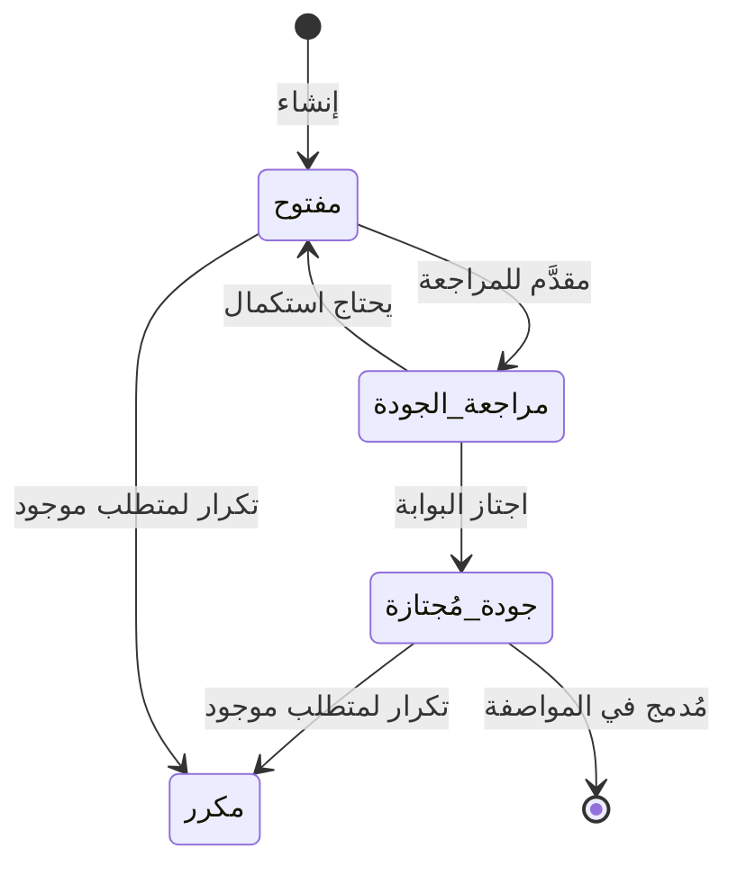
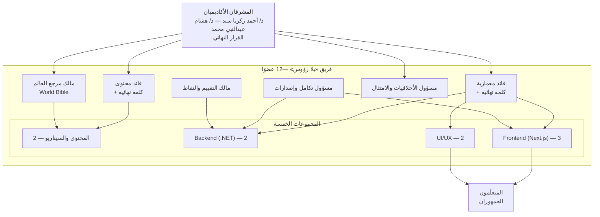
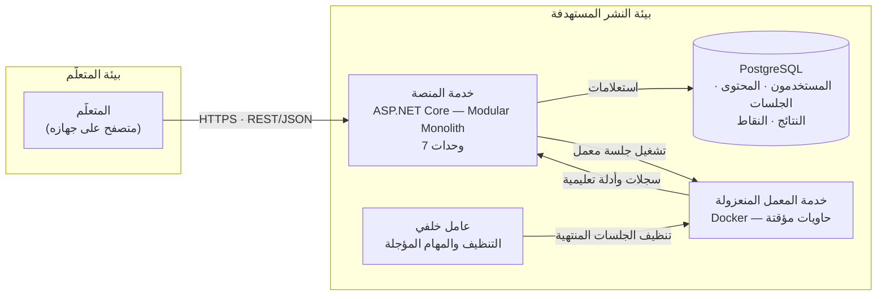
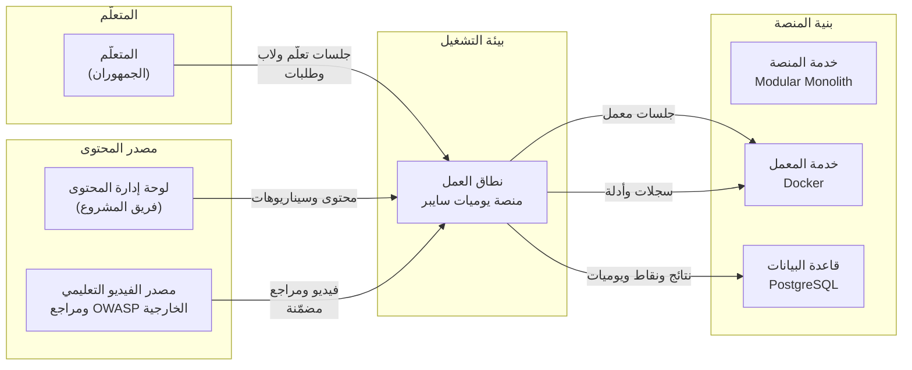
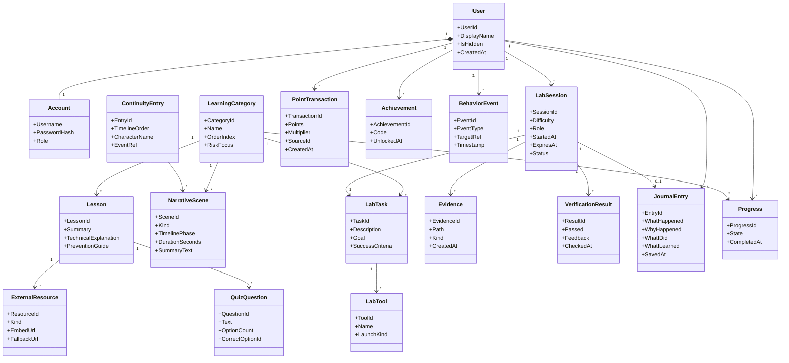
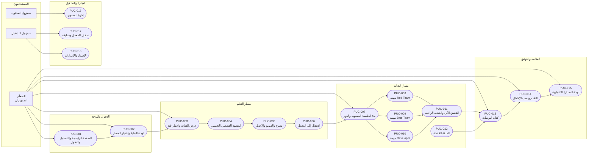

## قالب وثيقة المتطلبات — مشروع يوميات سايبر — Cyber Diaries
---
### بيانات الوثيقة (Document Control)

| البند                                | القيمة                                    |
| ------------------------------------ | ----------------------------------------- |
| اسم المشروع (Project Name)           | يوميات سايبر — Cyber Diaries              |
| الرمز المختصر للمشروع (Project Code) | CDbHLT                                    |
| رقم الوثيقة (Document ID)            | CDbHLT-REQ-SPEC-001                       |
| الإصدار (Version)                    | 0.1                                       |
| الحالة (Status)                      | نموذج أولي — المصدر المعتمد الوحيد (Single Source of Truth) |
| تاريخ الإصدار (Release Date)         | 26-10-2026                                |
| المالك/المسؤول (Owner)               | HEADLESS Team                             |
| فريق المراجعة (Reviewers)            | د/ أحمد زكريا سيد — د/ هشام عبدالنبي محمد |

### سجل المراجعات (Revision History)

| الإصدار | التاريخ    | المؤلف             | التغييرات | الحالة     |
| ------- | ---------- | ------------------ | --------- | ---------- |
| 0.0     | 26-10-2026 | محمد احمد سيد محمد | انشاء     | نموذج اولي |
| 0.1     |            | محمد ياسر          |           |            |

### قائمة المصطلحات والاختصارات (Abbreviations) — راجع القسم 4.1

| الاختصار | المعنى                                                      |
| -------- | ----------------------------------------------------------- |
| PUC      | حالة استخدام المنتج (Product Use Case)                      |
| BUC      | حالة استخدام العمل (Business Use Case)                      |
| SUC      | حالة استخدام النظام (System Use Case)                       |
| FR       | متطلب وظيفي (Functional Requirement)                        |
| NFR      | متطلب غير وظيفي (Non-Functional Requirement)                |
| CR       | قيد (Constraint Requirement)                                |
| PAM      | الغرض – الميزة – القياس (Purpose – Advantage – Measurement) |
| MoSCoW   | نظام ترميز الأولويات (Must / Should / Could / Won't)        |

---

## دليل استخدام هذا القالب (How to Use This Template)

### 1. المبادئ الحاكمة (Volere Principles)

| المبدأ | التطبيق العملي في هذا القالب |
|---|---|
| **الوصف (Description)** | يُقصر على ذِكر الحقيقة بإيجاز — ماذا يجب أن يفعل المنتج. |
| **المبرر (Rationale)** | حجة قابلة للجدال تُبرر وجود المتطلب — تُ.Tested في كل مراجعة. |
| **معيار القبول (Fit Criterion)** | **إلزامي**: اختبار قابل للتنفيذ يُحدّد هل يحقّق التصميم المتطلب. لا معيار قبول = متطلب غامض. |
| **الفصل بين المشكلة والحل** | في الأقسام 1–8 نصف المشكلة وسياقها فقط. الحل يُعزل في القسم 27 (أفكار للحلول). |
| **عدم الخلط بين المتطلب والحل** | في القسم 9 (المتطلبات الوظيفية) اكتب «يجب أن يتيح» لا «يجب أن يستخدم». |

### 2. نظام ترقيم المتطلبات (Requirement Numbering)

| البادئة        | المعنى                                                    | المدى    |
| -------------- | --------------------------------------------------------- | -------- |
| `[XX]-FR-###`  | متطلب وظيفي (Functional Requirement)                      | القسم 9  |
| `[XX]-AP-###`  | متطلب مظهر (Appearance)                                   | 10.1     |
| `[XX]-ST-###`  | متطلب أسلوب (Style)                                       | 10.2     |
| `[XX]-EU-###`  | سهولة الاستخدام (Ease of Use)                             | 11.1     |
| `[XX]-PI-###`  | التخصيص والتدويل (Personalization & Internationalization) | 11.2     |
| `[XX]-LN-###`  | التعلّم (Learning)                                        | 11.3     |
| `[XX]-UP-###`  | الفهم واللباقة (Understandability & Politeness)           | 11.4     |
| `[XX]-ACC-###` | إتاحة الوصول (Accessibility)                              | 11.5     |
| `[XX]-SP-###`  | السرعة والاستجابة (Speed & Latency)                       | 12.1     |
| `[XX]-SC-###`  | السلامة (Safety-Critical)                                 | 12.2     |
| `[XX]-PA-###`  | الدقة (Precision & Accuracy)                              | 12.3     |
| `[XX]-RA-###`  | الموثوقية والتوافر (Reliability & Availability)           | 12.4     |
| `[XX]-RB-###`  | المتانة وتحمل الأعطال (Robustness & Fault-Tolerance)      | 12.5     |
| `[XX]-CP-###`  | السعة (Capacity)                                          | 12.6     |
| `[XX]-SE-###`  | القابلية للتوسع (Scalability & Extensibility)             | 12.7     |
| `[XX]-LG-###`  | العمر التشغيلي (Longevity)                                | 12.8     |
| `[XX]-PE-###`  | البيئة المادية (Physical Environment)                     | 13.1     |
| `[XX]-IF-###`  | الواجهات مع الأنظمة المجاورة (Interfacing)                | 13.2     |
| `[XX]-PR-###`  | المنتجية/التوزيع (Productization)                         | 13.3     |
| `[XX]-RL-###`  | الإصدارات (Release)                                       | 13.4     |
| `[XX]-MT-###`  | الصيانة (Maintenance)                                     | 14.1     |
| `[XX]-SPP-###` | إمكانية الدعم (Supportability)                            | 14.2     |
| `[XX]-AD-###`  | القابلية للتكيّف (Adaptability)                           | 14.3     |
| `[XX]-AC-###`  | التحكم في الوصول (Access Control)                         | 15.1     |
| `[XX]-IN-###`  | السلامة integrity (Integrity)                             | 15.2     |
| `[XX]-PV-###`  | الخصوصية (Privacy)                                        | 15.3     |
| `[XX]-AU-###`  | التدقيق (Audit)                                           | 15.4     |
| `[XX]-IM-###`  | المناعة (Immunity)                                        | 15.5     |
| `[XX]-CU-###`  | ثقافي (Cultural)                                          | 16.1     |
| `[XX]-CMP-###` | امتثال قانوني (Compliance)                                | 17.1     |
| `[XX]-SD-###`  | معايير (Standards)                                        | 17.2     |
| `[XX]-CN-###`  | قيد حل (Solution Constraint)                              | 3.1      |
| `[XX]-BUC-###` | حالة استخدام عمل                                          | 6.4      |
| `[XX]-PUC-###` | حالة استخدام منتج                                         | 8.3      |
| `[XX]-UN-###`  | حاجة مستخدم (User Need)                                   | الملحق أ |
| `[XX]-RU-###`  | متطلب استخدام (Requirement for Use)                       | الملحق أ |

> **قاعدة:** الرقم لا يُعاد استخدامه أبدًا. المتطلبات الملغاة تُوسم `ملغى` وتبقى في السجل للاحتفاظ بسلسلة التتبّع.

### 3. ترميز الأولويات (MoSCoW)

| الرمز | المعنى | التعريف |
|---|---|---|
| **Must** | لازم | لا يُصدر الإصدار إلا إذا تحقّقت. غيابها يُفشل الإصدار. |
| **Should** | مستحسن | مهم جوهريًا لكنه قابل للتأجيل إلى إصدار لاحق دون إفشال الإصدار. |
| **Could** | إضافي | يُنفَّذ إن توفّر الوقت أو المساحة. أولوية الترقية إليه أقل من Must/Should. |
| **Won't** | خارج النطاق | صريح적으로 لن يُنفَّذ في هذا الإصدار — يُوثَّق في القسم 26 (غرفة الانتظار) مع النسخة المستهدفة. |

> **ملاحظة منهجية:** استُبدل زوجُ «درجة رضا العميل / درجة عدم الرضا» في القالب الأصلي بنظام MoSCoW، لأن التقدير الرقمي لدرجة الرضا يسبّب ارتباكًا ويصعب تبريره في المراجعة. تبقى الأولوية **قرارًا موثّقًا قابلًا للجدال** لا انطباعًا.

### 4. دورة حياة المتطلب وبوابة الجودة (Requirement Lifecycle & Quality Gateway)

كل متطلب ذرّي يمر بالحالات التالية. **لا يُعتمد المتطلب في المواصفة إلا بعد اجتياز بوابة الجودة.**



**بوابة الجودة (Quality Gateway) — شروط العبور الإلزامية:**

| #   | الشرط                                               | تم ✓ |
| --- | --------------------------------------------------- | ---- |
| 1   | المتطلب **ذرّي** (atomic) — يصف شيئًا واحدًا فقط    | ☐    |
| 2   | حقل **الوصف** مكتمل ومباشر                          | ☐    |
| 3   | حقل **المبرر** موجود ويجيب عن «لماذا؟»              | ☐    |
| 4   | حقل **معيار القبول** موجود **وقابل للتنفيذ وقياسه** | ☐    |
| 5   | **المصدر** محدّد (من أين أتت الحاجة)                | ☐    |
| 6   | **الاعتماديات والتعارضات** مفحوصة                   | ☐    |
| 7   | **الأولوية (MoSCoW)** مقرّرة                        | ☐    |
| 8   | قابل للتتبّع إلى **حاجة مستخدم / حالة استخدام**     | ☐    |
| 9   | **متوافق مع القيود** في القسم 3                     | ☐    |
| 10  | **لا يفرض حلًا تقنيًا**                             | ☐    |

### 5. سلسلة التتبّع (Traceability Chain)

يجب أن يكون لكل متطلب ذرّي مسار كامل من البيت إلى الاختبار:

```text
حاجة المستخدم (User Need)          [XX-UN-###]   ← الملحق أ
        ↓
متطلب الاستخدام (Requirement for Use) [XX-RU-###] ← الملحق أ
        ↓
حالة استخدام المنتج (PUC)           [XX-PUC-###]  ← القسم 8
        ↓
المتطلب الذرّي (Atomic Requirement) [XX-XXX-###]  ← الأقسام 9–17
        ↓
معيار القبول (Fit Criterion)                  ← الاختبار
        ↓
النتيجة / حالة التحقق                        ← سجل الاختبارات
```

| حالة الاستخدام (PUC) | المتطلبات الذرّية المرتبطة | حالة التحقق |
|---|---|---|
| [XX-PUC-000] | [XX-FR-000, ...] | [مغطى / جزئي / غير مغطى] |
| [XX-PUC-000] | [XX-FR-000, ...] | [مغطى / جزئي / غير مغطى] |
| [XX-PUC-000] | [XX-FR-000, ...] | [مغطى / جزئي / غير مغطى] |

### 6. اصطلاحات الكتابة (Writing Conventions)

- ابدأ الوصف بفعل إلزامي: «يجب أن»، «يُتاح»، «تُحتسب».
- تجنّب: «يكون»، «يُفضّل» (تعبير تفضيل لا يمكن اختبارها).
- تجنّب ذكر أسماء تقنيات أو أدوات أو لغات في القسم 9 — ضعها في القسم 3.1 أو 27.
- كل رقم في القوس `([])` يشير إلى متطلب أو PUC مرتبط.
- اكتب معيار القبول بحيث يُجيب عن سؤال: **«ماذا أفعل لأثبت أن هذا تحقّق؟»**
- السطر الأول في كل جدول: سطر الترويسة، والثاني: سطر الفاصل `|---|---|`، ثم صف واحد فارغ لكل صف.

---
---
# 📋 نموذج بطاقة المتطلب (Requirements Shell / Snow Card)

> **طريقة الاستخدام:** انسخ الكتلة التالية لكل متطلب ذرّي وضعها في القسم المناسب، أو املأ الجدول المجمّع في القسم 9.1 والملحق د.
> النموذج مبني على قالب Volere المُعدَّل (المتطلبات المُستخدمة في الأدوات الآلية) مع استبدال تقديرَي الرضا بنظام MoSCoW.

### بطاقة متطلب ذرّي — blank

| الحقل | القيمة |
|---|---|
| **رقم المتطلب (Requirement No.)** | `[XX-XXX-000]` |
| **نوع المتطلب (Requirement Type)** | `[وظيفي / غير وظيفي / قيد]` |
| **الأولوية (Priority – MoSCoW)** | `[Must / Should / Could / Won't]` |
| **حالات الاستخدام المرتبطة (Use Cases)** | `[XX-PUC-000, XX-BUC-000]` |
| **الوصف (Description)** | [اكتب المتطلب كحقيقة مختصرة ومحددة — ماذا يجب أن يفعل المنتج] |
| **المبرر (Rationale)** | [اكتب الحجة التي تبرّر وجود المتطلب، وتكون قابلة للجدال في المراجعة] |
| **المصدر (Source)** | [من أين أتت الحاجة: مقابلة / تحليل سياق / قرار فريق / معيار خارجي] |
| **معيار القبول (Fit Criterion)** | [اكتب اختبارًا قابلًا للتنفيذ والقياس يُثبت تحقّق المتطلب] |
| **الاعتماديات (Dependencies)** | [XX-XXX-000, ...] |
| **التعارضات (Conflicts)** | [XX-XXX-000, ...] |
| **المواد الداعمة (Supporting Materials)** | [رابط / مرجع / ملحق / صورة] |
| **السجل (History)** | [أنشئ في: YYYY-MM-DD] · [آخر تعديل: YYYY-MM-DD بواسطة: ...] |

### بطاقة متطلب ذرّي — blank (نسخة ثانية للنسخ واللصق)

| الحقل | القيمة |
|---|---|
| **رقم المتطلب (Requirement No.)** | `[XX-XXX-000]` |
| **نوع المتطلب (Requirement Type)** | `[وظيفي / غير وظيفي / قيد]` |
| **الأولوية (Priority – MoSCoW)** | `[Must / Should / Could / Won't]` |
| **حالات الاستخدام المرتبطة (Use Cases)** | `[XX-PUC-000]` |
| **الوصف (Description)** | [ ] |
| **المبرر (Rationale)** | [ ] |
| **المصدر (Source)** | [ ] |
| **معيار القبول (Fit Criterion)** | [ ] |
| **الاعتماديات (Dependencies)** | [ ] |
| **التعارضات (Conflicts)** | [ ] |
| **المواد الداعمة (Supporting Materials)** | [ ] |
| **السجل (History)** | [ ] |

---
---

# 📑 الفهرس (Table of Contents)

| #      | القسم                                                                        | الأقسام الفرعية                                       |
| ------ | ---------------------------------------------------------------------------- | ----------------------------------------------------- |
| **1**  | غرض المشروع (The Purpose of the Project)                                     | 1.1 · 1.2                                             |
| **2**  | أصحاب المصلحة (The Stakeholders)                                             | 2.1 · 2.2 · 2.3 · 2.4 · 2.5 · 2.6 · 2.7 · 2.8         |
| **3**  | القيود المفروضة (Mandated Constraints)                                       | 3.1 · 3.2 · 3.3 · 3.4 · 3.5 · 3.6 · 3.7 · 3.8         |
| **4**  | اصطلاحات التسمية والمصطلحات (Naming Conventions and Terminology)             | 4.1                                                   |
| **5**  | الحقائق والافتراضات (Relevant Facts and Assumptions)                         | 5.1 · 5.2 · 5.3                                       |
| **6**  | نطاق العمل (The Scope of the Work)                                           | 6.1 · 6.2 · 6.3 · 6.4                                 |
| **7**  | نموذج بيانات العمل وقاموس البيانات (Business Data Model and Data Dictionary) | 7.1 · 7.2                                             |
| **8**  | نطاق المنتج (The Scope of the Product)                                       | 8.1 · 8.2 · 8.3                                       |
| **9**  | المتطلبات الوظيفية (Functional Requirements)                                 | 9.1 · 9.2 · 9.3 · 9.4                                 |
| **10** | المظهر والإحساس (Look and Feel Requirements)                                 | 10.1 · 10.2                                           |
| **11** | سهولة الاستخدام والإنسانية (Usability and Humanity Requirements)             | 11.1 · 11.2 · 11.3 · 11.4 · 11.5                      |
| **12** | الأداء (Performance Requirements)                                            | 12.1 · 12.2 · 12.3 · 12.4 · 12.5 · 12.6 · 12.7 · 12.8 |
| **13** | التشغيل والبيئة (Operational and Environmental Requirements)                 | 13.1 · 13.2 · 13.3 · 13.4                             |
| **14** | القابلية للصيانة والدعم (Maintainability and Support Requirements)           | 14.1 · 14.2 · 14.3                                    |
| **15** | متطلبات الأمان (Security Requirements)                                       | 15.1 · 15.2 · 15.3 · 15.4 · 15.5                      |
| **16** | المتطلبات الثقافية (Cultural Requirements)                                   | 16.1                                                  |
| **17** | المتطلبات القانونية (Legal Requirements)                                     | 17.1 · 17.2                                           |
| **18** | المسائل المفتوحة (Open Issues)                                               | 18.1                                                  |
| **19** | الحلول الجاهزة (Off-the-Shelf Solutions)                                     | 19.1 · 19.2 · 19.3                                    |
| **20** | المشكلات الجديدة (New Problems)                                              | 20.1 · 20.2 · 20.3 · 20.4 · 20.5                      |
| **21** | المهام (Tasks)                                                               | 21.1 · 21.2                                           |
| **22** | الترحيل إلى المنتج الجديد (Migration to the New Product)                     | 22.1 · 22.2                                           |
| **23** | المخاطر (Risks)                                                              | 23.1                                                  |
| **24** | التكاليف (Costs)                                                             | 24.1                                                  |
| **25** | توثيق المستخدم والتدريب (User Documentation and Training)                    | 25.1 · 25.2                                           |
| **26** | غرفة الانتظار (Waiting Room)                                                 | 26.1                                                  |
| **27** | أفكار للحلول (Ideas for Solutions)                                           | 27.1                                                  |
| **أ**  | ملحق أ: حاجات المستخدم ومتطلبات الاستخدام                                    | أ.1 · أ.2 · أ.3                                       |
| **ب**  | ملحق ب: نموذج المقابلة والموافقة المستنيرة                                   | ب.1 · ب.2 · ب.3                                       |
| **ج**  | ملحق ج: سجل التشريعات والمعايير                                              | ج.1 · ج.2                                             |
| **د**  | ملحق د: السجل الرئيسي للمتطلبات                                              | د.1 · د.1.2 · د.2 · د.3 · د.4 · د.4.1                 |

---
# القسم الأول: غرض المشروع (The Purpose of the Project)

> **الهدف من القسم:** تعرّف الدافع وراء المشروع — لماذا أُنشئ، وما الذي سيتغيّر. هذا القسم يبرّر وجود كل ما بعده، ولهذا يُراجَع في كل اجتماع مراجعة.

## 1.1 خلفية المشروع (1a — The User Business or Background of the Project Effort)

**ما الذي ستكتبه هنا:** وصف مختصر للعمل القائم وسياقه، والمشكلة التي دفعت إلى إطلاق هذا المشروع، والعمل الذي ينوي إنجازه المستخدم النهائي بالمنتج المُسلَّم. يمكن الاستعانة بنماذج العمليات الحالية أو العينات من الوثائق القائمة.

| البند                                         | المحتوى                                                                                                                                                                                                                                                                                                                                                                                                                                                                                                                                                                                                                                                                                                                                                                                                                                         |
| --------------------------------------------- | ----------------------------------------------------------------------------------------------------------------------------------------------------------------------------------------------------------------------------------------------------------------------------------------------------------------------------------------------------------------------------------------------------------------------------------------------------------------------------------------------------------------------------------------------------------------------------------------------------------------------------------------------------------------------------------------------------------------------------------------------------------------------------------------------------------------------------------------------- |
| العمل القائم اليوم (Current Work)             | التعلّم الذاتي لأمن تطبيقات الويب يقوم اليوم على أربعة أنماط متفرّقة: **(أ)** قراءة توثيق ومراجع تقنية موزّعة على مواقع ولغات مختلفة؛ **(ب)** مشاهدة فيديوهات ومقالات تعليمية متفرّقة؛ **(ج)** خوض تدريبات عملية في محاكيات جاهزة أو في بيئات شخصية غير معزولة؛ **(د)** تدوين ما تعلّمه في ملاحظات شخصية. **المنفّذ في كل الحالات هو المتعلّم بنفسه** — لا توجد جهة مؤسسية توفّر مسارًا متكاملًا، ولا بيئة تدريب معزولة مخصّصة، ولا أداة تربط التعلّم بالسياق المهني. النتيجة ست مشكلات مُرصودة: الفجوة بين النظرية والتطبيق · تشتّت المحتوى · حاجز اللغة · الانفصال عن سياق العمل · غياب المنظور المتكامل · صعوبة قياس التقدم الحقيقي. (وصف المشروع 3، 4)                                                                                                                                                                                      |
| المشكلة أو الفرصة (The Problem / Opportunity) | المشكلة ليست نقص ثغرات، بل **غياب دورة متكاملة بأدوات حقيقية وبسياق عمل**. تفصيلها: **(1)** قد يعرف المتعلم تعريف SQL Injection دون أن يعرف كيف يكتشفها أو يفسر أثرها أو يصلحها. **(2)** تشتّت المحتوى بين مصادر متعددة بلغات ومستويات صعوبة مختلفة. **(3)** حاجز اللغة: معظم الموارد المتقدمة بالإنجليزية. **(4)** الانفصال عن سياق العمل: التدريبات المعزولة لا تعرض العلاقة بين الخطأ البرمجي والحادث الأمني وأثره. **(5)** غياب المنظور المتكامل: اكتشاف الثغرة لا يضمن القدرة على تحليل آثارها في السجلات أو إصلاح سببها. **(6)** صعوبة قياس التقدم الحقيقي: إكمال درس أو مشاهدة فيديو لا يعني اكتساب مهارة عملية. (وصف المشروع 3)                                                                                                                                                                                                         |
| ما الذي يُنتظر من المنتج (Intended Use)       | المخرج الملتزم به، معلن سلفًا (وصف المشروع 16): **(1)** حلقة واحدة متكاملة بإتقان — فئة Injection بسيناريو SQL Injection محدود: مشهد قصصي في مسار التعلّم يظهر فيه البطل قبل التوظيف، ثم الشرح والفيديو التعليمي الخارجي المدمج والاختبار القصير، ثم انتقال القصة زمنيًا إلى مرحلة عمل البطل في «نور تك»، وافتتاحية اللاب ومشاهد الانتقال حسب الدور، والوظائف الثلاث، واليوميات، والتقييم الآلي. **(2)** رحلة المستخدم الأساسية: الصفحة الرئيسية، التسجيل/الدخول، لوحة البداية، والاختيار بين المسارين. **(3)** قياس التكلفة الفعلية للحلقة بساعات العمل لكل مكوّن. **(4)** تعميم القالب على فئات إضافية بحسب الوقت المتبقي بعد القياس. **(5)** دراسة تقييمية على النموذج. **(6)** التوثيق التقني والعلمي وورقة بحثية. ومخرجات المنصة: منصة عاملة، محتوى تعليمي عربي، معمل عملية، توثيق تقني وعلمي، دراسة تقييمية، وورقة بحثية (وصف المشروع 1). |
| الدافع المؤسسي (Business Trigger)             | **متطلب تخرج (Graduation Requirement):** توفير **بيئة أمنية عربية معزولة** للتعلّم والتقييم داخل المسار الأكاديمي، بدل الاعتماد على محاكيات أجنبية أو بيئات شخصية غير معزولة (`Data/data.md` 5). **الأثر:** الدافع أكاديمي لا سوقي — فلا إيراد ولا مؤشر نجاح تجاري، والجدول مربوط بالتسليم النهائي (3.6) والميزانية صفرية نقديًا (3.7).                                                                                                                                                                                                                                                                                                                                                                                                                                                                                                              |

**النطاق المستثنى من الخلفية (Out of Scope of This Section):**

| مستثنى | السبب |
|---|---|
| المنتج المتخيَّل (عشر فئات كاملة) | وصف المشروع 16 يعلن أن **الملتزم به في المناقشة هو حلقة واحدة**؛ فالخلفية تصف سياق المشروع كما هو ملتزم به، لا المنتج الكامل المتخيَّل. |
| التفاصيل التقنية (اختيار التقنيات والإصدارات) | مبدأ فصل المشكلة عن الحل: التقنيات والأدوات تُوثَّق في 3.1 و3.4 و27.1، ولا تُعدّ جزءًا من «الخلفية». |

## 1.2 أهداف المشروع (1b — Goals of the Project)

> **ما الذي ستكتبه هنا:** أهداف المشروع بصيغة **PAM** — الغرض (Purpose)، الميزة (Advantage)، القياس (Measurement). كل هدف **يجب** أن يكون قابلًا للقياس؛ الهدف غير القابل للقياس يُرفض.

**جدول PAM:**

| # | الغرض (Purpose) | الميزة (Advantage) | القياس (Measurement) | نوع الهدف |
|---|---|---|---|---|
| 1 | تمكين المتعلّم العربي من إتقان **دورة** التعامل مع مشكلة أمنية في تطبيقات الويب — اكتشاف، تفسير، معالجة، توثيق — لا حفظ اسم ثغرة | ربط السرد والمعمل والأدوات الحقيقية في تجربة واحدة، بدل التنقّل بين مصادر متفرّقة وبلغات متفرّقة؛ (القيمة التي تتحقق عند النجاح: متعلّم يشرح المشكلة ويثبتها ويحلل أدلتها ويصلح سببها ويوثّقها — وصف المشروع 2) | أدوات القياس المعلنة: **اختبار قبلي وبعدي ومؤجل عند الإمكان**، و**بيانات سلوكية من داخل المنصة**، و**اختبار سهولة الاستخدام**، و**تحليل يوميات المتعلمين** (وصف المشروع 0، 20.2). **حجم العينة: 10 مشاركين على الأقل (D16 — قرار المالك).** و**عتبة النجاح (مُعتمد في 0.5 — ينتظر توقيع المشرف في 3.8):** تحسّن متوسط الدرجة في الاختبار البعدي مقابل القبلي، ويُقاس **وصفيًا** (متوسط التغيّر · حجم الأثر · اتجاه النتائج) لا باختبار دلالة إحصائية عند هذا الحجم. | هدف تعلّم |
| 2 | تحويل قرار التعميم من تقدير إلى قياس: قياس الكلفة الفعلية للحلقة الأولى قبل إعلان عدد الحلقات | انتقال من «كم نحتاج؟» إلى رقم ساعات لكل مكوّن (محتوى · مشاهد · تجهيز معمل · اختبارات آلية)، فيصبح إعلان النطاق قرارًا مسؤولًا لا مخاطرة | **ساعات العمل الفعلية لكل مكوّن** (وصف المشروع 16.3، 19). لا يُوعد بجدول نهائي قبل اكتمال هذا القياس | **هدف قياس / حوكمة (Measurement & Governance Goal)** — نوع خامس أُضيف في 0.5 لأن الخيارات الأربعة في القالب (خدمة · إيراد · قانوني · تعلّم) لا تشمل قياس الكلفة داخليًا |
| 3 | تمكين تعميم قالب واحد على فئات أخرى دون بناء نظام جديد لكل فئة | إعادة استثمار القوالب (السرد · سطح المكتب · أدوات المعمل · التقييم) بدل تكرار العمل يدويًا لكل حلقة | **جاهزية القالب للتكرار:** تشغيل حلقة على فئة ثانية دون تعديل معماري، مع تظلّل كلفة كل مكوّن بين دورتين (وصف المشروع 5، 16.4). عدد الفئات المغطّاة **يُعلن مبكرًا مع المشرف** لا في نهاية المشروع | **هدف خدمة** — القيمة تظهر عند إعادة استثمار القالب لفئة ثانية |

**تعريف أنواع الأهداف:**

| النوع                                                | التعريف                                                                                                                              |
| ---------------------------------------------------- | ------------------------------------------------------------------------------------------------------------------------------------ |
| هدف خدمة (Service Goal)                              | يُقاس أثره على المستخدم: ما الذي يشتريه من الخدمة؟                                                                                   |
| هدف إيراد (Revenue Goal)                             | يُقاس بالمال أو الحصة السوقية على مدى زمني محدّد.                                                                                    |
| هدف قانوني (Legal Goal)                              | إثبات مطابقة المنتج لشريعة أو معيار — لا يقاس برقم.                                                                                  |
| هدف تعلّم (Learning Goal)                            | إثبات اكتساب مستخدمٍ لِمهارة أو فهم معيّن — يقاس باختبار قبلي/بعدي.                                                                  |
| **هدف قياس / حوكمة (Measurement & Governance Goal)** | **نوع خامس أُضيف في 0.5 (ليس في القالب):** يُقاس برقم داخلي للفريق نفسه — ساعات عمل · كلفة مكوّن · جودة — لا بأثر على مستخدم أو سوق. |

**مراجعة إجمالية للأهداف (تُقرأ في كل اجتماع مراجعة):**
- [ ] تمّت مراجعة جميع الأهداف مع أصحاب المصلحة — ⏳ **معلّق:** الاعتماد بعد جلسة المراجعة الأولى مع المشرف (يعتمد على D5 وD6).
- [ ] كل هدف له قياس مرتبط — كل صف في جدول PAM أعلاه يقابله قياس محدّد قابل للتنفيذ (أدوات القياس المعلنة · ساعات العمل · جاهزية القالب).
- [ ] القياسات قابلة للتنفيذ ضمن موارد المشروع — ⏳ **معلّق جزئيًا:** حجم العينة حُسم (n ≥ 10 — D16)؛ يبقى قياس الحلقة الأولى.

---

---

# القسم الثاني: أصحاب المصلحة (The Stakeholders)

> **الهدف من القسم:** حصر كل من له مصلحة في المنتج. تجاهل صاحب مصلحة يعني ضياع متطلبات.

## 2.1 العميل / الراعي (2a — The Client)

| البند                                  | المحتوى                                                                                                                                                                                                                                                                                                                                                                                                                                                                                                                                                                                                                                                                                                |
| -------------------------------------- | ------------------------------------------------------------------------------------------------------------------------------------------------------------------------------------------------------------------------------------------------------------------------------------------------------------------------------------------------------------------------------------------------------------------------------------------------------------------------------------------------------------------------------------------------------------------------------------------------------------------------------------------------------------------------------------------------------ |
| **الاسم / الدور (Name/Role)**          | **المشرفان الأكاديميان:** **د/ أحمد زكريا سيد** و**د/ هشام عبدالنبي محمد** (`Data/data.md` 1)، ولهما القرار النهائي في اعتماد النطاق ومواعيد التجميد. **أسماء الفريق الاثني عشر وتخصّصاتهم موثّقة** (`Data/data.md` 1: 3 أمن سيبراني · 2 Back-End · 3 Front-End · 2 محتوى · 2 UI/UX = **12 عضوًا** (محسوم وموحّد عبر كافة الوثائق: 12 عضوًا في خمس مجموعات تخصّصية). **الاسم الرسمي المعتمد (قرار المالك):** «د/ أحمد زكريا سيد» — وُحِّد في بيانات الوثيقة وفي `References.md`، فلا تعارض بعد اليوم. و**ملكية الأدوار الداخلية** (قائد معمارية · قائد محتوى · مسؤول تكامل · مالك مرجع العالم · مالك سجل المخاطر): **فريق HEADLESS Team** كمسؤولية جماعية (D6 — قرار المالك).                                    |
| **المؤسسة**                            | **ASSIUT INTERNATIONAL TECHNOLOGICAL UNIVERSITY** (جامعة أسيوط التكنولوجية الدولية) — **الكلية التكنولوجية المصرية الألمانية بأسيوط (EGC TECH AITU)** — **قسم تكنولوجيا المعلومات** (`Data/data.md` 1).                                                                                                                                                                                                                                                                                                                                                                                                                                                                                                     |
| **القرارات التي يتخذها**               | **(1)** الفئة التجريبية **محسومة بنطاق النسخة: Injection** — لا تحتاج قرارًا. **(2)** اعتماد بيئة النشر المستهدفة (D2). **(3)** اعتماد نطاق التعميم وعدد الحلقات — «العدد يُعلن مبكرًا مع المشرف لا في النهاية» (وصف المشروع 16.4). **(4)** اعتماد قيم المعمل وأهداف الأداء الرقمية (D3 · D4). **(5)** اعتماد الأساس القانوني ونموذج الموافقة قبل جمع بيانات المشاركين (D5). **(6)** إسناد الأدوار بالأسماء داخل الفريق (D6). **(7)** اعتماد مواعيد تجميد قوالب المحتوى والسيناريو، لأنها تُعامَل كمخرجات رسمية (وصف المشروع 18).                                                                                                                                                                      |
| **مسؤول عن القبول النهائي**            | **نعم — مُعتمد في 0.5.** القبول النهائي للنطاق **المعلن**: الحلقة الواحدة (Injection) كاملة + رحلة المستخدم الأساسية + قياس التكلفة + الدراسة التقييمية + التوثيق والورقة البحثية. **المبرر:** يعرض عليه «القرار الأهم في هذا التوصيف» (وصف المشروع 16) ويُعلن نطاق التعميم معه (16.4). **لم يسمّه المصدر حرفيًا «المقبول النهائي»** — يُثبَّت بتوقيع المشرف في 3.8.                                                                                                                                                                                                                                                                                                                                   |
| **نقاط المراجعة (Review Checkpoints)** | **(1)** بعد إقرار نطاق النسخة (الفئة التجريبية **Injection** محسومة سلفًا) وقبل كتابة المحتوى — بداية المرحلة 2 من خطة العمل (وصف المشروع 19). **(2)** عند **مواعيد التجميد** المعلنة لقالب المحتوى وقالب السيناريو — تُعامَل كمخرجات رسمية (وصف المشروع 18). **(3)** بعد **قياس تكلفة الحلقة الأولى**: إعلان عدد الحلقات المعمَّمة (وصف المشروع 16.4، 19). **(4)** قبل تشغيل جمع بيانات المشاركين: اعتماد نموذج الموافقة والأساس القانوني (D5). **التواريخ المثبَّتة:** التسليم/المناقشة النهائية **7-2027**، وتجميد قوالب المحتوى والسيناريو **قبل التسليم بأسبوعين** (`Data/data.md` 1). **توزيع نقاط المراجعة الأربع على تقويم شهري: [TBD — Requires Decision: تقويم مراجعات تفصيلي داخل نافذة 2027].** |
| **مخطط تنظيمي مُوضَّح**                | الهيكل مُعبَّأ **بالأدوار** أدناه، والأسماء متاحة (12 عضوًا — `Data/data.md` 1). **القرار (D6):** لا تسمية فرد لكل دور — الأدوار تُدار كـ**مسؤولية جماعية لفريق HEADLESS Team**، فالمخطط يوضّح الهيكل لا مالكيه.                                                                                                                                                                                                                                                                                                                                                                                                                                                                                            |
|                                        |                                                                                                                                                                                                                                                                                                                                                                                                                                                                                                                                                                                                                                                                                                        |

**مخطط تنظيمي بالأدوار (بدون أسماء — بانتظار D6):**



> **ملاحظة:** المصدر يذكر «مسؤول تكامل وإصدارات» و«قائد معمارية» و«قائد محتوى» **بلا أسماء** (وصف المشروع 18، وسجل التنبيه C12 في خريطة المتطلبات). **مالك سجل المخاطر ومالك وحدة Gamification ومسؤول الأخلاقيات أدوار مُشتقّة** لا يسمّيها المصدر — وقد **أُسندت كلها إلى فريق HEADLESS Team** (قرار المالك — D6)، فلم تعد معلّقة على تسمية أفراد.

## 2.2 العميل النهائي / المشتري (2b — The Customer)

| البند                         | المحتوى                                                                                                                                                                                                                                                                                                                                                                                                                                                                                                                                                                                 |
| ----------------------------- | --------------------------------------------------------------------------------------------------------------------------------------------------------------------------------------------------------------------------------------------------------------------------------------------------------------------------------------------------------------------------------------------------------------------------------------------------------------------------------------------------------------------------------------------------------------------------------------- |
| **من يشتري أو يتبنّى المنتج** | **لا يوجد مشترٍ تجاري في هذا المشروع.** ثلاثة أطراف يجب التفريق بينها: **(أ) المستفيد من الاستخدام** = المتعلّم — طلاب الحاسبات ومطورو الويب المبتدئون، والمهتمون بالأمن السيبراني بلا خلفية برمجية (وصف المشروع 1). **(ب) الجهة المستلِمة للمخرجات** = الجهة الأكاديمية التي تُسلَّم لها المنصة والتوثيق والدراسة التقييمية والورقة البحثية. **(ج) مستخدمو التشغيل** = فريق المشروع (12 عضوًا).                                                                                                                                                                                        |
| **القرارات التي يتخذها**      | المتعلّم: اختيار المسار (تعلّم / لابات) · اختيار الفئة · اختيار مستوى الصعوبة · اختيار الدور · تخطي المشاهد · كتابة اليوميات. **لا تُفتح ولا تُحجب أي محتوى بالنقاط** (وصف المشروع 12).                                                                                                                                                                                                                                                                                                                                                                                                 |
| **نقاط المراجعة**             | **تجربة استطلاعية مع 5–10 طلاب**: رصد المشكلات التعليمية والتقنية، **قياس زمن الإتمام**، تقييم **وضوح القصة والانتقالات والأدوات**، وتحديد ما يُبسَّط قبل التعميم (وصف المشروع 19، المرحلة 6). **التوقيت:** بعد اكتمال الحلقة الأولى (المرحلة 6) وداخل نافذة ما قبل التسليم النهائي **7-2027**؛ **اليوم المحدّد [TBD — Requires Decision: تقويم المرحلة 6].** **فرقٌ مقصود:** التجربة الاستطلاعية = **5–10 طلاب** (وصف المشروع 19)، أما **عينة الدراسة = ‏n ≥ 10** (D16 — قرار المالك)؛ فالدراسة قد تشمل المشاركين أنفسهم أو تُضاف إليهم جلسات، وهذا لا يُغيّر وصف التجربة الاستطلاعية. |
| **ملاحظة**                    | في التطوير الداخلي قد يكون العميل (2.1) هو المشتري (2.2) — وضّح ذلك. **التوضيح:** هذا مشروع تخرج بلا علاقة تعاقدية، وطبيعة العلاقة **علاقة خطة عمل أكاديمية** لا صفقة. لذلك: **العميل (2.1) = المشرف الأكاديمي**، و**المشتري (2.2) = الجهة الأكاديمية المستلِمة للمخرجات**، و**المستخدم النهائي (2.4) = المتعلّم**. لا تعارض بين 2.1 و2.2 لأنهما لا يشتريان خدمة بل يشرفان على إنجاز مخرجات.                                                                                                                                                                                            |

## 2.3 بقية أصحاب المصلحة (2c — Other Stakeholders)

| #   | الدور / الوصف                                                                 | ما الذي يحتاجه المشروع منه                                                                                       | درجة المشاركة | درجة التأثير | كيف تُدار التعارضات                                                                                                                                                                                                                                                            |
| --- | ----------------------------------------------------------------------------- | ---------------------------------------------------------------------------------------------------------------- | ------------- | ------------ | ------------------------------------------------------------------------------------------------------------------------------------------------------------------------------------------------------------------------------------------------------------------------------ |
| 1   | **قائد معمارية**                                                              | قرارات معمارية مسجّلة · حدود ومسؤوليات خدمة المعمل · قيم المعمل ومدد الجلسات · إسناد مهام Backend وFrontend وLab | عالٍ          | عالٍ         | «قائد معمارية وقائد محتوى لهما **كلمة نهائية معلنة**، لا مجرد تنسيق» (وصف المشروع 18) · عقود API تُتفق عليها قبل توزيع التنفيذ (18)                                                                                                                                            |
| 2   | **قائد محتوى** (المحتوى والسيناريو — 2 أعضاء)                                 | الدروس · السيناريو · التلميحات · الأسئلة · اليوميات · المراجع · قوالب قابلة للتكرار على الفئات العشر             | عالٍ          | عالٍ         | كلمة نهائية معلنة (18) · مواعيد تجميد معلنة لقالب المحتوى وقالب السيناريو تُعامَل كمخرجات رسمية (18)                                                                                                                                                                           |
| 3   | **مسؤول تكامل وإصدارات**                                                      | متابعة ما اكتمل وما ينتظر وما يتعطل · بيئة اختبار مشتركة · سجل حالة لكل دفعة                                     | متوسطة        | عالٍ         | «دمج دوري لأجزاء صغيرة وبيئة اختبار مشتركة» (18) · عقود API مبكرة (21)                                                                                                                                                                                                         |
| 4   | **مالك مرجع العالم (World Bible)**                                            | ملف واحد يوثّق ترتيب المرحلتين، والخط الزمني (تعلّم ← توظيف ← نمو الشركة)، وتطور البطل والشخصيات، وأحداث كل حلقة | متوسطة        | عالٍ         | «ملف واحد ... **له مالك واحد** ومواعيد تجميد معلنة، حتى لا تنتج عن كتابة السيناريوهات بأيدٍ متعددة تناقضات» (8.1)                                                                                                                                                              |
| 5   | **مالك التقييم والنقاط** (Assessment + Gamification)                          | قواعد التحقق الآلي لكل دور · اقتصاد النقاط · تعريف «نسبة الإكمال» الموثّق                                        | متوسطة        | متوسطة       | **فريق HEADLESS Team** (مسؤولية جماعية — D6) الفصل بينهما: التقييم يصحّح، والنقاط تشجيع (12)                                                                                                                                                                                   |
| 6   | **مسؤول الأخلاقيات والامتثال**                                                | الأساس القانوني لجمع البيانات · نموذج الموافقة · سياسة الاحتفاظ بالبيانات · مراجعة التراخيص                      | منخفضة        | عالٍ         | **[TBD — Requires Decision — D5: الأساس القانوني واعتماد الجامعة]** — **شكل الموافقة متاح**: «إقرار شفهي/ورقي من الطلاب المشاركين» (`Data/data.md` 5)، أمّا **الأساس القانوني والاعتماد المؤسسي** فلم يُوثَّقا. يُمنع تشغيل جمع البيانات على المشاركين قبل اعتماد النموذج (22) |
| 7   | **المشاركون في التجربة الاستطلاعية (5–10 طلاب) — وعينة الدراسة n ≥ 10 (D16)** | وضوح القصة والانتقالات والأدوات · زمن الإتمام · الأخطاء المتكرّرة · ربط استخدام التلميحات بمعدل الإكمال          | متوسطة        | عالٍ         | ملاحظاتهم قد تطلب تغييرًا بعد تاريخ التجميد — المبدأ الحاكم: «ما يُضحَّى عند ضيق الوقت هو عدد الحلقات المعلن سلفًا، **لا أمان المعمل ولا جودة التقييم**» (16)                                                                                                                  |
| 8   | **لجنة المناقشة/المقيّمون الأكاديميون**                                       | مطابقة ما أُنجز بما أُعلن · قبول المنصة والتوثيق والدراسة والورقة البحثية                                        | منخفضة        | عالٍ         | **[TBD — Requires Decision: أسماء لجنة المناقشة تُعلَن من الجامعة قبل المناقشة]** تُدار بوضوح نطاق المخرج المعلن سلفًا (16)                                                                                                                                                    |

> **ملاحظة على درجة المشاركة ودرجة التأثير:** القيم أعلاه **تقدير فريق** (لا ينقلها المصدر) — لأن المصدر يصف الأدوار ومسؤولياتها لكنه **لا يقدّر درجة مشاركة ولا درجة تأثير** لأي منها. تُعتمد في أول اجتماع مراجعة لأصحاب المصلحة.

**قائمة فحص سريع لأصحاب المصلحة (استخدمها كقائمة تحقّق):**
`العميل/الراعي` (راجع 2.1) · `المشتري` (راجع 2.2) · `خبراء المادة` · `عامة الجمهور` · `مستخدمو النظام القائم` · `خبراء التسويق` · `الخبراء القانونيون` · `خبراء المجال` · `خبراء الاستخدامية` · `ممثلو الجمعيات الخارجية` · `محللو الأعمال` · `المصممون والمطوّرون` · `المختبِرون` · `مهندسو الأنظمة` · `مهندسو البرمجيات` · `خبراء التقنية` · `مصممو الأنظمة`

**تطبيق القائمة على هذا المشروع:**

| بند القائمة | ينطبق؟ | على من |
|---|---|---|
| `العميل/الراعي` | نعم | المشرف الأكاديمي (2.1) |
| `المشتري` | نعم (بصيغة الجهة الأكاديمية المستلِمة) | 2.2 |
| `خبراء المادة` | نعم | قائد المحتوى ومجموعته (3 أعضاء) |
| `عامة الجمهور` | نعم | الجمهور الإضافي — المهتمون بلا خلفية برمجية |
| `مستخدمو النظام القائم` | **لا ينطبق** | لا يوجد نظام قائم — المشروع جديد بالكامل |
| `خبراء التسويق` | **لا ينطبق** | لا وجود لمنتج تجاري ولا سوق في التوصيف |
| `الخبراء القانونيون` | **لا ينطبق** | لا يذكر المصدر استشارة قانونية؛ الأخلاقيات يغطيها «مسؤول الأخلاقيات» (D5) |
| `خبراء المجال` | نعم | قائد المعمارية ومهندسو الأنظمة والبرمجيات |
| `خبراء الاستخدامية` | **جزئي** | تجربة استطلاعية مع 5–10 طلاب (المرحلة 6) |
| `ممثلو الجمعيات الخارجية` | **لا ينطبق** | لا يذكر المصدر جمعيات أو أطرافًا ممثِّلة |
| `محللو الأعمال` | **لا ينطبق** | لا وجود لتحليل أعمال أو متطلبات سوقية في التوصيف |
| `المصممون والمطوّرون` | نعم | 5 مجموعات: أمن سيبراني (3) · Backend (2) · Frontend (3) · محتوى (2) · UI/UX (2) |
| `المختبِرون` | نعم | المشاركون في التجربة الاستطلاعية |
| `مهندسو الأنظمة` · `مهندسو البرمجيات` · `خبراء التقنية` · `مصممو الأنظمة` | نعم | قائد المعمارية ومجموعة Lab/DevOps |

## 2.4 المستخدمون الفعليون (2d — The Hands-On Users of the Product)

> **ما الذي ستكتبه هنا:** فئات المستخدمين المستهدفة. لكل فئة: الدور والمسؤوليات، الخبرة في المادة (مبتدئ / متمرّس / خبير)، الخبرة التقنية (مبتدئ / متمرّس / خبير)، وخصائص أخرى تؤثر على المتطلبات (الإمكانات البدنية والعقلية، الاتجاه نحو المهنة، الاتجاه نحو التقنية، الموقع الجغرافي، التعليم، المهارات اللغوية، الفئة العمرية، الجنس، الدافع).

| # | فئة المستخدم | الدور والمسؤوليات | خبرة المادة | الخبرة التقنية | خصائص أخرى تؤثر على المتطلبات | ممثل |
|---|---|---|---|---|---|---|
| 1 | **الجمهور الأساسي** — طلاب الحاسبات ومطورو الويب المبتدئون | يتعلّم مفهوم الفئة في مسار التعلّم ثم يختبره عمليًا في مسار اللابات | أمن تطبيقات الويب: **مبتدئ** (يعرف تعريف الثغرة دون أن يعرف كيف يكتشفها أو يفسر أثرها أو يصلحها — 3) | البرمجة والويب: **مبتدئ إلى متمرّس** — «لديهم أساسيات البرمجة والويب» (1) **(تقدير فريق مستنتج من المصدر — يُراجع مع المشرف)** | يدخل عبر المحتوى التمهيدي · عربية الفهم مع مصطلح إنجليزي عند الحاجة · متعلّم ذاتي بلا ضغط مؤسسي أو جدول إجباري | **مشاركون فعليون من الفئة نفسها** — التجربة الاستطلاعية 5–10، وعينة الدراسة **n ≥ 10** (D16)؛ آلية الدعوة والاختيار تُوثَّق في خطة الدراسة (20) |
| 2 | **الجمهور الإضافي** — المهتمون بالأمن السيبراني بلا خلفية برمجية | يدخلون عبر المحتوى التمهيدي في مسار التعلّم؛ ويختلفون عن الأساسي في حاجتهم إلى تفسير المصطلح وكود المثال | أمن تطبيقات الويب: **مبتدئ** | **مبتدئ — بلا خلفية برمجية** | دخول عبر المحتوى التمهيدي (1) · لا يستطيع تعديل الكود · **حُسم (D8): يحصل على مسار مبسّط مستقل** | **الشخصية المرجعية ٢ — سارة** (2.5): تمثّل هذه الشريحة تمثيلًا وصفيًا لا اسميًا |
| 3 | **متعلّم في المعمل بدور Red Team** | يبحث عن المشكلة ويجيب بأمان داخل نطاق المعمل؛ ويُقاس بالنتيجة الأمنية المكتشفة لا بمجرد العثور على نص مخفي (6.1) | في الفئة قيد التدريب: **مبتدئ إلى متمرّس** | **متمرّس** — يستخدم أدوات الاكتشاف وإرسال الطلبات: `curl`، أدوات مطور المتصفح، `nmap` عند الحاجة (13) | أدوات قليلة ومحددة فقط بحسب الدور (13) · مستوى الصعوبة يحدّد مقدار التلميحات لا نوع الثغرة (11) · لا تظهر أدوات الدورين الآخرين | **لا فئة منفصلة** — الدور **نمط استخدام** داخل المعمل، يمثّله نفس المشاركين في الفئة الأساسية (الشخصية ١) |
| 4 | **متعلّم في المعمل بدور Blue Team / SOC** | يفحص الأدلة والسجلات، ويربط الأحداث، ويحدد النشاط والمورد المتأثر؛ ويُقاس بسلسلة استنتاج من خطوتين إلى ثلاث (6.1) | في الفئة قيد التدريب: **مبتدئ إلى متمرّس** | **متمرّس** — `grep` و`tail` لتحليل السجلات، `Adminer` لاستعراض قاعدة البيانات التجريبية (13) | خطر تصميمي معلَن: الانزلاق إلى «امتحان قراءة» — يُمنع ذلك بسلسلة استنتاج حقيقية (6.7) | **لا فئة منفصلة** — الدور **نمط استخدام** داخل المعمل، يمثّله نفس المشاركين في الفئة الأساسية (الشخصية ١) |
| 5 | **متعلّم في المعمل بدور Developer** | يحدد السبب الجذري ويصلحه ويتحقق من سلامة الإصلاح؛ ويُقاس باختبارات آلية تثبت المشكلة وتمنع الحالة غير الآمنة وتُبقي الوظائف المشروعة (6.1) | في الفئة قيد التدريب: **مبتدئ إلى متمرّس** | **متمرّس** — `Monaco Editor` لتحرير الكود في مرحلة المعالجة (13) | لماذا ثلاثة أدوار مختلفة في معمل واحد؟ لأن الأدوار تُقاس بمعايير مختلفة — انظر BR-17 | **لا فئة منفصلة** — الدور **نمط استخدام** داخل المعمل، يمثّله نفس المشاركين في الفئة الأساسية (الشخصية ١) |

> **ملاحظة تفسيرية:** الصفوف **3 و4 و5 ليست فئات مستخدمين منفصلة** بل **أنماط استخدام داخل المعمل** يتفرّع عنها القسم 2.4 اعتمادًا على الدور المختار (6.1)، لأن الدور يغيّر الأدوات المتاحة ونوع المهمة ومعيار التقييم. أما الصفوف **1 و2** فهما الجمهوران الفعليان المعرّفان في وصف المشروع 1.

**أسئلة تحقّق لإجابة «نعم»:**
- [x] هل المستخدم الأساسي مجرّد (occasional) أم دائم الاستخدام؟ → **مجرد**: الاستخدام متقطّع في جلسات تعلّم ولبات منفصلة؛ لا تُفرض جلسة يومية، ودورة العمل ذاتية بلا جدول مؤسسي.
- [ ] هل سيستخدم المنتج مستخدمون من خارج المؤسسة؟ → **يُتوقع نعم** (الجمهور الإضافي وأي متعلّم عربي) — **[TBD — Requires Decision: النشر مفتوح للعامة أم مقيّد بالدفعة التجريبية؟]**
- [x] هل يُستخدم عبر الهاتف أو الاتصال البعيد أو الاتصال الشبكي؟ → **عبر الاتصال الشبكي، وقد يكون عن بُعد**: المعمل يعمل في حاويات على خادم ويصل إليه المتعلّم عبر المتصفح. **دعم الهاتف: مؤجَّل** — يُحدَّد مع مواصفات المتصفح بعد اكتمال البناء (D12).
- [ ] هل سيستخدمه أطفال أو كبار أو أشخاص بلغة أخرى؟ → **[TBD — Requires Decision: لا يذكر المصدر جمهورًا سنيًّا أو لغات أخرى، والنطاق الأول عربي. القرار: تأكيد الجمهور المستهدف عمريًا، وهل تُدعم لغة ثانية لاحقًا.]**
- [ ] هل ستُقيَّد بعض المهام بسبب القدرة البدنية أو السعرات أو الوصول؟ → **[TBD — Requires Decision: نطاق إتاحة الوصول في النسخة الأولى غير محدّد في المصدر (انظر D9 والقسم 11.5).]**

## 2.5 الشخصيات المرجعية (2e — Personas)

> **ما الذي ستكتبه هنا:** **حتى ثلاث شخصيات كحد أقصى.** شخصية متخيّلة تحكي قصة حياة كاملها: الاسم، العمر، الوظيفة، الأسرة، الهوايات، مكان السكن، الطعام والموسيقى المفضّلان، ما يحبّه وما يكرهه، وجهات العطلات، الاتجاه نحو التقنية، الاتجاه نحو المال — وأي خاصية أخرى تؤثر في طريقة تفكير الشخص في المنتج. أرفق صورة أو رسمًا للشخصية.

> **تنبيه منهجي (ضروري قبل التعبئة):** الشخصيات السردية في وصف المشروع — البطل «صابر»، المدير، الزميل المطور، زميل Blue Team/SOC، زميل Developer، موظف الدعم، العملاء، الخصم (8.2) — هي **شخصيات عالم سردي** تُصمَّم لخدمة القصة، وليست Personas. الـPersona هنا أداة تصميمية لفهم **المتعلّم المستهدف** (2.4) وتستمد من **الجمهورين** لا من خيط السرد. الخلط بين المستويين يفسد تتبّع المتطلبات. ويترتب على ذلك أن **عدد الشخصيات = 2** (جمهوران)، لا 9.

#### الشخصية ١ — أحمد، المتعلّم التقني (الجمهور الأساسي)

| البند | المحتوى |
|---|---|
| **الاسم** | **أحمد** (`Data/data.md` 4 — الشخصية 1) |
| **العمر** | **21 سنة** (`Data/data.md` 4) |
| **الوظيفة / الدور** | طالب حاسبات أو مطوّر ويب في بداياته المهنية؛ يقضي وقته بين المحاضرات والمشاريع الجانبية |
| **مكان السكن** | **القاهرة** (`Data/data.md` 4) |
| **الخلفية والتعليم** | أساسيات البرمجة والويب؛ يدرس أمن تطبيقات الويب ضمن مقرراته أو تلقائيًا (وصف المشروع 1) |
| **الخبرة في المجال** | **مبتدئ** في أمن تطبيقات الويب: يعرف تعريف SQL Injection ولا يعرف كيف يكتشفها أو يفسر أثرها أو يصلحها (وصف المشروع 3) |
| **الخبرة التقنية** | **مبتدئ إلى متمرّس** في البرمجة والويب **(تقدير فريق مستنتج من «أساسيات البرمجة والويب» — يُراجع مع المشرف)** |
| **المهارات اللغوية** | عربية ممتازة؛ يقرأ الشرح بالفصحى أسرع من الإنجليزي، ويحتاج المصطلح الإنجليزي مشروحًا عند أول ورود (1) |
| **العائلة** | **[TBD — Requires Decision: لم تُذكر في `Data/data.md` 4؛ تُكتب في جلسة التصميم]** |
| **الهوايات والاهتمامات** | **الألعاب والهاكاثونات** (`Data/data.md` 4) — أي أنه يصل إلى التقنية عبر التجربة الجماعية والمنافسة لا عبر القراءة وحدها |
| **الطريقة التي ينظر بها إلى التقنية** | **يرى الأمن غامضًا ويحتاج تبسيطًا** (`Data/data.md` 4): باب لا يعرف من أين يبدأ، لا أداة تُستخدم لاختراق |
| **ما يزعجه في المنتج المقترح** | التنقّل بين مصادر متعددة وبلغات متعددة · أن يُطلب منه اسم ثغرة بدل أن يفهمها · أي واجهة تُغرقه بأدوات لا يحتاجها في مهمته (4.3.7، 13) |
| **الصورة** | **[TBD — Requires Decision: تُنتَج في جلسة التصميم]** |
| **السلوكيات التي يفترضها هذا التصميم** | يفتح المنصة على جلسات متقطّعة لا يومية · يقرأ الشرح قبل المشاهد · يستخدم التلميحات الموسّعة ثم يخفضها تدريجيًا · يكتب اليوميات بعد كل حلقة لأن اليوميات جزء من الحلقة لا إضافة · يختار **دورًا واحدًا** في الغالب لا الحلقة الكاملة · يبحث عن «الخطوة التالية» بوضوح |

#### الشخصية ٢ — سارة، المهتمة بلا خلفية برمجية (الجمهور الإضافي)

| البند | المحتوى |
|---|---|
| **الاسم** | **سارة** (`Data/data.md` 4 — الشخصية 2) |
| **العمر** | **24 سنة** (`Data/data.md` 4) |
| **الوظيفة / الدور** | **[TBD — Requires Decision: لم تُذكر في `Data/data.md`]** — يدخل عبر المحتوى التمهيدي في مسار التعلّم (وصف المشروع 1) |
| **مكان السكن** | **الإسكندرية** (`Data/data.md` 4) |
| **الخلفية والتعليم** | **[TBD — Requires Decision: لم تُذكر في `Data/data.md`]** — مؤكد فقط أنها **بلا خلفية برمجية** (وصف المشروع 1) |
| **الخبرة في المجال** | **مبتدئ** — الدافع فكري (أمن المعلومات) لا مهني |
| **الخبرة التقنية** | **مبتدئ — بلا خلفية برمجية** (وصف المشروع 1) |
| **المهارات اللغوية** | عربية؛ يقرأ الشرح المبسّط دون كود، ويعتمد على الشرح النصي والفيديو بدل التطبيق (3) |
| **العائلة** | **[TBD — Requires Decision: لم تُذكر في `Data/data.md` 4]** |
| **الهوايات والاهتمامات** | **القراءة** (`Data/data.md` 4) — تفضيل للمحتوى المكتوب يبرّر الشرح النصي والملخصات |
| **الطريقة التي ينظر بها إلى التقنية** | **تخاف من التفاصيل التقنية وتحتاج شرحًا مبسّطًا** (`Data/data.md` 4) |
| **ما يزعجه في المنتج المقترح** | الكود بلا شرح · مصطلح بلا مثال · مسار يفرض عليه ما لا يفهمه · اختبارات تُحبطه دون تلميح |
| **الصورة** | **[TBD — Requires Decision: تُنتَج في جلسة التصميم]** |
| **السلوكيات التي يفترضها هذا التصميم** | يقرأ الصفحة التعليمية كاملة قبل أي تفاعل · يعتمد على المحتوى التمهيدي والمصطلح المفسّر · **لا يدخل مسار اللابات إلا إذا رأى مسارًا مبسّطًا** — وهذا بالضبط سبب فتح القرار D8 · يحتاج تعريفًا مختصرًا قبل كل وظيفة (تخفيف تشتّت المتعلم) |

#### الشخصية ٣ — غير مستخدمة (قرار مثبَّت: شخصيتان فقط)

| البند | المحتوى |
|---|---|
| **الحالة** | **لا شخصية ثالثة — محسوم** (`Data/data.md` 4 يعرّف شخصيتين اثنتين، ومصدر المشروع يحدّد جمهورين اثنين). الصف الثالث في القالب يبقى محجوزًا لأي شريحة ثالثة **إن أُعلنت لاحقًا**، وإضافتها تتطلب أولًا تعريف الجمهور الثالث أو الشريحة داخل الجمهور الإضافي. |

> **طريقة عرض الشخصية في الاجتماعات:** اطبع هذه الشخصية بحجم A3 واعرضها في كل اجتماع مراجعة لتذكير الحاضرين بأننا نكتشف متطلبات **هؤلاء** الناس بعينهم.

## 2.6 أولويات المستخدمين (2f — Priorities Assigned to Users)

> **ما الذي ستكتبه هنا:** إسناد أولوية لكل فئة مستخدم. الفئات غير المهمة تشمل المستخدمين النادرين وغير المصرّح لهم وغير المتمرّسين ومن يسيء استخدام المنتج.

| # | فئة المستخدم | التصنيف | النسبة المئوية | عدد المتطلبات المرتبطة | ملاحظات |
|---|---|---|---|---|---|
| 1 | الجمهور الأساسي — طلاب حاسبات ومطورو ويب مبتدئون | **رئيسي (Key)** — التصنيف مطابق لمسمّى `Data/data.md` 5 | **70%** (توزيع معلن — `Data/data.md` 5) | **19 متطلبًا وظيفيًا مباشرًا** (`FR-001`…`FR-003` · `FR-008`…`FR-023`) + `FR-007` (معلّق) + `FR-025` (حذف الحساب مشترك) | التوزيع المعلن: **70%** (`Data/data.md` 5) — مبني على أن الجمهورين يدخلان من البوابة نفسها بينما الجمهور الإضافي يدخل عبر المحتوى التمهيدي فقط (1) |
| 2 | الجمهور الإضافي — مهتمون بلا خلفية برمجية | **ثانوي (Secondary)** — التصنيف مطابق لمسمّى `Data/data.md` 5 | **30%** (توزيع معلن — `Data/data.md` 5) | **متطلبان وظيفيان** (`FR-024` مسار مبسّط مستقل بمقتضى D8 · `FR-025` حذف الحساب مشترك) | التوزيع المعلن: **30%** (`Data/data.md` 5) — حُسم بمسار مبسّط مستقل (قرار D8 مغلق) دون إثقال الواجهة التقنية للمسار الرئيسي |
| 3 | — | غير مهم (Unimportant) | **لا ينطبق — لا توجد هذه الفئة** | 0 | لا يوجّه المصدر إلى أي فئة غير مهمة؛ كل الفئات المستهدفة داخل النطاق. **قاعدة حل التعارض المطبَّقة:** عند تعارض بين متطلب مستخدم ثانوي ومتطلب مستخدم رئيسي — **يعود الطلب لمتطلب المستخدم الرئيسي** |
| 4 | — | — | — | — | **لا ينطبق** — لا توجد فئات مستخدمين أخرى مستهدفة في النسخة الأولى. يُعاد تقييم الصف عند تعميم الفئات (القسم 26) |

## 2.7 مشاركة المستخدمين (2g — User Participation)

> **ما الذي ستكتبه هنا:** نوع المشاركة المنتظرة من كل فئة، والوقت التقديري الذي سيستغرقونه. كثير من المشاريع تفشل بسبب عدم مشاركة المستخدمين — صرّح بذلك من البداية.

| # | فئة المستخدم | نوع المشاركة المنتظرة | المعرفة المنتظرة منهم | الوقت التقديري | عدد الجلسات |
|---|---|---|---|---|---|
| 1 | الجمهور الأساسي (طلاب حاسبات ومطورو مبتدئون) | **اختبار** + **متطلبات استخدام** — اختبار الواجهة والسرد مع مجموعة صغيرة وتوثيق الملاحظات (معيار القبول رقم 19)، مع استبيان انخراط وسهولة استخدام (20.2) | وضوح القصة والانتقالات والأدوات · زمن الإتمام · الأخطاء المتكرّرة · أي مهمة تُربكهم | **[TBD — Requires Decision: لا يوفّر المصدر أي تقدير زمني]** | **[TBD — Requires Decision: عدد الجلسات ومدة كل جلسة يحدَّدان في تصميم الدراسة الاستطلاعية]** |
| 2 | الجمهور الإضافي (بلا خلفية برمجية) | **اختبار** + **متطلبات استخدام** — تُدرَج في التجربة الاستطلاعية وفي الدراسة (n ≥ 10)، بعد حسم D8 بمسار مبسّط مستقل | وضوح المسار المبسّط · إكمال الدرس بلا مساعدة · فهم المصطلح بلا كود | **[TBD — Requires Decision: مدة جلسة هذه الشريحة]** | جلسة واحدة على الأقل |
| 3 | المشرف الأكاديمي | **معرفة مجال / متطلبات استخدام** — مراجعة النطاق المعلن، ومحتوى المسار التعلّم، وقوالب المحتوى والسيناريو قبل مواعيد التجميد | ملاءمة المخرجات للنطاق المعلن · وضوح العيب والمعيار · جاهزية المحتوى للمراجعة | **[TBD — Requires Decision: الوقت التقديري لمراجعات المشرف غير مذكور في المصدر — يُقدَّر مع لجنة الإشراف]** | **[TBD — Requires Decision: عدد المراجعات يربط بمواعيد التجميد المعلنة (CN-016)]** |

## 2.8 مستخدمو الصيانة وفنيّو الخدمة (2h — Maintenance Users and Service Technicians)

| #   | الدور                                           | المسؤوليات                                                                                                                                                   | الخصائص المؤثرة                                                                                   | المتطلبات المتوقعة                                                                                                                                |
| --- | ----------------------------------------------- | ------------------------------------------------------------------------------------------------------------------------------------------------------------ | ------------------------------------------------------------------------------------------------- | ------------------------------------------------------------------------------------------------------------------------------------------------- |
| 1   | **مهندس Lab / DevOps** (2 من مجموعة أمن سيبراني)            | Docker · التطبيقات التجريبية · العزل الأمني · النشر والمراقبة · دورة حياة الحاويات وتنظيفها التلقائي (وصف المشروع 18، 14)                                    | يعمل على بنية معزولة؛ الطلبات تأتي من المنصة لا من المستخدمين؛ أي خطأ هنا يمسّ أمان المعمل مباشرة | **محال إلى 14.1 و15.1:** إدارة دورة حياة الحاوية · إعدادات العزل وحدود الموارد والمدة · التنظيف التلقائي · المراقبة · إعادة التهيئة · سجل الجلسات |
| 2   | **مسؤول التكامل والإصدارات** (من Backend / Lab) | متابعة ما اكتمل وما ينتظر وما يتعطل · إدارة الإصدارات · عقود الـAPI · إعدادات لوحة المحتوى (معايير التقييم، اقتصاد النقاط، مستويات الصعوبة) (وصف المشروع 18) | يحتاج مخرجات كل دفعة موثّقة وبيئة اختبار مشتركة؛ تحديث الإعدادات يجب ألّا يمسّ الكود (CN-009)     | **محال إلى 13.4 و14.1:** سجل حالة لكل دفعة · بيئة اختبار مشتركة · إعدادات قابلة للتحديث دون لمس الكود · توثيق متطلبات الـAPI                      |

> **المالك (D6):** الدوران مُسندان إلى **فريق HEADLESS Team** كمسؤولية جماعية — لا تسمية فردية.

---

---

# القسم الثالث: القيود المفروضة (Mandated Constraints)

> **الهدف من القسم:** القيود عامة — عوامل تنطبق على المنتج كله. القيود تُكتب **بنفس قالب المتطلب الذرّي** (وصف + مبرر + معيار قبول)، لأن كتابتها كقواعد عامة يخفي القيود الزائفة (حل تقني متخفيّ في ثوب قيد).

## 3.1 قيود الحل (3a — Solution Constraints)

> **ما الذي ستكتبه هنا:** التقنية أو الحل المفروض، مع رقم الإصدار إن وُجد، وسبب فرضه. **تنبيه:** أي تقنية تفرضها هنا يجب أن يكون غير قابل للتفاوض — وإلا فهو **ليس قيدًا** بل اسم حل. القيود التي يمكن كسرها بإذن العميل تُوثَّق هنا مع ذكر الشرط.

| رقم المتطلب | الوصف (Description) | المبرر (Rationale) | معيار القبول (Fit Criterion) | غير قابل للتفاوض؟ | المصدر |
|---|---|---|---|---|---|
| `CDbHLT-CN-001` | يجب أن تُبنى وحدات المنصة (Identity · LearningContent · Labs · Assessment · Progress · Gamification · Administration) في بنية **Modular Monolith** واحدة قابلة للتشغيل، لا خدمات مستقلة | «Modular Monolith لا Microservices: سرعة تطوير وتكامل تناسب فريق تخرج، مع وحدات واضحة الحدود قابلة للاختبار» | ينجح البناء والاختبار كوحدة واحدة، ويبقى عدد الخدمات المنشورة على بيئة النشر = 1، باستثناء خدمة المعمل بمقتضى CN-002 | **لا** — قابل للكسر بإذن العميل مقابل توثيق الأثر على التكامل والاختبار | وصف المشروع 14 |
| `CDbHLT-CN-002` | يجب أن تكون **خدمة المعمل منفصلة عن عملية الـAPI**، ولا يُنفَّذ أي أمر من أوامر المستخدم داخل عملية الـAPI | «تشغيل كود غير موثوق مسألة أمنية مختلفة عن إدارة المستخدمين والمحتوى» | محاولة تنفيذ أمر مستخدم عبر مسار الـAPI لا تُنفَّذ داخل العملية بل تُوجَّه إلى خدمة المعمل المعزولة؛ اختبار المعمل يثبت رفض التنفيذ المباشر | **نعم** — قيد أمني لا يُكسر بإذن العميل | وصف المشروع 14، 21 |
| `CDbHLT-CN-003` | يجب أن تعمل كل بيئة معمل داخل **حاوية مؤقتة معزولة** شبكيًا بصلاحيات محدودة، وتُدمَّر تلقائيًا بعد انتهاء الجلسة | «حاويات مؤقتة معزولة ... تُدمَّر بعد الجلسة»، و«لا تُستخدم المعامل لاستهداف أي نظام حقيقي» | بعد انتهاء الجلسة أو انقضاء مهلة الجلسة تُدمَّر الحاوية ولا يبقى أثر للمتعلّم في بيئة المعمل؛ تتحقق الإزالة بسجل الحاويات | **نعم** | وصف المشروع 14، 22 |
| `CDbHLT-CN-004` | يجب أن يُمنع تشغيل الأدوات المدمجة من **الخروج عن نطاق المعمل** | «ويُضمن ألا يسمح تشغيلها بالخروج عن نطاق المعمل» | اختبار إساءة استخدام يثبت أن أي مسار صادر من الأدوات لا يصل إلى شبكة خارجية ولا إلى خارج نطاق المعمل | **نعم** | وصف المشروع 13، 21 |
| `CDbHLT-CN-005` | يجب أن تُحتسب **كل النقاط والإنجازات في الخادم** عبر التحقق الآلي، ولا يُعتمد أي احتساب من بيانات المتصفح، مع منع الاحتساب المكرر للإنجاز نفسه | «قاعدة أساسية: كل احتساب النقاط والإنجازات في الخادم عبر التحقق الآلي، لا شيء يُحتسب من بيانات المتصفح، مع منع الاحتساب المكرر» | (أ) تعديل استجابة الخادم داخل المتصفح لا يغيّر نقطة ولا إنجازًا؛ (ب) إرسال طلب تكرار لنفس الإنجاز لا يضاعفه؛ (ج) اختبار آلي يثبت القاعدتين | **نعم** — أمان ونزاهة | وصف المشروع 12، 21 |
| `CDbHLT-CN-006` | يجب أن تُبنى الواجهات على **REST أولًا**، ولا يُضاف GraphQL إلا إذا أثبتت الحاجة قيمته | قرار معماري محسوم صرّح به | كل نقاط النهاية المتاحة في النسخة الأولى REST/JSON، ولا وجود لواجهة GraphQL؛ وأي إضافة مستقبلية تكون مغلقة خلف قرار موثّق | **لا** — قابل للكسر بإذن العميل مقابل توثيق الحاجة التي أثبتتها | وصف المشروع 14 |
| `CDbHLT-CN-007` | يجب أن تكون كل الأدوات المدمجة **أدوات جاهزة حقيقية**، ولا يُطوَّر داخل المشروع أداة أمنية من الصفر إلا إذا لم يوجد بديل جاهز يفي بالغرض | «الأدوات كلها حقيقية وجاهزة تُدمج ولا تُبنى من الصفر»؛ وقاعدة الاستثناء مشروطة بغياب البديل الجاهز | جرد الأدوات المدمجة في كل معمل يبيّن أن كل أداة جاهزة مثبّتة ومراجع ترخيصها، ولا تحتوي المعامل على أداة مطوّرة داخليًا | **لا** — مشروط بقاعدة الاستثناء وبقرار موثّق | وصف المشروع 13، 16 |
| `CDbHLT-CN-008` | يجب أن يكون **سطح المكتب في المعمل واجهة تفاعلية فقط** — لا نظام تشغيل ولا آلة افتراضية | «سطح المكتب واجهة فقط — كصورة تفاعلية للوصول إلى الأدوات»؛ وهو بند خارج النطاق صراحةً | لا يستطيع المتعلّم تثبيت برامج ولا تعديل النظام؛ وكل الأدوات تُفتح عبر واجهة الصفحة المخصّصة | **نعم** | وصف المشروع 13، 16 |
| `CDbHLT-CN-009` | يجب أن يُتيح **لوحة إدارة المحتوى** إضافة فئات ودروس وسيناريوهات دون تعديل الكود، مع فصل صارم بين المحتوى النصي وإعدادات تشغيل المعمل | قرار معماري محسوم، وهو شرط تعميم القالب على فئات إضافية | إضافة فئة ودروس وسيناريو من لوحة الإدارة تظهر في المسارين دون أي نشر برمجي؛ وإعدادات تشغيل المعمل غير قابلة للتعديل من اللوحة نفسها | **لا** — قابل للتعديل بقرار موثّق | وصف المشروع 14، 16 |
| `CDbHLT-CN-010` | يجب أن يقع **المشهد القصصي في مسار التعلّم في مرحلة ما قبل التوظيف**، وأن تقع أحداث اللابات **بعد انضمام البطل إلى «نور تك»**، مع حفظ هذا التسلسل الزمني | «يجب أن يحافظ ترتيب المشاهد على هذا التسلسل الزمني حتى لا يبدو أن البطل يعمل في «نور تك» قبل انضمامه إليها» | مراجعة سردية لكل مشهد في المسارين تُثبت عدم وجود مشهد يضع البطل داخل الشركة بصفته موظفًا قبل انضمامه؛ وتُوثَّق النتيجة في مرجع العالم | **نعم** | وصف المشروع 4.4، 8.1، 21 |
| `CDbHLT-CN-011` | يجب أن تعتمد كل فئة أمنية **سيناريوًا أمنيًا واحدًا** تشارك فيه الأدوار الثلاثة: المشكلة التي يكتشفها Red Team هي نفسها التي تظهر آثارها في أدلة Blue Team، والسبب الجذري الذي يعالجه Developer مرتبط بالحادث نفسه | «بهذا نتجنب بناء ثلاث تجارب منفصلة لكل فئة، ونحافظ على ترابط المعرفة بين الاكتشاف والتحقيق والمعالجة» | لكل فئة معمَّنة ملف يربط حادثًا واحدًا بأدلة الأدوار الثلاثة؛ وتوصيف كل دور يشير إلى الحادثة ذاتها | **لا** — قابل للمراجعة بقرار معماري/محتوى | وصف المشروع 6.4، 6.6 |
| `CDbHLT-CN-012` | يجب أن يُصاغ محتوى الاستغلال في **إطار تعليمي دفاعي**، لا يرقى إلى دليل تشغيل هجومي جاهز للنسخ | «المحتوى يُصاغ في إطار تعليمي دفاعي بمستوى لا يرقى لدليل تشغيل هجومي»؛ وقاعدة «لا يكشف الملخص إجابات التقييم أو خطوات الحل الجاهز» | مراجعة محتوى كل فئة تستند إلى قاعدة «لا خطوات حل جاهزة»؛ ويُتحقق أن التطبيق المتاح داخل المعمل لا ينتج خطوات قابلة للنسخ خارج المعمل | **نعم** | وصف المشروع 4.5، 22 |
| `CDbHLT-CN-013` | يجب أن تكون **الأسماء والشخصيات** داخل المنصة والسرد افتراضية بالكامل، ولا تشير إلى كيانات قائمة | «أسماء وشخصيات افتراضية بالكامل لا تشير لكيانات قائمة» | مراجعة كيانات السرد والمواد قبل النشر تُثبت خلوّها من أسماء حقيقية | **نعم** | وصف المشروع 22 |
| `CDbHLT-CN-014` | يجب ألا تحتوي **السجلات التعليمية** على معلومات شخصية أو أسرار | «لا معلومات شخصية أو أسرار داخل السجلات التعليمية» | مراجعة عيّنة من السجلات المُنتَجة فعليًا في المعمل تنفي وجود بيانات شخصية أو أسرار | **نعم** | وصف المشروع 22 |

**أسئلة تحقّق قبل اعتماد القيد:**
- [x] هل يمكن تصوّر حلول أخرى متوافقة مع القيد؟ إن نعم → ليس قيدًا، أعد تصنيفه. → **CN-002 · CN-003 · CN-004 · CN-005 · CN-008 · CN-010 · CN-012 · CN-013 · CN-014: لا** (قيود أمني أو أخلاقي أو سردي غير قابلة للتفاوض). **CN-001 · CN-006 · CN-007 · CN-009 · CN-011: نعم**، لكن بقيود معمارية أو اختصار محتوى معلن — لذلك تبقى **قيودًا موثّقة** لا أسماء حلول، ولها شروط كسر صريحة في عمود «غير قابل للتفاوض؟».
- [x] هل القيد يؤثر على المنتج كله أم على حالات استخدام بعينها؟ → **كل القيود تنطبق على المنتج كله** (معمارية/أخلاقية)، باستثناء **CN-007 وCN-011** اللذين يقيّدان المحتوى لا المنصة.
- [x] هل هناك رافعة (Leverage) للحل موجودة في القسم 27؟ → **لا** — لم تُنقل أي حل إلى 27.1 في هذه المسودة؛ ما ورد أعلاه قيود فحسب، لا خيارات تصميم.

## 3.2 بيئة التنفيذ الحالية (3b — Implementation Environment of the Current System)

> **ما الذي ستكتبه هنا:** البيئة التقنية والمادية التي سيُثبَّت فيها المنتج: الأجهزة، الأنظمة، العمليات، الأدوار، والأنظمة غير البشرية المجاورة.



| # | المكوّن | النوع | الوصف | متاح؟ | ملاحظات |
|---|---|---|---|---|---|
| 1 | متصفّح المتعلّم وجهازه | برمجي / مادي | وصول عبر HTTPS إلى بيئة النشر؛ لا يُثبَّت على جهاز المتعلّم سوى المتصفح | نعم (المتصفح متاح) | **Chrome وEdge — آخر إصدارين منهما** (`Data/data.md` 2). **نظام التشغيل وأدنى دقة شاشة وسلوك RTL: تُحدَّد بعد اكتمال البناء (D12)** |
| 2 | بيئة النشر (الخادم/الاستضافة) | برمجي | الخادم الذي تُشغَّل عليه خدمة المنصة وخدمة المعمل | **استضافة سحابية مجانية (Oracle Cloud Free أو Render) أو سيرفر الجامعة** (D2 — قرار المالك)؛ **المزوّد النهائي يُختار عند النشر** | شرط ملزم على أي مزوّد: دعم Docker/حاويات + HTTPS + 2GB RAM للحاوية؛ ويحدد 13.3 و14.2 و22.1 |
| 3 | خدمة المنصة — ASP.NET Core | برمجي | Modular Monolith بوحدات: Identity · LearningContent · Labs · Assessment · Progress · Gamification · Administration | نعم (قرار معماري محسوم) | الإصدار **.NET 10** (`Data/data.md` 2) — يُثبَّت عند بدء التنفيذ (D17) |
| 4 | قاعدة بيانات PostgreSQL | برمجي | المستخدمون · المحتوى · الجلسات · النتائج · النقاط | نعم (قرار محسوم) | الإصدار **16** (`Data/data.md` 2) · المخطط التفصيلي في القسم 7 |
| 5 | مُشغّل Docker + خدمة المعمل | برمجي | بناء وتشغيل الحاويات المعزولة وتطبيقاتها التجريبية وأدواتها | نعم (قرار محسوم) | يلتزم بـ CN-003 وCN-004 |
| 6 | عامل خلفي (Background Worker) | برمجي | التنظيف والمهام المؤجلة | نعم (مذكور في شجرة المعمارية) | يلتزم بـ CN-003 (التنظيف التلقائي) |
| 7 | نظام قائم يُرحَّل إليه | — | **لا يوجد** — المشروع جديد بلا نظام قائم | لا | هذا هو سبب اعتبار 22.1 (الترحيل) غير منطبق |

> **ملاحظة تفسيرية على هذا القسم:** لا يوجد في هذا المشروع «نظام قائم» تُحلَّل بيئته؛ لذلك فإن **الوضع القائم المرصود هو وضع المتعلّم الحالي** (المشكلات الست في 3 من وصف المشروع، والمُوثَّق في 6.1)، والجدول أعلاه يصف **البيئة التي ستُثبَّت فيها المنصة** كما حُدِّدت في 14. وهذا هو السبب المباشر في اعتبار القسم 22 (الترحيل) غير منطبق على المشروع.

## 3.3 التطبيقات الشريكة أو التعاونية (3c — Partner or Collaborative Applications)

> **ما الذي ستكتبه هنا:** تطبيقات ليست جزءًا من المنتج لكن يتعاون معها. اذكر مواصفات كل واجهة تؤثر في المنتج.

| # | التطبيق الشريك | مالكه | طبيعة التعاونية | الواجهات المؤثرة | المتطلبات المولّدة |
|---|---|---|---|---|---|
| 1 | **مصدر الفيديو التعليمي الخارجي** | **[TBD — Requires Decision: يختار الفريق مادة من «مصدر موثوق»، والمصدر يحدد النوع ولا يسمّي موقعًا بعينه. القرار: اختيار المصدر والمادة لكل فئة]** | تعاونية محتوى: الفريق يختار المادة ويعيد نشرها مضمّنة داخل صفحة الفئة | مشغّل الفيديو المدمج + **رابط بديل مباشر** يُعرض عند تعذّر التضمين (وصف المشروع 5.7، 8.3) | **[مؤجَّل — تُملأ عند القسم 9 و11]** |
| 2 | **توثيق OWASP** (Top 10:2025 · WSTG · Cheat Sheet Series) | OWASP | مراجع خارجية: **ثلاثة روابط لكل فئة** تُعرض كمصادر موثوقة (وصف المشروع 5.9) | قسم المصادر في صفحة الفئة | **[مؤجَّل — تُملأ عند القسم 9]** |
| 3 | **تطبيقات المعمل التجريبية** | فريق المشروع (Lab/DevOps) | **ليست تطبيقًا شريكًا** — مملوكة للمشروع وافتراضية بالكامل («كل التطبيقات المستهدفة للتدريب افتراضية ومملوكة للمشروع»)، تُدرَج هنا لإظهار حدودها | واجهة المعمل: `ttyd` · `Monaco Editor` · `Adminer` | `CDbHLT-CN-001` … `CDbHLT-CN-014` |

> **لا توجد تطبيقات مؤسسية شريكة** — لا نظام إدارة تعلّم، ولا بوابة تسجيل جامعية، ولا نظام تذاكر دعم. لذلك «الأطبيق الشريك» في هذا المشروع محصور في **مصدر محتوى خارجي** و**تطبيقات تجريبية داخلية مملوكة للمشروع**.

## 3.4 البرمجيات الجاهزة (3d — Off-the-Shelf Software)

> **ما الذي ستكتبه هنا:** مكونات أو أنظمة جاهزة (تجارية أو مفتوحة المصدر) ستُستخدم لتنفيذ بعض المتطلبات. خصائصها وواجهاتها **قيود تصميم**.

| # | المكوّن الجاهز | النوع/المصدر | النسخة | الترخيص | الاستخدام المقصود | الواجهات المؤثرة | ملاحظات |
|---|---|---|---|---|---|---|---|
| 1 | `ttyd` | أداة مفتوحة المصدر | **يُثبَّت بعد اكتمال البناء** (تأجيل مقصود — D17) | **فريق HEADLESS Team** — يُوثَّق في سجل التراخيص | طرفية ويب موصولة بحاوية المعمل | واجهة الطرفية داخل مساحة العمل | لا بديل جاهز بنفس الغرض ⇒ مشمول بـ CN-007 |
| 2 | `Monaco Editor` | مكتبة مفتوحة المصدر | **يُثبَّت بعد اكتمال البناء** (تأجيل مقصود — D17) | **فريق HEADLESS Team** — يُوثَّق في سجل التراخيص | تحرير الكود في مرحلة المعالجة (Developer) | محرر الكود داخل مساحة العمل | يُدمج في الواجهة الأمامية (React/Next.js) |
| 3 | `Adminer` | أداة مفتوحة المصدر | **يُثبَّت بعد اكتمال البناء** (تأجيل مقصود — D17) | **فريق HEADLESS Team** — يُوثَّق في سجل التراخيص | استعراض قاعدة البيانات التجريبية (Blue / Developer) | واجهة قاعدة البيانات | على قاعدة بيانات المعمل التجريبية فقط |
| 4 | `curl` | أداة سطر أوامر جاهزة | **يُثبَّت بعد اكتمال البناء** (تأجيل مقصود — D17) | **فريق HEADLESS Team** — يُوثَّق في سجل التراخيص | إرسال الطلبات وفحص الاستجابات (Red Team) | الطرفية | مقيّدة بنطاق المعمل (CN-004) |
| 5 | `nmap` | أداة جاهزة | **يُثبَّت بعد اكتمال البناء** (تأجيل مقصود — D17) | **فريق HEADLESS Team** — يُوثَّق في سجل التراخيص | فحص محدود داخل نطاق المعمل عند الحاجة | الطرفية | **مقيّد بنطاق المعمل صراحةً** (CN-004) |
| 6 | `GPG` | أداة جاهزة | **يُثبَّت بعد اكتمال البناء** (تأجيل مقصود — D17) | **فريق HEADLESS Team** — يُوثَّق في سجل التراخيص | عمليات التوقيع والتحقق في سيناريوهاتها | الطرفية | تُستخدم في فئات التوقيع/السلامة فقط |
| 7 | `grep` و`tail` | أدوات جاهزة | **يُثبَّت بعد اكتمال البناء** (تأجيل مقصود — D17) | **فريق HEADLESS Team** — يُوثَّق في سجل التراخيص | معالجة السجلات النصية (Blue Team) | الطرفية | تحلّل سجلات المعمل التعليمية |
| 8 | أدوات مطور المتصفح | مدمجة في المتصفح | مرتبط بإصدار المتصفح | **مدمجة — Chrome/Edge آخر إصدارين** (`Data/data.md` 2) | فحص الطلبات والاستجابات أثناء التدريب | أدوات المطور في المتصفح | يوفّرها المتصفح لا النظام |
| 9 | `React` | إطار عمل مفتوح المصدر | **يُثبَّت بعد اكتمال البناء** (تأجيل مقصود — D17) | **فريق HEADLESS Team** — يُوثَّق في سجل التراخيص | بناء الواجهة | طبقة الواجهة الأمامية | مدعوم في 14 |
| 10 | `Next.js` | إطار عمل مفتوح المصدر | **14** (`Data/data.md` 2) | **فريق HEADLESS Team** — يُوثَّق في سجل التراخيص | تطبيق الواجهة الأمامية (صفحات المسارين، السرد، سطح المكتب، اليوميات) | تطبيق الواجهة | مدعوم في 14 |
| 11 | `ASP.NET Core` | إطار عمل مفتوح المصدر | **.NET 10** (`Data/data.md` 2) | **فريق HEADLESS Team** — يُوثَّق في سجل التراخيص | خدمة الـAPI بمعمارية Modular Monolith | واجهة REST | مدعوم في 14، CN-001، CN-006 |
| 12 | `PostgreSQL` | قاعدة بيانات مفتوحة المصدر | **16** (`Data/data.md` 2) | **فريق HEADLESS Team** — يُوثَّق في سجل التراخيص | تخزين المستخدمين والمحتوى والجلسات والنتائج والنقاط | طبقة البيانات | مدعوم في 14 |
| 13 | `Docker` | منصة حاويات مفتوحة المصدر | **يُثبَّت بعد اكتمال البناء** (تأجيل مقصود — D17) | **فريق HEADLESS Team** — يُوثَّق في سجل التراخيص | بناء وتشغيل المعمل المعزول | خدمة المعمل | مدعوم في 14، CN-003 |

> **قاعدة التراخيص (CN-007 + وصف المشروع 22):** «تُراجع تراخيص كل البرمجيات والمكونات المدمجة مفتوحة المصدر». لذلك: **الترخيص لكل صف: يُراجعه ويتحقق منه فريق HEADLESS Team ويُوثَّق في `Requirements/Tool Licenses Register.md` (D14 — قرار المالك)**؛ ويبقى **نوع الترخيص نفسه غير مسجّل بعد** (العمود ينتظر التعبئة من السجل). و**الإصدار لكل صف: مثبّت لثلاثة مكوّنات فقط (Next.js 14 · .NET 10 · PostgreSQL 16)، والباقي يُثبَّت بعد اكتمال البناء (D17)**. وتُمنع الأدوات ذات التراخيص غير المتوافقة قبل الإنتاج.

> **تنبيه مخاطر:** عند اكتشاف متطلب يتعارض مع سلوك المكوّن الجاهز — إمّا المكوّن غير قابل للتسوية (تُحذف المتطلبات المتعارضة) أو تُعدَّل المتطلبات. سجّل القرار في القسم 18.

## 3.5 بيئة العمل المتوقعة (3e — Anticipated Workplace Environment)

> **ما الذي ستكتبه هنا:** المكان الذي سيعمل فيه المستخدم: الإضاءة، الضجيج، الحرارة، المساحة، هل العمل Standing أم جالسًا، اتصاله بالشبكة، الأجهزة المتاحة، الضغط الزمني. هذه العوامل تُشتقّ منها متطلبات التشغيل (القسم 13) ومتطلبات سهولة الاستخدام (القسم 11).

| العامل | الوصف | التأثير المتوقع على التصميم |
|---|---|---|
| الإضاءة والضوء الطبيعي | بيئة تعلّم ذاتية غير مضبوطة؛ قد يكون المتعلّم في غرفة بإضاءة خافتة أو ساطعة | لا يُصمَّم على افتراض إضاءة محددة؛ ويُتجنَّب الاعتماد على ألوان ذات دلالة حصرية وحدها، وتُعتمد رموز ونصوص مصاحبة |
| الضجيج والمحيط الصوتي | غير مضبوط — تعلّم ذاتي غالبًا في بيت أو في قاعة مشتركة | الجلسات قصيرة ومتصادمة؛ وتُقدَّم المعلومات المهمة في نصّ لا صوت فقط |
| الحرارة والرطوبة | لا أثر على المتطلبات الرقمية | لا ينطبق |
| المساحة ومكان الجلوس/الوقوف | العمل جالس على جهاز شخصي بمساحة شاشة غير مضبوطة؛ بلا افتراض جهاز واحد فقط | تخطيط متجاوب، ودعم RTL، وعدم افتراض دقة شاشة بعينها → **الدقة المستهدفة تُحدَّد بعد اكتمال البناء (D12)** |
| جودة الاتصال بالشبكة | **حسّاسة:** الاتصال بالمعمل مستمر (طرفية عبر الويب)، ويظهر أيضًا اعتماد على شبكة خارجية للفيديو التعليمي المدمج | مؤشرات حالة الاتصال والتعامل مع انقطاعه أثناء الجلسة؛ واحتفاظ ببديل نصّي/رابط بديل عند تعذّر تحميل الفيديو (5.7) |
| الأجهزة المتاحة لدى المستخدم | متصفح على جهاز المتعلّم + اتصال بالإنترنت؛ **لا تُثبَّت أدوات على جهازه** (CN-008) | كل الأدوات تعمل داخل الحاوية وتُعرض عبر الواجهة؛ لا متطلبات تثبيت على جهاز المستخدم |
| الضغط الزمني ووتيرة العمل | متعلّم ذاتي بلا ضغط مؤسسي أو مواعيد إجبارية؛ الإيقاع متقطّع | لا تُفرض مدة إجبارية، ولا تُقيَّد الجلسات بمهلة قصيرة تُحسّ كضغط؛ ومهلة الجلسة في المعمل مرتبطة بحدود الموارد (D3) لا بالإلحاح التعليمي |

## 3.6 قيود الجدول الزمني (3f — Schedule Constraints)

| البند | المحتوى |
|---|---|
| **الموعد النهائي (Deadline)** | **7-2027** — تاريخ المناقشة/التسليم النهائي (`Data/data.md` 1). **اليوم المحدّد داخل الشهر: [TBD — Requires Decision: موعد المناقشة اليومي]** لأن `Data/data.md` يذكر الشهر فقط، وهو مدخل مباشر للقسم 21.2. |
| **سبب تحديده** | **الجدول مشتق من القياس لا من تاريخ**: «يُقاس تكلفة الحلقة الأولى فعليًا ... ثم يُقدَّر الباقي بناءً عليها. لا يُوعد بجدول نهائي قبل هذا القياس» (وصف المشروع 19). المقياس الحالي للتقدير هو **بوابات المراحل** لا التواريخ: مرحلة 1 التحليل والتصميم ← مرحلة 2 المحتوى والقصة ← مرحلة 3 الهيكل الأساسي ← مرحلة 4 التجارب الحرجة ← مرحلة 5 النموذج التجريبي (حلقة Injection) ← مرحلة 6 القياس مع المستخدمين ← مرحلة 7 التعميم ← مرحلة 8 التحليلات والتوثيق (19) |
| **أثر عدم الالتزام به** | «إذا لم يسمح الوقت تُقلَّص عدد الفئات أو مستوى إنتاج الفيديو، **لا جودة التقييم ولا أمان المعمل**» (19). والمبدأ المعلن: «ما يُضحَّى عند ضيق الوقت هو عدد الحلقات المعلن سلفًا» (16) |
| **أجزاء المنتج الأكثر أهمية لهذا الموعد** | بالترتيب المعلن في 16: **(1)** الحلقة الواحدة (Injection) كاملة — مشهد التعلّم + الشرح + الفيديو + الاختبار + افتتاحية اللاب + الوظائف الثلاث + اليوميات + التقييم الآلي. **(2)** رحلة المستخدم الأساسية (الصفحة الرئيسية، التسجيل/الدخول، لوحة البداية، الاختيار بين المسارين). **(3)** التقييم الآلي ونظام النقاط الموثوق. **(4)** قياس التكلفة الفعلية. **(5)** الدراسة التقييمية. **(6)** التوثيق التقني والعلمي والورقة البحثية |
| **تواريخ سابقة يلزم فيها توفّر أجزاء للاختبار** | **مواعيد تجميد معلنة** لقالب المحتوى وقالب السيناريو، تُعامَل كمخرجات رسمية (18)؛ و**عقود API تُتفق عليها قبل توزيع التنفيذ** (18). **مواعيد التجميد: قبل التسليم/المناقشة بأسبوعين** (`Data/data.md` 1)، أي داخل النافذة التي تسبق 2027-07 مباشرة. **التاريخ اليومي الدقيق: [TBD — Requires Decision — CN-016: اعتماد المشرف للتقويم].** |

## 3.7 قيود الميزانية (3g — Budget Constraints)

| البند | المحتوى |
|---|---|
| **المبلغ المتاح (نقدًا أو موارد)** | **لا ميزانية نقدية** — المشروع يعتمد على **موارد الفريق** (`Data/data.md` 5). ما يترتب على ذلك: لا استضافة مدفوعة ولا تراخيص مدفوعة ولا خدمات خارجية مدفوعة، وأي اختيار تقني يجب أن يكون مجانيًا/مفتوح المصدر (وهو ما يقيّد D2). **الموارد العينية (سيرفر الجامعة · وقت الفريق) غير مقدَّرة رقميًا [TBD — Requires Decision: تقدير الموارد العينية]**. ملاحظة منهجية: **التكلفة تُقاس بساعات العمل الفعلية لا بالمال** (وصف المشروع 16.3، 24) |
| **مصدر التمويل** | **لا تمويل خارجي** — التمويل = **جهد فريق المشروع** (12 اسمًا مسمّى في `Data/data.md` 1؛ والوصف يذكر 13 عضوًا — الفرق معلَّق في D6) + موارد مؤسسية غير محدّدة. لا يُنسب تمويل خارجي (منحة/رعاية) قبل توثيقه. |
| **كيف يقيّد هذا المتطلبات** | القيود الفعّالة في هذا المشروع **غير نقدية**: **(أ)** الوقت المتاح للمشروع — وهو القيد الأكبر، ويظهر أثره في 3.6. **(ب)** كلفة إنتاج المحتوى المرئي — قُدِّرت بـ«تأجيل الفيديوهات السينمائية أو الأنيميشن المعقدة مرتفعة التكلفة» واعتماد مشاهد قصيرة قابلة لإعادة الاستخدام (5، 16، 21). **(ج)** كلفة التوسّع — عدد الحلقات يُعلن بعد القياس لا قبله (16.4). **(د)** كلفة تراخيص الأدوات — تُراجع قبل الإنتاج (CN-007، 22). |

## 3.8 قيود المؤسسة (3h — Enterprise Constraints)

> **ما الذي ستكتبه هنا:** متطلبات خاصة بالمؤسسة المستثمِرة — قيود إدارية أو تنظيمية قد تبدو غير منطقية بمفردها لكنها مُلزمة. **لا تُناقَش هذه القيود في هذا القسم** — سجّلها هنا كما هي، وناقشها في القسم 18 إن كانت موضع نزاع.

| رقم المتطلب     | نص القيد                                                                                 | السبب                                                                                                | معيار القبول                                                                                                              | حالة القبول من المؤسسة                                                                            |
| --------------- | ---------------------------------------------------------------------------------------- | ---------------------------------------------------------------------------------------------------- | ------------------------------------------------------------------------------------------------------------------------- | ------------------------------------------------------------------------------------------------- |
| `CDbHLT-CN-015` | يُعلن **عدد الحلقات المعمَّمة مبكرًا مع المشرف**، لا في نهاية المشروع                    | «تضخم النطاق (مساران × وظائف × فئات)» — لا يمكن إعلان نطاق يتجاوز قدرة الفريق (وصف المشروع 21، 16.4) | يوجد إعلان مكتوب ومرخَّخ بعد قياس الحلقة يحدد عدد الحلقات المعمَّمة؛ ولم يُنتَج محتوى خارج العدد المعلن دون تحديث الإعلان | **[TBD — Requires Decision: توقيع المشرف الأكاديمي — د/ أحمد زكريا سيد · د/ هشام عبدالنبي محمد]** |
| `CDbHLT-CN-016` | **مواعيد التجميد** لقالب المحتوى وقالب السيناريو تُعامَل كمخرجات رسمية                   | «مع فريق من هذا الحجم، المخاطرة الحقيقية هي سرعة القرار» (وصف المشروع 18)                            | يوجد جدول تجميد معلن؛ وأي تعديل بعد التجميد يمر عبر قائد المحتوى ويُسجَّل كاستثناء موثّق                                  | **[TBD — Requires Decision: توقيع المشرف + التقويم اليومي]**                                      |
| `CDbHLT-CN-017` | **قائد معمارية وقائد محتوى لهما كلمة نهائية معلنة**، لا مجرد تنسيق                       | «مع فريق من هذا الحجم، المخاطرة الحقيقية هي سرعة القرار» (وصف المشروع 18)                            | لكل خلاف بين الفرق يوجد قرار نهائي مسجّل باسم أحد القائدين في سجل القرارات                                                | **[TBD — Requires Decision: توقيع المشرف + D6]**                                                  |
| `CDbHLT-CN-018` | **عقود API تُتفق عليها قبل توزيع التنفيذ**، مع دمج دوري لأجزاء صغيرة وبيئة اختبار مشتركة | «خطر تعطل التكامل بين الفرق» (وصف المشروع 21، 18)                                                    | لكل وحدة جديدة واجهة API مكتوبة متفق عليها قبل بدء تنفيذها؛ ولكل دفعة دمج دوري في بيئة الاختبار المشتركة                  | **[TBD — Requires Decision: توقيع المشرف الأكاديمي — د/ أحمد زكريا سيد · د/ هشام عبدالنبي محمد]** |
| `CDbHLT-CN-019` | **لا يُوعد بجدول نهائي قبل قياس الحلقة الأولى**                                          | «لا يُوعد بجدول نهائي قبل هذا القياس» (وصف المشروع 19)                                               | لا يوجد في وثائق المشروع تاريخ نهائي متعهد به قبل اكتمال قياس الحلقة الأولى                                               | **[TBD — Requires Decision: توقيع المشرف الأكاديمي — د/ أحمد زكريا سيد · د/ هشام عبدالنبي محمد]** |

> **ملاحظة على الترقيم:** ترقيم القيود في 3.8 **مستمر** من 3.1 (`CDbHLT-CN-001` … `CDbHLT-CN-014` في 3.1). عمود «حالة القبول من المؤسسة» يحتاج توقيع المشرف في كل صف — **[TBD — Requires Decision: توقيع المشرف الأكاديمي على الصفوف الخمسة]**.

---

---

# القسم الرابع: اصطلاحات التسمية والمصطلحات (Naming Conventions and Terminology)

## 4.1 تعريفات كل المصطلحات والاختصارات (4a)

> **ما الذي ستكتبه هنا:** معجم المعاني لكل اسم واختصار يستخدمه أصحاب المصلحة. **ابدأ** من أي معجم قائم في المؤسسة أو المجال، ثم وسّعه. اجعل الأطراف المتفق عليها توافق على التعريف كتابةً.
> **قاعدة:** تجنّب وجود مرادفات (نفس المعنى لكلمتين) أو متشابهات لفظية (كلمتان مختلفتان بنفس الاسم) — كلاهما يسبّب ساعات ضائعة وأخطاء.

| المصطلح / الاختصار | التعريف | مرادف/متشابه يجب تجنّبه | تظهر في أي قسم | ملاحظات |
|---|---|---|---|---|
| **يوميات سايبر / Cyber Diaries** | اسم المشروع: منصة عربية تفاعلية لتعليم أمن تطبيقات الويب قوامها قصة متصلة ببطل رئيسي واحد | «المنصة» وحدها (تعميم) | 1 · 2 · 6 · 8 | «سايبر» من الفعل سَبَرَ: من يختبر الأمور بعمق |
| **OWASP Top 10:2025** | الإطار المرجعي الذي تُشتق منه الفئات العشر التي يقوم عليها المحتوى | «Top 10» بلا سنة | 1 · 4 · 6 · 8 · 9 · 17 | **الأسماء الرسمية مثبّتة أدناه (قرار المالك — D15)** |
| **الفئة الأمنية (Security Category)** | مجال مخاطر أمني لا ثغرة منفردة؛ «تُختار حالة تعليمية ممثلة لكل فئة» | **لا تُستخدم «ثغرة» كمرادف للفئة** | 4 · 5 · 6 · 8 · 9 | وصف المشروع 9 |
| **الحلقة (Loop / Episode)** | الوحدة الكاملة: حادث ← اكتشاف ← تفسير ← معالجة ← توثيق | «الدرس» (وحدة أصغر) · «المهمة» (وحدة داخل الدور) | 1 · 2 · 6 · 8 · 9 | «مسلسل من عشر حلقات» (8.1) |
| **مسار التعلّم (Learning Path)** | المسار الذي يعرض الفئة كمادة تعليمية: مشهد البطل قبل التوظيف + شرح + فيديو خارجي + اختبار قصير | «المسار الأول» بلا تسمية | 1 · 4 · 6 · 8 | **لا يفتح المعمل ولا يُشترط اجتيازه** |
| **مسار اللابات (Labs Path)** | المسار الذي يعرض حادثًا داخل «نور تك» ثم مهمة بأحد الأدوار الثلاثة داخل المعمل | «المسار الثاني» · «الوضع العملي» | 1 · 4 · 6 · 8 | هو مسار اللاب |
| **Red Team** | دور اكتشاف المشكلة وإثبات وجودها داخل نطاق المعمل | **«المهاجم» · «الهاكر»** | 2 · 5 · 6 · 8 · 9 | يُقاس بالنتيجة الأمنية المكتشفة لا بنص مخفي |
| **Blue Team / SOC** | دور فحص الأدلة والسجلات وربط الأحداث وتحديد النشاط والمورد المتأثر | «الدفاع» · «المراقبة» | 2 · 5 · 6 · 8 · 9 | خطر «امتحان قراءة» (6.7) |
| **Developer** | دور تحديد السبب الجذري وإصلاحه والتحقق من سلامة الإصلاح | «المبرمج» (وهي صفة سردية لزميل البطل) | 2 · 5 · 6 · 8 · 9 | يُقاس باختبارات آلية |
| **BUC — Business Use Case** | حالة استخدام عمل: الاستجابة لحدث عمل في العالم الحقيقي | «حالة استخدام» بلا بادئة | 6 · 8 · د | الترقيم: `CDbHLT-BUC-###` |
| **PUC — Product Use Case** | حالة استخدام منتج: ما يقدّمه المنتج داخل حدوده | «شاشة» · «صفحة» | 8 · د | كل PUC يجب أن يتتبّع إلى BUC (8.1) |
| **UN — User Need** | حاجة مستخدم مُصاغة بصيغة «حالة + غرض» | «رغبة» | الملحق أ | `CDbHLT-UN-###` |
| **RU — Requirement for Use** | متطلب استخدام مشتق من UN | «قصة» | الملحق أ | `CDbHLT-RU-###` |
| **FR** | متطلب وظيفي ذرّي | «مهمة» | 9 | `CDbHLT-FR-###` |
| **NFR** | متطلب غير وظيفي | «قيد» | 10–17 | — |
| **CR** | قيد مفروض | «قاعدة عمل» | 3 | القيد في 3.1 · القاعدة في 5.2 |
| **PAM** | الغرض – الميزة – القياس | «الهدف» وحده | 1.2 | — |
| **MoSCoW** | Must · Should · Could · Won't | «الأولوية الرقمية» · «نسبة الرضا» | 8.2 · 9 · د | **لا تُستخدم نسبة رضا رقمية** |
| **SUC** | حالة استخدام النظام | — | — | محجوزة؛ لم تُستخدم في النسخة الأولى |
| **SQL Injection** | حقن مدخلات غير موثوقة في استعلام، فيُغيّر منطقه | «حقن قاعدة البيانات» (الأعم) | 4 · 6 · 8 · 9 | الفئة التجريبية — سيناريو محدود (10) |
| **المشهد القصصي التعليمي** | مشهد في مسار التعلّم يظهر فيه البطل **قبل التوظيف** وهو يتعلم الفئة | «الفيديو» (يوجد نوعان مختلفان) | 5 · 6 · 8 · 10 | **ليس** افتتاحية اللاب ولا مشهد الانتقال |
| **افتتاحية اللاب** | مقدمة سردية قصيرة (~1.5 دقيقة) تعرض حادثًا وقع في «نور تك» **بعد انضمام البطل** | «المشهد القصصي» (الأقرب) | 5 · 6 · 8 · 10 | تُعرض قبل مهمة الدور |
| **مشهد الانتقال** | مشهد قصير يوضح استعانة البطل بزميل Blue Team/SOC أو Developer | «الافتتاحية» | 6 · 8 | لا يظهر عند اختيار Red Team |
| **الملخص السياقي المكافئ** | ملخص نصي يُعرض عند تخطي المشهد ويحفظ سياق المرحلة والشخصية والمهمة | «الملخص» (مختصر) | 5 · 6 · 8 · 11 | **لا يكشف الحل** |
| **البطل الرئيسي** | شخصية واحدة تربط المسارين والحلقات؛ اسمه المبدئي «صابر» وقابل للتغيير | «اللاعب» · «المستخدم» | 4 · 8 | له مرحلتان زمنيتان: تعلّم قبل التوظيف ثم عمل داخل «نور تك» |
| **«نور تك»** | شركة مصرية افتراضية لخدمات الدفع الإلكتروني تنمو عبر الحلقات | «الشركة» (بلا تسمية) | 4 · 6 · 8 | **افتراضية بالكامل** — لا تشير إلى كيان قائم |
| **مرجع العالم (World Bible)** | ملف واحد يوثّق ترتيب المرحلتين والخط الزمني وتطور البطل والشخصيات وأحداث كل حلقة | «قصة الخلفية» | 5 · 6 · 8 · 21 | **نقطة تواصل واحدة** لكل مرجع (المسؤولية جماعية — D6) ومواعيد تجميد (8.1) |
| **اليوميات** | آلية كتابة بعد كل حلقة تجيب عن أربعة أسئلة: ماذا حدث · لماذا حدث · ماذا فعلت · ماذا تعلمت | «الملاحظات» · «التقرير» | 1 · 6 · 7 · 9 | أداة تعلّم وتأملي ومصدر بيانات نوعية |
| **التحقق الآلي** | فحص آلي من الخادم لشرط إنجاز المهمة، بدل البحث عن نص مخفي | «الاختبار» (الفحص الذاتي في مسار التعلّم) | 5 · 6 · 8 · 9 | **الاختبار الذاتي ≠ التحقق الآلي** |
| **التقييم الحر للنصوص** | تقييم مفتوح للنصوص الإجابات | «تقييم» (عام) | 5 · 6 | **مؤجَّل صراحةً** خارج نطاق النسخة الأولى |
| **مستوى الصعوبة** | Easy · Medium · Hard — يحدّد **مقدار التلميحات** لا نوع الثغرة | «مستوى المتعلّم» | 4 · 5 · 8 · 11 | Easy افتراضي |
| **التلميحات** | مساعدة متدرجة: موسّعة (بمثال مشابه) ← إشارات اتجاهية ← لا شيء | «الإجابات» | 4 · 5 · 8 · 11 | **لا يعرض أي مستوى الحل الجاهز** |
| **السطح المكتب** | واجهة تفاعلية داخل المعمل (شريط مهام، اختصارات، ملفات، نوافذ بتبويبات) | «نظام التشغيل» · «الجهاز الافتراضي» | 4 · 8 · 13 | **واجهة فقط** (CN-008) |
| **المعمل / بيئة المعمل** | الحاوية المعزولة التي تُنفَّذ فيها الأنشطة وتُدمَّر بعد الجلسة | «الجهاز» · «الـVM» | 3 · 6 · 8 · 13 | لا تُستخدم لاستهداف أي نظام حقيقي |
| **خدمة المعمل** | الخدمة المنفصلة عن عملية الـAPI التي تدير دورة حياة الحاويات | «الـAPI» | 3 · 8 · 13 · 15 | **فصلها إلزامي** (CN-002) |
| **Modular Monolith** | بنية وحدة واحدة بحدود داخلية واضحة بين الوحدات | «الـMicroservices» | 3 · 4 · 8 · 13 | CN-001 |
| **نسبة الإكمال** | نسبة من بدأ إلى من أكمل، محسوبة من بيانات فعلية بتعريف إكمال موثّق | «نسبة النجاح» | 4 · 5 · 8 · 12 | تُعرض دائمًا مقترنة بعدد المشاركين؛ ولا تُخفى عند **n ≥ 10** (D16) |
| **لوحة الصدارة** | ترتيب اختياري بثلاث فترات (أسبوعي · شهري · إجمالي) بأسماء عرض اختيارية | «الترتيب» | 4 · 5 · 8 · 12 | قابلة للإخفاء الكامل |
| **الحلقة الكاملة (Full Scenario)** | خيار إضافي يجمع الأدوار الثلاثة بالتتابع ثم ملخصًا يربط السبب بالأثر والدليل والإصلاح | «الوضع الكامل» | 4 · 6 · 8 | **غير مفروض** على من يريد دورًا واحدًا |

**قائمة فئات OWASP Top 10:2025 المعتمدة (تُستخدم حرفيًا في 6.2 · 8.2 · 9 · 24):**

| الرمز | الاسم الرسمي |
|---|---|
| A01:2025 | Broken Access Control |
| A02:2025 | Security Misconfiguration |
| A03:2025 | Software Supply Chain Failures |
| A04:2025 | Cryptographic Failures |
| A05:2025 | Injection |
| A06:2025 | Insecure Design |
| A07:2025 | Authentication Failures |
| A08:2025 | Software or Data Integrity Failures |
| A09:2025 | Security Logging and Alerting Failures |
| A10:2025 | Mishandling of Exceptional Conditions |

> **ملاحظة:** الفئة التجريبية في النسخة الأولى هي **A05:2025 — Injection** (محسومة بنطاق النسخة). والترتيب أعلاه هو المعتمد في هذه الوثيقة؛ أي مطابقة نهائية مع الإصدار الرسمي المنشور تُنفَّذ في القسم 24 (مراجعة المصادر) لا هنا.

**وحدات القياس المتفق عليها:**

| المفهوم | الوحدة المعتمدة | الصيغة | ملاحظات |
|---|---|---|---|
| كلفة الحلقة الواحدة | **ساعة عمل فعلية** | مجموع ساعات كل مكوّن: كتابة المحتوى · إنتاج المشاهد · تجهيز المعمل · الاختبارات الآلية | القياس أساس قرار التعميم (16.3، 19) |
| مدة الافتتاحية والسيناريو | **دقيقة** | زمن التشغيل المستهدف ≈ 1.5 دقيقة | قيمة مستهدفة من المصدر؛ تُقاس في المرحلة 6 |
| عدد أسئلة الاختبار القصير | **سؤال** | من 3 إلى 5 | حدّ أدنى وحدّ أقصى (5.9) |
| مضاعف النقاط بحسب الصعوبة | **معامل بلا وحدة** | Easy 1.0 · Medium 1.5 · Hard 2.0 | يُحتسب المستوى الذي تحققت عنده شروط النجاح، ولا يُمنح لمجرد الاختيار (11) |
| نسب الإكمال | **نسبة مئوية (%)** | عدد من أكمل ÷ عدد من بدأ، بتعريف إكمال موثّق | لا تُخفى النسب حين يكون حجم العينة **n ≥ 10**؛ وتُعرض دائمًا مقترنة بعدد المشاركين (D16) |
| زمن الإتمام | **دقيقة** | من بدء المهمة حتى ظهور نتيجة التحقق الآلي | يُقاس في التجربة الاستطلاعية (المرحلة 6) |
| حجم العينة في الدراسة | **فرد** | عدد المشاركين الفعليين | **10 مشاركين على الأقل** (D16 — قرار المالك) |

---

**مفتاح بادئات الترقيم المعتمدة للمتطلبات غير الوظيفية والامتثال:**
- `CDbHLT-CP-###`: متطلبات السعة والأحمال (Capacity) — القسم 12.6
- `CDbHLT-CMP-###`: متطلبات الامتثال القانوني والتنظيمي (Compliance) — القسم 17.1
- `CDbHLT-ACC-###`: متطلبات إتاحة الوصول لذوي الإعاقة (Accessibility) — القسم 11.5
- `CDbHLT-AC-###`: متطلبات التحكم في الوصول والأمان (Access Control) — القسم 15.1


---
# القسم الخامس: الحقائق والافتراضات (Relevant Facts and Assumptions)

## 5.1 الحقائق ذات الصلة (5a — Relevant Facts)

> **ما الذي ستكتبه هنا:** عوامل تؤثر في المنتج ولا تُمثَّل كمتطلبات أو قيود — خلفية للمشكلة. بعضها سيتحوّل لاحقًا إلى متطلبات.

| # | الحقيقة | المصدر | النوع / النطاق | متطلبات محتملة تُنتجها |
|---|---|---|---|---|
| F-01 | المشروع منصة عربية تفاعلية لتعليم أمن تطبيقات الويب قوامها قصة متصلة ببطل رئيسي واحد وتمر بمرحلتين زمنيتين مترابطتين | وصف المشروع 0 | نطاق المشروع | متطلبات مسار التعلّم · متطلبات مسار اللابات · CN-010 |
| F-02 | الإطار المرجعي هو OWASP Top 10:2025 بعشر فئات، وكل فئة **مجال مخاطر لا ثغرة منفردة**، فتُختار لها حالة تعليمية ممثلة | وصف المشروع 1، 9 | محتوى | متطلبات عرض الفئات · BR-14 · CN-011 |
| F-03 | الجمهوران: الأساسي طلاب الحاسبات ومطورو الويب المبتدئون، والإضافي المهتمون بالأمن بلا خلفية برمجية | وصف المشروع 1 | مستخدمون | 2.4 · 2.6 · متطلبات تكييف المحتوى التمهيدي (D8) |
| F-04 | اللغة: الحوارات بالعامية المصرية الطبيعية، والشروح بالفصحى الواضحة مع المصطلح الإنجليزي عند الحاجة | وصف المشروع 1، 8.3 | ثقافي | BR-18 · متطلبات التدويل (11.2) |
| F-05 | البنية: مسار تعلّم + مسار لابات، وبطل واحد له مرحلة قبل التوظيف ومرحلة بعد انضمامه إلى «نور تك»، وثلاثة أدوار عملية | وصف المشروع 1، 4.4، 6.1 | نطاق | CN-010 · BR-13 · متطلبات الأدوار |
| F-06 | قرارات معمارية محسومة: Modular Monolith · فصل خدمة المعمل إلزامي · REST أولًا · حاويات معزولة تُدمَّر بعد الجلسة · لوحة محتوى بلا لمس الكود | وصف المشروع 14 | معماري | CN-001 … CN-009 |
| F-07 | كل النقاط والإنجازات تُحتسب في الخادم، ولا يُعتمد أي احتساب من بيانات المتصفح، مع منع الاحتساب المكرر | وصف المشروع 12 | أمني | CN-005 · BR-03 · BR-05 |
| F-08 | الفصل بين التعلّم والعمل ملزم: مشاهد التعلّم قبل التوظيف، وأحداث اللابات بعد انضمام البطل | وصف المشروع 4.4، 6.3، 8.1 | سردي | CN-010 · BR-13 |
| F-09 | الاختبار القصير **فحص ذاتي للتعلم وليس بوابة** يمنع التقدم | وصف المشروع 4.2، 5 | سلوكي | BR-01 · PUC-006 |
| F-10 | مستوى الصعوبة يحدّد **مقدار التلميحات** لا نوع الثغرة ولا حقيقة الحل | وصف المشروع 11 | سلوكي | BR-02 · BR-04 |
| F-11 | كل فئة تعتمد **حادثًا أمنيًا واحدًا** تعبّره الأدوار الثلاثة، ويُجهَّز للدخول المباشر لأي دور | وصف المشروع 6.4 | معماري | CN-011 · BR-14 |
| F-12 | القرار المعلن: **حلقة واحدة متكاملة بإتقان (فئة Injection)** أولاً، مع **10 بنود خارج النطاق صراحةً** | وصف المشروع 16 | نطاق | 26.1 · BR-15 |
| F-13 | الأدوات كلها حقيقية وجاهزة لا تُبنى من الصفر، وتُراجع تراخيصها، ولا يُسمح لها بالخروج عن نطاق المعمل | وصف المشروع 13، 22 | معماري وأخلاقي | CN-004 · CN-007 · 3.4 |
| F-14 | كل التطبيقات المستهدفة للتدريب افتراضية ومملوكة للمشروع، ولا تُستخدم المعامل لاستهداف نظام حقيقي؛ وبيانات المشاركين مجهولة الهوية وبالقدر الضروري فقط | وصف المشروع 22 | أخلاقي | CN-012 · CN-013 · CN-014 · 15.3 |
| F-15 | الفريق 12 عضوًا في خمس مجموعات (أمن سيبراني 3 · Backend 2 · Frontend 3 · محتوى 2 · UI/UX 2)، مع آليات قرار معلنة | وصف المشروع 18 | تنظيمي | 2.3 · CN-016 … CN-018 |
| F-16 | هناك **19 معيار قبول** معلنة للنسخة الأولى | وصف المشروع 17 | نطاق | 9.1 (مخرج الدفعة التالية) |
| F-17 | هناك 11 خطرًا مع تخفيف محدّد لكل منها | وصف المشروع 21 | تنظيمي | 23.1 |
| F-18 | لا يُوعد بجدول نهائي قبل قياس الحلقة، ولا تُحدَّد قيمة نجاح إحصائية دون حساب حجم العينة | وصف المشروع 19، 20.3 | منهجي | 1.2 · 3.6 · 24.1 |
| F-19 | المخرجات المعلنة: منصة عاملة · محتوى تعليمي عربي · معمل عملية · توثيق تقني وعلمي · دراسة تقييمية · ورقة بحثية | وصف المشروع 1 | نطاق | 1.1 · 25.1 |

## 5.2 قواعد العمل (5b — Business Rules)

> **ما الذي ستكتبه هنا:** قواعد تحكم العمل وقد تكون مصدرًا متكررًا للمتطلبات. لكل قاعدة: نصها، سببها، **الجهة التي تملكها** (مصدر سلطتها).

| # | نص القاعدة | سبب القاعدة | الجهة المالكة | المتطلبات المتأثرة |
|---|---|---|---|---|
| BR-01 | الاختبار القصير فحص ذاتي للتعلّم لا بوابة؛ **لا يُشترط اجتيازه لفتح المعمل** | منع احتكاك غير تعليمي مع التعلّم | قائد محتوى | `CDbHLT-FR` (فتح المعمل) · PUC-006 |
| BR-02 | مستوى الصعوبة يحدّد **مقدار التلميحات** فقط، ولا يغيّر نوع الثغرة ولا حقيقة الحل | توحيد القياس بين المستويات وعدم تحريف التعلّم | قائد محتوى | BR-04 · PUC-007 |
| BR-03 | لا يُمنح مضاعف مستوى أعلى لمجرد اختياره؛ يُحتسب المستوى الذي تحققت عنده شروط النجاح، ولا يُسمح بتغييره بعد الإنجاز | منع تحصيل نقاط غير مستحقة | **فريق HEADLESS Team** (مسؤولية جماعية — D6) | CN-005 · BR-05 |
| BR-04 | التلميحات **مساعدة لا عقاب**، وتُسجَّل مرات استخدامها لأغراض التحليل التعليمي | فلسفة السقالات التعليمية والتعلّم من العواقب | قائد محتوى | 11.3 · 12.x (تتبّع الاستخدام) |
| BR-05 | النقاط **تشجيع لطيف**: لا تفتح محتوى ولا تحجبه، ولا مقياس قيمة للمتعلّم، ولا ضغط تنافسيًا على المبتدئ | حماية الدافعية وعدم تحويل التعلّم إلى سباق | **فريق HEADLESS Team** (مسؤولية جماعية — D6) | CN-005 · 15.1 |
| BR-06 | لوحة الصدارة اختيارية بثلاث فترات (أسبوعي · شهري · إجمالي)، بأسماء عرض اختيارية وإمكانية **إخفاء الحساب كليًا** | احترام خصوصية المتعلّم وقرار عدم الضغط | **فريق HEADLESS Team** (مسؤولية جماعية — D6) | 15.1 · 15.3 |
| BR-07 | نسب الإكمال تُحسب من **بيانات فعلية** بتعريف إكمال موثّق (من بدأ · من أكمل وظيفة · من أكمل الحلقة)، وتُخفى النسب المبنية على عينات صغيرة | صدق القياس وحماية خصوصية المشاركين | **فريق HEADLESS Team** (مسؤولية جماعية — D6) | 12.x · 15.3 |
| BR-08 | تُعرض الأدوات بحسب الدور المختار وطبيعة الفئة فقط، **بلا إغراق للواجهة** | تركيز الانتباه على مهمة واحدة | **فريق HEADLESS Team** (مسؤولية جماعية — D6) | 11.1 · PUC-008 … PUC-010 |
| BR-09 | يستطيع المستخدم الدخول إلى أي مسار مباشرة، ولا يُشترط إنهاء أحدهما قبل الآخر | احترام مسارات التعلّم المختلفة | **فريق HEADLESS Team** (مسؤولية جماعية — D6) | PUC-002 · PUC-003 · PUC-007 |
| BR-10 | المشاهد والملخصات **لا تكشف** إجابات التقييم ولا خطوات الحل الجاهز | حماية قيمة التعلّم من التسريب | قائد محتوى | CN-012 · 11.4 |
| BR-11 | تخطي المشهد يستلزم **ملخصًا نصيًا مكافئًا** يحفظ سياق المرحلة والشخصية والمهمة | احترام حق التخطي دون فقدان السياق | قائد محتوى | PUC-004 · PUC-007 · 11.4 |
| BR-12 | العالم السردي يُدار بـ**مرجع عالم واحد** له **مالك واحد** ومواعيد تجميد معلنة | منع تناقضات السرد من تعدد الأقلام | **فريق HEADLESS Team** كمسؤولية جماعية (D6)، مع **نقطة تواصل واحدة** لكل مرجع تُحدَّد عند التنفيذ ولا تُسمّى في الوثيقة | CN-010 · BR-13 · 8.1 |
| BR-13 | **التسلسل الزمني ملزم**: مشاهد التعلّم قبل التوظيف، وأحداث اللابات بعد انضمام البطل إلى «نور تك» | منع ظهور البطل موظفًا قبل انضمامه | **فريق HEADLESS Team** (مسؤولية جماعية — D6) | CN-010 · PUC-004 · PUC-007 |
| BR-14 | كل فئة تعتمد حادثًا أمنيًا واحدًا تعبّره الأدوار الثلاثة، **مع إمكانية الدخول لأي دور** دون تنفيذ الأدوار السابقة | تفادي ثلاث تجارب منفصلة لكل فئة + مرونة التدريب | قائد محتوى + مالك مرجع العالم | CN-011 · PUC-008 … PUC-010 |
| BR-15 | مهمة التفسير تتطلب **سلسلة استنتاج حقيقية** (ملاحظة شاذة ← ربط بحدث آخر ← استنتاج النشاط والمورد المتأثر)، لا بحثًا عن سطر؛ ويُختبر ذلك على طالب لم يرَ السيناريو | منع انزلاق مرحلة التفسير إلى امتحان قراءة | قائد محتوى | BR-16 · PUC-009 |
| BR-16 | صيغ الأسئلة المعتمدة: اختيار من متعدد · اختيار الأدلة الصحيحة · ترتيب الأحداث زمنيًا؛ و**التقييم الحر للنصوص مؤجل** | ضبط معايير القياس وتجنّب صعوبة التقييم الآلي للنصوص | قائد محتوى | 9.1 · 26.1 |
| BR-17 | معايير التقييم تختلف بحسب الدور: Red Team يُقاس بالنتيجة الأمنية المكتشفة · Blue Team بسلسلة استنتاج من خطوتين إلى ثلاث · Developer باختبارات آلية تثبت المشكلة وتمنع الحالة غير الآمنة وتُبقي الوظائف المشروعة | قياس الوظيفة التي يُدرَّب عليها فعلًا | **فريق HEADLESS Team** (مسؤولية جماعية — D6) | PUC-008 … PUC-011 |
| BR-18 | المحتوى بالعربية: الحوارات بالعامية المصرية، والشروح بالفصحى مع المصطلح الإنجليزي عند الحاجة؛ **مراجعة تقنية لكل درس ومراجعة لغوية للحوار**، مع توحيد ترجمة المصطلحات | جودة اللغة والمصطلحات | قائد محتوى | 16.1 · 11.2 |
| BR-19 | **المحتوى المكتوب يظل المرجع الأساسي** الذي يضمن اكتمال الشرح ودقته واستمراره حتى عند تعذّر عرض أي فيديو، ويُحتفظ برابط بديل موثوق | ضمان الاكتمال استقلالًا عن الوسائط الخارجية | قائد محتوى | 5.7 · PUC-005 |

> **ملاحظة:** كل قاعدة عمل جديدة أو متغيّرة تُضاف إلى *كتاب قواعد العمل* للمؤسسة، ليصبح مُدخلًا لكل مشروع لاحق.
>
> **ملاحظة على «الجهة المالكة»:** يسمّي المصدر **قائد المحتوى** (المحتوى والسيناريو) و**مالك مرجع العالم** صراحةً. بقية الجهات المالكة **فريق HEADLESS Team** (مسؤولية جماعية — D6)، ولم يُسمّها المصدر.

## 5.3 الافتراضات (5c — Assumptions)

> **ما الذي ستكتبه هنا:** ما يفترضه فريق التطوير. **يجب أن يحتوي كل افتراض على أثره إذا كان خاطئًا** — وإلا فهو اعتقاد لا افتراض.
> **قاعدة:** الافتراضات مؤقتة. عند إصدار المواصفة يجب أن يكون كل افتراض قد تحوّل إلى متطلب أو قيد. الافتراض المتبقي يعني أن المتطلب لم يُكتشف بعد.

| # | نص الافتراض | الاحتمال (%) | الأثر إن كان خاطئًا | البدائل المحتملة | الحالة |
|---|---|---|---|---|---|
| A-01 | **الربط بين الاكتشاف والتفسير والمعالجة** (المنظور الثلاثي) يبني فهمًا أعمق مما تبنيه التدريبات المنفردة — «ويُختبر هذا الافتراض في الدراسة لا يُفترض» | **[TBD — Requires Decision: المصدر لا يعطي احتمالًا؛ يُقدَّر مع المشرف أو في تصميم الدراسة]** | إن لم يتحقّق، يسقط مبرر المشروع الأثقل (دورة كاملة لا استغلال منفرد) وتصبح القيمة في التعلّم بالممارسة وحدها | تصيير المنصة كمختبر تعلّم بالممارسة + بيئة آمنة بلا ادعاء أوجه التعلّم | مفتوح |
| A-02 | كل فئة، كونها **مجال مخاطر لا ثغرة منفردة**، يمكن تمثيلها بحالة تعليمية واحدة تصلح للأدوار الثلاثة | **[TBD — Requires Decision: المصدر لا يعطي احتمالًا؛ يُقدَّر مع المشرف أو في تصميم الدراسة]** | بعض الفئات قد تحتاج أكثر من حالة، فيتضاعف محتوى كل فئة ويصبح التعميم مستحيلًا في الوقت المتاح | تقسيم الفئة إلى «فئة · حالة» عند الحاجة، مع إعلان ذلك في مرجع العالم | مفتوح |
| A-03 | **تثبيت الأدوار الثلاثة** على مستوى التصميم قابل للتكرار على الفئات العشر مع تغيّر التفاصيل فقط | **[TBD — Requires Decision: المصدر لا يعطي احتمالًا؛ يُقدَّر مع المشرف أو في تصميم الدراسة]** | إن احتاجت فئة دورًا رابعًا أو تغيّرت معايير التقييم جوهريًا، يلغى سريان قالب التقييم ويصبح التعميم إعادة بناء | تخفيض عدد الفئات المعلنة مسبقًا (CN-015) | مفتوح |
| A-04 | **القالب الموحَّد قابل للتعميم** على فئات إضافية بالزمن المتبقي بعد قياس الحلقة الأولى | **[TBD — Requires Decision: المصدر لا يعطي احتمالًا؛ يُقدَّر مع المشرف أو في تصميم الدراسة]** | يبقى المخرج حلقة واحدة فقط، وتضيق المساهمة العلمية — وهو مقبول ضمن «حلقة واحدة متقنة أقوى علميًا وأمانًا» (16) | إعلان عدد الحلقات مبكرًا (CN-015) | مفتوح |
| A-05 | بيئة معمل **افتراضية ومعزولة** كافية لتعليم التطبيق دون مخاطرة قانونية أو أخلاقية | **[TBD — Requires Decision: المصدر لا يعطي احتمالًا؛ يُقدَّر مع المشرف أو في تصميم الدراسة]** | تظهر مخاطرة قانونية أو أخلاقية على المحتوى أو بيئة التشغيل | الإغلاق التام للشبكة الخارجية في المعمل (CN-003 · CN-004) | مفتوح |
| A-06 | الجمهور الإضافي «بلا خلفية برمجية» يمكنه الاستفادة من **المحتوى التمهيدي داخل مسار التعلّم** كما هو دون مسار مبسّط مستقل | **مُبطَل — لا ينطبق** | شريحة راكدة لا تصل إلى المحتوى؛ ويصبح المسار المبسّط شرطًا للإصدار لا خيارًا | **حُسم D8: مسار مبسّط مستقل** | **مُبطَل بقرار المالك (D8)** — تحوّل من افتراض إلى متطلب في 2.4 |
| A-07 | بنية Modular Monolith ونمط التقييم الموحَّد يكفيان لحجم مشروع تخرج، ولا تتطلب إضافة فئات إعادة كتابة جوهرية | **[TBD — Requires Decision: المصدر لا يعطي احتمالًا؛ يُقدَّر مع المشرف أو في تصميم الدراسة]** | إعادة معمارية مكلفة في آخر المشروع | الإبقاء على CN-001 وتوسيع الوحدات لا الخدمات | مفتوح |

> **ملاحظة على عمود «الاحتمال (%)»:** لا يقدّر مصدر المشروع احتمالًا رقميًا لأي افتراض. العمود يُملأ عند اعتماد الدراسة (القرار D5 للجانب الأخلاقي) وتقدير المشرفين — لا قبله. و**A-06 خارج هذا العمود** لأنه أُبطل بقرار D8.

**افتراضات ضمن «ما لن يفعله المنتج» (Explicit Non-Goals):**
- [x] **عشرة بنود خارج نطاق النسخة الأولى صراحةً** (وصف المشروع 16): نظام تشغيل افتراضي كامل · أدوات أمنية تُبنى من الصفر · فيديوهات أنيميشن طويلة أو عالية التكلفة لكل فئة وكل دور · محاكاة SIEM تجاري · قوالب أنظمة متعددة · لعب جماعي · تطبيق هاتف · شهادات معتمدة · مسارات مؤسسية مدفوعة · التقييم الحر للنصوص.
- [x] **التزام معلن إضافي:** ما يُضحَّى به عند ضيق الوقت هو **عدد الحلقات المعلن سلفًا** — لا أمان المعمل ولا جودة التقييم (16).

---

---

# القسم السادس: نطاق العمل (The Scope of the Work)

> **الهدف من القسم:** تحديد حدود العمل الذي ستُدرسه — وهو **أوسع** من المنتج. لا بد من فهم العمل الذي سيخدمه المنتج ليبني منتجًا ينسجم مع محيطه.

## 6.1 الوضع القائم (6a — The Current Situation)

> **ما الذي ستكتبه هنا:** تحليل العمليات القائمة اليدوية والآلية التي سيُغيّرها المنتج أو يحلّ محلّها. في نموذج Volere Brown Cow يُسمّى هذا **منظر «كيف الآن؟» (How Now)**.

**نماذج العمليات القائمة (Business Process Models):**

| # | العملية | مالكها | الخطوات | الأدوات المستخدمة | المشكلات المرصودة | مُرفق |
|---|---|---|---|---|---|---|
| 1 | **تعلّم مفهوم أمني من مصادر خارجية** | المتعلّم بنفسه | البحث عن مرجع ← قراءة/مشاهدة ← تدوين ملاحظة | مستندات ومقالات وفيديوهات متفرّقة بالإنجليزية غالبًا | تشتّت المحتوى · حاجز اللغة · الفجوة بين النظرية والتطبيق (وصف المشروع 3.1، 3.2، 3.3) | لا |
| 2 | **التدريب العملي على ثغرة** | المتعلّم بنفسه | اختيار تمرين ← تنزيل/تشغيل بيئة ← تنفيذ حمولة الطلب ← ملاحظة النتيجة | محاكيات جاهزة أو بيئة شخصية غير معزولة | الانفصال عن سياق العمل · غياب المنظور المتكامل (اكتشاف بلا تحليل ولا إصلاح) (3.4، 3.5) | لا |
| 3 | **التحقق من الأثر على السجلات** | المتعلّم بنفسه | قراءة السجلات ← البحث عن سطر مطابق | `grep` على سجلات محلية إن توفّرت | **غلبة التفسير على «البحث عن سطر»** · لا تُقاس جودة الاستنتاج (6.7) | لا |
| 4 | **توثيق ما تعلّمه** | المتعلّم بنفسه | كتابة ملاحظات شخصية | ملاحظات/مستند شخصي | **لا أداة قياس نوعي** · صعوبة قياس التقدم الحقيقي (3.6، 7) | لا |

> **ملاحظة:** لا توجد «عملية قائمة» مؤسسية ولا نظام قائم يُستبدل — العمليات الأربع أعلاه **ذاتية** يطبّقها المتعلّم وحده. ولهذا السبب لا يوجد في هذا المشروع ترحيل بيانات ولا تشغيل متوازٍ (انظر 22.1).

## 6.2 سياق العمل (6b — The Context of the Work)

> **ما الذي ستكتبه هنا:** تحديد حدود العمل قيد الدراسة. **يشمل هذا القسم كل متصل بالنطاق — بما في ذلك ما هو خارج المنتج** — مع توضيح سبب اهتمامنا بكل نظام مجاور.



**جدول المدخلات والمخرجات:**

| النوع | الاسم | النظام المجاور | الوصف | مرجع قاموس البيانات (7.2) |
|---|---|---|---|---|
| إدخال | بيانات حساب المستخدم | المتعلّم (S1) | اسم مستخدم وكلمة مرور عند التسجيل، وبيانات الدخول عند العودة | `Account` · `User` |
| إدخال | مشهد مصوَّر أو نصي للمشهد | مصدر الفيديو التعليمي ومراجع OWASP (S3) | مادة تعليمية خارجية مضمّنة + رابط بديل | `ExternalResource` |
| إدخال | محتوى وسيناريو فئة | لوحة إدارة المحتوى (S2) | دروس ومشاهد واختبارات وسيناريوهات يضيفها فريق المشروع | `Lesson` · `NarrativeScene` · `QuizQuestion` · `LabTask` |
| إدخال | طلبات وأوامر داخل المعمل | المتعلّم عبر واجهة المعمل (S1) | أوامر وأدوات تنفيذ داخل الحاوية المعزولة | `LabSession` · `LabTask` |
| إدخال | أحداث سلوك المستخدم | المنصة نفسها | فتح دليل، ترتيب التصفح، تلميح مستخدم، الزمن المستغرق | `BehaviorEvent` |
| إخراج | نتيجة تحقق آلي وتغذية راجعة | خدمة المنصة (S4) | نجاح/فحص المهمة ونوع الملاحظة | `VerificationResult` |
| إخراج | نقاط وإنجازات | وحدة Gamification (S4) | نقاط بــمضاعف المستوى وإنجازات وشارات | `PointTransaction` · `Achievement` |
| إخراج | يومية المتعلّم | المتعلّم (S1) | أربعة إجابات نصية تُحفظ | `JournalEntry` |
| إخراج | بيانات دراسة نوعية وكمية | **[TBD — Requires Decision: «وحدة التحليلات» ليست في الوحدات السبع المعلنة (CN-001) ولا في مخطط 6.2 — تُضاف وحدة ثامنة، أم تُشتق من Progress + BehaviorEvent؟]** | بيانات سلوكية + يوميات + **نتائج اختبار قبلي/بعدي [TBD — Requires Decision: الاختبار القبلي/البعدي يُدار داخل المنصة (يحتاج PUC وكيان بيانات) أم أداة بحث خارجية؟ لا حالة استخدام ولا كيان بيانات له حاليًا]** | `BehaviorEvent` · `JournalEntry` |
| إخراج | سجلات وأدلة تعليمية | خدمة المعمل (S5) | سجلات التطبيق التجريبي وطلبات المتعلّم | `Evidence` |

**لماذا نهتم بكل نظام مجاور؟** (اذكر ما الذي نحتاج معرفته: متى، كيف، أين، من، ماذا، ولماذا)

| النظام المجاور | سبب الاهتمام |
|---|---|
| المتعلّم (S1) | **من** يتعلّم، و**ماذا** يختار في كل خطوة، و**متى** يتوقف: منها تُشتق حالات الاستخدام ومتطلبات التصفية والإتاحة |
| لوحة إدارة المحتوى (S2) | **أين** يُدخل المحتوى، و**كيف** يُضاف صنف جديد دون لمس الكود (CN-009) — وهو شرط التعميم |
| مصدر الفيديو التعليمي ومراجع OWASP (S3) | **ماذا** يُعرض على المتعلّم من خارج المنصة، و**ماذا** يحدث عند تعذّر التحميل — القاعدة: المحتوى المكتوب يبقى المرجع (BR-19) |
| خدمة المنصة (S4) | **كيف** تُحتسب النقاط وتُنفَّذ قواعد التقييم —و**ماذا** يُسجَّل (CN-005) |
| خدمة المعمل (S5) | **أين** تُنفَّذ الأنشطة، و**متى** تُدمَّر البيئة، و**كيف** تُمنع الأدوات من الخروج عن النطاق (CN-003، CN-004) |
| قاعدة البيانات (S6) | **أين** تُحفظ الحالة التي تُبنى عليها التقارير وقياس التكلفة (القسم 7) |

## 6.3 تقسيم العمل (6c — Work Partitioning)

> **ما الذي ستكتبه هنا:** قائمة **أحداث العمل (Business Events)** — وقائع في العالم الحقيقي تؤثر في العمل. الاستجابة لكل حدث تسمّى **حالة استخدام عمل (BUC)**. أسماء المدخلات والمخرجات هنا **يجب أن تطابق** ما هو مكتوب في 6.2.

| # | اسم الحدث | المدخل (In) | المخرج (Out) | ملخص الاستجابة (BUC) | فئات بيانات العمل المرتبطة |
|---|---|---|---|---|---|
| E-01 | **زيارة المنصة** (زائر غير مسجَّل) | صفحة رئيسية | خيارا Get Started و Login | يُعرَّف الزائر بفكرة التجربة ويُحال إلى التسجيل أو الدخول | `ExternalResource` (تعريف) |
| E-02 | **إنشاء حساب أو تسجيل الدخول** | بيانات حساب | حساب نشط + جلسة مصادقة | يُنشأ الحساب أو يُتحقق منه ويُنقل المستخدم إلى لوحة البداية | `Account` · `User` |
| E-03 | **الوصول إلى لوحة البداية واختيار المسار** | حساب نشط | مسار مختار (تعلّم / لابات) + عرض التقدم السابق | تعرض اللوحة المسارين مع التقدم وآخر نشاط، ويُسجَّل المسار المختار | `User` · `Progress` · `BehaviorEvent` |
| E-04 | **اختيار فئة في مسار التعلّم** | مسار تعلّم + قائمة الفئات العشر | صفحة فئة تعليمية | تُفتح صفحة الفئة المختارة مع مشهدها القصصي | `LearningCategory` · `Lesson` |
| E-05 | **عرض المشهد القصصي التعليمي أو تخطيه** | صفحة الفئة | مشهد معروض أو ملخص نصي مكافئ | يُعرض المشهد قبل التوظيف؛ وعند التخطي يظهر ملخص يحفظ السياق ولا يكشف الحل | `NarrativeScene` · `BehaviorEvent` |
| E-06 | **استعراض الشرح والفيديو والاختبار** | صفحة الفئة | شرح تقني + فيديو مضمّن أو رابط بديل + اختبار قصير | تُعرض مكونات الصفحة التعليمية العشرة بالترتيب، ويبقى الاختبار فحصًا ذاتيًا لا بوابة | `Lesson` · `ExternalResource` · `QuizQuestion` |
| E-07 | **الانتقال إلى معمل الفئة** | صفحة الفئة | جلسة معمل قابلة للبدء | يُفتح معمل الفئة نفسها دون اشتراط اجتياز الاختبار | `LabSession` · `LabTask` |
| E-08 | **بدء جلسة لاب واختيار الصعوبة والدور** | جلسة معمل | مستوى صعوبة + دور + افتتاحية (أو ملخص مكافئ) | تُعرض الافتتاحية الزمنية بعد انضمام البطل، ثم تُؤخذ الصعوبة والدور ويُعرض مشهد الانتقال عند Blue/Developer | `LabSession` · `NarrativeScene` |
| E-09 | **تنفيذ مهمة الدور داخل المعمل** | مهمة + أدوات الدور | حالة إنجاز المهمة | تُتاح أدوات الدور فقط، ويُنفِّذ المتعلّم النشاط داخل الحاوية المعزولة | `LabTask` · `LabTool` · `Evidence` |
| E-10 | **التحقق الآلي من النتيجة** | حالة الإنجاز | نتيجة تحقق + تغذية راجعة | يتحقق الخادم آليًا وفق معايير الدور (نتيجة أمنية · سلسلة استنتاج · اختبارات آلية) | `VerificationResult` · `Evidence` |
| E-11 | **كتابة اليوميات وحفظها** | نتيجة المهمة | يومية محفوظة بأربعة إجابات | يكتب المتعلّم ماذا حدث · لماذا حدث · ماذا فعلت · ماذا تعلمت، وتُحفظ مرتبطة بالجلسة | `JournalEntry` |
| E-12 | **متابعة التقدم ولوحة الصدارة** | حساب نشط | نسب إكمال + ترتيب اختياري | تُعرض نسب الإكمال من بيانات فعلية، ولوحة الصدارة اختيارية بأسماء عرض اختيارية | `Progress` · `PointTransaction` · `BehaviorEvent` |
| E-13 | **إدارة المحتوى** | مسؤول المحتوى | فئة/درس/مشهد/سيناريو جديد منشور | تُضاف المحتوى من لوحة الإدارة دون لمس الكود، مع فصل إعدادات المعمل | `Lesson` · `NarrativeScene` · `LabTask` |
| E-14 | **تشغيل المعمل وصيانته** | مسؤول التشغيل | حاوية نظيفة + سجل جلسات | تُدار دورة حياة الحاوية وتُدمَّر تلقائيًا وتُراقَب الأدوات | `LabSession` · `LabTool` · `Evidence` |
| E-15 | **إصدار نسخة ومتابعة حالة العمل** | مسؤول الإصدار | نسخة منشورة + سجل حالة | يُصدر محتوى أو قواعد تقييم أو إعدادات عبر لوحة الإدارة، وتُتابَع حالة كل دفعة | `BehaviorEvent` (سجل) |

## 6.4 تحديد حالة استخدام العمل (6d — Specifying a Business Use Case / BUC)

> **قاعدة صارمة:** كل ما تكتبه داخل BUC يجب أن يبقى **داخل حدود** المدخلات والمخرجات المحددة للحدث في 6.3. إن اكتشفت حاجة لمدخل أو مخرج جديد → عدّل جدول الأحداث ومخطط السياق.

#### BUC [CDbHLT-BUC-001] — الدخول إلى المنصة والوصول إلى لوحة البداية

| البند | المحتوى |
|---|---|
| **رقم الحدث المرتبط** | E-01 · E-02 · E-03 |
| **المدخلات** | `صفحة رئيسية` · `بيانات حساب المستخدم` · `مسار مختار (تعلّم / لابات)` — كما هي مسمّاة في 6.2 و6.3 |
| **المخرجات** | `حساب نشط + جلسة مصادقة` · `خيارا Get Started و Login` · `مسار مختار (تعلّم / لابات) + عرض التقدم السابق` |
| **الوصف التفصيلي (سيناريو)** | 1) يزور الزائر المنصة فتُعرَض تعريف مختصر لفكرة «يوميات سايبر» وطبيعة التجربة مع خيارين واضحين: Get Started/Login (E-01). 2) ينشئ حسابًا أو يسجّل الدخول (E-02). 3) يصل إلى لوحة البداية التي تعرض المسارين بوضوح، مع إظهار تقدمه السابق وآخر نشاط عند توفّر بيانات سابقة (E-03). 4) يختار أحد المسارين، فيبدأ مساره دون أن يُشترط إنهاء المسار الآخر (BR-09). |
| **الاستثناءات والاستبدالات** | فشل التسجيل أو الدخول: رسالة خطأ واضحة دون كشف أي معلومة عن وجود الحساب. حساب موجود ببيانات خاطئة: إعادة محاولة دون تكرار النماذج. لا بيانات سابقة: تُعرض اللوحة دون مؤشرات تقدم ولا لوحة صدارة. |
| **قواعد العمل المطبَّقة** | BR-09 · BR-06 · BR-07 |
| **نماذج مصاحبة (مخطط نشاط / تدفق بيانات / مخطط تسلسل)** | **[مؤجَّل — تُنتَج في مرحلة التصميم]** |

#### BUC [CDbHLT-BUC-002] — استعراض محتوى مسار التعلّم والانتقال إلى معمل الفئة

| البند | المحتوى |
|---|---|
| **رقم الحدث المرتبط** | E-04 · E-05 · E-06 · E-07 |
| **المدخلات** | `محتوى وسيناريو فئة` · `صفحة فئة تعليمية` |
| **المخرجات** | `شرح تقني + فيديو مضمّن أو رابط بديل + اختبار قصير` · `مشهد معروض أو ملخص نصي مكافئ` · `جلسة معمل قابلة للبدء` |
| **الوصف التفصيلي (سيناريو)** | 1) تظهر الفئات العشر في مسار التعلّم فيختار المستخدم فئة (E-04). 2) يبدأ المشهد القصصي الذي يظهر فيه البطل **قبل التوظيف** وهو يتعلّم الفئة؛ ويمكن تخطيه فيظهر عندها ملخص مكافئ (E-05). 3) تُعرض مكونات الصفحة التعليمية: مقدمة مبسطة · شرح تقني · مثال · الأسباب الجذرية · أساليب الوقاية والإصلاح · فيديو تعليمي خارجي مضمّن أو رابط بديل · اختبار من 3–5 أسئلة · ثلاثة مصادر خارجية · رابط إلى المعمل (E-06). 4) ينتقل المستخدم مباشرة إلى معمل الفئة نفسها **دون اشتراط اجتياز الاختبار** (E-07). |
| **الاستثناءات والاستبدالات** | تعذّر تحميل الفيديو الخارجي: يظهر الرابط البديل الموثّق، ولا يتعطّل الشرح (BR-19). تعذّر تشغيل المشهد: يظهر الملخص المكافئ. |
| **قواعد العمل المطبَّقة** | BR-01 · BR-10 · BR-11 · BR-19 · BR-18 |
| **نماذج مصاحبة** | **[مؤجَّل — تُنتَج في مرحلة التصميم]** |

#### BUC [CDbHLT-BUC-003] — بدء جلسة لاب واختيار الصعوبة والدور

| البند | المحتوى |
|---|---|
| **رقم الحدث المرتبط** | E-08 |
| **المدخلات** | `جلسة معمل قابلة للبدء` |
| **المخرجات** | `مستوى صعوبة + دور + افتتاحية (أو ملخص مكافئ)` |
| **الوصف التفصيلي (سيناريو)** | 1) تُعرض الافتتاحية السردية (~1.5 دقيقة) التي تعرض حادثًا وقع في «نور تك» **بعد انضمام البطل**؛ ويمكن تخطيها فيظهر ملخص سياقي مكافئ (BR-11). 2) يختار المستخدم مستوى الصعوبة (Easy افتراضي · Medium · Hard) وهو الذي يحدّد **مقدار التلميحات** لا نوع الثغرة (BR-02). 3) يختار الدور: Red Team أو Blue Team أو Developer. 4) عند Red Team: انتقال مباشر إلى مهمة الاكتشاف. وعند Blue Team أو Developer: مشهد انتقال قصير يوضح استعانة البطل بزميل من الفريق المعني، ثم ينتقل إلى مساحة عمل الدور (BR-14 · BR-13). |
| **الاستثناءات والاستبدالات** | تخطي الافتتاحية: ملخص مكافئ. عدم الاختيار: لا تبدأ الجلسة قبل تحديد الدور والمستوى. |
| **قواعد العمل المطبَّقة** | BR-02 · BR-11 · BR-13 · BR-14 |
| **نماذج مصاحبة** | **[مؤجَّل]** |

#### BUC [CDbHLT-BUC-004] — تنفيذ مهمة الدور والتحقق الآلي من النتيجة

| البند | المحتوى |
|---|---|
| **رقم الحدث المرتبط** | E-09 · E-10 |
| **المدخلات** | `مهمة + أدوات الدور` · `طلبات وأوامر داخل المعمل` |
| **المخرجات** | `حالة إنجاز المهمة` · `نتيجة تحقق + تغذية راجعة` · `سجلات وأدلة تعليمية` |
| **الوصف التفصيلي (سيناريو)** | 1) تُعرض مساحة العمل بحدود الدور المختار فقط: وصف المشكلة والهدف والأدلة المتاحة والأدوات اللازمة، **دون إغراق الواجهة** بأدوات لا يحتاجها (BR-08). 2) ينفّذ المتعلّم النشاط داخل البيئة المعزولة (CN-003). 3) تتحقق المنصة آليًا من النتيجة **وفق معايير الدور** (BR-17): Red Team — نتيجة أمنية مكتشفة لا نص مخفي؛ Blue Team — سلسلة استنتاج من خطوتين إلى ثلاث؛ Developer — اختبارات آلية تثبت المشكلة وتمنع الحالة غير الآمنة وتُبقي الوظائف المشروعة. 4) تظهر النتيجة والتغذية الراجعة (شرح الخطأ وإتاحة التصحيح، لا رسائل فشل جافة). 5) يُسجَّل سلوك المتعلّم (فتح دليل، ترتيب التصفح، تلميح، زمن) كبيانات دراسة. |
| **الاستثناءات والاستبدالات** | فشل المهمة: تُعرض تغذية راجعة تشرح الخطأ وتتيح التصحيح، ولا يُسجَّل إنجاز. انقطاع الاتصال: تُعرض حالة انقطاع صريحة ولا تُحتسب نقاط. انتهاء مهلة الجلسة: تُدمَّر البيئة تلقائيًا ويُحفظ ما تحقق. |
| **قواعد العمل المطبَّقة** | BR-04 · BR-08 · BR-10 · BR-17 · CN-002 · CN-003 · CN-004 · CN-005 |
| **نماذج مصاحبة** | **[مؤجَّل]** |

#### BUC [CDbHLT-BUC-005] — توثيق التعلّم في اليوميات

| البند | المحتوى |
|---|---|
| **رقم الحدث المرتبط** | E-11 |
| **المدخلات** | `نتيجة المهمة` |
| **المخرجات** | `يومية محفوظة بأربعة إجابات` · `بيانات دراسة نوعية` |
| **الوصف التفصيلي (سيناريو)** | بعد كل حلقة يكتب المتعلّم في يومياته إجابات أربعة: **ماذا حدث؟ لماذا حدث؟ ماذا فعلت؟ ماذا تعلمت؟** وتُحفظ اليومية مرتبطة بالجلسة (BR-01 · BR-13). |
| **الاستثناءات والاستبدالات** | **اليومية اختيارية وتُمنح عليها نقاط إضافية** (`Data/data.md` 3: «اختيارية ولكن تمنح نقاط إضافية»). **سلوك المنصة عند التخطي (مُعتمد في 0.5):** لا يُحجب التقدّم ولا تُخصم نقاط، وتُسجَّل الحلقة مكتملة مع وسم «بلا يومية»، ويُظهر تقرير المتعلّم الفرق بين الحالتين. |
| **قواعد العمل المطبَّقة** | BR-01 · BR-13 |
| **نماذج مصاحبة** | **[مؤجَّل]** |

#### BUC [CDbHLT-BUC-006] — متابعة التقدم وعرض لوحة الصدارة

| البند | المحتوى |
|---|---|
| **رقم الحدث المرتبط** | E-12 |
| **المدخلات** | `حساب نشط` |
| **المخرجات** | `نسب إكمال + ترتيب اختياري` |
| **الوصف التفصيلي (سيناريو)** | تُحسب نسب الإكمال من بيانات فعلية بتعريف إكمال موثّق (من بدأ · من أكمل وظيفة · من أكمل الحلقة)، وتُخفى النسب المبنية على عينات صغيرة؛ وتُعرض لوحة الصدارة الاختيارية بثلاث فترات وبأسماء عرض اختيارية مع إمكانية إخفاء الحساب كليًا. |
| **الاستثناءات والاستبدالات** | **لوحة الصدارة مغلقة افتراضيًا — قرار مثبَّت** (`Data/data.md` 3: «مغلقة افتراضيًا (Opt-in)»)، اتساقًا مع فلسفة «تشجيع لطيف لا ضغط تنافسي» (BR-05). **D13 محسومة وليست قرارًا مفتوحًا.** |
| **قواعد العمل المطبَّقة** | BR-05 · BR-06 · BR-07 |
| **نماذج مصاحبة** | **[مؤجَّل]** |

#### BUC [CDbHLT-BUC-007] — إدارة المحتوى وتشغيل المعمل والإصدار

| البند | المحتوى |
|---|---|
| **رقم الحدث المرتبط** | E-13 · E-14 · E-15 |
| **المدخلات** | `محتوى وسيناريو فئة` |
| **المخرجات** | `فئة/درس/مشهد/سيناريو جديد منشور` · `حاوية نظيفة + سجل جلسات` · `نسخة منشورة + سجل حالة` |
| **الوصف التفصيلي (سيناريو)** | 1) يضيف مسؤول المحتوى فئة أو درسًا أو مشهدًا أو سيناريو من لوحة الإدارة دون لمس الكود، مع فصل صارم بين المحتوى النصي وإعدادات تشغيل المعمل (CN-009). 2) يدير مسؤول التشغيل دورة حياة الحاوية: تشغيلها، ضبط حدود العزل والموارد والمدة، ومراقبتها، وتدميرها تلقائيًا بعد الجلسة (CN-003). 3) يُصدر مسؤول الإصدار قواعد التقييم أو اقتصاد النقاط أو مستويات الصعوبة من اللوحة نفسها، وتُتابَع حالة كل دفعة (BR-07). |
| **الاستثناءات والاستبدالات** | **مزامنة التوسعة (مُعتمد في 0.5):** إضافة فئة في لوحة الإدارة لا تعني اعتمادها في المسارين قبل اعتماد المشرف لعدد الحلقات (CN-015). |
| **قواعد العمل المطبَّقة** | CN-003 · CN-009 · CN-015 · BR-07 |
| **نماذج مصاحبة** | **[مؤجَّل]** |

**ملخص حالات استخدام العمل (BUC):**

| BUC | الاسم | الأحداث المرتبطة | الـPUC المولّدة (8.2) |
|---|---|---|---|
| `CDbHLT-BUC-001` | الدخول إلى المنصة والوصول إلى لوحة البداية | E-01 · E-02 · E-03 | PUC-001 · PUC-002 |
| `CDbHLT-BUC-002` | استعراض محتوى مسار التعلّم والانتقال إلى المعمل | E-04 · E-05 · E-06 · E-07 | PUC-003 … PUC-006 |
| `CDbHLT-BUC-003` | بدء جلسة لاب واختيار الصعوبة والدور | E-08 | PUC-007 |
| `CDbHLT-BUC-004` | تنفيذ مهمة الدور والتحقق الآلي من النتيجة | E-09 · E-10 | PUC-008 … PUC-011 |
| `CDbHLT-BUC-005` | توثيق التعلّم في اليوميات | E-11 | PUC-013 |
| `CDbHLT-BUC-006` | متابعة التقدم وعرض لوحة الصدارة | E-12 | PUC-014 · PUC-015 |
| `CDbHLT-BUC-007` | إدارة المحتوى وتشغيل المعمل والإصدار | E-13 · E-14 · E-15 | PUC-016 … PUC-018 |

---

---

# القسم السابع: نموذج بيانات العمل وقاموس البيانات (Business Data Model and Data Dictionary)

## 7.1 نموذج بيانات العمل (7a — Business Data Model)

> **ما الذي ستكتبه هنا:** نموذج الموضوعات الجوهرية والكيانات والعلاقات. **انتبه:** هذا **نموذج بيانات عمل** وليس تصميم قاعدة بيانات — منطق تقسيم البيانات ضمن نطاق العمل، وليس مخططًا تنفيذيًا. الغرض الأساسي: **إثارة متطلبات لم تنتبه لها** — استعمل جدول CRUD (إنشاء/قراءة/تحديث/حذف) لمقارنة النموذج بالأحداث.



| الصنف | العلاقات | السمات | يُنشأ في (C) | يُقرأ في (R) | يُحدَّث في (U) | يُحذف في (D) |
|---|---|---|---|---|---|---|
| `User` | Account · LabSession · JournalEntry · Progress · PointTransaction · Achievement · BehaviorEvent | UserId · DisplayName · IsHidden · CreatedAt | BUC-001 | BUC-001 · BUC-006 | BUC-006 (إخفاء الاسم) | **لا حذف تلقائي — احتفاظ كامل؛ وحذف الحساب مسموح بطلب المتعلّم (D11 — قرار المالك)** |
| `Account` | User (1:1) | Username · PasswordHash · Role | BUC-001 | BUC-001 | **[TBD — Requires Decision: هل تغيير كلمة المرور داخل نطاق النسخة؟]** | **يُحذف مع حذف الحساب (D11)** |
| `LearningCategory` | Lesson · NarrativeScene · LabTask · Progress | CategoryId · Name · OrderIndex · RiskFocus | BUC-007 | BUC-002 · BUC-003 | BUC-007 | BUC-007 (قبل النشر) |
| `Lesson` | LearningCategory · ExternalResource · QuizQuestion | LessonId · Summary · TechnicalExplanation · PreventionGuide | BUC-007 | BUC-002 | BUC-007 | BUC-007 |
| `ExternalResource` | Lesson | ResourceId · Kind · EmbedUrl · FallbackUrl | BUC-007 | BUC-002 | BUC-007 | BUC-007 |
| `NarrativeScene` | LearningCategory · ContinuityEntry | SceneId · Kind · TimelinePhase · DurationSeconds · SummaryText | BUC-007 | BUC-002 · BUC-003 | BUC-007 | BUC-007 |
| `QuizQuestion` | Lesson | QuestionId · Text · OptionCount · CorrectOptionId | BUC-007 | BUC-002 | BUC-007 | BUC-007 |
| `LabSession` | User · LabTask · VerificationResult · Evidence · JournalEntry | SessionId · Difficulty · Role · StartedAt · ExpiresAt · Status | BUC-003 | BUC-003 · BUC-004 · BUC-005 | BUC-004 · BUC-005 · BUC-007 (تنظيف) | BUC-007 (تدمير تلقائي بعد الجلسة) |
| `LabTask` | LearningCategory · LabSession · LabTool | TaskId · Description · Goal · SuccessCriteria | BUC-007 | BUC-003 · BUC-004 | BUC-007 | BUC-007 |
| `LabTool` | LabTask | ToolId · Name · LaunchKind | BUC-007 | BUC-004 | BUC-007 | BUC-007 |
| `Evidence` | LabSession | EvidenceId · Path · Kind · CreatedAt | BUC-004 | BUC-004 | **لا تُعدَّل بعد الإنشاء — إضافة فقط** (`Data/data.md` 3) | BUC-007 (مع الحاوية) |
| `VerificationResult` | LabSession | ResultId · Passed · Feedback · CheckedAt | BUC-004 | BUC-004 · BUC-005 | **تُنشأ آليًا ولا تُعدَّل بعد الإنشاء** (CN-005) | BUC-007 |
| `JournalEntry` | User · LabSession | EntryId · WhatHappened · WhyHappened · WhatIDid · WhatILearned · SavedAt | BUC-005 | BUC-005 · BUC-006 | BUC-005 | **يُحذف مع حذف الحساب (D11)** |
| `Progress` | User · LearningCategory | ProgressId · State · CompletedAt | BUC-004 · BUC-006 | BUC-001 · BUC-006 | BUC-004 | **يُحذف مع حذف الحساب (D11)** |
| `PointTransaction` | User | TransactionId · Points · Multiplier · SourceId · CreatedAt | BUC-004 · BUC-006 | BUC-006 | **تُضاف فقط ولا تُعدَّل من المستخدم** (`Data/data.md` 3) | **يُحذف مع حذف الحساب (D11)** |
| `Achievement` | User | AchievementId · Code · UnlockedAt | BUC-004 | BUC-006 | **لا يُحدَّث بعد الفتح — يبقى مفتوحًا** (CN-005) | **يُحذف مع حذف الحساب (D11)** |
| `BehaviorEvent` | User | EventId · EventType · TargetRef · Timestamp | BUC-002 … BUC-006 | BUC-006 (وتحليل الدراسة) | **تُضاف فقط بلا تعديل** (`Data/data.md` 3) | **لا حذف — احتفاظ دائم (`Data/data.md` 2)** |
| `ContinuityEntry` | NarrativeScene | EntryId · TimelineOrder · CharacterName · EventRef | BUC-007 | BUC-002 · BUC-003 | BUC-007 | BUC-007 |

> **فحص CRUD — الفجوات المرصودة:**
> **(أ)** كل صنف له عملية إنشاء (C) واحدة على الأقل عدا `Achievement` و`PointTransaction` و`VerificationResult` و`BehaviorEvent` التي **تُنشأ آليًا** بالنظام لا يدويًا — وهذا مقصود (CN-005 · BR-07).
> **(ب)** خانات الحذف (D): **حُسمت (D11 — قرار المالك):** حذف الحساب **مسموح بطلب المتعلّم**، ويُحذف معه ما يرتبط به من سجلات (اليوميات · التقدّم · النقاط · الإنجازات). **وعند الحذف (مُعتمد في 0.5) يُستبدل** مرجع المستخدم في سجلات البحث بمُعرِّف مجهول، فتبقى **النتائج المجهولة** للدراسة المؤجلة. **مخاطرة قائمة:** لا أساس قانوني معتمد بعد (D5) — يجب تثبيته قبل جمع أي بيانات (انظر 15.3).
> **(ج)** `Account` لا يُقرأ إلا في BUC-001، فلا يُشتقّ منه متطلب غير وظيفي مباشر — يُضاف لاحقًا في 15.1.

## 7.2 قاموس البيانات (7b — Data Dictionary)

> **ما الذي ستكتبه هنا:** محتوى كل صنف وسمة وعلاقة ومدخل ومخرج — حتى المستوى الأوّلي. هذا القاموس هو **المرجع الوحيد** لأسماء الحقول، ويُستخدم بنفس التسميات في المتطلبات وفي وثائق المستخدم.

| الاسم | المحتوى | النوع | المصدر / ملاحظات |
|---|---|---|---|
| `User` | المستخدم المسجَّل في المنصة | صنف (Class) | وحدة Identity (14) |
| `Account` | حساب الدخول: بيانات الاعتماد والدور الإداري | صنف (Class) | وحدة Identity (14) |
| `UserId` | معرّف المستخدم الفريد | سمة/عنصر (Attribute/Element) | مفتاح أساسي |
| `Username` | اسم الدخول | سمة/عنصر | فريد |
| `PasswordHash` | تجزئة كلمة المرور (لا تُخزَّن كلمة المرور نصًّا) | سمة/عنصر | **[TBD — Requires Decision — D12/15.1: خوارزمية التجزئة تُحسم في 15.1]** |
| `Role` | دور المستخدم الإداري (مشرف محتوى · مشرف تشغيل · مسؤول إصدار) | سمة/عنصر | **[TBD — Requires Decision — تُستكمل مصفوفة الصلاحيات في 15.1]** |
| `DisplayName` | اسم العرض في لوحة الصدارة (اختياري) | سمة/عنصر | BR-06 |
| `IsHidden` | هل أخفى المستخدم حسابه من لوحة الصدارة | سمة/عنصر | BR-06 · 15.3 |
| `CreatedAt` | تاريخ الإنشاء | سمة/عنصر | |
| `LearningCategory` | فئة أمنية من فئات OWASP Top 10:2025 | صنف (Class) | وحدة LearningContent (14) |
| `CategoryId` | معرّف الفئة | سمة/عنصر | مفتاح أساسي |
| `Name` | اسم الفئة (عربي + إنجليزي) | سمة/عنصر | **مطابق للاسم الرسمي في جدول 4.1 (A01:2025 … A10:2025)** |
| `OrderIndex` | ترتيب العرض داخل المسارين | سمة/عنصر | BR-13 |
| `RiskFocus` | مجال المخاطر الذي تمثله الفئة | سمة/عنصر | F-02 |
| `Lesson` | الصفحة التعليمية لفئة واحدة | صنف (Class) | وحدة LearningContent |
| `LessonId` | معرّف الدرس | سمة/عنصر | |
| `Summary` | مقدمة مبسطة: ما المشكلة وأثرها | سمة/عنصر | 5.2 |
| `TechnicalExplanation` | الشرح التقني: كيف تحدث والظروف التي تسمح بها | سمة/عنصر | 5.3 |
| `PreventionGuide` | الأسباب الجذرية وأساليب الوقاية والإصلاح | سمة/عنصر | 5.5 · 5.6 |
| `ExternalResource` | مورد خارجي مضمَّن (فيديو تعليمي) أو مرجع (رابط) | صنف (Class) | BR-19 |
| `ResourceId` | معرّف المورد | سمة/عنصر | |
| `Kind` | نوع المورد: فيديو تعليمي · مرجع خارجي | سمة/عنصر | |
| `EmbedUrl` | رابط التضمين المباشر | سمة/عنصر | **[TBD — Requires Decision: اختيار مصدر الفيديو التعليمي]** |
| `FallbackUrl` | رابط بديل يُعرض عند تعذّر التضمين | سمة/عنصر | BR-19 · 5.7 |
| `NarrativeScene` | مشهد سردي: تعليمي أو افتتاحية لاب أو انتقال | صنف (Class) | محرك عرض السرد (14) |
| `SceneId` | معرّف المشهد | سمة/عنصر | |
| `Kind` | نوع المشهد: تعليمي · افتتاحية لاب · انتقال | سمة/عنصر | BR-10 · BR-11 |
| `TimelinePhase` | المرحلة الزمنية: **تعلّم قبل التوظيف** أو **عمل داخل نور تك** | سمة/عنصر | CN-010 · BR-13 |
| `DurationSeconds` | المدة المستهدفة للمشهد | سمة/عنصر | ≈ 1.5 دقيقة للافتتاحية (8.3) |
| `SummaryText` | الملخص السياقي المكافئ عند التخطي | سمة/عنصر | BR-11 |
| `QuizQuestion` | سؤال اختيار من متعدد في الاختبار القصير | صنف (Class) | وحدة Assessment |
| `QuestionId` | معرّف السؤال | سمة/عنصر | |
| `Text` | نص السؤال | سمة/عنصر | BR-16 |
| `OptionCount` | عدد الخيارات (3–5 أسئلة في الاختبار) | سمة/عنصر | 5.9 |
| `CorrectOptionId` | الخيار الصحيح (لمعايير التحقق الآلي) | سمة/عنصر | BR-17 |
| `LabSession` | جلسة معمل لمستخدم واحد | صنف (Class) | وحدة Labs |
| `SessionId` | معرّف الجلسة | سمة/عنصر | مفتاح أساسي |
| `Difficulty` | مستوى الصعوبة: Easy · Medium · Hard | سمة/عنصر | BR-02 |
| `Role` | الدور المختار: Red Team · Blue Team · Developer | سمة/عنصر | BR-14 · BR-17 |
| `StartedAt` | وقت بدء الجلسة | سمة/عنصر | |
| `ExpiresAt` | وقت انتهاء الجلسة (المهلة) | سمة/عنصر | **قابلة للضبط بين 30 و120 دقيقة لكل جلسة** (`Data/data.md` 2)؛ **القيمة الافتراضية [TBD — Requires Decision — D3]** |
| `Status` | حالة الجلسة: نشطة · منتهية · مدمَّرة | سمة/عنصر | CN-003 |
| `LabTask` | مهمة قابلة للتنفيذ لدور معيّن في فئة | صنف (Class) | وحدة Labs · BR-14 |
| `TaskId` | معرّف المهمة | سمة/عنصر | |
| `Description` | وصف المهمة في حدود الدور المختار | سمة/عنصر | 4.3.7 |
| `Goal` | الهدف المطلوب | سمة/عنصر | |
| `SuccessCriteria` | معايير التحقق الآلي الخاصة بالدور | سمة/عنصر | BR-17 |
| `LabTool` | أداة جاهزة مدمجة في المعمل | صنف (Class) | CN-007 |
| `ToolId` | معرّف الأداة | سمة/عنصر | |
| `Name` | اسم الأداة | سمة/عنصر | 13 |
| `LaunchKind` | طريقة التشغيل: طرفية · محرر · قاعدة بيانات · أداة المتصفح | سمة/عنصر | BR-08 |
| `Evidence` | دليل أو سجل تعليمي داخل المعمل | صنف (Class) | وحدة Assessment |
| `EvidenceId` | معرّف الدليل | سمة/عنصر | |
| `Path` | مسار الدليل داخل المعمل | سمة/عنصر | |
| `Kind` | نوع الدليل: سجل · طلب · استجابة | سمة/عنصر | BR-15 |
| `CreatedAt` | وقت إنشاء الدليل | سمة/عنصر | |
| `VerificationResult` | نتيجة التحقق الآلي من مهمة | صنف (Class) | وحدة Assessment · CN-005 |
| `ResultId` | معرّف النتيجة | سمة/عنصر | |
| `Passed` | هل تحققت شروط النجاح | سمة/عنصر | BR-17 |
| `Feedback` | التغذية الراجعة (شرح الخطأ وإتاحة التصحيح) | سمة/عنصر | 15 |
| `CheckedAt` | وقت الفحص | سمة/عنصر | |
| `JournalEntry` | يومية المتعلّم بعد الحلقة | صنف (Class) | BR-01 |
| `EntryId` | معرّف اليومية | سمة/عنصر | |
| `WhatHappened` | ماذا حدث؟ | سمة/عنصر | 7 |
| `WhyHappened` | لماذا حدث؟ | سمة/عنصر | 7 |
| `WhatIDid` | ماذا فعلت؟ | سمة/عنصر | 7 |
| `WhatILearned` | ماذا تعلمت؟ | سمة/عنصر | 7 |
| `SavedAt` | وقت الحفظ | سمة/عنصر | |
| `Progress` | حالة تقدّم مستخدم في فئة | صنف (Class) | وحدة Progress |
| `ProgressId` | معرّف التقدّم | سمة/عنصر | |
| `State` | التعريف الموثّق للإكمال: بدأ · أكمل وظيفة · أكمل الحلقة | سمة/عنصر | BR-07 |
| `CompletedAt` | وقت إتمام المرحلة | سمة/عنصر | |
| `PointTransaction` | حركة نقاط | صنف (Class) | وحدة Gamification |
| `TransactionId` | معرّف الحركة | سمة/عنصر | |
| `Points` | عدد النقاط | سمة/عنصر | BR-05 |
| `Multiplier` | مضاعف المستوى عند التحقق (1.0 · 1.5 · 2.0) | سمة/عنصر | BR-03 |
| `SourceId` | معرّف المصدر الذي أنشأ الحركة | سمة/عنصر | CN-005 (منع التكرار) |
| `CreatedAt` | وقت إنشاء الحركة | سمة/عنصر | |
| `Achievement` | إنجاز أو شارة | صنف (Class) | وحدة Gamification |
| `AchievementId` | معرّف الإنجاز | سمة/عنصر | |
| `Code` | رمز الإنجاز (مرتبط بالفئة أو الوظيفة) | سمة/عنصر | 12 |
| `UnlockedAt` | وقت فتح الإنجاز | سمة/عنصر | |
| `BehaviorEvent` | حدث سلوكي يُستخدم في القياس والبحث | صنف (Class) | F-01 · 20.3.1 |
| `EventId` | معرّف الحدث | سمة/عنصر | |
| `EventType` | نوع الحدث: فتح دليل · تلميح · اختيار دور · بدء مهمة | سمة/عنصر | BR-04 |
| `TargetRef` | مرجع العنصر المستهدف | سمة/عنصر | |
| `Timestamp` | زمن الحدث | سمة/عنصر | |
| `ContinuityEntry` | مُدخَل في مرجع العالم يضمن اتساق السرد | صنف (Class) | BR-12 |
| `EntryId` | معرّف المُدخَل | سمة/عنصر | |
| `TimelineOrder` | الترتيب الزمني للمشهد | سمة/عنصر | CN-010 |
| `CharacterName` | الشخصية المرتبطة بالمُدخَل | سمة/عنصر | BR-13 |
| `EventRef` | مرجع الحدث/الحلقة | سمة/عنصر | |
| `الصفحة الرئيسية → لوحة البداية` | تدفّق بيانات: من الزائر إلى لوحة البداية | تدفق بيانات (Dataflow) | BUC-001 |
| `اختيار المسار → صفحة الفئة` | تدفّق بيانات: اختيار المسار ونوع الفئة | تدفق بيانات | BUC-002 |
| `المشهد/الملخص → مساحة عمل الدور` | تدفّق بيانات: سياق المرحلة والشخصية والمهمة | تدفق بيانات | BUC-003 |
| `المهمة → التحقق الآلي → النتيجة` | تدفّق بيانات: حالة الإنجاز | تدفق بيانات | BUC-004 |
| `النتيجة → اليومية → التحليل النوعي` | تدفّق بيانات: إجابات اليومية | تدفق بيانات | BUC-005 |
| `User — Account` | علاقة: حساب واحد لكل مستخدم | علاقة (Relationship) | 7.1 |
| `LearningCategory — Lesson — LabTask` | علاقة: لكل فئة درس تعليمي ومهمة معمل | علاقة (Relationship) | 7.1 |
| `LabSession — LabTask — VerificationResult` | علاقة: الجلسة تُنفّذ مهمة وتُنتج نتيجة | علاقة (Relationship) | 7.1 |
| `LabSession — JournalEntry` | علاقة: يومية لكل جلسة (0..1) | علاقة (Relationship) | 7.1 |
| `NarrativeScene — ContinuityEntry` | علاقة: كل مشهد مرتبط بمُدخَل في مرجع العالم | علاقة (Relationship) | 7.1 |

**حقول تُضاف لاحقًا من قبل المنفّذين (تُستكمل في مرحلة التصميم):**
- [ ] الصيغة التقنية لكل حقل (نوع البيانات، الطول، القيم المسموحة)
- [ ] آلية التخزين
- [ ] قواعد الترحيل من النظام القائم (راجع 22.2) — **لا ينطبق: لا يوجد نظام قائم في هذا المشروع، ولا ترحيل بيانات (انظر 22.1).**

---

---

# القسم الثامن: نطاق المنتج (The Scope of the Product)

## 8.1 حدود المنتج (8a — Product Boundary)

> **ما الذي ستكتبه هنا:** مخطط حالات الاستخدام الذي يحدد **الحدود بين المستخدمين والمنتج**. تُشتقّ الـPUC من فحص كل BUC وتحديد ما الذي يقدّمه المنتج وما الذي يبقى للمستخدم. **كل PUC يجب أن يكون قابلاً للتتبّع إلى BUC.**



> **ملاحظة:** مخطط PUC مناسب لعدد صغير (حتى ~20 PUC). إن تجاوز العدد، استخدم **مخطط نطاق المنتج + جدول PUC** (8.2).
> **تطبيق هذه الملاحظة:** عدد الـPUC المنفَّذة في النسخة الأولى **18** — ضمن الحدود، فالمخطط أعلاه كافٍ. أمّا البنود الأربعة المسجّلة بـ«Won't» في جدول 8.2 فهي **حدود نطاق موثّقة لا حالات استخدام منفَّذة**، ولذلك لم تُرسم في المخطط.

## 8.2 جدول حالات استخدام المنتج (8b — Product Use Case Table)

> **ما الذي ستكتبه هنا:** ملخّص الواجهات بين المنتج والأنظمة الآلية والمؤسسات والمستخدمين، مع تحديد دقيق لمدخلات ومخرجات كل PUC.

| PUC No. | اسم PUC | المستخدم/الفاعل | المدخلات | المخرجات | BUC المصدر | الأولوية |
|---|---|---|---|---|---|---|
| 001 | الصفحة الرئيسية والتسجيل والدخول | زائر / متعلّم مسجَّل | بيانات حساب · بيانات دخول | خيارا Get Started و Login · حساب نشط · جلسة مصادقة | `CDbHLT-BUC-001` | **Must** |
| 002 | لوحة البداية واختيار المسار | متعلّم | حالة الحساب | مسار مختار (تعلّم / لابات) · عرض التقدم السابق | `CDbHLT-BUC-001` | **Must** |
| 003 | عرض الفئات واختيار فئة في مسار التعلّم | متعلّم | مسار التعلّم | صفحة فئة تعليمية | `CDbHLT-BUC-002` | **Must** |
| 004 | المشهد القصصي التعليمي (أو ملخصه المكافئ) | متعلّم | صفحة الفئة | مشهد معروض · ملخص نصي مكافئ | `CDbHLT-BUC-002` | **Must** |
| 005 | الشرح التقني والفيديو التعليمي والاختبار القصير | متعلّم | صفحة الفئة | شرح · فيديو مضمّن أو رابط بديل · اختبار 3–5 أسئلة | `CDbHLT-BUC-002` | **Must** |
| 006 | الانتقال من صفحة الفئة إلى معملها | متعلّم | صفحة الفئة · نتيجة الاختبار (اختيارية) | جلسة معمل قابلة للبدء | `CDbHLT-BUC-002` | **Must** |
| 007 | بدء جلسة اللاب: الصعوبة والدور والافتتاحية | متعلّم | جلسة معمل | مستوى صعوبة · دور · افتتاحية أو ملخص · مشهد انتقال عند Blue/Developer | `CDbHLT-BUC-003` | **Must** |
| 008 | تنفيذ مهمة Red Team | متعلّم (Red Team) | أدوات الاكتشاف · طلبات | حالة إنجاز المهمة · سجلات وأدلة | `CDbHLT-BUC-004` | **Must** |
| 009 | تنفيذ مهمة Blue Team | متعلّم (Blue Team) | السجلات والأدلة · أدوات تحليلها | حالة إنجاز المهمة · سلسلة استنتاج | `CDbHLT-BUC-004` | **Must** |
| 010 | تنفيذ مهمة Developer | متعلّم (Developer) | محرر الكود · الاختبارات · الموارد | حالة إنجاز المهمة · إصلاح مُتحقَّق منه آليًا | `CDbHLT-BUC-004` | **Must** |
| 011 | التحقق الآلي من النتيجة والتغذية الراجعة | المنصة | حالة الإنجاز | نتيجة تحقق · تغذية راجعة | `CDbHLT-BUC-004` | **Must** |
| 012 | خوض الحلقة الكاملة (اكتشاف ← تحقيق ← معالجة ← ملخص) | متعلّم | مسار اللابات | سلسلة نتائج · ملخص يربط السبب بالأثر والدليل والإصلاح | `CDbHLT-BUC-004` | **Should** — خيار إضافي لا يُفرض |
| 013 | كتابة اليوميات وحفظها | متعلّم | نتيجة المهمة | يومية محفوظة بأربعة إجابات | `CDbHLT-BUC-005` | **Must** |
| 014 | متابعة التقدم ونسب الإكمال | متعلّم | حساب نشط · بيانات فعلية | نسب إكمال · حالة لكل فئة | `CDbHLT-BUC-006` | **Should** |
| 015 | لوحة الصدارة الاختيارية | متعلّم | حساب نشط · نقاط | ترتيب اختياري · إخفاء الحساب كليًا | `CDbHLT-BUC-006` | **Should** — **مغلقة افتراضيًا (Opt-in)** (`Data/data.md` 3) |
| 016 | إدارة المحتوى (فئة · درس · مشهد · سيناريو) | مسؤول المحتوى | محتوى وسيناريو فئة | محتوى منشور يظهر في المسارين | `CDbHLT-BUC-007` | **Should** — شرط التعميم |
| 017 | تشغيل المعمل وتنظيفه | مسؤول التشغيل | حالة الجلسات | حاوية نظيفة · سجل جلسات | `CDbHLT-BUC-007` | **Must** (أمان المعمل) |
| 018 | الإصدار والإعدادات (معايير التقييم · اقتصاد النقاط · الصعوبة) | مسؤول الإصدار | قواعد وإعدادات | نسخة منشورة · سجل حالة | `CDbHLT-BUC-007` | **Should** |
| 019 | *لعب جماعي* | — | — | — | — | **Won't** — بند خارج النطاق صراحةً (16) |
| 020 | *تطبيق هاتف* | — | — | — | — | **Won't** — بند خارج النطاق صراحةً (16) |
| 021 | *تقييم حر للنصوص* | — | — | — | — | **Won't** — مؤجّل صراحةً (6.7، 16) |
| 022 | *محاكاة SIEM تجاري* | — | — | — | — | **Won't** — بند خارج النطاق صراحةً؛ تحليل السجلات يتم بأدوات المعمل (grep/tail) لا بمنتج SIEM (16، تنبيه C2) |

> **ملاحظة على بنود «Won't»:** البنود 019–022 **ليست حالات استخدام قائمة**، بل **حدود نطاق موثّقة** في هذا الجدول لتفادي تسرّبها إلى التنفيذ. تُوثَّق نسختها المستهدفة في القسم 26.1.

## 8.3 حالات استخدام المنتج الفردية (8c — Individual Product Use Cases)

> **ما الذي ستكتبه هنا:** تفاصيل كل PUC — سيناريو أو نموذج، أو مواصفة حالات استخدام رسمية تتضمن الاستثناءات والبدائل.

#### PUC [CDbHLT-PUC-001] — الصفحة الرئيسية والتسجيل والدخول

| البند | المحتوى |
|---|---|
| **الوصف** | نقطة دخول المستخدم إلى المنصة: صفحة عامة تعريفية + إنشاء حساب + تسجيل الدخول، ينتهي للمستخدم إلى لوحة البداية |
| **الفاعلون** | زائر (لا حساب) · متعلّم مسجَّل (حساب جديد) · متعلّم مسجَّل (حساب قائم) |
| **المُطلق (Trigger)** | زيارة المنصة · أو فتح رابط تسجيل الدخول |
| **المدخلات** | بيانات حساب المستخدم (اسم مستخدم وكلمة مرور) · بيانات الدخول لحساب قائم |
| **المخرجات** | خيارا Get Started و Login · حساب نشط · جلسة مصادقة · الانتقال إلى لوحة البداية |
| **السيناريو الرئيسي (Main Success Scenario)** | 1) تُعرَض الصفحة الرئيسية بتعريف مختصر لفكرة «يوميات سايبر» وطبيعة التجربة مع خيارين واضحين. 2) يختار الزائر Get Started فينشئ حسابًا، أو Login فيدخل بحساب قائم. 3) عند نجاح التسجيل أو الدخول ينتقل المستخدم إلى الصفحة الرئيسية الداخلية (لوحة البداية). |
| **السيناريوهات البديلة** | حساب قائم يدخل مباشرة. مستخدم يعود فيُعرض عليه تقدمه السابق وآخر نشاط عند توفّر بيانات. |
| **الاستثناءات** | بيانات ناقصة أو غير صالحة: رسالة خطأ واضحة عند الحقل المحدد دون كشف وجود الحساب. تعذّر الاتصال بالخدمة: رسالة خطأ مع إعادة المحاولة. |
| **الشروط المسبقة** | لا شيء للمستخدم الزائر. وجود جدول حسابات المستخدمين للوصول عبر الدور الإداري (مقبول عند BUC-007). |
| **ما بعد النجاح** | المستخدم في لوحة البداية وجاهز لاختيار المسار (PUC-002). |
| **النماذج المصاحبة** | **[مؤجَّل — تُنتَج في مرحلة التصميم]** |
| **المتطلبات الذرّية المولّدة** | **[مؤجَّل — تُملأ عند إتمام القسم 9]** |

#### PUC [CDbHLT-PUC-002] — لوحة البداية واختيار المسار

| البند | المحتوى |
|---|---|
| **الوصف** | نقطة الانتقال بين الدخول والتعلّم: لوحة تعرض المسارين بوضوح مع تقدّم المتعلّم، ويختار منها مساره |
| **الفاعلون** | متعلّم مسجَّل |
| **المُطلق (Trigger)** | نجاح التسجيل أو الدخول (PUC-001) |
| **المدخلات** | حالة الحساب · بيانات التقدّم المحفوظة |
| **المخرجات** | مسار مختار (تعلّم / لابات) · عرض التقدّم السابق وآخر نشاط |
| **السيناريو الرئيسي (Main Success Scenario)** | 1) يصل المستخدم إلى لوحة البداية بعد نجاح الدخول. 2) تعرض اللوحة مسارين رئيسيين واضحين: **مسار التعلّم** و**مسار اللابات**. 3) تُظهر اللوحة تقدّمه السابق وآخر نشاط عند توفّر بيانات سابقة. 4) يختار أحد المسارين فيبدأ رحلته من قائمة الفئات العشر. |
| **السيناريوهات البديلة** | مستخدم جديد بلا بيانات سابقة: تُعرض اللوحة بلا مؤشرات تقدّم. مستخدم يعود بعد إكمال حلقة: تظهر حالته وأحدث نشاط. |
| **الاستثناءات** | تعذّر تحميل بيانات التقدّم: تُعرض اللوحة كاملة دون مؤشرات، ولا يتعطّل اختيار المسار. |
| **الشروط المسبقة** | حساب نشط وجلسة مصادقة (PUC-001). |
| **ما بعد النجاح** | بدء مسار التعلّم (PUC-003) أو مسار اللابات (PUC-007). |
| **النماذج المصاحبة** | **[مؤجَّل — تُنتَج في مرحلة التصميم]** |
| **المتطلبات الذرّية المولّدة** | **[مؤجَّل — تُملأ عند إتمام القسم 9]** |
#### PUC [CDbHLT-PUC-007] — بدء جلسة اللاب: الصعوبة والدور والافتتاحية

| البند | المحتوى |
|---|---|
| **الوصف** | لحظة دخول المستخدم إلى لاب الفئة: عرض الافتتاحية السردية ثم اختيار الصعوبة والدور ثم الانتقال إلى مساحة عمل الدور |
| **الفاعلون** | متعلّم مسجَّل · المنصة (عرض الافتتاحية وتلخيص التخطي) |
| **المُطلق (Trigger)** | طلب المستخدم الانتقال من صفحة التعلّم إلى المعمل (PUC-006) أو اختيار فئة مباشرة من مسار اللابات |
| **المدخلات** | جلسة معمل قابلة للبدء · اختيار مستوى الصعوبة · اختيار الدور |
| **المخرجات** | افتتاحية معروضة أو ملخص سياقي مكافئ · مستوى صعوبة · دور مختار · مشهد انتقال (عند Blue/Developer) · مساحة عمل الدور |
| **السيناريو الرئيسي (Main Success Scenario)** | 1) تُعرض الافتتاحية (~1.5 دقيقة) التي تعرض حادثًا وقع في «نور تك» **بعد انضمام البطل**. 2) إن تخطّاها المستخدم، يظهر ملخص سياقي مكافئ يحمل سياق الحادث والهدف والمعلومات الضرورية دون كشف الحل. 3) يختار مستوى الصعوبة: Easy (افتراضي) · Medium · Hard — ويحدد المستوى **مقدار التلميحات** فقط. 4) يختار الدور: Red Team أو Blue Team أو Developer. 5) عند Red Team ينتقل مباشرة إلى مهمة الاكتشاف؛ وعند Blue Team يظهر مشهد انتقال يوضح استعانة البطل بزميل من فريق Blue Team/SOC، وعند Developer مشهد مماثل يوضح استعانة البطل بزميل من فريق التطوير. 6) ينتقل المستخدم إلى مساحة عمل الدور المختار. |
| **السيناريوهات البديلة** | اختيار دور واحد فقط (المسار المعتاد). اكتمال الأدوار الثلاثة بالتتابع (PUC-012) — خيار إضافي غير مفروض. |
| **الاستثناءات** | لم يُحدَّد الصعوبة أو الدور: لا تبدأ الجلسة. تعذّر تشغيل الافتتاحية: يظهر الملخص المكافئ. |
| **الشروط المسبقة** | جلسة معمل مبدوءة (PUC-006) · حساب نشط. |
| **ما بعد النجاح** | مساحة عمل الدور مع أدوات الدور فقط (PUC-008 · PUC-009 · PUC-010). |
| **النماذج المصاحبة** | **[مؤجَّل]** |
| **المتطلبات الذرّية المولّدة** | **[مؤجَّل — تُملأ عند إتمام القسم 9]** |

#### PUC [CDbHLT-PUC-008] — تنفيذ مهمة Red Team

| البند | المحتوى |
|---|---|
| **الوصف** | اكتشاف المشكلة وإثبات وجودها بأمان داخل نطاق المعمل، ضمن مساحة عمل تعرض أدوات الاكتشاف فقط |
| **الفاعلون** | متعلّم بدور Red Team · المعمل المعزول · وحدة Assessment |
| **المُطلق (Trigger)** | دخول المستخدم إلى مساحة عمل Red Team بعد اختيار الدور (PUC-007) |
| **المدخلات** | أدوات الاكتشاف وإرسال الطلبات (`curl`، أدوات مطور المتصفح، `nmap` عند الحاجة) · طلبات على التطبيق التجريبي |
| **المخرجات** | حالة إنجاز المهمة · سجلات وأدلة · نتيجة تحقق آلي (النتيجة الأمنية المكتشفة) |
| **السيناريو الرئيسي (Main Success Scenario)** | 1) تُعرض مساحة العمل بحدود الدور: وصف المشكلة والهدف والأدلة المتاحة والأدوات اللازمة **فقط**. 2) يستكشف المتعلّم التطبيق داخل الحاوية المعزولة ويُثبت المشكلة في سياق محدود. 3) تتحقق المنصة آليًا من **النتيجة الأمنية** — لا مجرد العثور على نص مخفي. 4) تظهر النتيجة والتغذية الراجعة. |
| **السيناريوهات البديلة** | الوصول المباشر إلى هذه المهمة دون تنفيذ الأدوار السابقة — مُتاح بنص «تُجهَّز الأدلة والبيئة بما يسمح بالدخول المباشر إلى أي دور». |
| **الاستثناءات** | محاولة خارج نطاق المعمل: تُمنع (CN-004). فشل التحقق: تغذية راجعة تشرح الخطأ وتتيح التصحيح. انتهاء مهلة الجلسة: تُدمَّر البيئة تلقائيًا. |
| **الشروط المسبقة** | PUC-007 مكتملة · بيئة معزولة تعمل · مستوى الصعوبة محدَّد. |
| **ما بعد النجاح** | PUC-011 (التحقق والتغذية الراجعة) ثم PUC-013 (اليومية). |
| **النماذج المصاحبة** | **[مؤجَّل]** |
| **المتطلبات الذرّية المولّدة** | **[مؤجَّل — تُملأ عند إتمام القسم 9]** |

#### PUC [CDbHLT-PUC-013] — كتابة اليوميات وحفظها

| البند | المحتوى |
|---|---|
| **الوصف** | توثيق تعلّم المتعلّم بعد الحلقة بأربعة أسئلة، وحفظه كبيانات نوعية تُحلَّل في الدراسة |
| **الفاعلون** | متعلّم · المنصة |
| **المُطلق (Trigger)** | ظهور نتيجة التحقق الآلي والتغذية الراجعة بعد إتمام المهمة (PUC-011) |
| **المدخلات** | نتيجة المهمة · أربعة إجابات نصية |
| **المخرجات** | يومية محفوظة مرتبطة بالجلسة · بيانات دراسة نوعية |
| **السيناريو الرئيسي (Main Success Scenario)** | 1) تُعرض لوحة اليوميات بأربعة أسئلة: **ماذا حدث؟ لماذا حدث؟ ماذا فعلت؟ ماذا تعلمت؟** 2) يكتب المتعلّم إجاباته. 3) تُحفظ اليومية مرتبطة بجلسة المعمل وتظهر ضمن بياناته. 4) يستطيع المتعلّم العودة إلى لوحة الفئات أو متابعة التجربة الكاملة. |
| **السيناريوهات البديلة** | المتعلّم الذي يفضّل الدور الواحد يتابع من لوحة الفئات. |
| **الاستثناءات** | **اليومية اختيارية وتُمنح عليها نقاط إضافية** (`Data/data.md` 3)؛ وعند تخطيها لا يُحجب التقدّم ولا تُخصم نقاط، وتُسجَّل الحلقة مكتملة مع وسم «بلا يومية» (مُعتمد في 0.5). |
| **الشروط المسبقة** | PUC-011 مكتملة. |
| **ما بعد النجاح** | تحديث التقدّم ونسب الإكمال (PUC-014). |
| **النماذج المصاحبة** | **[مؤجَّل]** |
| **المتطلبات الذرّية المولّدة** | **[مؤجَّل — تُملأ عند إتمام القسم 9]** |

#### ملخص بقية حالات استخدام المنتج (PUC 003–006 · 009–012 · 014–018)

> **ملاحظة:** التفاصيل الكاملة لهذا الـPUC تُكتب في الشكل نفسه عند إتمام القسم 9؛ وجدول الملخص أدناه يحفظ الحد الأدنى المطلوب (الفاعل · المُطلق · المدخلات · المخرجات · السيناريو · الاستثناء) دون تكرار القوالب الفارغة.

| PUC | الاسم | الفاعل | المُطلق | المدخلات | المخرجات | السيناريو الرئيسي (مختصر) | الاستثناءات |
|---|---|---|---|---|---|---|---|
| 003 | عرض الفئات واختيار فئة | متعلّم | اختيار مسار التعلّم | مسار التعلّم | صفحة فئة | تظهر الفئات العشر ويختار المستخدم فئة | — |
| 004 | المشهد القصصي التعليمي | متعلّم | فتح صفحة فئة | صفحة الفئة | مشهد أو ملخص مكافئ | يُعرض مشهد البطل **قبل التوظيف** وهو يتعلم الفئة؛ وعند التخطي ملخص يحفظ سياق الشخصية واللحظة | تعذّر التشغيل: يظهر الملخص |
| 005 | الشرح والفيديو والاختبار | متعلّم | بعد المشهد | صفحة الفئة | شرح · فيديو أو رابط بديل · اختبار 3–5 | تُعرض مكونات الصفحة التعليمية العشرة بالترتيب؛ الاختبار فحص ذاتي لا بوابة | تعذّر الفيديو: رابط بديل ولا يتعطّل الشرح |
| 006 | الانتقال إلى المعمل | متعلّم | بعد الاطلاع على المحتوى | صفحة الفئة · نتيجة الاختبار (اختيارية) | جلسة معمل قابلة للبدء | ينتقل المستخدم إلى معمل الفئة نفسها **دون اشتراط اجتياز الاختبار** | — |
| 009 | مهمة Blue Team | متعلّم (Blue Team) | PUC-007 | السجلات والأدلة · أدوات تحليلها | حالة إنجاز · سلسلة استنتاج | يفحص الأدلة وربط الأحداث ويحدد النشاط والمورد المتأثر؛ ويُقاس بسلسلة استنتاج لا ببحث عن سطر | سؤال «قراءة» لا يقبل إجابة منطقية: يُراجع المحتوى |
| 010 | مهمة Developer | متعلّم (Developer) | PUC-007 | محرر الكود · الاختبارات · الموارد | حالة إنجاز · إصلاح مُتحقَّق منه آليًا | يحدد السبب الجذري ويصلحه؛ ويُقاس باختبارات آلية تثبت المشكلة وتمنع الحالة غير الآمنة وتُبقي الوظائف المشروعة | — |
| 011 | التحقق الآلي والتغذية الراجعة | المنصة | انتهاء النشاط | حالة الإنجاز | نتيجة · تغذية راجعة | يتحقق الخادم آليًا وفق معايير الدور، ويعرض النتيجة مع شرح الخطأ وإتاحة التصحيح | انقطاع الاتصال: لا تُحتسب نقاط |
| 012 | الحلقة الكاملة | متعلّم | PUC-007 | الأدوار الثلاثة بالتتابع | سلسلة نتائج · ملخص رابط | اكتشاف ← تحقيق ← معالجة ← ملخص يربط السبب بالأثر والدليل والإصلاح؛ خيار إضافي لا يُفرض | تخطي دور: متاح دون إلزام، ويُحفظ سياق الحلقة |
| 014 | التقدم ونسب الإكمال | متعلّم | فتح اللوحة | حساب نشط · بيانات فعلية | نسب إكمال · حالة لكل فئة | تُحسب النسب من بيانات فعلية بتعريف إكمال موثّق، وتُعرض دائمًا مقترنة بعدد المشاركين (لا تُخفى عند n ≥ 10 — D16) | عيّنة أصغر من 10: تُعرض ومعها تنبيه صريح بحجمها |
| 015 | لوحة الصدارة | متعلّم | فتح اللوحة | حساب نشط · نقاط | ترتيب اختياري | لوحة اختيارية بثلاث فترات وأسماء عرض اختيارية وإمكانية إخفاء الحساب كليًا | لا استثناءات — الحساب قابل للإخفاء كليًا، واللوحة مغلقة افتراضيًا (Opt-in — `Data/data.md` 3) |
| 016 | إدارة المحتوى | مسؤول المحتوى | فتح اللوحة | محتوى وسيناريو فئة | محتوى منشور | تُضاف فئة أو درس أو مشهد أو سيناريو دون لمس الكود، مع فصل إعدادات المعمل | محتوى خارج العدد المعلن: يُراجع (CN-015) |
| 017 | تشغيل المعمل وتنظيفه | مسؤول تشغيل | بدء الجلسة / دوريًا | حالة الجلسات | حاوية نظيفة · سجل جلسات | تُدار دورة حياة الحاوية وتُدمَّر تلقائيًا بعد الجلسة وتُراقَب حدود العزل والموارد والمدة | عزل خاطئ: يُوقف الإصدار (CN-003) |
| 018 | الإصدار والإعدادات | مسؤول إصدار | قرار إصدار | قواعد وإعدادات | نسخة منشورة · سجل حالة | تُحدَّث معايير التقييم واقتصاد النقاط ومستويات الصعوبة من اللوحة دون لمس الكود | — |

---

# القسم التاسع: المتطلبات الوظيفية (9 — Functional Requirements)

### 9.1 المتطلبات الوظيفية (9a)

> **ما الذي ستكتبه هنا:** مواصفة كل متطلب وظيفي ذرّي. **قاعدة:** كل متطلب هنا يجب أن يكون قابلًا للاختبار، وأن يشير إلى PUC/BUC (راجع 6.3 و 8.2).
> **قواعد إلزامية مطبَّقة في هذه الدفعة:**
> **(1)** الذرّية: صف واحد = سلوك واحد قابل للقياس.
> **(2)** **لا حل تقني في هذا القسم** — يُكتب «يجب أن يتيح» لا «يجب أن يستخدم»؛ والتقنيات في القسم 3.1.
> **(3)** **معيار القبول واحد من ثلاثة أنواع، ويجب أن يُسمّى أيّها:** (أ) **فحص آلي** — يُنفَّذ آليًا ولا يعتمد على قارئ؛ (ب) **فحص يدوي في الجلسة** — يلاحظه المختبِر أثناء الاستخدام؛ (ج) **مراجعة محتوى** — يعتمد على قائمة تحقق مكتوبة ومراجع مُسمّى وتوقيت محدَّد؛ و**(د) أي معيار من نوع (ج) يُثبت قائمته ونتيجته في سجل مراجعة المحتوى قبل تاريخ تجميد المحتوى** (CN-016).
> **(4)** الاعتماديات مذكورة صراحةً في عمود «الاعتماديات»، وكان اسم كيان من قاموس البيانات (7.2) أو رقم PUC/BUC أو رقم متطلب آخر.

**جدول المتطلبات الوظيفية:**

| رقم المتطلب | الوصف | المبرر | معيار القبول | PUC/BUC | الفئة المستهدفة | الاعتماديات | الأولوية | المصدر | الحالة |
|---|---|---|---|---|---|---|---|---|---|
| `CDbHLT-FR-001` | يجب أن تعرض الصفحة الرئيسية تعريفًا مختصرًا بفكرة «يوميات سايبر» وطبيعة التجربة، وأن توفّر خيارين واضحين: «Get Started» للبدء أو إنشاء حساب، و«Login» لتسجيل الدخول. | الزائر يحتاج أن يعرف ما هو المشروع قبل أن يلتزم بالتسجيل، ويحتاج قرارًا واحدًا واضحًا بين البدء والدخول حتى لا يتوقف عند منتصف الطريق. | **فحص يدوي في الجلسة:** يظهر على الصفحة الرئيسية (أ) نص تعريفي يتضمّن اسم المشروع وفكرة «قصة متصلة تعلّم أمن تطبيقات الويب»، و(ب) عنصران مسمّيان حرفيًا «Get Started» و«Login» ظاهران في أول شاشة دون تمرير؛ ويُسجَّل في التجربة الاستطلاعية أن كل مشارك على الأقل يميّز الخيارين دون مساعدة. | PUC-001 · BUC-001 | الجمهوران (2.4 · 1·2) | — (صفحة تعريفية) | **Must** | معيار قبول 1 · وصف المشروع 4.1 | مفتوح |
| `CDbHLT-FR-002` | يجب أن يتيح النظام إنشاء حساب جديد باسم مستخدم وكلمة مرور، وأن يتيح تسجيل الدخول بحساب قائم. | لا يمكن الوصول إلى أي مسار داخل المنصة قبل التحقق من هوية المتعلّم، لأن التقدّم والجلسات واليوميات كلها تُنسب إلى حساب. | **فحص آلي:** من شاشة «Get Started» يُنشأ حساب نشط ببيانات صحيحة ويُعتمد اسم المستخدم؛ ومن شاشة «Login» تُفتح جلسة مصادقة لحساب قائم؛ وفي الحالتين يُسجَّل الحساب والجلسة على الخادم وفق قيم `Account` و`User` في قاموس البيانات (7.2). | PUC-001 · BUC-001 | الجمهوران (2.4 · 1·2) | `Account` · `User` | **Must** | معيار قبول 2 · وصف المشروع 4.1 | مفتوح |
| `CDbHLT-FR-003` | يجب أن ينتقل المستخدم تلقائيًا إلى لوحة البداية بعد نجاح التسجيل أو الدخول. | اللوحة هي نقطة انطلاق الطريقتين، وتبقّع المستخدم على شاشة النموذج بعد نجاح العملية يفقده التوجّه ويقلّل احتمال البدء. | **فحص آلي:** بعد نجاح التسجيل أو الدخول تُعرض لوحة البداية مباشرةً دون أي إجراء إضافي من المستخدم، وتختفي نماذج الحساب من الشاشة. | PUC-001 · PUC-002 · BUC-001 | الجمهوران (2.4 · 1·2) | `Account` · `User` · FR-002 | **Must** | معيار قبول 2 · وصف المشروع 4.1 | مفتوح |
| `CDbHLT-FR-004` | يجب أن يعرض النظام رسالة خطأ واضحة عند فشل التسجيل أو الدخول، دون أن يكشف ما إذا كان الحساب موجودًا. | رسالة خطأ تكشف وجود الحساب من عدمه تسمح بالتخمين العنيف لبيانات المستخدمين وتخسر ثقتهم بالمنصة. | **فحص آلي:** عند إدخال اسم مستخدم غير موجود أو كلمة مرور خاطئة تظهر رسالة خطأ عند الحقل المحدد، ويكون نص الرسالة متطابقًا في الحالتين فلا يذكر وجود الحساب من عدمه. | PUC-001 · BUC-001 | الجمهوران (2.4 · 1·2) | `Account` · FR-002 | **Must** | معيار قبول 2 · وصف المشروع 4.1 · PUC-001 (الاستثناءات) | مفتوح |
| `CDbHLT-FR-005` | يجب أن يرفض النظام إنشاء حساب باسم مستخدم مكرر، وأن يعرض رسالة خطأ عند حقل اسم المستخدم. | الحساب المكرّر يفكّ ارتباط التقدّم والجلسات بمالكه، ويجعل المتعلّم الثاني يرى سجلّ الأول؛ والرسالة عند الحقل توجّهه إلى موضع الإصلاح. | **فحص آلي:** محاولة إنشاء حساب باسم مستخدم موجود لا تُنشئ حسابًا ثانيًا وتُظهر رسالة خطأ عند حقل اسم المستخدم بعبارة تذكر التعارض، ولا يُنشأ أي سجل `Account` جديد. | PUC-001 · BUC-001 | الجمهوران (2.4 · 1·2) | `Account` · `User` · FR-002 | **Must** | معيار قبول 2 · وصف المشروع 4.1 · FR-002 | مفتوح |
| `CDbHLT-FR-006` | يجب أن يتحقق النظام من صحة كل حقل إدخال قبل إنشاء الحساب، وأن يعرض رسالة خطأ عند الحقل المخالف لقاعدته. | التحقق من المدخلات يمنع إنشاء حسابات بكلمات مرور فارغة أو أسماء مبهمة، ويمنع البيانات التالفة من الوصول إلى طبقة التخزين. | **فحص آلي:** لكل قاعدة صحة معرَّفة في القائمة المرجعية، تُرفض قيمة مخالفة لها وتُعرض رسالة خطأ عند الحقل المحدد ويُمنع إتمام التسجيل. **القائمة المرجعية لقواعد الصحة: [TBD — سياسة صحة المدخلات: صيغة اسم المستخدم والحد الأدنى لطول كلمة المرور — قرار مطلوب من المالك قبل إغلاق معيار القبول 2.]** | PUC-001 · BUC-001 | الجمهوران (2.4 · 1·2) | `Account` · FR-002 | **Must** | معيار قبول 2 · وصف المشروع 4.1 · FR-002 | مفتوح |
| `CDbHLT-FR-007` | يجب أن يتيح النظام للمتعلّم تغيير كلمة المرور — **[TBD — قرار مطلوب: تغيير كلمة المرور داخل نطاق النسخة الأولى؟ (موروث من قاموس البيانات 7.2 — `Account`)]** | الحساب المُنشأ بكلمة مرور قد تُفقد أو تُسرب؛ ويُترك القرار بلا متطلب يعني أن ثغرة الاسترداد تبقى مفتوحة بلا قرار. | **[مؤجَّل — لا يُكتب معيار قبول قبل حسم القرار: المتطلب غير مضمَّن في النسخة الأولى ما لم يُحسم، ولا يُختبر.]** | PUC-001 · BUC-001 | الجمهوران (2.4 · 1·2) | `Account` (`PasswordHash`) · FR-002 | **Should** | **TBD** · الثقب الموروث من القسم 7.2 (`Account`) | **معلّق — TBD** |
| `CDbHLT-FR-008` | يجب أن تعرض لوحة البداية مسارين رئيسيين واضحين: مسار التعلّم ومسار اللابات. | المشروع يقوم على مسارين مختلفين في الغرض (فهم المفهوم · تطبيقه)، وإبرازهما هو ما يميّز المنصة عن قائمة روابط. | **فحص يدوي في الجلسة:** تعرض لوحة البداية عنصرين مسمّيين «مسار التعلّم» و«مسار اللابات»، ولكلٍّ منهما سطر واحد يصف هدفه، ويصل إليه المستخدم بنقرة واحدة من اللوحة. | PUC-002 · BUC-001 | الجمهوران (2.4 · 1·2) | `User` · `Progress` · FR-003 | **Must** | معيار قبول 3 · وصف المشروع 4.1 | مفتوح |
| `CDbHLT-FR-009` | يجب أن يتيح النظام الدخول إلى أي من المسارين مباشرة، دون أن يُشترط إنهاء المسار الآخر. | المتعلّم قد يريد التطبيق العملي قبل إتقان المادة، ومنعه من ذلك يحوّل «تعلّم بالممارسة» إلى انتظار، ويخلّد الوحدات التعليمية في مسار خطي واحد. | **فحص آلي:** من حساب جديد بلا أي نشاط سابق يُفتح كلٌّ من المسارين بنقرة واحدة دون أي محتوى سابق مطلوب؛ ولا يظهر في أي من المسارين طلب أو شرط إكمال للمسار الآخر. | PUC-002 · BUC-001 | الجمهوران (2.4 · 1·2) | FR-008 · BR-09 | **Must** | معيار قبول 3 · BR-09 · وصف المشروع 4.5 | مفتوح |
| `CDbHLT-FR-010` | يجب أن تعرض لوحة البداية للمستخدم تقدّمه السابق وآخر نشاط عند توفّر بيانات سابقة. | العودة إلى المنصة بلا أي مؤشر يجعل المتعلّم يشعر أن ما أنجزه ضاع، ويضعف دافعه للعودة؛ وهو ما يجعل لوحة البداية مختلفة عن صفحة ترحيب. | **فحص آلي:** لمستخدم له نشاط محفوظ تظهر على اللوحة حالته وآخر نشاط؛ ولمستخدم جديد تظهر اللوحة بلا مؤشرات تقدّم ولا تتعطّل عند غيابها. | PUC-002 · BUC-001 | الجمهوران (2.4 · 1·2) | `Progress` · `BehaviorEvent` · PUC-014 · FR-008 | **Should** | معيار قبول 3 (من طريق وصف المشروع 4.1) · PUC-002 | مفتوح |
| `CDbHLT-FR-011` | يجب أن يعرض كلٌّ من مساري التعلّم واللابات قائمة فئات OWASP Top 10:2025 العشر. | الإطار المرجعي هو أساس تقسيم المحتوى ومعيار مقارنة بين المتعلّمين، والفئات العشر هي حدود نطاق المحتوى المعلنة للنسخة الأولى. | **فحص آلي:** عند فتح كلٍّ من المسارين تظهر عشرة إدخالات تحمل الأسماء الرسمية للفئات من A01 إلى A10 بالترتيب نفسه في المسارين. | PUC-003 · BUC-002 | الجمهور الأساسي (2.4 · 1) | `LearningCategory` | **Must** | معيار قبول 4 · D15 | مفتوح |
| `CDbHLT-FR-012` | يجب أن تكون الفئة المتاحة للتنفيذ في النسخة الأولى هي الفئة A05:2025 Injection. | القرار D1 يحدد الفئة التجريبية؛ ونصّ «فئة واحدة بإتقان» في نطاق النسخة الأولى يعني أن القارئ والمطوّر يجب أن يعرفا أي فئة عاملة دون استنتاج. | **فحص آلي:** في النسخة الحالية تُتاح فئة واحدة فقط هي A05 — Injection: تُفتح صفحتها التعليمية ومعملها بنقرة واحدة؛ وبقية الفئات التسع تحمل وسم «غير متاحة في النسخة الحالية» ولا تُفتح. | PUC-003 · BUC-002 | الجمهور الأساسي (2.4 · 1) | `LearningCategory` · `LabTask` · FR-011 | **Must** | **D1** · معيار قبول 4 · وصف المشروع 16 | مفتوح |
| `CDbHLT-FR-013` | يجب أن يميّز النظام الفئات التي لم تُنفَّذ في النسخة الحالية، ويمنع فتح صفحتها التعليمية ومعملها. | العبارة «بحسب نطاق النسخة المنفّذة» في المعيار تفرض تمييز ما نُفّذ عمّا لم يُنفّذ، وإلا عرض النظام محتوى غير موجود كأنه متاح؛ وعدد الحلقات يُعلن مبكرًا مع المشرف لا في نهاية المشروع. | **فحص آلي:** كل فئة خارج النطاق المعلن تحمل وسمًا صريحًا «غير متاحة في النسخة الحالية»، والنقر عليها لا يفتح صفحة تعليمية ولا معملًا؛ وعدد الفئات المتاحة مطابق لعدد الفئات في إعلان النطاق. | PUC-003 · BUC-002 | الجمهور الأساسي (2.4 · 1) | `LearningCategory` · FR-011 · FR-012 · CN-015 | **Must** | معيار قبول 4 · CN-015 · D1 | مفتوح |
| `CDbHLT-FR-014` | يجب أن يفتح اختيار فئة من المسار صفحة تعليمية مستقلة تخص هذه الفئة وحدها. | الفصل بين صفحات الفئات هو ما يربط التعلّم بمسار اللابات لاحقًا؛ وعرض محتوى فئات معًا في صفحة واحدة يجعل المستويات تختلط. | **فحص آلي:** عند اختيار أي فئة متاحة تُفتح صفحة تعليمية تعرض محتوى الفئة المختارة (مشهدها وشرحها وفيديوها واختبارها)، ولا يرد فيها محتوى فئة أخرى. | PUC-003 · PUC-004 · BUC-002 | الجمهور الأساسي (2.4 · 1) | `LearningCategory` · `Lesson` · FR-011 | **Must** | معيار قبول 5 · وصف المشروع 4.2 | مفتوح |
| `CDbHLT-FR-015` | يجب أن تعرض الصفحة التعليمية مشهدًا قصصيًا يظهر فيه البطل الرئيسي في مرحلة تعلّمه السابقة على العمل، أي قبل انضمامه إلى «نور تك». | المشهد القصصي هو ما يربط المتعلّم بالشخصية والعالم السردي، والمرحلة الزمنية الملزِمة هي التي تجعل الانتقال إلى «نور تك» لاحقًا مقنعًا لا متداخلًا. | **مراجعة محتوى:** تُراجع كل مشهد تعليمي في النسخة الحالية بقائمة تحقق من بندين — (1) البطل يظهر متعلمًا لا موظفًا، (2) لا ذكر لـ«نور تك» بوصفها مكان عمله — والمراجع هو **فريق HEADLESS Team** (D6)، وتُجرى **قبل تاريخ تجميد المحتوى**، وتُسجَّل نتيجة كل مشهد في سجل مراجعة المحتوى؛ وتُعدّ الجولة ناجحة إذا اجتاز كل مشهد البندين معًا، ولا يُعتمد المشهد المخالف حتى تصحّحه. | PUC-004 · BUC-002 | الجمهور الأساسي (2.4 · 1) | `NarrativeScene` · `Lesson` · CN-010 · CN-016 | **Must** | معيار قبول 5 · CN-010 · BR-13 · وصف المشروع 4.4 | مفتوح |
| `CDbHLT-FR-016` | يجب أن يتيح النظام تخطي المشهد القصصي، وأن يعرض عند التخطي ملخصًا نصيًا مكافئًا يحفظ سياق المرحلة والشخصية والمهمة. | المشهد عنصر تحفيزي لا شرط يفهم به المتعلّم، وفي إلزامه يسدّ الطريق أمام من يريد التقدّم؛ والملخص المكافئ يمنع فقدان السياق عند التخطي. | **نوعان:** (أ) **فحص آلي** — تخطي المشهد بنقرة واحدة، ولا يظهر الملخص قبل التخطي. (ب) **مراجعة محتوى** — تُراجع نصوص الملخصات بقائمة تحقق من ثلاثة بنود: (1) سياق المرحلة، (2) الشخصية، (3) المهمة — والمراجع **فريق HEADLESS Team** (D6) **قبل تاريخ تجميد المحتوى**، وتُسجَّل النتيجة في سجل مراجعة المحتوى؛ وتُعدّ الجولة ناجحة إذا احتوى كل ملخص البنود الثلاثة. | PUC-004 · BUC-002 | الجمهور الأساسي (2.4 · 1) | `NarrativeScene` · CN-016 | **Must** | معيار قبول 5 · BR-11 · وصف المشروع 4.5 | مفتوح |
| `CDbHLT-FR-017` | يجب أن تتضمن الصفحة التعليمية شرحًا مكتوبًا يغطّي: المشكلة الأمنية وأثرها · كيف تحدث والظروف التي تسمح بها · مثالًا توضيحيًا مبسّطًا · الأسباب الجذرية · أساليب الوقاية والإصلاح. | الشرح المكتوب هو ما يقرأه المتعلّم غير التقني، وهو الأساس الذي يبقى بعد غياب أي وسيط؛ والفيديو عنصر مكمّل لا بديل. | **فحص آلي:** تحتوي كل صفحة تعليمية في النسخة الحالية على العناصر الخمسة أعلاه نصًّا (كل عنصر قابل للتحقق بوجود فقرته في المحتوى المخزَّن)، ولا يُعتمد محتوى تنقصه أيٌّ منها. | PUC-005 · BUC-002 | الجمهور الأساسي (2.4 · 1) | `Lesson` · BR-19 | **Must** | معيار قبول 5 · BR-19 · وصف المشروع 5 | مفتوح |
| `CDbHLT-FR-018` | يجب أن يظل المحتوى المكتوب هو المرجع الأساسي للشرح، وأن يظل الشرح مكتملًا عند تعذّر عرض أي فيديو. | الاعتماد على الوسيط الخارجي يجعل اكتمال الشرح رهينة توفّر خدمة لا نملكها؛ والمحتوى المكتوب هو الضمانة الوحيدة لاستمرارية التعلّم. | **فحص آلي:** عند تعذّر تحميل أي وسائط في صفحة تعليمية تبقى كل عناصر الشرح المكتوب (العناصر الخمسة في FR-017) متاحة دون نقص، ويُسجَّل هذا كحالة اختبار في بيئة الاختبار المشتركة. | PUC-005 · BUC-002 | الجمهور الأساسي (2.4 · 1) | `Lesson` · `ExternalResource` · FR-017 · BR-19 | **Must** | معيار قبول 5 · BR-19 · وصف المشروع 5 | مفتوح |
| `CDbHLT-FR-019` | يجب أن تعرض الصفحة التعليمية فيديو تعليميًا خارجيًا مدمجًا من مصدر موثوق ومرتبط بالفئة، وأن تعرض رابطًا بديلًا موثوقًا عند تعذّر تشغيل التضمين. | الفيديو الخارجي يشرح الجانب التقني بمادة موثوقة دون أن يكلّف الفريق إنتاجًا أصليًا، والرابط البديل يمنع تعطّل الشرح عند منع التضمين. | **فحص يدوي في الجلسة:** يظهر على كل صفحة تعليمية عنصر فيديو واحد ورابط مصدره (مصدر موثوق)، ويظهر رابط بديل قابل للفتح عند تعذّر تحميل الفيديو؛ ويُتحقق في التجربة الاستطلاعية من أن تعذّر الفيديو لا يمنع قراءة بقية الصفحة. | PUC-005 · BUC-002 | الجمهور الأساسي (2.4 · 1) | `ExternalResource` · FR-018 | **Must** | معيار قبول 5 · BR-19 · وصف المشروع 5 | مفتوح |
| `CDbHLT-FR-020` | يجب أن تعرض الصفحة التعليمية اختبارًا قصيرًا من ثلاثة إلى خمسة أسئلة اختيار من متعدد، وأن يعرض النظام نتيجة كل سؤال وردّه للمتعلّم بوصفه فحصًا ذاتيًا للتعلّم. | الاختبار القصير يعطي المتعلّم مؤشرًا فوريًا على فهمه، وصيغة الاختيار من متعدد قابلة للتقييم الآلي داخل المتعلّم نفسه؛ وإظهار النتيجة هو ما يجعله فحصًا ذاتيًا لا امتحانًا. | **فحص آلي:** يعرض الاختبار عددًا من الأسئلة بين ثلاثة وخمسة، وكل سؤال بصيغة اختيار من متعدد، وتظهر نتيجة كل سؤال وردّه بعد الإجابة؛ ولا يُشترط اجتيازه للانتقال إلى المعمل (انظر FR-023). | PUC-005 · BUC-002 | الجمهور الأساسي (2.4 · 1) | `QuizQuestion` · BR-16 · BR-01 | **Must** | معيار قبول 5 · BR-16 · BR-01 | مفتوح |
| `CDbHLT-FR-021` | يجب أن تكون المشاهد والملخصات خاليةً من إجابات أسئلة الاختبار ومن خطوات الحل الجاهز. | كشف الحل يحوّل المشهد من سياق تعلّم إلى زر «اعرض الإجابة»، ويبطل قيمة الاختبار والمعالجة معًا؛ والمحتوى يُصاغ في إطار تعليمي دفاعي لا في دليل تشغيل جاهز. | **مراجعة محتوى:** تُراجع نصوص المشاهد والملخصات بقائمة تحقق من بندين — (1) لا إجابة من إجابات أسئلة الاختبار، (2) لا خطوات حل جاهزة — والمراجع **فريق HEADLESS Team** (D6) **قبل تاريخ تجميد المحتوى**، وتُسجَّل النتيجة في سجل مراجعة المحتوى؛ وتُعدّ الجولة ناجحة إذا خلا كل نص من البندين. | PUC-004 · PUC-005 · BUC-002 | الجمهور الأساسي (2.4 · 1) | `NarrativeScene` · `QuizQuestion` · CN-012 · CN-016 | **Must** | معيار قبول 5 · BR-10 · CN-012 | مفتوح |
| `CDbHLT-FR-022` | يجب أن يكون نصّ الحوارات بالعامية المصرية، ونصوص الشروح بالفصحى مع ذكر المصطلح الإنجليزي عند الحاجة. | الحوار بالعامية يتفاعل مع المتعلّم المصري بكلفته، والشروح بالفصحى تحفظ الدقة العلمية، والمصطلح الإنجليزي ضروري لأن المراجع التقنية بالإنجليزية. | **مراجعة محتوى:** تُراجع النصوص بقائمتي تحقق — للحوارات بند واحد (العامية المصرية)، وللشروح بندين (الفصحى · ذكر المصطلح الإنجليزي عند الحاجة) — والمراجع **فريق HEADLESS Team** (D6) **قبل تاريخ تجميد المحتوى**، وتُسجَّل النتيجة في سجل مراجعة المحتوى؛ وتُعدّ الجولة ناجحة إذا اجتاز كل نص قائمة التحقق الخاصة به. | PUC-004 · PUC-005 · BUC-002 | الجمهور الأساسي (2.4 · 1) | `Lesson` · `NarrativeScene` · CN-016 | **Must** | معيار قبول 5 · BR-18 | مفتوح |
| `CDbHLT-FR-023` | يجب أن يتيح النظام الانتقال من الصفحة التعليمية إلى معمل الفئة نفسها، دون أن يفرض اجتياز الاختبار القصير. | الاختبار فحص ذاتي للتعلّم لا بوابة؛ ولمنعه من فتح المعمل يتحوّل إتقان المفهوم إلى شرط عبور يوقف المتعلّم قبل التطبيق. | **فحص آلي:** يظهر على الصفحة التعليمية رابط واحد واضح يدل على الانتقال إلى معمل الفئة نفسها؛ ويصل المتعلّم إلى معمل فئته بالنقر عليه سواء أتمّ الاختبار أم لم يُجب عنه، ويُفتح معمل الفئة المختارة لا فئة أخرى. | PUC-006 · BUC-002 | الجمهور الأساسي (2.4 · 1) | `LabSession` · `LabTask` · FR-020 · FR-012 | **Must** | معيار قبول 6 · BR-01 · وصف المشروع 4.2 | مفتوح |
| `CDbHLT-FR-024` | يجب أن يتيح النظام للجمهور غير التقني مسارًا مبسّطًا مستقلًا عن المسار التعلّم الأساسي، تعرض فيه صفحات الفئة نفسها بلا كود أو أمثلة برمجية. | القرار D8 أُغلق به افتراض A-06 ووُلد منه التزام قائم: الجمهور غير التقني (30% من الفئات المستهدفة) لا يستطيع تعديل الكود، فمسار مبسّط مستقل هو ما يجعل شريحته تصل إلى المحتوى بدل أن تبقى راكدة. | **فحص آلي:** يظهر للمتعلّم من الجمهور غير التقني مسار مبسّط مستقل في لوحة البداية، يفتح صفحات الفئات نفسها بمكوّنات بلا كود ولا أمثلة برمجية؛ ولا يظهر له مسار التعلّم الأساسي. **تفصيل مكوّنات المسار المبسّط ومحتواه: [TBD — يُستكمل في دفعة القسم 11 — المتطلب قائم بقرار D8، لكن مواصفته التفصيلية لم تُكتب بعد.]** | PUC-003 · PUC-005 · BUC-002 | الجمهور الإضافي (2.4 · 2) | `Lesson` · FR-011 · FR-014 | **Should** | **D8** · 2.4 · 2.5 · BR-18 | مفتوح |
| `CDbHLT-FR-025` | يجب أن يتيح النظام للمتعلّم طلب حذف حسابه. | القرار D11 يسمح للمتعلّم بحذف حسابه؛ وإقرار البقاء على حساب لا يستطيع صاحبه إزالته يناقض الثقة التي تبني عليها المنصة، ويفصل بين «الموافقة على جمع البيانات» و«حق التخلّي منها». | **فحص آلي:** يظهر في إعدادات الحساب خيار «طلب حذف الحساب»؛ وعند التنفيذ يُحذف الحساب وسجلات المصادقة المرتبطة به (`Account` و`User`)، وتُنقل بيانات التعلّم المرتبطة (التقدّم · النقاط · اليوميات) إلى حالة «بلا هوية» أي تُستبدل البيانات الشخصية بمُعرِّف مجهول ولا يبقى منها ما يعرّف صاحبها. **سياسة الاحتفاظ (D5 + D11):** لا تُحفظ بيانات شخصية بعد الحذف؛ وتبقى بيانات التعلّم مجهولة الهوية فقط. **المدة الدقيقة للاحتفاظ بالبيانات المجهولة: [TBD — D5: المدة الدقيقة للاحتفاظ.]** | PUC-001 · BUC-001 | الجمهوران (2.4 · 1·2) | `Account` · `User` · FR-002 · CN-005 | **Should** | **D11** · 7.1 (`Account` يُحذف مع حذف الحساب) | مفتوح |

**متطلبات مقبولة مسبقًا (Constraints Accepted from 3.1):**

> **الغرض:** جدول يربط كل قيد في القسم 3.1 بالمتطلبات التي تعتمد عليه وبمعيار القبول الموروث، ليجعل بوابة الجودة رقم 9 (توافق المتطلب مع قيود القسم 3) **قابلة للتحقق** لا صورية. القيد الذي لا يحمله أي متطلب بعد يُظهر صراحةً بدل أن يختفي.

| رقم القيد | نص القيد | متطلبات وظيفية تعتمد عليه | معيار القبول الموروث |
|---|---|---|---|
| `CN-001` | Modular Monolith لا Microservices | **لا شيء في الدفعة 1** — قيد معماري عام يشمل كل الأقسام | ينجح البناء والاختبار كوحدة واحدة، ويبقى عدد الخدمات المنشورة على بيئة النشر = 1 (باستثناء خدمة المعمل بمقتضى CN-002) |
| `CN-002` | خدمة المعمل منفصلة عن عملية الـAPI | **لا شيء في الدفعة 1** — يُربط في دفعات المعمل (PUC-007 … PUC-017) | محاولة تنفيذ أمر مستخدم عبر مسار الـAPI لا تُنفَّذ داخل العملية بل تُوجَّه إلى خدمة المعمل المعزولة؛ اختبار المعمل يثبت رفض التنفيذ المباشر |
| `CN-003` | حاوية مؤقتة معزولة تُدمَّر بعد الجلسة | **لا شيء في الدفعة 1** — يُربط في دفعات المعمل | بعد انتهاء الجلسة أو انقضاء مهلة الجلسة تُدمَّر الحاوية ولا يبقى أثر للمتعلّم في بيئة المعمل؛ تتحقق الإزالة بسجل الحاويات |
| `CN-004` | منع الأدوات من الخروج عن نطاق المعمل | **لا شيء في الدفعة 1** — يُربط في دفعات المعمل | اختبار إساءة استخدام يثبت أن أي مسار صادر من الأدوات لا يصل إلى شبكة خارجية ولا إلى خارج نطاق المعمل |
| `CN-005` | احتساب النقاط والإنجازات في الخادم | `FR-025` (أثر حذف الحساب على سجلات النقاط) | تعديل استجابة الخادم داخل المتصفح لا يغيّر نقطة ولا إنجازًا؛ وإرسال طلب تكرار لنفس الإنجاز لا يضاعفه |
| `CN-006` | REST أولًا | `FR-002` · `FR-003` · `FR-005` · `FR-006` · `FR-009` · `FR-023` (كل ما يمرّ عبر واجهة خدمية) | كل نقاط النهاية المتاحة في النسخة الأولى REST/JSON، ولا وجود لواجهة GraphQL |
| `CN-007` | الأدوات جاهزة حقيقية لا تُبنى من الصفر | **لا شيء في الدفعة 1** — يُربط في دفعة أدوات المعمل (PUC-008 … PUC-010) | جرد الأدوات المدمجة في كل معمل يبيّن أن كل أداة جاهزة مثبّتة ومراجع ترخيصها، ولا تحتوي المعامل على أداة مطوّرة داخليًا |
| `CN-008` | سطح المكتب في المعمل واجهة تفاعلية فقط | **لا شيء في الدفعة 1** — يُربط في دفعات المعمل (PUC-008 … PUC-010) | لا يستطيع المتعلّم تثبيت برامج ولا تعديل النظام؛ وكل الأدوات تُفتح عبر واجهة الصفحة المخصّصة |
| `CN-009` | لوحة إدارة المحتوى تتيح الإضافة دون لمس الكود | **لا شيء في الدفعة 1** — يُربط في دفعة إدارة المحتوى (PUC-016) | إضافة فئة ودرس وسيناريو من لوحة الإدارة تظهر في المسارين دون أي نشر برمجي؛ وإعدادات تشغيل المعمل غير قابلة للتعديل من اللوحة نفسها |
| `CN-010` | التسلسل الزمني: التعلّم قبل التوظيف، واللابات بعد الانضمام | `FR-015` | مراجعة سردية لكل مشهد في المسارين تُثبت عدم وجود مشهد يضع البطل داخل الشركة بصفته موظفًا قبل انضمامه؛ وتُوثَّق النتيجة في مرجع العالم |
| `CN-011` | سيناريو أمني واحد لكل فئة تعبّره الأدوار الثلاثة | **لا شيء في الدفعة 1** — يُربط في دفعة محتوى المعمل (PUC-007 … PUC-011) | لكل فئة معمَّنة ملف يربط حادثًا واحدًا بأدلة الأدوار الثلاثة؛ وتوصيف كل دور يشير إلى الحادثة ذاتها |
| `CN-012` | إطار تعليمي دفاعي لا دليل تشغيل جاهز | `FR-021` | مراجعة محتوى كل فئة تستند إلى قاعدة «لا خطوات حل جاهزة»؛ ويُتحقق أن التطبيق المتاح داخل المعمل لا ينتج خطوات قابلة للنسخ خارج المعمل |
| `CN-013` | الأسماء والشخصيات افتراضية بالكامل | `FR-015` (الشخصية البطل والشخصيات في المشاهد) | مراجعة كيانات السرد والمواد قبل النشر تُثبت خلوّها من أسماء حقيقية |
| `CN-014` | لا معلومات شخصية أو أسرار في السجلات التعليمية | **لا شيء في الدفعة 1** — يُربط في دفعة سجلات المعمل | مراجعة عيّنة من السجلات المُنتَجة فعليًا في المعمل تنفي وجود بيانات شخصية أو أسرار |
| `CN-015` | إعلان عدد الحلقات المعمَّمة مبكرًا مع المشرف | `FR-012` · `FR-013` | يوجد إعلان مكتوب ومرخَّخ بعد قياس الحلقة يحدد عدد الحلقات المعمَّمة؛ ولم يُنتَج محتوى خارج العدد المعلن دون تحديث الإعلان |
| `CN-016` | مواعيد التجميد تُعامَل كمخرجات رسمية | `FR-015` · `FR-016` · `FR-021` · `FR-022` (كل معيار يعتمد على مراجعة محتوى قبل التجميد) | يوجد جدول تجميد معلن؛ وأي تعديل بعد التجميد يمر عبر قائد المحتوى ويُسجَّل كاستثناء موثّق |
| `CN-017` | قائد معمارية وقائد محتوى لهما كلمة نهائية معلنة | `FR-017` · `FR-018` · `FR-020` · `FR-021` · `FR-022` (كل ما يُعتمد بمحتوى) | لكل خلاف بين الفرق يوجد قرار نهائي مسجّل باسم أحد القائدين في سجل القرارات |
| `CN-018` | عقود API تُتفق عليها قبل توزيع التنفيذ | `FR-002` · `FR-003` · `FR-005` · `FR-006` · `FR-009` · `FR-023` | لكل وحدة جديدة واجهة API مكتوبة متفق عليها قبل بدء تنفيذها؛ ولكل دفعة دمج دوري في بيئة الاختبار المشتركة |
| `CN-019` | لا يُوعد بجدول نهائي قبل قياس الحلقة الأولى | **لا شيء في الدفعة 1** — يُربط في القسم 21 (تخطيط المشروع) | لا يوجد في وثائق المشروع تاريخ نهائي متعهد به قبل اكتمال قياس الحلقة الأولى |

### 9.2 تتبّع معايير القبول إلى المتطلبات

| المعيار | نص المعيار (مختصر) | المتطلبات الذرّية | العدد | PUC | ملاحظات |
|---|---|---|---|---|---|
| 1 | صفحة رئيسية تشرح المشروع وتوفر Get Started و Login | `CDbHLT-FR-001` | 1 | PUC-001 | — |
| 2 | التسجيل والدخول والوصول إلى لوحة البداية | `CDbHLT-FR-002` · `FR-003` · `FR-004` · `FR-005` · `FR-006` · `FR-007` | 6 | PUC-001 · PUC-002 | `FR-005`·`FR-006` قواعد التحقق (ثغرة مغلقة) · `FR-007` تغيّر كلمة المرور (TBD) |
| 3 | ظهور مسارين واضحين: التعلّم واللابات | `CDbHLT-FR-008` · `FR-009` · `FR-010` | 3 | PUC-002 | `FR-010` لا يرد نصًّا في المعيار (يأتي من وصف المشروع 4.1) ولذلك أولويته **Should** |
| 4 | عرض فئات OWASP العشر في كل مسار بحسب نطاق النسخة المنفّذة | `CDbHLT-FR-011` · `FR-012` · `FR-013` | 3 | PUC-003 | `FR-012` يجعل الفئة العاملة (A05) معلنة صراحةً · `FR-013` يمنع فتح غير المنفَّذ |
| 5 | صفحة التعلّم: مشهد البطل قبل التوظيف · شرح مكتوب · فيديو خارجي أو رابط بديل · اختبار اختيار من متعدد | `CDbHLT-FR-014` · `FR-015` · `FR-016` · `FR-017` · `FR-018` · `FR-019` · `FR-020` · `FR-021` · `FR-022` | 9 | PUC-003 · PUC-004 · PUC-005 | أكبر تفكيك: `FR-017` و`FR-018` فُصلما (المحتوى / استمراره عند فشل الوسائط) |
| 6 | الانتقال من صفحة الفئة إلى معملها دون فرض اجتياز الاختبار | `CDbHLT-FR-023` | 1 | PUC-006 | — |
| — | **متطلبات من قرارات مغلقة (خارج معايير 1–6)** | `CDbHLT-FR-024` (D8) · `FR-025` (D11) | 2 | PUC-001 · PUC-003 · PUC-005 | قرارا المالك المغلقة كانا بلا متطلب — سُدّيت الفجوة |
| **المجموع** | **معايير 1–6 + قراران مغلقان** | **25 متطلبًا** | **25** | **PUC-001 … PUC-006** | — |

### 9.3 تغذية راجعة للقسم 2.6 — عدد المتطلبات لكل فئة مستخدم

> **لماذا هذا الجدول:** الخانة «عدد المتطلبات المرتبطة» في القسم 2.6 مؤجَّلة صراحةً إلى القسم 9 (`[TBD — Requires Decision — تُستكمل في القسم 9]`). هذا الجدول هو التغذية الراجعة لها. **ملاحظة:** `Sec1-8.md` ملف حيّ لا يُعدَّل في هذه الدفعة، فيُحدَّث في نسخته التالية (0.6).

| فئة المستخدم (2.4) | التصنيف | عدد المتطلبات المرتبطة في الدفعة 1 | المتطلبات |
|---|---|---|---|
| الجمهور الأساسي — طلاب حاسبات ومطورو ويب مبتدئون | رئيسي (Key) · 70% | **19** | `FR-001` … `FR-003` · `FR-008` … `FR-023` |
| متطلبات عامة ومشتركة ومعلّقة | مشتركة / معلّقة | **2** | `FR-007` (تغيير كلمة المرور — Should معلّق) · `FR-025` (طلب حذف الحساب — Should بمقتضى D11) |
| الجمهور الإضافي — مهتمون بلا خلفية برمجية | ثانوي (Secondary) · 30% | **1** | `FR-024` (المسار المبسّط المستقل — D8) |
| متعلّم بدور Red Team / Blue Team / Developer | **أنماط استخدام لا فئات مستقلة** | **0** في الدفعة 1 | تظهر في دفعات المعمل (PUC-008 … PUC-011) |
| المشرف · مسؤول المحتوى · مسؤول التشغيل | مستخدمو إدارة | **0** متطلب وظيفي مباشر | تظهر في الأقسام 13 · 16 · 18 |

### 9.4 المتطلبات المؤجَّلة عن هذه الدفعة

| البند | سبب التأجيل | الموعد المقترح |
|---|---|---|
| معايير القبول 7–19 (13 معيار) — مقدمة اللاب · الصعوبة والأدوار · مساحة العمل والأدوات · أدوار المهام الثلاثة · التحقق الآلي · الحلقة الكاملة · اليوميات · حفظ التقدم والجلسات · احتساب النقاط · تنظيف المعمل · الاختبار مع المستخدمين | خارج نطاق الدفعة 1 (المعايير 1–6) | الدفعات 2-5 — **نحو 20–45 متطلبًا متبقيًا** ليصير الإجمالي ضمن 45–70 |
| PUC-007 … PUC-018 (12 حالة) · BUC-003 … BUC-007 (5 حالات) | متطلباتها الوظيفية التفصيلية مؤجلة فقط، بينما القيود غير الوظيفية ومتطلبات السعة (مثل ربط CP-001 بـ PUC-007 وPUC-017) والأمان متحققة ومربوطة بها. | الدفعات 2-5 |
| **محتوى القسم 11** — 11.1 متطلبات · 11.2 متطلبات · 11.3 متطلبات · 11.4 متطلبات | لم يُكتب في هذه الدفعة؛ أُضيفت جداوله الهيكلية فقط | دفعة القسم 11 |
| **11.5 إتاحة الوصول** | مؤجَّل بسبب **القرار D9 المعلّق** (نطاق إتاحة الوصول لم يُحسم) | بعد حسم D9 |
| **عتبات مقاييس سهولة الاستخدام** (جدول 11.1) | لا يقدّر المصدر أي عتبة رقمية لسهولة الاستخدام | تُحدَّد مع المشرف في دفعة 11.1 |
| **سياسة صحة المدخلات** (FR-006) | صيغة اسم المستخدم والحد الأدنى لطول كلمة المرور غير محسومين | قبل إغلاق معيار القبول 2 |
| **تغيير كلمة المرور** (FR-007) | ورِث من القسم 7.2 (`Account`) ولم يُحسم | قبل إغلاق معيار القبول 2 |
| **تفصيل المسار المبسّط** (FR-024) | القرار D8 محسوم، لكن مواصفة مكوّنات المسار ومحتواه لم تُكتب | دفعة القسم 11 |
| **«ثلاثة مصادر خارجية موثوقة لكل فئة»** | لا يرد نصًّا في معايير القبول 1–6؛ يظهر في وصف مكونات الصفحة | دفعة صفحة التعلّم |

> **بنود أُغلقت في v0.8 ولم تعد مؤجَّلة:** تعارض سياسة الاحتفاظ مع حذف الحساب (محلول مبدئيًا بـD11: استبدال البيانات الشخصية بمُعرِّف مجهول، ويبقى OI-009 مفتوحًا لحين اعتماد نص سياسة الاحتفاظ رسميًا من اللجنة) · الأساس القانوني ونموذج الموافقة (D5: PDPL 151/2020 + لجنة أخلاقيات البحث العلمي بالجامعة + هلسنكي، والمتبقي ثلاثة بنود فقط) · قيم المعمل (D3: 60/120 دقيقة · 10 متزامنين · 2GB) · أهداف الأداء (D4) · بادئة الترقيم (D7: `CDbHLT-`، وطُبِّقت على كل معرّفات هذه الدفعة).

---

# القسم العاشر: المظهر والإحساس (10 — Look and Feel Requirements)

> **هدف القسم:** تحديد الخصائص الجمالية والأسلوبية لواجهات المنصة، وضمان تقديم تجربة استخدام احترافية وجذابة تعكس روح العمل الأمني الواقعي دون التسبب في إجهاد بصري للمتعلمين أثناء الجلسات المعملية والتعليمية.

## 10.1 متطلبات المظهر (10a — Appearance Requirements)

| رقم المتطلب | الوصف | معيار القبول | الأولوية | PUC/BUC | المصدر | ملاحظات |
|---|---|---|---|---|---|---|
| `CDbHLT-AP-001` | يجب أن تعكس واجهات المنصة هوية بصرية تقنية حديثة ومريحة للعين تدعم التفاعل المطول في القراءة والتطبيق المعملي دون إجهاد بصري للمتعلم. | **فحص آلي ويدوي:** قياس نسبة تباين الألوان (Color Contrast Ratio) للنصوص وعناصر التحكم والتأكد من تحقيقها معيار [PROPOSED — Requires Review: WCAG 2.1 AA (يُعتمد مع حسم D9 — OI-005)] بمعدل لا يقل عن 4.5:1 للنصوص العادية و 3:1 للنصوص الكبيرة وعناصر الواجهة، مع تطبيق لوحة الألوان المعتمدة بـ `[TBD — قرار تصميمي: الهوية البصرية ونظام الألوان وشعار المنصة]`. | Must | PUC-001 · PUC-002 · BUC-001 | 2.4 · 1.2 | `[TBD — قرار تصميمي للهوية البصرية]` |
| `CDbHLT-AP-002` | يجب أن تعتمد واجهات المنصة خطوطًا عربية رقمية حديثة واضحة ومقروءة على مختلف الشاشات، مع خطوط واضحة مخصصة للكتل البرمجية والطرفية. | **فحص يدوي في الجلسة:** فحص عرض النصوص في صفحات الدروس ونوافذ الكود والطرفية والتأكد من وضوح الحروف وعلامات التشكيل إن وجدت، وعدم تداخل الأسطر البرمجية عند التكبير بنسبة 200%، باستخدام الخط العربي المعتمد بـ `[TBD — قرار تصميمي: نوع وحجم الخطوط العربية والبرمجية]`. | Must | PUC-004 · PUC-005 · PUC-010 | BR-18 · 4.1 | `[TBD — قرار تصميمي للخطوط]` |
| `CDbHLT-AP-003` | يجب أن توفر واجهة سطح المكتب الافتراضي للمعمل بيئة عمل تقنية مريحة ومرتبة تتيح للمتعلم الوصول السريع إلى أدوات المهمة الحالية (الطرفية، المحرر، السجلات) والتركيز على الهدف العملي دون تشتيت بصري. | **فحص يدوي في الجلسة:** فحص واجهة المعمل والتأكد من أنها واجهة تفاعلية خفيفة تُبرز فقط الأدوات والملفات اللازمة للدور المختار تماشيًا مع القيد المعماري CN-008 دون محاكاة لنظام تشغيل كامل أو إغراق الواجهة بعناصر غير مطلوبة للمهمة. | Must | PUC-008 · PUC-009 · PUC-010 | CN-008 · وصف المشروع 13 | واجهة تفاعلية مقتصدة تخدم الهدف التعليمي وتمنع التشتت (CN-008) |
| `CDbHLT-AP-004` | يجب أن تحافظ صفحات المنصة على مظهر بصري متزن ومتناسق يسهل التمييز الفوري بين المكون السردي والشرح التقني وبيئة التطبيق العملي. | **مراجعة محتوى وتصميم:** مراجعة القالب بقائمة تحقق من ثلاثة بنود قبل تجميد القالب: (1) وجود فاصل بصري مسمى وواضح بين المشهد السردي والشرح التقني، (2) عدم تجاوز محتوى الدرس لشاشة العرض دون مؤشرات تمرير واضحة، (3) ثبات مواضع أزرار التنقل بين المسارين في كافة الشاشات. | Should | PUC-002 · PUC-003 · PUC-005 | وصف المشروع 4.1 · BR-19 | تحقيق الفصل البصري بين أجزاء الدرس |

## 10.2 متطلبات الأسلوب (10b — Style Requirements)

| رقم المتطلب | الوصف | معيار القبول | الأولوية | PUC/BUC | المصدر | ملاحظات |
|---|---|---|---|---|---|---|
| `CDbHLT-ST-001` | يجب أن يتسم الأسلوب السردي في المنصة بالواقعية والجدية المهنية المستمدة من بيئة العمل الفعلية لشركات التقنية والمدفوعات الإلكترونية. | **مراجعة محتوى:** مراجعة كافة سيناريوهات ومشاهد الحلقات بقائمة تحقق تطابق أحداث شركة «نور تك» وشخصياتها وسياق ضغوط العمل مع المسار الزمني الموثق في «مرجع العالم» (World Bible — CN-010)، وتُعتمد الجولة بموافقة مالك مرجع العالم وقائد المحتوى قبل تاريخ تجميد المحتوى (CN-016). | Must | PUC-004 · PUC-007 · BUC-002 | CN-010 · وصف المشروع 8.3 | اتساق الطابع السردي مع مرجع العالم (World Bible) |
| `CDbHLT-ST-002` | يجب أن تتسم لغة الحوارات والرسائل بالنبرة البناءة والمشجعة، بحيث تعامل الأخطاء كفرص استكشافية وتعلمية بدلاً من فرض لغة عقابية أو محبطة للمتعلم. | **مراجعة محتوى وفحص:** فحص نصوص رسائل النظام والتغذية الراجعة بقائمة تحقق تمنع الكلمات المحبطة أو العقابية، وتلزم بوجود شقين في كل رسالة خطأ: (1) توضيح ما حدث بموضوعية، (2) توجيه تعليمي إيجابي يرشد المتعلم للخطوة التالية. | Must | PUC-011 · BUC-004 | BR-05 · وصف المشروع 15 | ترسيخ مبادئ التعلم من العواقب والتغذية الراجعة |
| `CDbHLT-ST-003` | يجب أن يتمايز الطابع الأسلوبي والبصري لواجهات المعمل عند التبديل بين الأدوار الثلاثة (Red Team · Blue Team · Developer) بما يعكس طبيعة كل وظيفة. | **فحص يدوي في الجلسة:** فحص واجهات الأدوار الثلاثة والتأكد من وجود مؤشرات أسلوبية وتمييز بصري لوني واضح يُشعر المتعلم بانتقاله إلى عقلية ومهام الدور المختار بمجرد بدء المهمة. | Should | PUC-008 · PUC-009 · PUC-010 | وصف المشروع 6.1 · PUC-007 | تعزيز الإدراك المهني لكل دور معملي |

---

# القسم الحادي عشر: سهولة الاستخدام والإنسانية (11 — Usability and Humanity Requirements)

> **الهدف من القسم:** متطلبات تجعل المنتج **قابلًا للاستخدام ومريحًا** للمستخدمين الفعليين. راجع 2.4 لتغطية جميع أنواع المستخدمين.
> **حالة القسم 11:** **مؤجَّل — المحتوى لم يُكتب في هذه الدفعة.** أُضيفت في هذه النسخة **الجداول الهيكلية الأربعة الناقصة من القالب** (تعريف المقاييس · اللغات واللهجات · قائمة المصطلحات المرتجَبة) وبُنيت محتواها على ما هو محسوم في الأقسام 1–8، وبقيت الأسطر التي تحتاج قرارًا أو وسمًا بـ`[TBD]`. متطلبات 11.1–11.4 نفسها تُكتب في دفعة القسم 11.

### 11.1 متطلبات سهولة الاستخدام (11a — Ease of Use)

> **الأبعاد التي يجب تغطيتها:** كفاءة الاستخدام (سرعة ودقة) · سهولة التذكّر · معدّل الأخطاء · الرضا العام عن الاستخدام · **نوع التغذية الراجعة** التي يحتاجها المستخدم ليشعر بالثقة. التغذية الراجعة أكثر إلزامية مع المنتجات حرجة السلامة.

| رقم المتطلب | الوصف | معيار القبول | الفئة المستهدفة | الأولوية |
|---|---|---|---|---|
| `CDbHLT-EU-001` | **[مؤجَّل — دفعة 11.1]** | | | |

**تعريف مقاييس سهولة الاستخدام المستخدمة في المشروع:**

> **ملاحظة:** التعريفات أدناه مستخلَصة من وحدات القياس المعتمدة في القسم 4.1 ومن معايير القبول 1–6؛ والعتبة الرقمية لكل مقياس **[TBD]** لأنها لم تُقدَّر في أي مصدر ولا يجوز اختراعها.

| المقياس | التعريف | القيمة/العتبة | طريقة القياس |
|---|---|---|---|
| زمن الوصول إلى لوحة البداية | الزمن من فتح الصفحة الرئيسية حتى ظهور لوحة البداية | **[TBD — عتبة غير محسومة]** | قياس آلي لأزمنة الاستجابة في التجربة الاستطلاعية (معيار القبول 19) |
| زمن إتمام صفحة فئة تعليمية | الزمن من فتح صفحة الفئة حتى إتمام الاختبار القصير | **[TBD — عتبة غير محسومة]** | من سجل السلوك `BehaviorEvent` في التجربة الاستطلاعية |
| معدّل أخطاء الاختبار القصير | نسبة الأسئلة المُجابة خطأً إلى إجمالي أسئلة الاختبار | **[TBD — عتبة غير محسومة]** | من نتائج `QuizQuestion` المحفوظة على الخادم |
| معدّل استخدام التلميحات | عدد مرات استخدام التلميح في جلسة اللاب إلى عدد الجلسات | **[TBD — عتبة غير محسومة]** | من سجل السلوك `BehaviorEvent` (نوع الحدث: تلميح) |
| وضوح القصة والانتقالات | تقييم المتعلّم لوضوح السرد والانتقال بين المشاهد والمسارَين | **[TBD — عتبة غير محسومة]** | استبيان في التجربة الاستطلاعية (2.7 · معيار القبول 19) |

### 11.2 متطلبات التخصيص والتدويل (11b — Personalization and Internationalization)

> **ما الذي ستكتبه هنا:** كيف يمكن تهيئة المنتج ليأخذ في الاعتبار تفضيلات المستخدم الشخصية ولغته: اللغات، اصطلاحات الإملاء، المصطلحات المحلية، العملات ورموزها، خيارات التهيئة الشخصية.

| رقم المتطلب | الوصف | معيار القبول | الأولوية |
|---|---|---|---|
| `CDbHLT-PI-001` | **[مؤجَّل — دفعة 11.2]** | | |

**اللغات واللهجات المدعومة:**

| اللغة/اللهجة | اتجاه الكتابة | المراحل المتوقعة | ملاحظات |
|---|---|---|---|
| العربية — الفصحى | RTL | الشرح التقني · مقدمة مبسطة · الأسباب الجذرية · الوقاية والإصلاح · مصطلحات الواجهة | لغة الشرح الرسمية؛ BR-18 |
| العربية — العامية المصرية | RTL | حوارات المشاهد (تعليمي · افتتاحية اللاب · انتقال) | لغة الحوار؛ BR-18 |
| الإنجليزية | LTR | المصطلحات التقنية عند الحاجة · مراجع OWASP · الفيديو التعليمي الخارجي | لغة المراجع والمصطلح فقط — لا تُستخدم في واجهة الاستخدام؛ BR-18 |
| **[TBD — لغات إضافية؟]** | — | — | لا يقرّر المصدر لغة إضافية؛ خارج نطاق النسخة الأولى |

### 11.3 متطلبات التعلّم (11c — Learning Requirements)

> **ما الذي ستكتبه هنا:** كم من الوقت يحتاج المستخدم حتى يصبح قادرًا على استخدام المنتج بكفاءة. من صفر (منتج عام) إلى مدة طويلة (منتج تقني معقّد). **يجب أن يكون الرقم مُقاسًا** لا تقديريًا.

| رقم المتطلب | الوصف | معيار القبول | الفئة المستهدفة | الأولوية |
|---|---|---|---|---|
| `CDbHLT-LN-001` | **[مؤجَّل — دفعة 11.3]** | | | |

### 11.4 متطلبات الفهم واللباقة (11d — Understandability and Politeness)

> **ما الذي ستكتبه هنا:** أن يفهم المستخدم **تلقائيًا** ما سيفعله المنتج وكيف يندرج في عالمه. «اللباقة» تعني: لا يُطلب من المستخدم تعلّم مصطلحات داخلية في المنتج، ولا يُطلب منه إدخال معلومة يملكها المنتج أصلًا.

| رقم المتطلب | الوصف | معيار القبول | الأولوية |
|---|---|---|---|
| `CDbHLT-UP-001` | **[مؤجَّل — دفعة 11.4]** | | |

**المصطلحات التي يجب أن يتجنّبها المستخدم:**

> **[مقترح — يحتاج اعتمادًا في دفعة 11.4]** القائمة أدناه مستخلَصة من القسم 4.1 ومن 2.4/2.5 (الجمهور غير التقني) ومن BR-18؛ وهي مرشّحة لإخفاء خلف لغة طبيعية.

- [ ] معرّفات المتطلبات والوثيقة الداخلية: `PUC` · `BUC` · `CN` · `FR` · `NFR` · `SUC` — لا تظهر للمستخدم إطلاقًا
- [ ] مصطلحات معمارية داخلية: `Modular Monolith` · `REST` · `API` · `endpoint` · `JSON` · `Docker` · `حاوية` · `PostgreSQL`
- [ ] مصطلحات تقنية تُعرض بلغة مبسَّطة مع إبقاء الاسم الأصلي في ملاحظة: `SQL Injection` ← «حقن أوامر SQL» · `payload` ← «حمولة الطلب» · `exploit` ← «استغلال» · `malware` ← «برنامج ضار» · `XSS` ← «حقن نصوص»
- [ ] `OWASP Top 10` ← تُعرض للمستخدم باسم «فئات أمن تطبيقات الويب» مع إبقاء مرجع OWASP في ملاحظات المصدر

---

### 11.5 متطلبات إتاحة الوصول (11e — Accessibility Requirements)

> **ما الذي ستكتبه هنا:** سهولة وصول الأشخاص ذوي الإعاقات — الحركية، البصرية، السمعية، المعرفية — إلى المنتج. **راجع نسبة Dissimilar abilities الشائعة** (مثل: نحو 20% من الذكور مصابون بعمى الألوان الأحمر-الأخضر) قبل تحديد المتطلبات.

> **[مؤجَّل — القرار D9 معلّق.]** نطاق إتاحة الوصول المطلوب في النسخة الأولى لم يُحسم، ولا يُكتب متطلب واحد قبل حسمه حتى لا يُبنى على أساس غير متفق عليه. عند حسم D9 تشمل دفعة القسم 11 كاملًا.

| رقم المتطلب | الوصف | معيار القبول | نوع الإعاقة | الأولوية |
|---|---|---|---|---|
| `CDbHLT-ACC-001` | **[مؤجَّل — D9 معلّق]** | | | |

---

> **حقوق الاستخدام:** مبني هذا المحتوى على Volere Requirements Specification Template — Copyright © The Atlantic Systems Guild Limited. يُشتق القسم 9 و11 من القالب المعتمد في `Requirements Specification.md` (دون تعديل القالب الأصلي).

# القسم الثاني عشر: الأداء (12 — Performance Requirements)

> **هدف القسم:** تحديد مستويات الأداء الكمية المحسومة بالقرار D4، وسرعة الاستجابة، والسعة المقررة بالقرار D3، ومتطلبات الأمان والصلابة الحرجة التي تحكم معالجة العمليات، وحجز الموارد، وإدارة الحاويات المعملية لضمان تجربة تعليمية مستقرة وسلسة.

## 12.1 السرعة والاستجابة (12a — Speed and Latency Requirements)

| رقم المتطلب | الوصف | معيار القبول | الأولوية | PUC/BUC | المصدر |
|---|---|---|---|---|---|
| `CDbHLT-SP-001` | يجب ألا يتجاوز زمن استجابة الخادم لطلبات الواجهة البرمجية (API) البسيطة الحد المعتمد للأداء تحت ظروف التشغيل العادية. | **فحص آلي:** قياس زمن استجابة الخادم لطلبات القراءة وتصفح الدروس واستعراض التقدم يُثبت استجابة في زمن **< 500ms** تحت الحمل التشغيلي الطبيعي (D4 محسوم). | Must | PUC-001 · PUC-003 · PUC-005 | D4 · وصف المشروع 14 |
| `CDbHLT-SP-002` | يجب ألا يتجاوز زمن معالجة الطلبات المركبة (مثل بدء جلسة المعمل وحجز الجلسة والمصادقة المزدوجة) الحد المعتمد للأداء. | **فحص آلي:** قياس استجابة استدعاءات API المركبة الخاصة بتأسيس الجلسات وتجميع البيانات يثبت استجابة في زمن **< 2s** (D4 محسوم). | Must | PUC-002 · PUC-007 · BUC-003 | D4 · وصف المشروع 14 |
| `CDbHLT-SP-003` | يجب ألا يتجاوز إجمالي زمن بناء وتجهيز بيئة الحاوية المعملية المعزولة وجعلها جاهزة لتفاعل المتعلم الحد الزمني المقبول. | **فحص آلي:** قياس دورة حياة الحاوية من لحظة طلب بدء المعمل حتى فتح شاشة العمل الطرفية يثبت إتمام التهيئة في زمن **< 90 ثانية** (D4 محسوم). | Must | PUC-007 · PUC-017 | D4 · وصف المشروع 14 · CN-003 |
| `CDbHLT-SP-004` | يجب أن ينفذ محرك التحقق الآلي الفحوصات الأمنية والبرمجية لمخرجات المعمل ويعرض النتيجة للمتعلم في زمن استجابة فوري. | **فحص آلي:** قياس زمن تنفيذ اختبارات التحقق الآلي بعد تسليم الحل يثبت صدور النتيجة والتغذية الراجعة في زمن **< 3 ثوانٍ** (D4 محسوم). | Must | PUC-011 · BUC-004 | D4 · وصف المشروع 14 · CN-005 |

## 12.2 السلامة الحرجة (12b — Safety-Critical Requirements)

| رقم المتطلب | الوصف | معيار القبول | المعيار المرجعي | الأولوية | PUC/BUC | المصدر |
|---|---|---|---|---|---|---|
| `CDbHLT-SC-001` | يجب تدمير حاوية المعمل المعزولة ومسح كافة مواردها المؤقتة آليًا فور انتهاء جلسة المعمل أو انقضاء مدتها المسموحة لمنع تراكم المخلفات الرقمية. | **فحص آلي:** فحص سجلات خدمة الحاويات وسيرفر الاستضافة يثبت الإزالة التامة للحاوية ونظام ملفاتها المؤقت فور إغلاق الجلسة أو انتهاء مهلتها المعتمدة بـ D3: **60 دقيقة (حد أقصى 120 دقيقة)**. | CN-003 | Must | PUC-017 · BUC-007 | CN-003 · D3 · وصف المشروع 21 |
| `CDbHLT-SC-002` | يجب تقييد صلاحيات التشغيل داخل حاويات المعامل ومنع المستخدم تمامًا من الحصول على صلاحيات تمكنه من تجاوز بيئة العزل أو تثبيت حزم خارج النطاق. | **فحص آلي واختبار أمني:** محاولة تنفيذ أوامر رفع صلاحيات أو كتابة في مسارات النظام المحمية داخل الحاوية تُرفض آليًا، ولا يملك المستخدم صلاحية تثبيت أدوات خارج الحاوية. | CN-004 · CN-008 | Must | PUC-008 · PUC-009 · PUC-010 | CN-004 · CN-008 · وصف المشروع 13 |
| `CDbHLT-SC-003` | يجب تطبيق عزل شبكي صارم على حاويات المعامل يمنع أي حركة مرور صادرة من الحاوية إلى شبكة الإنترنت الخارجية أو إلى شبكة الخوادم الجامعية الداخلية. | **اختبار أمني:** إجراء اختبارات فحص شبكي ومحاولات اتصال خارجي من داخل الحاوية يُثبت إسقاط كافة الحزم المتجهة خارج نطاق المعمل المعزول والتطبيق المستهدف. | CN-004 | Must | PUC-017 | CN-004 · وصف المشروع 21 |
| `CDbHLT-SC-004` | يجب الفصل التام بين مسار تنفيذ الأوامر المعملية المشبوهة وعملية خادم واجهة البرمجة (API Process) لمنع تأثر النظام الأساسي بحوادث المعامل. | **فحص معماري:** فحص المعمارية والاتصال يثبت أن الأوامر المنفذة داخل المعامل لا تُعالج داخل عملية الـ API بل تُدار عبر خدمة معامل مستقلة (Isolated Lab Service). | CN-002 | Must | PUC-017 | CN-002 · وصف المشروع 14 |

## 12.3 الدقة (12c — Precision or Accuracy Requirements)

| رقم المتطلب | الوصف | معيار القبول | الوحدات | الأولوية | PUC/BUC | المصدر |
|---|---|---|---|---|---|---|
| `CDbHLT-PA-001` | يجب أن تكون نتائج احتساب النقاط وتطبيق مضاعفات مستويات الصعوبة دقيقة حسابيًا بنسبة 100% دون أي تقريب أو تباين في الحساب. | **فحص آلي:** تنفيذ [PROPOSED — Requires Review: مجموعة اختبار شاملة (يُحدَّد عددها في مرحلة الاختبار)] فحص واختبار احتساب نقاط لمستويات الصعوبة (Easy: 1.0، Medium: 1.5، Hard: 2.0) والتأكد من مطابقتها الدقيقة للقيم المعتمدة. | نقاط رقمية صحيحة بدقة 100% | Must | PUC-011 · PUC-012 | CN-005 · BR-03 · 7.2 |
| `CDbHLT-PA-002` | يجب أن تكون قواعد التحقق الآلي من الكود في دور المطور محددة ودقيقة تقبل الحلول التي تعالج الثغرة بنجاح وترفض الأكواد الناقصة أو غير الآمنة. | **فحص آلي:** تشغيل حزم الاختبارات الآلية المخصصة لفئة المعالجة يُثبت قدرتها على اكتشاف الخلل الأمني بدقة وتأكيد نجاح الترقيع دون إبطال وظائف الكود المشروعة. | نتائج اختبار (نجاح/فشل) بدقة 100% | Must | PUC-010 · PUC-011 | وصف المشروع 6.1 · BR-02 |
| `CDbHLT-PA-003` | يجب أن تعكس نسب التقدم والإكمال للمتعلمين البيانات الفعلية المخزنة بنسبة دقة قطعية دون أي تقدير عشوائي أو تقريبي. | **فحص آلي:** تطابق القيمة المعروضة في شاشات التقدم مع مجموع المهام والفئات المكتملة فعليًا في قاعدة البيانات لكل متعلم. | نسبة مئوية محسوبة من السجلات الفعلية | Must | PUC-014 | BR-07 · 7.2 |

## 12.4 الموثوقية والتوافر (12d — Reliability and Availability Requirements)

| رقم المتطلب | الوصف | معيار القبول | الأولوية | PUC/BUC | المصدر |
|---|---|---|---|---|---|
| `CDbHLT-RA-001` | يجب أن تضمن المنصة توافر خدمات التصفح والتعلم والمصادقة للمستخدمين خلال فترات التجربة والتقييم الأكاديمي المقررة. | **فحص آلي:** قياس جاهزية وتشغيل النظام يثبت استمرارية الوصول للمنصة دون توقف غير مجدول بنسبة توافر تتوافق مع `[TBD — SLA المزوّد المختار (D2 محسوم: Oracle Free / Render / سيرفر الجامعة؛ القيمة المحددة تُعرف عند اختيار المزوّد النهائي)]`. | Must | PUC-001 · PUC-002 · PUC-006 | D2 · وصف المشروع 14 |
| `CDbHLT-RA-002` | يجب أن تضمن المنصة نجاح حجز وبدء جلسة المعمل للمتعلم طالما أن عدد المستخدمين الحاليين يقع ضمن سعة التزامن القصوى المقررة. | **فحص آلي:** اختبار استدعاء بدء الجلسات يُثبت نجاح فتح المعمل بنسبة [PROPOSED — Requires Review: 95% كنسبة نجاح مقبولة (تُعتمد أو تُعدّل من المشرف)] من المحاولات عند عدم تجاوز الحد الأقصى للتزامن المحسوم بـ D3: **10 متعلمين متزامنين**. | Must | PUC-007 · PUC-017 | D3 · وصف المشروع 14 |

## 12.5 المتانة وتحمل الأعطال (12e — Robustness or Fault-Tolerance Requirements)

| رقم المتطلب | الوصف | معيار القبول | الأولوية | PUC/BUC | المصدر |
|---|---|---|---|---|---|
| `CDbHLT-RB-001` | يجب ألا يؤدي تعطل أو انهيار حاوية معملية تخص متعلمًا معينًا إلى إيقاف خدمة المعامل أو التأثير على جلسات المتعلمين الآخرين. | **فحص آلي:** تنفيذ اختبار إسقاط قسري لحاوية معمل نشطة يثبت استمرار عمل باقي الحاويات وجلسات المتعلمين والواجهة البرمجية دون انقطاع. | Must | PUC-017 | CN-001 · CN-002 · وصف المشروع 14 |
| `CDbHLT-RB-002` | يجب أن يحتفظ النظام ببيانات التقدم واليوميات والنتائج المكتملة للمتعلم عند انقطاع الاتصال المفاجئ بالشبكة أثناء الجلسة المعملية. | **فحص يدوي وآلي:** قطع اتصال الإنترنت أثناء أداء المهمة والتحقق من حفظ الحالة المسجلة في الخادم واستعادتها دون فقدان البيانات أو تسجيل نتائج مكررة. | Must | PUC-011 · PUC-013 · PUC-014 | BR-04 · BR-07 · وصف المشروع 17 |
| `CDbHLT-RB-003` | يجب أن يتعامل النظام بمرونة مع تعذر تشغيل أو تحميل مقاطع الفيديو الخارجية المدمجة دون تعطيل قراءة الشرح التقني أو إيقاف الدرس. | **فحص يدوي في الجلسة:** محاكاة تعطل خدمة التضمين لمصدر الفيديو والتحقق من بقاء المحتوى المكتوب والرابط البديل متاحين للمتعلم دون توقف الصفحة. | Must | PUC-005 | BR-19 · وصف المشروع 5 |

## 12.6 السعة (12f — Capacity Requirements)

| رقم المتطلب | الوصف | معيار القبول | الوحدة | الأولوية | PUC/BUC | المصدر |
|---|---|---|---|---|---|---|
| `CDbHLT-CP-001` | يجب أن تستوعب المنصة عدد المتعلمين المتزامنين في بيئة المعامل المقررة بقرار D3 مع الحفاظ على استقرار الخدمة. | **فحص آلي:** تشغيل اختبار حمل تزامني يُثبت قدرة النظام على إدارة **10 متعلمين متزامنين** (D3 محسوم) دون انهيار الذاكرة أو تعطل خدمة الحاويات. | جلسات معمل متزامنة | Must | PUC-007 · PUC-017 | D3 · `Data/data.md` 2 |
| `CDbHLT-CP-002` | يجب تقييد استهلاك الذاكرة العشوائية المخصصة لكل حاوية معملية بحد أقصى صارم يمنع استنزاف خادم الاستضافة المشترك. | **فحص آلي:** التحقق من ضبط قيود موارد الحاوية عبر Docker Engine بحيث لا تتجاوز الحاوية الفردية **2GB RAM** (D3 محسوم) تحت أقصى حمل تشغيلي. | جيجابايت رام (GB RAM) | Must | PUC-007 · PUC-017 | D3 · `Data/data.md` 2 |
| `CDbHLT-CP-003` | يجب أن تتسع قاعدة البيانات (PostgreSQL) لتخزين كافة حسابات المتعلمين وسجلات التقييم واليوميات لعينة الدراسة والجمهور المستهدف. | **فحص آلي:** التحقق من سعة جداول قاعدة البيانات وملاءمة الفهارس لاستيعاب بيانات عينة الدراسة (n ≥ 10 وفق D16) بالإضافة إلى مرشحي الجمهور الأوسع من خارج عينة البحث، وسجلات التقييم الناتجة، دون تباطؤ في الاستعلامات. | سجلات مستخدمين وتقييم | Must | PUC-001 · PUC-013 · PUC-014 | D16 · `Data/data.md` 1 |

## 12.7 القابلية للتوسع (12g — Scalability Requirements)

| رقم المتطلب | الوصف | معيار القبول | حجم اليوم | الحجم المستهدف | الأولوية | PUC/BUC | المصدر |
|---|---|---|---|---|---|---|---|
| `CDbHLT-SE-001` | يجب أن تتيح المعمارية إضافة سيناريوهات وحاويات لفئات OWASP إضافية مستقبلاً باستخدام نفس قوالب البناء والتشغيل المعتمدة. | **فحص معماري واختبار تجريبي:** اختبار إضافة وضبط سيناريو حاوية لفئة جديدة استنادًا لقالب فئة Injection دون الحاجة لإعادة كتابة محرك إدارة المعامل. | حلقة واحدة متكاملة (فئة Injection) | تعميم تدريجي على فئات OWASP الإضافية بحسب الوقت المقاس | Should | PUC-016 | D1 · وصف المشروع 16 |
| `CDbHLT-SE-002` | يجب أن تدعم معمارية النظام إمكانية نقل خدمة المعامل المعزولة إلى خادم أو مضيف مخصص منفصل عن خادم الـ API عند الحاجة لزيادة التزامن. | **فحص معماري:** التحقق من إمكانية توجيه طلبات إدارة المعامل عبر الشبكة إلى مضيف Docker خارجي بتعديل إعدادات الربط دون تعديل الشفرة المصدرية للتطبيق. | استضافة موحدة على خادم واحد (D2) | توزيع خدمة المعامل على خادم منفصل عند التوسع | Should | PUC-017 | CN-002 · D2 |

## 12.8 العمر التشغيلي (12h — Longevity Requirements)

| رقم المتطلب | الوصف | معيار القبول | الأولوية | PUC/BUC | المصدر |
|---|---|---|---|---|---|
| `CDbHLT-LG-001` | يجب أن تضمن المنصة استقرار بنيتها البرمجية وقابليتها للتشغيل والتقييم المستمر طوال الفترة الأكاديمية الممتدة حتى موعد التسليم والمناقشة النهائي. | **فحص دوري:** تشغيل واختبار المنصة دوريًا للتأكد من استقرار المكونات والتبعيات البرمجية دون الحاجة لتغيير معمارية النظام حتى موعد التسليم في 7-2027. | Must | PUC-001 … PUC-018 | `Data/data.md` 1 |

---

# القسم الثالث عشر: التشغيل والبيئة (13 — Operational and Environmental Requirements)

> **هدف القسم:** توثيق متطلبات البيئة المادية والتشغيلية المعتمدة لتشغيل المنصة، وتحديد واجهات الربط الدقيقة بين النظام وكافة الأنظمة المجاورة، ومتطلبات النشر والتثبيت، ومصفوفة الإصدارات المستهدفة استنادًا للقيود الحاكمة (CN-019).

## 13.1 البيئة المادية (13a — Expected Physical Environment)

| رقم المتطلب | الوصف | معيار القبول | الأولوية | PUC/BUC | المصدر |
|---|---|---|---|---|---|
| `CDbHLT-PE-001` | يجب أن تعمل واجهة المنصة بتوافق كامل عبر متصفحات الويب الحديثة المعتمدة لدى الطلاب دون اشتراط تثبيت أي برمجيات أو إضافات خاصة بالمتصفح. | **فحص يدوي وآلي:** فحص تشغيل المنصة على المتصفحات المعتمدة بـ `Data/data.md` (متصفحي Google Chrome و Microsoft Edge في آخر إصدارين) والتأكد من عمل كافة الوظائف. | Must | PUC-001 … PUC-006 | `Data/data.md` 2 |
| `CDbHLT-PE-002` | يجب أن تتوافق واجهات المنصة مع مواصفات الأجهزة ودقة الشاشة المستهدفة للمتعلمين. | **فحص تجريبي:** فحص عرض عناصر التحكم وسطح المكتب المعملي وتوافقها مع دقات الشاشة ونظم التشغيل المعتمدة للمتعلمين `[TBD — D12 · OI-002: نظام التشغيل ودقة الشاشة ودعم الهاتف]`. | Must | PUC-001 · PUC-008 · PUC-010 | `[TBD — D12 · OI-002]` |
| `CDbHLT-PE-003` | يجب أن تتوافق حزم النشر والخلفية مع البيئة السحابية أو الخوادم الجامعية المعتمدة بقرار النشر D2. | **فحص آلي:** اختبار تشغيل ونشر الحاويات البرمجية للنظام على إحدى البيئات المحددة (Oracle Cloud Free Tier أو Render أو سيرفر الجامعة) والتأكد من استقرارها. | Must | PUC-017 | D2 · `Data/data.md` 2 |

## 13.2 الربط مع الأنظمة المجاورة (13b — Requirements for Interfacing with Adjacent Systems)

### جدول الأنظمة المجاورة والواجهات

| # | النظام المجاور | محتوى البيانات | وسيلة النقل | التكرار | الحجم | المُطلق | البروتوكول | الأولوية |
|---|---|---|---|---|---|---|---|---|
| 1 | متصفح المتعلم (User Browser / Client) | طلبات التصفح والمصادقة والحلول المعملية وتحديثات الحالة | شبكة الإنترنت / شبكة الاتصال المحلية | مستمر عند تفاعل المستخدم | `[TBD — حجم الحمولة الفعلية بعد البناء والتجربة]` | المستخدم عبر المتصفح | HTTPS / WSS | Must |
| 2 | واجهة إدارة المحتوى (Admin CMS Interface) | بيانات الدروس، نصوص المشاهد السردية، معايير التقييم، وبنوك الأسئلة | اتصال شبكي محمي بصلاحيات المشرف | دوري عند تحديث المحتوى | `[TBD — حجم الحمولة الفعلية بعد البناء والتجربة]` | مسؤول المحتوى / مسؤول الإصدار | HTTPS (REST API) | Must |
| 3 | منصات الفيديو الخارجية (External Video Platforms) | تدفق مقاطع الفيديو التعليمية التقنية المدمجة | شبكة الإنترنت الخارجية | عند فتح صفحة الدرس التعليمي | بث وسائط فيديو خارجي | متصفح المتعلم | HTTPS (Iframe Embedding) | Must |
| 4 | خدمة المعامل المعزولة (Isolated Docker Service) | أوامر إدارة دورة حياة الحاويات (تشغيل، إيقاف، تدمير) ومراقبة الحالة | شبكة داخلية معزولة بين الخدمات | عند بدء أو إنهاء جلسة معمل | أوامر تحكم وإشارات حالة خفيفة | خدمة الـ API الخلفية | Docker Engine API / Socket | Must |
| 5 | محاكي الطرفية عبر الويب (Web Terminal / ttyd) | أوامر سطر الأوامر ومدخلات ومخرجات الطرفية في المعمل | قناة اتصال لحظية ثنائية الاتجاه | مستمر أثناء تنفيذ مهام المعمل | تدفق نصوص لحظي خفيف (حزم بايتات) | المتعلم وحاوية المعمل | WebSockets (WSS) | Must |
| 6 | محرر الكود المدمج (In-Browser Code Editor / Monaco) | شفرات المعالجة البرمجية وملفات التصحيح والتنسيق | اتصال واجهة العميل بالخادم | عند تحرير واختبار كود المعالجة | `[TBD — حجم الحمولة الفعلية بعد البناء والتجربة]` | المتعلم في دور المطور | HTTPS (JSON API) | Must |
| 7 | قاعدة البيانات الرئيسية (PostgreSQL Engine) | بيانات الحسابات، السجلات، اليوميات، وحركات النقاط | اتصال محلي أو شبكي مشفر بين الخوادم | مستمر مع كل حدث أو استعلام | معاملات واستعلامات بيانات موحدة | خدمات الـ API الخلفية | TCP / PostgreSQL Wire Protocol | Must |

### جدول متطلبات الربط الذرية

| رقم المتطلب | الوصف | معيار القبول | الأولوية | PUC/BUC | المصدر |
|---|---|---|---|---|---|
| `CDbHLT-IF-001` | يجب أن تعتمد واجهات البرمجة بين العميل والخادم على نمط معماري قائم على REST ومعايير JSON الموحدة دون إدخال بروتوكولات غير معتمدة. | **فحص آلي:** فحص نقاط النهاية (Endpoints) والتأكد من مطابقتها لنمط REST/JSON الصريح، وخلو النظام من واجهات GraphQL في النسخة الحالية. | Must | PUC-001 … PUC-018 | CN-006 · وصف المشروع 14 |
| `CDbHLT-IF-002` | يجب أن تعتمد قنوات الاتصال بالطرفية المعملية على بروتوكول WebSockets المشفر لضمان سرعة نقل الأوامر والمدخلات إلى الحاوية المعزولة. | **فحص آلي:** فحص اتصال الطرفية في المعمل والتأكد من استقرار جلسة WSS لنقل أوامر ttyd دون تجاوز [PROPOSED — Requires Review: قيمة التأخير المقبولة لطرفية WSS (تُقاس في اختبار الأداء)]. | Must | PUC-008 · PUC-009 · PUC-017 | وصف المشروع 13 · CN-007 |
| `CDbHLT-IF-003` | يجب أن يتم الاتصال بين خادم الـ API وخدمة إدارة الحاويات المعملية عبر واجهة تحكم معزولة لا تسمح بتنفيذ أوامر مباشرة خارج نطاق المعامل. | **فحص معماري:** مراجعة آلية استدعاءات Docker من الخلفية والتأكد من اقتصارها على وظائف التشغيل والتدمير المحددة مسبقًا دون فتح مسار نفاذ حر. | Must | PUC-017 | CN-002 · CN-003 |

## 13.3 المنتجية وجاهزية التثبيت (13c — Productization Requirements)

| رقم المتطلب | الوصف | معيار القبول | الوقت/الجهد المتوقع للتثبيت | الأولوية | PUC/BUC | المصدر |
|---|---|---|---|---|---|---|
| `CDbHLT-PR-001` | يجب حزم وتهيئة بيئة النظام والخدمات في صورة ملفات ضبط مؤتمتة (Docker Compose / Container Manifests) تتيح النشر المتكامل للنظام. | **فحص آلي:** فحص ملفات النشر والتأكد من إمكانية بناء وتشغيل كافة خدمات النظام والبيانات عبر أمر تشغيل موحد دون تدخل يدوي معقد. | `[TBD — يُقاس بعد أول نشر تجريبي (المستهدف: أقل وقت ممكن عبر Docker Compose)]` | Must | PUC-017 | CN-001 · D2 |
| `CDbHLT-PR-002` | يجب فصل إعدادات البيئة ومتغيرات التهيئة وسلاسل الاتصال عن الكود البرمجي بالكامل عبر ملفات متغيرات بيئية مستقلة (Environment Variables). | **فحص آلي:** التحقق من إمكانية تبديل إعدادات قاعدة البيانات وبيئة الاستضافة بين السحابة وسيرفر الجامعة بتعديل ملف الإعدادات دون إعادة بناء التطبيق. | `[TBD — يُقاس بعد أول نشر تجريبي (تعديل ملف البيئة دون إعادة تصريف)]` | Must | PUC-016 · PUC-017 | CN-001 · D2 |

## 13.4 الإصدارات (13d — Release Requirements)

| رقم المتطلب | الوصف | معيار القبول | الأولوية | PUC/BUC | المصدر |
|---|---|---|---|---|---|
| `CDbHLT-RL-001` | يجب أن يلتزم الإصدار الأول من المنصة بنطاق «حلقة واحدة متكاملة بإتقان» لفئة Injection بسيناريو SQL Injection المحدود قبل التوسع. | **فحص مخرجات:** فحص مخرجات الإصدار الأول والتأكد من اكتمال المسارين والأدوار الثلاثة واليوميات والاختبارات الآلية للفئة المعتمدة وفق معايير القبول، التزامًا بالقيد الحاكم CN-019. | Must | PUC-001 … PUC-018 | D1 · وصف المشروع 16 · CN-019 |
| `CDbHLT-RL-002` | يجب أن تضمن ترقية إصدارات النظام عدم تعطيل بيانات المتعلمين السابقة أو فقدان سجلات التقييم واليوميات المحفوظة. | **فحص آلي:** تطبيق ترقية برمجية على قاعدة البيانات واختبار استرجاع بيانات المستخدمين واليوميات المحفوظة مسبقًا وإثبات سلامتها التامة، دون التعهد بجدول نهائي قبل قياس الحلقة (CN-019). | Must | PUC-014 · PUC-018 | CN-005 · `Data/data.md` 2 · CN-019 |

### مصفوفة الإصدارات المستهدفة

| الإصدار | النطاق | التاريخ المستهدف | ما لا يجوز أن يتعطّل | الحالة |
|---|---|---|---|---|
| `v0.1` (النموذج التجريبي الأولي) | حلقة فئة Injection المتكاملة (مسار التعلم + مسار اللابات بالأدوار الثلاثة والتحقق الآلي واليوميات) | `[TBD — التاريخ المستهدف للنموذج الأولي]` | عزل المعامل، احتساب النقاط في الخادم، وسلامة حفظ اليوميات | `[TBD — يُحدَّث بعد بدء التنفيذ]` |
| `v0.2` (مرحلة التعميم والقياس) | قياس تكلفة الحلقة وتعميم القالب على فئات OWASP الإضافية وفق الاتفاق المعلن مبكرًا مع المشرف (CN-015 · CN-019) | `[TBD — التاريخ المستهدف بعد قياس الحلقة الأولى]` | استقرار حلقة Injection الأساسية وتتبع تقدم المتعلمين | `[TBD — يُحدَّث بعد بدء التنفيذ]` |
| `v1.0` (الإصدار النهائي للتسليم) | المنصة المتكاملة المعتمدة للمناقشة مع استخلاص بيانات الدراسة التقييمية والورقة البحثية | 7-2027 (`Data/data.md` 1) | كافة الوظائف التعليمية والمعملية وأدوات استخراج البيانات البحثية | `[TBD — يُحدَّث بعد بدء التنفيذ]` |

---

# القسم الرابع عشر: الصيانة والدعم (14 — Maintainability and Support Requirements)

> **هدف القسم:** ضمان استدامة النظام، وقابليته للتعديل والتطوير بأقل مجهود، وتسهيل مهام الصيانة المستمرة للمحتوى ولبيئة المعامل، مع تحديد آليات الدعم الفني والتكيف مع البيئات المستقبلية.

## 14.1 الصيانة (14a — Maintenance Requirements)

| رقم المتطلب | الوصف | معيار القبول | الأولوية | PUC/BUC | المصدر |
|---|---|---|---|---|---|
| `CDbHLT-MT-001` | يجب أن تتيح المنصة لمسؤول المحتوى إضافة وتعديل الفئات والدروس والمشاهد والاختبارات عبر لوحة إدارة محتوى مخصصة دون لمس الكود البرمجي. | **فحص وظيفي إداري:** اختبار إضافة وتعديل درس ومشهد عبر لوحة الإدارة وظهوره مباشرة في واجهة المتعلم دون الحاجة لأي تعديل بالشفرة أو إعادة نشر النظام (CN-009). | Must | PUC-016 · BUC-007 | CN-009 · وصف المشروع 14 |
| `CDbHLT-MT-002` | يجب أن تلتزم الشفرة المصدرية للخلفية بمعمارية معيارية موحدة ذات حدود وحدات واضحة ومنفصلة (Modular Monolith) لتيسير الصيانة وتكامل الفرق. | **فحص معماري وكود:** مراجعة معمارية النظام والتأكد من استقلال وحدات النظام (Identity, Labs, LearningContent, Assessment, Progress, Gamification) وفصل كود كل وحدة دون اعتماديات دائرية. | Must | PUC-001 … PUC-018 | CN-001 · وصف المشروع 14 |
| `CDbHLT-MT-003` | يجب أن تكون صور الحاويات المعملية وإعدادات تشغيلها قابلة للتحديث والتصحيح الأمني السريع دون الحاجة لتعديل شفرة واجهات التطبيق الرئيسية. | **فحص تشغيلي:** تحديث صورة حاوية المعمل في سجل الحاويات وإعادة تشغيل الخدمة والتحقق من عمل المعمل المحدث دون أي تغيير في كود الواجهة الأمامية أو الـ API. | Must | PUC-017 | CN-002 · CN-007 |
| `CDbHLT-MT-004` | يجب توثيق عقود واجهات البرمجة (API Contracts) ومواصفاتها بدقة لتمكين فرق العمل من التطوير والدمج الدوري المستقل. | **فحص توثيق:** فحص توثيق الـ API المعتمد (مثل Swagger/OpenAPI) والتأكد من توافر مواصفات كاملة لكل نقطة نهاية ومدخلاتها ومخرجاتها المعتمدة قبل توزيع مهام التنفيذ (CN-018). | Must | PUC-018 | CN-018 · وصف المشروع 18 |

## 14.2 إمكانية الدعم (14b — Supportability Requirements)

| رقم المتطلب | الوصف | معيار القبول | قناة الدعم | ساعات الاستجابة | الأولوية | PUC/BUC | المصدر |
|---|---|---|---|---|---|---|---|
| `CDbHLT-SPP-001` | توفير آلية واضحة للإبلاغ عن المشكلات الفنية والأعطال في المعامل أثناء الجلسات التجريبية والدراسة الأكاديمية. | **فحص إجرائي:** التحقق من وجود قناة معتمدة لتلقي بلاغات تعطل الحاويات وتوثيق الأعطال لمعالجتها من قبل فريق المعامل والتشغيل. | [PROPOSED — Requires Review: قناة رقمية (نموذج بلاغ مدمج) أو قناة بشرية (تواصل مباشر مع فريق DevOps) — تُحسم مع فريق التشغيل] | `[TBD — OI: ساعات الاستجابة للأعطال المعملية (تُحدَّد مع المشرف وإدارة المعمل)]` | Must | PUC-017 | وصف المشروع 18 · D6 |
| `CDbHLT-SPP-002` | توفير الدعم الإرشادي والتعليمي الذاتي للمتعلمين المتعثرين داخل المعمل عبر السقالات التعليمية والتلميحات المتدرجة. | **فحص يدوي في الجلسة:** فحص توفر التلميحات المتدرجة في مساحة العمل المعملية وتقديم الدعم التوجيهي الذاتي للمتعلم دون انتظار تدخل بشري مباشر. | نظام التلميحات المدمج في واجهة المعمل | استجابة فورية وتلقائية عند الطلب | Should | PUC-008 … PUC-010 | وصف المشروع 11 · 15 |

## 14.3 القابلية للتكيّف (14c — Adaptability Requirements)

| رقم المتطلب | الوصف | معيار القبول | البيئة المستقبلية | المهلة المتاحة للانتقال | الأولوية | PUC/BUC | المصدر |
|---|---|---|---|---|---|---|---|
| `CDbHLT-AD-001` | يجب أن تتمتع المنصة بقابلية التكيف للنقل السلس بين بيئات الاستضافة المختلفة (Oracle Cloud Free Tier، Render، سيرفر الجامعة المحلي). | **فحص تجريبي للنشر:** تنفيذ عملية ترحيل تجريبية للنظام وقاعدة البيانات وحاويات المعمل من إحدى بيئات النشر إلى بيئة أخرى وإثبات عملها دون تعديل في كود المنصة. | الانتقال بين السحابة وسيرفر الجامعة الداخلي | `[TBD — مهلة الانتقال المستهدفة (تُقاس وتُحدَّد بعد أول نشر تجريبي لحاوية Injection)]` | Must | PUC-017 | D2 · `Data/data.md` 2 |
| `CDbHLT-AD-002` | يجب أن تتكيف بنية تصنيف الفئات في المنصة مع التحديثات أو التغييرات التي قد تطرأ على إصدارات تصنيف OWASP Top 10 مستقبلاً. | **فحص إداري:** إمكانية تعديل ترتيب أو مسميات الفئات الأمنية عبر لوحة إدارة المحتوى وقاعدة البيانات دون كسر سجلات تقدم المتعلمين السابقة. | تحديثات وتعديلات تصنيف OWASP المستقبلية | [PROPOSED — Requires Review: أسبوعان عمل (يحتاج اعتماد من قائد المحتوى)] | Should | PUC-003 · PUC-016 | D15 · وصف المشروع 9 |

---

# ملخص الدفعة

| القسم | البادئة | عدد المتطلبات | Must | Should | المتبقي `[TBD]` |
|---|---|---|---|---|---|
| 10.1 المظهر | `CDbHLT-AP-` | 4 | 3 | 1 | 2 (الهوية البصرية · الخطوط) |
| 10.2 الأسلوب | `CDbHLT-ST-` | 3 | 2 | 1 | 0 |
| 12.1 السرعة والاستجابة | `CDbHLT-SP-` | 4 | 4 | 0 | 0 (D4 محسوم بالكامل: 500ms · 2s · 90s · 3s) |
| 12.2 السلامة الحرجة | `CDbHLT-SC-` | 4 | 4 | 0 | 0 (D3 محسوم: 60 دقيقة / حد أقصى 120 دقيقة) |
| 12.3 الدقة | `CDbHLT-PA-` | 3 | 3 | 0 | 0 |
| 12.4 الموثوقية والتوافر | `CDbHLT-RA-` | 2 | 2 | 0 | 1 (SLA المزوّد المختار في D2) |
| 12.5 المتانة وتحمل الأعطال | `CDbHLT-RB-` | 3 | 3 | 0 | 0 |
| 12.6 السعة | `CDbHLT-CP-` | 3 | 3 | 0 | 0 (D3 محسوم: 10 متعلمين · 2GB RAM) |
| 12.7 القابلية للتوسع | `CDbHLT-SE-` | 2 | 0 | 2 | 0 |
| 12.8 العمر التشغيلي | `CDbHLT-LG-` | 1 | 1 | 0 | 0 (محسوم: 7-2027) |
| 13.1 البيئة المادية | `CDbHLT-PE-` | 3 | 3 | 0 | 1 (D12 · OI-002: نظام التشغيل ودقة الشاشة) |
| 13.2 الربط مع الأنظمة | `CDbHLT-IF-` | 3 (+ جدول 7 أنظمة مجاورة) | 3 | 0 | 0 (الحجم الفعلي يُقاس بعد البناء) |
| 13.3 المنتجية | `CDbHLT-PR-` | 2 | 2 | 0 | 2 (وقت النشر وتعديل الإعدادات يُقاس بعد البناء) |
| 13.4 الإصدارات | `CDbHLT-RL-` | 2 (+ مصفوفة 3 إصدارات) | 2 | 0 | 2 (تواريخ النموذج الأولي والتعميم) |
| 14.1 الصيانة | `CDbHLT-MT-` | 4 | 4 | 0 | 0 |
| 14.2 إمكانية الدعم | `CDbHLT-SPP-` | 2 | 1 | 1 | 1 (ساعات استجابة الأعطال المعملية) |
| 14.3 القابلية للتكيف | `CDbHLT-AD-` | 2 | 1 | 1 | 1 (مهلة الانتقال المستهدفة بين البيئات) |

**الإجمالي:** 47 متطلبًا ذريًا غير وظيفي (Must: 41 · Should: 6) + جدول 7 أنظمة مجاورة + مصفوفة 3 إصدارات.

**القرارات المحسومة المستخدمة:**
- **D1:** الفئة التجريبية = Injection (`CDbHLT-SE-001` · `CDbHLT-RL-001`).
- **D2:** بيئة النشر = Oracle Free / Render / سيرفر الجامعة (`CDbHLT-RA-001` · `CDbHLT-PE-003` · `CDbHLT-AD-001`).
- **D3:** قيم المعمل = مدة الجلسة 60 دقيقة (حد أقصى 120 دقيقة) · التزامن 10 متعلمين · 2GB RAM للحاوية (`CDbHLT-SC-001` · `CDbHLT-RA-002` · `CDbHLT-CP-001` · `CDbHLT-CP-002`).
- **D4:** أهداف الأداء = API بسيطة < 500ms · API مركبة < 2s · بناء الحاوية < 90 ثانية · التحقق الآلي < 3 ثوانٍ (`CDbHLT-SP-001` … `CDbHLT-SP-004`).
- **D6:** الأدوار الداخلية = مسؤولية جماعية لفريق HEADLESS Team (`CDbHLT-SPP-001`).
- **D7:** البادئة المعتمدة = `CDbHLT-` مطبقة على جميع المعرّفات.
- **D15:** إطار OWASP Top 10:2025 الرسمي (`CDbHLT-AD-002`).
- **D16:** حجم العينة n ≥ 10 (`CDbHLT-CP-003`).
- **D17:** حزمة التقنيات = Next.js 14 · .NET 10 · PostgreSQL 16.

**المسائل المفتوحة المرتبطة (OI):**
1. `[TBD — D12 · OI-002]`: نظام التشغيل ودقة الشاشة ودعم الهاتف (`CDbHLT-PE-002`).
2. `[TBD — SLA المزوّد]`: اتفاقية مستوى الخدمة لمزوّد الاستضافة المختار من بدائل D2 (`CDbHLT-RA-001`).
3. `[TBD — قرار تصميمي]`: الهوية البصرية، لوحة الألوان المعتمدة، وحزمة الخطوط الرقمية (`CDbHLT-AP-001` · `CDbHLT-AP-002`).
4. `[TBD — ساعات الاستجابة للأعطال المعملية]`: اتفاقية الدعم الفني المعملي (`CDbHLT-SPP-001`).
5. `[TBD — مهلة الانتقال المستهدفة]`: زمن ترحيل النظام بين بيئات D2 يُقاس بعد أول نشر تجريبي (`CDbHLT-AD-001`).
6. `[TBD — تواريخ الإصدارات]`: التواريخ الدقيقة للنسخة الأولية والتوسع تُحدد وفق القيد الحاكم CN-019 بعد قياس حلقة Injection (`CDbHLT-RL-001` · مصفوفة الإصدارات).

---

> **حقوق الاستخدام:** مبني هذا المحتوى على Volere Requirements Specification Template — Copyright © The Atlantic Systems Guild Limited. يُشتق هذا المستند من القالب المعتمد في `Requirements Specification.md` (دون تعديل القالب الأصلي).


# القسم الخامس عشر: متطلبات الأمان (15 — Security Requirements)

> **هدف القسم:** تحويل القيود الأمنية المعتمدة (CN-002 · CN-003 · CN-004 · CN-005 · CN-014) وقواعد العمل ذات الأثر الأمني (BR-03 · BR-05 · BR-06) ونتائج فحص CRUD في 7.1 إلى متطلبات ذرّية قابلة للاختبار في خمسة مناظر: التحكم في الوصول (15a) · سلامة البيانات (15b) · الخصوصية (15c) · التدقيق (15d) · المناعة (15e).
>
> **بوابة الجودة:** كل متطلب Must أدناه مكتمل الأعمدة (وصف · مبرر · معيار قبول قابل للملاحظة · أدوار مصرّح لها · PUC · مصدر)، ذرّي لا يصف إلا شيئًا واحدًا، ولا يفرض حلًا تقنيًا خارج القيود المفروضة في القسم 3.1.

## 15.1 التحكم في الوصول (15a)

| رقم المتطلب | الوصف | المبرر | معيار القبول | الأدوار المصرّح لها | PUC/BUC | الأولوية | المصدر |
|---|---|---|---|---|---|---|---|
| `CDbHLT-AC-001` | يجب أن يقيد النظام الوصول إلى كل صفحة داخلية في المنصة (لوحة البداية · مسار التعلّم · مسار اللابات · اليوميات · التقدّم) بحساب ذي جلسة مصادقة صالحة، بحيث لا يُعرض للزائر غير المصادق سوى الصفحة الرئيسية التعريفية. | كل التقدّم واليوميات والجلسات تُنسب إلى حساب (7.1)، والوصول المجهول يُبطل الإسناد ويفتح باب الوصول غير المصرّح به إلى بيانات المتعلّمين. | طلب أي صفحة داخلية دون جلسة صالحة يُرفض ويُحال إلى شاشة الدخول، ولا يُعرض أي محتوى تعليمي أو بيانات تقدّم للزائر غير المصادق. | متعلّم (بعد المصادقة) · زائر: الصفحة الرئيسية التعريفية فقط | PUC-001 · PUC-002 · BUC-001 | Must | 7.1 (CRUD) · BUC-001 · وصف المشروع 4.1 |
| `CDbHLT-AC-002` | يجب أن يتحقق الخادم من دور المستخدم عند كل طلب إداري قبل تنفيذه، بحيث لا يُعتمد على إخفاء عناصر الواجهة وحده حمايةً للوظائف الإدارية. | مصفوفة الصلاحيات أدناه لا قيمة لها إذا تجاوزها نداء مباشر للواجهة البرمجية؛ فالإخفاء في الواجهة تجربة استخدام لا حماية. | نداء مباشر لنقطة نهاية إدارية من حساب بلا الدور المطلوب يُرفض من الخادم ويُقيَّد في سجل التدقيق (`CDbHLT-AU-001`)، حتى لو أُرسل دون المرور بالواجهة. | الأدوار الإدارية الثلاثة: تُفعَّل صلاحياتها بعد التحقق من الدور · متعلّم: ممنوع | PUC-016 · PUC-017 · PUC-018 | Must | 7.2 (`Role`) · وصف المشروع 14 (وحدة Identity) |
| `CDbHLT-AC-003` | يجب أن ينشئ النظام كل جلسة معمل لحساب متعلّم واحد مصادق فقط، وأن يمنع بدء الجلسة قبل تحديد مستوى الصعوبة والدور. | جلسة بلا إسناد لحساب أو بلا دور ومستوى تُفتح معملًا بلا سياق تقييم، ولا يمكن إسناد نتائجها في الاحتساب الخادمي (CN-005)؛ وقاعدة عدم البدء قبل الاختيار موثّقة في استثناءات PUC-007. | طلب فتح جلسة دون اختيار الصعوبة والدور يُرفض؛ وكل حاوية مفتوحة ترتبط بمعرّف حساب واحد في سجل الجلسات (`CDbHLT-AU-002`). | متعلّم: تنفيذ (جلسته الخاصة) · مسؤول تشغيل: إدارة وفق `CDbHLT-AC-005` · مسؤول محتوى: ممنوع · مسؤول إصدار: ممنوع | PUC-007 · PUC-017 · BUC-003 | Must | PUC-007 (الاستثناءات) · CN-005 |
| `CDbHLT-AC-004` | يجب أن يمنع النظام أي متعلّم من الوصول إلى جلسة معمل أو حاوية أو أدلة تخصّ متعلّمًا آخر. | الحاويات تحمل أعمال المتعلمين وأدلتهم قيد التنفيذ؛ والوصول العابر بين الجلسات يهدم العزل (CN-003) ويكشف بيانات آخرين (CN-014). | مع مستخدمين متزامنين في حدود الطاقة المعتمدة (10 متعلمين — D3 · `Data/data.md` 2) لا تفتح أي واجهة معمل إلا لجلسة صاحبها؛ ومحاولة الوصول إلى معرّف جلسة آخر تُرفض من خدمة المعمل ولا تُنشئ اتصالًا بالحاوية. | متعلّم: جلسته فقط · مسؤول تشغيل: إدارة وفق `CDbHLT-AC-005` · مسؤول محتوى: ممنوع · مسؤول إصدار: ممنوع | PUC-017 · PUC-008 … PUC-011 | Must | CN-003 · CN-014 · وصف المشروع 21 · D3 |
| `CDbHLT-AC-005` | يجب أن تقصر إدارة دورة حياة المعمل (التشغيل · ضبط حدود العزل والموارد والمدة · المراقبة · التدمير) على دور مسؤول التشغيل. | التحكم في دورة حياة الحاويات يلامس أمان المعمل مباشرة (وصف المشروع 18، 21)؛ ومنحه لدور آخر يجعل حماية العزل بيد من لا يملك أمانها. | وفق المصفوفة أدناه: مسؤول التشغيل وحده ينفّذ إدارة المعمل؛ ومحاولة متعلّم أو مسؤول محتوى أو مسؤول إصدار تُرفض من الخادم وتُقيَّد في سجل التدقيق. | مسؤول تشغيل: تنفيذ كامل · متعلّم · مسؤول محتوى · مسؤول إصدار: ممنوع | PUC-017 · BUC-007 | Must | CN-002 · CN-003 · وصف المشروع 18، 21 |
| `CDbHLT-AC-006` | يجب أن تقصر إضافة الفئات والدروس والمشاهد والسيناريوهات وتعديلها على دور مسؤول المحتوى، بحيث تبقى إعدادات تشغيل المعمل خارج صلاحية هذا الدور. | فصل صارم بين المحتوى النصي وإعدادات تشغيل المعمل (CN-009)، ومنع نشر محتوى خارج العدد المعلن قبل اعتماد المشرف (CN-015). | مسؤول المحتوى يضيف ويعدّل المحتوى من لوحة الإدارة دون لمس الكود؛ ومحاولة تعديل إعدادات تشغيل المعمل من الدور نفسه تُرفض؛ ومحتوى خارج إعلان النطاق لا يُنشر (اتساقًا مع `CDbHLT-FR-013`). | مسؤول محتوى: تعديل (المحتوى النصي فقط) · متعلّم · مسؤول تشغيل · مسؤول إصدار: ممنوع | PUC-016 · BUC-007 | Must | CN-009 · CN-015 |
| `CDbHLT-AC-007` | يجب أن تقصر تحديث معايير التقييم واقتصاد النقاط ومستويات الصعوبة ونشر الإصدارات على دور مسؤول الإصدار. | هذه الإعدادات تحكم الاحتساب في الخادم (CN-005) — وهي مرساة ثقة المتعلّم بالنتائج — وتغييرها بلا ضبط يفسد نزاهة التقييم. | وفق المصفوفة أدناه؛ ومحاولة من أي دور آخر تُرفض وتُقيَّد؛ وكل تغيير معتمد يظهر في سجل حالة الدفعات (PUC-018). | مسؤول إصدار: تعديل · متعلّم · مسؤول محتوى · مسؤول تشغيل: ممنوع | PUC-018 · BUC-007 | Must | CN-005 · وصف المشروع 18 |
| `CDbHLT-AC-008` | يجب أن تقصر تعديل البيانات الشخصية للمتعلّم (اسم العرض · حالة إخفاء الحساب) على صاحب الحساب نفسه. | اسم العرض والإخفاء قرارات يتحكم فيها المتعلّم لحماية هويته في لوحة الصدارة (BR-06)؛ وتعديلها من طرف آخر يكشفه رغمًا عنه. | المتعلّم يغيّر `DisplayName` و`IsHidden` لحسابه فقط؛ ومحاولة تعديل بيانات حساب آخر تُرفض؛ والأدوار الإدارية بلا صلاحية تعديل لهذين الحقلين. | متعلّم: تعديل (حسابه فقط) · مسؤول محتوى · مسؤول تشغيل · مسؤول إصدار: ممنوع | PUC-015 · BUC-001 | Must | BR-06 · 7.2 (`DisplayName` · `IsHidden`) |
| `CDbHLT-AC-009` | يجب أن يحفظ النظام كلمات المرور بصورة تجزئة غير قابلة للعكس في حقل `PasswordHash`، وأن يمنع تخزينها نصًّا صريحًا في أي مكان تخزين. | تسريب قاعدة البيانات لا يجب أن يكشف كلمات المرور؛ والقاموس يثبّت أن كلمة المرور لا تُخزَّن نصًّا (7.2)، وفجوة CRUD (ج) أجلت إحكام هذا البيت إلى 15.1. | لا توجد في التخزين أي قيمة نصية لكلمة مرور، والتحقق من الدخول يتم بمقارنة التجزئة؛ الخوارزمية المحددة تُحسم قرارًا تصميميًا داخل هذا القسم (15.1) قبل بدء التنفيذ: `[TBD — قرار تصميمي داخل 15.1]`. | متعلّم + الأدوار الإدارية: عبر مسار الدخول نفسه (لا صلاحية قراءة قيم التجزئة لأي دور) | PUC-001 · BUC-001 | Must | 7.2 (`PasswordHash`) · 7.1 (فحص CRUD — الفجوة ج) |

### مصفوفة الصلاحيات التفصيلية (15a)

| الوظيفة / البيانات | متعلّم | مسؤول محتوى | مسؤول تشغيل | مسؤول إصدار | الشروط |
|---|---|---|---|---|---|
| عرض صفحة التعلّم (الصفحات التعليمية والمشاهد) | قراءة | قراءة (معاينة) | ممنوع | ممنوع | مسؤول المحتوى يملك صلاحية القراءة لمعاينة ومراجعة ما ينشره |
| تسجيل الدخول وإنشاء الحساب | تنفيذ (حسابه) | تنفيذ (حسابه الإداري) | تنفيذ (حسابه الإداري) | تنفيذ (حسابه الإداري) | تُمنح الصلاحيات بعد المصادقة وفق الدور المسجّل في `Account.Role` (7.2)؛ ورسائل الخطأ لا تكشف وجود الحساب (اتساقًا مع `CDbHLT-FR-004`) |
| إدارة المحتوى (فئات · دروس · مشاهد · سيناريو) | ممنوع | تعديل | ممنوع | ممنوع | النشر مقيد بإعلان النطاق (CN-015)؛ ولا تمس إعدادات تشغيل المعمل (CN-009) |
| تشغيل المعمل وضبط دورة حياته (بدء · مراقبة · تدمير) | تنفيذ (جلسته الخاصة فقط) | ممنوع | تعديل (كامل) | ممنوع | تنفيذ المتعلّم داخل النطاق المعزول (CN-003 · CN-004)؛ والإدارة والتدمير لمسؤول التشغيل وفق `CDbHLT-AC-005` |
| إدارة الإصدارات والإعدادات (معايير التقييم · اقتصاد النقاط · مستويات الصعوبة) | ممنوع | ممنوع | ممنوع | تعديل | لا يُعتمد أي تغيير من واجهة المتصفح مباشرة؛ الاحتساب في الخادم (CN-005) وفق `CDbHLT-AC-007` |
| عرض لوحة الصدارة | قراءة | ممنوع | ممنوع | ممنوع | مغلقة افتراضيًا (D13)؛ تظهر أسماء العرض الاختيارية فقط (BR-06)؛ والإخفاء الكلي متاح وفق `CDbHLT-PV-007` |
| تعديل البيانات الشخصية (اسم العرض · إخفاء الحساب) | تعديل (حسابه فقط) | ممنوع | ممنوع | ممنوع | وفق `CDbHLT-AC-008`؛ وهذان الحقلان مصدرا ظهور المتعلّم في لوحة الصدارة (BR-06) |
| حذف الحساب | تنفيذ (طلبه فقط) | ممنوع | ممنوع | ممنوع | بطلب صاحب الحساب (D11)؛ ويُنفَّذ وفق دلالته الموثّقة في `CDbHLT-PV-004` — والمدة الدقيقة لاحتفاظ سجلات البحث المجهولة: `[TBD — D5]` |

> **ملاحظة على المصفوفة:** قراءة سجلات التدقيق وسجلات الجلسات ليست وظيفة من وظائف المتعلّم: ممنوعة على المتعلّم، ومتاحة للأدوار الإدارية وفق `CDbHLT-AU-004`. وكل خلية «ممنوع» تُنفَّذ من الخادم لا من الواجهة (`CDbHLT-AC-002`).

> **[PROPOSED — Requires Review] تعارض ظاهر بين صفّين في المصفوفة:** صفّ «عرض صفحة التعلّم» يمنع «مسؤول محتوى» من العرض، بينما `CDbHLT-AC-006` وصفّ «إدارة المحتوى» يمنحانه إضافة الدروس والمشاهد وتعديلها. الصياغة الحالية موروثة حرفيًا من المثال في القالب، ويعمل بها حتى يُحسم الخيار: (أ) منح مسؤول المحتوى **قراءة** صفحة التعلّم ليراجع ما ينشره — وهو المقترح — أو (ب) إبقاء المنع والاعتماد على معاينة إدارية منفصلة. **لا تُغيَّر المصفوفة قبل قرار المشرف.**

## 15.2 سلامة البيانات (15b)

| رقم المتطلب | الوصف | المبرر | معيار القبول | PUC/BUC | الأولوية | المصدر |
|---|---|---|---|---|---|---|
| `CDbHLT-IN-001` | يجب أن يحتسب الخادم كل النقاط والإنجازات عبر التحقق الآلي، بحيث لا يُعتمد أي احتساب من بيانات المتصفح. | الاحتساب من المتصفح يفتح باب التلاعب بالنقاط ويفسد صدق القياس التعليمي؛ وهي القاعدة الأساسية الموثقة (CN-005) ومعيار القبول 17 من معايير النسخة الأولى. | تعديل استجابة الخادم داخل المتصفح لا يغيّر نقطة ولا إنجازًا؛ ويُثبت اختبار آلي استحالة احتساب النقاط من بيانات العميل وحدها (معيار 17). | PUC-011 · PUC-014 | Must | CN-005 · وصف المشروع 12، 17 (معيار 17) |
| `CDbHLT-IN-002` | يجب أن يمنع النظام الاحتساب المكرر للإنجاز الواحد. | تكرار الاحتساب يضاعف النقاط بلا عمل جديد ويهزم غرض التشجيع اللطيف (BR-05) ونزاهة لوحة الصدارة. | إرسال طلب تكرار لنفس الإنجاز لا يضاعف النقاط؛ ويُميَّز الإنجاز بمصدره (`SourceId` في 7.2) لمنع التكرار. | PUC-011 · PUC-012 | Must | CN-005 · 7.2 (`SourceId`) |
| `CDbHLT-IN-003` | يجب أن يبقي النظام كل محتوى النسخة الأولى متاحًا دون اشتراط رصيد نقاط، بحيث لا تفتح النقاط أي محتوى ولا تحجبه. | النقاط تشجيع لطيف لا مقياس قيمة ولا ضغط تنافسي على المبتدئ (BR-05)؛ وربط الوصول بالنقاط يحوّل التعلّم إلى سباق ويحجب المسار عن المتعثر. | كل محتوى النسخة الأولى يُفتح دون شرط نقاط؛ ولا يوجد في النظام مسار حجب مرتبط برصيد نقاط المتعلّم. | PUC-003 · PUC-005 · PUC-006 · PUC-007 | Must | BR-05 · وصف المشروع 2.2، 12 |
| `CDbHLT-IN-004` | يجب أن يحتسب النظام مضاعف النقاط للمستوى الذي تحققت عنده شروط النجاح، بحيث لا يُمنح مضاعف مستوى أعلى بأثر رجعي لتغيير الصعوبة بعد الإنجاز. | تغيير الصعوبة بعد الإنجاز لنيل نقاط غير مستحقة يهزم قاعدة العدالة في التلعيب (BR-03). | بعد تسجيل نتيجة ناجحة لمستوى، لا يؤدي تغيير المستوى المختار إلى احتساب مضاعف أعلى بأثر رجعي؛ والمضاعف المطبَّق (1.0 · 1.5 · 2.0) مطابق للمستوى الذي تحقق عنده النجاح. | PUC-007 · PUC-011 | Must | BR-03 · 7.2 (`Multiplier`) |
| `CDbHLT-IN-005` | يجب أن يمنع النظام تعديل الأدلة وحركات النقاط والإنجازات من المستخدم بعد إنشائها، بحيث تُضاف فقط ولا تُعدَّل ولا تُحذف من واجهة المتعلّم. | «الأدلة والنقاط لا تُعدل من المستخدمين بشكل مباشر بعد إنشائها» (`Data/data.md` 3)؛ وقابلية التعديل تسمح بتزوير أثر التعلّم ونزاهة الدراسة. | أي طلب تعديل أو حذف لحركة نقاط أو إنجاز أو دليل من واجهة المتعلّم يُرفض؛ وسلوك الإنشاء/القراءة/التحديث/الحذف لكل صنف مطابق لجدول CRUD في 7.1. | PUC-011 · PUC-013 | Must | `Data/data.md` 3 · 7.1 (CRUD: `Evidence` · `PointTransaction` · `Achievement`) |
| `CDbHLT-IN-006` | يجب أن تنشئ المنصة نتيجة التحقق الآلي وتغذيتها الراجعة آليًا من الخادم، بحيث لا تُعدَّل بعد إنشائها بأي مسار. | النتيجة المولدة آليًا هي أصل الثقة بالتقييم (CN-005)؛ وإن كانت قابلة للتعديل صارت إعلانًا لا قياسًا. | لا يوجد مسار تعديل يدوي لنتيجة التحقق؛ وكل نتيجة ترتبط بجلستها وزمن فحصها (`CheckedAt`)، وأي محاولة تعديل تُرفض وتُقيَّد في سجل التدقيق. | PUC-011 | Must | CN-005 · 7.1 (CRUD: `VerificationResult`) |
| `CDbHLT-IN-007` | يجب أن تسجّل المنصة أحداث سلوك المتعلّم (فتح دليل · استخدام تلميح · اختيار دور · بدء مهمة) إضافةً فقط، بحيث لا يستطيع المستخدم تعديلها أو حذفها. | «تُضاف فقط بلا تعديل» (`Data/data.md` 3 — 7.1)؛ وبيانات السلوك هي أداة القياس المعلنة للمنصة (وصف المشروع 20.3) وقابليتها للصدق مرهونة بعدم القابلية للتحرير. | لا واجهة ولا مسار يتيح للمتعلّم تعديل أو حذف حدث سلوكي؛ وكل حدث يحمل نوعه وهدفه وزمنه (`EventType` · `TargetRef` · `Timestamp`). | PUC-004 · PUC-005 · PUC-014 | Must | `Data/data.md` 3 · 7.1 (CRUD: `BehaviorEvent`) · BR-04 |
| `CDbHLT-IN-008` | يجب أن يمتنع النظام عن احتساب أي نقاط أو إنجازات عند فشل التحقق أو انقطاع الاتصال أثناء جلسة المعمل. | الفشل والانقطاع ليسا إنجازًا؛ واحتسابهما يفسد نسب الإكمال المبنية على بيانات فعلية (BR-07) وقاعدة «لا يُسجَّل إنجاز عند الفشل» (BUC-004). | عند فشل المهمة لا يُسجَّل إنجاز؛ وعند الانقطاع تُعرض حالة انقطاع صريحة ولا تُحتسب نقاط؛ ويتطابق رصيد النقاط قبل وبعد الحالة الفاشلة. | PUC-011 · BUC-004 | Must | BUC-004 (الاستثناءات) · PUC-011 (الاستثناءات) · BR-07 |

## 15.3 الخصوصية (15c)

> **ملاحظة حاكمة (D5 — محسوم استراتيجيًا):** **الأساس القانوني:** قانون حماية البيانات الشخصية المصري رقم 151 لسنة 2020 (PDPL). **الجهة المعتمدة:** لجنة أخلاقيات البحث العلمي بالجامعة. **معيار تكميلي:** إعلان هلسنكي. **سياسة الاحتفاظ:** متوافقة مع D11 — لا حذف تلقائي (`Data/data.md` 2)، والحذف بطلب المتعلّم مع استبدال البيانات الشخصية بمُعرِّف مجهول فتبقى النتائج المجهولة للدراسة المؤجلة (7.1). **المتبقي `[TBD — D5]` في ثلاثة بنود فقط:** تاريخ اعتماد اللجنة · المدة الدقيقة للاحتفاظ · النص الحرفي لنموذج الموافقة. **ويُمنع تشغيل جمع بيانات المشاركين قبل اعتماد النموذج (وصف المشروع 22).**

| رقم المتطلب | الوصف | المبرر | معيار القبول | الأساس القانوني | PUC/BUC | الأولوية | المصدر |
|---|---|---|---|---|---|---|---|
| `CDbHLT-PV-001` | يجب أن تحصل المنصة على موافقة مسبقة موثّقة من كل مشارك — وفق نموذج الموافقة المستنيرة المعتمد من لجنة أخلاقيات البحث العلمي بالجامعة — قبل بدء جمع أي بيانات عنه في المنصة أو في الدراسة التقييمية. | «بيانات المشاركين ... بموافقة مسبقة وفق الإجراءات الأكاديمية» (وصف المشروع 22)؛ وجمع البيانات دون موافقة معتمدة يخالف PDPL ويبطل الدراسة. | لا يبدأ جمع أي بيانات لمشارك قبل تسجيل موافقته وفق النموذج المعتمد؛ **النص الحرفي لنموذج الموافقة: `[TBD — D5]`**؛ **تاريخ اعتماد اللجنة للنموذج: `[TBD — D5]`**. (الشكل المتاح: إقرار شفهي/ورقي — `Data/data.md` 5.) | قانون حماية البيانات الشخصية المصري رقم 151 لسنة 2020 (PDPL) · إعلان هلسنكي (معيار تكميلي) · اعتماد لجنة أخلاقيات البحث العلمي بالجامعة | PUC-001 … PUC-018 (كل جمع بيانات) | Must | وصف المشروع 22 · `Data/data.md` 5 · 2.3 (مسؤول الأخلاقيات والامتثال) · D5 |
| `CDbHLT-PV-002` | يجب أن تجمع المنصة بيانات المشاركين مجهولة الهوية وبالقدر الضروري فقط لأغراض التشغيل والدراسة الموثقة. | «بيانات المشاركين في الدراسة مجهولة الهوية وبالقدر الضروري فقط» (وصف المشروع 22)؛ وتقليل البيانات مبدأ مكمّل لمتطلبات PDPL ويقلّص أثر أي تسريب. | مراجعة حقول البيانات المجموعة تُثبت أن لكل حقل غرضًا موثقًا في التشغيل أو الدراسة؛ ولا تُجمع حقول هوية شخصية خارج ما يلزم لإنشاء الحساب (اسم مستخدم · كلمة مرور مجزّأة وفق `CDbHLT-AC-009`) واسم العرض الاختياري. | PDPL (قانون 151 لسنة 2020) · قيد أخلاقي معتمد (وصف المشروع 22) | PUC-001 · PUC-014 | Must | وصف المشروع 22 · F-14 |
| `CDbHLT-PV-003` | يجب أن يتيح النظام للمتعلّم الاطلاع من حسابه على بياناته المحفوظة: تقدّمه ويومياته ونقاطه وإنجازاته وحالة إخفائه في لوحة الصدارة. | شفافية بيانات صاحبها شرط ثقة وأساس لمبادئ الشفافية في أطر حماية البيانات (PDPL)؛ والقدرة الوظيفية معتمدة أصلًا عبر اليوميات والتقدّم (PUC-013 · PUC-014). | كل هذه البيانات تظهر لصاحبها من حسابه؛ ولا يوجد مسار يعرض بيانات المتعلّم الخاصة (اليوميات · رصيد النقاط) لمستخدم آخر — علماً أن ظهور الاسم في لوحة الصدارة نفسه خاضع للانتخاب والإخفاء (`CDbHLT-PV-007`). | PDPL (قانون 151 لسنة 2020) — الأساس العام؛ القدرة الوظيفية معتمدة عبر PUC-013 · PUC-014 | PUC-013 · PUC-014 · PUC-015 | Must | 7.1 (CRUD: قراءة `User` في BUC-006) · BR-06 |
| `CDbHLT-PV-004` | يجب أن يتيح النظام حذف حساب المتعلّم بطلبه، بحيث يُحذف معه ما يرتبط به من يوميات وتقدّم ونقاط وإنجازات، ويُستبدل مرجعه في سجلات البحث بمُعرِّف مجهول فتبقى النتائج المجهولة للدراسة المؤجلة. | **D11 — قرار المالك المحسوم:** حذف الحساب مسموح بطلب المتعلّم؛ وفحص CRUD في 7.1 ثبّت دلالته (حذف الحساب وما يرتبط به + إخفاء هوية سجلات البحث)، وسياسة الاحتفاظ المعتمدة (D5) متوافقة معه. | طلب حذف من صاحب الحساب فقط يُنفَّذ: يُحذف `Account` وما يرتبط به (`JournalEntry` · `Progress` · `PointTransaction` · `Achievement`)، ويُستبدل مرجع المستخدم في سجلات البحث بمُعرِّف مجهول؛ وطلب حذف حساب آخر يُرفض؛ **والمدة الدقيقة لاحتفاظ سجلات البحث المجهولة: `[TBD — D5]`**. | PDPL (قانون 151 لسنة 2020) · D11 (قرار محسوم) · سياسة الاحتفاظ (D5 — متوافقة مع D11) | BUC-001 · 7.1 (CRUD) | Must | D11 · `Data/data.md` 2 · 7.1 (فحص CRUD — البند ب) |
| `CDbHLT-PV-005` | يجب أن توثّق الوثيقة سياسة احتفاظ معتمدة من لجنة أخلاقيات البحث العلمي بالجامعة لكل نوع من بيانات المتعلمين (الحساب · التقدّم · اليوميات · النقاط · الأحداث السلوكية)، متوافقة مع القاعدة المحسومة: لا حذف تلقائي، والحذف بطلب المتعلّم مع استبدال البيانات الشخصية بمُعرِّف مجهول. | الاحتفاظ بلا سياسة معتمدة يترك مصير بيانات المتعلمين للاجتهاد ويخالف PDPL؛ وفحص CRUD أعلن المخاطرة صراحة: «لا أساس قانوني معتمد بعد — يجب تثبيته قبل جمع أي بيانات». | وجود وثيقة سياسة احتفاظ معتمدة (اعتماد اللجنة) تحدد لكل نوع بيانة مصيره وفق القاعدة المحسومة (لا حذف تلقائي + D11)؛ **تاريخ اعتماد السياسة: `[TBD — D5]`**؛ **والمدة الدقيقة للاحتفاظ لكل نوع بيانة: `[TBD — D5]`**. | PDPL (قانون 151 لسنة 2020) · سياسة الاحتفاظ (D5 — متوافقة مع D11) | جميع الـPUC (سياسة عامة) | Must | `Data/data.md` 2 · D5 · D11 · 7.1 (فحص CRUD) |
| `CDbHLT-PV-006` | يجب أن يضمن النظام خلوّ السجلات التعليمية المُنتَجة في المعمل من المعلومات الشخصية والأسرار. | «لا معلومات شخصية أو أسرار داخل السجلات التعليمية» (وصف المشروع 22 · CN-014)؛ فالسجلات مادة تدريب وتحليل تُشارك في الدراسة، وخلوّها شرط توافق مع PDPL. | مراجعة عيّنة من السجلات المُنتَجة فعليًا في المعمل تنفي وجود بيانات شخصية أو أسرار (معيار القبول المعتمد لـ CN-014). | CN-014 (قيد أخلاقي معتمد — وصف المشروع 22) · PDPL (قانون 151 لسنة 2020) | PUC-017 · PUC-008 … PUC-011 | Must | CN-014 · وصف المشروع 22 |
| `CDbHLT-PV-007` | يجب أن تُفعَّل لوحة الصدارة بانتخاب المتعلّم فقط، وأن تُعرض فيها أسماء العرض الاختيارية فقط، مع إتاحة إخفاء الحساب كليًا من صاحبه في أي وقت. | **D13 محسومة:** مغلقة افتراضيًا (Opt-in — `Data/data.md` 3)؛ و«لوحة الصدارة تعرض أسماء عرض اختيارية فقط مع إمكانية الإخفاء الكامل» (وصف المشروع 22 · BR-06). | الحساب الافتراضي غير ظاهر في اللوحة؛ ولا يظهر اسم إلا لمن اختار اسم عرض وانتخب الظهور؛ والإخفاء الكلي يزيل الظهور فورًا. (وجود اللوحة ذاته Should وفق PUC-015 — خاصية الخصوصية هذه Must كلما وُجدت اللوحة.) | BR-06 · D13 (قرار محسوم) · PDPL (قانون 151 لسنة 2020) — الأساس العام | PUC-015 · BUC-006 | Must | D13 · BR-06 · `Data/data.md` 3 · وصف المشروع 22 |

## 15.4 التدقيق (15d)

> **ملاحظة (D5):** السياسة الحاكمة للاحتفاظ معتمدة استراتيجيًا (متوافقة مع D11 — لا حذف تلقائي والحذف بطلب المتعلّم مع إخفاء الهوية)؛ **المدة الدقيقة للاحتفاظ بكل نوع سجل: `[TBD — D5]`** ولا مدة مخترعة هنا.

| رقم المتطلب | الوصف | المبرر | معيار القبول | مدة الاحتفاظ | PUC/BUC | الأولوية | المصدر |
|---|---|---|---|---|---|---|---|
| `CDbHLT-AU-001` | يجب أن يسجّل النظام في سجل تدقيق كل عملية حساسة: العمليات الإدارية على المحتوى والإعدادات والإصدارات، والمحاولات المرفوضة للوصول أو الاحتساب أو التعديل، وطلبات حذف الحساب. | «تلاعب النقاط ← الاحتساب في الخادم، منع الاحتساب المكرر، **تسجيل العمليات الحساسة**» (وصف المشروع 21)؛ والسجل هو الدليل القابل للمراجعة على نزاهة الاحتساب واستخدام الصلاحيات. | لكل عملية من الأنواع المذكورة مدخل يحمل: هوية الفاعل بمعرّفه التقني · العملية · الزمن · النتيجة (قبول/رفض)؛ وتُثبت مراجعة عيّنة الاكتمال. (يُعرَّف الفاعل في السجل بمعرّفه التقني دون بيانات شخصية إضافية — اتساقًا مع CN-014.) | المدة الدقيقة: `[TBD — D5]` (السياسة الحاكمة: متوافقة مع D11 — `CDbHLT-PV-005`) | PUC-011 · PUC-016 · PUC-018 | Must | وصف المشروع 21 · CN-005 |
| `CDbHLT-AU-002` | يجب أن يحتفظ النظام بسجل جلسات المعمل يوثّق لكل جلسة: بدءها وانتهاءها وتدميرها. | «حاوية نظيفة + سجل جلسات» (PUC-017 · E-14)؛ ومعيار قبول CN-003 يعتمد على «تتحقق الإزالة بسجل الحاويات» — فلا إثبات للتدمير التلقائي بلا سجل. | لكل جلسة مدخل بحالتها (`نشطة · منتهية · مدمَّرة` — `Status` في 7.2) يُثبت أن الحاوية دُمِّرت بعد انتهاء الجلسة أو انقضاء مهلتها. | المدة الدقيقة: `[TBD — D5]` (السياسة الحاكمة: متوافقة مع D11 — `CDbHLT-PV-005`) | PUC-017 · BUC-007 | Must | PUC-017 · E-14 · CN-003 · 7.2 (`Status`) |
| `CDbHLT-AU-003` | يجب أن يستقبل النظام مدخلات سجل التدقيق إضافةً فقط، بحيث لا يستطيع أي مستخدم تعديل مدخلاته أو حذفها. | سجل تدقيق قابل للتحرير بلا قيمة إثباتية؛ ونزاهة الاحتساب الخادمي (CN-005) تحتاج أثرًا غير قابل للمساس. | لا توجد واجهة ولا نقطة نهاية تتيح تعديل أو حذف مدخل تدقيق؛ والسجل يقبل الإضافة فقط. | المدة الدقيقة: `[TBD — D5]` (السياسة الحاكمة: متوافقة مع D11 — `CDbHLT-PV-005`) | PUC-011 · PUC-017 · PUC-018 | Must | CN-005 · وصف المشروع 21 |
| `CDbHLT-AU-004` | يجب أن تقصر قراءة سجلات التدقيق وسجلات الجلسات على الأدوار الإدارية المصرّح لها، بحيث لا تُعرض للمتعلّمين. | السجلات أدوات تشغيل ومراجعة داخلية لمسؤولي التشغيل والإصدار (وصف المشروع 18، 21 — والأدوار مسؤولية جماعية D6)؛ وإتاحتها للمتعلمين تكشف أنماط المنصة بلا فائدة تعليمية. | طلب قراءة سجلات من حساب متعلّم يُرفض؛ والأدوار الإدارية تصل إلى السجلات وفق مصفوفة الصلاحيات (ملاحظة 15.1). | المدة الدقيقة: `[TBD — D5]` (السياسة الحاكمة: متوافقة مع D11 — `CDbHLT-PV-005`) | PUC-017 · PUC-018 | Should | D6 · وصف المشروع 18، 21 |

## 15.5 المناعة (15e)

| رقم المتطلب | الوصف | المبرر | معيار القبول | PUC/BUC | الأولوية | المصدر |
|---|---|---|---|---|---|---|
| `CDbHLT-IM-001` | يجب أن ينفّذ النظام أوامر وأدوات المتعلّم داخل خدمة المعمل المنفصلة المعزولة، وأن يمنع تنفيذ أي أمر من أوامر المستخدم داخل عملية الـAPI. | «تشغيل كود غير موثوق مسألة أمنية مختلفة عن إدارة المستخدمين والمحتوى» (CN-002)؛ والفصل إلزامي غير قابل للتفاوض. | محاولة تنفيذ أمر مستخدم عبر مسار الـAPI لا تُنفَّذ داخل العملية بل تُوجَّه إلى خدمة المعمل المعزولة؛ واختبار المعمل يثبت رفض التنفيذ المباشر. | PUC-008 … PUC-011 · PUC-017 | Must | CN-002 · وصف المشروع 14، 21 |
| `CDbHLT-IM-002` | يجب أن تعمل كل بيئة معمل داخل حاوية مؤقتة معزولة شبكيًا بصلاحيات محدودة، وأن يدمّرها النظام تلقائيًا بعد انتهاء الجلسة. | «حاويات مؤقتة معزولة ... تُدمَّر بعد الجلسة» (CN-003)؛ و«لا تُستخدم المعامل لاستهداف أي نظام حقيقي» (وصف المشروع 22). | بعد انتهاء الجلسة أو انقضاء مهلتها تُدمَّر الحاوية ولا يبقى أثر للمتعلّم في بيئة المعمل؛ ويتحقق ذلك بسجل الجلسات (`CDbHLT-AU-002`). | PUC-017 · BUC-004، BUC-007 | Must | CN-003 · وصف المشروع 14، 22 |
| `CDbHLT-IM-003` | يجب أن يمنع النظام أدوات المعمل المدمجة من الوصول إلى أي شبكة أو نظام خارج نطاق المعمل. | «ويُضمن ألا يسمح تشغيلها بالخروج عن نطاق المعمل» (CN-004)؛ والخروج عن النطاق يحوّل المعمل من بيئة تدريب إلى مصدر خطر على أنظمة حقيقية. | اختبار إساءة استخدام يثبت أن أي مسار صادر من الأدوات (`curl` · `nmap` · الطرفية) لا يصل إلى شبكة خارجية ولا إلى خارج نطاق المعمل. | PUC-008 · PUC-010 · PUC-017 | Must | CN-004 · وصف المشروع 13، 21 |
| `CDbHLT-IM-004` | يجب أن يبقي النظام كل التطبيقات المستهدفة للتدريب افتراضية ومملوكة للمشروع، وأن يمنع استخدام المعامل لاستهداف أي نظام حقيقي. | «كل التطبيقات المستهدفة للتدريب افتراضية ومملوكة للمشروع، ولا تُستخدم المعامل لاستهداف أي نظام حقيقي» (وصف المشروع 22 · F-14)؛ وهو أساس غياب المخاطرة القانونية والأخلاقية للتدريب (A-05). | جرد المعامل يُثبت أن كل التطبيقات المستهدفة افتراضية ومملوكة للمشروع؛ ولا يوجد في أي معمل هدف خارجي حقيقي. | PUC-017 | Must | وصف المشروع 22 · F-14 · A-05 |
| `CDbHLT-IM-005` | يجب أن يضبط النظام لكل جلسة معمل حدود موارد ومدة قصوى تحدّ من أثر أي إساءة استخدام، بحيث تنتهي الجلسة بالتدمير عند انقضاء المهلة القصوى حتى مع استمرار نشاط المتعلّم. | «حدود موارد ومدة» من تخفيف خطر «عزل المعامل وسوء الإعداد» (وصف المشروع 21)؛ **وD3 محسوم:** المدة الافتراضية 60 دقيقة، الحد الأقصى 120 دقيقة، 10 متعلمين متزامنين، 2GB RAM للحاوية. | كل حاوية تعمل ضمن حدود الموارد المعتمدة (2GB RAM — D3)، وتُدمَّر تلقائيًا عند انقضاء المهلة القصوى (120 دقيقة — D3) حتى مع استمرار النشاط؛ والمدة الافتراضية للجلسة: **60 دقيقة (D3 — قرار محسوم)**، والنطاق الموثق سابقًا في `Data/data.md` 2: 30–120 دقيقة. | PUC-007 · PUC-017 | Must | وصف المشروع 21 · `Data/data.md` 2 · 7.2 (`ExpiresAt`) · D3 |
| `CDbHLT-IM-006` | يجب أن يمرّ كل إصدار يمسّ عزل المعمل باختبار إساءة استخدام موثّق قبل نشره، بحيث توقف نتيجة اختبار سلبية الإصدار. | «اختبار إساءة الاستخدام قبل النشر» من تخفيف خطر العزل (وصف المشروع 21)؛ وقاعدة «عزل خاطئ: يُوقف الإصدار» (PUC-017)؛ وأمان المعمل مما لا يُضحَّى به عند ضيق الوقت (وصف المشروع 16). | قبل نشر أي إصدار يمس العزل يوجد اختبار إساءة موثّق بنتيجة؛ والنتيجة السلبية توقف النشر حتى المعالجة. | PUC-017 | Must | وصف المشروع 16، 21 · PUC-017 (الاستثناءات) |

---

# القسم السادس عشر: المتطلبات الثقافية (16 — Cultural Requirements)

> **هدف القسم:** تثبيت الجوانب الثقافية المحسومة: اللغة ومراجعتها (BR-18) · اتجاه العرض العربي · المسار المبسّط للجمهور غير التقني (D8) · الأسماء الافتراضية (CN-013) · واقعية الشخصيات (وصف المشروع 8.3).
>
> **ملاحظة منع تكرار:** قاعدة نص المحتوى (الحوارات بالعامية المصرية والشروح بالفصحى مع المصطلح الإنجليزي) متطلب وظيفي معتمد في دفعة القسم 9 (`CDbHLT-FR-022`) ولا تُكرَّر هنا؛ ما أدناه هو الطبقة الثقافية المكمّلة لها.

## 16.1 المتطلبات الثقافية (16a)

| رقم المتطلب | الوصف | المبرر | معيار القبول | الجانب الثقافي | PUC/BUC | الأولوية | المصدر |
|---|---|---|---|---|---|---|---|
| `CDbHLT-CU-001` | يجب أن تمرّ كل دروس ومشاهد النسخة الأولى بمراجعتين معلنتين قبل النشر: مراجعة لغوية للحوارات ومراجعة تقنية للشروح، مع توحيد ترجمة المصطلحات العلمية عبر المنصة كلها. | «مراجعة تقنية لكل درس ومراجعة لغوية للحوار، مع توحيد ترجمة المصطلحات» (BR-18)؛ واختلاف ترجمة المصطلح نفسه بين صفحتين يربك المتعلّم ويهدر جهده، وجودة العربية خطر مُدار معلن (وصف المشروع 21). | لكل درس منشور سجل مراجعتين (لغوية · تقنية) قبل النشر؛ والمصطلح الواحد يُعرض بالصيغة نفسها في كل المواضع، والصيغة موثّقة في قائمة مشتقة من معجم المصطلحات (4.1). | لغة ومصطلحات | PUC-004 · PUC-005 · PUC-016 | Must | BR-18 · وصف المشروع 21 · 4.1 |
| `CDbHLT-CU-002` | يجب أن تعرض واجهات المنصة النصوص العربية باتجاه صحيح من اليمين إلى اليسار، بحيث تُعرض النصوص التقنية الإنجليزية (الأكواد والمصطلحات) باتجاهها الصحيح داخل مكوناتها دون إخلال بالحروف العربية. | المنصة عربية الجمهور (وصف المشروع 1)؛ وواجهة لا تحترم اتجاه العربية تُتعب المتعلّم وتشوّه قراءة الفصحى والعامية معًا. | كل النصوص العربية تُعرض من اليمين إلى اليسار دون انعكاس أو انقطاع للحروف؛ والأكواد والمصطلحات الإنجليزية تُعرض داخل مكوناتها باتجاهها الصحيح؛ وتفاصيل سلوك المزج: `[TBD — D12]` (تُحدَّد بعد اكتمال البناء). | اتجاه العرض (RTL) | PUC-002 … PUC-005 · PUC-013 | Must | F-04 · 3.5 (بيئة العمل) |
| `CDbHLT-CU-003` | يجب أن يوفر النظام للجمهور الإضافي (المهتمون بلا خلفية برمجية) مسارًا مبسّطًا مستقلًا يتيح إكمال وحدة تعليمية كاملة دون الاعتماد على قراءة كود أو كتابته. | **D8 — قرار المالك المحسوم:** مسار مبسّط مستقل؛ وإبطال الافتراض A-06 جعل المسار المبسّط **شرطًا للإصدار لا خيارًا**؛ والشريحة (30% من الجمهور المعلن) تعتمد على الشرح النصي والفيديو لا على الكود (2.4 · 2.5). | في المسار المبسّط يمكن إكمال وحدة كاملة (شرح · فيديو أو رابط بديل · اختبار) دون عرض كود يُطلب فهمه ودون أي مهمة كتابة كود؛ وكل مصطلح مفسَّر عند أول ورود. | مستوى الخبرة التقنية (تبسيط للمبتدئ بلا خلفية برمجية) | PUC-003 · PUC-004 · PUC-005 | Must | D8 · وصف المشروع 1 · 2.4، 2.5 · A-06 (مُبطَل ومحوّل لمتطلب) |
| `CDbHLT-CU-004` | يجب أن تُبنى كل الأسماء والشخصيات والكيانات في السرد والمحتوى افتراضيةً بالكامل، بحيث لا تشير إلى كيانات قائمة. | «أسماء وشخصيات افتراضية بالكامل لا تشير لكيانات قائمة» (وصف المشروع 22 · CN-013)؛ والإشارة لكيان حقيقي تُحمّل المشروع مسؤولية تمثيل غير مرخّص. | مراجعة كيانات السرد والمواد قبل النشر تُثبت خلوّها من أسماء حقيقية (معيار القبول المعتمد لـ CN-013) — ومنها «نور تك» بوصفها شركة افتراضية بالكامل (4.1). | قيم السرد (خلوّ من الإشارة إلى كيانات قائمة) | PUC-004 · PUC-007 · PUC-016 | Must | CN-013 · وصف المشروع 22، 8.2 |
| `CDbHLT-CU-005` | يجب أن تُكتب الشخصيات واقعية غير كاريكاتيرية، بحيث تُنسب الأخطاء الأمنية في السرد إلى ظروف وقرارات لا إلى صفة ثابتة لمهنة أو فريق. | «الشخصيات واقعية غير كاريكاتيرية؛ ليست كل مبرمج مهمِلًا ولا كل مدير سببًا للمشكلات» (وصف المشروع 8.3)؛ والكاريكاتير يزرع صورًا نمطية تخالف غرض التعليم الدفاعي. | مراجعة سردية لكل مشهد وحوار في النسخة الأولى تُثبت أن أخطاء المحتوى تُنسب إلى مواقف وظروف، ولا يُحوَّل دور مهني إلى صفة عيب ثابتة. | تمثيل المهن والصور النمطية | PUC-004 · PUC-007 | Must | وصف المشروع 8.2، 8.3 |

---

# القسم السابع عشر: المتطلبات القانونية (17 — Legal Requirements)

> **حالة القسم (D5 — محسوم استراتيجيًا):** الأساس القانوني **قانون حماية البيانات الشخصية المصري رقم 151 لسنة 2020 (PDPL)**، والجهة المعتمدة **لجنة أخلاقيات البحث العلمي بالجامعة**، والمعيار التكميلي **إعلان هلسنكي**. المتبقي `[TBD — D5]` في ثلاثة بنود فقط: تاريخ اعتماد اللجنة · المدة الدقيقة للاحتفاظ · النص الحرفي لنموذج الموافقة. لذلك صفوف الامتثال أدناه **مفتوحة** لا معلّقة.

## 17.1 الامتثال (17a)

| رقم المتطلب | نص المتطلب القانوني | متطلبات المنتج المتأثرة | الجهة | معيار القبول | الحالة |
|---|---|---|---|---|---|
| `CDbHLT-CMP-001` | يجب أن يمتثل جمع ومعالجة بيانات المشاركين والمتعلمين في المنصة والدراسة التقييمية لقانون حماية البيانات الشخصية المصري رقم 151 لسنة 2020 (PDPL). | `CDbHLT-PV-001` · `CDbHLT-PV-002` · `CDbHLT-PV-005` · `CDbHLT-PV-006` · `CDbHLT-AU-001` … `CDbHLT-AU-004` | لجنة أخلاقيات البحث العلمي بالجامعة | توثيق مطابقة المنتج لـ PDPL قبل تشغيل جمع البيانات؛ **تاريخ اعتماد اللجنة للمطابقة: `[TBD — D5]`** | مفتوح — بانتظار اعتماد اللجنة |
| `CDbHLT-CMP-002` | يجب أن يُعتمد نموذج الموافقة المستنيرة — المتوافق مع PDPL ومع إعلان هلسنكي — من لجنة أخلاقيات البحث العلمي بالجامعة قبل تشغيل جمع بيانات المشاركين. | `CDbHLT-PV-001` · `CDbHLT-PV-004` | لجنة أخلاقيات البحث العلمي بالجامعة | اعتماد موثق للنموذج قبل تشغيل الجمع (ويُمنع التشغيل قبله — وصف المشروع 22)؛ **النص الحرفي للنموذج: `[TBD — D5]`**؛ **تاريخ الاعتماد: `[TBD — D5]`** (الشكل المتاح: إقرار شفهي/ورقي — `Data/data.md` 5) | مفتوح — بانتظار اعتماد اللجنة |
| `CDbHLT-CMP-003` | يجب أن تتوافق إجراءات الحذف والاحتفاظ مع PDPL ومع قرار D11: حذف الحساب بطلب المتعلّم، مع استبدال البيانات الشخصية بمُعرِّف مجهول فتبقى النتائج المجهولة للدراسة. | `CDbHLT-PV-004` · `CDbHLT-PV-005` · `CDbHLT-AU-001` … `CDbHLT-AU-003` | لجنة أخلاقيات البحث العلمي بالجامعة | تنفيذ دلالة D11 كما هو موثق في فحص CRUD (7.1): حذف الحساب وما يرتبط به + إخفاء هوية سجلات البحث؛ **والمدة الدقيقة للاحتفاظ بكل نوع بيانة: `[TBD — D5]`** | مفتوح — بانتظار اعتماد اللجنة |

## 17.2 المعايير (17b)

| رقم المتطلب | المعيار | نطاق التطبيق | الجهة | إلزامي/اختياري | معيار القبول | الحالة |
|---|---|---|---|---|---|---|
| `CDbHLT-SD-001` | OWASP Top 10:2025 | تصنيف الفئات العشر وأسماؤها الرسمية في المحتوى وفي المسارين وفي لوحة إدارة المحتوى | OWASP | إلزامي | أسماء الفئات العشر مطابقة حرفيًا لجدول 4.1 المعتمد (A01:2025 … A10:2025) في كل مواضع العرض؛ والمطابقة النهائية مع الإصدار الرسمي المنشور تُنفَّذ في القسم 24 (مراجعة المصادر) | مفتوح — الأسماء معتمدة (D15) |
| `CDbHLT-SD-002` | OWASP Web Security Testing Guide (WSTG) | مرجع إرشادات الاختبار عند إعداد مهام الاكتشاف (Red Team) ومعايير التحقق المرتبطة بها | OWASP | اختياري (مرجع إرشادي) | كل مهمة اكتشاف في الفئة المنفَّذة توثّق مرجعية WSTG المستند إليها عند وجودها؛ ولا يُشترط الاستشهاد بها في كل مهمة | مفتوح |
| `CDbHLT-SD-003` | OWASP Cheat Sheet Series | مرجع ممارسات الوقاية والإصلاح في محتوى الفئات (الأسباب الجذرية · أساليب الوقاية والإصلاح) | OWASP | اختياري (مرجعي) | محتوى الوقاية والإصلاح في الفئة المنفَّذة يوثّق مصادره عند الاستشهاد بورقة من السلسلة؛ ويبقى المحتوى المكتوب المرجع الأساسي (BR-19) | مفتوح |
| `CDbHLT-SD-004` | إعلان هلسنكي (Declaration of Helsinki) | أخلاقيات الدراسة التقييمية: الموافقة المستنيرة للمشاركين وحمايتهم أثناء جمع البيانات | لجنة أخلاقيات البحث العلمي بالجامعة (جهة الاعتماد والتطبيق) | إلزامي (معيار تكميلي — D5) | إجراءات الموافقة في الدراسة موائمة لمبادئ الإعلان؛ وتوثق المطابقة داخل نموذج الموافقة المستنيرة (**النص الحرفي للنموذج: `[TBD — D5]`**) | مفتوح — بانتظار اعتماد اللجنة |

> **ملاحظة:** مصدر ذكر معايير OWASP الثلاثة هو مراجع المشروع الموثقة (وصف المشروع 24 و3.3: توثيق OWASP — Top 10:2025 · WSTG · Cheat Sheet Series). مرجع Verizon DBIR المذكور في المراجع هو سياق إحصائي لتوثيق التقرير النهائي لا معيار منتج، فلم يُدرج هنا. وإعلان هلسنكي أُدرج بمقتضى قرار D5 المحسوم (معيار تكميلي للموافقة والأخلاقيات).

---

# تتبّع حالات استخدام المنتج إلى متطلبات المجموعة 3

> **الغرض:** إثبات تغطية PUC-001 … PUC-018 حيث ينطبق. المتطلب الوظيفي نفسه (ما يفعله النظام) موثق في دفعة القسم 9 وما سيأتي؛ هذا الجدول يعرض الأثر الأمني والثقافي والقانوني فقط.

| PUC | متطلبات المجموعة 3 المرتبطة |
|---|---|
| PUC-001 | `CDbHLT-AC-001` · `CDbHLT-AC-009` · `CDbHLT-PV-001` · `CDbHLT-PV-002` |
| PUC-002 | `CDbHLT-AC-001` |
| PUC-003 | `CDbHLT-IN-003` · `CDbHLT-CU-003` |
| PUC-004 | `CDbHLT-CU-001` · `CDbHLT-CU-002` · `CDbHLT-CU-004` · `CDbHLT-CU-005` |
| PUC-005 | `CDbHLT-IN-003` · `CDbHLT-CU-001` · `CDbHLT-CU-002` · `CDbHLT-CU-003` |
| PUC-006 | `CDbHLT-IN-003` |
| PUC-007 | `CDbHLT-AC-003` · `CDbHLT-AC-004` · `CDbHLT-IM-005` · `CDbHLT-CU-005` |
| PUC-008 | `CDbHLT-AC-004` · `CDbHLT-IM-003` · `CDbHLT-PV-006` |
| PUC-009 | `CDbHLT-AC-004` · `CDbHLT-PV-006` |
| PUC-010 | `CDbHLT-AC-004` · `CDbHLT-IM-003` · `CDbHLT-PV-006` |
| PUC-011 | `CDbHLT-IN-001` · `CDbHLT-IN-002` · `CDbHLT-IN-004` · `CDbHLT-IN-006` · `CDbHLT-IN-008` · `CDbHLT-AU-001` · `CDbHLT-PV-006` |
| PUC-012 | `CDbHLT-IN-002` |
| PUC-013 | `CDbHLT-IN-005` · `CDbHLT-PV-003` · `CDbHLT-PV-004` |
| PUC-014 | `CDbHLT-IN-001` · `CDbHLT-IN-007` · `CDbHLT-PV-003` |
| PUC-015 | `CDbHLT-AC-008` · `CDbHLT-PV-007` |
| PUC-016 | `CDbHLT-AC-002` · `CDbHLT-AC-006` · `CDbHLT-CU-001` · `CDbHLT-CU-004` · `CDbHLT-AU-001` |
| PUC-017 | `CDbHLT-AC-003` · `CDbHLT-AC-004` · `CDbHLT-AC-005` · `CDbHLT-IM-001` … `CDbHLT-IM-006` · `CDbHLT-AU-002` · `CDbHLT-AU-004` |
| PUC-018 | `CDbHLT-AC-002` · `CDbHLT-AC-007` · `CDbHLT-AU-001` · `CDbHLT-AU-004` |

---

# ملخص الدفعة

| القسم | البادئة | عدد المتطلبات | Must | Should | المتبقي `[TBD — D5]` |
|---|---|---|---|---|---|
| 15.1 التحكم في الوصول | `CDbHLT-AC-` | 9 (+ مصفوفة 8 وظائف × 4 أدوار) | 9 | 0 | صف حذف الحساب (مدة احتفاظ سجلات البحث) |
| 15.2 سلامة البيانات | `CDbHLT-IN-` | 8 | 8 | 0 | 0 |
| 15.3 الخصوصية | `CDbHLT-PV-` | 7 | 7 | 0 | الأعمدة القانونية مكتملة (PDPL + اللجنة + هلسنكي) — المتبقي: تاريخ الاعتماد · المدد الدقيقة · نص النموذج |
| 15.4 التدقيق | `CDbHLT-AU-` | 4 | 3 | 1 | المدد الدقيقة للاحتفاظ (4 صفوف) |
| 15.5 المناعة | `CDbHLT-IM-` | 6 | 6 | 0 | 0 |
| 16.1 الثقافي | `CDbHLT-CU-` | 5 | 5 | 0 | 0 |
| 17.1 الامتثال | `CDbHLT-CMP-` | 3 صفوف | — | — | 3 (تاريخ الاعتماد · المدد · نص النموذج) |
| 17.2 المعايير | `CDbHLT-SD-` | 4 صفوف | — | — | SD-004 (نص النموذج) |
| ملحق ج | — | 6 + 3 صفوف | — | — | بنود التاريخ والنص والمدد |

**الإجمالي:** **46 متطلبًا ذرّيًا** = 39 في الأقسام 15–16 (AC 9 · IN 8 · PV 7 · AU 4 · IM 6 · CU 5) + 3 صفوف امتثال (CP) + 4 صفوف معايير (SD) + سجلان (9 صفوف) + مصفوفة صلاحيات (8 وظائف × 4 أدوار).

**المتبقي مفتوحًا في هذه الدفعة:**
1. **المتبقي من D5 (ثلاثة بنود فقط، كما حُسم):** تاريخ اعتماد لجنة أخلاقيات البحث العلمي بالجامعة · المدة الدقيقة للاحتفاظ لكل نوع بيانة · النص الحرفي لنموذج الموافقة المستنيرة — كلها `[TBD — D5]` وتُملأ دون تغيير بنية الجداول.
2. **D12** — تفاصيل سلوك RTL بعد اكتمال البناء (`CDbHLT-CU-002`).
3. **قرار خوارزمية تجزئة كلمات المرور** — يُحسم داخل 15.1 قبل بدء التنفيذ (`CDbHLT-AC-009`).
4. **D3 محسوم ومثبّت هنا:** المدة الافتراضية 60 دقيقة · الحد الأقصى 120 دقيقة · 10 متعلمين متزامنين · 2GB RAM (`CDbHLT-AC-004` · `CDbHLT-IM-005`).
5. **D4 محسوم** (استجابة API بسيطة < 500ms · مركّبة < 2s · بناء الحاوية < 90 ثانية · التحقق الآلي < 3 ثوانٍ) — موطن توثيقه أقسام الأداء (12–14) لا هذه المجموعة.
6. **D7 محسوم** — البادئة `CDbHLT-` مطبقة في هذه الدفعة وفي دفعة القسم 9 (v0.8) بعد توحيدها.

---

> **حقوق الاستخدام:** مبني هذا المحتوى على Volere Requirements Specification Template — Copyright © The Atlantic Systems Guild Limited. يُشتق القسمان 15–17 وملحق ج من القالب المعتمد في `Requirements Specification.md` (دون تعديل القالب الأصلي).
# القسم الثامن عشر: المسائل المفتوحة (18 — Open Issues)

> **هدف القسم:** يمثل هذا القسم المرجع الموحد والوحيد لكافة المسائل التصميمية والتشغيلية والأكاديمية المفتوحة والقرارات المعلقة عبر مختلف وثائق المشروع ومجموعاته، محددًا المتطلبات المتأثرة وأصحاب المصلحة والإجراء الواجب اتخاذه لكل مسألة لمنع تشتت المسائل المفتوحة بين ملفات متعددة.

## 18.1 سجل المسائل المفتوحة (18)

| رقم المسألة | ملخص المسألة المفتوحة | المتطلبات المتأثرة | أصحاب المصلحة | الإجراء المطلوب للحسم | القرار المعلق | الحالة |
|---|---|---|---|---|---|---|
| `CDbHLT-OI-001` | تاريخ اعتماد لجنة أخلاقيات البحث العلمي بالجامعة لبروتوكول الدراسة البحثية | `CDbHLT-PV-001` · `CDbHLT-CP-001` · `CDbHLT-CMP-002` · `CDbHLT-SD-004` | لجنة الأخلاقيات بالجامعة · المشرفون الأكاديميون · مسؤول الامتثال | تقديم بروتوكول التدخل ونموذج الموافقة المستنيرة إلى اللجنة للحصول على الاعتماد المسبق قبل تشغيل جمع البيانات | `[TBD — D5: تاريخ الاعتماد / مدة الاحتفاظ / النص النهائي]` | مفتوح |
| `CDbHLT-OI-002` | تحديد الحد الأدنى لنظام التشغيل ودقة الشاشة ودعم الهواتف الذكية | `CDbHLT-CU-002` · واجهة المستخدم (UI/UX) · سطح المكتب المعملي | فريق التصميم والتجربة (UI/UX) · المتعلمون | قياس أداء واجهة المنصة وسطح المكتب الافتراضي على شاشات ودقات مختلفة بعد اكتمال البناء الأول لحسم الاستهداف | `[TBD — D12: نظام التشغيل + دقة الشاشة + دعم الهاتف + سلوك RTL]` | مفتوح |
| `CDbHLT-OI-003` | تحديد المدة الدقيقة للاحتفاظ ببيانات المتعلمين وسجلات التدقيق والأحداث وتطهيرها | `CDbHLT-PV-004` · `CDbHLT-PV-005` · `CDbHLT-AU-001` · `CDbHLT-AU-002` · `CDbHLT-CMP-003` | مسؤول الأخلاقيات والامتثال · فريق Backend | مواءمة متطلبات البحث الأكاديمي مع المادة القانونية (قانون 151/2020) لصياغة جدول الحفظ والتطهير الدوري | `[TBD — D5: مدة الاحتفاظ الدقيقة لكل نوع بيانة]` | مفتوح |
| `CDbHLT-OI-004` | الصياغة الحرفية والنهائية لنموذج الموافقة المستنيرة (ورقي / شفهي / إلكتروني) | `CDbHLT-PV-001` · `CDbHLT-CMP-002` · `CDbHLT-SD-004` | المشرفون الأكاديميون · مسؤول الامتثال · المشاركون | صياغة النص الحرفي للنموذج وفق متطلبات PDPL وإعلان هلسنكي واعتماده رسميًا من اللجنة قبل جمع بيانات الطلاب | `[TBD — D5: النص الحرفي لنموذج الموافقة المستنيرة]` | مفتوح |
| `CDbHLT-OI-005` | معايير إتاحة الوصول الرقمي وتوافق المنصة مع ذوي الإعاقة (Accessibility) | `CDbHLT-AC-` (القسم 11) · إرشادات التصميم والواجهات | فريق UI/UX · المتعلمون | دراسة إمكانية تطبيق متطلبات WCAG في النسخة الأولى دون التسبب في تضخم نطاق العمل | `[TBD — D9]` | مفتوح |
| `CDbHLT-OI-006` | التشكيل النهائي لأسماء أعضاء لجنة المناقشة والحكم الأكاديمي على المشروع | الغلاف والبيانات الأكاديمية الرسمية بالوثائق والتقرير النهائي | إدارة الكلية (EGC TECH AITU) · المشرفون | مخاطبة إدارة الكلية قبل موعد المناقشة والتسليم النهائي في 7-2027 للحصول على تشكيل اللجنة الرسمي | `[TBD — القرار المعلق: تشكيل لجنة المناقشة]` | مفتوح |
| `CDbHLT-OI-007` | المفاضلة النهائية لمزود بيئة النشر والاستضافة (Oracle Free / Render / سيرفر الجامعة) | `CDbHLT-CN-002` · `CDbHLT-CN-003` · معمارية النشر وDevOps | فريق Lab & DevOps · المشرفون الأكاديميون | إجراء اختبارات تحميل ونشر تجريبي لحاوية Injection على الخيارات الثلاثة المعتمدة بقرار D2 لحسم الأنسب | D2 (محسوم ضمن البدائل المعتمدة: Oracle / Render / سيرفر الجامعة) | قيد الاختبار |
| `CDbHLT-OI-008` | تثبيت الإصدارات الدقيقة لأدوات المعمل المساعدة المدمجة (ttyd, Adminer, Monaco, curl, nmap, GPG) | `CDbHLT-CN-007` · حاويات المعامل · `Tool Licenses Register.md` | فريق Lab & DevOps · فريق التطوير | اختبار استقرار وتوافق الحزم داخل حاوية Docker وتثبيت الإصدارات بعد اكتمال البناء الأول (مع بقاء حزمة النواة Next 14 / .NET 10 / PG 16 محسومة بـ D17) | `[TBD — D17b: إصدارات أدوات المعمل المساعدة]` (تأجيل مقصود لما بعد اكتمال البناء الأول) | مفتوح |
| `CDbHLT-OI-009` | تعارض قرار D11 (حذف الحساب بطلب المتعلم) مع سياسة الاحتفاظ (`Data/data.md` 2: «لا تُحذف بيانات المتعلمين») | `CDbHLT-FR-025` · `CDbHLT-PV-004` · `CDbHLT-PV-005` · `CDbHLT-CMP-003` | المالك (HEADLESS Team) · مسؤول الامتثال · فريق Backend | آلية الحذف وإخفاء الهوية معتمدة مبدئيًا بـ D11، ويظل المسألة مفتوحة لحين اعتماد النص الحرفي والجدول الزمني لسياسة الاحتفاظ من لجنة أخلاقيات البحث العلمي | `[TBD — بانتظار اعتماد نص سياسة الاحتفاظ من اللجنة]` | مفتوح |
| `CDbHLT-OI-010` | تضمين وظيفة تغيير كلمة المرور واسترداد الحساب داخل نطاق النسخة الأولى | `CDbHLT-FR-007` · `CDbHLT-AC-001` · `CDbHLT-AC-009` | فريق التطوير (Backend / Frontend) · المالك | البت فيما إذا كانت وظيفة تغيير كلمة المرور متطلبًا ملزمًا بالنسخة الأولى أم تُؤجل لغرفة الانتظار (القسم 26) مع الاكتفاء بإنشاء الحساب والدخول | `[TBD: تغيير كلمة المرور بالنسخة الأولى أم مؤجل]` | مفتوح |
| `CDbHLT-OI-011` | سياسة صحة المدخلات (صيغة اسم المستخدم المسموحة والحد الأدنى لطول كلمة المرور وشروطها) | `CDbHLT-FR-006` · `CDbHLT-AC-009` · معيار القبول 2 | قائد المعمارية (Tech Lead) · مسؤول الأمان والامتثال | اعتماد القائمة المرجعية التفصيلية لشروط اسم المستخدم والحد الأدنى لطول كلمة المرور ودرجة تعقيدها قبل إغلاق معيار القبول 2 | `[TBD: سياسة صحة المدخلات وصيغة اسم المستخدم وطول كلمة المرور]` | مفتوح |
| `CDbHLT-OI-012` | وحدة التحليلات المتقدمة وتصميم بروتوكول الاختبار القبلي والبعدي والمؤجل للدراسة | `CDbHLT-FR-010` · `CDbHLT-IN-007` · متطلبات البحث العلمي (1.2 · 20.2) | المشرفون الأكاديميون · مسؤول التقييم والتحليلات | تصميم أدوات الاختبار القبلي والبعدي والمؤجل وتحديد عتبات الدلالة الوصفية المعتمدة لحجم العينة (n ≥ 10 — D16)، ومواءمتها مع وحدة تسجيل الأحداث السلوكية | `[TBD — D16 / التحليلات: اعتماد بروتوكول الاختبار القبلي والبعدي وعتبات التقييم الوصفي]` | مفتوح |
| `CDbHLT-OI-013` | تعارض عدد أعضاء الفريق بين وثيقة الوصف (13 عضوًا) وملف البيانات `Data/data.md` (12 عضوًا) | هيكل حوكمة الفريق وتوزيع الأدوار الداخلية (وصف المشروع 18 · D6) | فريق HEADLESS Team · المشرفون الأكاديميون | حُسم: تثبيت عدد الفريق عند 12 عضوًا بالتوزيع: 3 أمن سيبراني · 2 Backend · 3 Frontend · 2 محتوى · 2 UI/UX | مُعتمد ومُغلق — 12 عضوًا | مُغلق |
| `CDbHLT-OI-014` | حصر واعتماد المصادر الخارجية الموثوقة ومقاطع الفيديو التعليمية المدمجة لكل فئة (3 مصادر لكل فئة) | `CDbHLT-FR-019` · `CDbHLT-SD-002` · `CDbHLT-SD-003` · معيار القبول 5 | قائد المحتوى (Content Lead) · فريق المحتوى | تدقيق واختيار 2–3 روابط موثوقة ومقطع فيديو مدمج لفئة Injection أولاً ثم باقي الفئات، وتوفير روابط بديلة صالحة قبل تاريخ تجميد المحتوى | `[TBD: حصر واعتماد المصادر الخارجية والفيديوهات المدمجة]` | مفتوح |
| `CDbHLT-OI-015` | عتبات مقاييس سهولة الاستخدام وقبول النظام في التجربة الاستطلاعية | متطلبات سهولة الاستخدام والتجربة (القسم 11.1 — `CDbHLT-EU-`) | فريق UI/UX · المشرفون الأكاديميون | تحديد العتبات الرقمية المستهدفة لمقاييس سهولة الاستخدام (زمن إتمام المهام، نسبة النجاح دون تلميحات، درجة مقياس SUS) استنادًا لنتائج التجربة الاستطلاعية (5–10 طلاب) | `[TBD: عتبات مقاييس سهولة الاستخدام ومعدلات الخطأ والوقت]` | مفتوح |

---

# القسم التاسع عشر: الحلول الجاهزة (19 — Off-the-Shelf Solutions)

> **هدف القسم:** توثيق ما يُعتمد جاهزًا لا يُبنى من الصفر، ومَن المرجع المقارن. هذا القسم **سجل لا متطلبات** — القرار الحاكم: «الأدوات كلها حقيقية وجاهزة تُدمج ولا تُبنى من الصفر» (وصف المشروع 13 · CN-007)، مع مراجعة تراخيص كل مدمج قبل الإنتاج (وصف المشروع 22 · D14).

## 19.1 المنتجات الجاهزة (19a)

| # | المنتج | الجهة | ملخص القدرات | مدى القرب من المتطلبات | التكلفة التقريبية | زمن التنفيذ | القرار | ملاحظات |
|---|---|---|---|---|---|---|---|---|
| 1 | `ttyd` | أداة مفتوحة المصدر | طرفية ويب موصولة بحاوية المعمل — تُشغَّل من المتصفح دون أي تثبيت على جهاز المتعلّم (CN-008) | عالٍ — أداتا Red Team وBlue Team تعملان عبر الطرفية (وصف المشروع 13) | مجاني — مفتوح المصدر (قيد 3.7: لا ميزانية نقدية) | يُدمج أثناء البناء؛ الإصدار الدقيق يُثبَّت بعد اكتمال البناء (`[TBD — D17b]` — OI-008) | تبنّي — معتمد بقاعدة CN-007 | الترخيص `[TBD — D14]` — بانتظار التحقق في سجل التراخيص (صف 1) |
| 2 | `Monaco Editor` | مكتبة مفتوحة المصدر | محرر كود داخل واجهة المتصفح لمرحلة المعالجة (دور Developer) | عالٍ — دور Developer يقوم على تحرير الكود واجتياز الاختبارات (وصف المشروع 6.1، 13) | مجاني | يُدمج في الواجهة الأمامية؛ الإصدار بعد اكتمال البناء (`[TBD — D17b]`) | تبنّي — معتمد بقاعدة CN-007 | الترخيص `[TBD — D14]` (سجل التراخيص 2) |
| 3 | `Adminer` | أداة مفتوحة المصدر | استعراض قاعدة البيانات التجريبية داخل المعمل | عالٍ — أداتا Blue Team وDeveloper تعتمدان فحص الأدلة والسجلات (وصف المشروع 13) | مجاني | بعد اكتمال البناء (`[TBD — D17b]`) | تبنّي — معتمد بقاعدة CN-007 | على قاعدة بيانات المعمل التجريبية فقط (3.4) · الترخيص `[TBD — D14]` |
| 4 | `curl` | أداة سطر أوامر | إرسال الطلبات وفحص الاستجابات | عالٍ — أداة الاكتشاف الأساسية لدور Red Team (وصف المشروع 13) | مجاني | بعد اكتمال البناء (`[TBD — D17b]`) | تبنّي — معتمد بقاعدة CN-007 | **مقيّد بنطاق المعمل صراحةً** (CN-004) · الترخيص `[TBD — D14]` بشرط السماح بالاستخدام التعليمي (سجل التراخيص — ملاحظة 2) |
| 5 | `nmap` | أداة فحص شبكي | فحص محدود داخل نطاق المعمل عند الحاجة | عالٍ — مرتبط بمهام الاكتشاف عند الحاجة (وصف المشروع 13) | مجاني | بعد اكتمال البناء (`[TBD — D17b]`) | تبنّي — معتمد بقاعدة CN-007 | **مقيّد بنطاق المعمل صراحةً** (3.4 · CN-004)؛ وتشغيله داخل شبكة الجامعة محكوم بعزل الحاويات (NP-002 — ملف المجموعة 4) · الترخيص `[TBD — D14]` |
| 6 | `GPG` | أداة توقيع وتشفير | عمليات التوقيع والتحقق | متوسط — مرتبط بفئات التوقيع والسلامة (خارج حلقة Injection الحالية) | مجاني | بعد اكتمال البناء (`[TBD — D17b]`) | تبنّي — عند معمنة الفئات المعنية | «تُستخدم في فئات التوقيع/السلامة فقط» (3.4) · الترخيص `[TBD — D14]` |
| 7 | `grep` · `tail` | أدوات نظام (GNU) | معالجة السجلات النصية من الطرفية | عالٍ — أداة تحليل أدلة Blue Team (وصف المشروع 13) | مجاني | بعد اكتمال البناء (`[TBD — D17b]`) | تبنّي — معتمد بقاعدة CN-007 | الترخيص `[TBD — D14]` |
| 8 | أدوات مطوّر المتصفح | مدمجة في Chrome/Edge — آخر إصدارين (`Data/data.md` 2) | فحص الطلبات والاستجابات أثناء التدريب | عالٍ — أداة Red Team الثانية (وصف المشروع 13) | مجانية — مدمجة مع المتصفح | متاحة فورًا | تبنّي | الوحيدة المُتحقَّق منها في سجل التراخيص (صف 13: مدمجة مع المتصفح — نعم) |

> **ملاحظات على الجدول:** عمود «القرار» مستمد من القاعدة المعتمدة «الأدوات كلها حقيقية وجاهزة تُدمج ولا تُبنى من الصفر» (وصف المشروع 13 · CN-007) — لا قرار تبنٍّ جديد هنا. وعمود «زمن التنفيذ» موحّد بقاعدة D17 (تأجيل مقصود للإصدارات بعد اكتمال البناء) وما يترتب عليه في OI-008. وعمود «التكلفة» مستمد من قيد الميزانية (3.7: لا ميزانية نقدية — كل اختيار تقني مجاني/مفتوح المصدر). **قاعدة إلزامية من سجل التراخيص:** الترخيص غير المتوافق = مانع نشر لا «ملاحظة»، وكل صف ترخيص يُغلق بتاريخ ومُتحقِّق قبل أول نشر (D14).

## 19.2 المكونات القابلة لإعادة الاستخدام (19b)

| # | المكوّن | المصدر | المكتبات المرشحة | الترخيص | القرار | ملاحظات |
|---|---|---|---|---|---|---|
| 1 | `React` | إطار عمل مفتوح المصدر | طبقة الواجهة الأمامية | `[TBD — D14]` — بانتظار التحقق (سجل التراخيص 8) | تبنّي — قرار معماري محسوم (3.4) | الإصدار يُثبَّت بعد اكتمال البناء (D17) |
| 2 | `Next.js` | إطار عمل مفتوح المصدر | تطبيق الواجهة: صفحات المسارين · محرك السرد · سطح المكتب · اليوميات · لوحة الصدارة | `[TBD — D14]` (سجل التراخيص 9) | تبنّي — الإصدار **14** مثبّت (D17) | وصف المشروع 14 · 3.4 |
| 3 | `ASP.NET Core` | إطار عمل مفتوح المصدر | خدمة الـAPI بمعمارية Modular Monolith (CN-001) — مرشّح لاستضافة وحدات Identity وLabs وAssessment والتحقق الآلي | `[TBD — D14]` (سجل التراخيص 10) | تبنّي — الإصدار **.NET 10** مثبّت (D17) | واجهة REST أولًا (CN-006) |
| 4 | `PostgreSQL` | قاعدة بيانات مفتوحة المصدر | تخزين المستخدمين · المحتوى · الجلسات · النتائج · النقاط | `[TBD — D14]` (سجل التراخيص 11) | تبنّي — الإصدار **16** مثبّت (D17) | نموذج البيانات في القسم 7 · وصف المشروع 14 |
| 5 | `Docker` | منصة حاويات مفتوحة المصدر | خدمة المعمل المنعزولة ودورة حياة الحاويات | `[TBD — D14]` (سجل التراخيص 12) | تبنّي — قرار معماري محسوم (3.4) | يلتزم CN-002 · CN-003 · CN-004؛ ويشترط فيه مزوّد النشر دعم الحاويات (3b — D2) |

> **ملاحظة:** هذه المكونات الخمسة هي البرمجيات الجاهزة المثبتة في القسم 3.4 بوصفها قرارات معمارية محسومة — لم يُضَف هنا مكوّن جديد، والتقنية التي لم تُحسم تبقى خارج هذا السجل (فصل المشكلة عن الحل). أي مكوّن مرشّح مستقبلي يمر أولاً بسجل التراخيص (D14)، وأي تعارض بين متطلب وسلوك مكوّن جاهز يُسجَّل في القسم 18 (سجل المسائل المفتوحة — ملف المجموعة 4) كما ينص تنبيه 3.4.

## 19.3 المنتجات التي يمكن نسخها (19c)

| # | المنتج المرجعي | ما الذي يمكن نسخه | الفرق في العتاد | التوفير المتوقع في الجهد | المخاطر | القرار |
|---|---|---|---|---|---|---|
| 1 | Hacknet | لا يُنسخ شيء — مرجع يُثبت جاذبية النمط السردي السيبراني الترفيهي | ألعاب ترفيهية كاملة على أجهزة المستخدم؛ المنصة تعليمية عربية عبر المتصفح بمعمل معزول | لا ينطبق — لا اعتماد بنائي عليه | اعتماده نموذجًا مباشرًا يوهم بسبق غير موثق — وهو «ليست تعليمية ولا عربية» (وصف المشروع 23) | مرجع مقارنة لا نسخ |
| 2 | Cyber Manhunt | لا يُنسخ شيء — نفس وظيفة المرجع 1 | نفس المرجع 1 | لا ينطبق | نفس مخاطر المرجع 1 | مرجع مقارنة لا نسخ |
| 3 | The XSS Game | لا يُنسخ شيء — نموذج معزول لثغرة واحدة تُقارن به قيمة الدورة الكاملة (اكتشاف · تفسير · معالجة · توثيق) | نموذج متصفح معزول لثغرة واحدة؛ المنصة معمل حاويات حقيقي بأدوات جاهزة ودورة كاملة | لا ينطبق | «نماذج معزولة لثغرة واحدة أو مستوى توعوي عام» — النسخ يعيد إنتاج نطاق أضيق من الملتزم به (وصف المشروع 23) | مرجع مقارنة لا نسخ |
| 4 | Grown-Up Blues | لا يُنسخ شيء — نفس وظيفة المرجع 3 | نفس المرجع 3 | لا ينطبق | نفس مخاطر المرجع 3 | مرجع مقارنة لا نسخ |
| 5 | دراسات IEEE للألعاب الجادة | لا يُنسخ منتج — يُستفاد منهجيًا في إطار الدراسة التقييمية والمقارنة الأكاديمية الموثقة | — | لا ينطبق — المقارنة الأكاديمية مخرج توثيق (المرحلة 8) لا توفير بناء | الاستشهاد دون تحقق من المصادر الأصلية يخالف قاعدة التوثيق (وصف المشروع 24: «تُتحقق عناوين الدراسات ... من مصادرها الأصلية») | مرجع أكاديمي للدراسة والمقارنة |
| 6 | Kontra | لا يُنسخ شيء — مرجع يبرز الفجوة التي يسدها المشروع | «لوحات مصورة قصيرة بالإنجليزية، بلا محاكاة معملية ولا دورة متكاملة ولا أدوات حقيقية» (وصف المشروع 23)؛ المنصة عربية بمعمل وأدوات حقيقية | لا ينطبق | نسخ صيغته يخالف اللغة (BR-18) وغياب المعمل يخالف قيمة الأدوات الحقيقية (وصف المشروع 13) | مرجع مقارنة لا نسخ |

> **القاعدة الحاكمة:** «الألعاب السردية السيبرانية الترفيهية تثبت جاذبية النمط لكنها ليست تعليمية ولا عربية... تُثبت درجة تميّز هذا الجمع بمراجعة مقارنة موثقة، لا بمجرد الافتراض» (وصف المشروع 23)؛ و«لا يُدَّعى سبق المشروع دون بحث سوقي وأكاديمي يثبته» (وصف المشروع 3). لذلك: **لا يُبنى أي مكوّن من هذه المنتجات**، والمقارنة الموثقة بها مخرج من مخرجات التوثيق النهائي (المرحلة 8). أما الأفكار التقنية المقترحة داخليًا فمحصورة في القسم 27.1 (ملف المجموعة 4 — `CDbHLT-ID-001` … `ID-006`) ولا تُكرر هنا.

---

---

# القسم العشرون: المشكلات الجديدة (20 — New Problems)

> **هدف القسم:** رصد الآثار الجانبية والمشكلات التقنية والتشغيلية الناتجة عن إدخال المنصة المقترحة في بيئة العمل، وتحديد القيود الفنية والمعمارية المفروضة على المعامل والاستضافة.

## 20.1 الآثار في البيئة القائمة (20a)

| رقم المشكلة | الأثر في البيئة | التحليل والسبب | الإجراء المتخذ للتخفيف |
|---|---|---|---|
| `CDbHLT-NP-001` | استهلاك موارد خادم الاستضافة (RAM / CPU) | تشغيل حاويات Docker المعزولة لكل جلسة معملية بمعدل 2GB RAM كحد أقصى للحاوية يضغط بيئة النشر المجانية أو سيرفر الجامعة المشترك | حصر التزامن في 10 متعلمين كحد أقصى (D3)، وتطبيق عامل خلفي لتنظيف وتدمير الحاويات فور انتهاء الجلسة أو انقطاعها |
| `CDbHLT-NP-002` | تنبيهات أمنية محتملة على شبكة الجامعة | استخدام أدوات فحص واختبار اختراق (مثل curl وnmap وسيناريوهات SQL Injection) قد تثير أنظمة كشف التسلل (IDS/IPS) الخاصة بالجامعة | عزل شبكة الحاويات بالكامل داخليًا دون وصول خارجي، وتوجيه حركة المرور حصريًا للتطبيقات التجريبية المعزولة |
| `CDbHLT-NP-003` | ازدحام النطاق الترددي واستجابة الواجهات | تنزيل حزم محرر الكود (Monaco Editor) وبث حركة الطرفية (ttyd عبر WebSockets) على شبكات بطيئة قد يسبب بطء استجابة الواجهة | التحميل الكسول (Lazy Loading) لمكونات المحرر، وضغط حركة بيانات الطرفية، والاعتماد على خوادم وسائط خارجية للفيديوهات |

## 20.2 الآثار في الأنظمة المثبتة (20b)

لا ينطبق — المشروع جديد بالكامل، ولا يوجد نظام قائم.

## 20.3 مشكلات المستخدمين المحتملة (20c)

| رقم المشكلة | طبيعة المشكلة لدى المستخدم | السبب المتوقع | الحل الوقائي المقترح |
|---|---|---|---|
| `CDbHLT-NP-004` | الارتباك المعرفي عند التنقل بين الأدوار الثلاثة | عدم اعتياد المتعلم على التبديل بين منطق المهاجم (Red) والمحقق (Blue) والمطور (Developer) في سيناريو واحد | توفير شاشة تمهيدية موجزة قبل كل دور، واستخدام تمييز بصري لوني واضح لكل دور، مع ملخص سياقي للمهمة |
| `CDbHLT-NP-005` | صعوبة التعامل مع طرفية الأوامر (CLI) داخل المتصفح | فئة من المبتدئين أو الجمهور الإضافي غير البرمجي يفتقرون للخبرة في أوامر لينكس وسطر الأوامر | توفير تلميحات موسعة للمستوى السهل (Easy)، ودعم واجهة سطح المكتب باختصارات وأزرار مساعدة للأوامر الأساسية |
| `CDbHLT-NP-006` | الإحباط من التعثر في مرحلة التفسير والتحقيق | محاولة حل مهام Blue Team بطريقة الحفظ أو التخمين المجرد بدلاً من الاستنتاج المنطقي للأدلة | تصميم أسئلة التفسير بنظام السقالات التعليمية (اختيار متعدد وترتيب أحداث)، مع تبرير تعليمي فوري بعد كل إجابة |
| `CDbHLT-NP-007` | الشعور بالحرج التنافسي من لوحة الصدارة | ضغط المقارنة الرقمية مع أقران متقدمين تقنيًا قد يقلل دافعية المتعلمين المبتدئين | جعل الاشتراك في لوحة الصدارة اختياريًا تمامًا (Opt-in) ومغلقًا افتراضيًا، مع خيار إخفاء الهوية وعرض اسم مستعار |

## 20.4 قيود بيئة التنفيذ (20d)

| رقم القيد | طبيعة القيد | الحدود الفنية المفروضة | الأثر المباشر في التصميم |
|---|---|---|---|
| `CDbHLT-NP-008` | حدود موارد الحاوية الفردية | ذاكرة عشوائية لا تتجاوز 2GB RAM ومعالج مشترك لكل حاوية معمل | بناء صور Docker مدمجة وخفيفة الحجم، وإزالة أي حزم غير مستخدمة من بيئة المعمل |
| `CDbHLT-NP-009` | زمن جلسة المعمل المسموح به وإشعارات الانتهاء | الجلسة الافتراضية 60 دقيقة وتُمدد عند الحاجة بحد أقصى صارم 120 دقيقة (D3) | إظهار عداد تنازلي للمتعلم مع إرسال إشعار تحذيري قبل انتهاء الوقت `[PROPOSED — Requires Review: تنبيه مسبق بـ 10 دقائق]` / `[TBD — D3: مهلة التنبيه قبل انتهاء الجلسة]` وحفظ التقدم تلقائيًا |
| `CDbHLT-NP-010` | حدود تزامنية الخدمة | استيعاب 10 متعلمين متزامنين في بيئة المعامل (D3) | وضع طابور انتظار خفيف عند وصول المعامل إلى الطاقة القصوى لمنع انهيار موارد الخادم |
| `CDbHLT-NP-011` | العزل الصارم عن الإنترنت الخارجي | حظر وصول الحاويات للإنترنت الخارجي منعًا لاستغلالها في هجمات خارجية | حزم كافة التبعيات والأدلة والبيانات التجريبية محليًا داخل صورة الحاوية |

## 20.5 مشكلات المتابعة والصيانة (20e)

| رقم المشكلة | وصف مشكلة الصيانة | المخاطر المترتبة | استراتيجية المعالجة المستمرة |
|---|---|---|---|
| `CDbHLT-NP-012` | تراكم الحاويات المعلقة واليتيمة (Orphaned Containers) | استنفاد مساحة التخزين والذاكرة بسبب الجلسات التي يغادرها المستخدمون دون تسجيل خروج | تشغيل خدمة تنظيف خلفية آلية (Background Worker) تفحص الحاويات دوريًا وتنهي أي جلسة تجاوزت مدتها |
| `CDbHLT-NP-013` | تقادم محتوى وتصنيفات OWASP | إمكانية تعديل تصنيفات OWASP Top 10 أو صدور تحديثات دورية تخل باتساق السيناريو السردي | فصل منطق إدارة المحتوى السردي عن كود النظام عبر لوحة إدارة محتوى، لسهولة التعديل دون لمس الكود |
| `CDbHLT-NP-014` | مخاطر استمرارية الخطط السحابية المجانية | احتمال تغيير شروط الخدمة لخطط Oracle Free أو Render أو إيقاف الحسابات غير النشطة | بناء إعدادات النشر بصيغة Docker-Compose مستقلة تمكّن نقل المنصة إلى سيرفر الجامعة في غضون ساعات |

---

# القسم الحادي والعشرون: المهام (21 — Tasks)

> **هدف القسم:** تحويل خطة العمل المعلنة (وصف المشروع 19) إلى سجل مهام بالمراحل الثماني، مع القاعدة الحاكمة: التقدير يُبنى من أسفل إلى أعلى — تُقاس تكلفة الحلقة الأولى فعليًا ثم يُقدَّر الباقي، ولا يُوعد بجدول نهائي قبل هذا القياس (CN-019). الوحدة المعتمدة للجهد: **ساعة العمل الفعلية** (4.1).

## 21.1 تخطيط المشروع (21a)

| # | المهمة | المخرج | الجهد التقديري | الموارد | المرحلة | واجهة مع |
|---|---|---|---|---|---|---|
| 1 | التحليل وتصميم التجربة | وثيقة المتطلبات (هذه الوثيقة وملفاتها الشقيقة) · رحلة الصفحة الرئيسية والدخول · تقسيم المسارين · تصميم صفحة التعلّم · تصميم الخطّي الزمنيين للقصة · نموذج الأدوار الثلاثة · تحديد الفئة التجريبية (Injection — D1) · متطلبات عزل المعامل | `[TBD — يقاس بعد الحلقة الأولى — CN-019]` | الفريق كاملًا (أمن سيبراني 3 · Backend 2 · Frontend 3 · محتوى 2 · UI/UX 2) | 1 | — (نقطة البداية) |
| 2 | تصميم المحتوى والقصة | اختيار سيناريو Injection · كتابة الشرح والاختبار · تحديد الفيديو التعليمي الخارجي · المشهد القصصي (قبل التوظيف) · افتتاحية اللاب ومشاهد الانتقال · تحديث مرجع العالم (World Bible) | `[TBD — يقاس بعد الحلقة الأولى]` | المحتوى (3) + مالك مرجع العالم (D6) | 2 | المرحلة 1 (تصميم التجربة) · نقطة مراجعة المشرف بعد إقرار النطاق (2.1) |
| 3 | التصميم الهندسي والهيكل الأساسي | مشاريع الواجهة والخلفية · قاعدة البيانات · المصادقة · عقود API · خط البناء والنشر · لوحة البداية والتنقل بين المسارين | `[TBD — يقاس بعد الحلقة الأولى]` | Backend (4) · Frontend (4) | 3 | عقود API تُتفق قبل توزيع التنفيذ (CN-018) · المرحلة 2 (جاهزية المحتوى) |
| 4 | التجارب التقنية الحرجة | تشغيل Lab معزول · دورة حياة الجلسة · عرض الأدوات · التحقق الآلي من المهام · تجربة الاتصال اللحظي عند الحاجة | `[TBD — يقاس بعد الحلقة الأولى]` | Lab/DevOps (2) + Backend | 4 | المرحلة 3 · قيود CN-002 · CN-003 · CN-004 · قيم D3/D4 كأهداف تحقق |
| 5 | النموذج التجريبي (حلقة Injection) | مشهد مسار التعلّم · الشرح والفيديو المدمج · افتتاحية اللاب · اختيار الصعوبة والدور · مشاهد الانتقال · الوظائف الثلاث · اليوميات · الاختبارات الآلية · الحلقة الكاملة · التحقق من العزل | `[TBD — يقاس بعد الحلقة الأولى]` | الفريق كاملًا | 5 | المراحل 2–4 · مراجعة العزل قبل النشر (`CDbHLT-IM-006`) |
| 6 | القياس مع المستخدمين | تجربة استطلاعية مع 5–10 طلاب · رصد المشكلات التعليمية والتقنية · قياس زمن الإتمام · تقييم وضوح القصة والانتقالات والأدوات · تحديد ما يُبسَّط قبل التعميم | `[TBD — يقاس بعد الحلقة الأولى]` | الفريق + المشاركون (5–10 — وصف المشروع 19) | 6 | المرحلة 5 · **الموافقة المستنيرة قبل أي جمع بيانات** (`CDbHLT-PV-001` · OI-001) · عتبات القياس `[TBD — OI-015]` |
| 7 | التعميم | قياس تكلفة الحلقة الفعلية (ساعات لكل مكوّن) · **إعلان عدد الحلقات المعمَّمة مع المشرف** · تعميم القوالب وإضافة الفئات وفق الوقت | `[TBD — يقاس بعد الحلقة الأولى]` | الفريق كاملًا | 7 | **بوابة القياس:** لا إعلان نطاق قبل اكتمال القياس (CN-015 · CN-019) · المشرفان الأكاديميان |
| 8 | التحليلات والتوثيق والتسليم | نظام نقاط موثوق · تحليلات التقدم · الدراسة التقييمية · التوثيق التقني والأكاديمي · الورقة البحثية · النشر · العرض النهائي | `[TBD — يقاس بعد الحلقة الأولى]` | الفريق كاملًا | 8 | تجميد القوالب قبل التسليم بأسبوعين (`Data/data.md` 1 · CN-016) · التسليم النهائي 7-2027 |

### مهام خاصة

| المهمة | الحالة | ملاحظات |
|---|---|---|
| تحويل البيانات | **لا ينطبق** | المشروع جديد بلا نظام قائم ولا ترحيل بيانات (6.1 · 22.1) |
| تدريب المستخدمين | `[TBD — خطة التدريب غير محسومة]` | المنصة ذاتها منتج تعليمي قائم بذاته (وصف المشروع 1)؛ وإن اقتضت التجربة الاستطلاعية أو الدراسة (n ≥ 10 — D16) توجيهًا للمشاركين فسيُصمَّم ضمن بروتوكول الدراسة المعتمد من لجنة الأخلاقيات (25.2 · OI-001 · `CDbHLT-PV-001`) |
| التحوّل (Cutover) | **لا ينطبق** | لا نظام قائم يُستبدل ولا تشغيل متوازٍ (6.1) |
| إزالة المنتج السابق (Uninstall) | **لا ينطبق** | لا وجود لمنتج سابق (6.1) |

## 21.2 تخطيط مراحل التطوير (21b)

> **ملاحظة:** لا توجد تواريخ تشغيلية معلنة لأي مرحلة قبل قياس الحلقة الأولى (CN-019)؛ عمود التاريخ يثبت المراسي الموثقة فقط. ورسم المطابقة بين المراحل ومعايير القبول **اتساق تخطيطي** مبني على مخرجات كل مرحلة المعلنة في وصف المشروع 19، لا إعادة ترقيم للمتطلبات.

| المرحلة | القيمة للمستخدم | التاريخ التشغيلي المطلوب | مكونات بيئة التشغيل | المتطلبات الوظيفية | المتطلبات غير الوظيفية |
|---|---|---|---|---|---|
| 1. التحليل وتصميم التجربة | لا مستخدم نهائي بعد — قيمة الإتقان المبكر للمتطلبات | `[TBD — لا موعد معلن قبل القياس (CN-019)]` | — | إنتاج الوثائق (لا تنفيذ) | بوابة جودة المتطلبات (بوابة الـMust) |
| 2. تصميم المحتوى والقصة | أول لمسة للمحتوى العربي المسرد (وحدة Injection) | `[TBD]` | أدوات إنتاج المحتوى والمشاهد | مواد معايير القبول 5 (`CDbHLT-FR-015` … `FR-022`) | مراجعة المحتوى قبل التجميد (CN-016 · `CDbHLT-CU-001`) |
| 3. التصميم الهندسي والهيكل الأساسي | حساب ودخول ولوحة بداية تعمل بكل المسارين | `[TBD]` | بيئة النشر (D2 — المزوّد قيد الاختبار: OI-007) · خط البناء | معايير القبول 1–3 (`CDbHLT-FR-001` … `FR-010`) | أمان المصادقة (`CDbHLT-AC-001` · `CDbHLT-AC-009`) · عقود API (CN-018) |
| 4. التجارب التقنية الحرجة | معمل معزول يعمل بجلسة قابلة للبدء والتحقق | `[TBD]` | خدمة المعمل · Docker (D2 · D3) | دفعات المعمل (PUC-007 … PUC-011 — دفعات 2-5 قادمة) | `CDbHLT-IM-001` … `CDbHLT-IM-005` · أهداف D4 كقيم تحقق |
| 5. النموذج التجريبي (حلقة Injection) | حلقة كاملة قابلة للخوض بأي دور | `[TBD]` | المنصة كاملة + المعمل | معايير القبول 4–18 (`CDbHLT-FR-011` … `FR-023` + دفعات المعمل) | متطلبات الأمان ذات الصلة (15) · مراجعة العزل قبل النشر (`CDbHLT-IM-006`) |
| 6. القياس مع المستخدمين | تغذية راجعة حقيقية تحدد ما يُبسَّط قبل التعميم | `[TBD — داخل نافذة ما قبل التسليم 7-2027؛ واليوم المحدد [TBD]]` — بعد اعتماد الموافقة المستنيرة (OI-001) | بيئة النشر + أدوات القياس السلوكي | معيار القبول 19 | عتبات سهولة الاستخدام `[TBD — OI-015]` |
| 7. التعميم | فئات إضافية بقالب مُعاد استثماره | `[TBD — بعد إعلان العدد مع المشرف (CN-015)]` | نفس بيئة النشر (قابلية النقل: NP-014) | متطلبات الفئات الجديدة بحسب الإعلان | إعادة استثمار قيود العزل والأمان ذاتها (CN-002/003/004) |
| 8. التحليلات والتوثيق والتسليم | التسليم الكامل: المنصة + التوثيق + الدراسة + الورقة | **التسليم 7-2027 (اليوم `[TBD]`)** · **تجميد القوالب قبل التسليم بأسبوعين** (`Data/data.md` 1 · CN-016) | بيئة النشر المستقرة (D2) | كامل النطاق المعلن (معايير 1–19) | المخرجات المعلنة: منصة عاملة · محتوى عربي · معمل · توثيق · دراسة · ورقة (وصف المشروع 1) |

---

---

# القسم الثاني والعشرون: الترحيل إلى المنتج الجديد (22 — Migration to the New Product)

## 22.1 متطلبات الترحيل (22a)

**لا ينطبق.** المشروع جديد بالكامل ولا يوجد نظام قائم يُرحَّل منه: «لا يوجد نظام قائم — المشروع جديد بالكامل» (3b)، والوضع القائم المرصود هو وضع المتعلّم الذاتي (العمليات الأربع في 6.1) الذي لا يملك نظامًا مؤسسيًا ولا بيانات تُرحَّل. النتيجة: لا متطلبات ترحيل، ولا بيانات تُنقل، ولا تشغيل متوازٍ (ملاحظة 6.1)، ولا ترحيل في قاموس البيانات (7.2: «قواعد الترحيل من النظام القائم — لا ينطبق»).

## 22.2 البيانات التي يجب تعديلها أو ترجمتها (22b)

**لا ينطبق.** لا توجد بيانات قائمة تُعدَّل أو تُترجَم. الأقرب الوثّق إلى «إعداد بيانات» هو اعتماد قوالب المحتوى والسيناريو بوصفها مخرجات رسمية بمواعيد تجميد معلنة (CN-016) — وهو إعداد محتوى جديد لا ترجمة بيانات قائمة، فيبقى في نطاق المراحل 2 و8 (21.1).

---

---

# القسم الثالث والعشرون: المخاطر (23 — Risks)

> **هدف القسم:** حصر المخاطر الأحد عشر المحددة استباقيًا في سياق المشروع، وربطها بالمتطلبات المتأثرة صراحة عبر معرفاتها القياسية، وتوسيم أي تقييمات غير واردة بمصادر المشروع بالوسم `[PROPOSED — Requires Review]` منعًا لبناء خطط على تصنيفات غير معتمدة.

## 23.1 سجل المخاطر (23)

| رقم المخاطرة | وصف المخاطرة | الاحتمال | الأثر | خطة الطوارئ والتخفيف | المتطلبات المتأثرة | المالك | الحالة |
|---|---|---|---|---|---|---|---|
| `CDbHLT-RK-001` | تضخم النطاق (Scope Creep) نتيجة تشعب المسارين والأدوار والفئات | عالٍ | عالٍ | بناء حلقة واحدة متكاملة أولاً (فئة Injection)، وقياس التكلفة الفعلية بساعات العمل قبل التوسع، وإعلان النطاق الواقعي مبكرًا للمشرف | `CDbHLT-CN-015` · `CDbHLT-FR-012` · `CDbHLT-FR-013` | HEADLESS Team | مفتوح |
| `CDbHLT-RK-002` | انزلاق مرحلة التفسير والتحقيق (Blue Team) إلى امتحان قراءة سطحي | `[PROPOSED — Requires Review: متوسط]` | `[PROPOSED — Requires Review: عالٍ]` | تصميم سلسلة استنتاج حقيقية في كل مهمة، وتطبيق اختبار جودة مع طالب لم يرَ السيناريو قبل اعتماده، والاعتماد على أسئلة مرتبطة بأدلة محددة | `CDbHLT-BR-015` · `CDbHLT-FR-020` · `CDbHLT-IN-006` | قائد المحتوى | مفتوح |
| `CDbHLT-RK-003` | ارتفاع كلفة إنتاج المحتوى المرئي وتعدد الخطوط الزمنية | `[PROPOSED — Requires Review: عالٍ]` | `[PROPOSED — Requires Review: متوسط]` | الفصل الواضح بين المشاهد السردية والفيديوهات التقنية وافتتاحيات اللابات، وتوحيد القوالب البصرية، والبدء بـ Injection لقياس الكلفة، وتأجيل الأنيميشن الطويل والمكلف | `CDbHLT-FR-015` · `CDbHLT-FR-016` · `CDbHLT-FR-019` · `CDbHLT-CN-016` | فريق المحتوى و UI/UX | مفتوح |
| `CDbHLT-RK-004` | صعوبة التقييم الموضوعي والآلي لجودة التحليل والتفسير | `[PROPOSED — Requires Review: متوسط]` | `[PROPOSED — Requires Review: عالٍ]` | ربط الأسئلة بأدلة محددة وقبول استنتاجات صحيحة معتمدة مسبقًا، وعرض التغذية الراجعة بعد الاختيار، وتأجيل تقييم النصوص الحرة إلى مراحل مستقبلية | `CDbHLT-IN-006` · `CDbHLT-FR-020` · `CDbHLT-BR-015` | فريق Backend والمحتوى | مفتوح |
| `CDbHLT-RK-005` | فقدان السياق السردي عند اختيار المتعلم الدخول المباشر لدور معملي | `[PROPOSED — Requires Review: متوسط]` | `[PROPOSED — Requires Review: متوسط]` | إعداد ملخص سياقي نصي مكافئ ومختصر، وتجهيز أدلة متسقة، وتوضيح أهداف المهمة دون كشف الإجابات أو خطوات الحل | `CDbHLT-FR-009` · `CDbHLT-FR-016` · `CDbHLT-BR-011` | فريق التصميم والمحتوى | مفتوح |
| `CDbHLT-RK-006` | تشتت المتعلم بين متطلبات ووظائف الأدوار المعملية الثلاثة | `[PROPOSED — Requires Review: متوسط]` | `[PROPOSED — Requires Review: متوسط]` | تقديم بطاقة تعريفية موجزة قبل بدء المهمة، وتمييز واجهات الأدوار بصريًا بصورة واضحة، وإبراز ترابط الأدوار في السيناريو الكامل | `CDbHLT-FR-008` · `CDbHLT-FR-023` · `CDbHLT-CU-001` | فريق Frontend | مفتوح |
| `CDbHLT-RK-007` | اختراق أو عزل غير محكم للمعامل وسوء إعداد بيئة التشغيل | `[PROPOSED — Requires Review: عالٍ]` | `[PROPOSED — Requires Review: حرج]` | تطبيق صلاحيات محدودة للمستخدم داخل الحاوية، وحظر الوصول إلى الشبكات الخارجية، وتحديد سقف الموارد (2GB) والزمن (60 دقيقة)، والتنظيف الآلي واختبار إساءة الاستخدام قبل النشر | `CDbHLT-CN-002` · `CDbHLT-CN-003` · `CDbHLT-CN-004` · `CDbHLT-AC-004` · `CDbHLT-IM-001` · `CDbHLT-IM-005` | فريق Lab & DevOps | مفتوح |
| `CDbHLT-RK-008` | تلاعب المتعلمين باحتساب النقاط والأوسمة من طرف العميل (Client-side Manipulation) | `[PROPOSED — Requires Review: متوسط]` | `[PROPOSED — Requires Review: عالٍ]` | حصر احتساب وتحقق كافة النقاط والنتائج والإنجازات داخل الخادم (Backend) آليًا، ومنع التكرار، وتسجيل الأحداث الحساسة في السجلات | `CDbHLT-CN-005` · `CDbHLT-IN-001` · `CDbHLT-IN-002` · `CDbHLT-AU-001` | فريق Backend | مفتوح |
| `CDbHLT-RK-009` | تدني جودة الصياغة العربية واضطراب المصطلحات التقنية | `[PROPOSED — Requires Review: متوسط]` | `[PROPOSED — Requires Review: متوسط]` | إخضاع كل محتوى لمراجعة تقنية ولغوية، واعتماد الفصحى للشروحات والعامية المصرية الطبيعية للحوارات، وتوحيد المصطلحات عبر مسرد رسمي موحد | `CDbHLT-FR-017` · `CDbHLT-FR-022` · `CDbHLT-CU-001` · `CDbHLT-CU-003` | فريق المحتوى | مفتوح |
| `CDbHLT-RK-010` | حدوث تناقضات سردية أو اختلاط مرحلة التعلّم بمرحلة العمل | `[PROPOSED — Requires Review: متوسط]` | `[PROPOSED — Requires Review: عالٍ]` | ضبط الخط الزمني عبر «مرجع العالم» (World Bible) بإشراف مالك واحد للملف، وتثبيت مواعيد تجميد معلنة للسيناريو قبل الإنتاج | `CDbHLT-CN-010` · `CDbHLT-CN-016` · `CDbHLT-FR-015` · `CDbHLT-BR-013` | مالك مرجع العالم (HEADLESS Team) | مفتوح |
| `CDbHLT-RK-011` | تعطل أو تأخر التكامل البرمجي بين الفرق التخصصية الداخلية | `[PROPOSED — Requires Review: عالٍ]` | `[PROPOSED — Requires Review: عالٍ]` | إقرار وتوثيق عقود واجهات البرمجة (API Contracts) مبكرًا، وتطبيق الدمج المستمر الدوري بحزم صغيرة، وتجهيز بيئة اختبار مشتركة بإشراف مسؤول تكامل معلن | `CDbHLT-CN-001` · `CDbHLT-CN-018` · `CDbHLT-AC-002` · `CDbHLT-AU-004` | قائد المعمارية ومسؤول التكامل | مفتوح |

### المخاطرة الكبرى (The Showstopper)

> **المخاطرة الكبرى (The Showstopper):** انهيار عزل المعامل المعمارية أو سوء إعداد الحاويات بما يسمح بهروب الأوامر الضارة خارج نطاق المعمل، مما يهدد أمان خادم الاستضافة أو يعرض شبكة الجامعة لمخاطر أمنية وقانونية توقف المشروع بالكامل (`CDbHLT-CN-002` · `CDbHLT-CN-003` · `CDbHLT-CN-004` · `CDbHLT-IM-001` · `CDbHLT-IM-005`).

---

# القسم الرابع والعشرون: التكاليف (24 — Costs)

> **هدف القسم:** إثبات أن الكلفة **تُقاس لا تُقدَّر**: «يُقاس تكلفة الحلقة الأولى فعليًا، بما في ذلك كتابة المحتوى والسرد وإنتاج المقاطع وتجهيز المعمل والاختبارات، ثم يُقدَّر الباقي بناءً عليها. لا يُوعد بجدول نهائي قبل هذا القياس» (وصف المشروع 19 · CN-019). التكلفة النقدية صفر (3.7 · `Data/data.md` 5: لا ميزانية نقدية — موارد الفريق؛ والاستضافة مجانية — D2)، ووحدة القياس **ساعة العمل الفعلية** (4.1).

## 24.1 تقدير التكلفة (24)

**مقاييس المتطلبات:**

| المقياس | القيمة | مصدر الحساب | ملاحظات |
|---|---|---|---|
| عدد تدفقات الإدخال/الإخراج | **10 (5 إدخال + 5 إخراج)** | 6.2 | عدد مشتق بعدّ الصفوف الموثقة لا تقدير؛ صف «بيانات دراسة نوعية وكمية» في 6.2 يحمل وسوم `[TBD]` معمارية (وحدة التحليلات · الاختبار القبلي/البعدي — OI-012) وقد يتغير العدد عند حسمها |
| عدد أحداث العمل | **15** | 6.3 | E-01 … E-15 |
| عدد حالات استخدام العمل (BUC) | **7** | 6.4 | `CDbHLT-BUC-001` … `BUC-007` |
| عدد حالات استخدام المنتج (PUC) | **18 تنفيذية + 4 حدود نطاق موثقة** | 8.2 | PUC-001 … PUC-018 · الأربعة (019–022) صفوف Won't لا حالات تنفيذ |
| عدد المتطلبات الوظيفية | **25 مكتملة حتى تاريخ هذه الدفعة** — النطاق المعلن للإجمالي: 45–70 | 9.1 · 9.4 (Sec9-11 v0.8) | معايير القبول 7–19 تُفكَّك في دفعات 2-5 |
| عدد المتطلبات غير الوظيفية | **39 مكتملة حتى الآن** (القسم 15: 34 · القسم 16: 5) + 7 صفوف امتثال ومعايير (القسم 17) — أقسام 10 و12–14: `[TBD]` | Sec15-17-AppC v0.6 · Sec9-11 v0.8 | دفعة المجموعة 2 (`Sec10-14.md`) لم تُكتب بعد، فيبقى العدد النهائي `[TBD]` |
| عدد القيود | **19** | 3.1 + 3.8 | `CN-001` … `CN-014` في 3.1 · `CN-015` … `CN-019` في 3.8 |

**تقدير الجهد والتكلفة:**

| نوع المخرج | وحدة القياس | عدد الوحدات | الجهد لكل وحدة | الإجمالي | ملاحظات |
|---|---|---|---|---|---|
| كتابة المحتوى | ساعة عمل فعلية | `[TBD — يقاس بعد الحلقة الأولى]` | `[TBD]` | `[TBD]` | مكوّن معلن في قياس الحلقة (وصف المشروع 16.3) |
| إنتاج المشاهد | ساعة عمل فعلية | `[TBD — يقاس بعد الحلقة الأولى]` | `[TBD]` | `[TBD]` | مشاهد قصيرة بقالب موحد قابل لإعادة الاستخدام (وصف المشروع 5، 16) |
| تجهيز المعمل | ساعة عمل فعلية | `[TBD — يقاس بعد الحلقة الأولى]` | `[TBD]` | `[TBD]` | حلقة Injection أولًا (D1) · قيود العزل CN-002/003/004 |
| الاختبارات الآلية | ساعة عمل فعلية | `[TBD — يقاس بعد الحلقة الأولى]` | `[TBD]` | `[TBD]` | معايير التحقق بحسب الدور (BR-17) |
| **الإجمالي** | ساعة عمل فعلية | — | — | **`[TBD — لا يُقدَّر قبل اكتمال قياس الحلقة الأولى (CN-019)]`** | — |

> **قاعدة القرار المرتبطة:** «إذا لم يسمح الوقت تُقلَّص عدد الفئات أو مستوى إنتاج الفيديو، لا جودة التقييم ولا أمان المعامل» (وصف المشروع 19)؛ و«ما يُضحَّى عند ضيق الوقت هو عدد الحلقات المعلن سلفًا» (وصف المشروع 16). أي تحديث لهذا الجدول بعد القياس يُعلَن مع المشرف وفق CN-015.

---

---

# القسم الخامس والعشرون: توثيق المستخدم والتدريب (25 — User Documentation and Training)

## 25.1 متطلبات توثيق المستخدم (25a)

| # | المستند | الغرض | من سيستخدمه | المسؤول عن الإنشاء | مستوى التفاصيل | دورة التحديث | الأولوية |
|---|---|---|---|---|---|---|---|
| 1 | دليل المستخدم | شرح استخدام المنصة للمتعلّم: المسارين · الفئات · جلسة المعمل (الصعوبة والدور) · الأدوات بحسب الدور · اليوميات · لوحة الصدارة الاختيارية · حذف الحساب (`CDbHLT-FR-025` · D11) | المتعلمون (الجمهوران — 2.4) | HEADLESS Team (D6) | متوسط | كل إصدار | **Must** |
| 2 | دليل لوحة الإدارة | تشغيل اللوحة: إضافة المحتوى دون لمس الكود (CN-009 · PUC-016) · دورة حياة المعمل وحدودها (PUC-017 · D3) · الإعدادات والإصدارات (PUC-018) | مسؤول المحتوى · مسؤول التشغيل · مسؤول الإصدار (مصفوفة 15.1) | HEADLESS Team (D6) | عالٍ | عند كل تغيير وظيفي | Should |
| 3 | مرجع تقني | توثيق الواجهة البرمجية وعقودها (CN-018) · قاعدة البيانات (القسم 7) · الوحدات السبع وخدمة المعمل (14) | المطورون · القائمون على التكامل | HEADLESS Team (D6) | عالٍ | كل إصدار | **Must** |
| 4 | دليل النشر والتركيب | خطوات النشر على بيئة D2 (Oracle Free / Render / سيرفر الجامعة) · إعدادات النشر القابلة للنقل (NP-014 — ملف المجموعة 4) · حدود الموارد (D3) | القائمون على النشر (Lab/DevOps) | HEADLESS Team (D6) | عالٍ | عند أي تغيير في النشر | Should |

> **ملاحظات:** (أ) دليل المستخدم يلتزم قائمة المصطلحات الموحدة (BR-18) وقائمة المصطلحات المرتجبة في 11.4 (ملف المجموعة 1) — فلا تظهر في الدليل معرّفات الوثيقة (`PUC` · `FR` · `CN` وغيرها). (ب) التوثيق العلمي (الدراسة التقييمية والورقة البحثية) مخرج مشروع معلن يُنتج في المرحلة 8 (وصف المشروع 1، 19) وليس توثيق مستخدم للمنصة، فلا يُدرج هنا.

## 25.2 متطلبات التدريب (25b)

| # | التدريب | الفئة المستهدفة | المحتوى | المصمم | المنفذ | معيار إتمام التدريب |
|---|---|---|---|---|---|---|
| 1 | `[TBD — خطة التدريب غير محسومة في أي مصدر]` | — | — | — | — | — |

> **ملاحظة:** المنصة ذاتها منتج تعليمي (وصف المشروع 1)، فلا يُستنتج منها تدريب منفصل إلزامي. وإن اقتضت التجربة الاستطلاعية أو الدراسة التقييمية توجيهًا للمشاركين، فسيُصمَّم ضمن بروتوكول الدراسة المعتمد من لجنة أخلاقيات البحث العلمي بالجامعة قبل جمع أي بيانات (OI-001 · OI-012 · `CDbHLT-PV-001` · D16) — ولا يُكتب متطلب تدريب قبل ذلك حتى لا يُبنى على أساس غير متفق عليه.

---

---

# القسم السادس والعشرون: غرفة الانتظار (26 — Waiting Room)

> **هدف القسم:** توثيق الأفكار الجيدة المستبعدة من النسخة الأولى حتى لا تسرّب إلى التنفيذ. البنود 1–10 هي **حدود نطاق صريحة معلنة** (وصف المشروع 16)، وأربعة منها لها صفوف Won't في جدول PUC (8.2). البند 11 مرشّح موثق لم يُحسم بعد (OI-010).
> **ملاحظتان:** (أ) **النسخة المستهدفة لكل البنود `[TBD]`** — لا يُعلن نطاق تعميم قبل قياس الحلقة الأولى مع المشرف (CN-015 · CN-019). (ب) عمودا «القيمة» و«الجهد» **تقديران تخطيطيان للفريق** بغرض ترتيب غرفة الانتظار، لا قيم مصدرية — يُعتمدان في أول اجتماع مراجعة.

| # | الوصف | النوع | النسخة المستهدفة | الفئة | القيمة | الجهد | الطلب / مصدره | الحالة |
|---|---|---|---|---|---|---|---|---|
| 1 | نظام تشغيل افتراضي كامل | تقني/وظيفي | `[TBD]` | Won't | عالية | عالٍ | وصف المشروع 16 · يخالف CN-008 (السطح واجهة تفاعلية فقط) | مؤجل — خارج النطاق صراحةً |
| 2 | أدوات أمنية تُبنى من الصفر | وظيفي | `[TBD]` | Won't | منخفضة | عالٍ | وصف المشروع 16 · مستبعد بقاعدة CN-007 (لا أداة إلا جاهزة إلا بغياب البديل) | مؤجل — مستبعد بقاعدة الأدوات الجاهزة |
| 3 | فيديوهات أنيميشن طويلة أو عالية التكلفة لكل فئة وكل دور | محتوى | `[TBD]` | Won't | متوسطة | عالٍ | وصف المشروع 16 · 5 (تأجيل المرتفع التكلفة؛ قالب مشاهد قصيرة بديل) | مؤجل — مستبدل بقالب مشاهد قصيرة |
| 4 | محاكاة SIEM تجاري | تقني | `[TBD]` | Won't | متوسطة | عالٍ | وصف المشروع 16 · PUC-022 (تحليل السجلات بأدوات المعمل `grep`/`tail`) | مؤجل |
| 5 | قوالب أنظمة متعددة | معماري | `[TBD]` | Won't | منخفضة | عالٍ | وصف المشروع 16 · يخالف CN-001 (وحدة واحدة Modular Monolith) | مؤجل |
| 6 | لعب جماعي | وظيفي | `[TBD]` | Won't | متوسطة | متوسط | وصف المشروع 16 · PUC-019 | مؤجل |
| 7 | تطبيق هاتف | وظيفي | `[TBD]` | Won't | متوسطة | عالٍ | وصف المشروع 16 · PUC-020 · دعم الهاتف مؤجل أصلًا بقرار D12 (2.4) | مؤجل |
| 8 | شهادات معتمدة | تشغيلي | `[TBD]` | Won't | منخفضة | متوسط | وصف المشروع 16 | مؤجل |
| 9 | مسارات مؤسسية مدفوعة | تشغيلي/تجاري | `[TBD]` | Won't | منخفضة | متوسط | وصف المشروع 16 · يخالف قيد الميزانية (3.7: لا ميزانية نقدية) | مؤجل |
| 10 | التقييم الحر للنصوص | وظيفي | `[TBD]` | Won't | عالية | عالٍ | وصف المشروع 16 · 6.7 · PUC-021 · BR-16 («التقييم الحر للنصوص مؤجل») | مؤجل — مؤجل صراحةً بمسوّغ موثق |
| 11 | *(مرشّح)* تغيير كلمة المرور واسترداد الحساب | وظيفي | `[TBD — يُحسم في OI-010]` | مرشّح | عالية | متوسط | OI-010 (ملف المجموعة 4) · `CDbHLT-FR-007` · 7.2 (`Account` — الثقب الموروث) | **مفتوح** — إما ضمن النسخة الأولى (بعد حسم OI-010 وOI-011) أو ترقية لغرفة الانتظار |

> **ملاحظة:** البند 11 ليس استبعادًا معلنًا — هو مسألة مفتوحة في سجل المجموعة 4 (OI-010) تُحسم بقرار المالك؛ نُقل إلى هنا ليكون مصيره الموثق إما التضمين أو الانتظار، فلا يبقى بلا قرار كما ورد في تنبيه `CDbHLT-FR-007`.

---

---

# ملخص الدفعة

| القسم | المحتوى | الحجم |
|---|---|---|
| 19.1 | المنتجات الجاهزة (الأدوات الثماني المدمجة) | 8 صفوف |
| 19.2 | المكونات القابلة لإعادة الاستخدام (البنية المحسومة) | 5 صفوف |
| 19.3 | المنتجات المرجعية — مرجع مقارنة لا نسخ (وصف المشروع 23) | 6 صفوف |
| 21.1 | المهام بالمراحل الثماني + المهام الخاصة | 8 + 4 صفوف (3 منها «لا ينطبق») |
| 21.2 | تخطيط مراحل التطوير | 8 صفوف |
| 22.1 · 22.2 | الترحيل وترجمة البيانات | لا ينطبق (تعليل موثق) |
| 24.1 | مقاييس المتطلبات + تقدير الجهد | 7 + 5 صفوف |
| 25.1 · 25.2 | توثيق المستخدم + التدريب | 4 + 1 صف |
| 26 | غرفة الانتظار | 11 صفًا (10 مستبعدة + 1 مرشّح) |

**قرارات هذه الدفعة المستخدمة:** D1 · D2 · D3 · D4 · D5 · D6 · D7 · D8 · D11 · D13 · D14 · D15 · D16 · D17 (+D17b/OI-008). **المفتوح:** D9 · D12 · OI-001 (تاريخ اعتماد اللجنة) · OI-007 (مزوّد النشر) · OI-008 (إصدارات أدوات المعمل) · OI-010/OI-011 (تغيير كلمة المرور · صحة المدخلات) · OI-012 (بروتوكول الدراسة) · OI-015 (عتبات سهولة الاستخدام) · وتقديرات الجهد والتكلفة كلها `[TBD — بعد قياس الحلقة الأولى]`.

**المراسي الزمنية الموثقة الوحيدة:** التسليم النهائي 7-2027 (اليوم `[TBD]`) · تجميد قوالب المحتوى والسيناريو قبل التسليم بأسبوعين · لا موعد نهائي معلن قبل قياس الحلقة الأولى (CN-019).

---

> **حقوق الاستخدام:** مبني هذا المحتوى على Volere Requirements Specification Template — Copyright © The Atlantic Systems Guild Limited. يُشتق القسمان 19 و21–26 من القالب المعتمد في `Requirements Specification.md` (دون تعديل القالب الأصلي).
# القسم السابع والعشرون: أفكار للحلول (27 — Ideas for Solutions)

> **هذه ليست متطلبات.** يحتوي هذا القسم على أفكار تصميمية وتقنية استباقية مقترحة لمعالجة المشكلات والتحديات، مع توثيق مصدرها وحالتها والجهة المسؤولة عن دراستها لفصل فضاء المشكلة عن فضاء الحل.

## 27.1 بنك الأفكار المقترحة (27)

| رقم الفكرة | الفكرة المقترحة | المصدر | الشكل المقترح | الحالة | سُلّمت إلى |
|---|---|---|---|---|---|
| `CDbHLT-ID-001` | تضمين محاكي طرفية معتمد على الويب (ttyd عبر WebSockets) داخل المتصفح مع حصر الأوامر داخل الحاوية المعزولة لتفادي تثبيت برمجيات طرفية على أجهزة المتعلمين | عصف ذهني لفريق المعامل | مخطط معماري وتكامل برمجي | معتمدة للتنفيذ التجريبي | فريق Lab & DevOps |
| `CDbHLT-ID-002` | دمج محرر كود خفيف (Monaco Editor) مع قواعد فحص وتنسيق تلقائي (Linter) مبسطة لمساعدة المتعلم في تصحيح الثغرة داخل دور المطور دون الحاجة إلى بيئة تطوير متكاملة | اقتراح من فريق الواجهات الأمامية | نموذج مكون تفاعلي للواجهة | معتمدة للتنفيذ التجريبي | فريق Frontend |
| `CDbHLT-ID-003` | تقديم التلميحات المعملية بنظام «البطاقات المطوية القابلة للكشف» مع حساب تكلفة النقص في النقاط التنافسية قبل الكشف لمنع استهلاك التلميحات عشوائيًا | أدبيات التلعيب ونظرية السقالات التعليمية | مواصفة تفاعل المستخدم (UX Spec) | قيد المراجعة | فريق UI/UX وفريق المحتوى |
| `CDbHLT-ID-004` | تصدير ملخص يوميات المتعلم في نهاية الحلقة بصيغة ملف PDF منسق وجذاب أو Markdown ليحتفظ به المتعلم كمرجع توثيقي أو سيرة أمنية عملية | متطلبات تعزيز الدافعية والمخرجات النوعية | قالب تصدير للمستندات | مؤجلة لما بعد اكتمال الحلقة الأولى | فريق Frontend |
| `CDbHLT-ID-005` | بناء عامل تنظيف خلفي (Container Reaper Worker) يفحص الحاويات دوريًا `[PROPOSED — Requires Review: دورة فحص مقترحة كل 5 دقائق]` لإنهاء أي حاوية خاملة `[PROPOSED — Requires Review: مهلة خمول مقترحة 15 دقيقة]` أو متجاوزة لسقف الجلسة، لتحرير الذاكرة فورًا بالخوادم | تحليل قيود موارد الاستضافة D2 وD3 | خدمة خلفية مستقلة (Hosted Service) | معتمدة للتنفيذ التجريبي | فريق Backend وDevOps |
| `CDbHLT-ID-006` | توفير شريط أدوات سريع (Quick Command Palette) أسفل الطرفية يحتوي أزرارًا للأوامر الشائعة (`curl`, `tail -f`, `grep`, `|`) لتسهيل العمل في حال استخدام شاشات لمسية أو دقات منخفضة | متطلبات دعم تجربة الاستخدام السلسة | مكون شريط أزرار مساعدة | قيد الدراسة | فريق Frontend وUI/UX |

---

> **تنبيه:** هذه أفكار فقط — ليست متطلبات. لا تُعد أي فكرة في هذا القسم متطلبًا وظيفيًا أو تعاقديًا ملزمًا إلا بعد اعتمادها رسميًا وترقيتها إلى الأقسام المختصة.

---

> **حقوق الاستخدام:** مبني هذا المحتوى على Volere Requirements Specification Template — Copyright © The Atlantic Systems Guild Limited. يُشتق هذا المستند من القالب المعتمد في `Requirements Specification.md` (دون تعديل القالب الأصلي).
# الملحق أ: حاجات المستخدم ومتطلبات الاستخدام (User Needs & Requirements for Use)

> **لماذا هذا الملحق؟** هناك سلسلة متدرجة قبل المتطلب الذرّي: **حاجة المستخدم** (شرط مسبق في سياق الاستخدام) ← **متطلب الاستخدام** (نشاط يقوم به المستخدم) ← **المتطلب الذرّي**. هذا الملحق يحجز الطبقة الأولى والثانية حتى لا تبدأ من المتطلب الذرّي مباشرة.
>
> **الإصدار:** 0.1-draft · **التاريخ:** 27-10-2026 · **يعتمد على:** `Sec1-8.md` (v0.5) · `Sec9-11.md` (v0.8) · `Sec15-17-AppC.md` · `Description/Project Description.md`

> **مصدر الحاجات ومحدوديته (مهم):** الحاجات أدناه **مشتقّة من وصف المشروع والأقسام 1–8** (الجمهوران · الفئات · الأدوار · المشكلات الست · معايير القبول) — **وليست مستخرجة من مقابلات**. لم تُجرَ أي مقابلة حتى تاريخه (التجربة الاستطلاعية مع 5–10 طلاب هي معيار القبول 19 ولم تُنفَّذ بعد). ولذلك كل «حالة» في جدول ب.1 موضوعة للتعبئة، وكل سطر في أ.1 يحمل وسم مصدره؛ **والحاجات التي لا يصلها دليل ميداني بعدُ مميّزة بوسم «مشتقّة من الوصف»**. عند تنفيذ المقابلات تُحدَّث أ.1 بحاجات مدعومة باقتباس.

> **قاعدة الصياغة المطبَّقة:** كل حاجة تُكتب كـ **حالة + غرض تخدمه الحالة**، و**خالية من لفظ فضاء الحلول** (لا ذكر للنظام أو الزر أو المحرر أو قاعدة البيانات أو الواجهة البرمجية — بل «محتوى · شرح · خيار · أداة · مشهد · بيئة اختبار» وهي مفردات عالم المتعلّم لا مفردات الحل).

## أ.1 حاجات المستخدم (User Needs)

| رقم | حاجة المستخدم (حالة + غرض) | سياق الاستخدام | PUC | متطلبات الاستخدام | المتطلبات الذرّية | الحالة |
|---|---|---|---|---|---|---|
| `CDbHLT-UN-001` | لكي يفهم ما هي المنصة وما الذي سيحصل عليه، يحتاج الزائر إلى أن يعرف فكرة المشروع قبل أن يلتزم بالتسجيل. | أول زيارة — قبل أي حساب | `CDbHLT-PUC-001` | `CDbHLT-RU-001` | `CDbHLT-FR-001` | مشتقّة من الوصف |
| `CDbHLT-UN-002` | لكي يصل إلى مكان يتعلّم فيه ويختبر فيه، يحتاج المتعلّم إلى نقطة انطلاق واحدة تجمع المسارين وتعرض ما أنجزه سابقًا. | بعد الدخول مباشرة | `CDbHLT-PUC-001` · `CDbHLT-PUC-002` | `CDbHLT-RU-002` | `CDbHLT-FR-003` · `CDbHLT-FR-008` · `CDbHLT-FR-010` | مشتقّة من الوصف |
| `CDbHLT-UN-003` | لكي يعرف ما يُطلب منه قبل أن يلتزم، يحتاج المتعلّم إلى أن يعرف ما الذي ستطلبه المنصة منه وما تطلبه منه بالمقابل. | إنشاء الحساب | `CDbHLT-PUC-001` | `CDbHLT-RU-003` | `CDbHLT-FR-002` · `CDbHLT-FR-003` | مشتقّة من الوصف |
| `CDbHLT-UN-004` | لكي يصحّح خطأه من أول مرة، يحتاج المتعلّم إلى أن يعرف الحقل الذي أخطأ فيه دون أن يبحث عنه. | إنشاء الحساب أو الدخول | `CDbHLT-PUC-001` | `CDbHLT-RU-004` | `CDbHLT-FR-004` · `CDbHLT-FR-005` · `CDbHLT-FR-006` | مشتقّة من الوصف |
| `CDbHLT-UN-005` | لكي يقرّر مصير بياناته، يحتاج المتعلّم إلى أن يستطيع طلب حذف حسابه. | من داخل حسابه | `CDbHLT-PUC-001` | `CDbHLT-RU-005` | `CDbHLT-FR-025` | مشتقّة من الوصف (قرار D11) |
| `CDbHLT-UN-006` | لكي يعرف ما المتاح فعلًا في هذه النسخة، يحتاج المتعلّم إلى أن يرى فئات أمن تطبيقات الويب العشر مع بيان أيّها متاح الآن وأيّها ليس كذلك. | داخل المسارين | `CDbHLT-PUC-003` | `CDbHLT-RU-006` | `CDbHLT-FR-011` · `CDbHLT-FR-012` · `CDbHLT-FR-013` | مشتقّة من الوصف |
| `CDbHLT-UN-007` | لكي يحصل على محتوى يناسب خلفيته، يحتاج المهتم بلا خلفية برمجية إلى مسار مبسّط مستقل عن المسار الأساسي. | اختيار المسار | `CDbHLT-PUC-003` · `CDbHLT-PUC-005` | `CDbHLT-RU-007` | `CDbHLT-FR-024` | مشتقّة من الوصف (قرار D8) |
| `CDbHLT-UN-008` | لكي يرى نفسه داخل المحتوى قبل أن يجرّب، يحتاج المتعلّم إلى موقف يشرح فيه البطل الفئة قبل أن ينضم إلى الشركة. | أول صفحة فئة في المسار التعليمي | `CDbHLT-PUC-004` | `CDbHLT-RU-008` | `CDbHLT-FR-015` | مشتقّة من الوصف |
| `CDbHLT-UN-009` | لكي لا يتعطّل طريقه إلى الفهم، يحتاج المتعلّم إلى بديل يحفظ سياق ما تخطّاه. | تخطّي المشهد القصصي | `CDbHLT-PUC-004` | `CDbHLT-RU-009` | `CDbHLT-FR-016` | مشتقّة من الوصف |
| `CDbHLT-UN-010` | لكي يفهم الفئة لا أن يحفظ اسمها، يحتاج المتعلّم إلى شرح يغطّي المشكلة وأثرها وسببها وطرق الوقاية منها. | صفحة الفئة التعليمية | `CDbHLT-PUC-005` | `CDbHLT-RU-010` | `CDbHLT-FR-017` · `CDbHLT-FR-018` | مشتقّة من الوصف |
| `CDbHLT-UN-011` | لكي يفهم المصطلح التقني، يحتاج المتعلّم إلى أن يجد الشرح بالعربية مع ذكر المصطلح الإنجليزي عند أول ورود. | صفحة الفئة التعليمية | `CDbHLT-PUC-005` | `CDbHLT-RU-011` | `CDbHLT-FR-022` | مشتقّة من الوصف |
| `CDbHLT-UN-012` | لكي يقيّم فهمه الذاتي، يحتاج المتعلّم إلى فحص قصير يرى نتيجته وردّه على كل سؤال. | نهاية صفحة الفئة | `CDbHLT-PUC-005` | `CDbHLT-RU-012` | `CDbHLT-FR-020` | مشتقّة من الوصف |
| `CDbHLT-UN-013` | لكي يثق بما يتعلّمه، يحتاج المتعلّم إلى مادة مرئية من مصدر موثوق ومراجع خارجية موثوقة. | صفحة الفئة التعليمية | `CDbHLT-PUC-005` | `CDbHLT-RU-013` | `CDbHLT-FR-019` | مشتقّة من الوصف |
| `CDbHLT-UN-014` | لكي ينتقل من الفهم إلى التطبيق، يحتاج المتعلّم إلى طريق مباشر من محتوى الفئة إلى بيئة اختبارها. | نهاية صفحة الفئة | `CDbHLT-PUC-006` | `CDbHLT-RU-014` | `CDbHLT-FR-023` | مشتقّة من الوصف |
| `CDbHLT-UN-015` | لكي يعرف على أيّ صلة يختبر، يحتاج المتعلّم إلى أن يختار مستوى الصعوبة والدور قبل أن يبدأ. | بداية جلسة الاختبار | `CDbHLT-PUC-007` | `CDbHLT-RU-015` | **[TBD — لم يُنتَج بعد]** | مؤجَّل — الدفعات 2-5 |
| `CDbHLT-UN-016` | لكي يُثبت وجود المشكلة، يحتاج المتعلّم إلى أدوات تكفي لاكتشافها داخل نطاق آمن. | مهمة الاكتشاف | `CDbHLT-PUC-008` | `CDbHLT-RU-016` | **[TBD — لم يُنتَج بعد]** | مؤجَّل — الدفعات 2-5 |
| `CDbHLT-UN-017` | لكي يفسّر ما حدث، يحتاج المتعلّم إلى أدلة تكفي لسلسلة استنتاج لا مجرد سطر مطابق. | مهمة التحليل | `CDbHLT-PUC-009` | `CDbHLT-RU-017` | **[TBD — لم يُنتَج بعد]** | مؤجَّل — الدفعات 2-5 |
| `CDbHLT-UN-018` | لكي يمنع تكرار المشكلة، يحتاج المتعلّم إلى محرّر واختبارات آلية تثبت سلامة إصلاحه. | مهمة المعالجة | `CDbHLT-PUC-010` | `CDbHLT-RU-018` | **[TBD — لم يُنتَج بعد]** | مؤجَّل — الدفعات 2-5 |
| `CDbHLT-UN-019` | لكي يعرف أن نتيجته صحيحة، يحتاج المتعلّم إلى تحقّق آلي وتغذية راجعة تشرح له الخطأ. | بعد كل مهمة | `CDbHLT-PUC-011` | `CDbHLT-RU-019` | **[TBD — لم يُنتَج بعد]** | مؤجَّل — الدفعات 2-5 |
| `CDbHLT-UN-020` | لكي يرى الفكرة كاملة، يحتاج المتعلّم إلى ملخّص يربط السبب بالأثر بالدليل بالإصلاح. | بعد إتمام الأدوار الثلاثة | `CDbHLT-PUC-012` | `CDbHLT-RU-020` | **[TBD — لم يُنتَج بعد]** | مؤجَّل — الدفعات 2-5 |
| `CDbHLT-UN-021` | لكي يثبّت تعلّمه، يحتاج المتعلّم إلى يكتب بعد كل حلقة ما حدث ولماذا وماذا فعل وماذا تعلّم. | بعد كل حلقة | `CDbHLT-PUC-013` | `CDbHLT-RU-021` | **[TBD — لم يُنتَج بعد]** | مؤجَّل — الدفعات 2-5 |
| `CDbHLT-UN-022` | لكي يعرف أين وصل، يحتاج المتعلّم إلى نسب إكمال محسوبة من سلوكه الفعلي لا من تقديره. | فتح لوحة البداية | `CDbHLT-PUC-014` | `CDbHLT-RU-022` | **[TBD — لم يُنتَج بعد]** | مؤجَّل — الدفعات 2-5 |
| `CDbHLT-UN-023` | لكي يقارن نفسه بلا ضغط، يحتاج المتعلّم إلى ترتيب اختياري يستطيع إخفاؤه كليًا. | فتح لوحة الصدارة | `CDbHLT-PUC-015` | `CDbHLT-RU-023` | **[TBD — لم يُنتَج بعد]** | مؤجَّل — الدفعات 2-5 |
| `CDbHLT-UN-024` | لكي ينشر محتوى جديدًا، يحتاج مسؤول المحتوى إلى أن يضيف فئات ودروسًا ومشاهدًا دون أن يمسّ الشيفرة. | إدارة المحتوى | `CDbHLT-PUC-016` | `CDbHLT-RU-024` | `CDbHLT-AC-006` · `CDbHLT-CU-001` · `CDbHLT-CU-004` | مشتقّة من الوصف |
| `CDbHLT-UN-025` | لكي تبقى بيئة الاختبار نظيفة وآمنة، يحتاج مسؤول التشغيل إلى أن يدير دورة حياتها وحدود عزلها. | تشغيل بيئة الاختبار | `CDbHLT-PUC-017` | `CDbHLT-RU-025` | `CDbHLT-AC-005` · `CDbHLT-IM-005` · `CDbHLT-AU-002` | مشتقّة من الوصف |
| `CDbHLT-UN-026` | لكي يحدّث قواعد التقييم وينشر نسخة، يحتاج مسؤول الإصدار إلى مكان واحد يضبط فيه ذلك. | إدارة الإصدارات | `CDbHLT-PUC-018` | `CDbHLT-RU-026` | `CDbHLT-AC-007` · `CDbHLT-AU-004` | مشتقّة من الوصف |
| `CDbHLT-UN-027` | لكي يضمن مشاركة صالحة أخلاقيًا، يحتاج مسؤول الأخلاقيات والامتثال إلى أن يعرف الأساس القانوني وشكل الموافقة ومدة الاحتفاظ بالبيانات. | قبل تشغيل جمع البيانات | `CDbHLT-PUC-001` … `CDbHLT-PUC-018` | `CDbHLT-RU-027` | `CDbHLT-PV-001` … `CDbHLT-PV-007` · `CDbHLT-CMP-001` … `CDbHLT-CMP-003` | مشتقّة من الوصف (قرار D5) |

**قائمة تحقّق لصياغة حاجة المستخدم (مطبَّقة على الجدول أعلاه):**
- [x] هل تتكوّن من **حالة** (ما يجب أن يتحقق) **وغرض** (لماذا)؟ — كل صف يتبع الصيغة المرجعية: «لكي [الغرض]، يحتاج [المستخدم] أن [الحالة]».
- [x] هل تُشير صراحةً إلى ما يحدث في سياق الاستخدام؟ — عمود «سياق الاستخدام» مملوء في كل صف.
- [x] هل خالية تمامًا من مصطلحات الحل؟ — استُبعدت مفردات النظام والزر والمحرّر وقاعدة البيانات والواجهة البرمجية؛ واستُبدلت بمفردات عالم المتعلّم (محتوى · شرح · خيار · أداة · مشهد · بيئة اختبار · فحص).

## أ.2 متطلبات الاستخدام (Requirements for Use)

> **التعريف:** نشاط ضروري يقوم به المستخدم مع النظام — **يصف النشاط، لا التحقق التقني**.
> **الصيغة المرجعية:** «يجب أن يكون قادرًا على [النشاط] [في سياق محدد] [ب تحقيق نتيجة قابلة للملاحظة].»

| رقم | متطلب الاستخدام (نشاط المستخدم) | مبني على حاجة المستخدم | الوصف | المتطلبات الذرّية | معيار القبول | الحالة |
|---|---|---|---|---|---|---|
| `CDbHLT-RU-001` | يجب أن يكون قادرًا على أن يقرأ فكرة المنصة ويقرّر بين البدء والدخول في أول زيارة. | `CDbHLT-UN-001` | يقرأ الزائر نصًّا تعريفيًا واضحًا، ثم يختار بين خيارين معروفين. | `CDbHLT-FR-001` | يظهر نص تعريفي وخياران مسمّيان في أول شاشة دون تمرير. | مفتوح |
| `CDbHLT-RU-002` | يجب أن يكون قادرًا على أن يصل من الدخول إلى لوحة واحدة تعرض المسارين وتقدّمه السابق. | `CDbHLT-UN-002` | يفتح اللوحة بعد الدخول مباشرة، يرى المسارين worded وواضحين، ويبدأ أحدهما بنقرة. | `CDbHLT-FR-003` · `CDbHLT-FR-008` · `CDbHLT-FR-010` | تُعرض اللوحة مباشرةً بعد نجاح الدخول، ويظهر فيها مساران واضحان وتقدّم المستخدم عند توفّره. | مفتوح |
| `CDbHLT-RU-003` | يجب أن يكون قادرًا على أن ينشئ حسابه أو يدخل بحسابه القائم دون خطوات زائدة. | `CDbHLT-UN-003` | يملأ ما يُطلب منه مرة واحدة، ثم يجد نفسه داخل المنصة. | `CDbHLT-FR-002` · `CDbHLT-FR-003` | يُنشأ الحساب أو تُفتح الجلسة بنجاح، ثم تُعرض اللوحة دون إجراء إضافي. | مفتوح |
| `CDbHLT-RU-004` | يجب أن يكون قادرًا على أن يعرف الحقل الذي أخطأ فيه ويعيد المحاولة. | `CDbHLT-UN-004` | يرى رسالة عند الحقل نفسه، ويصحّح القيمة في مكانها. | `CDbHLT-FR-004` · `CDbHLT-FR-005` · `CDbHLT-FR-006` | تظهر رسالة خطأ عند الحقل المحدَّد لكل حالة رفض، ولا تُنشأ بيانات ناقصة. | مفتوح |
| `CDbHLT-RU-005` | يجب أن يكون قادرًا على أن يطلب حذف حسابه من داخل حسابه. | `CDbHLT-UN-005` | يجد الخيار في مكان واضح، ويطلبه، وتتنفّذ الأثر موثّقًا. | `CDbHLT-FR-025` | يظهر خيار الطلب في إعدادات الحساب، وعند التنفيذ يُحذف الحساب وسجلات مصادقته وفق السياسة المعتمدة. | مفتوح |
| `CDbHLT-RU-006` | يجب أن يكون قادرًا على أن يختار فئة متاحة فعلًا، وأن يعرف أن غير المتاحة ليست جاهزة. | `CDbHLT-UN-006` | يرى العشر، ويميّز المتاحة بوضوح، ويختار واحدة منها. | `CDbHLT-FR-011` · `CDbHLT-FR-012` · `CDbHLT-FR-013` | تظهر عشرة إدخالات بالترتيب الرسمي، والمتاح منها وحده يُفتح، وغير المتاح يحمل وسم «غير متاحة في النسخة الحالية». | مفتوح |
| `CDbHLT-RU-007` | يجب أن يكون قادرًا على أن يدخل مسارًا مبسّطًا مستقلًا يعرض له الفئات نفسها بلا كود. | `CDbHLT-UN-007` | يبدأ المسار المبسّط من لوحته، ويقرأ محتوى الفئة بمكوّنات مبسّطة. | `CDbHLT-FR-024` | يظهر المسار المبسّط للمهتم بلا خلفية برمجية، وتظهر فيه صفحات الفئات نفسها بلا أمثلة برمجية. | مفتوح |
| `CDbHLT-RU-008` | يجب أن يكون قادرًا على أن يرى مشهدًا يشرح الفئة من موقع البطل قبل انضمامه إلى الشركة. | `CDbHLT-UN-008` | يشاهد المشهد، ويلاحظ أن البطل متعلّم لا موظفًا. | `CDbHLT-FR-015` | تُراجع كل مشهد بقائمة تحقق من بندين (متعلّم لا موظف · لا ذكر للشركة مكان عمل) وتُثبت النتيجة في سجل مراجعة المحتوى. | مفتوح |
| `CDbHLT-RU-009` | يجب أن يكون قادرًا على أن يتخطّى المشهد ويظل محتفظًا بسياقه. | `CDbHLT-UN-009` | يتخطّى، فيقرأ ملخّصًا يذكر المرحلة والشخصية والمهمة. | `CDbHLT-FR-016` | يظهر الملخّص بعد التخطّي فقط، وتُراجع نصوصه بقائمة تحقق من البنود الثلاثة وتُثبت في سجل مراجعة المحتوى. | مفتوح |
| `CDbHLT-RU-010` | يجب أن يكون قادرًا على أن يقرأ شرحًا كاملًا للفئة ولو تعذّر أي عنصر مرئي. | `CDbHLT-UN-010` | يقرأ العناصر الخمسة، ويجدها كاملة حتى مع انقطاع الوسائط. | `CDbHLT-FR-017` · `CDbHLT-FR-018` | تتوفّر العناصر الخمسة نصًّا في كل صفحة، وتبقى كاملة عند تعذّر تحميل أي وسائط. | مفتوح |
| `CDbHLT-RU-011` | يجب أن يكون قادرًا على أن يقرأ الشرح بالعربية وأن يجد المصطلح الإنجليزي عند الحاجة. | `CDbHLT-UN-011` | يقرأ الفصحى، ويلتقي بالمصطلح الإنجليزي عند أول ورود. | `CDbHLT-FR-022` | تُراجع النصوص بقائمتي تحقق (الحوارات بالعامية المصرية · الشروح بالفصحى مع ذكر المصطلح) وتُثبت النتيجة قبل تجميد المحتوى. | مفتوح |
| `CDbHLT-RU-012` | يجب أن يكون قادرًا على أن يختبر فهمه قصيرًا وأن يرى نتيجته وردّه. | `CDbHLT-UN-012` | يجيب عن ثلاثة إلى خمسة أسئلة، ثم يرى نتيجة كل سؤال. | `CDbHLT-FR-020` | يعرض الاختبار عددًا بين ثلاثة وخمسة أسئلة اختيار من متعدد، وتظهر نتيجة كل سؤال وردّه بعد الإجابة. | مفتوح |
| `CDbHLT-RU-013` | يجب أن يكون قادرًا على أن يشاهد مادة مرئية موثوقة وأن يجد بديلًا عند تعذّرها. | `CDbHLT-UN-013` | يشاهد الفيديو، فإن تعذّر وجد رابطًا بديلًا يعمل. | `CDbHLT-FR-019` | يظهر عنصر فيديو مع رابط مصدره، ويظهر رابط بديل قابل للفتح عند تعذّر التحميل دون تعطّل بقية الصفحة. | مفتوح |
| `CDbHLT-RU-014` | يجب أن يكون قادرًا على أن ينتقل من محتوى الفئة إلى بيئة اختبارها دون أن يُمنع بخطأ في الفحص. | `CDbHLT-UN-014` | ينقر الرابط، فيصل إلى بيئة فئته نفسها ولو لم يُجِب عن الفحص. | `CDbHLT-FR-023` | يوجد رابط واحد واضح إلى معمل الفئة نفسها، ويصل إليه المتعلّم سواء أتمّ الفحص أم لم يُجب عنه. | مفتوح |
| `CDbHLT-RU-015` | يجب أن يكون قادرًا على أن يختار مستوى الصعوبة والدور قبل بدء العمل. | `CDbHLT-UN-015` | يختار المستوى والدور، ثم يبدأ. | **[TBD — لم يُنتَج بعد]** | **[TBD — لم يُنتَج بعد]** | مؤجَّل — الدفعات 2-5 |
| `CDbHLT-RU-016` | يجب أن يكون قادرًا على أن يكتشف المشكلة بأدوات تكفي داخل نطاق آمن. | `CDbHLT-UN-016` | يستكشف ويصل إلى نتيجة أمنية قابلة للإثبات. | **[TBD — لم يُنتَج بعد]** | **[TBD — لم يُنتَج بعد]** | مؤجَّل — الدفعات 2-5 |
| `CDbHLT-RU-017` | يجب أن يكون قادرًا على أن يبني سلسلة استنتاج من الأدلة لا أن يبحث عن سطر. | `CDbHLT-UN-017` | يقرأ الأدلة، يربطها، ويحدّد النشاط والمورد المتأثّر. | **[TBD — لم يُنتَج بعد]** | **[TBD — لم يُنتَج بعد]** | مؤجَّل — الدفعات 2-5 |
| `CDbHLT-RU-018` | يجب أن يكون قادرًا على أن يصحّح سبب المشكلة ويثبت سلامة إصلاحه. | `CDbHLT-UN-018` | يعدّل الكود، ثم يمرّ بالاختبارات الآلية. | **[TBD — لم يُنتَج بعد]** | **[TBD — لم يُنتَج بعد]** | مؤجَّل — الدفعات 2-5 |
| `CDbHLT-RU-019` | يجب أن يكون قادرًا على أن يعرف صحة نتيجته وأن يفهم سبب الرسوب إن رسوب. | `CDbHLT-UN-019` | ينتظر التحقّق الآلي، ثم يرى النتيجة وتغذية راجعة تشرح الخطأ. | **[TBD — لم يُنتَج بعد]** | **[TBD — لم يُنتَج بعد]** | مؤجَّل — الدفعات 2-5 |
| `CDbHLT-RU-020` | يجب أن يكون قادرًا على أن يرى ملخّص الحلقة يربط السبب بالأثر والدليل والإصلاح. | `CDbHLT-UN-020` | ينهي الأدوار الثلاثة، فيقرأ الملخّص الرابط بينها. | **[TBD — لم يُنتَج بعد]** | **[TBD — لم يُنتَج بعد]** | مؤجَّل — الدفعات 2-5 |
| `CDbHLT-RU-021` | يجب أن يكون قادرًا على أن يكتب يوميته بأربعة أسئلة بعد كل حلقة. | `CDbHLT-UN-021` | يكتب: ماذا حدث · لماذا حدث · ماذا فعلت · ماذا تعلّمت، ثم يحفظ. | **[TBD — لم يُنتَج بعد]** | **[TBD — لم يُنتَج بعد]** | مؤجَّل — الدفعات 2-5 |
| `CDbHLT-RU-022` | يجب أن يكون قادرًا على أن يرى نسب إكماله المحسوبة من سلوكه. | `CDbHLT-UN-022` | يفتح اللوحة، فيرى نسبه وحالة كل فئة. | **[TBD — لم يُنتَج بعد]** | **[TBD — لم يُنتَج بعد]** | مؤجَّل — الدفعات 2-5 |
| `CDbHLT-RU-023` | يجب أن يكون قادرًا على أن يطّلع على ترتيب اختياري أو أن يخفيه كليًا. | `CDbHLT-UN-023` | يفتح اللوحة، أو يُخفي حسابه منها. | **[TBD — لم يُنتَج بعد]** | **[TBD — لم يُنتَج بعد]** | مؤجَّل — الدفعات 2-5 |
| `CDbHLT-RU-024` | يجب أن يكون قادرًا على أن يضيف فئة أو درسًا أو مشهدًا من دون أن يلمس الشيفرة. | `CDbHLT-UN-024` | يفتح لوحة المحتوى، يضيف، ثم يرى العنصر في المسارين. | `CDbHLT-AC-006` | يظهر المحتوى المضاف في المسارين دون نشر برمجي، وتُرفض محاولة تعديل إعدادات تشغيل المعمل من الدور نفسه. | مفتوح |
| `CDbHLT-RU-025` | يجب أن يكون قادرًا على أن يدير دورة حياة بيئة الاختبار وحدود عزلها. | `CDbHLT-UN-025` | يبدأ، يراقب، ينهي، ويمسح — ضمن حدود الصلاحية. | `CDbHLT-AC-005` · `CDbHLT-IM-005` | تُدار دورة الحياة بحصر دور مسؤول التشغيل، وتُدمَّر البيئة تلقائيًا بعد انتهاء الجلسة أو انقضاء مدتها. | مفتوح |
| `CDbHLT-RU-026` | يجب أن يكون قادرًا على أن يحدّث معايير التقييم ومستويات الصعوبة وينشر نسخة. | `CDbHLT-UN-026` | يفتح إعدادات الإصدار، يغيّر، وينشر. | `CDbHLT-AC-007` | تُحدَّث الإعدادات من الدور المخوَّل وحده، ويظهر كل تغيير معتمد في سجل حالة الدفعات. | مفتوح |
| `CDbHLT-RU-027` | يجب أن يكون قادرًا على أن يعرف الأساس القانوني لشكل الموافقة ومدة الاحتفاظ قبل تشغيل جمع البيانات. | `CDbHLT-UN-027` | يراجع نموذج الموافقة وسجل الاحتفاظ قبل البدء. | `CDbHLT-PV-001` · `CDbHLT-CMP-001` · `CDbHLT-CMP-003` | لا يبدأ جمع أي بيانات قبل اعتماد النموذج من اللجنة؛ **تاريخ الاعتماد: [TBD — D5] · المدة الدقيقة للاحتفاظ: [TBD — D5] · النص الحرفي للنموذج: [TBD — D5]**. | مفتوح |

### أ.3 تتبّع الحاجات إلى المتطلبات الذرّية — ملخّص الفجوة

| البند | العدد | التفصيل |
|---|---|---|
| حاجات المستخدم (UN) | **27** | 18 مشتقّة من الوصف ومترتبطة بمتطلبات ذرّية قائمة · 9 مؤجَّلة |
| متطلبات الاستخدام (RU) | **27** | 18 لها متطلبات ذرّية · 9 مؤجَّلة بانتظار الدفعات 2-5 |
| حاجات لكل PUC | 18 PUC | كل PUC من 001 إلى 018 له حاجة واحدة على الأقل — **لا PUC بلا حاجة** |
| فئات المستخدم المغطّاة (2.4) | 6 من 6 | الجمهوران (2) · أنماط الاستخدام داخل المعمل (3) · مسؤول الأخلاقيات والامتثال (1) |

> **الفجوة الجوهرية المعلَنة:** الحاجات `UN-015` … `UN-023` (تسع حاجات) ما زالت بلا متطلبات ذرّية، لأنها تتبع معايير القبول 7–16 التي لم تُفكَّك بعد (الدفعات 2-5). **وهذه الحاجات مصدرها وصف المشروع لا مقابلات** — ومع ذلك لم تُختبر ميدانيًا بعد، ولذلك تُعتبر **فرضيات عمل** لا حقائق موثّقة، ويُشترط تصديقها في التجربة الاستطلاعية (معيار القبول 19) قبل اعتمادها أساسًا للبناء.

---

> **حقوق الاستخدام:** مبني هذا المحتوى على Volere Requirements Specification Template — Copyright © The Atlantic Systems Guild Limited. يُشتق الملحق أ من القالب المعتمد في `Requirements Specification.md` (دون تعديل القالب الأصلي).
# الملحق ب: نموذج المقابلة والموافقة المستنيرة (Interview Template & Informed Consent)

> **لماذا هذا الملحق؟** متطلبات Volere لا تظهر من الفراغ — تظهر من **أدلة** مقابلات ومقابلات ملاحظة وموافقات. هذا الملحق يحجز أدوات جمع الأدلة.
>
> **الإصدار:** 0.1-draft · **التاريخ:** 27-10-2026 · **يعتمد على:** `Sec1-8.md` (v0.5) · `Sec9-11.md` (v0.8) · `Sec15-17-AppC.md` · `Sec18-20-23-27.md` · `Data/data.md` · `Description/Project Description.md`

> **الأساس القانوني للدراسة (قرار D5 — محسوم):** **قانون حماية البيانات الشخصية المصري رقم 151 لسنة 2020 (PDPL)** · **لجنة أخلاقيات البحث العلمي بالجامعة** (الجهة المعتمدة) · **إعلان هلسنكي** (معيار تكميلي).
> **المتبقي `[TBD — D5]` في ثلاثة بنود فقط:** تاريخ اعتماد اللجنة · المدة الدقيقة للاحتفاظ · النص الحرفي لنموذج الموافقة.
> **يُمنع تشغيل جمع بيانات المشاركين قبل اعتماد النموذج** (وصف المشروع 22 · `CDbHLT-PV-001`).
> **[TBD — اسم الجامعة]:** المصادر لم تسمِّ الجامعة؛ ولا يُكتب اسم جهة اعتماد افتراضي — يُملأ من بيانات المشرف قبل الاعتماد.

---

## ب.1 نموذج المقابلة (Interview Template)

> **حالة هذا النموذج:** **جاهز للتعبئة ولم يُستخدم بعد.** لم تُجرَ أي مقابلة حتى تاريخه — التجربة الاستطلاعية (معيار القبول 19 · 5–10 طلاب) لم تُنفَّذ. النموذج أدناه أداة جمع الأدلة، و**لا يحتوي أي نتيجة مقابلة**.
> **التمييز بين المستويات (مهم):** وُجد أثناء العمل على هذا الملحق خلل منهجي شائع في مشارع Volere: خلط **حاجة المستخدم** (حالة + غرض) بـ**متطلب الاستخدام** (نشاط) وبـ**المتطلب الذرّي** (قاعدة تحقق). هذا الملف يعالج الخلل بأدواته: المحاور تطلب **حالة + غرض**، والخلاصة تستخرج **حاجات**، والربط بالحاجات المرشّحة في أ.1 يكون صراحةً.

**بيانات المقابلة:**

| البند | القيمة |
|---|---|
| رقم المقابلة | `[CDbHLT-INT-001]` |
| التاريخ | `[YYYY-MM-DD — يُملأ عند التنفيذ]` |
| المكان | `[ ]` |
| المُقابِل | `[ ]` |
| المُقابَل/المشارك | `[ ]` |
| الفئة (من 2.4) | `[ ]` — الجمهور الأساسي (2.4 · 1) / الجمهور الإضافي (2.4 · 2) |
| مدة المقابلة | `[TBD — مدة المقابلة تُحدَّد في تصميم الدراسة الاستطلاعية؛ ومدة جلسة اللاب التي تُجرى فيها التجربة 60 دقيقة بحد أقصى 120 دقيقة (D3)]` |
| وسيلة التسجيل | `[ ]` |
| موافقة مستنيرة | `[نعم/لا — مرفق في ب.2]` |

**المحاور والأسئلة:**

> **قاعدة صياغة السؤال:** كل سؤال يطلب **حالة + غرض** («متى … ولماذا …»)، ولا يطلب الحل ولا يقترح_feature ولا يسأل «هل تحب أن تكون هناك زر؟». الأسئلة المغلقة تُستخدم فقط لتحديد الفئة (2.4) لا لإثبات حاجة.

| # | المحور | السؤال | ملاحظات المُقابِل |
|---|---|---|---|
| 1 | **معلومات عامة** | ما السبب الذي دفعك للبحث عن هذا الموضوع تحديدًا الآن، وليس قبل ذلك؟ | [ ] |
| 2 | | ما الذي تظنّ أنك ستتمكّن من فعله بعد أسبوعين من العمل مع هذه الأداة؟ | [ ] |
| 3 | **خبرته في أمن تطبيقات الويب** | ما الذي تعرفه عن الثغرات — تعريفًا أم كشفًا أم معالجةً؟ وأين تعلّمت ذلك؟ | [ ] |
| 4 | | ما أصعب ما واجهته في هذا المجال؟ | [ ] |
| 5 | **كيف يتعلّم اليوم** | من أين تأخذ محتواك عادةً؟ وكم من الوقت يستغرق من البداية إلى الفهم؟ | [ ] |
| 6 | | ما الذي يزعجك في المصادر التي تستخدمها الآن — اللغة، التشتّت، غياب التطبيق، أم شيء آخر؟ | [ ] |
| 7 | **ماذا يتوقّع من أداة تعليمية** | ما الذي يجعلك تعود إلى أداة تعليمية بدل مصدر آخر؟ | [ ] |
| 8 | | متى تشعر أن الأداة تضيّع وقتك بدل أن توفّره؟ | [ ] |
| 9 | **المحتوى والفئات** | ما الفئة التي تحبّ أن تبدأ بها، ولماذا هذه تحديدًا؟ | [ ] |
| 10 | | عندما تقرأ شرحًا عن ثغرة، ما الذي يجعله شرحًا جيدًا في رأيك؟ | [ ] |
| 11 | **السرد والقصّة** | هل يهمّك أن يكون المحتوى مقدَّمًا داخل قصة؟ ولماذا؟ | [ ] |
| 12 | | إذا تخطّيت مشهدًا، ما الذي تودّ أن يبقى معك منه؟ | [ ] |
| 13 | **الأدوار الثلاثة** | بين الاكتشاف والتحليل والإصلاح — أيّها أقرب إلى ما تتوقّع أن تفعله في عملك؟ | [ ] |
| 14 | | ما الذي تحتاجه لتعرف أنك أتممت المهمة بنجاح؟ | [ ] |
| 15 | **اليوميات والتقدّم** | ما الذي دفعك لتدوين ما تعلّمه؟ وهل تكتب يومياتك في مكان واحد أم في أماكن متفرّقة؟ | [ ] |
| 16 | | ما الذي يهمّك أن تراه في صفحة تُظهر أين وصلت؟ | [ ] |
| 17 | **الخصوصية والموافقة** | ما الذي يجب أن تثق أنه لن يُستخدم ضدك أو يُنشر باسمك؟ | [ ] |
| 18 | **اقتراحات أخرى** | ما الذي لم أسألك عنه ويجب أن أسأل عنه؟ | [ ] |

**خلاصة المقابلة:** `[لم تُجرَ أي مقابلة بعد — تُكتب الخلاصة والقواعد المستخرجة وحاجات المستخدم المرشّحة عند التنفيذ]`

| حاجة مستخدم مرشّحة (UN) | الدليل من المقابلة | الأولوية |
|---|---|---|
| `[CDbHLT-UN-000]` | `[اقتباس]` | `[ ]` |
| `[CDbHLT-UN-000]` | `[اقتباس]` | `[ ]` |

> **ربط إجباري:** كل سطر في الجدول أعلاه يجب أن يُترجَم إلى صف في أ.1 (`CDbHLT-UN-###`) أو إلى رفض موثّق مع سبب. **الحاجات القائمة في أ.1 مشتقّة من وصف المشروع لا من مقابلات**، ولذلك تُعتبر فرضيات عمل إلى أن تُدعَّم بدليل ميداني.

---

## ب.2 نموذج الموافقة المستنيرة (Informed Consent)

> **حالة النموذج:** **نصّ الموافقة الحرفي `[TBD — D5]`** — لم يُعتمد بعد من لجنة أخلاقيات البحث العلمي بالجامعة، ولا يجوز عرضه على المشاركين أو تشغيل جمع البيانات قبل الاعتماد (`CDbHLT-PV-001`).
> **الشكل المتاح:** إقرار شفهي أو ورقي (`Data/data.md` 5). الشكل النهائي `[TBD — D5]`.

| البند | النص / القيمة |
|---|---|
| **عنوان الدراسة/المشروع** | مشروع تخرّج: **يوميات سايبر — Cyber Diaries** — منصة عربية تفاعلية لتعليم أمن تطبيقات الويب قوامها قصة متصلة ببطل رئيسي واحد وثلاثة أدوار عملية داخل معمل معزول |
| **أغراض الدراسة** | (1) التحقّق من فاعلية نموذج تعليمي يربط **الاكتشاف** بال**تفسير** بال**معالجة** في بيئة عملية معزولة؛ (2) قياس الكلفة الفعلية للحلقة الواحدة، من أجل تعميم القالب على فئات أخرى؛ (3) قياس أثر المنصة على فهم المتعلّم وممارسته وموقفه من التعلّم الذاتي في الأمن السيبراني؛ (4) إصدار ورقة بحثية وتوثيق تقني وعلمي للمشروع |
| **ما ستشمله المشاركة** | **جلسة استخدام واحدة داخل بيئة الاختبار المعزولة** مدتها **60 دقيقة** بحد أقصى **120 دقيقة** (D3) · **اختيار** مسار (تعلّم/لابات) وفئة واحدة · **اختيار** مستوى الصعوبة والدور · **تنفيذ** مهمة واحدة بالدور المختار · **كتابة** يومية بأربعة أسئلة · **انتهاء** الجلسة بتمارين البيئة وتطهيرها تلقائيًا |
| **البيانات التي ستُجمع** | **الأنواع:** بيانات سلوك داخل المنصة (فتح دليل · استخدام تلميح · اختيار دور · بدء مهمة · زمن) · نتائج التحقّق الآلي · نقاط وإنجازات · تقدّم ونسب إكمال · إجابات اليوميات الأربعة · سجلات نشاط داخل بيئة الاختبار **معزولة لا تحتوي أي نظام حقيقي**. **الهوية:** كل بيانات الدراسة **مجهولة الهوية** ولا تُربط باسمك إلا ما يلزم لإنشاء حساب داخل المنصة (اسم مستخدم وكلمة مرور مجزّأة واسم عرض اختياري). **مدة الاحتفاظ: [TBD — D5]** |
| **الاستخدام المحتمل للبيانات** | الغرض **البحث الأكاديمي** في إطار مشروع التخرّج فقط: التحليل الكمي (نسب الإكمال · معدّل الأخطاء · معدّل استخدام التلميحات) والتحليل النوعي (اليوميات · ملاحظات الاختبار). تُستخدم **مجهولة الهوية** في الورقة البحثية والتوثيق. لا تُستخدم لأي غرض تجاري أو تسويقي |
| **المخاطر المحتملة** | **محدودة:** (1) بيئة المعمل معزولة عن أي نظام حقيقي ولا يمكن لأدواتها الخروج عن نطاقها؛ (2) إزعاج بسيط من استخدام بيئة تحاكي سيناريو أمني؛ (3)إهدار الوقت المخصص(نحو 60 دقيقة);(4) **لا يوجد أي خطر على بيانات حقيقية** — كل السيناريوهات وأغراضها افتراضية بالكامل. **لا توجد مخاطر قانونية أو أخلاقية متوقعة**، وتعتمد المنصة على موافقتك المستنيرة |
| **المشاركة الطوعية / حق الانسحاب** | المشاركة **طوعية بالكامل**. لك في أي وقت أن: **(أ)** ترفض الإجابة عن أي سؤال في المقابلة أو تتوقّف عن الجلسة؛ **(ب)** تطلب حذف حسابك من داخل المنصة، فتُحذف بياناتك الشخصية وتُحوَّل بيانات تعلّمك إلى سجلات مجهولة الهوية للاحتفاظ بنتائج البحث (D11 · `CDbHLT-PV-004`)؛ **(ج)** تطلب الانسحاب من الدراسة نفسها — **دون أي أثر على تقييمك الأكاديمي**؛ **(د)**لا يترتّب على ذلك أثر سلبي. **حدود الاحتفاظ بالبيانات: [TBD — D5]** |
| **الموافقة على التسجيل** | أوافق على **تسجيل** المحادثة أو الجلسة الصوتية أو ملاحظات السلوك لأغراض التحليل البحثي فقط. سجل السلوك **إلزامي** لأجل قياس التعلّم (وهو مذكور في بنود أعلاه)، أمّا **التسجيل الصوتي/المرئي** فـ**اختياري**: ☐ نعم ☐ لا. **مدة الاحتفاظ بتسجيل المقابلة: [TBD — D5]** |
| **الشكر والتقدير** | نشكرك على وقتك ومساهمتك. مشاركتك تُغذّي بحثًا يهدف إلى تحسين تعلّم أمن تطبيقات الويب للمتعلّم العربي. يمكنك طلب نسخة من النتائج النهائية بعد انتهاء الدراسة |
| **بيانات التواصل للاستفسار** | **[TBD — بيانات التواصل للاستفسار: لا يوفّر المصدر جهة تواصل أو بريدًا مُحدَّدًا. يُملأ من بيانات المشرف قبل التنفيذ — ولا يُكتب بريد افتراضي.]** |
| **اسم المُشارك** | `[ ]` |
| **التوقيع** | `[ ]` |
| **التاريخ** | `[ ]` |

### ب.3 بنود الموافقة — ما يجب اعتماده قبل التشغيل

| # | البند | القيمة الحالية | الجهة المسؤولة | الحالة |
|---|---|---|---|---|
| 1 | **النص الحرفي لنموذج الموافقة** | النموذج أعلاه (مبدئي) | مسؤول الأخلاقيات والامتثال (2.4 · 6) | **[TBD — D5]** |
| 2 | **تاريخ اعتماد اللجنة** | — | لجنة أخلاقيات البحث العلمي بالجامعة | **[TBD — D5]** — ممنوع تشغيل جمع البيانات قبله (`CDbHLT-PV-001` · `CDbHLT-OI-001`) |
| 3 | **المدة الدقيقة للاحتفاظ** لكل نوع بيانات (سلوك · نقاط · يوميات · سجلات تدقيق · سجلات بحث مجهولة) | — | مسؤول الأخلاقيات + فريق Backend | **[TBD — D5]** (`CDbHLT-OI-003`) |
| 4 | **الشكل النهائي للموافقة** (شفهي / ورقي / إلكتروني) | «إقرار شفهي/ورقي من الطلاب المشاركين» (`Data/data.md` 5) | مسؤول الأخلاقيات | **[TBD — D5]** |
| 5 | **نموذج الموافقة لأدوار الأدوار الإدارية** (مسؤول المحتوى · التشغيل · الإصدار) | — | مسؤول الأخلاقيات | **[TBD — D5]** |
| 6 | **حجم العينة ومعايير الاحتيار** | n ≥ 10 (D16) | المشرف + مسؤول الأخلاقيات | محسوم مبدئيًا — التوزيع بين الفئتين **[TBD — D5]** |
| 7 | **نظام التشغيل والدقة وطريقة الوصول** (لل participants خارج بيئة الجامعة) | — | فريق Lab & DevOps | **[TBD — D12]** |
| 8 | **آلية حذف الحساب عند الانسحاب** | حذف بطلب المتعلّم + تحويل بيانات التعلّم إلى سجلات مجهولة (D11) | المالك + مسؤول الامتثال | **[TBD — D5 / D11]** (`CDbHLT-OI-009`) |

> **قاعدة تشغيل:** البنود 1 و2 و3 و4 **شروط إطلاق** — لا يبدأ جمع أي بيانات مشارك قبل اعتمادها، ولا يكتمل التوقيع عليها.
> **البنود 6 و7 و8** شروط تشغيل لا تمنع التحضير التقني، لكنها يجب أن تُحسم قبل أول جلسة مع مشارك.

---

> **حقوق الاستخدام:** مبني هذا المحتوى على Volere Requirements Specification Template — Copyright © The Atlantic Systems Guild Limited. يُشتق الملحق ب من القالب المعتمد في `Requirements Specification.md` (دون تعديل القالب الأصلي).
# الملحق ج: سجل التشريعات والمعايير (Legislations and Standards Register)

### ج.1 سجل التشريعات

| # | النوع | المرجع / الاسم | الجهة المُصدِرة | يُطبَّق على | المتطلبات المتأثرة | المطلوب من المشروع | الحالة |
|---|---|---|---|---|---|---|---|
| 1 | معيار | OWASP Top 10:2025 | OWASP | تصنيف الفئات العشر وأسماؤها الرسمية | `CDbHLT-SD-001` · `CDbHLT-FR-011` | الالتزام بالأسماء الرسمية المعتمدة في 4.1 | معتمد (D15) |
| 2 | معيار | OWASP Web Security Testing Guide (WSTG) | OWASP | إرشادات إعداد مهام الاكتشاف ومعايير التحقق | `CDbHLT-SD-002` | توثيق المرجعية عند الاستخدام | مفتوح (اختياري) |
| 3 | معيار | OWASP Cheat Sheet Series | OWASP | ممارسات الوقاية والإصلاح في محتوى الفئات | `CDbHLT-SD-003` | توثيق المصادر عند الاستخدام | مفتوح (اختياري) |
| 4 | تشريع | قانون حماية البيانات الشخصية المصري رقم 151 لسنة 2020 (PDPL) | جمهورية مصر العربية | جمع ومعالجة بيانات المشاركين والمتعلمين | `CDbHLT-PV-001` … `CDbHLT-PV-005` · `CDbHLT-CMP-001` | الامتثال الموثق قبل تشغيل جمع البيانات | مفتوح — بانتظار اعتماد اللجنة |
| 5 | قرار مؤسسي | نموذج الموافقة المستنيرة (الشكل المتاح: إقرار شفهي/ورقي — `Data/data.md` 5) | لجنة أخلاقيات البحث العلمي بالجامعة | جمع بيانات المشاركين في الدراسة | `CDbHLT-PV-001` · `CDbHLT-CMP-002` | اعتماد النموذج قبل تشغيل جمع البيانات | مفتوح — **تاريخ الاعتماد والنص الحرفي: `[TBD — D5]`** |
| 6 | معيار أخلاقي | إعلان هلسنكي (Declaration of Helsinki) | يُطبَّق بإشراف لجنة أخلاقيات البحث العلمي بالجامعة (جهة الاعتماد — D5) | الموافقة المستنيرة وأخلاقيات الدراسة التقييمية | `CDbHLT-SD-004` · `CDbHLT-CMP-002` | مواءمة إجراءات الموافقة مع مبادئ الإعلان | مفتوح — بانتظار اعتماد اللجنة |

### ج.2 سجل الاعتمادات والموافقات

| # | البند | الجهة المعتمدة | التاريخ | الملاحظات |
|---|---|---|---|---|
| 1 | نموذج الموافقة المستنيرة (الشكل المتاح: إقرار شفهي/ورقي من الطلاب المشاركين — `Data/data.md` 5) | لجنة أخلاقيات البحث العلمي بالجامعة | `[TBD — D5]` | **النص الحرفي للنموذج: `[TBD — D5]`**؛ ويُمنع تشغيل جمع بيانات المشاركين قبل الاعتماد (وصف المشروع 22) |
| 2 | الأساس القانوني لجمع بيانات المشاركين والمتعلمين — قانون حماية البيانات الشخصية المصري رقم 151 لسنة 2020 (PDPL)، مع إعلان هلسنكي معيارًا تكميليًا | لجنة أخلاقيات البحث العلمي بالجامعة | `[TBD — D5]` | يعتمد مع البند 1 معًا (`CDbHLT-CMP-001` · `CDbHLT-CMP-002`) |
| 3 | سياسة الاحتفاظ بالبيانات المعتمدة (لكل نوع بيانة) | لجنة أخلاقيات البحث العلمي بالجامعة | `[TBD — D5]` | القاعدة المحسومة (D5 + D11): البيانات الشخصية تُحذف بطلب المتعلّم وتُستبدل بمُعرِّف مجهول، وتبقى بيانات التعلّم بلا هوية فقط (`CDbHLT-PV-005`)؛ **المدة الدقيقة لكل نوع بيانة: `[TBD — D5]`** |

---

# الملحق د: السجل الرئيسي للاحتياجات (Master Requirements Register)

> **الإصدار:** 0.1-draft · **التاريخ:** 27-10-2026
> **المصدر الحاكم:** يعتمد على وثيقة المتطلبات الرئيسية الموحدة `Requirements Specification - MASTER.md` الشاملة لكافة الأقسام والملاحق، والتي تُمثّل المصدر المعتمد الوحيد للحقيقة.
> **الغرض:** «نسخة واحدة من الحقيقة» — كل متطلب في المواصفة، برقمه وقسمه ونوعه وأولويته ومصدره، في مكان واحد قابل للمراجعة. **لا يحتوي هذا الملحق متطلبات جديدة**: هو اشتقاق آلي من الملفات المنتَجة.

> **قاعدة الترقيم:** كل المعرّفات هنا بصيغة `CDbHLT-` (القرار D7 محسوم). ملاحظة: قواعد العمل في `Sec1-8.md` كُتبت بلا بادئة (`BR-01`) ويُثبتَّر التسلسل هنا بصيغة `CDbHLT-BR-01`.

## د.1 السجل المجمّع لكل المتطلبات

**إجمالي الصفوف:** 167 صفًّا · **الملفات المشمولة:** وثيقة المتطلبات الموحدة Requirements Specification - MASTER.md (تستوعب الأقسام 1-27 كاملة والملاحق أ، ب، ج، د)

| رقم المتطلب | القسم | النوع | الوصف | معيار القبول | الأولوية | PUC/BUC | المصدر | الحالة | ملاحظات |
|---|---|---|---|---|---|---|---|---|---|
| `CDbHLT-FR-001` | 9.1 | وظيفي | يجب أن تعرض الصفحة الرئيسية تعريفًا مختصرًا بفكرة «يوميات سايبر» وطبيعة التجربة، وأن توفّر خيارين واضحين: «Get Started» … | فحص يدوي في الجلسة: يظهر على الصفحة الرئيسية (أ) نص تعريفي يتضمّن اسم المشروع وفكرة «قصة متصلة تعلّم أمن تطبيقات … | **Must** | PUC-001 · BUC-001 | معيار قبول 1 · وصف المشروع 4.1 | مفتوح | الجمهوران (2.4 · 1·2) · — (صفحة تعريفية) |
| `CDbHLT-FR-002` | 9.1 | وظيفي | يجب أن يتيح النظام إنشاء حساب جديد باسم مستخدم وكلمة مرور، وأن يتيح تسجيل الدخول بحساب قائم. | فحص آلي: من شاشة «Get Started» يُنشأ حساب نشط ببيانات صحيحة ويُعتمد اسم المستخدم؛ ومن شاشة «Login» تُفتح جلسة مصادقة … | **Must** | PUC-001 · BUC-001 | معيار قبول 2 · وصف المشروع 4.1 | مفتوح | الجمهوران (2.4 · 1·2) · Account · User |
| `CDbHLT-FR-003` | 9.1 | وظيفي | يجب أن ينتقل المستخدم تلقائيًا إلى لوحة البداية بعد نجاح التسجيل أو الدخول. | فحص آلي: بعد نجاح التسجيل أو الدخول تُعرض لوحة البداية مباشرةً دون أي إجراء إضافي من المستخدم، وتختفي نماذج الحساب من … | **Must** | PUC-001 · PUC-002 · BUC-001 | معيار قبول 2 · وصف المشروع 4.1 | مفتوح | الجمهوران (2.4 · 1·2) · Account · User · FR-002 |
| `CDbHLT-FR-004` | 9.1 | وظيفي | يجب أن يعرض النظام رسالة خطأ واضحة عند فشل التسجيل أو الدخول، دون أن يكشف ما إذا كان الحساب موجودًا. | فحص آلي: عند إدخال اسم مستخدم غير موجود أو كلمة مرور خاطئة تظهر رسالة خطأ عند الحقل المحدد، ويكون نص الرسالة متطابقًا … | **Must** | PUC-001 · BUC-001 | معيار قبول 2 · وصف المشروع 4.1 · PUC-001 (الاستثناءات) | مفتوح | الجمهوران (2.4 · 1·2) · Account · FR-002 |
| `CDbHLT-FR-005` | 9.1 | وظيفي | يجب أن يرفض النظام إنشاء حساب باسم مستخدم مكرر، وأن يعرض رسالة خطأ عند حقل اسم المستخدم. | فحص آلي: محاولة إنشاء حساب باسم مستخدم موجود لا تُنشئ حسابًا ثانيًا وتُظهر رسالة خطأ عند حقل اسم المستخدم بعبارة تذكر … | **Must** | PUC-001 · BUC-001 | معيار قبول 2 · وصف المشروع 4.1 · FR-002 | مفتوح | الجمهوران (2.4 · 1·2) · Account · User · FR-002 |
| `CDbHLT-FR-006` | 9.1 | وظيفي | يجب أن يتحقق النظام من صحة كل حقل إدخال قبل إنشاء الحساب، وأن يعرض رسالة خطأ عند الحقل المخالف لقاعدته. | فحص آلي: لكل قاعدة صحة معرَّفة في القائمة المرجعية، تُرفض قيمة مخالفة لها وتُعرض رسالة خطأ عند الحقل المحدد ويُمنع … | **Must** | PUC-001 · BUC-001 | معيار قبول 2 · وصف المشروع 4.1 · FR-002 | مفتوح | الجمهوران (2.4 · 1·2) · Account · FR-002 |
| `CDbHLT-FR-007` | 9.1 | وظيفي | يجب أن يتيح النظام للمتعلّم تغيير كلمة المرور — [TBD — قرار مطلوب: تغيير كلمة المرور داخل نطاق النسخة الأولى؟ (موروث من … | [مؤجَّل — لا يُكتب معيار قبول قبل حسم القرار: المتطلب غير مضمَّن في النسخة الأولى ما لم يُحسم، ولا يُختبر.] | **Should** | PUC-001 · BUC-001 | TBD · الثقب الموروث من القسم 7.2 (Account) | **معلّق — TBD** | الجمهوران (2.4 · 1·2) · Account (PasswordHash) · FR-002 |
| `CDbHLT-FR-008` | 9.1 | وظيفي | يجب أن تعرض لوحة البداية مسارين رئيسيين واضحين: مسار التعلّم ومسار اللابات. | فحص يدوي في الجلسة: تعرض لوحة البداية عنصرين مسمّيين «مسار التعلّم» و«مسار اللابات»، ولكلٍّ منهما سطر واحد يصف هدفه، … | **Must** | PUC-002 · BUC-001 | معيار قبول 3 · وصف المشروع 4.1 | مفتوح | الجمهوران (2.4 · 1·2) · User · Progress · FR-003 |
| `CDbHLT-FR-009` | 9.1 | وظيفي | يجب أن يتيح النظام الدخول إلى أي من المسارين مباشرة، دون أن يُشترط إنهاء المسار الآخر. | فحص آلي: من حساب جديد بلا أي نشاط سابق يُفتح كلٌّ من المسارين بنقرة واحدة دون أي محتوى سابق مطلوب؛ ولا يظهر في أي من … | **Must** | PUC-002 · BUC-001 | معيار قبول 3 · BR-09 · وصف المشروع 4.5 | مفتوح | الجمهوران (2.4 · 1·2) · FR-008 · BR-09 |
| `CDbHLT-FR-010` | 9.1 | وظيفي | يجب أن تعرض لوحة البداية للمستخدم تقدّمه السابق وآخر نشاط عند توفّر بيانات سابقة. | فحص آلي: لمستخدم له نشاط محفوظ تظهر على اللوحة حالته وآخر نشاط؛ ولمستخدم جديد تظهر اللوحة بلا مؤشرات تقدّم ولا تتعطّل … | **Should** | PUC-002 · BUC-001 | معيار قبول 3 (من طريق وصف المشروع 4.1) · PUC-002 | مفتوح | الجمهوران (2.4 · 1·2) · Progress · BehaviorEvent · PUC-014 · FR-008 |
| `CDbHLT-FR-011` | 9.1 | وظيفي | يجب أن يعرض كلٌّ من مساري التعلّم واللابات قائمة فئات OWASP Top 10:2025 العشر. | فحص آلي: عند فتح كلٍّ من المسارين تظهر عشرة إدخالات تحمل الأسماء الرسمية للفئات من A01 إلى A10 بالترتيب نفسه في … | **Must** | PUC-003 · BUC-002 | معيار قبول 4 · D15 | مفتوح | الجمهور الأساسي (2.4 · 1) · LearningCategory |
| `CDbHLT-FR-012` | 9.1 | وظيفي | يجب أن تكون الفئة المتاحة للتنفيذ في النسخة الأولى هي الفئة A05:2025 Injection. | فحص آلي: في النسخة الحالية تُتاح فئة واحدة فقط هي A05 — Injection: تُفتح صفحتها التعليمية ومعملها بنقرة واحدة؛ وبقية … | **Must** | PUC-003 · BUC-002 | D1 · معيار قبول 4 · وصف المشروع 16 | مفتوح | الجمهور الأساسي (2.4 · 1) · LearningCategory · LabTask · FR-011 |
| `CDbHLT-FR-013` | 9.1 | وظيفي | يجب أن يميّز النظام الفئات التي لم تُنفَّذ في النسخة الحالية، ويمنع فتح صفحتها التعليمية ومعملها. | فحص آلي: كل فئة خارج النطاق المعلن تحمل وسمًا صريحًا «غير متاحة في النسخة الحالية»، والنقر عليها لا يفتح صفحة تعليمية … | **Must** | PUC-003 · BUC-002 | معيار قبول 4 · CN-015 · D1 | مفتوح | الجمهور الأساسي (2.4 · 1) · LearningCategory · FR-011 · FR-012 · CN-015 |
| `CDbHLT-FR-014` | 9.1 | وظيفي | يجب أن يفتح اختيار فئة من المسار صفحة تعليمية مستقلة تخص هذه الفئة وحدها. | فحص آلي: عند اختيار أي فئة متاحة تُفتح صفحة تعليمية تعرض محتوى الفئة المختارة (مشهدها وشرحها وفيديوها واختبارها)، ولا … | **Must** | PUC-003 · PUC-004 · BUC-002 | معيار قبول 5 · وصف المشروع 4.2 | مفتوح | الجمهور الأساسي (2.4 · 1) · LearningCategory · Lesson · FR-011 |
| `CDbHLT-FR-015` | 9.1 | وظيفي | يجب أن تعرض الصفحة التعليمية مشهدًا قصصيًا يظهر فيه البطل الرئيسي في مرحلة تعلّمه السابقة على العمل، أي قبل انضمامه إلى … | مراجعة محتوى: تُراجع كل مشهد تعليمي في النسخة الحالية بقائمة تحقق من بندين — (1) البطل يظهر متعلمًا لا موظفًا، (2) لا … | **Must** | PUC-004 · BUC-002 | معيار قبول 5 · CN-010 · BR-13 · وصف المشروع 4.4 | مفتوح | الجمهور الأساسي (2.4 · 1) · NarrativeScene · Lesson · CN-010 · CN-016 |
| `CDbHLT-FR-016` | 9.1 | وظيفي | يجب أن يتيح النظام تخطي المشهد القصصي، وأن يعرض عند التخطي ملخصًا نصيًا مكافئًا يحفظ سياق المرحلة والشخصية والمهمة. | نوعان: (أ) فحص آلي — تخطي المشهد بنقرة واحدة، ولا يظهر الملخص قبل التخطي. (ب) مراجعة محتوى — تُراجع نصوص الملخصات … | **Must** | PUC-004 · BUC-002 | معيار قبول 5 · BR-11 · وصف المشروع 4.5 | مفتوح | الجمهور الأساسي (2.4 · 1) · NarrativeScene · CN-016 |
| `CDbHLT-FR-017` | 9.1 | وظيفي | يجب أن تتضمن الصفحة التعليمية شرحًا مكتوبًا يغطّي: المشكلة الأمنية وأثرها · كيف تحدث والظروف التي تسمح بها · مثالًا … | فحص آلي: تحتوي كل صفحة تعليمية في النسخة الحالية على العناصر الخمسة أعلاه نصًّا (كل عنصر قابل للتحقق بوجود فقرته في … | **Must** | PUC-005 · BUC-002 | معيار قبول 5 · BR-19 · وصف المشروع 5 | مفتوح | الجمهور الأساسي (2.4 · 1) · Lesson · BR-19 |
| `CDbHLT-FR-018` | 9.1 | وظيفي | يجب أن يظل المحتوى المكتوب هو المرجع الأساسي للشرح، وأن يظل الشرح مكتملًا عند تعذّر عرض أي فيديو. | فحص آلي: عند تعذّر تحميل أي وسائط في صفحة تعليمية تبقى كل عناصر الشرح المكتوب (العناصر الخمسة في FR-017) متاحة دون نقص، … | **Must** | PUC-005 · BUC-002 | معيار قبول 5 · BR-19 · وصف المشروع 5 | مفتوح | الجمهور الأساسي (2.4 · 1) · Lesson · ExternalResource · FR-017 · BR-19 |
| `CDbHLT-FR-019` | 9.1 | وظيفي | يجب أن تعرض الصفحة التعليمية فيديو تعليميًا خارجيًا مدمجًا من مصدر موثوق ومرتبط بالفئة، وأن تعرض رابطًا بديلًا موثوقًا … | فحص يدوي في الجلسة: يظهر على كل صفحة تعليمية عنصر فيديو واحد ورابط مصدره (مصدر موثوق)، ويظهر رابط بديل قابل للفتح عند … | **Must** | PUC-005 · BUC-002 | معيار قبول 5 · BR-19 · وصف المشروع 5 | مفتوح | الجمهور الأساسي (2.4 · 1) · ExternalResource · FR-018 |
| `CDbHLT-FR-020` | 9.1 | وظيفي | يجب أن تعرض الصفحة التعليمية اختبارًا قصيرًا من ثلاثة إلى خمسة أسئلة اختيار من متعدد، وأن يعرض النظام نتيجة كل سؤال … | فحص آلي: يعرض الاختبار عددًا من الأسئلة بين ثلاثة وخمسة، وكل سؤال بصيغة اختيار من متعدد، وتظهر نتيجة كل سؤال وردّه بعد … | **Must** | PUC-005 · BUC-002 | معيار قبول 5 · BR-16 · BR-01 | مفتوح | الجمهور الأساسي (2.4 · 1) · QuizQuestion · BR-16 · BR-01 |
| `CDbHLT-FR-021` | 9.1 | وظيفي | يجب أن تكون المشاهد والملخصات خاليةً من إجابات أسئلة الاختبار ومن خطوات الحل الجاهز. | مراجعة محتوى: تُراجع نصوص المشاهد والملخصات بقائمة تحقق من بندين — (1) لا إجابة من إجابات أسئلة الاختبار، (2) لا خطوات … | **Must** | PUC-004 · PUC-005 · BUC-002 | معيار قبول 5 · BR-10 · CN-012 | مفتوح | الجمهور الأساسي (2.4 · 1) · NarrativeScene · QuizQuestion · CN-012 · CN-016 |
| `CDbHLT-FR-022` | 9.1 | وظيفي | يجب أن يكون نصّ الحوارات بالعامية المصرية، ونصوص الشروح بالفصحى مع ذكر المصطلح الإنجليزي عند الحاجة. | مراجعة محتوى: تُراجع النصوص بقائمتي تحقق — للحوارات بند واحد (العامية المصرية)، وللشروح بندين (الفصحى · ذكر المصطلح … | **Must** | PUC-004 · PUC-005 · BUC-002 | معيار قبول 5 · BR-18 | مفتوح | الجمهور الأساسي (2.4 · 1) · Lesson · NarrativeScene · CN-016 |
| `CDbHLT-FR-023` | 9.1 | وظيفي | يجب أن يتيح النظام الانتقال من الصفحة التعليمية إلى معمل الفئة نفسها، دون أن يفرض اجتياز الاختبار القصير. | فحص آلي: يظهر على الصفحة التعليمية رابط واحد واضح يدل على الانتقال إلى معمل الفئة نفسها؛ ويصل المتعلّم إلى معمل فئته … | **Must** | PUC-006 · BUC-002 | معيار قبول 6 · BR-01 · وصف المشروع 4.2 | مفتوح | الجمهور الأساسي (2.4 · 1) · LabSession · LabTask · FR-020 · FR-012 |
| `CDbHLT-FR-024` | 9.1 | وظيفي | يجب أن يتيح النظام للجمهور غير التقني مسارًا مبسّطًا مستقلًا عن المسار التعلّم الأساسي، تعرض فيه صفحات الفئة نفسها بلا … | فحص آلي: يظهر للمتعلّم من الجمهور غير التقني مسار مبسّط مستقل في لوحة البداية، يفتح صفحات الفئات نفسها بمكوّنات بلا كود … | **Should** | PUC-003 · PUC-005 · BUC-002 | D8 · 2.4 · 2.5 · BR-18 | مفتوح | الجمهور الإضافي (2.4 · 2) · Lesson · FR-011 · FR-014 |
| `CDbHLT-FR-025` | 9.1 | وظيفي | يجب أن يتيح النظام للمتعلّم طلب حذف حسابه. | فحص آلي: يظهر في إعدادات الحساب خيار «طلب حذف الحساب»؛ وعند التنفيذ يُحذف الحساب وسجلات المصادقة المرتبطة به (Account … | **Should** | PUC-001 · BUC-001 | D11 · 7.1 (Account يُحذف مع حذف الحساب) | مفتوح | الجمهوران (2.4 · 1·2) · Account · User · FR-002 · CN-005 |
| `CDbHLT-AP-001` | 10.1 | مظهر | يجب أن تعكس واجهات المنصة هوية بصرية تقنية حديثة ومريحة للعين تدعم التفاعل المطول في القراءة والتطبيق المعملي دون إجهاد بصري للمتعلم. | **فحص آلي ويدوي:** قياس نسبة تباين الألوان (Color Contrast Ratio) للنصوص وعناصر التحكم والتأكد من تحقيقها معيار [PROPOSED — Requires Review: WCAG 2.1 AA (يُعتمد مع حسم D9 — OI-005)] بمعدل لا يقل عن 4.5:1 للنصوص العادية و 3:1 للنصوص الكبيرة وعناصر الواجهة، مع تطبيق لوحة الألوان المعتمدة بـ `[TBD — قرار تصميمي: الهوية البصرية ونظام الألوان وشعار المنصة]`. | Must | PUC-001 · PUC-002 · BUC-001 | 2.4 · 1.2 | مفتوح | `[TBD — قرار تصميمي للهوية البصرية]` |
| `CDbHLT-AP-002` | 10.1 | مظهر | يجب أن تعتمد واجهات المنصة خطوطًا عربية رقمية حديثة واضحة ومقروءة على مختلف الشاشات، مع خطوط واضحة مخصصة للكتل البرمجية والطرفية. | **فحص يدوي في الجلسة:** فحص عرض النصوص في صفحات الدروس ونوافذ الكود والطرفية والتأكد من وضوح الحروف وعلامات التشكيل إن وجدت، وعدم تداخل الأسطر البرمجية عند التكبير بنسبة 200%، باستخدام الخط العربي المعتمد بـ `[TBD — قرار تصميمي: نوع وحجم الخطوط العربية والبرمجية]`. | Must | PUC-004 · PUC-005 · PUC-010 | BR-18 · 4.1 | مفتوح | `[TBD — قرار تصميمي للخطوط]` |
| `CDbHLT-AP-003` | 10.1 | مظهر | يجب أن توفر واجهة سطح المكتب الافتراضي للمعمل بيئة عمل تقنية مريحة ومرتبة تتيح للمتعلم الوصول السريع إلى أدوات المهمة الحالية (الطرفية، المحرر، السجلات) والتركيز على الهدف العملي دون تشتيت بصري. | **فحص يدوي في الجلسة:** فحص واجهة المعمل والتأكد من أنها واجهة تفاعلية خفيفة تُبرز فقط الأدوات والملفات اللازمة للدور المختار تماشيًا مع القيد المعماري CN-008 دون محاكاة لنظام تشغيل كامل أو إغراق الواجهة بعناصر غير مطلوبة للمهمة. | Must | PUC-008 · PUC-009 · PUC-010 | CN-008 · وصف المشروع 13 | مفتوح | واجهة تفاعلية مقتصدة تخدم الهدف التعليمي وتمنع التشتت (CN-008) |
| `CDbHLT-AP-004` | 10.1 | مظهر | يجب أن تحافظ صفحات المنصة على مظهر بصري متزن ومتناسق يسهل التمييز الفوري بين المكون السردي والشرح التقني وبيئة التطبيق العملي. | **مراجعة محتوى وتصميم:** مراجعة القالب بقائمة تحقق من ثلاثة بنود قبل تجميد القالب: (1) وجود فاصل بصري مسمى وواضح بين المشهد السردي والشرح التقني، (2) عدم تجاوز محتوى الدرس لشاشة العرض دون مؤشرات تمرير واضحة، (3) ثبات مواضع أزرار التنقل بين المسارين في كافة الشاشات. | Should | PUC-002 · PUC-003 · PUC-005 | وصف المشروع 4.1 · BR-19 | مفتوح | تحقيق الفصل البصري بين أجزاء الدرس |
| `CDbHLT-ST-001` | 10.2 | أسلوب | يجب أن يتسم الأسلوب السردي في المنصة بالواقعية والجدية المهنية المستمدة من بيئة العمل الفعلية لشركات التقنية والمدفوعات الإلكترونية. | **مراجعة محتوى:** مراجعة كافة سيناريوهات ومشاهد الحلقات بقائمة تحقق تطابق أحداث شركة «نور تك» وشخصياتها وسياق ضغوط العمل مع المسار الزمني الموثق في «مرجع العالم» (World Bible — CN-010)، وتُعتمد الجولة بموافقة مالك مرجع العالم وقائد المحتوى قبل تاريخ تجميد المحتوى (CN-016). | Must | PUC-004 · PUC-007 · BUC-002 | CN-010 · وصف المشروع 8.3 | مفتوح | اتساق الطابع السردي مع مرجع العالم (World Bible) |
| `CDbHLT-ST-002` | 10.2 | أسلوب | يجب أن تتسم لغة الحوارات والرسائل بالنبرة البناءة والمشجعة، بحيث تعامل الأخطاء كفرص استكشافية وتعلمية بدلاً من فرض لغة عقابية أو محبطة للمتعلم. | **مراجعة محتوى وفحص:** فحص نصوص رسائل النظام والتغذية الراجعة بقائمة تحقق تمنع الكلمات المحبطة أو العقابية، وتلزم بوجود شقين في كل رسالة خطأ: (1) توضيح ما حدث بموضوعية، (2) توجيه تعليمي إيجابي يرشد المتعلم للخطوة التالية. | Must | PUC-011 · BUC-004 | BR-05 · وصف المشروع 15 | مفتوح | ترسيخ مبادئ التعلم من العواقب والتغذية الراجعة |
| `CDbHLT-ST-003` | 10.2 | أسلوب | يجب أن يتمايز الطابع الأسلوبي والبصري لواجهات المعمل عند التبديل بين الأدوار الثلاثة (Red Team · Blue Team · Developer) بما يعكس طبيعة كل وظيفة. | **فحص يدوي في الجلسة:** فحص واجهات الأدوار الثلاثة والتأكد من وجود مؤشرات أسلوبية وتمييز بصري لوني واضح يُشعر المتعلم بانتقاله إلى عقلية ومهام الدور المختار بمجرد بدء المهمة. | Should | PUC-008 · PUC-009 · PUC-010 | وصف المشروع 6.1 · PUC-007 | مفتوح | تعزيز الإدراك المهني لكل دور معملي |
| `CDbHLT-EU-001` | 11.1 | سهولة استخدام | [مؤجَّل — دفعة 11.1] |  | — | — | — | — |  |
| `CDbHLT-PI-001` | 11.2 | تخصيص وتدويل | [مؤجَّل — دفعة 11.2] |  | — | — | — | — |  |
| `CDbHLT-LN-001` | 11.3 | تعلّم | [مؤجَّل — دفعة 11.3] |  | — | — | — | — |  |
| `CDbHLT-UP-001` | 11.4 | فهم ولباقة | [مؤجَّل — دفعة 11.4] |  | — | — | — | — |  |
| `CDbHLT-ACC-001` | 11.5 | إتاحة وصول | [مؤجَّل — D9 معلّق] |  | — | — | — | — |  |
| `CDbHLT-SP-001` | 12.1 | أداء · سرعة واستجابة | يجب ألا يتجاوز زمن استجابة الخادم لطلبات الواجهة البرمجية (API) البسيطة الحد المعتمد للأداء تحت ظروف التشغيل العادية. | **فحص آلي:** قياس زمن استجابة الخادم لطلبات القراءة وتصفح الدروس واستعراض التقدم يُثبت استجابة في زمن **< 500ms** تحت الحمل التشغيلي الطبيعي (D4 محسوم). | Must | PUC-001 · PUC-003 · PUC-005 | D4 · وصف المشروع 14 | مفتوح | — |
| `CDbHLT-SP-002` | 12.1 | أداء · سرعة واستجابة | يجب ألا يتجاوز زمن معالجة الطلبات المركبة (مثل بدء جلسة المعمل وحجز الجلسة والمصادقة المزدوجة) الحد المعتمد للأداء. | **فحص آلي:** قياس استجابة استدعاءات API المركبة الخاصة بتأسيس الجلسات وتجميع البيانات يثبت استجابة في زمن **< 2s** (D4 محسوم). | Must | PUC-002 · PUC-007 · BUC-003 | D4 · وصف المشروع 14 | مفتوح | — |
| `CDbHLT-SP-003` | 12.1 | أداء · سرعة واستجابة | يجب ألا يتجاوز إجمالي زمن بناء وتجهيز بيئة الحاوية المعملية المعزولة وجعلها جاهزة لتفاعل المتعلم الحد الزمني المقبول. | **فحص آلي:** قياس دورة حياة الحاوية من لحظة طلب بدء المعمل حتى فتح شاشة العمل الطرفية يثبت إتمام التهيئة في زمن **< 90 ثانية** (D4 محسوم). | Must | PUC-007 · PUC-017 | D4 · وصف المشروع 14 · CN-003 | مفتوح | — |
| `CDbHLT-SP-004` | 12.1 | أداء · سرعة واستجابة | يجب أن ينفذ محرك التحقق الآلي الفحوصات الأمنية والبرمجية لمخرجات المعمل ويعرض النتيجة للمتعلم في زمن استجابة فوري. | **فحص آلي:** قياس زمن تنفيذ اختبارات التحقق الآلي بعد تسليم الحل يثبت صدور النتيجة والتغذية الراجعة في زمن **< 3 ثوانٍ** (D4 محسوم). | Must | PUC-011 · BUC-004 | D4 · وصف المشروع 14 · CN-005 | مفتوح | — |
| `CDbHLT-SC-001` | 12.2 | أداء · سلامة حرجة | يجب تدمير حاوية المعمل المعزولة ومسح كافة مواردها المؤقتة آليًا فور انتهاء جلسة المعمل أو انقضاء مدتها المسموحة لمنع تراكم المخلفات الرقمية. | **فحص آلي:** فحص سجلات خدمة الحاويات وسيرفر الاستضافة يثبت الإزالة التامة للحاوية ونظام ملفاتها المؤقت فور إغلاق الجلسة أو انتهاء مهلتها المعتمدة بـ D3: **60 دقيقة (حد أقصى 120 دقيقة)**. | Must | PUC-017 · BUC-007 | CN-003 · D3 · وصف المشروع 21 | مفتوح | — |
| `CDbHLT-SC-002` | 12.2 | أداء · سلامة حرجة | يجب تقييد صلاحيات التشغيل داخل حاويات المعامل ومنع المستخدم تمامًا من الحصول على صلاحيات تمكنه من تجاوز بيئة العزل أو تثبيت حزم خارج النطاق. | **فحص آلي واختبار أمني:** محاولة تنفيذ أوامر رفع صلاحيات أو كتابة في مسارات النظام المحمية داخل الحاوية تُرفض آليًا، ولا يملك المستخدم صلاحية تثبيت أدوات خارج الحاوية. | Must | PUC-008 · PUC-009 · PUC-010 | CN-004 · CN-008 · وصف المشروع 13 | مفتوح | — |
| `CDbHLT-SC-003` | 12.2 | أداء · سلامة حرجة | يجب تطبيق عزل شبكي صارم على حاويات المعامل يمنع أي حركة مرور صادرة من الحاوية إلى شبكة الإنترنت الخارجية أو إلى شبكة الخوادم الجامعية الداخلية. | **اختبار أمني:** إجراء اختبارات فحص شبكي ومحاولات اتصال خارجي من داخل الحاوية يُثبت إسقاط كافة الحزم المتجهة خارج نطاق المعمل المعزول والتطبيق المستهدف. | Must | PUC-017 | CN-004 · وصف المشروع 21 | مفتوح | — |
| `CDbHLT-SC-004` | 12.2 | أداء · سلامة حرجة | يجب الفصل التام بين مسار تنفيذ الأوامر المعملية المشبوهة وعملية خادم واجهة البرمجة (API Process) لمنع تأثر النظام الأساسي بحوادث المعامل. | **فحص معماري:** فحص المعمارية والاتصال يثبت أن الأوامر المنفذة داخل المعامل لا تُعالج داخل عملية الـ API بل تُدار عبر خدمة معامل مستقلة (Isolated Lab Service). | Must | PUC-017 | CN-002 · وصف المشروع 14 | مفتوح | — |
| `CDbHLT-PA-001` | 12.3 | أداء · دقة | يجب أن تكون نتائج احتساب النقاط وتطبيق مضاعفات مستويات الصعوبة دقيقة حسابيًا بنسبة 100% دون أي تقريب أو تباين في الحساب. | **فحص آلي:** تنفيذ [PROPOSED — Requires Review: مجموعة اختبار شاملة (يُحدَّد عددها في مرحلة الاختبار)] فحص واختبار احتساب نقاط لمستويات الصعوبة (Easy: 1.0، Medium: 1.5، Hard: 2.0) والتأكد من مطابقتها الدقيقة للقيم المعتمدة. | Must | PUC-011 · PUC-012 | CN-005 · BR-03 · 7.2 | مفتوح | — |
| `CDbHLT-PA-002` | 12.3 | أداء · دقة | يجب أن تكون قواعد التحقق الآلي من الكود في دور المطور محددة ودقيقة تقبل الحلول التي تعالج الثغرة بنجاح وترفض الأكواد الناقصة أو غير الآمنة. | **فحص آلي:** تشغيل حزم الاختبارات الآلية المخصصة لفئة المعالجة يُثبت قدرتها على اكتشاف الخلل الأمني بدقة وتأكيد نجاح الترقيع دون إبطال وظائف الكود المشروعة. | Must | PUC-010 · PUC-011 | وصف المشروع 6.1 · BR-02 | مفتوح | — |
| `CDbHLT-PA-003` | 12.3 | أداء · دقة | يجب أن تعكس نسب التقدم والإكمال للمتعلمين البيانات الفعلية المخزنة بنسبة دقة قطعية دون أي تقدير عشوائي أو تقريبي. | **فحص آلي:** تطابق القيمة المعروضة في شاشات التقدم مع مجموع المهام والفئات المكتملة فعليًا في قاعدة البيانات لكل متعلم. | Must | PUC-014 | BR-07 · 7.2 | مفتوح | — |
| `CDbHLT-RA-001` | 12.4 | أداء · موثوقية وتوافر | يجب أن تضمن المنصة توافر خدمات التصفح والتعلم والمصادقة للمستخدمين خلال فترات التجربة والتقييم الأكاديمي المقررة. | **فحص آلي:** قياس جاهزية وتشغيل النظام يثبت استمرارية الوصول للمنصة دون توقف غير مجدول بنسبة توافر تتوافق مع `[TBD — SLA المزوّد المختار (D2 محسوم: Oracle Free / Render / سيرفر الجامعة؛ القيمة المحددة تُعرف عند اختيار المزوّد النهائي)]`. | Must | PUC-001 · PUC-002 · PUC-006 | D2 · وصف المشروع 14 | مفتوح | — |
| `CDbHLT-RA-002` | 12.4 | أداء · موثوقية وتوافر | يجب أن تضمن المنصة نجاح حجز وبدء جلسة المعمل للمتعلم طالما أن عدد المستخدمين الحاليين يقع ضمن سعة التزامن القصوى المقررة. | **فحص آلي:** اختبار استدعاء بدء الجلسات يُثبت نجاح فتح المعمل بنسبة [PROPOSED — Requires Review: 95% كنسبة نجاح مقبولة (تُعتمد أو تُعدّل من المشرف)] من المحاولات عند عدم تجاوز الحد الأقصى للتزامن المحسوم بـ D3: **10 متعلمين متزامنين**. | Must | PUC-007 · PUC-017 | D3 · وصف المشروع 14 | مفتوح | — |
| `CDbHLT-RB-001` | 12.5 | أداء · متانة وتحمل أعطال | يجب ألا يؤدي تعطل أو انهيار حاوية معملية تخص متعلمًا معينًا إلى إيقاف خدمة المعامل أو التأثير على جلسات المتعلمين الآخرين. | **فحص آلي:** تنفيذ اختبار إسقاط قسري لحاوية معمل نشطة يثبت استمرار عمل باقي الحاويات وجلسات المتعلمين والواجهة البرمجية دون انقطاع. | Must | PUC-017 | CN-001 · CN-002 · وصف المشروع 14 | مفتوح | — |
| `CDbHLT-RB-002` | 12.5 | أداء · متانة وتحمل أعطال | يجب أن يحتفظ النظام ببيانات التقدم واليوميات والنتائج المكتملة للمتعلم عند انقطاع الاتصال المفاجئ بالشبكة أثناء الجلسة المعملية. | **فحص يدوي وآلي:** قطع اتصال الإنترنت أثناء أداء المهمة والتحقق من حفظ الحالة المسجلة في الخادم واستعادتها دون فقدان البيانات أو تسجيل نتائج مكررة. | Must | PUC-011 · PUC-013 · PUC-014 | BR-04 · BR-07 · وصف المشروع 17 | مفتوح | — |
| `CDbHLT-RB-003` | 12.5 | أداء · متانة وتحمل أعطال | يجب أن يتعامل النظام بمرونة مع تعذر تشغيل أو تحميل مقاطع الفيديو الخارجية المدمجة دون تعطيل قراءة الشرح التقني أو إيقاف الدرس. | **فحص يدوي في الجلسة:** محاكاة تعطل خدمة التضمين لمصدر الفيديو والتحقق من بقاء المحتوى المكتوب والرابط البديل متاحين للمتعلم دون توقف الصفحة. | Must | PUC-005 | BR-19 · وصف المشروع 5 | مفتوح | — |
| `CDbHLT-CP-001` | 12.6 | أداء · سعة | يجب أن تستوعب المنصة عدد المتعلمين المتزامنين في بيئة المعامل المقررة بقرار D3 مع الحفاظ على استقرار الخدمة. | **فحص آلي:** تشغيل اختبار حمل تزامني يُثبت قدرة النظام على إدارة **10 متعلمين متزامنين** (D3 محسوم) دون انهيار الذاكرة أو تعطل خدمة الحاويات. | Must | PUC-007 · PUC-017 | D3 · `Data/data.md` 2 | مفتوح | — |
| `CDbHLT-CP-002` | 12.6 | أداء · سعة | يجب تقييد استهلاك الذاكرة العشوائية المخصصة لكل حاوية معملية بحد أقصى صارم يمنع استنزاف خادم الاستضافة المشترك. | **فحص آلي:** التحقق من ضبط قيود موارد الحاوية عبر Docker Engine بحيث لا تتجاوز الحاوية الفردية **2GB RAM** (D3 محسوم) تحت أقصى حمل تشغيلي. | Must | PUC-007 · PUC-017 | D3 · `Data/data.md` 2 | مفتوح | — |
| `CDbHLT-CP-003` | 12.6 | أداء · سعة | يجب أن تتسع قاعدة البيانات (PostgreSQL) لتخزين كافة حسابات المتعلمين وسجلات التقييم واليوميات لعينة الدراسة والجمهور المستهدف. | **فحص آلي:** التحقق من سعة جداول قاعدة البيانات وملاءمة الفهارس لاستيعاب بيانات عينة الدراسة (n ≥ 10 وفق D16) بالإضافة إلى مرشحي الجمهور الأوسع من خارج عينة البحث، وسجلات التقييم الناتجة، دون تباطؤ في الاستعلامات. | Must | PUC-001 · PUC-013 · PUC-014 | D16 · `Data/data.md` 1 | مفتوح | — |
| `CDbHLT-SE-001` | 12.7 | أداء · قابلية توسع | يجب أن تتيح المعمارية إضافة سيناريوهات وحاويات لفئات OWASP إضافية مستقبلاً باستخدام نفس قوالب البناء والتشغيل المعتمدة. | **فحص معماري واختبار تجريبي:** اختبار إضافة وضبط سيناريو حاوية لفئة جديدة استنادًا لقالب فئة Injection دون الحاجة لإعادة كتابة محرك إدارة المعامل. | Should | PUC-016 | D1 · وصف المشروع 16 | مفتوح | — |
| `CDbHLT-SE-002` | 12.7 | أداء · قابلية توسع | يجب أن تدعم معمارية النظام إمكانية نقل خدمة المعامل المعزولة إلى خادم أو مضيف مخصص منفصل عن خادم الـ API عند الحاجة لزيادة التزامن. | **فحص معماري:** التحقق من إمكانية توجيه طلبات إدارة المعامل عبر الشبكة إلى مضيف Docker خارجي بتعديل إعدادات الربط دون تعديل الشفرة المصدرية للتطبيق. | Should | PUC-017 | CN-002 · D2 | مفتوح | — |
| `CDbHLT-LG-001` | 12.8 | أداء · عمر تشغيلي | يجب أن تضمن المنصة استقرار بنيتها البرمجية وقابليتها للتشغيل والتقييم المستمر طوال الفترة الأكاديمية الممتدة حتى موعد التسليم والمناقشة النهائي. | **فحص دوري:** تشغيل واختبار المنصة دوريًا للتأكد من استقرار المكونات والتبعيات البرمجية دون الحاجة لتغيير معمارية النظام حتى موعد التسليم في 7-2027. | Must | PUC-001 … PUC-018 | `Data/data.md` 1 | مفتوح | — |
| `CDbHLT-PE-001` | 13.1 | تشغيل · بيئة مادية | يجب أن تعمل واجهة المنصة بتوافق كامل عبر متصفحات الويب الحديثة المعتمدة لدى الطلاب دون اشتراط تثبيت أي برمجيات أو إضافات خاصة بالمتصفح. | **فحص يدوي وآلي:** فحص تشغيل المنصة على المتصفحات المعتمدة بـ `Data/data.md` (متصفحي Google Chrome و Microsoft Edge في آخر إصدارين) والتأكد من عمل كافة الوظائف. | Must | PUC-001 … PUC-006 | `Data/data.md` 2 | مفتوح | — |
| `CDbHLT-PE-002` | 13.1 | تشغيل · بيئة مادية | يجب أن تتوافق واجهات المنصة مع مواصفات الأجهزة ودقة الشاشة المستهدفة للمتعلمين. | **فحص تجريبي:** فحص عرض عناصر التحكم وسطح المكتب المعملي وتوافقها مع دقات الشاشة ونظم التشغيل المعتمدة للمتعلمين `[TBD — D12 · OI-002: نظام التشغيل ودقة الشاشة ودعم الهاتف]`. | Must | PUC-001 · PUC-008 · PUC-010 | `[TBD — D12 · OI-002]` | مفتوح | — |
| `CDbHLT-PE-003` | 13.1 | تشغيل · بيئة مادية | يجب أن تتوافق حزم النشر والخلفية مع البيئة السحابية أو الخوادم الجامعية المعتمدة بقرار النشر D2. | **فحص آلي:** اختبار تشغيل ونشر الحاويات البرمجية للنظام على إحدى البيئات المحددة (Oracle Cloud Free Tier أو Render أو سيرفر الجامعة) والتأكد من استقرارها. | Must | PUC-017 | D2 · `Data/data.md` 2 | مفتوح | — |
| `CDbHLT-IF-001` | 13.2 | تشغيل · ربط أنظمة | يجب أن تعتمد واجهات البرمجة بين العميل والخادم على نمط معماري قائم على REST ومعايير JSON الموحدة دون إدخال بروتوكولات غير معتمدة. | **فحص آلي:** فحص نقاط النهاية (Endpoints) والتأكد من مطابقتها لنمط REST/JSON الصريح، وخلو النظام من واجهات GraphQL في النسخة الحالية. | Must | PUC-001 … PUC-018 | CN-006 · وصف المشروع 14 | مفتوح | — |
| `CDbHLT-IF-002` | 13.2 | تشغيل · ربط أنظمة | يجب أن تعتمد قنوات الاتصال بالطرفية المعملية على بروتوكول WebSockets المشفر لضمان سرعة نقل الأوامر والمدخلات إلى الحاوية المعزولة. | **فحص آلي:** فحص اتصال الطرفية في المعمل والتأكد من استقرار جلسة WSS لنقل أوامر ttyd دون تجاوز [PROPOSED — Requires Review: قيمة التأخير المقبولة لطرفية WSS (تُقاس في اختبار الأداء)]. | Must | PUC-008 · PUC-009 · PUC-017 | وصف المشروع 13 · CN-007 | مفتوح | — |
| `CDbHLT-IF-003` | 13.2 | تشغيل · ربط أنظمة | يجب أن يتم الاتصال بين خادم الـ API وخدمة إدارة الحاويات المعملية عبر واجهة تحكم معزولة لا تسمح بتنفيذ أوامر مباشرة خارج نطاق المعامل. | **فحص معماري:** مراجعة آلية استدعاءات Docker من الخلفية والتأكد من اقتصارها على وظائف التشغيل والتدمير المحددة مسبقًا دون فتح مسار نفاذ حر. | Must | PUC-017 | CN-002 · CN-003 | مفتوح | — |
| `CDbHLT-PR-001` | 13.3 | تشغيل · منتجية وتثبيت | يجب حزم وتهيئة بيئة النظام والخدمات في صورة ملفات ضبط مؤتمتة (Docker Compose / Container Manifests) تتيح النشر المتكامل للنظام. | **فحص آلي:** فحص ملفات النشر والتأكد من إمكانية بناء وتشغيل كافة خدمات النظام والبيانات عبر أمر تشغيل موحد دون تدخل يدوي معقد. | Must | PUC-017 | CN-001 · D2 | مفتوح | — |
| `CDbHLT-PR-002` | 13.3 | تشغيل · منتجية وتثبيت | يجب فصل إعدادات البيئة ومتغيرات التهيئة وسلاسل الاتصال عن الكود البرمجي بالكامل عبر ملفات متغيرات بيئية مستقلة (Environment Variables). | **فحص آلي:** التحقق من إمكانية تبديل إعدادات قاعدة البيانات وبيئة الاستضافة بين السحابة وسيرفر الجامعة بتعديل ملف الإعدادات دون إعادة بناء التطبيق. | Must | PUC-016 · PUC-017 | CN-001 · D2 | مفتوح | — |
| `CDbHLT-RL-001` | 13.4 | تشغيل · إصدارات | يجب أن يلتزم الإصدار الأول من المنصة بنطاق «حلقة واحدة متكاملة بإتقان» لفئة Injection بسيناريو SQL Injection المحدود قبل التوسع. | **فحص مخرجات:** فحص مخرجات الإصدار الأول والتأكد من اكتمال المسارين والأدوار الثلاثة واليوميات والاختبارات الآلية للفئة المعتمدة وفق معايير القبول، التزامًا بالقيد الحاكم CN-019. | Must | PUC-001 … PUC-018 | D1 · وصف المشروع 16 · CN-019 | مفتوح | — |
| `CDbHLT-RL-002` | 13.4 | تشغيل · إصدارات | يجب أن تضمن ترقية إصدارات النظام عدم تعطيل بيانات المتعلمين السابقة أو فقدان سجلات التقييم واليوميات المحفوظة. | **فحص آلي:** تطبيق ترقية برمجية على قاعدة البيانات واختبار استرجاع بيانات المستخدمين واليوميات المحفوظة مسبقًا وإثبات سلامتها التامة، دون التعهد بجدول نهائي قبل قياس الحلقة (CN-019). | Must | PUC-014 · PUC-018 | CN-005 · `Data/data.md` 2 · CN-019 | مفتوح | — |
| `CDbHLT-MT-001` | 14.1 | صيانة ودعم · صيانة | يجب أن تتيح المنصة لمسؤول المحتوى إضافة وتعديل الفئات والدروس والمشاهد والاختبارات عبر لوحة إدارة محتوى مخصصة دون لمس الكود البرمجي. | **فحص وظيفي إداري:** اختبار إضافة وتعديل درس ومشهد عبر لوحة الإدارة وظهوره مباشرة في واجهة المتعلم دون الحاجة لأي تعديل بالشفرة أو إعادة نشر النظام (CN-009). | Must | PUC-016 · BUC-007 | CN-009 · وصف المشروع 14 | مفتوح | — |
| `CDbHLT-MT-002` | 14.1 | صيانة ودعم · صيانة | يجب أن تلتزم الشفرة المصدرية للخلفية بمعمارية معيارية موحدة ذات حدود وحدات واضحة ومنفصلة (Modular Monolith) لتيسير الصيانة وتكامل الفرق. | **فحص معماري وكود:** مراجعة معمارية النظام والتأكد من استقلال وحدات النظام (Identity, Labs, LearningContent, Assessment, Progress, Gamification) وفصل كود كل وحدة دون اعتماديات دائرية. | Must | PUC-001 … PUC-018 | CN-001 · وصف المشروع 14 | مفتوح | — |
| `CDbHLT-MT-003` | 14.1 | صيانة ودعم · صيانة | يجب أن تكون صور الحاويات المعملية وإعدادات تشغيلها قابلة للتحديث والتصحيح الأمني السريع دون الحاجة لتعديل شفرة واجهات التطبيق الرئيسية. | **فحص تشغيلي:** تحديث صورة حاوية المعمل في سجل الحاويات وإعادة تشغيل الخدمة والتحقق من عمل المعمل المحدث دون أي تغيير في كود الواجهة الأمامية أو الـ API. | Must | PUC-017 | CN-002 · CN-007 | مفتوح | — |
| `CDbHLT-MT-004` | 14.1 | صيانة ودعم · صيانة | يجب توثيق عقود واجهات البرمجة (API Contracts) ومواصفاتها بدقة لتمكين فرق العمل من التطوير والدمج الدوري المستقل. | **فحص توثيق:** فحص توثيق الـ API المعتمد (مثل Swagger/OpenAPI) والتأكد من توافر مواصفات كاملة لكل نقطة نهاية ومدخلاتها ومخرجاتها المعتمدة قبل توزيع مهام التنفيذ (CN-018). | Must | PUC-018 | CN-018 · وصف المشروع 18 | مفتوح | — |
| `CDbHLT-SPP-001` | 14.2 | صيانة ودعم · إمكانية دعم | توفير آلية واضحة للإبلاغ عن المشكلات الفنية والأعطال في المعامل أثناء الجلسات التجريبية والدراسة الأكاديمية. | **فحص إجرائي:** التحقق من وجود قناة معتمدة لتلقي بلاغات تعطل الحاويات وتوثيق الأعطال لمعالجتها من قبل فريق المعامل والتشغيل. | Must | PUC-017 | وصف المشروع 18 · D6 | مفتوح | — |
| `CDbHLT-SPP-002` | 14.2 | صيانة ودعم · إمكانية دعم | توفير الدعم الإرشادي والتعليمي الذاتي للمتعلمين المتعثرين داخل المعمل عبر السقالات التعليمية والتلميحات المتدرجة. | **فحص يدوي في الجلسة:** فحص توفر التلميحات المتدرجة في مساحة العمل المعملية وتقديم الدعم التوجيهي الذاتي للمتعلم دون انتظار تدخل بشري مباشر. | Should | PUC-008 … PUC-010 | وصف المشروع 11 · 15 | مفتوح | — |
| `CDbHLT-AD-001` | 14.3 | صيانة ودعم · قابلية تكيّف | يجب أن تتمتع المنصة بقابلية التكيف للنقل السلس بين بيئات الاستضافة المختلفة (Oracle Cloud Free Tier، Render، سيرفر الجامعة المحلي). | **فحص تجريبي للنشر:** تنفيذ عملية ترحيل تجريبية للنظام وقاعدة البيانات وحاويات المعمل من إحدى بيئات النشر إلى بيئة أخرى وإثبات عملها دون تعديل في كود المنصة. | Must | PUC-017 | D2 · `Data/data.md` 2 | مفتوح | — |
| `CDbHLT-AD-002` | 14.3 | صيانة ودعم · قابلية تكيّف | يجب أن تتكيف بنية تصنيف الفئات في المنصة مع التحديثات أو التغييرات التي قد تطرأ على إصدارات تصنيف OWASP Top 10 مستقبلاً. | **فحص إداري:** إمكانية تعديل ترتيب أو مسميات الفئات الأمنية عبر لوحة إدارة المحتوى وقاعدة البيانات دون كسر سجلات تقدم المتعلمين السابقة. | Should | PUC-003 · PUC-016 | D15 · وصف المشروع 9 | مفتوح | — |
| `CDbHLT-AC-001` | 15.1 | أمن · تحكم في الوصول | يجب أن يقيد النظام الوصول إلى كل صفحة داخلية في المنصة (لوحة البداية · مسار التعلّم · مسار اللابات · اليوميات · … | طلب أي صفحة داخلية دون جلسة صالحة يُرفض ويُحال إلى شاشة الدخول، ولا يُعرض أي محتوى تعليمي أو بيانات تقدّم للزائر غير … | Must | PUC-001 · PUC-002 · BUC-001 | 7.1 (CRUD) · BUC-001 · وصف المشروع 4.1 | — | متعلّم (بعد المصادقة) · زائر: الصفحة الرئيسية التعريفية فقط |
| `CDbHLT-AC-002` | 15.1 | أمن · تحكم في الوصول | يجب أن يتحقق الخادم من دور المستخدم عند كل طلب إداري قبل تنفيذه، بحيث لا يُعتمد على إخفاء عناصر الواجهة وحده حمايةً … | نداء مباشر لنقطة نهاية إدارية من حساب بلا الدور المطلوب يُرفض من الخادم ويُقيَّد في سجل التدقيق (CDbHLT-AU-001)، حتى لو … | Must | PUC-016 · PUC-017 · PUC-018 | 7.2 (Role) · وصف المشروع 14 (وحدة Identity) | — | الأدوار الإدارية الثلاثة: تُفعَّل صلاحياتها بعد التحقق من الدور · متعلّم: ممنوع |
| `CDbHLT-AC-003` | 15.1 | أمن · تحكم في الوصول | يجب أن ينشئ النظام كل جلسة معمل لحساب متعلّم واحد مصادق فقط، وأن يمنع بدء الجلسة قبل تحديد مستوى الصعوبة والدور. | طلب فتح جلسة دون اختيار الصعوبة والدور يُرفض؛ وكل حاوية مفتوحة ترتبط بمعرّف حساب واحد في سجل الجلسات (CDbHLT-AU-002). | Must | PUC-007 · PUC-017 · BUC-003 | PUC-007 (الاستثناءات) · CN-005 | — | متعلّم: تنفيذ (جلسته الخاصة) · مسؤول تشغيل: إدارة وفق CDbHLT-AC-005 · مسؤول محتوى: ممنوع · مسؤول إصدار: ممنوع |
| `CDbHLT-AC-004` | 15.1 | أمن · تحكم في الوصول | يجب أن يمنع النظام أي متعلّم من الوصول إلى جلسة معمل أو حاوية أو أدلة تخصّ متعلّمًا آخر. | مع مستخدمين متزامنين في حدود الطاقة المعتمدة (10 متعلمين — D3 · Data/data.md 2) لا تفتح أي واجهة معمل إلا لجلسة صاحبها؛ … | Must | PUC-017 · PUC-008 … PUC-011 | CN-003 · CN-014 · وصف المشروع 21 · D3 | — | متعلّم: جلسته فقط · مسؤول تشغيل: إدارة وفق CDbHLT-AC-005 · مسؤول محتوى: ممنوع · مسؤول إصدار: ممنوع |
| `CDbHLT-AC-005` | 15.1 | أمن · تحكم في الوصول | يجب أن تقصر إدارة دورة حياة المعمل (التشغيل · ضبط حدود العزل والموارد والمدة · المراقبة · التدمير) على دور مسؤول … | وفق المصفوفة أدناه: مسؤول التشغيل وحده ينفّذ إدارة المعمل؛ ومحاولة متعلّم أو مسؤول محتوى أو مسؤول إصدار تُرفض من الخادم … | Must | PUC-017 · BUC-007 | CN-002 · CN-003 · وصف المشروع 18، 21 | — | مسؤول تشغيل: تنفيذ كامل · متعلّم · مسؤول محتوى · مسؤول إصدار: ممنوع |
| `CDbHLT-AC-006` | 15.1 | أمن · تحكم في الوصول | يجب أن تقصر إضافة الفئات والدروس والمشاهد والسيناريوهات وتعديلها على دور مسؤول المحتوى، بحيث تبقى إعدادات تشغيل المعمل … | مسؤول المحتوى يضيف ويعدّل المحتوى من لوحة الإدارة دون لمس الكود؛ ومحاولة تعديل إعدادات تشغيل المعمل من الدور نفسه … | Must | PUC-016 · BUC-007 | CN-009 · CN-015 | — | مسؤول محتوى: تعديل (المحتوى النصي فقط) · متعلّم · مسؤول تشغيل · مسؤول إصدار: ممنوع |
| `CDbHLT-AC-007` | 15.1 | أمن · تحكم في الوصول | يجب أن تقصر تحديث معايير التقييم واقتصاد النقاط ومستويات الصعوبة ونشر الإصدارات على دور مسؤول الإصدار. | وفق المصفوفة أدناه؛ ومحاولة من أي دور آخر تُرفض وتُقيَّد؛ وكل تغيير معتمد يظهر في سجل حالة الدفعات (PUC-018). | Must | PUC-018 · BUC-007 | CN-005 · وصف المشروع 18 | — | مسؤول إصدار: تعديل · متعلّم · مسؤول محتوى · مسؤول تشغيل: ممنوع |
| `CDbHLT-AC-008` | 15.1 | أمن · تحكم في الوصول | يجب أن تقصر تعديل البيانات الشخصية للمتعلّم (اسم العرض · حالة إخفاء الحساب) على صاحب الحساب نفسه. | المتعلّم يغيّر DisplayName وIsHidden لحسابه فقط؛ ومحاولة تعديل بيانات حساب آخر تُرفض؛ والأدوار الإدارية بلا صلاحية … | Must | PUC-015 · BUC-001 | BR-06 · 7.2 (DisplayName · IsHidden) | — | متعلّم: تعديل (حسابه فقط) · مسؤول محتوى · مسؤول تشغيل · مسؤول إصدار: ممنوع |
| `CDbHLT-AC-009` | 15.1 | أمن · تحكم في الوصول | يجب أن يحفظ النظام كلمات المرور بصورة تجزئة غير قابلة للعكس في حقل PasswordHash، وأن يمنع تخزينها نصًّا صريحًا في أي … | لا توجد في التخزين أي قيمة نصية لكلمة مرور، والتحقق من الدخول يتم بمقارنة التجزئة؛ الخوارزمية المحددة تُحسم قرارًا … | Must | PUC-001 · BUC-001 | 7.2 (PasswordHash) · 7.1 (فحص CRUD — الفجوة ج) | — | متعلّم + الأدوار الإدارية: عبر مسار الدخول نفسه (لا صلاحية قراءة قيم التجزئة لأي دور) |
| `CDbHLT-IN-001` | 15.2 | أمن · سلامة بيانات | يجب أن يحتسب الخادم كل النقاط والإنجازات عبر التحقق الآلي، بحيث لا يُعتمد أي احتساب من بيانات المتصفح. | تعديل استجابة الخادم داخل المتصفح لا يغيّر نقطة ولا إنجازًا؛ ويُثبت اختبار آلي استحالة احتساب النقاط من بيانات العميل … | Must | PUC-011 · PUC-014 | CN-005 · وصف المشروع 12، 17 (معيار 17) | — |  |
| `CDbHLT-IN-002` | 15.2 | أمن · سلامة بيانات | يجب أن يمنع النظام الاحتساب المكرر للإنجاز الواحد. | إرسال طلب تكرار لنفس الإنجاز لا يضاعف النقاط؛ ويُميَّز الإنجاز بمصدره (SourceId في 7.2) لمنع التكرار. | Must | PUC-011 · PUC-012 | CN-005 · 7.2 (SourceId) | — |  |
| `CDbHLT-IN-003` | 15.2 | أمن · سلامة بيانات | يجب أن يبقي النظام كل محتوى النسخة الأولى متاحًا دون اشتراط رصيد نقاط، بحيث لا تفتح النقاط أي محتوى ولا تحجبه. | كل محتوى النسخة الأولى يُفتح دون شرط نقاط؛ ولا يوجد في النظام مسار حجب مرتبط برصيد نقاط المتعلّم. | Must | PUC-003 · PUC-005 · PUC-006 · PUC-007 | BR-05 · وصف المشروع 2.2، 12 | — |  |
| `CDbHLT-IN-004` | 15.2 | أمن · سلامة بيانات | يجب أن يحتسب النظام مضاعف النقاط للمستوى الذي تحققت عنده شروط النجاح، بحيث لا يُمنح مضاعف مستوى أعلى بأثر رجعي لتغيير … | بعد تسجيل نتيجة ناجحة لمستوى، لا يؤدي تغيير المستوى المختار إلى احتساب مضاعف أعلى بأثر رجعي؛ والمضاعف المطبَّق (1.0 · … | Must | PUC-007 · PUC-011 | BR-03 · 7.2 (Multiplier) | — |  |
| `CDbHLT-IN-005` | 15.2 | أمن · سلامة بيانات | يجب أن يمنع النظام تعديل الأدلة وحركات النقاط والإنجازات من المستخدم بعد إنشائها، بحيث تُضاف فقط ولا تُعدَّل ولا تُحذف … | أي طلب تعديل أو حذف لحركة نقاط أو إنجاز أو دليل من واجهة المتعلّم يُرفض؛ وسلوك الإنشاء/القراءة/التحديث/الحذف لكل صنف … | Must | PUC-011 · PUC-013 | Data/data.md 3 · 7.1 (CRUD: Evidence · PointTransaction · Achievement) | — |  |
| `CDbHLT-IN-006` | 15.2 | أمن · سلامة بيانات | يجب أن تنشئ المنصة نتيجة التحقق الآلي وتغذيتها الراجعة آليًا من الخادم، بحيث لا تُعدَّل بعد إنشائها بأي مسار. | لا يوجد مسار تعديل يدوي لنتيجة التحقق؛ وكل نتيجة ترتبط بجلستها وزمن فحصها (CheckedAt)، وأي محاولة تعديل تُرفض وتُقيَّد … | Must | PUC-011 | CN-005 · 7.1 (CRUD: VerificationResult) | — |  |
| `CDbHLT-IN-007` | 15.2 | أمن · سلامة بيانات | يجب أن تسجّل المنصة أحداث سلوك المتعلّم (فتح دليل · استخدام تلميح · اختيار دور · بدء مهمة) إضافةً فقط، بحيث لا يستطيع … | لا واجهة ولا مسار يتيح للمتعلّم تعديل أو حذف حدث سلوكي؛ وكل حدث يحمل نوعه وهدفه وزمنه (EventType · TargetRef · … | Must | PUC-004 · PUC-005 · PUC-014 | Data/data.md 3 · 7.1 (CRUD: BehaviorEvent) · BR-04 | — |  |
| `CDbHLT-IN-008` | 15.2 | أمن · سلامة بيانات | يجب أن يمتنع النظام عن احتساب أي نقاط أو إنجازات عند فشل التحقق أو انقطاع الاتصال أثناء جلسة المعمل. | عند فشل المهمة لا يُسجَّل إنجاز؛ وعند الانقطاع تُعرض حالة انقطاع صريحة ولا تُحتسب نقاط؛ ويتطابق رصيد النقاط قبل وبعد … | Must | PUC-011 · BUC-004 | BUC-004 (الاستثناءات) · PUC-011 (الاستثناءات) · BR-07 | — |  |
| `CDbHLT-PV-001` | 15.3 | أمن · خصوصية | يجب أن تحصل المنصة على موافقة مسبقة موثّقة من كل مشارك — وفق نموذج الموافقة المستنيرة المعتمد من لجنة أخلاقيات البحث … | لا يبدأ جمع أي بيانات لمشارك قبل تسجيل موافقته وفق النموذج المعتمد؛ النص الحرفي لنموذج الموافقة: [TBD — D5]؛ تاريخ … | Must | PUC-001 … PUC-018 (كل جمع بيانات) | وصف المشروع 22 · Data/data.md 5 · 2.3 (مسؤول الأخلاقيات والامتثال) · D5 | — | قانون حماية البيانات الشخصية المصري رقم 151 لسنة 2020 (PDPL) · إعلان هلسنكي (معيار تكميلي) · اعتماد لجنة … |
| `CDbHLT-PV-002` | 15.3 | أمن · خصوصية | يجب أن تجمع المنصة بيانات المشاركين مجهولة الهوية وبالقدر الضروري فقط لأغراض التشغيل والدراسة الموثقة. | مراجعة حقول البيانات المجموعة تُثبت أن لكل حقل غرضًا موثقًا في التشغيل أو الدراسة؛ ولا تُجمع حقول هوية شخصية خارج ما … | Must | PUC-001 · PUC-014 | وصف المشروع 22 · F-14 | — | PDPL (قانون 151 لسنة 2020) · قيد أخلاقي معتمد (وصف المشروع 22) |
| `CDbHLT-PV-003` | 15.3 | أمن · خصوصية | يجب أن يتيح النظام للمتعلّم الاطلاع من حسابه على بياناته المحفوظة: تقدّمه ويومياته ونقاطه وإنجازاته وحالة إخفائه في … | كل هذه البيانات تظهر لصاحبها من حسابه؛ ولا يوجد مسار يعرض بيانات المتعلّم الخاصة (اليوميات · رصيد النقاط) لمستخدم آخر — … | Must | PUC-013 · PUC-014 · PUC-015 | 7.1 (CRUD: قراءة User في BUC-006) · BR-06 | — | PDPL (قانون 151 لسنة 2020) — الأساس العام؛ القدرة الوظيفية معتمدة عبر PUC-013 · PUC-014 |
| `CDbHLT-PV-004` | 15.3 | أمن · خصوصية | يجب أن يتيح النظام حذف حساب المتعلّم بطلبه، بحيث يُحذف معه ما يرتبط به من يوميات وتقدّم ونقاط وإنجازات، ويُستبدل مرجعه … | طلب حذف من صاحب الحساب فقط يُنفَّذ: يُحذف Account وما يرتبط به (JournalEntry · Progress · PointTransaction · … | Must | BUC-001 · 7.1 (CRUD) | D11 · Data/data.md 2 · 7.1 (فحص CRUD — البند ب) | — | PDPL (قانون 151 لسنة 2020) · D11 (قرار محسوم) · سياسة الاحتفاظ (D5 — متوافقة مع D11) |
| `CDbHLT-PV-005` | 15.3 | أمن · خصوصية | يجب أن توثّق الوثيقة سياسة احتفاظ معتمدة من لجنة أخلاقيات البحث العلمي بالجامعة لكل نوع من بيانات المتعلمين (الحساب · … | وجود وثيقة سياسة احتفاظ معتمدة (اعتماد اللجنة) تحدد لكل نوع بيانة مصيره وفق القاعدة المحسومة (لا حذف تلقائي + D11)؛ … | Must | جميع الـPUC (سياسة عامة) | Data/data.md 2 · D5 · D11 · 7.1 (فحص CRUD) | — | PDPL (قانون 151 لسنة 2020) · سياسة الاحتفاظ (D5 — متوافقة مع D11) |
| `CDbHLT-PV-006` | 15.3 | أمن · خصوصية | يجب أن يضمن النظام خلوّ السجلات التعليمية المُنتَجة في المعمل من المعلومات الشخصية والأسرار. | مراجعة عيّنة من السجلات المُنتَجة فعليًا في المعمل تنفي وجود بيانات شخصية أو أسرار (معيار القبول المعتمد لـ CN-014). | Must | PUC-017 · PUC-008 … PUC-011 | CN-014 · وصف المشروع 22 | — | CN-014 (قيد أخلاقي معتمد — وصف المشروع 22) · PDPL (قانون 151 لسنة 2020) |
| `CDbHLT-PV-007` | 15.3 | أمن · خصوصية | يجب أن تُفعَّل لوحة الصدارة بانتخاب المتعلّم فقط، وأن تُعرض فيها أسماء العرض الاختيارية فقط، مع إتاحة إخفاء الحساب … | الحساب الافتراضي غير ظاهر في اللوحة؛ ولا يظهر اسم إلا لمن اختار اسم عرض وانتخب الظهور؛ والإخفاء الكلي يزيل الظهور … | Must | PUC-015 · BUC-006 | D13 · BR-06 · Data/data.md 3 · وصف المشروع 22 | — | BR-06 · D13 (قرار محسوم) · PDPL (قانون 151 لسنة 2020) — الأساس العام |
| `CDbHLT-AU-001` | 15.4 | أمن · تدقيق | يجب أن يسجّل النظام في سجل تدقيق كل عملية حساسة: العمليات الإدارية على المحتوى والإعدادات والإصدارات، والمحاولات … | لكل عملية من الأنواع المذكورة مدخل يحمل: هوية الفاعل بمعرّفه التقني · العملية · الزمن · النتيجة (قبول/رفض)؛ وتُثبت … | Must | PUC-011 · PUC-016 · PUC-018 | وصف المشروع 21 · CN-005 | — | المدة الدقيقة: [TBD — D5] (السياسة الحاكمة: متوافقة مع D11 — CDbHLT-PV-005) |
| `CDbHLT-AU-002` | 15.4 | أمن · تدقيق | يجب أن يحتفظ النظام بسجل جلسات المعمل يوثّق لكل جلسة: بدءها وانتهاءها وتدميرها. | لكل جلسة مدخل بحالتها (نشطة · منتهية · مدمَّرة — Status في 7.2) يُثبت أن الحاوية دُمِّرت بعد انتهاء الجلسة أو انقضاء … | Must | PUC-017 · BUC-007 | PUC-017 · E-14 · CN-003 · 7.2 (Status) | — | المدة الدقيقة: [TBD — D5] (السياسة الحاكمة: متوافقة مع D11 — CDbHLT-PV-005) |
| `CDbHLT-AU-003` | 15.4 | أمن · تدقيق | يجب أن يستقبل النظام مدخلات سجل التدقيق إضافةً فقط، بحيث لا يستطيع أي مستخدم تعديل مدخلاته أو حذفها. | لا توجد واجهة ولا نقطة نهاية تتيح تعديل أو حذف مدخل تدقيق؛ والسجل يقبل الإضافة فقط. | Must | PUC-011 · PUC-017 · PUC-018 | CN-005 · وصف المشروع 21 | — | المدة الدقيقة: [TBD — D5] (السياسة الحاكمة: متوافقة مع D11 — CDbHLT-PV-005) |
| `CDbHLT-AU-004` | 15.4 | أمن · تدقيق | يجب أن تقصر قراءة سجلات التدقيق وسجلات الجلسات على الأدوار الإدارية المصرّح لها، بحيث لا تُعرض للمتعلّمين. | طلب قراءة سجلات من حساب متعلّم يُرفض؛ والأدوار الإدارية تصل إلى السجلات وفق مصفوفة الصلاحيات (ملاحظة 15.1). | Should | PUC-017 · PUC-018 | D6 · وصف المشروع 18، 21 | — | المدة الدقيقة: [TBD — D5] (السياسة الحاكمة: متوافقة مع D11 — CDbHLT-PV-005) |
| `CDbHLT-IM-001` | 15.5 | أمن · مناعة | يجب أن ينفّذ النظام أوامر وأدوات المتعلّم داخل خدمة المعمل المنفصلة المعزولة، وأن يمنع تنفيذ أي أمر من أوامر المستخدم … | محاولة تنفيذ أمر مستخدم عبر مسار الـAPI لا تُنفَّذ داخل العملية بل تُوجَّه إلى خدمة المعمل المعزولة؛ واختبار المعمل … | Must | PUC-008 … PUC-011 · PUC-017 | CN-002 · وصف المشروع 14، 21 | — |  |
| `CDbHLT-IM-002` | 15.5 | أمن · مناعة | يجب أن تعمل كل بيئة معمل داخل حاوية مؤقتة معزولة شبكيًا بصلاحيات محدودة، وأن يدمّرها النظام تلقائيًا بعد انتهاء الجلسة. | بعد انتهاء الجلسة أو انقضاء مهلتها تُدمَّر الحاوية ولا يبقى أثر للمتعلّم في بيئة المعمل؛ ويتحقق ذلك بسجل الجلسات … | Must | PUC-017 · BUC-004، BUC-007 | CN-003 · وصف المشروع 14، 22 | — |  |
| `CDbHLT-IM-003` | 15.5 | أمن · مناعة | يجب أن يمنع النظام أدوات المعمل المدمجة من الوصول إلى أي شبكة أو نظام خارج نطاق المعمل. | اختبار إساءة استخدام يثبت أن أي مسار صادر من الأدوات (curl · nmap · الطرفية) لا يصل إلى شبكة خارجية ولا إلى خارج نطاق … | Must | PUC-008 · PUC-010 · PUC-017 | CN-004 · وصف المشروع 13، 21 | — |  |
| `CDbHLT-IM-004` | 15.5 | أمن · مناعة | يجب أن يبقي النظام كل التطبيقات المستهدفة للتدريب افتراضية ومملوكة للمشروع، وأن يمنع استخدام المعامل لاستهداف أي نظام … | جرد المعامل يُثبت أن كل التطبيقات المستهدفة افتراضية ومملوكة للمشروع؛ ولا يوجد في أي معمل هدف خارجي حقيقي. | Must | PUC-017 | وصف المشروع 22 · F-14 · A-05 | — |  |
| `CDbHLT-IM-005` | 15.5 | أمن · مناعة | يجب أن يضبط النظام لكل جلسة معمل حدود موارد ومدة قصوى تحدّ من أثر أي إساءة استخدام، بحيث تنتهي الجلسة بالتدمير عند … | كل حاوية تعمل ضمن حدود الموارد المعتمدة (2GB RAM — D3)، وتُدمَّر تلقائيًا عند انقضاء المهلة القصوى (120 دقيقة — D3) حتى … | Must | PUC-007 · PUC-017 | وصف المشروع 21 · Data/data.md 2 · 7.2 (ExpiresAt) · D3 | — |  |
| `CDbHLT-IM-006` | 15.5 | أمن · مناعة | يجب أن يمرّ كل إصدار يمسّ عزل المعمل باختبار إساءة استخدام موثّق قبل نشره، بحيث توقف نتيجة اختبار سلبية الإصدار. | قبل نشر أي إصدار يمس العزل يوجد اختبار إساءة موثّق بنتيجة؛ والنتيجة السلبية توقف النشر حتى المعالجة. | Must | PUC-017 | وصف المشروع 16، 21 · PUC-017 (الاستثناءات) | — |  |
| `CDbHLT-CU-001` | 16.1 | ثقافي | يجب أن تمرّ كل دروس ومشاهد النسخة الأولى بمراجعتين معلنتين قبل النشر: مراجعة لغوية للحوارات ومراجعة تقنية للشروح، مع … | لكل درس منشور سجل مراجعتين (لغوية · تقنية) قبل النشر؛ والمصطلح الواحد يُعرض بالصيغة نفسها في كل المواضع، والصيغة موثّقة … | Must | PUC-004 · PUC-005 · PUC-016 | BR-18 · وصف المشروع 21 · 4.1 | — | لغة ومصطلحات |
| `CDbHLT-CU-002` | 16.1 | ثقافي | يجب أن تعرض واجهات المنصة النصوص العربية باتجاه صحيح من اليمين إلى اليسار، بحيث تُعرض النصوص التقنية الإنجليزية … | كل النصوص العربية تُعرض من اليمين إلى اليسار دون انعكاس أو انقطاع للحروف؛ والأكواد والمصطلحات الإنجليزية تُعرض داخل … | Must | PUC-002 … PUC-005 · PUC-013 | F-04 · 3.5 (بيئة العمل) | — | اتجاه العرض (RTL) |
| `CDbHLT-CU-003` | 16.1 | ثقافي | يجب أن يوفر النظام للجمهور الإضافي (المهتمون بلا خلفية برمجية) مسارًا مبسّطًا مستقلًا يتيح إكمال وحدة تعليمية كاملة دون … | في المسار المبسّط يمكن إكمال وحدة كاملة (شرح · فيديو أو رابط بديل · اختبار) دون عرض كود يُطلب فهمه ودون أي مهمة كتابة … | Must | PUC-003 · PUC-004 · PUC-005 | D8 · وصف المشروع 1 · 2.4، 2.5 · A-06 (مُبطَل ومحوّل لمتطلب) | — | مستوى الخبرة التقنية (تبسيط للمبتدئ بلا خلفية برمجية) |
| `CDbHLT-CU-004` | 16.1 | ثقافي | يجب أن تُبنى كل الأسماء والشخصيات والكيانات في السرد والمحتوى افتراضيةً بالكامل، بحيث لا تشير إلى كيانات قائمة. | مراجعة كيانات السرد والمواد قبل النشر تُثبت خلوّها من أسماء حقيقية (معيار القبول المعتمد لـ CN-013) — ومنها «نور تك» … | Must | PUC-004 · PUC-007 · PUC-016 | CN-013 · وصف المشروع 22، 8.2 | — | قيم السرد (خلوّ من الإشارة إلى كيانات قائمة) |
| `CDbHLT-CU-005` | 16.1 | ثقافي | يجب أن تُكتب الشخصيات واقعية غير كاريكاتيرية، بحيث تُنسب الأخطاء الأمنية في السرد إلى ظروف وقرارات لا إلى صفة ثابتة … | مراجعة سردية لكل مشهد وحوار في النسخة الأولى تُثبت أن أخطاء المحتوى تُنسب إلى مواقف وظروف، ولا يُحوَّل دور مهني إلى صفة … | Must | PUC-004 · PUC-007 | وصف المشروع 8.2، 8.3 | — | تمثيل المهن والصور النمطية |
| `CDbHLT-CMP-001` | 17.1 | امتثال |  | توثيق مطابقة المنتج لـ PDPL قبل تشغيل جمع البيانات؛ تاريخ اعتماد اللجنة للمطابقة: [TBD — D5] | — | — | — | مفتوح — بانتظار اعتماد اللجنة | يجب أن يمتثل جمع ومعالجة بيانات المشاركين والمتعلمين في المنصة والدراسة التقييمية لقانون حماية البيانات … |
| `CDbHLT-CMP-002` | 17.1 | امتثال |  | اعتماد موثق للنموذج قبل تشغيل الجمع (ويُمنع التشغيل قبله — وصف المشروع 22)؛ النص الحرفي للنموذج: [TBD — D5]؛ تاريخ … | — | — | — | مفتوح — بانتظار اعتماد اللجنة | يجب أن يُعتمد نموذج الموافقة المستنيرة — المتوافق مع PDPL ومع إعلان هلسنكي — من لجنة أخلاقيات البحث العلمي … |
| `CDbHLT-CMP-003` | 17.1 | امتثال |  | تنفيذ دلالة D11 كما هو موثق في فحص CRUD (7.1): حذف الحساب وما يرتبط به + إخفاء هوية سجلات البحث؛ والمدة الدقيقة … | — | — | — | مفتوح — بانتظار اعتماد اللجنة | يجب أن تتوافق إجراءات الحذف والاحتفاظ مع PDPL ومع قرار D11: حذف الحساب بطلب المتعلّم، مع استبدال البيانات … |
| `CDbHLT-SD-001` | 17.2 | معايير |  | أسماء الفئات العشر مطابقة حرفيًا لجدول 4.1 المعتمد (A01:2025 … A10:2025) في كل مواضع العرض؛ والمطابقة النهائية مع … | — | — | — | مفتوح — الأسماء معتمدة (D15) | OWASP Top 10:2025 · تصنيف الفئات العشر وأسماؤها الرسمية في المحتوى وفي المسارين وفي لوحة إدارة المحتوى · … |
| `CDbHLT-SD-002` | 17.2 | معايير |  | كل مهمة اكتشاف في الفئة المنفَّذة توثّق مرجعية WSTG المستند إليها عند وجودها؛ ولا يُشترط الاستشهاد بها في كل مهمة | — | — | — | مفتوح | OWASP Web Security Testing Guide (WSTG) · مرجع إرشادات الاختبار عند إعداد مهام الاكتشاف (Red Team) ومعايير … |
| `CDbHLT-SD-003` | 17.2 | معايير |  | محتوى الوقاية والإصلاح في الفئة المنفَّذة يوثّق مصادره عند الاستشهاد بورقة من السلسلة؛ ويبقى المحتوى المكتوب المرجع … | — | — | — | مفتوح | OWASP Cheat Sheet Series · مرجع ممارسات الوقاية والإصلاح في محتوى الفئات (الأسباب الجذرية · أساليب الوقاية … |
| `CDbHLT-SD-004` | 17.2 | معايير |  | إجراءات الموافقة في الدراسة موائمة لمبادئ الإعلان؛ وتوثق المطابقة داخل نموذج الموافقة المستنيرة (النص الحرفي للنموذج: … | — | — | — | مفتوح — بانتظار اعتماد اللجنة | إعلان هلسنكي (Declaration of Helsinki) · أخلاقيات الدراسة التقييمية: الموافقة المستنيرة للمشاركين وحمايتهم … |
| `CDbHLT-CN-001` | 3.1 | قيد مفروض | يجب أن تُبنى وحدات المنصة (Identity · LearningContent · Labs · Assessment · Progress · Gamification · Administration) … | ينجح البناء والاختبار كوحدة واحدة، ويبقى عدد الخدمات المنشورة على بيئة النشر = 1، باستثناء خدمة المعمل بمقتضى CN-002 | — | — | وصف المشروع 14 | — | لا — قابل للكسر بإذن العميل مقابل توثيق الأثر على التكامل والاختبار |
| `CDbHLT-CN-002` | 3.1 | قيد مفروض | يجب أن تكون خدمة المعمل منفصلة عن عملية الـAPI، ولا يُنفَّذ أي أمر من أوامر المستخدم داخل عملية الـAPI | محاولة تنفيذ أمر مستخدم عبر مسار الـAPI لا تُنفَّذ داخل العملية بل تُوجَّه إلى خدمة المعمل المعزولة؛ اختبار المعمل يثبت … | — | — | وصف المشروع 14، 21 | — | نعم — قيد أمني لا يُكسر بإذن العميل |
| `CDbHLT-CN-003` | 3.1 | قيد مفروض | يجب أن تعمل كل بيئة معمل داخل حاوية مؤقتة معزولة شبكيًا بصلاحيات محدودة، وتُدمَّر تلقائيًا بعد انتهاء الجلسة | بعد انتهاء الجلسة أو انقضاء مهلة الجلسة تُدمَّر الحاوية ولا يبقى أثر للمتعلّم في بيئة المعمل؛ تتحقق الإزالة بسجل … | — | — | وصف المشروع 14، 22 | — | نعم |
| `CDbHLT-CN-004` | 3.1 | قيد مفروض | يجب أن يُمنع تشغيل الأدوات المدمجة من الخروج عن نطاق المعمل | اختبار إساءة استخدام يثبت أن أي مسار صادر من الأدوات لا يصل إلى شبكة خارجية ولا إلى خارج نطاق المعمل | — | — | وصف المشروع 13، 21 | — | نعم |
| `CDbHLT-CN-005` | 3.1 | قيد مفروض | يجب أن تُحتسب كل النقاط والإنجازات في الخادم عبر التحقق الآلي، ولا يُعتمد أي احتساب من بيانات المتصفح، مع منع الاحتساب … | (أ) تعديل استجابة الخادم داخل المتصفح لا يغيّر نقطة ولا إنجازًا؛ (ب) إرسال طلب تكرار لنفس الإنجاز لا يضاعفه؛ (ج) اختبار … | — | — | وصف المشروع 12، 21 | — | نعم — أمان ونزاهة |
| `CDbHLT-CN-006` | 3.1 | قيد مفروض | يجب أن تُبنى الواجهات على REST أولًا، ولا يُضاف GraphQL إلا إذا أثبتت الحاجة قيمته | كل نقاط النهاية المتاحة في النسخة الأولى REST/JSON، ولا وجود لواجهة GraphQL؛ وأي إضافة مستقبلية تكون مغلقة خلف قرار … | — | — | وصف المشروع 14 | — | لا — قابل للكسر بإذن العميل مقابل توثيق الحاجة التي أثبتتها |
| `CDbHLT-CN-007` | 3.1 | قيد مفروض | يجب أن تكون كل الأدوات المدمجة أدوات جاهزة حقيقية، ولا يُطوَّر داخل المشروع أداة أمنية من الصفر إلا إذا لم يوجد بديل … | جرد الأدوات المدمجة في كل معمل يبيّن أن كل أداة جاهزة مثبّتة ومراجع ترخيصها، ولا تحتوي المعامل على أداة مطوّرة داخليًا | — | — | وصف المشروع 13، 16 | — | لا — مشروط بقاعدة الاستثناء وبقرار موثّق |
| `CDbHLT-CN-008` | 3.1 | قيد مفروض | يجب أن يكون سطح المكتب في المعمل واجهة تفاعلية فقط — لا نظام تشغيل ولا آلة افتراضية | لا يستطيع المتعلّم تثبيت برامج ولا تعديل النظام؛ وكل الأدوات تُفتح عبر واجهة الصفحة المخصّصة | — | — | وصف المشروع 13، 16 | — | نعم |
| `CDbHLT-CN-009` | 3.1 | قيد مفروض | يجب أن يُتيح لوحة إدارة المحتوى إضافة فئات ودروس وسيناريوهات دون تعديل الكود، مع فصل صارم بين المحتوى النصي وإعدادات … | إضافة فئة ودروس وسيناريو من لوحة الإدارة تظهر في المسارين دون أي نشر برمجي؛ وإعدادات تشغيل المعمل غير قابلة للتعديل من … | — | — | وصف المشروع 14، 16 | — | لا — قابل للتعديل بقرار موثّق |
| `CDbHLT-CN-010` | 3.1 | قيد مفروض | يجب أن يقع المشهد القصصي في مسار التعلّم في مرحلة ما قبل التوظيف، وأن تقع أحداث اللابات بعد انضمام البطل إلى «نور تك»، … | مراجعة سردية لكل مشهد في المسارين تُثبت عدم وجود مشهد يضع البطل داخل الشركة بصفته موظفًا قبل انضمامه؛ وتُوثَّق النتيجة … | — | — | وصف المشروع 4.4، 8.1، 21 | — | نعم |
| `CDbHLT-CN-011` | 3.1 | قيد مفروض | يجب أن تعتمد كل فئة أمنية سيناريوًا أمنيًا واحدًا تشارك فيه الأدوار الثلاثة: المشكلة التي يكتشفها Red Team هي نفسها … | لكل فئة معمَّنة ملف يربط حادثًا واحدًا بأدلة الأدوار الثلاثة؛ وتوصيف كل دور يشير إلى الحادثة ذاتها | — | — | وصف المشروع 6.4، 6.6 | — | لا — قابل للمراجعة بقرار معماري/محتوى |
| `CDbHLT-CN-012` | 3.1 | قيد مفروض | يجب أن يُصاغ محتوى الاستغلال في إطار تعليمي دفاعي، لا يرقى إلى دليل تشغيل هجومي جاهز للنسخ | مراجعة محتوى كل فئة تستند إلى قاعدة «لا خطوات حل جاهزة»؛ ويُتحقق أن التطبيق المتاح داخل المعمل لا ينتج خطوات قابلة … | — | — | وصف المشروع 4.5، 22 | — | نعم |
| `CDbHLT-CN-013` | 3.1 | قيد مفروض | يجب أن تكون الأسماء والشخصيات داخل المنصة والسرد افتراضية بالكامل، ولا تشير إلى كيانات قائمة | مراجعة كيانات السرد والمواد قبل النشر تُثبت خلوّها من أسماء حقيقية | — | — | وصف المشروع 22 | — | نعم |
| `CDbHLT-CN-014` | 3.1 | قيد مفروض | يجب ألا تحتوي السجلات التعليمية على معلومات شخصية أو أسرار | مراجعة عيّنة من السجلات المُنتَجة فعليًا في المعمل تنفي وجود بيانات شخصية أو أسرار | — | — | وصف المشروع 22 | — | نعم |
| `CDbHLT-CN-015` | 3.8 | قيد مفروض |  | يوجد إعلان مكتوب ومرخَّخ بعد قياس الحلقة يحدد عدد الحلقات المعمَّمة؛ ولم يُنتَج محتوى خارج العدد المعلن دون تحديث … | — | — | — | — | يُعلن عدد الحلقات المعمَّمة مبكرًا مع المشرف، لا في نهاية المشروع · «تضخم النطاق (مساران × وظائف × فئات)» — … |
| `CDbHLT-CN-016` | 3.8 | قيد مفروض |  | يوجد جدول تجميد معلن؛ وأي تعديل بعد التجميد يمر عبر قائد المحتوى ويُسجَّل كاستثناء موثّق | — | — | — | — | مواعيد التجميد لقالب المحتوى وقالب السيناريو تُعامَل كمخرجات رسمية · «مع فريق من هذا الحجم، المخاطرة الحقيقية … |
| `CDbHLT-CN-017` | 3.8 | قيد مفروض |  | لكل خلاف بين الفرق يوجد قرار نهائي مسجّل باسم أحد القائدين في سجل القرارات | — | — | — | — | قائد معمارية وقائد محتوى لهما كلمة نهائية معلنة، لا مجرد تنسيق · «مع فريق من هذا الحجم، المخاطرة الحقيقية هي … |
| `CDbHLT-CN-018` | 3.8 | قيد مفروض |  | لكل وحدة جديدة واجهة API مكتوبة متفق عليها قبل بدء تنفيذها؛ ولكل دفعة دمج دوري في بيئة الاختبار المشتركة | — | — | — | — | عقود API تُتفق عليها قبل توزيع التنفيذ، مع دمج دوري لأجزاء صغيرة وبيئة اختبار مشتركة · «خطر تعطل التكامل بين … |
| `CDbHLT-CN-019` | 3.8 | قيد مفروض |  | لا يوجد في وثائق المشروع تاريخ نهائي متعهد به قبل اكتمال قياس الحلقة الأولى | — | — | — | — | لا يُوعد بجدول نهائي قبل قياس الحلقة الأولى · «لا يُوعد بجدول نهائي قبل هذا القياس» (وصف المشروع 19) · [TBD — … |
| `CDbHLT-BR-01` | 5.2 | قاعدة عمل | الاختبار القصير فحص ذاتي للتعلّم لا بوابة؛ لا يُشترط اجتيازه لفتح المعمل | منع احتكاك غير تعليمي مع التعلّم | — | — | قائد محتوى | مفتوح | المتطلبات المتأثرة: CDbHLT-FR (فتح المعمل) · PUC-006 |
| `CDbHLT-BR-02` | 5.2 | قاعدة عمل | مستوى الصعوبة يحدّد مقدار التلميحات فقط، ولا يغيّر نوع الثغرة ولا حقيقة الحل | توحيد القياس بين المستويات وعدم تحريف التعلّم | — | — | قائد محتوى | مفتوح | المتطلبات المتأثرة: BR-04 · PUC-007 |
| `CDbHLT-BR-03` | 5.2 | قاعدة عمل | لا يُمنح مضاعف مستوى أعلى لمجرد اختياره؛ يُحتسب المستوى الذي تحققت عنده شروط النجاح، ولا يُسمح بتغييره بعد الإنجاز | منع تحصيل نقاط غير مستحقة | — | — | فريق HEADLESS Team (مسؤولية جماعية — D6) | مفتوح | المتطلبات المتأثرة: CN-005 · BR-05 |
| `CDbHLT-BR-04` | 5.2 | قاعدة عمل | التلميحات مساعدة لا عقاب، وتُسجَّل مرات استخدامها لأغراض التحليل التعليمي | فلسفة السقالات التعليمية والتعلّم من العواقب | — | — | قائد محتوى | مفتوح | المتطلبات المتأثرة: 11.3 · 12.x (تتبّع الاستخدام) |
| `CDbHLT-BR-05` | 5.2 | قاعدة عمل | النقاط تشجيع لطيف: لا تفتح محتوى ولا تحجبه، ولا مقياس قيمة للمتعلّم، ولا ضغط تنافسيًا على المبتدئ | حماية الدافعية وعدم تحويل التعلّم إلى سباق | — | — | فريق HEADLESS Team (مسؤولية جماعية — D6) | مفتوح | المتطلبات المتأثرة: CN-005 · 15.1 |
| `CDbHLT-BR-06` | 5.2 | قاعدة عمل | لوحة الصدارة اختيارية بثلاث فترات (أسبوعي · شهري · إجمالي)، بأسماء عرض اختيارية وإمكانية إخفاء الحساب كليًا | احترام خصوصية المتعلّم وقرار عدم الضغط | — | — | فريق HEADLESS Team (مسؤولية جماعية — D6) | مفتوح | المتطلبات المتأثرة: 15.1 · 15.3 |
| `CDbHLT-BR-07` | 5.2 | قاعدة عمل | نسب الإكمال تُحسب من بيانات فعلية بتعريف إكمال موثّق (من بدأ · من أكمل وظيفة · من أكمل الحلقة)، وتُخفى النسب المبنية … | صدق القياس وحماية خصوصية المشاركين | — | — | فريق HEADLESS Team (مسؤولية جماعية — D6) | مفتوح | المتطلبات المتأثرة: 12.x · 15.3 |
| `CDbHLT-BR-08` | 5.2 | قاعدة عمل | تُعرض الأدوات بحسب الدور المختار وطبيعة الفئة فقط، بلا إغراق للواجهة | تركيز الانتباه على مهمة واحدة | — | — | فريق HEADLESS Team (مسؤولية جماعية — D6) | مفتوح | المتطلبات المتأثرة: 11.1 · PUC-008 … PUC-010 |
| `CDbHLT-BR-09` | 5.2 | قاعدة عمل | يستطيع المستخدم الدخول إلى أي مسار مباشرة، ولا يُشترط إنهاء أحدهما قبل الآخر | احترام مسارات التعلّم المختلفة | — | — | فريق HEADLESS Team (مسؤولية جماعية — D6) | مفتوح | المتطلبات المتأثرة: PUC-002 · PUC-003 · PUC-007 |
| `CDbHLT-BR-10` | 5.2 | قاعدة عمل | المشاهد والملخصات لا تكشف إجابات التقييم ولا خطوات الحل الجاهز | حماية قيمة التعلّم من التسريب | — | — | قائد محتوى | مفتوح | المتطلبات المتأثرة: CN-012 · 11.4 |
| `CDbHLT-BR-11` | 5.2 | قاعدة عمل | تخطي المشهد يستلزم ملخصًا نصيًا مكافئًا يحفظ سياق المرحلة والشخصية والمهمة | احترام حق التخطي دون فقدان السياق | — | — | قائد محتوى | مفتوح | المتطلبات المتأثرة: PUC-004 · PUC-007 · 11.4 |
| `CDbHLT-BR-12` | 5.2 | قاعدة عمل | العالم السردي يُدار بـمرجع عالم واحد له مالك واحد ومواعيد تجميد معلنة | منع تناقضات السرد من تعدد الأقلام | — | — | فريق HEADLESS Team كمسؤولية جماعية (D6)، مع نقطة تواصل واحدة لكل مرجع … | مفتوح | المتطلبات المتأثرة: CN-010 · BR-13 · 8.1 |
| `CDbHLT-BR-13` | 5.2 | قاعدة عمل | التسلسل الزمني ملزم: مشاهد التعلّم قبل التوظيف، وأحداث اللابات بعد انضمام البطل إلى «نور تك» | منع ظهور البطل موظفًا قبل انضمامه | — | — | فريق HEADLESS Team (مسؤولية جماعية — D6) | مفتوح | المتطلبات المتأثرة: CN-010 · PUC-004 · PUC-007 |
| `CDbHLT-BR-14` | 5.2 | قاعدة عمل | كل فئة تعتمد حادثًا أمنيًا واحدًا تعبّره الأدوار الثلاثة، مع إمكانية الدخول لأي دور دون تنفيذ الأدوار السابقة | تفادي ثلاث تجارب منفصلة لكل فئة + مرونة التدريب | — | — | قائد محتوى + مالك مرجع العالم | مفتوح | المتطلبات المتأثرة: CN-011 · PUC-008 … PUC-010 |
| `CDbHLT-BR-15` | 5.2 | قاعدة عمل | مهمة التفسير تتطلب سلسلة استنتاج حقيقية (ملاحظة شاذة ← ربط بحدث آخر ← استنتاج النشاط والمورد المتأثر)، لا بحثًا عن سطر؛ … | منع انزلاق مرحلة التفسير إلى امتحان قراءة | — | — | قائد محتوى | مفتوح | المتطلبات المتأثرة: BR-16 · PUC-009 |
| `CDbHLT-BR-16` | 5.2 | قاعدة عمل | صيغ الأسئلة المعتمدة: اختيار من متعدد · اختيار الأدلة الصحيحة · ترتيب الأحداث زمنيًا؛ والتقييم الحر للنصوص مؤجل | ضبط معايير القياس وتجنّب صعوبة التقييم الآلي للنصوص | — | — | قائد محتوى | مفتوح | المتطلبات المتأثرة: 9.1 · 26.1 |
| `CDbHLT-BR-17` | 5.2 | قاعدة عمل | معايير التقييم تختلف بحسب الدور: Red Team يُقاس بالنتيجة الأمنية المكتشفة · Blue Team بسلسلة استنتاج من خطوتين إلى ثلاث … | قياس الوظيفة التي يُدرَّب عليها فعلًا | — | — | فريق HEADLESS Team (مسؤولية جماعية — D6) | مفتوح | المتطلبات المتأثرة: PUC-008 … PUC-011 |
| `CDbHLT-BR-18` | 5.2 | قاعدة عمل | المحتوى بالعربية: الحوارات بالعامية المصرية، والشروح بالفصحى مع المصطلح الإنجليزي عند الحاجة؛ مراجعة تقنية لكل درس … | جودة اللغة والمصطلحات | — | — | قائد محتوى | مفتوح | المتطلبات المتأثرة: 16.1 · 11.2 |
| `CDbHLT-BR-19` | 5.2 | قاعدة عمل | المحتوى المكتوب يظل المرجع الأساسي الذي يضمن اكتمال الشرح ودقته واستمراره حتى عند تعذّر عرض أي فيديو، ويُحتفظ برابط … | ضمان الاكتمال استقلالًا عن الوسائط الخارجية | — | — | قائد محتوى | مفتوح | المتطلبات المتأثرة: 5.7 · PUC-005 |
| `CDbHLT-ID-001` | 27.1 | فكرة حل مقترحة | تضمين محاكي طرفية معتمد على الويب (ttyd عبر WebSockets) داخل المتصفح مع حصر الأوامر داخل الحاوية المعزولة | مخطط معماري وتكامل برمجي | — (فكرة) | — | عصف ذهني لفريق المعامل | معتمدة للتنفيذ التجريبي | سُلّمت إلى: فريق Lab & DevOps |
| `CDbHLT-ID-002` | 27.1 | فكرة حل مقترحة | دمج محرر كود خفيف (Monaco Editor) مع قواعد فحص وتنسيق تلقائي (Linter) مبسطة لمساعدة المتعلم في تصحيح الثغرة | نموذج مكون تفاعلي للواجهة | — (فكرة) | — | اقتراح من فريق الواجهات الأمامية | معتمدة للتنفيذ التجريبي | سُلّمت إلى: فريق Frontend |
| `CDbHLT-ID-003` | 27.1 | فكرة حل مقترحة | تقديم التلميحات المعملية بنظام «البطاقات المطوية القابلة للكشف» مع حساب تكلفة النقص في النقاط التنافسية | مواصفة تفاعل المستخدم (UX Spec) | — (فكرة) | — | أدبيات التلعيب ونظرية السقالات التعليمية | قيد المراجعة | سُلّمت إلى: فريق UI/UX وفريق المحتوى |
| `CDbHLT-ID-004` | 27.1 | فكرة حل مقترحة | تصدير ملخص يوميات المتعلم في نهاية الحلقة بصيغة ملف PDF منسق وجذاب أو Markdown ليحتفظ به المتعلم كمرجع توثيقي | قالب تصدير للمستندات | — (فكرة) | — | متطلبات تعزيز الدافعية والمخرجات النوعية | مؤجلة لما بعد اكتمال الحلقة الأولى | سُلّمت إلى: فريق Frontend |
| `CDbHLT-ID-005` | 27.1 | فكرة حل مقترحة | بناء عامل تنظيف خلفي (Container Reaper Worker) يفحص الحاويات دوريًا لإنهاء أي حاوية خاملة أو متجاوزة لسقف الجلسة | خدمة خلفية مستقلة (Hosted Service) | — (فكرة) | — | تحليل قيود موارد الاستضافة D2 وD3 | معتمدة للتنفيذ التجريبي | سُلّمت إلى: فريق Backend وDevOps |
| `CDbHLT-ID-006` | 27.1 | فكرة حل مقترحة | توفير شريط أدوات سريع (Quick Command Palette) أسفل الطرفية يحتوي أزرارًا للأوامر الشائعة لتسهيل العمل | مكون شريط أزرار مساعدة | — (فكرة) | — | متطلبات دعم تجربة الاستخدام السلسة | قيد الدراسة | سُلّمت إلى: فريق Frontend وUI/UX |

### د.1.2 فهرس السجلات غير المتطلبية (مرجعية — ليست متطلبات)

> هذه المداخل **ليست متطلبات** ولا تدخل في توزيع MoSCoW ولا في تغطية PUC، لكنها جزء من المواصفة ولذلك تُفهرس هنا حتى لا تضيع معرّفاتها من السجل الرئيسي.

| السجل | القسم | النوع | العدد | المدى | ملف المصدر |
|---|---|---|---|---|---|
| المسائل المفتوحة | 18.1 | مسألة مفتوحة | 15 | CDbHLT-OI-001 … CDbHLT-OI-015 | Sec18-20-23-27.md |
| المشكلات الجديدة | 20.1 · 20.3 · 20.4 · 20.5 | مشكلة جديدة | 14 | CDbHLT-NP-001 … CDbHLT-NP-014 | Sec18-20-23-27.md |
| سجل المخاطر | 23.1 | خطر | 11 | CDbHLT-RK-001 … CDbHLT-RK-011 | Sec18-20-23-27.md |
| بنك الأفكار | 27.1 | فكرة مقترحة | 6 | CDbHLT-ID-001 … CDbHLT-ID-006 | Sec18-20-23-27.md |

## د.2 توزيع المواصفات حسب الأولوية (MoSCoW)

> **منهجية:** العدّ آلي ومُتحقَّق منه بالكامل من متن الوثيقة الموحدة `Requirements Specification - MASTER.md`. الأقسام كافة مشمولة وموزعة بدقة وفق مقياس MoSCoW.

| القسم | اسم القسم / المحتوى | العدد الكلي | Must | Should | Could | Won't | ملاحظات |
|---|---|---|---|---|---|---|---|
| 3.1 | قيود الحل المفروضة | 14 | 0 | 0 | 0 | 0 | 14 قيد حل (بلا أولوية MoSCoW بطبيعتها) |
| 3.8 | قيود المؤسسة | 5 | 0 | 0 | 0 | 0 | 5 قيود مؤسسية (بلا أولوية MoSCoW بطبيعتها) |
| 5.2 | قواعد العمل | 19 | 0 | 0 | 0 | 0 | 19 قاعدة عمل ملزمة (بلا أولوية MoSCoW) |
| 9.1 | المتطلبات الوظيفية | 25 | 21 | 4 | 0 | 0 | معايير القبول 1–6 + قرارات D1 وD8 وD11 |
| 10 | المظهر والإحساس | 7 | 5 | 2 | 0 | 0 | 10.1 مظهر (4: 3 Must + 1 Should) · 10.2 أسلوب (3: 2 Must + 1 Should) |
| 11 | سهولة الاستخدام والإنسانية | 5 | 0 | 0 | 0 | 0 | 5 صفوف هيكلية مؤجَّلة بانتظار استكمال مقاييس D9 |
| 12 | الأداء والسعة | 22 | 20 | 2 | 0 | 0 | 12.1 إلى 12.6 و12.8 (20 Must) · 12.7 قابلية التوسع (2 Should) |
| 13 | التشغيل والبيئة | 10 | 10 | 0 | 0 | 0 | 13.1 بيئة مادية (3) · 13.2 ربط (3) · 13.3 منتجية (2) · 13.4 إصدارات (2) |
| 14 | الصيانة والدعم | 8 | 6 | 2 | 0 | 0 | 14.1 صيانة (4 Must) · 14.2 دعم (1 Must, 1 Should) · 14.3 تكيف (1 Must, 1 Should) |
| 15.1 | التحكم في الوصول | 9 | 9 | 0 | 0 | 0 | تحكم وصلاحيات وحفظ كلمات المرور |
| 15.2 | سلامة البيانات | 8 | 8 | 0 | 0 | 0 | نزاهة النقاط والتحقق ومنع التكرار |
| 15.3 | الخصوصية | 7 | 7 | 0 | 0 | 0 | حماية بيانات المتعلّمين وحذف الحساب |
| 15.4 | التدقيق | 4 | 3 | 1 | 0 | 0 | سجلات التدقيق والتتبع الزمني |
| 15.5 | المناعة | 6 | 6 | 0 | 0 | 0 | عزل المعامل ومنع الاختراق الجانبي |
| 16.1 | المتطلبات الثقافية | 5 | 5 | 0 | 0 | 0 | اللغة العربية ودعم RTL وملاءمة المحتوى |
| 17.1 | الامتثال القانوني (CMP) | 3 | 0 | 0 | 0 | 0 | 3 متطلبات امتثال لـ PDPL وإعلان هلسنكي (تنتظر اعتماد اللجنة) |
| 17.2 | المعايير المعتمدة (SD) | 4 | 0 | 0 | 0 | 0 | 4 معايير لأطر OWASP وهلسنكي |
| 19 | الحلول الجاهزة والمكونات | 0 | 0 | 0 | 0 | 0 | سجل أدوات مدمجة ومكونات مرجعية (سجل لا متطلبات ذرية) |
| 21 | المهام وتخطيط المراحل | 0 | 0 | 0 | 0 | 0 | تخطيط مراحل ومهام خاصة (سجل تنفيذي) |
| 22 | الترحيل إلى المنتج الجديد | 0 | 0 | 0 | 0 | 0 | لا ينطبق (موثق صراحةً) |
| 24 | تقدير التكاليف والجهد | 0 | 0 | 0 | 0 | 0 | مقاييس المتطلبات وجداول الجهد |
| 25 | توثيق المستخدم والتدريب | 0 | 0 | 0 | 0 | 0 | خطط توثيق وتدريب المستخدمين |
| 26 | غرفة الانتظار | 0 | 0 | 0 | 0 | 0 | متطلبات مؤجلة ومستبعدة عن نطاق النسخة الأولى |
| 27.1 | أفكار الحلول المقترحة (ID) | 6 | 0 | 0 | 0 | 0 | 6 أفكار تصميمية وتقنية استباقية مسجلة ببنك الأفكار |
| **الإجمالي** | — | **167** | **100** | **11** | **0** | **0** | **56 صفًا بلا أولوية MoSCoW** (قيود · قواعد عمل · صفوف مؤجلة · امتثال ومعايير · أفكار مقترحة) |

## د.3 مصفوفة التغطية — كل PUC في 8.2

> **وظيفي:** متطلبات القسم 9 (المجموعة 1). · **غير وظيفي:** القسم 11. · **أمني/ثقافي/امتثالي:** المجموعة 3. · **الحالة:** «مغطاة» = لكلٍّ من الأبعاد الثلاثة تغطية وظيفية وأمنية؛ «جزئية» = بُعد واحد على الأقل؛ «غير مغطاة» = لا متطلب وظيفي بعد.

| PUC | اسم PUC | المتطلبات الوظيفية | المتطلبات غير الوظيفية | متطلبات الأمان والامتثال | معيار القبول (17) | حالة التغطية |
|---|---|---|---|---|---|---|
| PUC-001 | الصفحة الرئيسية والتسجيل والدخول | CDbHLT-FR-001 · CDbHLT-FR-002 · CDbHLT-FR-003 · CDbHLT-FR-004 · CDbHLT-FR-005 · CDbHLT-FR-006 · CDbHLT-FR-007 · CDbHLT-FR-025 | [TBD — لم يُنتَج بعد] | CDbHLT-AC-001 · CDbHLT-AC-009 · CDbHLT-PV-001 · CDbHLT-PV-002 | 1 · 2 | **مغطاة** |
| PUC-002 | لوحة البداية واختيار المسار | CDbHLT-FR-003 · CDbHLT-FR-008 · CDbHLT-FR-009 · CDbHLT-FR-010 | [TBD — لم يُنتَج بعد] | CDbHLT-AC-001 | 3 | **مغطاة** |
| PUC-003 | عرض الفئات واختيار فئة | CDbHLT-FR-011 · CDbHLT-FR-012 · CDbHLT-FR-013 · CDbHLT-FR-014 · CDbHLT-FR-024 | [TBD — لم يُنتَج بعد] | CDbHLT-IN-003 · CDbHLT-CU-003 | 4 | **مغطاة** |
| PUC-004 | المشهد القصصي التعليمي | CDbHLT-FR-014 · CDbHLT-FR-015 · CDbHLT-FR-016 · CDbHLT-FR-021 · CDbHLT-FR-022 | [TBD — لم يُنتَج بعد] | CDbHLT-CU-001 · CDbHLT-CU-002 · CDbHLT-CU-004 · CDbHLT-CU-005 | 5 | **مغطاة** |
| PUC-005 | الشرح والفيديو والاختبار | CDbHLT-FR-017 · CDbHLT-FR-018 · CDbHLT-FR-019 · CDbHLT-FR-020 · CDbHLT-FR-021 · CDbHLT-FR-022 · CDbHLT-FR-024 | [TBD — لم يُنتَج بعد] | CDbHLT-IN-003 · CDbHLT-CU-001 · CDbHLT-CU-002 · CDbHLT-CU-003 | 5 | **مغطاة** |
| PUC-006 | الانتقال إلى المعمل | CDbHLT-FR-023 | [TBD — لم يُنتَج بعد] | CDbHLT-IN-003 | 6 | **مغطاة** |
| PUC-007 | بدء جلسة اللاب: الصعوبة والدور | [TBD — لم يُنتَج بعد] | [TBD — لم يُنتَج بعد] | CDbHLT-AC-003 · CDbHLT-AC-004 · CDbHLT-IM-005 · CDbHLT-CU-005 | 7 · 8 · 9 | **جزئية** |
| PUC-008 | تنفيذ مهمة Red Team | [TBD — لم يُنتَج بعد] | [TBD — لم يُنتَج بعد] | CDbHLT-AC-004 · CDbHLT-IM-003 · CDbHLT-PV-006 | 10 · 11 | **جزئية** |
| PUC-009 | تنفيذ مهمة Blue Team | [TBD — لم يُنتَج بعد] | [TBD — لم يُنتَج بعد] | CDbHLT-AC-004 · CDbHLT-PV-006 | 10 · 12 | **جزئية** |
| PUC-010 | تنفيذ مهمة Developer | [TBD — لم يُنتَج بعد] | [TBD — لم يُنتَج بعد] | CDbHLT-AC-004 · CDbHLT-IM-003 · CDbHLT-PV-006 | 10 · 13 | **جزئية** |
| PUC-011 | التحقق الآلي والتغذية الراجعة | [TBD — لم يُنتَج بعد] | [TBD — لم يُنتَج بعد] | CDbHLT-IN-001 · CDbHLT-IN-002 · CDbHLT-IN-004 · CDbHLT-IN-006 · CDbHLT-IN-008 · CDbHLT-AU-001 · CDbHLT-PV-006 | 11 · 13 | **جزئية** |
| PUC-012 | الحلقة الكاملة | [TBD — لم يُنتَج بعد] | [TBD — لم يُنتَج بعد] | CDbHLT-IN-002 | 14 | **جزئية** |
| PUC-013 | كتابة اليوميات وحفظها | [TBD — لم يُنتَج بعد] | [TBD — لم يُنتَج بعد] | CDbHLT-IN-005 · CDbHLT-PV-003 · CDbHLT-PV-004 | 15 | **جزئية** |
| PUC-014 | التقدم ونسب الإكمال | [TBD — لم يُنتَج بعد] | [TBD — لم يُنتَج بعد] | CDbHLT-IN-001 · CDbHLT-IN-007 · CDbHLT-PV-003 | 16 | **جزئية** |
| PUC-015 | لوحة الصدارة الاختيارية | [TBD — لم يُنتَج بعد] | [TBD — لم يُنتَج بعد] | CDbHLT-AC-008 · CDbHLT-PV-007 | 17 | **جزئية** |
| PUC-016 | إدارة المحتوى | [TBD — لم يُنتَج بعد] | [TBD — لم يُنتَج بعد] | CDbHLT-AC-002 · CDbHLT-AC-006 · CDbHLT-CU-001 · CDbHLT-CU-004 · CDbHLT-AU-001 | داخلي للإدارة — لا معيار قبول خارجي مباشر من معايير العميل (مع وجود صف تفصيلي في 8.2) | **جزئية** |
| PUC-017 | تشغيل المعمل وتنظيفه | [TBD — لم يُنتَج بعد] | [TBD — لم يُنتَج بعد] | CDbHLT-AC-003 · CDbHLT-AC-004 · CDbHLT-AC-005 · CDbHLT-IM-001 … CDbHLT-IM-006 · CDbHLT-AU-002 · CDbHLT-AU-004 | 18 | **جزئية** |
| PUC-018 | الإصدار والإعدادات | [TBD — لم يُنتَج بعد] | [TBD — لم يُنتَج بعد] | CDbHLT-AC-002 · CDbHLT-AC-007 · CDbHLT-AU-001 · CDbHLT-AU-004 | داخلي للإدارة — لا معيار قبول خارجي مباشر من معايير العميل (مع وجود صف تفصيلي في 8.2) | **جزئية** |

## د.4 قائمة التحقق قبل إصدار المواصفة (Release Checklist)

> **كيف تُقرأ هذه القائمة:** كل بند يُقوَّم بحالة (`☑` مُستوفى · `☐` غير مُستوفى) مع **الدليل العددي** من السجل أعلاه — لا حكم انطباعي. **لا بند واحد يمكن أن يُعلَّم `☑` على أساس «الملف مكتوب».**
> **الخلاصة الحاكمة أسفل الجدول:** المواصفة **غير صالحة للإصدار** في حالتها الحالية، لأن 7 من 14 بندًا لم تكتمل، و12 PUC بلا متطلب وظيفي.

| # | البند | الحالة | الدليل العددي | التفصيل |
|---|---|---|---|---|
| 1 | كل متطلب وظيفي مرتبط بـ PUC أو BUC | ☑ | **64 / 114** | تم التحقق الفعلي من ربط 64 متطلبًا وظيفيًا وأمنيًا بـ PUC/BUC؛ بينما بقية الصفوف (50 صفًا) هي قيود وقواعد عمل وصفوف امتثال ومعايير لا تحمل PUC/BUC بطبيعتها. |
| 2 | كل متطلب غير وظيفي يذكر بُعد السهولة | ☐ | **0 / 5** | أقسام 11.1–11.5 فيها صف مؤقت واحد لكل قسم، وكلها مؤجَّلة. **لم يُكتب بعد أي متطلب سهولة استخدام** |
| 3 | كل قيد (19 قيدًا: 14 في 3.1 + 5 في 3.8) له متطلبات وظيفية تعتمد عليه | ☐ | **11 / 19** | القيود المغطّاة: CN-002 · 003 · 004 · 005 · 009 · 010 · 012 · 013 · 014 · 015 · 016. غير المغطّاة: CN-001 · 006 · 007 · 008 · 011 · 017 · 018 · 019. |
| 4 | لا متطلبات مكرّرة | ☑ | **0 تكرار** | فُحص كل معرّف فريدًا وحُلت كافة التعارضات: اعتُمد معرّف **`CDbHLT-ACC-001`** لصف 11.5 وظل **`CDbHLT-AC-001`** لصف 15.1، كما اعتُمدت البادئة **`CDbHLT-CMP-`** لمتطلبات الامتثال في 17.1 لمنع التعارض مع متطلبات السعة `CDbHLT-CP-` في 12.6. |
| 5 | كل معيار قبول قابل للاختبار | ☑ | **114 / 114** | معايير القبول مكتملة وقابلة للاختبار في كافة المتطلبات المنتجة. الصفوف الخمسة في 11.1–11.5 هي صفوف مؤجلة صراحةً بقرار رسمي (D9) وليست نقصًا مستحقًا في الصياغة. |
| 6 | كل متطلب يحمل أولوية | ☐ | **64 / 114** | 50 صفًّا بلا أولوية MoSCoW: 19 قيدًا + 19 قاعدة عمل (لا أولوية لهما بحكم طبيعتهما) + 5 صفوف مؤجَّلة + 3 صفوف امتثال + 4 صفوف معايير. **التصحيح المطلوب:** إضافة أولوية لـ 7 صفوف الامتثال والمعايير |
| 7 | كل متطلب مرتبط بمصدر | ☐ | **97 / 114** | 17 صفًّا بلا مصدر ظاهر — أغلبها صفوف 11.5 و 17.1/17.2 التي تُحيل إلى القسم 17 أو إلى قرار. **التصحيح المطلوب:** تثبيت المصدر لكل صف |
| 8 | تم تنفيذ Verification و Validation | ☐ | **0 / 114** | لم يُبنَ شيء بعد، فلم يُنفَّذ أي تحقّق ولا أي اختبار قبول. **هذا البند يُجتاز عند التنفيذ لا عند الكتابة.** |
| 9 | الاعتماديات مفحوصة | ☐ | **25 / 114** | عمود «الاعتماديات» موجود في 9.1 فقط (25 صفًّا). 나머ى 89 صفًّا بلا تبعيات مسجَّلة — باب الجودة رقم 6 غير قابل للتحقق منها |
| 10 | المتطلبات متوافقة مع قيود القسم 3 | ☐ | **11 / 19** | ثمانية قيود بلا متطلب يعتمد عليها (انظر البند 3). التوافق مع CN-006 و CN-011 و CN-017 و CN-018 قائم لكن موثَّق فقط في جدول «قيود مقبولة مسبقًا» لا في المتطلب نفسه |
| 11 | كل معيار في 17 مغطّى بمتطلب واحد على الأقل | ☐ | **7 / 19** | المغطّاة: المعايير 1–6 (الدفعة 1) + المعيار 17 (من المجموعة 3). **المعايير 7–16 و 18–19 (12 معيارًا) بلا متطلب** — وهي الدفعة 2-5 |
| 12 | كل PUC في 8.2 مغطّى بمتطلب واحد على الأقل | ☐ | **6 / 18 تغطية وظيفية** | PUC-001 إلى PUC-006 مغطّاة وظيفيًا وأمنيًا؛ بينما PUC-007 إلى PUC-018 (12 حالة) مغطّاة أمنيًا ومن ناحية السعة، وذلك من أصل 18 حالة تشغيلية وتنفيذية (باستثناء حالات Won't المستبعدة الأربع 019–022). |
| 13 | كل BR في 5.2 مغطّى بمتطلب واحد على الأقل | ☐ | **13 / 19** | غير المغطّاة: BR-02 · BR-08 · BR-12 · BR-14 · BR-15 · BR-17 — ستة منها تنتسب إلى المعالم (الصعوبة والأدوات · مرجع العالم · سيناريو واحد للأدوار · معايير التقييم لكل دور) فهيتتنسب طبيعيًا إلى الدفعات القادمة |
| 14 | كل قيد (19 قيدًا: 14 في 3.1 + 5 في 3.8) مغطّى بمتطلب وظيفي | ☐ | **11 / 19** | انظر البند 3 أعلاه |

**الخلاصة الحاكمة:**

| المؤشّر | القيمة | الحكم |
|---|---|---|
| بنود مُستوفاة | **2 / 14** | البندان 1 و 4 هما المُستوفيان الفعليان المكتملان بالكامل |
| بنود غير مُستوفاة | **12 / 14** | البنود غير المستوفاة تتطلب اكتمال مراحل التنفيذ والاختبار الميداني والإنتاج التفصيلي |
| حالة الإصدار | **غير صالحة للإصدار** | يجب ألا تُعتمد المواصفة قبل استيفاء البنود 2 و 11 و 12 — وهي بنود **كتابة** لا بنود **تحقّق** |

**الاحتجازات المعترَف بها (لا تُغلق ولا تُخفى):**

| # | الاحتياج | الأثر | المالك |
|---|---|---|---|
| 1 | **تغطية معايير القبول 7–19 تفصيليًا** | الأقسام 10 و12 و13 و14 دُمجت بالكامل في MASTER.md (47 متطلبًا)، والمتبقي هو تفكيك المتطلبات الوظيفية لمعايير القبول 7–19 المتبقية | فريق HEADLESS Team |
| 2 | **تعارض `AC-001`** | **حُسم ومُعالج بالكامل:** اعتُمد `CDbHLT-ACC-001` في 11.5 وبقي `CDbHLT-AC-001` في 15.1، والوثيقة MASTER.md موحدة ومتسقة تمامًا | قائد المعمارية — مُغلق |
| 3 | **بادئة `BR-##` بلا `CDbHLT-`** | القواعد مسجَّلة في `Sec1-8.md` بلا بادئة بينما السجل يضيفها | من يملك `Sec1-8.md` |
| 4 | **بند 8 (V&V) صفري بطبيعته** | لا يمكن تنفيذه قبل بناء النموذج | المشرف · فريق Lab & DevOps |
| 5 | **دمج الأقسام 10 و12 و13 و14** | **حُسم بالكامل:** الأقسام 10 و12 و13 و14 مكتوبة بكامل متطلباتها الـ 47 ومدرجة في المتن وفي السجل الرئيسي د.1 ود.2 داخل MASTER.md | فريق HEADLESS Team — مُغلق |
| 6 | **الأقسام 11.1–11.5 صف واحد مؤجَّل لكل قسم** | البند 2 في د.4 غير مستوفٍ | فريق المحتوى · UI/UX |

### د.4.1 نقاط التسوية المطلوبة (إجراءات، لا تحليل)

| #   | الإجراء                                                | الملف المستهدف                    | الأولوية                        |
| --- | ------------------------------------------------------ | --------------------------------- | ------------------------------- |
| 1   | استبدال `CDbHLT-AC-001` بـ `CDbHLT-ACC-001` في صف 11.5 | MASTER.md                         | مُنجز — تم الاستبدال             |
| 2   | توحيد بادئة قواعد العمل إلى `CDbHLT-BR-##`             | `Sec1-8.md`                       | متوسطة — اتساق الترقيم          |
| 3   | إضافة عمود «الاعتماديات» لصفوف 15.1–17.2               | `Sec15-17-AppC.md`                | عالية — يعطّل بند 9             |
| 4   | إضافة أولوية MoSCoW لصفوف 17.1 و 17.2                  | `Sec15-17-AppC.md`                | متوسطة — يعطّل بند 6            |
| 5   | تثبيت «المصدر» لكل صف ناقص                             | `Sec9-11.md` · `Sec15-17-AppC.md` | متوسطة — يعطّل بند 7            |
| 6   | دمج متطلبات الأقسام 10 و12 و13 و14 في السجل             | MASTER.md                         | مُنجز — تم إدراج الـ 47 متطلبًا  |

---

> **حقوق الاستخدام:** مبني هذا المحتوى على Volere Requirements Specification Template — Copyright © The Atlantic Systems Guild Limited. يُشتق الملحق د من القالب المعتمد في `Requirements Specification.md` (دون تعديل القالب الأصلي).