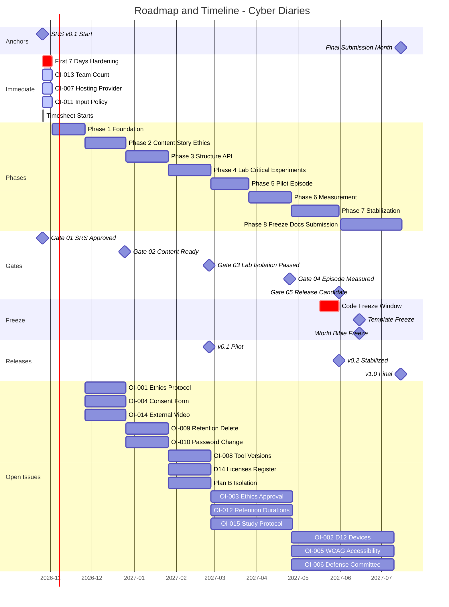

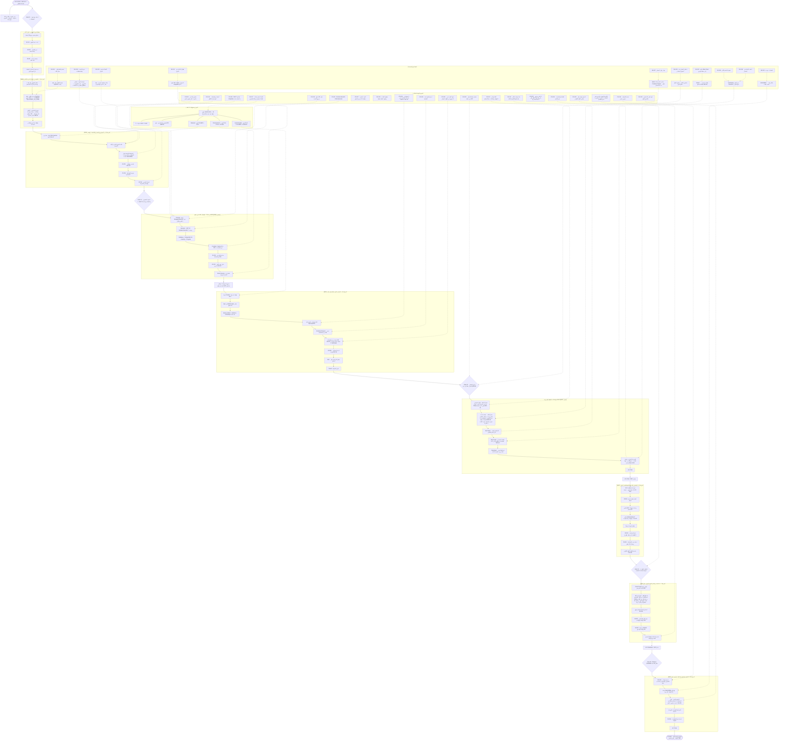

# خارطة الطريق والجدول الزمني — مشروع يوميات سايبر (Cyber Diaries)
## مخططات Mermaid فقط

---

## 1️⃣ المخطط الزمني الكلي (Gantt Chart)

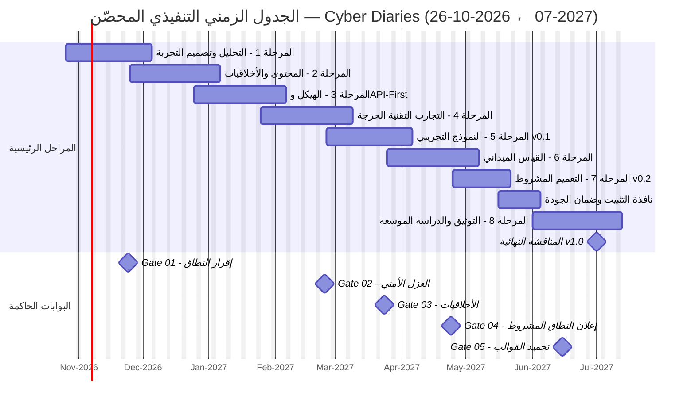

---

## 2️⃣ شبكة النودز المترابطة الكاملة (Full DAG)

```mermaid
flowchart TD
    classDef anchor fill:#10b981,stroke:#059669,stroke-width:3px,color:#fff
    classDef phase fill:#38bdf8,stroke:#0284c7,stroke-width:2px,color:#000
    classDef gate fill:#f59e0b,stroke:#d97706,stroke-width:3px,color:#000
    classDef branch fill:#a855f7,stroke:#7c3aed,stroke-width:1.5px,color:#fff
    classDef qa fill:#f43f5e,stroke:#e11d48,stroke-width:2px,color:#fff
    classDef final fill:#10b981,stroke:#059669,stroke-width:4px,color:#fff

    START["🚀 N-START<br/>انطلاق المشروع<br/>26-10-2026 · SRS v0.1"]:::anchor
    
    START --> P1["📋 المرحلة 1<br/>التحليل وتصميم التجربة<br/>أكتوبر 2026"]:::phase
    P1 --> P1A["P1-A · UX<br/>رحلة المستخدم<br/>والمساران"]:::branch
    P1 --> P1B["P1-B · ARCH<br/>عزل المعامل<br/>والأدوار الثلاثة"]:::branch
    P1 --> P1C["P1-C · INFRA<br/>حسم الاستضافة<br/>OI-007"]:::branch
    P1 --> P1D["P1-D · GOV<br/>تثبيت العضو 13<br/>OI-013"]:::branch
    
    P1A --> G1
    P1B --> G1
    P1C --> G1
    P1D --> G1
    G1{"🚦 Gate 01<br/>إقرار النطاق<br/>نهاية أكتوبر 2026"}:::gate
    
    G1 --> P2["📝 المرحلة 2<br/>المحتوى والقصة<br/>+ الأخلاقيات<br/>نوفمبر 2026"]:::phase
    P2 --> P2A["P2-A · SCENARIO<br/>سيناريو SQL Injection<br/>JSON/MD خام"]:::branch
    P2 --> P2B["P2-B · EDU<br/>الشرح بأركانه 5<br/>+ المصادر"]:::branch
    P2 --> P2C["P2-C · NARRATIVE<br/>المشاهد القصصية<br/>World Bible"]:::branch
    P2 --> P2D["P2-D · ETHICS<br/>بروتوكول الأخلاقيات<br/>OI-001/004"]:::branch
    
    P2A --> P3
    P2B --> P3
    P2C --> P3
    P2D --> P3
    P2D -.->|موافقة مسبقة| G3
    
    P3["⚙️ المرحلة 3<br/>الهيكل الأساسي<br/>API-First<br/>ديسمبر 2026"]:::phase
    P3 --> P3A["P3-A · API<br/>عقود Swagger<br/>+ Mock Servers"]:::branch
    P3 --> P3B["P3-B · MONOLITH<br/>.NET 10<br/>7 وحدات"]:::branch
    P3 --> P3C["P3-C · DB<br/>PostgreSQL 16<br/>+ Argon2id"]:::branch
    P3 --> P3D["P3-D · FRONTEND<br/>Next.js 14<br/>+ RTL"]:::branch
    
    P3A --> P4
    P3B --> P4
    P3C --> P4
    P3D --> P4
    
    P4["🧪 المرحلة 4<br/>التجارب التقنية الحرجة<br/>يناير 2027"]:::phase
    P4 --> P4A["P4-A · DOCKER<br/>عزل + Reaper"]:::branch
    P4 --> P4B["P4-B · TOOLS<br/>ttyd · Monaco · Adminer"]:::branch
    P4 --> P4C["P4-C · VERIFIER<br/>تحقق خادمي"]:::branch
    P4 --> P4D["P4-D · PLAN-B<br/>خطة بديلة<br/>+ المرجع التقني"]:::branch
    
    P4A --> G2
    P4B --> G2
    P4C --> G2
    P4D --> G2
    G2{"🚦 Gate 02<br/>العزل الأمني<br/>IM-006<br/>نهاية يناير 2027"}:::gate
    
    G2 --> P5["🎯 المرحلة 5<br/>النموذج التجريبي v0.1<br/>فبراير 2027"]:::phase
    P5 --> P5A["P5-A · FLOW<br/>ربط الشرح بالمعمل<br/>واختيار الدور"]:::branch
    P5 --> P5B["P5-B · RED<br/>استغلال SQLi"]:::branch
    P5 --> P5C["P5-C · BLUE<br/>تحقيق جنائي"]:::branch
    P5 --> P5D["P5-D · DEV<br/>ترقيع الكود"]:::branch
    P5 --> P5E["P5-E · DIARY & DoD<br/>اليوميات + ساعات<br/>CN-019"]:::branch
    
    P5A --> G3
    P5B --> G3
    P5C --> G3
    P5D --> G3
    P5E --> G3
    P5E -.->|ساعات فعلية| G4
    
    G3{"🚦 Gate 03<br/>الأخلاقيات<br/>أو Dogfooding<br/>مطلع مارس 2027"}:::gate
    
    G3 --> P6["📊 المرحلة 6<br/>القياس الميداني<br/>5-10 طلاب<br/>مارس 2027"]:::phase
    P6 --> P6A["P6-A · STUDY<br/>تجربة 5-10 طلاب<br/>+ BehaviorEvent"]:::branch
    P6 --> P6B["P6-B · SUS<br/>حسم OI-015<br/>+ OI-002"]:::branch
    P6 --> P6C["P6-C · USER DOC<br/>دليل المستخدم"]:::branch
    
    P6A --> G4
    P6B --> G4
    P6C --> G4
    G4{"🚦 Gate 04<br/>قرار مشروط<br/>CN-019<br/>نهاية مارس 2027"}:::gate
    
    G4 --> P7A_PATH["✅ PATH A<br/>التعميم المشروط<br/>إضافة فئات عبر CMS"]:::branch
    G4 --> P7B_PATH["🔄 PATH B PIVOT<br/>ترسيخ الحقن<br/>عند عيوب UX"]:::branch
    
    P7A_PATH --> P7
    P7B_PATH --> P7
    
    P7["📈 المرحلة 7<br/>التعميم المشروط v0.2<br/>أبريل - منتصف مايو 2027"]:::phase
    P7 --> P7A["P7-A · CMS<br/>إدخال فئات<br/>بلا كود"]:::branch
    P7 --> P7B["P7-B · TEMPLATE<br/>وفر 30-40%<br/>SE-001"]:::branch
    P7 --> P7C["P7-C · E2E<br/>تحقق شامل<br/>من الفئات"]:::branch
    
    P7A --> QA
    P7B --> QA
    P7C --> QA
    QA["🧊 نافذة التثبيت<br/>Code Freeze & QA<br/>نصف مايو 2027"]:::qa
    QA --> QAA["QA-A · BUG BASH<br/>صفر أخطاء حرجة"]:::branch
    QA --> QAB["QA-B · PERF<br/>SP-001..004<br/>10 متعلمين"]:::branch
    QA --> QAC["QA-C · DOCS<br/>مزامنة الأدلة"]:::branch
    
    QAA --> P8
    QAB --> P8
    QAC --> P8
    
    P8["📚 المرحلة 8<br/>التوثيق والدراسة الموسعة<br/>يونيو 2027"]:::phase
    P8 --> P8A["P8-A · LEADERBOARD<br/>لوحة اختيارية<br/>Opt-in"]:::branch
    P8 --> P8B["P8-B · EVAL<br/>دراسة n≥10<br/>قبلي/بعدي"]:::branch
    P8 --> P8C["P8-C · 4 MANUALS<br/>الأدلة الأربعة<br/>الرسمية"]:::branch
    P8 --> P8D["P8-D · PAPER<br/>الورقة البحثية<br/>+ OI-006"]:::branch
    
    P8A --> G5
    P8B --> G5
    P8C --> G5
    P8D --> G5
    G5{"🚦 Gate 05<br/>تجميد القوالب<br/>CN-016<br/>منتصف يونيو 2027"}:::gate
    
    G5 --> FINAL["🏁 N-FINAL v1.0<br/>التسليم والمناقشة<br/>يوليو 2027"]:::final
    
    linkStyle default stroke:#64748b,stroke-width:2px
```

---

## 3️⃣ مسار البوابات الحاكمة (Governance Gates Flow)

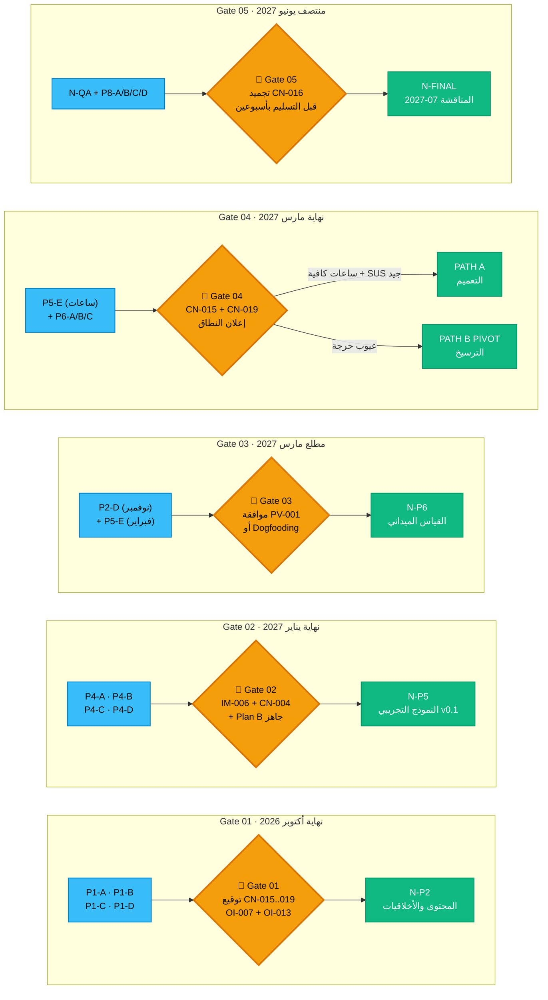

---

## 4️⃣ بوابة القرار المشروط Gate 04 (CN-019 Simulator)

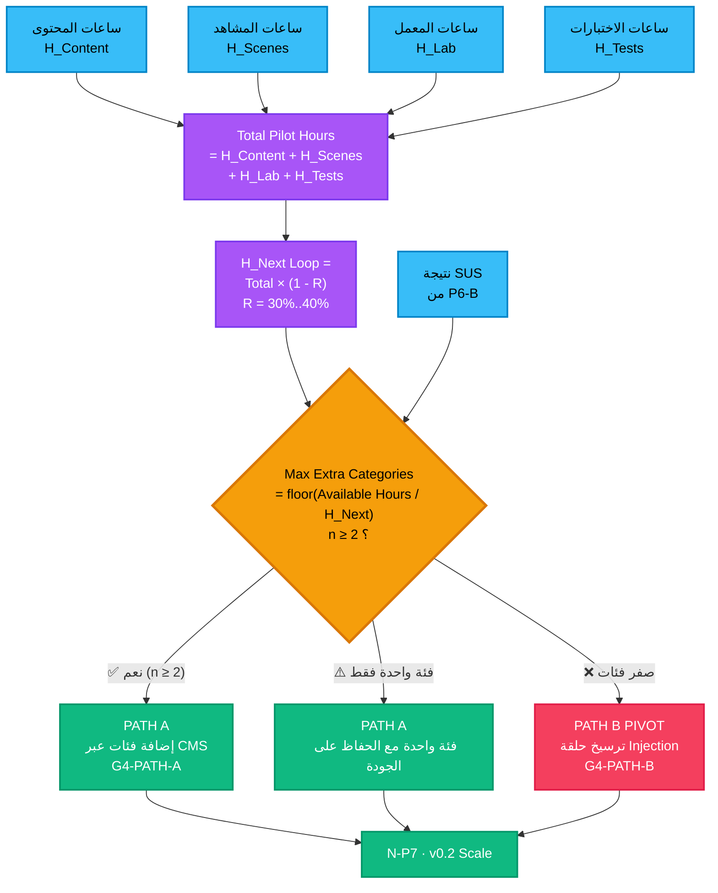

---

## 5️⃣ مصفوفة الإصدارات المرحلية (Release Evolution)

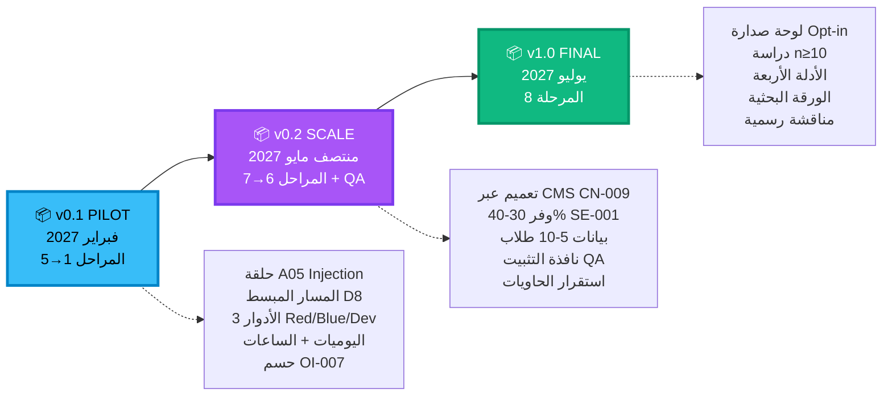

---

## 6️⃣ هيكلة الفرق الأربعة وصلاحيات الحسم (Teams Structure)

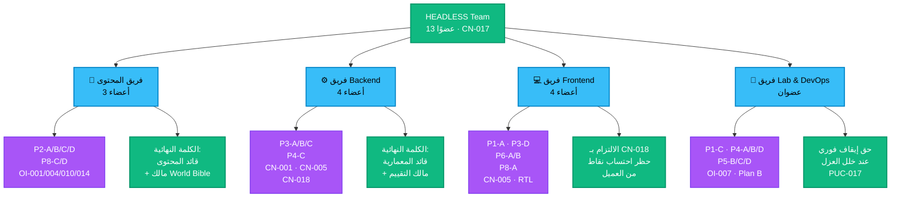

---

## 7️⃣ استراتيجية درء المخاطر الأربعة (Risk Mitigation)

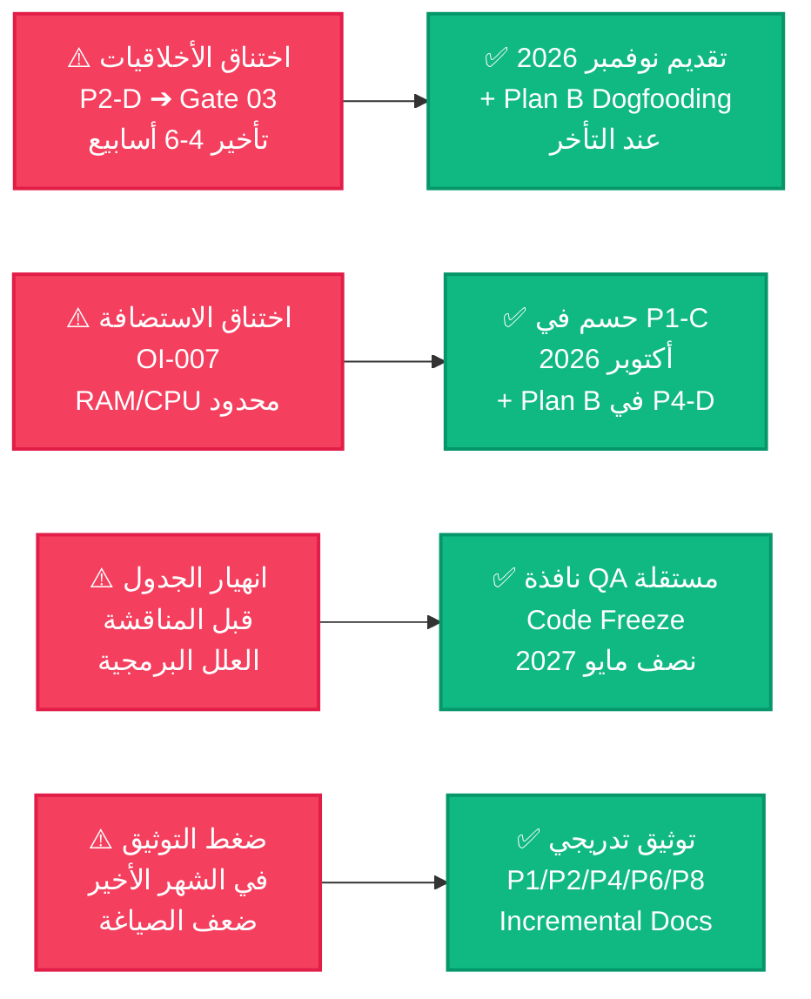

---

## 8️⃣ خريطة حسم القضايا المفتوحة على المسار (Open Issues Timeline)

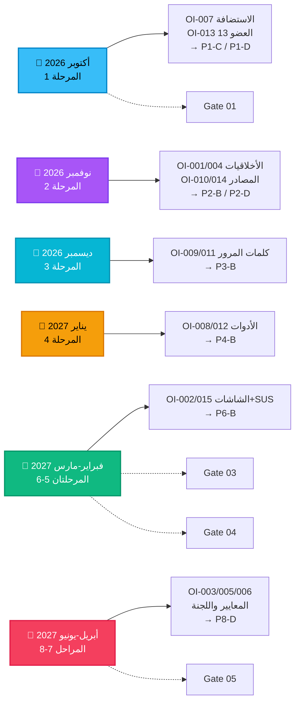

---

## 9️⃣ مصفوفة التحقق من شروط العبور (Exit Criteria Matrix)

```mermaid
flowchart TB
    classDef gate fill:#f59e0b,stroke:#d97706,stroke-width:3px,color:#000
    classDef crit fill:#38bdf8,stroke:#0284c7,stroke-width:1px,color:#000
    
    G1["🚦 Gate 01<br/>نهاية أكتوبر 2026"]:::gate
    G1 --> C1A["✓ SRS v0.1 معتمد"]:::crit
    G1 --> C1B["✓ توقيع CN-015..019"]:::crit
    G1 --> C1C["✓ OI-007 الاستضافة محسومة"]:::crit
    G1 --> C1D["✓ OI-013 العضو 13 مثبت"]:::crit
    
    G2["🚦 Gate 02<br/>نهاية يناير 2027"]:::gate
    G2 --> C2A["✓ IM-006 اجتياز إساءة الاستخدام"]:::crit
    G2 --> C2B["✓ CN-004 عزل شبكي تام"]:::crit
    G2 --> C2C["✓ Reaper يعمل"]:::crit
    G2 --> C2D["✓ Plan B جاهز"]:::crit
    
    G3["🚦 Gate 03<br/>مطلع مارس 2027"]:::gate
    G3 --> C3A["✓ PV-001 موافقة الأخلاقيات"]:::crit
    G3 --> C3B["✓ أو Dogfooding مفعّل"]:::crit
    G3 --> C3C["✓ نموذج موافقة مستنيرة"]:::crit
    
    G4["🚦 Gate 04<br/>نهاية مارس 2027"]:::gate
    G4 --> C4A["✓ ساعات المرحلة 5"]:::crit
    G4 --> C4B["✓ محضر CN-015 موقع"]:::crit
    G4 --> C4C["✓ نتائج SUS"]:::crit
    G4 --> C4D["✓ قرار PATH A/B"]:::crit
    
    G5["🚦 Gate 05<br/>منتصف يونيو 2027"]:::gate
    G5 --> C5A["✓ CN-016 تجميد القوالب"]:::crit
    G5 --> C5B["✓ تدقيق لغوي وتقني"]:::crit
    G5 --> C5C["✓ جاهزية العرض"]:::crit
```

---

## 🔟 التدفق التسلسلي المبسط للنودز الرئيسية (Spine Sequence)

```mermaid
flowchart TD
    classDef anchor fill:#10b981,stroke:#059669,stroke-width:3px,color:#fff
    classDef phase fill:#38bdf8,stroke:#0284c7,stroke-width:2px,color:#000
    classDef gate fill:#f59e0b,stroke:#d97706,stroke-width:3px,color:#000
    classDef qa fill:#f43f5e,stroke:#e11d48,stroke-width:2px,color:#fff
    
    START["N-START<br/>26-10-2026"]:::anchor
    P1["N-P1<br/>المرحلة 1"]:::phase
    G1["N-G1<br/>Gate 01"]:::gate
    P2["N-P2<br/>المرحلة 2"]:::phase
    P3["N-P3<br/>المرحلة 3"]:::phase
    P4["N-P4<br/>المرحلة 4"]:::phase
    G2["N-G2<br/>Gate 02"]:::gate
    P5["N-P5<br/>المرحلة 5 · v0.1"]:::phase
    G3["N-G3<br/>Gate 03"]:::gate
    P6["N-P6<br/>المرحلة 6"]:::phase
    G4["N-G4<br/>Gate 04"]:::gate
    P7["N-P7<br/>المرحلة 7 · v0.2"]:::phase
    QA["N-QA<br/>التثبيت"]:::qa
    P8["N-P8<br/>المرحلة 8"]:::phase
    G5["N-G5<br/>Gate 05"]:::gate
    FINAL["N-FINAL<br/>07-2027 · v1.0"]:::anchor
    
    START --> P1 --> G1 --> P2 --> P3 --> P4 --> G2 --> P5 --> G3 --> P6 --> G4 --> P7 --> QA --> P8 --> G5 --> FINAL
```

---
