# 1) المبادئ الحاكمة للـ Workflow

قبل ما نبني أي سير عمل، لازم نثبت القواعد اللي تحكم كل خطوة.

## أ) نطاق النسخة الأولى

الـ Workflow كله يخدم مخرجًا واحدًا:

> حلقة Injection كاملة تشمل:
> - مشهد قصصي تعليمي قبل التوظيف
> - شرح تقني
> - فيديو خارجي مدمج أو رابط بديل
> - اختبار قصير 3–5 أسئلة
> - انتقال إلى اللاب
> - مقدمة قصصية داخل “نور تك”
> - اختيار الصعوبة
> - اختيار الدور: Red Team / Blue Team / Developer
> - تنفيذ المهمة
> - تحقق آلي
> - تغذية راجعة
> - يومية اختيارية
> - تقدم ونقاط
> - قياس تكلفة الحلقة

---

## ب) قواعد لا تُكسر في الـ Workflow

| القاعدة | معناها العملي |
|---|---|
| الاختبار ليس بوابة | المستخدم يستطيع الانتقال إلى اللاب حتى لو لم يجتز الاختبار |
| الصعوبة تحدد التلميحات فقط | Easy/Medium/Hard لا يغيّر نوع الثغرة أو الحل |
| النقاط في الخادم | لا يُقبل احتساب نقاط من المتصفح وحده |
| اليومية اختيارية | تخطيها لا يحجب التقدم ولا يخصم نقاطًا |
| الدخول المباشر مسموح | يمكن اختيار دور واحد دون المرور بالأدوار الثلاثة |
| التجربة الكاملة خيار | Full Scenario يجمع الأدوار لكنه غير إجباري |
| حادثة واحدة لكل فئة | Red Team يكتشف، Blue Team يحقق، Developer يعالج نفس الحادث |
| Blue Team ليس بحث نصي | يجب أن يتضمن سلسلة استنتاج من خطوتين إلى ثلاث |
| المعمل معزول | الحاوية تُدمر بعد الجلسة ولا تصل خارج النطاق |
| المحتوى المكتوب هو المرجع | إذا فشل الفيديو، يبقى الشرح النصي كافيًا |
| ما يُضحى به هو عدد الحلقات | لا يُضحى بأمان المعمل ولا بجودة التقييم |

---

# 2) الـ Workflow العام للمستخدم من أول زيارة حتى إتمام الحلقة

هذا هو المسار الأساسي للمتعلّم.

## المخطط المختصر

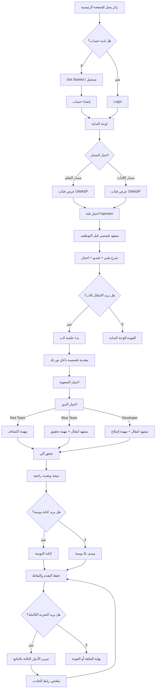

---

# 3) الWorkflow الصفحة الرئيسية والتسجيل والدخول

هذا يغطي `PUC-001` و`BUC-001`.

## الخطوات

| الخطوة | الحدث | النظام | المخرج | الحالة |
|---|---|---|---|---|
| 1 | زائر يفتح الصفحة الرئيسية | Frontend | تعريف بالمشروع + Get Started + Login | Visitor |
| 2 | يختار Get Started | Frontend → Auth | نموذج تسجيل | NewUser |
| 3 | يدخل بيانات الحساب | Backend Identity | Account + User | PendingValidation |
| 4 | يتم إنشاء الحساب | PostgreSQL | User نشط | Active |
| 5 | يسجل الدخول | Auth | Session/JWT | Authenticated |
| 6 | يذهب للوحة البداية | Frontend | Dashboard | Ready |

## قواعد مهمة

- لا يُطلب من الزائر التسجيل قبل فهم الفكرة.
- الصفحة الرئيسية يجب أن توضح أن النسخة الحالية تخدم فئة Injection كحلقة متكاملة.
- تسجيل الدخول يجب أن يدعم العربية و RTL.
- حذف الحساب مطلوب لاحقًا بموجب `D11` و`FR-025`، لكن في الـ Workflow الأولي يكفي وجود مسار إداري/قانوني واضح.

---

# 4) Workflow لوحة البداية واختيار المسار

هذا يغطي `PUC-002`.

## الخطوات

| الخطوة | الوصف | القرار |
|---|---|---|
| 1 | المستخدم يدخل لوحة البداية | يعرض المسارين |
| 2 | يرى “مسار التعلم” و“مسار اللابات” | لا يُشترط ترتيب معين |
| 3 | يرى تقدمه السابق إن وُجد | Progress + BehaviorEvent |
| 4 | يختار مسارًا | يسجَّل BehaviorEvent |
| 5 | ينتقل لصفحة الفئات | LearningCategory list |

## قاعدة حاسمة

> المستخدم يستطيع الدخول إلى أي مسار مباشرة، ولا يُشترط إنهاء مسار قبل الآخر.

يعني ممكن:
- يذهب للتعلم فقط.
- يذهب لللابات فقط.
- يبدأ من التعلم ثم ينتقل لللاب.
- يبدأ من اللاب ثم يعود للتعلم.

---

# 5) Workflow مسار التعلم

هذا يغطي `PUC-003` إلى `PUC-006`.

## الأجزاء الأساسية

### 5.1 عرض الفئات

- تُعرض فئات OWASP Top 10:2025.
- في النسخة الأولى، الفئة المتاحة فعليًا للحلقة الكاملة هي:
  - **A05:2025 Injection**
- الفئات الأخرى قد تظهر كمؤشر على البنية المستقبلية، لكن لا يُوهم المستخدم بأنها جاهزة.

### 5.2 المشهد القصصي التعليمي

- يظهر البطل “صابر” في مرحلة ما قبل التوظيف.
- الهدف: وضع المتعلم في سياق إنساني وتعليمي.
- يمكن تخطيه.
- عند التخطي يظهر **ملخص مكافئ**.

#### شروط الملخص المكافئ

يجب أن:
- يذكر المرحلة.
- يذكر الشخصية.
- يوضح المهمة.
- لا يكشف الإجابة.
- لا يعرض خطوات الحل الجاهز.

### 5.3 الشرح التقني

يجب أن يحتوي على:

1. مقدمة مبسطة: ما المشكلة؟
2. شرح تقني: كيف تحدث؟
3. مثال واقعي داخل السياق الافتراضي.
4. الأسباب الجذرية.
5. أساليب الوقاية والإصلاح.
6. المصطلح الإنجليزي عند أول ورود.
7. حوارات بالعامية المصرية عند الحاجة السردية.
8. شروح بالفصحى الواضحة.

### 5.4 الفيديو التعليمي الخارجي

- فيديو مدمج من مصدر خارجي موثوق.
- يجب وجود رابط بديل.
- إذا فشل الفيديو:
  - لا يتعطل الدرس.
  - يظهر الرابط البديل.
  - يبقى الشرح المكتوب كافيًا.

### 5.5 الاختبار القصير

- من 3 إلى 5 أسئلة اختيار من متعدد.
- كل سؤال له:
  - نص
  - خيارات
  - إجابة صحيحة
  - ردود توضيحية
- بعد الإجابة يظهر:
  - صحيح/خطأ
  - تفسير موجز

### قاعدة تربوية مهمة

> الاختبار فحص ذاتي، ليس بوابة إجبارية.

لذلك:
- لا يُحجب اللاب بسبب رسوب الاختبار.
- يمكن الانتقال مباشرة إلى المعمل.

---

# 6) Workflow الانتقال من التعلم إلى اللاب

هذا يغطي `PUC-006`.

## الخطوات

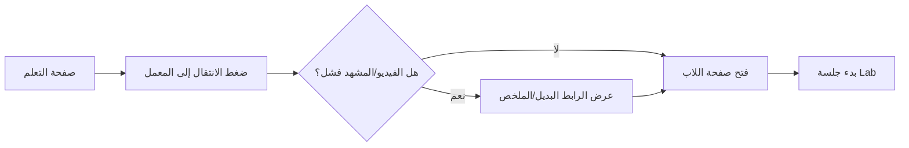

## الشروط

- لا يُشترط اجتياز الاختبار.
- يجب أن يظهر للمستخدم أنه ينتقل من مرحلة التعلم إلى مرحلة العمل داخل “نور تك”.
- يجب أن يُسجَّل حدث سلوكي:
  - `TransitionToLab`
  - أو ما يماثله في `BehaviorEvent`.

---

# 7) Workflow بدء جلسة اللاب

هذا يغطي `PUC-007`.

## الخطوات

| الخطوة | الحدث | البيانات | القرار |
|---|---|---|---|
| 1 | المستخدم يختار فئة اللاب | LearningCategory | يجب أن تكون Injection في النسخة الأولى |
| 2 | النظام يطلب بدء جلسة | LabSession | Pending |
| 3 | خدمة المعمل تنشئ حاوية | Docker | Provisioning |
| 4 | تُعرض المقدمة القصصية | NarrativeScene | بعد انضمام البطل إلى نور تك |
| 5 | يمكن تخطي المقدمة | BehaviorEvent | يظهر ملخص مكافئ |
| 6 | يختار الصعوبة | Difficulty | Easy/Medium/Hard |
| 7 | يختار الدور | Role | Red/Blue/Developer |
| 8 | إذا Blue/Developer يظهر مشهد انتقال | NarrativeScene | زميل مختص |
| 9 | تُعرض مساحة عمل الدور | LabTask + LabTool | Active |

---

# 8) Workflow مستويات الصعوبة

الصعوبة لا تغيّر المشكلة، بل تغيّر كمية المساعدة فقط.

| المستوى | نوع التلميحات | مضاعف النقاط | سلوك النظام |
|---|---|---:|---|
| Easy | تلميحات موسعة تشرح الخطوة الحالية بمثال مشابه دون الوصول للحل | 1.0 | يساعد كثيرًا |
| Medium | إشارات اتجاهية: أين تنظر؟ أي دليل؟ أي أداة؟ | 1.5 | توجيه متوسط |
| Hard | لا تلميحات | 2.0 | يعتمد على استقلالية المستخدم |

## قواعد تنفيذية

- لا مستوى يكشف الحل النهائي مباشرة.
- استخدام التلميح يُسجَّل في `BehaviorEvent`.
- المضاعف يُحتسب حسب المستوى الذي تحققت عنده شروط النجاح فعليًا.
- لا يسمح بتغيير المستوى بعد الإنجاز للحصول على نقاط أعلى.

---

# 9) Workflow الأدوار الثلاثة داخل اللاب

كل دور له مساحة عمل مختلفة، لكنهم جميعًا يتعاملون مع نفس الحادث الأمني.

---

## 9.1 Red Team — مهمة الاكتشاف

### السؤال الرئيسي

> أين المشكلة؟ وهل يمكن إثباتها بأمان؟

### الأدوات المتوقعة

- متصفح.
- أدوات مطوّر المتصفح.
- طرفية المعمل عبر `ttyd`.
- أدوات جاهزة حسب السيناريو، مثل `curl` أو أدوات استكشاف محدودة.

### خطوات المستخدم

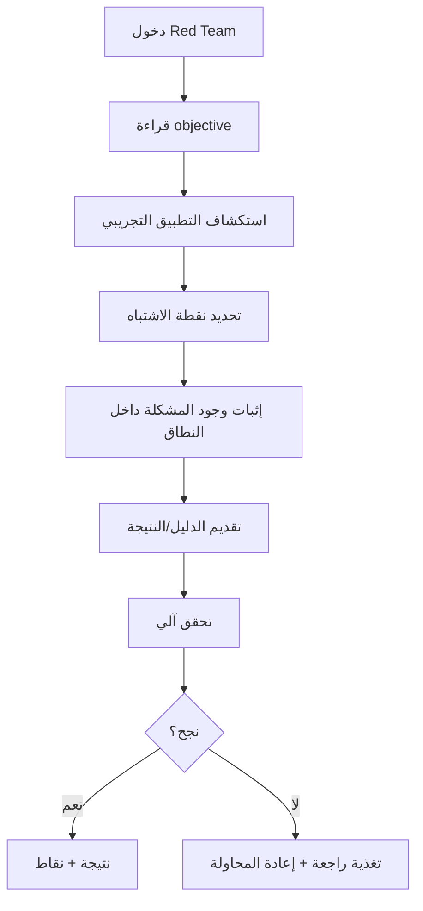

### معايير النجاح

يجب أن:
- يحدد نقطة الدخول أو موضع المشكلة.
- يثبت وجود المشكلة بأمان.
- لا يتجاوز نطاق المعمل.
- لا يصل إلى بيانات ممنوعة أو خارج السيناريو.
- يقدّم دليلًا قابلًا للتحقق الآلي.

### ما لا يُقبل

- مجرد العثور على نص مخفي.
- تنفيذ exploit عشوائي بدون فهم.
- الخروج عن بيئة المعمل.

---

## 9.2 Blue Team / SOC — مهمة التحقيق

### السؤال الرئيسي

> ماذا حدث؟ وكيف نعرف؟

### الأدوات المتوقعة

- `grep`
- `tail`
- عرض السجلات
- Adminer أو واجهة قاعدة بيانات تعليمية
- طرفية المعمل

### خطوات المستخدم

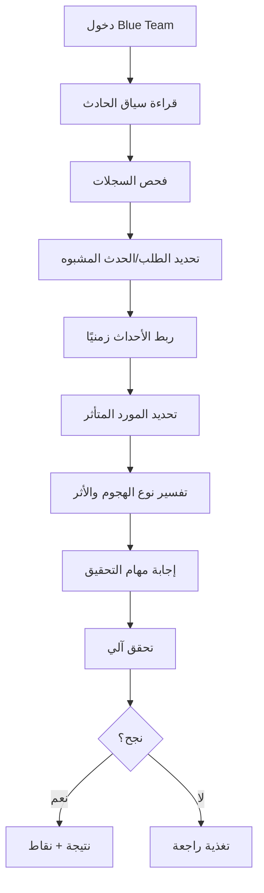

### الشرط التربوي المهم

> Blue Team ليس امتحان قراءة سطر في log.

يجب أن يحتوي على **سلسلة استنتاج حقيقية** من خطوتين إلى ثلاث، مثل:

1. أجد طلبًا مشبوهًا في السجل.
2. أربطه بمستخدم/وقت/مورد.
3. أستنتج نوع الهجوم وأثره المحتمل.

### معايير النجاح

- تحديد الحدث في السجلات.
- ربط الحدث بالطلب أو المستخدم أو المورد.
- تفسير نوع الهجوم.
- تحديد الأثر المحتمل.
- عدم الاعتماد على حدس غير مدعوم بأدلة.

---

## 9.3 Developer — مهمة الإصلاح

### السؤال الرئيسي

> كيف نمنع تكرار المشكلة؟

### الأدوات المتوقعة

- Monaco Editor
- اختبارات آلية
- بيئة المعمل
- تشغيل التطبيق داخل الحاوية عند الحاجة

### خطوات المستخدم

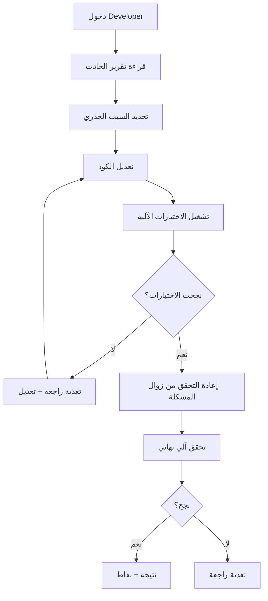

### معايير النجاح

يجب أن:
- يحدد السبب الجذري.
- يطبق إصلاحًا مناسبًا.
- يجتاز الاختبارات الآلية.
- يمنع الحالة غير الآمنة.
- لا يكسر الوظائف المشروعة.

### أمثلة تحقق آلي لفئة Injection

- إرسال payload سابق كان ناجحًا أصبح محجوبًا أو غير مؤثر.
- اختبار وحدة يؤكد استخدام parameterized query أو escaping مناسب.
- اختبار تكامل يؤكد أن التطبيق ما زال يعمل.
- فحص نمطي يمنع reintroduction للثغرة.

---

# 10) Workflow التحقق الآلي والتغذية الراجعة

هذا يغطي `PUC-011`.

## الخطوات

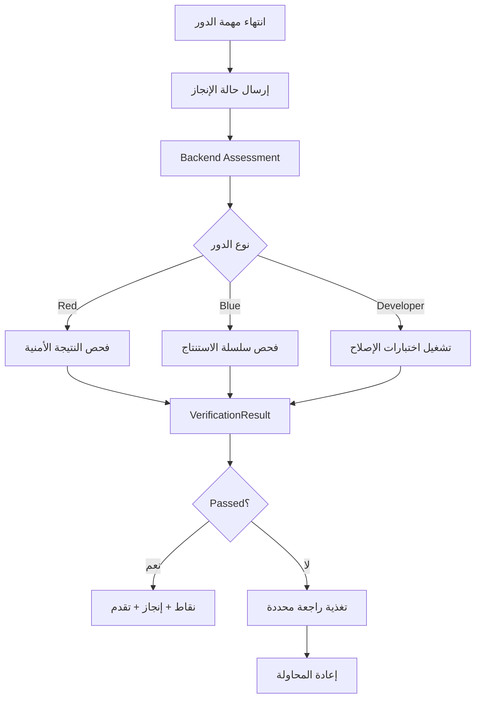

## قواعد حرجة

- التحقق يتم في الخادم.
- لا يُقبل أي claim من المتصفح وحده.
- لا تُمنح نقاط عند الفشل.
- لا تُمنح نقاط عند انقطاع الجلسة قبل التحقق.
- `VerificationResult` لا يُعدَّل بعد إنشائه.
- التغذية الراجعة يجب أن تكون تعليمية، ليست مجرد “خطأ”.

---

# 11) Workflow اليومية

هذا يغطي `PUC-013`.

## نموذج اليومية

المتعلم يجيب عن أربعة أسئلة:

1. ماذا حدث؟
2. لماذا حدث؟
3. ماذا فعلت؟
4. ماذا تعلمت؟

## القواعد

- اليومية اختيارية.
- تمنح نقاطًا إضافية.
- التخطي لا يحجب التقدم.
- التخطي لا يخصم نقاطًا.
- إذا تخطاها المستخدم، تُسجَّل الحلقة مع وسم:
  - «بلا يومية»
- التقييم الحر للنصوص مؤجل في النسخة الأولى.

## التدفق

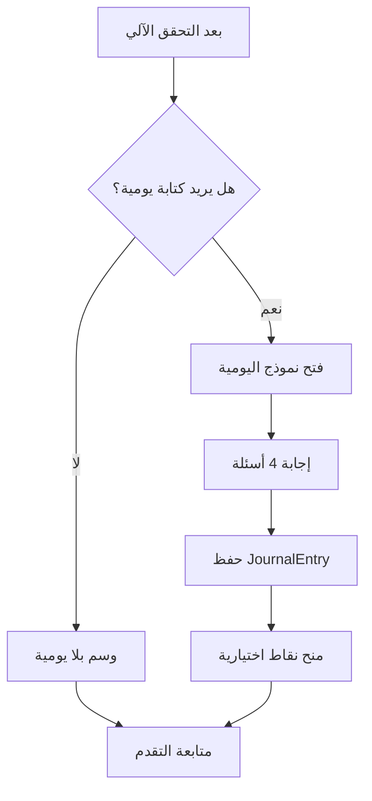

---

# 12) Workflow التقدم والنقاط ولوحة الصدارة

هذا يغطي `PUC-014` و`PUC-015`.

## التقدم

يجب أن يُحسب من بيانات فعلية، لا من تقدير المستخدم.

### تعريفات الإكمال المطلوبة

لازم نحدد بدقة:

- من بدأ الحلقة.
- من أنهى القراءة.
- من أجاب الاختبار.
- من فتح اللاب.
- من اختار دورًا.
- من أنجز Red Team.
- من أنجز Blue Team.
- من أنجز Developer.
- من كتب اليومية.
- من أكمل الحلقة كاملة.
- من أكمل Full Scenario.

## النقاط

### مصادر النقاط

- إتمام وظيفة معملية.
- إتمام الحلقة الكاملة.
- الإتمام بدون تلميحات.
- الإتمام بمستوى صعوبة أعلى.
- إنجازات تعليمية.
- كتابة اليومية اختيارًا.

### قواعد النقاط

- كل النقاط تُحسب في الخادم.
- كل حركة نقاط لها `SourceId` لمنع التكرار.
- لا تعديل لحركات النقاط بعد إنشائها من واجهة المتعلم.
- لا نقاط عند فشل التحقق.
- لا نقاط عند انقطاع الجلسة قبل الحفظ الآمن.

## لوحة الصدارة

- اختيارية.
- مغلقة افتراضيًا Opt-in.
- تسمح بالإخفاء الكامل.
- تستخدم أسماء عرض اختيارية.
- فترات:
  - أسبوعي
  - شهري
  - إجمالي

---

# 13) Workflow تشغيل المعمل تقنيًا

هذا أهم workflow تقني وأخطر workflow أمني.

##生命周期 الجلسة

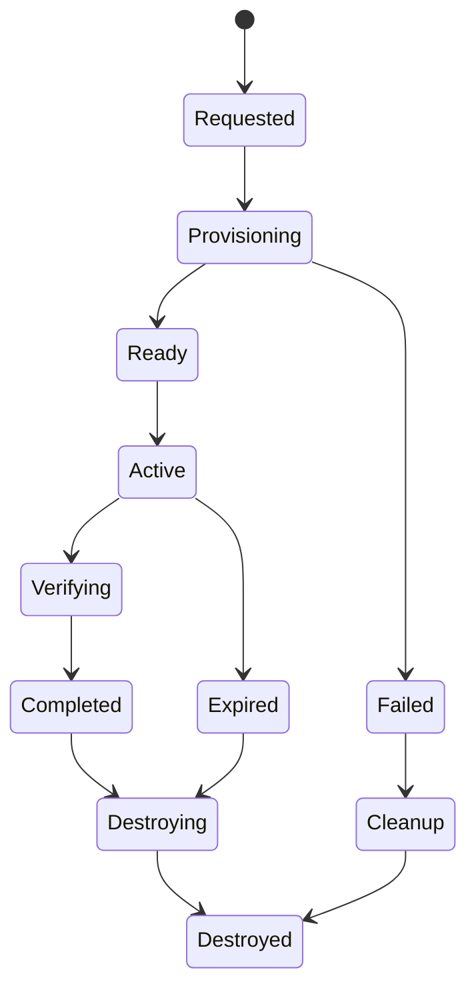

## الخطوات التفصيلية

| الخطوة | الوصف | المسؤول | المخرج |
|---|---|---|---|
| 1 | المستخدم يطلب بدء جلسة | Frontend → API | SessionRequest |
| 2 | API يتحقق من الصلاحيات | Identity | Authorized/Rejected |
| 3 | API يرسل طلب تشغيل معمل | Labs Service | ContainerJob |
| 4 | Docker ينشئ حاوية معزولة | Lab/DevOps | ContainerId |
| 5 | تُحمَّل الأدوات والتطبيق التجريبي | Container | Ready environment |
| 6 | تُربط واجهة المستخدم بـ ttyd/Monaco/Adminer | Frontend/Labs | Active session |
| 7 | المستخدم ينفذ المهمة | Learner | Evidence/Actions |
| 8 | النظام يلتقط الأحداث | BehaviorEvent | Audit/Analytics |
| 9 | المستخدم يرسل نتيجة | API | VerificationRequest |
| 10 | Assessment يتحقق | Backend | VerificationResult |
| 11 | تُحفظ النقاط والتقدم | Gamification/Progress | DB records |
| 12 | تنتهي الجلسة أو ينتهي الوقت | Background Worker | Expiry |
| 13 | تُدمَّر الحاوية | Docker/Labs | Cleanup |
| 14 | يُسجَّل تنظيف الموارد | AuditLog | Completed |

## قيود تشغيلية محسومة

| البند | القيمة |
|---|---|
| مدة الجلسة الافتراضية | 60 دقيقة |
| الحد الأقصى | 120 دقيقة |
| التزامن المستهدف | 10 متعلمين |
| ذاكرة الحاوية | 2GB RAM |
| بناء الحاوية | أقل من 90 ثانية |
| تحقق آلي | أقل من 3 ثوانٍ |
| API بسيط | أقل من 500ms |
| API مركب | أقل من 2s |

## قواعد أمنية حرجة

- خدمة المعمل منفصلة تمامًا عن خدمة API.
- الحاوية لا تصل إلى الشبكة الداخلية.
- الحاوية لا تصل إلى Host.
- الأدوات لا تخرج عن نطاق المعمل.
- لا تُثبَّت أدوات على جهاز المتعلم.
- سطح المكتب في المعمل واجهة تفاعلية فقط.
- الحاوية تُدمر تلقائيًا بعد الجلسة.
- يوجد Background Worker / Container Reaper لتنظيف الحاويات اليتيمة.
- السجلات التعليمية لا تحتوي معلومات شخصية حقيقية أو أسرارًا.

---

# 14) Workflow إدارة المحتوى

هذا يغطي `PUC-016`.

## المستخدمون الإداريون

| الدور | الصلاحية |
|---|---|
| مسؤول المحتوى | إضافة/تعديل الفئات، الدروس، المشاهد، الاختبارات، السيناريوهات النصية |
| مسؤول التشغيل | إدارة دورة حياة المعمل، الحدود، المراقبة، التنظيف |
| مسؤول الإصدار | إصدار قواعد التقييم، اقتصاد النقاط، مستويات الصعوبة، متابعة حالة الدفعات |

## تدفق إضافة محتوى

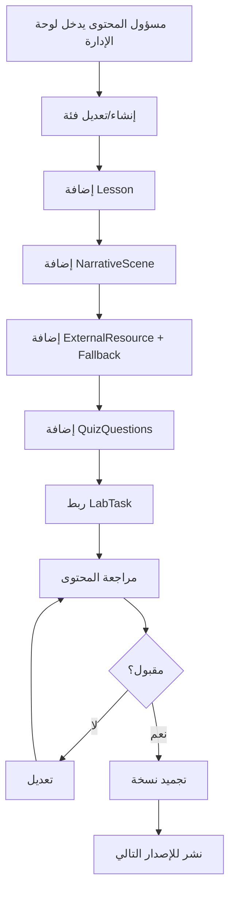

## قاعدة مهمة

> إضافة المحتوى لا يجب أن تتطلب لمس الكود.

هذا مرتبط بـ `CN-009` وشرط التعميم لاحقًا.

---

# 15) Workflow إدارة اللاب من ناحية المحتوى التقني

هذا يغطي `PUC-017`.

## الخطوات

| الخطوة | الوصف |
|---|---|
| 1 | مسؤول التشغيل يحدد صورة الحاوية |
| 2 | يحدد التطبيق التجريبي |
| 3 | يحدد الأدوات المسموح بها |
| 4 | يحدد حدود الشبكة والموارد |
| 5 | يحدد مدة الجلسة |
| 6 | يراقب الحاويات النشطة |
| 7 | يتدخل عند فشل provisioning |
| 8 | يتأكد من التنظيف التلقائي |
| 9 | يراجع سجلات الجلسات |

## مخرجات ضرورية

- LabSession log
- Container lifecycle log
- Evidence records
- Cleanup confirmation
- Resource usage metrics

---

# 16) Workflow الإصدار وحالة العمل

هذا يغطي `PUC-018`.

## فكرة الدفعات

الوثيقة مقسومة إلى دفعات، والنسخة الحالية لم تكتمل بعد.

### ما هو مكتمل نسبيًا

- القيود
- الحقائق
- قواعد العمل
- نطاق العمل
- نموذج بيانات العمل
- 18 PUC
- 25 FR للدفعة الأولى
- المتطلبات الأمنية
- المتطلبات الثقافية
- متطلبات الامتثال
- سجل القرارات Open Issues

### ما هو ناقص

- الدفعات 2–5
- PUC-007 إلى PUC-018 ليس لها متطلبات وظيفية مكتملة
- معايير القبول 7–19 لم تُفكك بالكامل
- متطلبات سهولة الاستخدام لم تُكتب فعليًا
- الاختبار القبلي/البعدي ليس له PUC أو كيان بيانات واضح
- وحدة التحليلات غير محسومة معماريًا
- التراخيص مفتوحة في D14

## Workflow الإصدار المقترح

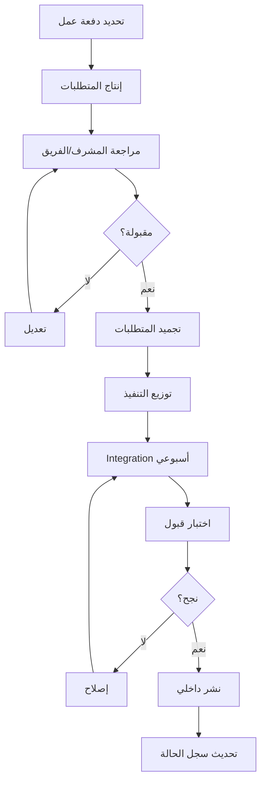

---

# 17) Workflow الفريق من البداية للتسليم

هذا هو سير عمل المشروع ككل.

## المرحلة 0: تجميد النطاق والقرارات

### المخرجات

- تأكيد أن النسخة الأولى = حلقة Injection واحدة.
- حسم عدد الفريق: 12 أم 13.
- حسم الاسم الرسمي: Cyber Diaries / يوميات سايبر.
- حسم سيناريو SQL Injection.
- حسم أدوات كل دور.
- إغلاق أو توثيق القرارات المفتوحة الحرجة.
- إنشاء Tool Licenses Register.
- إنشاء World Bible.
- إنشاء Decision Log.
- إنشاء Risk Register.

### بوابة الخروج

لا يبدأ بناء جاد قبل:
- توافق الفريق على النطاق.
- موافقة المشرف على المخرج الملتزم به.
- خطة واضحة لإغلاق الدفعات 2–5.

---

## المرحلة 1: Spike المعمل

هذه أهم مرحلة تقنية.

### الهدف

إثبات أن المعمل يعمل بأمان قبل بناء واجهات جميلة.

### المخرجات

- حاوية Docker معزولة.
- تطبيق تجريبي يحتوي مشكلة Injection.
- ttyd يعمل داخل المتصفح.
- Monaco Editor يعمل لدور Developer.
- Adminer أو عرض قاعدة بيانات تعليمية.
- جلسة تبدأ وتنتهي.
- تدمير الحاوية تلقائيًا.
- اختبار عزل الشبكة.
- اختبار 10 مستخدمين متزامنين.
- تحقق آلي أولي لدور واحد على الأقل.

### بوابة الخروج

إذا فشل العزل أو تعذّر تشغيل 10 متزامنين ضمن الحدود، يجب إعادة التصميم قبل الاستمرار.

---

## المرحلة 2: التصميم الهندسي الأساسي

### المخرجات

- Next.js 14 frontend.
- ASP.NET Core / .NET 10 backend.
- PostgreSQL 16.
- Modular Monolith بوحدات:
  - Identity
  - LearningContent
  - Labs
  - Assessment
  - Progress
  - Gamification
  - Administration
- Authentication.
- API contracts.
- CI/CD أولي.
- لوحة بداية.
- تنقل بين المسارين.

### قاعدة

عقود API تُتفق قبل توزيع التنفيذ.

---

## المرحلة 3: إنتاج حلقة التعلم

### المخرجات

- مشهد قصصي قبل التوظيف.
- شرح تقني كامل.
- فيديو خارجي + رابط بديل.
- اختبار 3–5 أسئلة.
- صفحة فئة Injection.
- حفظ تقدم القراءة والاختبار.

### بوابة الجودة

- الشرح المكتوب كافٍ بدون فيديو.
- الاختبار لا يمنع اللاب.
- النصوص تراجع لغويًا.
- المصطلح الإنجليزي يظهر عند الحاجة.

---

## المرحلة 4: إنتاج حلقة اللاب

### المخرجات

- مقدمة قصصية داخل نور تك.
- ملخص مكافئ عند التخطي.
- اختيار الصعوبة.
- اختيار الدور.
- مشاهد انتقال لـ Blue/Developer.
- مهمة Red Team.
- مهمة Blue Team.
- مهمة Developer.
- تحقق آلي.
- تغذية راجعة.
- ربط باليومية.

### بوابة الجودة

- Blue Team فيه سلسلة استنتاج حقيقية.
- Developer فيه اختبارات آلية meaningful.
- Red Team لا يعتمد على العثور على نص مخفي فقط.
- الأدوار الثلاثة مرتبطة بنفس الحادث.

---

## المرحلة 5: اليوميات والتحليلات

### المخرجات

- نموذج يومية.
- حفظ JournalEntry.
- ربطها بالجلسة والحلقة.
- BehaviorEvent.
- Progress.
- PointTransaction.
- Achievement.
- لوحة صدارة اختيارية.

### بوابة الجودة

- اليومية لا تعيق التقدم.
- النقاط لا تُحسب من العميل.
- لا تكرار في احتساب الإنجازات.

---

## المرحلة 6: التجربة الاستطلاعية

### الهدف

قياس فاعلية النموذج قبل التوسع.

### العينة

- 5–10 طلاب في التجربة الاستطلاعية.
- الدراسة البحثية تستهدف n ≥ 10.

### المخرجات

- اختبار قبلي/بعدي عند جاهزيتهما.
- زمن إتمام.
- معدل استخدام التلميحات.
- نسبة إكمال الأدوار.
- ملاحظات على القصة والانتقالات والأدوات.
- قياس تكلفة الحلقة بالساعات.

### تنبيه منهجي

- العينة صغيرة.
- النتائج تُقدَّم كإشارات أولية، لا كتعميم قوي.

---

## المرحلة 7: التوسع إن سمح الوقت

### القاعدة

لا تعد بعشر فئات.

### الشرط

يُعاد استخدام قالب الحلقة الأولى فقط بعد:
- قياس التكلفة.
- إثبات جودة الحلقة.
- استقرار المعمل.
- إغلاق الثغرات التنفيذية.

### الأولوية

- فئة ثانية واحدة فقط إن أمكن.
- لا تُضحَّى بجودة التقييم أو أمان المعمل.

---

## المرحلة 8: التوثيق والبحث والتسليم

### المخرجات

- وثيقة متطلبات محدثة.
- توثيق تقني.
- دليل مستخدم.
- دليل لوحة الإدارة.
- سجل قرارات.
- سجل مخاطر.
- سجل تراخيص.
- دراسة تقييمية.
- ورقة بحثية.
- عرض نهائي.
- نشر تجريبي/نهائي حسب البيئة.

---

# 18) Workflow البحث وجمع البيانات

هذا مهم جدًا لأن المشروع ليس منصة فقط، بل له بعد بحثي.

## الخطوات

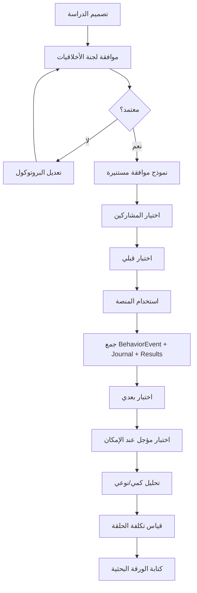

## بيانات مطلوبة

| النوع | المصدر | الاستخدام |
|---|---|---|
| اختبار قبلي | Study protocol | قياس المعرفة قبل التعرض |
| اختبار بعدي | Study protocol | قياس التحسن |
| BehaviorEvent | المنصة | أنماط التعلم، التلميحات، الوقت |
| JournalEntry | المنصة | تحليل نوعي |
| VerificationResult | المنصة | قياس الإنجاز |
| Cost hours | الفريق | قياس تكلفة الحلقة |
| SUS / usability | استبيان | سهولة الاستخدام |

## فجوات حالية يجب إغلاقها

- الاختبار القبلي/البعدي ليس له PUC واضح.
- ليس له كيان بيانات محدد.
- بروتوكول الدراسة مفتوح في OI-012.
- وحدة التحليلات ليست ضمن الوحدات السبع المعلنة.
- يجب تحديد هل يُدار داخل المنصة أم بأداة بحث خارجية.

---

# 19) Workflow البيانات والكيانات الأساسية

هذا يوضح ما الذي يُنشأ ويُحدَّث في كل خطوة.

## الكيانات الرئيسية

| الكيان | يُنشأ عند | يُحدَّث عند | يُحذف عند |
|---|---|---|---|
| User | التسجيل | تعديل الملف/الإعدادات | حذف الحساب |
| Account | التسجيل | تغيير كلمة المرور | حذف الحساب |
| LearningCategory | إدارة المحتوى | تعديل الفئة | حذف/أرشفة |
| Lesson | إدارة المحتوى | تعديل الشرح | حذف/أرشفة |
| NarrativeScene | إدارة المحتوى | تعديل المشهد | حذف/أرشفة |
| ExternalResource | إدارة المحتوى | تغيير الفيديو/الرابط | حذف/أرشفة |
| QuizQuestion | إدارة المحتوى | تعديل السؤال | حذف/أرشفة |
| LabSession | بدء اللاب | تغيير الحالة | تدمير/أرشفة بعد الجلسة |
| LabTask | إدارة المحتوى/اللاب | تعديل المهمة | حذف/أرشفة |
| LabTool | إعداد المعمل | تغيير الأدوات | حذف/أرشفة |
| Evidence | أثناء المهمة | إضافة فقط | حذف مع الحاوية/الجلسة |
| VerificationResult | انتهاء المهمة | لا يُعدَّل بعد الإنشاء | حذف مع البيانات حسب السياسة |
| JournalEntry | كتابة اليومية | تعديل قبل التجميد؟ حسب السياسة | حذف مع الحساب |
| Progress | إتمام أنشطة | تحديث الحالة | حذف مع الحساب |
| PointTransaction | تحقق ناجح/إنجاز | لا تُعدَّل | حذف مع الحساب حسب السياسة |
| Achievement | فتح إنجاز | لا يُعدَّل | حذف مع الحساب |
| BehaviorEvent | تفاعلات المستخدم | إضافة فقط | حذف حسب مدة الاحتفاظ |
| ContinuityEntry | World Bible/إدارة السرد | تحديث التسلسل | أرشفة |

---

# 20) Workflow الحالات State Machines

## أ) حالة الحلقة Episode

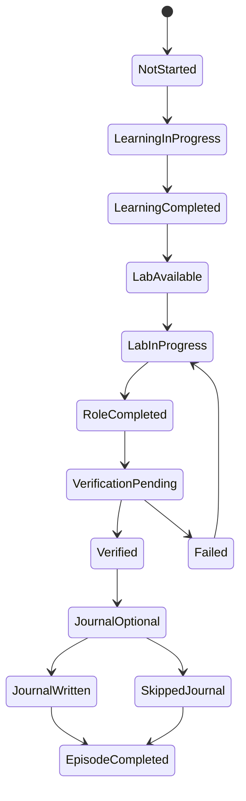

## ب) حالة جلسة المعمل LabSession

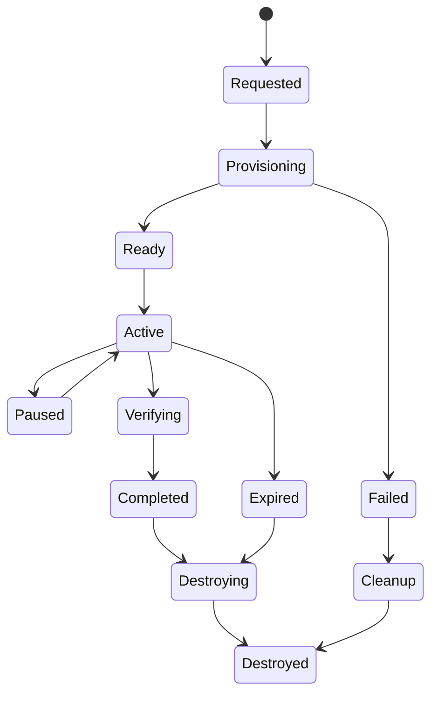

## ج) حالة التحقق VerificationResult

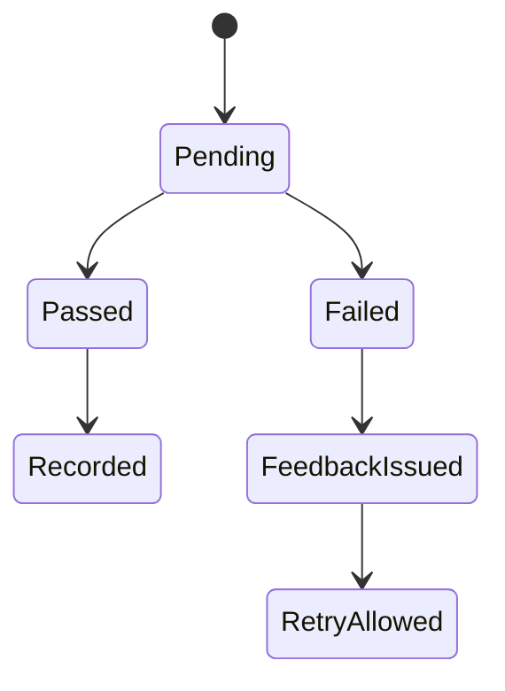

---

# 21) Workflow الصلاحيات Access Control

| الدور | الصفحة الرئيسية | التسجيل | لوحة البداية | التعلم | اللاب | اليومية | النقاط | إدارة المحتوى | تشغيل المعمل | الإصدار |
|---|---:|---:|---:|---:|---:|---:|---:|---:|---:|---:|
| زائر | نعم | نعم | لا | لا | لا | لا | لا | لا | لا | لا |
| متعلم | نعم | نعم | نعم | نعم | نعم | نعم | قراءة | لا | لا | لا |
| مسؤول محتوى | نعم | نعم | نعم | نعم | قد يرى preview | لا | لا | نعم | لا | جزئي |
| مسؤول تشغيل | نعم | نعم | إداري | لا | إدارة الجلسات | لا | لا | لا | نعم | لا |
| مسؤول إصدار | نعم | نعم | إداري | مراجعة | مراجعة | لا | مراجعة قواعد | جزئي | لا | نعم |
| مشرف/باحث | حسب الصلاحية | لا | إحصاءات مجهولة | لا | لا | حسب الموافقة | لا | لا | لا | لا |

---

# 22) Workflow الأخطاء والاستثناءات Exception Flows

كل workflow لازم يكون له مسارات فشل.

## أ) فشل تحميل الفيديو

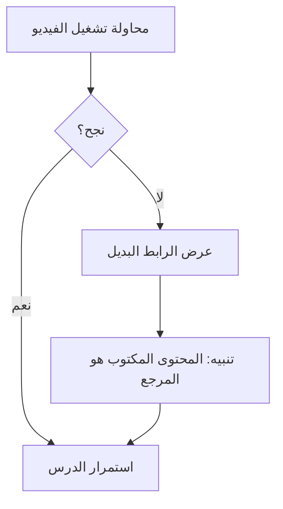

## ب) فشل إنشاء الحاوية

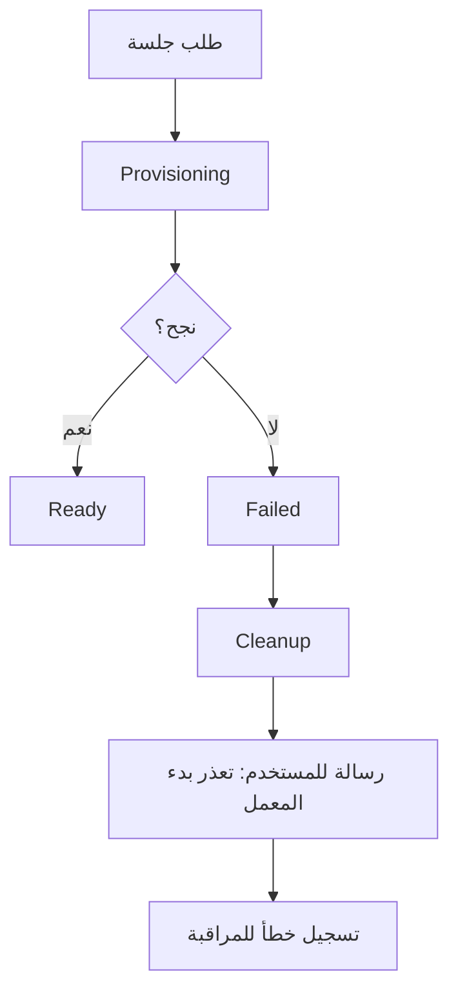

## ج) انقطاع اتصال المستخدم أثناء اللاب

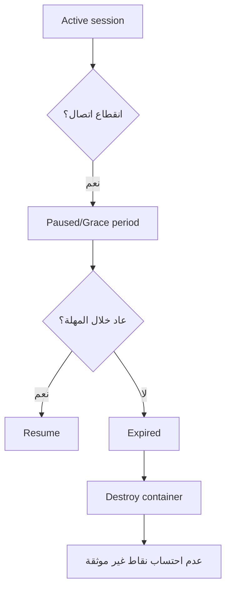

## د) فشل التحقق الآلي

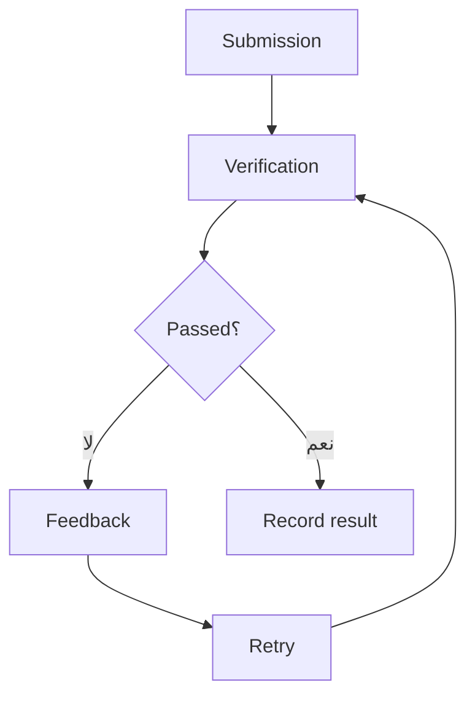

## هـ) محاولة تلاعب بالنقاط من العميل

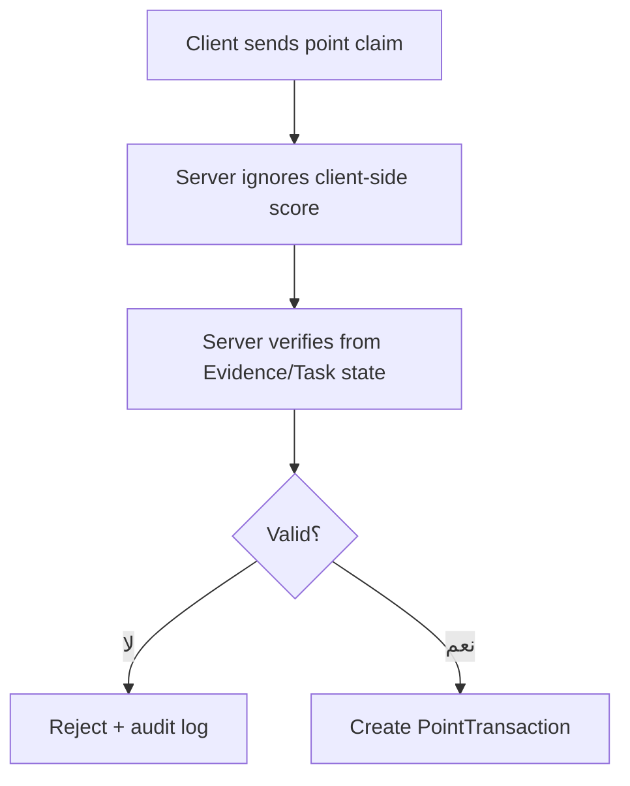

---

# 23) Workflow التكامل بين الفرق

هذا مهم لأن الفريق كبير نسبيًا، والتكامل المبكر ضروري.

## الفرق

| الفريق | مسؤوليته في الـ Workflow |
|---|---|
| المحتوى والسيناريو | المشاهد، الشرح، الاختبار، World Bible، ملخصات التخطي |
| Backend | Identity، Progress، Gamification، Assessment، APIs |
| Frontend | الصفحات، لوحة البداية، مسارات التعلم، واجهة اللاب، RTL |
| Lab/DevOps | Docker، العزل، ttyd، Monaco، Adminer، التنظيف، المراقبة |

## إيقاع التكامل المقترح

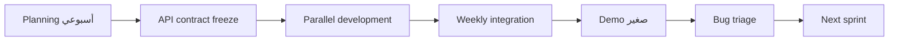

## قاعدة ذهبية

لا تنتظروا النهاية للربط بين:
- Frontend
- Backend
- Labs
- Content

كل أسبوعين على الأقل يجب أن يوجد demo حقيقي لحلقة جزئية.

---

# 24) Workflow اتخاذ القرار Decision Gates

هذه البوابات التي لا يجب تجاوزها دون قرار.

| البوابة | السؤال | القرار المطلوب |
|---|---|---|
| Gate 0 | هل النطاق محسوب على حلقة Injection فقط؟ | تجميد النطاق |
| Gate 1 | هل عدد الفريق محسوم 12 أم 13؟ | OI-013 |
| Gate 2 | هل سيناريو الحادث واضح؟ | اختيار SQL Injection scenario |
| Gate 3 | هل المعمل آمن؟ | Spike + isolation test |
| Gate 4 | هل التراخيص مغلقة؟ | D14 |
| Gate 5 | هل الموافقة الأخلاقية جاهزة؟ | D5 + OI-012 |
| Gate 6 | هل تعريف الإكمال موثق؟ | Progress spec |
| Gate 7 | هل Rubric الأدوار جاهز؟ | Assessment spec |
| Gate 8 | هل World Bible مالك له؟ | D6 + continuity |
| Gate 9 | هل الدفعات 2–5 أنتجت؟ | Requirements completeness |
| Gate 10 | هل التجربة الاستطلاعية نفذت؟ | Acceptance 19 |

---

# 25) Workflow مقترح لأسبوع عمل نموذجي

لو عايز تحول الكلام ده لتنفيذ فعلي.

## الأسبوع النموذجي

| اليوم | النشاط |
|---|---|
| الأحد | Planning + مراجعة Open Issues |
| الاثنين | تطوير موازي: Backend/Frontend/Labs/Content |
| الثلاثاء | Integration test صغير |
| الأربعاء | مراجعة محتوى + World Bible + QA |
| الخميس | Demo أسبوعي + bug triage |
| السبت/الجمعة حسب الجامعة | Documentation + decision log |

## مخرجات كل أسبوع

- تحديث Decision Log.
- تحديث Risk Register.
- تحديث حالة PUC/FR.
- demo واحد على الأقل.
- إغلاق أو تقدم في Open Issue واحد حرج.

---

# 26) النسخة المختصرة جدًا للـ Workflow الكامل

لو عايز تلخصه في جملة واحدة:

> المستخدم يدخل المنصة، يختار مسار التعلم أو اللابات، يشاهد مشهدًا قصصيًا ويقرأ شرحًا ويجتاز اختبارًا اختياريًا، ثم ينتقل إلى معمل معزول يختار فيه الصعوبة والدور، فينفذ مهمة Red Team أو Blue Team أو Developer حول نفس الحادث، ويتحقق النظام آليًا من نتيجته، ثم يمنحه نقاطًا وتقدمًا ويكتب يومية اختيارية، بينما يدير الفريق المحتوى والمعمل والإصدار والقياس البحثي وفق حلقة Injection واحدة متكاملة قبل أي توسع.

---

# 27) Checklist جاهزية الـ Workflow

قبل اعتبار الـ Workflow قابلًا للتنفيذ، تأكد من:

- [ ] النطاق مجمّد على حلقة Injection واحدة.
- [ ] سيناريو الحادث مكتوب ومراجع.
- [ ] World Bible له مالك واحد.
- [ ] أدوات كل دور محددة.
- [ ] معايير نجاح Red Team مكتوبة.
- [ ] معايير نجاح Blue Team تحتوي سلسلة استنتاج.
- [ ] معايير نجاح Developer تحتوي اختبارات آلية.
- [ ] نموذج اليومية جاهز.
- [ ] تعريف الإكمال موثق.
- [ ] نظام النقاط server-side.
- [ ] لوحة الصدارة opt-in.
- [ ] حذف الحساب مخطط له.
- [ ] المعمل معزول واختبر فعليًا.
- [ ] Background Worker للتنظيف جاهز.
- [ ] سجل التراخيص مغلق أو على الأقل غير مانع للنشر.
- [ ] الموافقة الأخلاقية وبروتوكول الدراسة جاهزان قبل جمع البيانات.
- [ ] الدفعات 2–5 أنتجت أو على الأقل PUC-007 إلى PUC-018 لها FRs.
- [ ] عقود API متفق عليها.
- [ ] بيئة تكامل مشتركة موجودة.
- [ ] Demo أسبوعي مقرر.

---

# 28) رأيي النهائي في الـ Workflow

المشروع عنده **Workflow فكري قوي جدًا**، لكن التنفيذ يحتاج تحويل هذا الكلام إلى:

1. **User Journey رسمية**  
2. **Lab Session Lifecycle**  
3. **Content Production Pipeline**  
4. **Assessment Validation Pipeline**  
5. **Research Data Pipeline**  
6. **Delivery/Integration Pipeline**

وأخطر نقطة ليست في القصة ولا في الواجهة، بل في:

> **هل المعمل المعزول يعمل بثقة؟ وهل التحقق الآلي عادل وقابل للقياس؟**

لو نجح هذان العنصران، بقية الـ Workflow يصبح قابلًا للتنظيم والتوسع.

---

لو تحب، الخطوة التالية أقدر أعملك واحد من ثلاثة:

1. **Workflow بصيغة BPMN/Flowchart جاهز للعرض على المشرف**
2. **User Story Map كاملة لكل PUC من 001 إلى 018**
3. **خطة Sprint أسبوعية مبنية على هذا الـ Workflow**